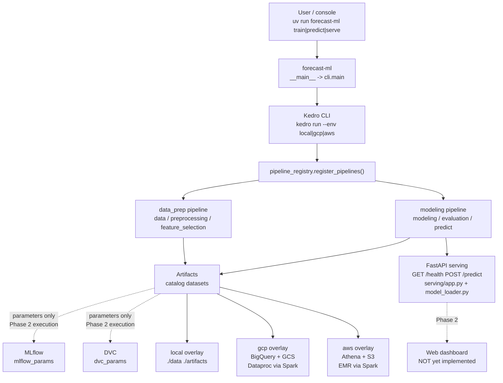
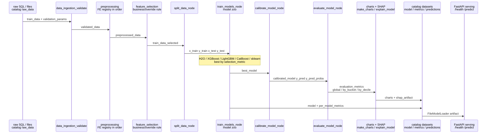
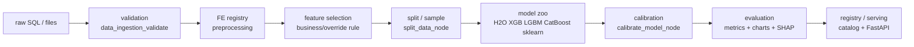
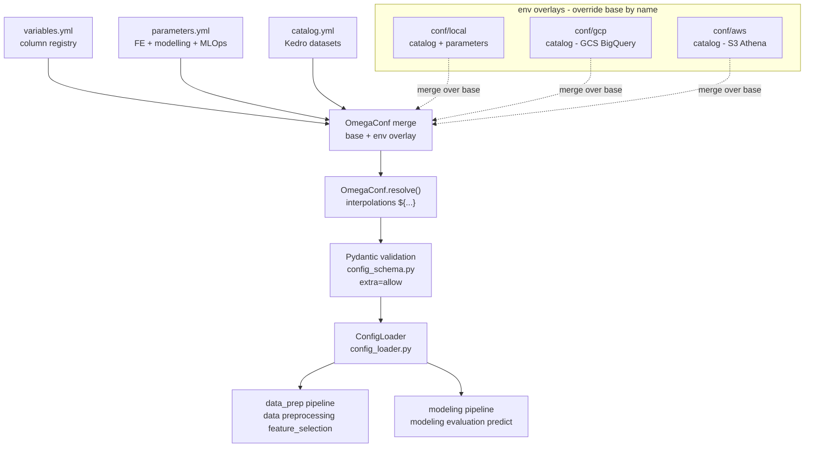
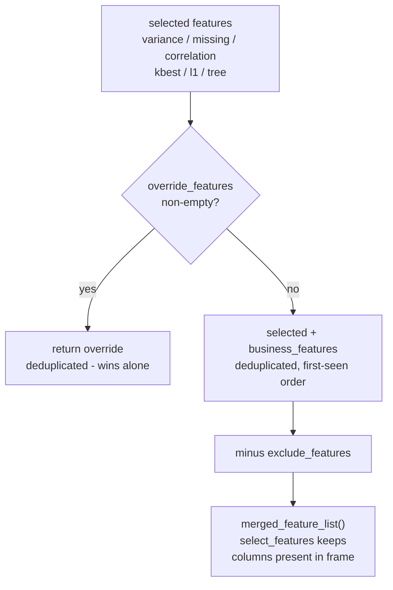
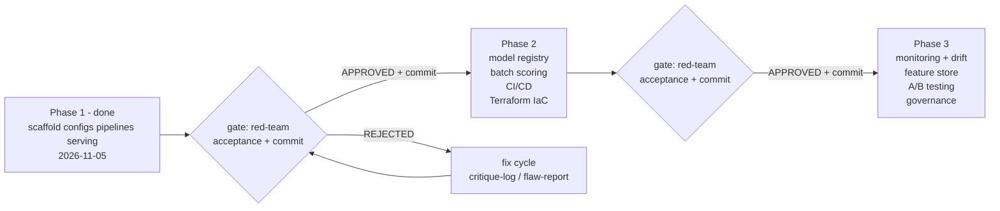

# Forecast ML Framework

Config-driven Kedro ML framework for forecasting and tabular prediction. One
repository runs the full lifecycle — ingest, validate, preprocess, select
features, train a model zoo, calibrate, evaluate, chart, explain with SHAP,
persist artifacts, and serve predictions over FastAPI — almost entirely from
three configuration files (`variables.yml`, `parameters.yml`, `catalog.yml`)
plus per-environment overlays. Changing a dataset, a model, or a loss
function is a config edit, not a code edit.

Phase 1 only. Model registry, IaC, and monitoring are Phase 2 extension
points and are **not yet implemented** (see [Phase 2 roadmap](#phase-2-roadmap-not-yet-implemented)).

> **Current-state note.** This README documents the code *as found on disk*.
> Parallel workers are still fixing `core/`, `config`, and loss-function code
> in this session. Sections affected are marked **IN-FLIGHT** where behaviour
> is expected to change; everything else is verified against the current
> code and config.

## Features

- **Config-driven in 3 files.** `conf/base/variables.yml` (column registry),
  `conf/base/parameters.yml` (modeling, FE, MLOps params), and
  `conf/base/catalog.yml` (Kedro Data Catalog). No code edits are needed to
  point the framework at a new dataset.
- **Kedro pipelines.** Two pipelines — `data_prep` and `modeling` — exposed
  through `pipeline_registry.register_pipelines()` under the display names
  `data`, `preprocessing`, `feature_selection`, `modeling`, `evaluation`,
  and `predict` (aliases of the two real modules).
- **Model zoo** (`pipelines/modeling/adapters.py`): H2O AutoML, XGBoost,
  LightGBM, CatBoost, scikit-learn, and any estimator named by a dotted
  `model_handle` (e.g. `xgboost.XGBClassifier`). Train several at once,
  pick the best by `selection_metric`.
- **Calibration.** Classification only: `sigmoid`, `isotonic`, `betacal`, or
  `none` (with `betacal.BetaCalibration` fallback to sigmoid when the
  `betacal` package is absent). Regression calibration is a no-op.
- **SHAP explainability.** `shap.Explainer` with permutation-importance
  fallback (`pipelines/modeling/shap_explain.py`); `method: auto` tries
  SHAP then falls back, `method: shap` raises if SHAP is unavailable.
- **Metrics and charts, global and per-bucket/per-decile.** Full metric
  catalogues for classification and regression (below), evaluated globally,
  by `bucket_segment_col`, and by prediction decile
  (`pipelines/modeling/evaluate.py`). Matplotlib charts for both task types
  (`pipelines/modeling/charts.py`).
- **Feature selection plus business/override rules.** Variance, missingness,
  correlation, SelectKBest, L1, and tree-importance filters, then a merge
  rule with `business_*`, `override_*`, and `exclude_*` lists
  (`core/config_loader.py:ConfigLoader.merged_feature_list`,
  `pipelines/data_prep/nodes.py:select_features`).
- **Configurable loss functions per model.** A top-level `loss_function`
  default with per-model overrides, mapped per adapter through a loss
  registry (aliases accepted, custom dotted callables supported);
  unknown losses raise `ValueError` listing valid losses
  (`pipelines/modeling/adapters.py:get_loss`,
  `LOSS_REGISTRY`, `LOSS_KWARGS`).
- **FastAPI serving.** `GET /health`, `POST /predict` with strict input
  validation and payload caps (`serving/app.py`). No auth or Docker in
  Phase 1.
- **MLflow / DVC hooks (parameters only).** `mlflow_params` and
  `dvc_params` sections exist in config and are validated by the schema;
  there is no tracking, registry, or DVC execution code in Phase 1.
- **Spark / BigQuery / GCS / S3 abstraction.** `SparkSessionFactory` with
  graceful local fallback (`core/spark_factory.py`), `SQLQueryDataSet` and
  `SparkSQLDataSet` Kedro datasets (`core/datasets.py`), and
  local/GCS/S3 artifact stores selected by `artifact_store_params.type`
  (`core/artifact_store.py:create_artifact_store`).
- **Pydantic + OmegaConf config validation.** `core/config_schema.py`
  validates every shipped section with `extra='allow'` (unknown keys pass
  through); `load_config()` merges env overlays and resolves `${...}`
  interpolations to plain dicts. `ConfigLoader` accepts plain dicts,
  OmegaConf objects, or pydantic models.

## Quick start

### Prerequisites

- Python **3.14** (`requires-python = '>=3.14'` in `pyproject.toml`).
  Python is not downgraded; libraries that fail on 3.14 move to the
  `extras-314-failures` optional group instead. The compatibility spike
  found all 17 libraries OK (see
  [Python 3.14 compatibility spike](#python-314-compatibility-spike)).
- [uv](https://docs.astral.sh/uv/) (package manager and runner).

### Install

```bash
cd forecast_ml_framework
uv sync
```

This creates `.venv/` inside `forecast_ml_framework/` (never commit it).

### Tests

Tests live in the top-level `tests/` directory (see the
[Testpaths note](#testpaths) in Known Issues for why the explicit path
below is required):

```bash
PYTHONPATH=src python -m pytest tests/ -q
```

Uv-run variants (same suite, inside the uv environment):

```bash
uv run python -m pytest tests/ -q
uv run pytest tests/ -q
```

Both forms were used to verify this README's commands. Expected result on
success: `pytest` exits 0 with all tests passing. Environment-dependent
tests (Spark, cloud SDKs) are mocked or skipped when the dependency or
service is absent; `httpx` is a dev-only dependency so the FastAPI
`TestClient` works without polluting production dependencies.

### Run the pipelines

```bash
uv run kedro run --env local
```

`--env local` selects the `conf/local/` overlay (local paths, local
artifact store, local MLflow tracking URI, DVC disabled). `--env gcp` and
`--env aws` select the GCS/BigQuery and S3/Athena overlays. Run a single
pipeline family with `--pipeline <name>` (names: `data`, `preprocessing`,
`feature_selection`, `modeling`, `evaluation`, `predict`).

### Console usage

The console script is `forecast-ml` (declared in `pyproject.toml`,
entry point `forecast_ml_framework.__main__:main`, which delegates to
`forecast_ml_framework.cli:main`):

```bash
uv run forecast-ml --help
uv run forecast-ml train --help
uv run forecast-ml predict --help
uv run forecast-ml serve --help
uv run forecast-ml run --help
```

Subcommands: `train`, `predict`, `serve`, `run`, each accepting
`--env` (default `local`), `--artifact`, `--host` (default `127.0.0.1`),
and `--port` (default `8000`). Each delegates to
`kedro run --pipeline <command> --env <env>` when `kedro` is on `PATH`,
otherwise it prints the planned command.

### Synthetic demo walkthrough

`pipelines/data_prep/nodes.py:synthetic_data()` generates a reproducible
demo frame (`n=100`, `seed=42`, `task='classification'` by default) with
columns `id`, `f1`–`f4` (numeric), `cat` (categorical `a`/`b`/`c`), `seq`
(list of floats), and `target` (binary). Walk the nodes in Python:

```python
import numpy as np  # noqa: F401 - available via the framework anyway

from forecast_ml_framework.pipelines.data_prep.nodes import (
    preprocess,
    select_features,
    synthetic_data,
    validate_data,
)

df = synthetic_data(n=100, task='classification', seed=42)
variables = {
    'target_col': 'target',
    'feature_cols': ['f1', 'f2', 'f3', 'f4'],
    'num_cols': ['f1', 'f2', 'f3', 'f4'],
    'cat_cols': ['cat'],
    'seq_cols': ['seq'],
}
params = {
    'validation_params': {'fail_fast': False, 'max_null_ratio': 0.5},
    'data_prep_params': [
        {'Imputations': {'skip': False, 'args': {
            'strategy': 'median',
            'cols': {'include_cols': ['f1', 'f2', 'f3', 'f4']}}}},
    ],
    'feature_selection_params': {'missing_threshold': 0.5},
}
df, report = validate_data(df, params, variables)
df = preprocess(df, params['data_prep_params'], variables)
df, selected, report = select_features(df, params, variables)
print(selected)  # merged feature list after business/override rules
```

For `task='regression'`, `target` becomes `2*f1 + 0.5*f2 + noise` and the
modeling pipeline consumes it as `modeling_reg_params`.

## Architecture

> **Diagrams.** All diagrams in this README are Mermaid fenced
> blocks and render natively on GitHub. Node names
> match `pipeline_registry.py` and the `name=` values in
> `pipelines/*/pipeline.py`; dashed boxes mark Phase 2 plans that are
> not yet implemented.

### System architecture



### Folder structure

```text
forecast_ml_framework/
├── pyproject.toml              # deps, console script, pytest/ruff config
├── README.md                   # this file
├── uv.lock                     # resolved dependency lockfile
├── conf/                       # Kedro config (base + env overlays)
│   ├── base/
│   │   ├── variables.yml       # column registry (target, id/cat/num/date/seq/ind/drop)
│   │   ├── parameters.yml      # all modelling / FE / MLOps parameters
│   │   └── catalog.yml         # Kedro Data Catalog entries
│   ├── local/                  # local overlay: catalog + parameters
│   ├── gcp/                    # GCS + BigQuery overlay: catalog
│   └── aws/                    # S3 + Athena overlay: catalog
├── src/forecast_ml_framework/  # importable package (PYTHONPATH=src)
│   ├── __init__.py             # __version__ = '0.1.0'
│   ├── __main__.py             # forecast-ml console entry point
│   ├── cli.py                  # train|predict|serve|run argparse CLI
│   ├── settings.py             # Kedro settings: CONF_SOURCE, HOOKS=()
│   ├── pipeline_registry.py    # register_pipelines(), lazy imports
│   ├── core/
│   │   ├── artifact_store.py   # local/GCS/S3 stores, restricted unpickler
│   │   ├── config_loader.py    # ConfigLoader: lookup, task_type, feature merge
│   │   ├── config_schema.py    # Pydantic models + OmegaConf load_config()
│   │   ├── datasets.py         # SQLQueryDataSet, SparkSQLDataSet
│   │   └── spark_factory.py    # SparkSessionFactory, to_pandas()
│   ├── pipelines/
│   │   ├── data_prep/          # pipeline.py, nodes.py
│   │   └── modeling/           # pipeline.py, adapters.py, calibration.py,
│   │                           # data_split.py, evaluate.py, metrics.py,
│   │                           # charts.py, shap_explain.py
│   └── serving/                # app.py (FastAPI), model_loader.py
├── tests/                      # pytest suite (16 test files)
└── .venv/                      # created by `uv sync`, never commit
```

### Pipeline list and nodes

| Display name | Real module | Nodes (in order) |
|---|---|---|
| `data`, `preprocessing`, `feature_selection` | `pipelines/data_prep/pipeline.py` | `data_ingestion_validate` → `preprocessing` → `feature_selection` |
| `modeling`, `evaluation`, `predict` | `pipelines/modeling/pipeline.py` | `split_data_node` → `train_models_node` → `calibrate_model_node` → `predict_node` → `predict_proba_node` → `evaluate_model_node` → `make_charts_node` → `explain_model_node` |

`pipeline_registry.register_pipelines()` maps each display name to one
cached pipeline object (aliases for the same module share one object) and
imports lazily, so an unavailable pipeline module is skipped instead of
breaking the registry.

### How data flows

```text
raw_data (catalog)
  │  pipelines/data_prep
  ▼
validated_data ── preprocess (FE registry, in order) ──► preprocessed_data
  │                                                     │
  │                                                     ▼
  │                                              select_features
  │                                                     │
  │                                                     ▼
  └────────────────────────────►  train_data_selected ─┘
                                                        │
                                                        ▼  modeling pipeline
  modeling_input ── split_data ──► x_train / x_test / y_train / y_test
                                        │
                                        ▼ train_models (zoo, best by selection_metric)
                                   best_model ── calibrate_model ──► calibrated_model
                                        │                              │
                                        │                              ▼
                                        │                        y_pred / y_pred_proba
                                        │                              │
                                        ▼                              ▼
                                   per_model_metrics           evaluate_model ──► evaluation_metrics
                                                                  (global / by_bucket / by_decile)
                                        │                              │
                                        ▼                              ▼
                                   explanations              make_charts ──► charts
                                   (SHAP/permutation)        explain_model ──► shap_artifact
```

In practice the catalog wires `train_data` into the data-prep pipeline
and the modeling pipeline starts from `modeling_input`; `model`,
`calibration_model`, and per-adapter model datasets persist the fitted
models, `metrics`/`metrics_csv` persist evaluation output, `predictions`
persists predictions, and `shap_values`/`shap_summary` persist the
explanation artifacts.

### Data flow (Mermaid)





## Configuration guide

Kedro loads `conf/base/` and merges the selected env overlay
(`conf/local/`, `conf/gcp/`, `conf/aws/`) over it — overlay entries
override base entries of the same name, everything else is inherited.
`settings.py` sets `CONF_SOURCE = 'conf'` and `HOOKS = ()` (empty in
Phase 1; the seam for future MLflow/DVC hooks).

Two loading paths exist:

- **Kedro runtime** — Kedro's `OmegaConfigLoader` reads the same files.
- **Programmatic** — `core/config_schema.py:load_config(env_dir)` merges
  base + overlay with OmegaConf, resolves interpolations, and returns
  `{'variables', 'parameters', 'catalog'}` as plain dicts.
  `validate_variables()` / `validate_parameters()` validate the result
  against the pydantic models.

### Config flow (Mermaid)



### `variables.yml` — the column registry

Delivered schema (synthetic demo: one row per customer snapshot,
classification by default):

```yaml
target_col: 'target'            # target column name
id_cols: ['id']                 # identifiers: never features
cat_cols: ['region', 'plan_type', 'channel']   # categorical → encoded
num_cols: ['age', 'income', 'tenure_days', 'purchase_count']  # numeric
date_cols: ['signup_date', 'last_purchase_date']               # dates
seq_cols: ['monthly_spend_seq'] # sequences → Sequence* FE steps
ind_cols: ['is_premium', 'has_support_ticket']                 # 0/1 indicators
drop_cols: ['email_hash']       # dropped before modelling (leakage/PII)
bucket_segment_col: ${.cat_cols[0]}   # segment for per-segment metrics
business_relevant_features: []  # always kept through selection
override_features: []           # forced in even if selection drops them
exclude_features: []            # always excluded
```

For a regression target, swap `target_col` to a continuous column and
point `data_params.train_data` at `raw_data_regression` (commented
example at the bottom of the file). `bucket_segment_col` uses an
OmegaConf interpolation (`${.cat_cols[0]}`).

Validation model: `VariablesConfig` (`core/config_schema.py`).

### `parameters.yml` — every section

Base defaults below. `conf/local/parameters.yml` overrides only
`artifact_store_params`, `mlflow_params`, `dvc_params`, and
`spark_params` (local paths, local MLflow URI, DVC off, `local[*]`
master). `conf/gcp/` and `conf/aws/` ship `catalog.yml` only, so all their
parameters come from base.

#### Runtime params (catalog interpolations)

Flat keys referenced by `catalog.yml` as `${params:<key>}` (Kedro params
namespace), mostly interpolations of `global_params`:

```yaml
score_model_id: ${.global_params.score_model_id}
output_gcs_location: 'artifacts'
model_id_prefix: 'demo_model_v1'
suffix: 'v1'
run_date: ${.global_params.run_date}
train_run_dt: ${.global_params.run_date}
score_run_dt: ${.global_params.run_date}
# data_project, db_staging_data, etl_project, etl_dataset, etl_table,
# external_project, tmp_bucket, brand: '' ; is_domino: false
```

#### Global / run

```yaml
global_params:
  is_regression: false          # true → regression defaults
  is_domino: false
  score_model_id: 'demo_model_v1'
  run_date: '2026-11-05'
  model_type: 'sklearn'
  random_state: 42
  target_col: ${variables.target_col}   # interpolation into variables.yml
  key_cols_list: ['id']
```

#### Data sources

```yaml
data_params:
  train_data: 'raw_data'        # catalog dataset name (catalog.yml)
  test_data: 'raw_data'
```

#### Sampling (classification and regression)

```yaml
sampling_params:                # contract: {method, test_size, stratify_col}
  method: 'stratified'          # 'stratified' | 'random'
  test_size: 0.2
  stratify_col: ${..global_params.target_col}
sampling_reg_params:            # same shape, method 'random'
  method: 'random'
  test_size: 0.2
  stratify_col: ${..global_params.target_col}
```

#### Spark → pandas conversion

```yaml
pandas_conversion_params:
  convert_to_pandas: true       # false + Spark input → TypeError
  category_cols: []
```

#### Evaluation

```yaml
evaluation_params:
  multiclass_flag: false
  prediction_col: 'xgboost_pred'
  prediction_probability_col: 'score_value'
  metrics:
    classification: ['roc_auc', 'average_precision', 'f1']
    regression: ['rmse', 'mae', 'r2']
```

#### Train/test split

```yaml
train_test_split_params:        # {training_split_ratio, test_split_ratio, ...}
  training_split_ratio: 0.8
  test_split_ratio: 0.2
  stratify_col: ${..global_params.target_col}
  shuffle: true
  random_state: 42
```

#### Data preparation: the ordered FE registry

`data_prep_params` is a list of steps that run **in list order**. Each
step is `{StepName: {skip: false, args: {...}}}`; `skip: true` disables
it. Steps with a single importable class carry `args.handle` (a dotted
importable string resolved via `resolve_handle()`); steps with no single
importable class are implemented directly in `data_prep/nodes.py`
(`CapOutliers`, `HighLabelBinning`, `FixedLength`, `Slope`,
`Similarity`, `Sequence*` — see the `# Note:` comments in the file).
`args.cols` uses `{exclude_cols, include_cols}`; an empty `include_cols`
means "no-op / all, per implementation".

Shipped steps (enabled in base): `Imputations` (numeric, median,
`sklearn.impute.SimpleImputer`), `Imputations` (categorical, mode),
`CategoricalEncoding` (label via `pyspark.ml.feature.StringIndexer`,
one-hot via `pyspark.ml.feature.OneHotEncoder`, `ohe_flag: true`).
Disabled in base: `CapOutliers`, `QuantileDiscretizer`,
`Normalizations`, `HighLabelBinning`, `TargetEncoding` (skipped
`sklearn.preprocessing.TargetEncoder`), `FixedLength`, `Slope`,
`Similarity`, `SequenceAverage`, `SequenceMin`, `SequenceMax`,
`SequenceLast`, `SequenceDelta`, `SequenceNormalize`.

```yaml
# Enabled example (numeric imputation):
- Imputations:
    skip: false
    args:
      handle: 'sklearn.impute.SimpleImputer'
      strategy: 'median'
      custom_bounds: {}
      cols:
        exclude_cols: []
        include_cols: ['age', 'income', 'tenure_days', 'purchase_count']
# Disabled example:
- CapOutliers:
    skip: true
    args:
      method: 'bound'
      bound: {lower: 0.01, upper: 0.99}
      cols: {exclude_cols: [], include_cols: []}
```

Unknown step names do not crash: `preprocess()` logs a warning and
records them in the report (`unknown_steps`).

#### Feature selection

```yaml
feature_selection_params:       # code contract in data_prep.nodes.select_features
  enabled: true
  random_state: 42
  is_regression: false
  variance_threshold: 0.0       # drop numeric cols with var <= threshold
  missing_threshold: 0.5        # drop numeric cols with null ratio > threshold
  correlation: {enabled: false, threshold: 0.95}
  kbest: {enabled: false, k: 20, score_func: 'f_classif'}
  l1: {enabled: false, alpha: 0.01, C: 1.0}
  tree: {enabled: false, n_estimators: 200, threshold: 0.01}
  business_features: []         # aliases honoured: business_relevant_features,
  override_features: []         #   feature_override, features_override, ...
  exclude_features: []
  output: 'selected_features'
```

The merge rule is documented
[below](#feature-selection--businessoverride-rule). `kbest.score_func`
accepts `f_classif`, `f_regression`, `mutual_info_classif`,
`mutual_info_regression`.

#### Models to use

```yaml
models_to_use:
  - 'h2o_automl'
  - 'xgboost'
  - 'lightgbm'
  - 'catboost'
  - 'sklearn'
```

(Mirrored inside `modeling_params.models_to_use` /
`modeling_reg_params.models_to_use`.) Up to `MAX_MODELS = 10` distinct
models are fitted per `train_models` call; a missing optional library
(xgboost, lightgbm, catboost, h2o) raises an error naming the package
and telling you to remove the entry from `models_to_use`.

#### H2O AutoML

```yaml
h2o_automl_params:              # also mirrored as modeling_params.model_params.h2o_automl
  max_models: 10
  max_runtime_secs: 600
  seed: 42
  nfolds: 5
  sort_by: 'AUC'
  include_algos: ['GBM', 'XGBoost', 'DeepLearning', 'GLM', 'RandomForest']
  exclude_algos: []
  stopping_rounds: 5
  verbosity: 'info'
```

#### Modelling (classification and regression)

`modeling_params` (classification) and `modeling_reg_params`
(regression) share one shape:

```yaml
modeling_params:
  task_type: 'classification'   # 'classification' | 'regression'
  target_col: 'target'
  feature_cols: null            # null = every non-target column
  models_to_use: ['h2o_automl', 'xgboost', 'lightgbm', 'catboost', 'sklearn']
  selection_metric: 'f1_weighted'  # regression: 'rmse'
  random_state: 42
  test_size: 0.2
  sampling_params: {method: 'stratified', test_size: 0.2, stratify_col: 'target'}
  calibration: {method: 'betacal', cv: 5}   # sigmoid|isotonic|betacal|none
  model_handle: 'xgboost.XGBClassifier'     # dotted importable, or adapter name
  calibration_handle: 'sklearn.calibration.CalibratedClassifierCV'
  tuning_handle: 'sklearn.model_selection.GridSearchCV'
  loss_function: 'Logloss'                  # top-level default (see below)
  model_params:                             # per-adapter hyperparameters
    xgboost:
      model_handle: 'xgboost.XGBClassifier'
      n_estimators: 300
      max_depth: 5
      learning_rate: 0.05
      objective: 'binary:logistic'
      loss_function: 'binary:logistic'
      tree_method: 'hist'
      random_state: 42
    # lightgbm, catboost, sklearn, h2o_automl — same pattern
  bucket_segment_col: 'region'
  shap_params: {method: 'shap', n_repeats: 5, sample_rows: 100, random_state: 42}
```

The regression twin uses `task_type: 'regression'`,
`modeling_reg_params`, `XGBRegressor`/`LGBMRegressor`/`CatBoostRegressor`
/`RandomForestRegressor` handles, `selection_metric: 'rmse'`,
`calibration: {method: 'none'}`, `loss_function: 'RMSE'`, and
`sort_by: 'RMSE'` for H2O.

##### Loss functions per model

`loss_function` is a plain string naming a built-in loss **or** a dotted
importable string for a custom callable (e.g.
`'my_losses.my_weighted_logloss'`), resolved by `LOSS_REGISTRY` via
`get_loss()`. The top-level `loss_function` is the default for every
model; `model_params.<model>.loss_function` overrides it. XGBoost and
LightGBM also ship a native `objective` key; an explicit
`loss_function` overrides `objective`/`loss`, a recognised `objective`
is normalised, and an unrecognised native objective passes through
unchanged. No `loss_function` means estimator defaults are unchanged.
Unknown losses raise `ValueError` listing the valid losses for the
adapter.

Valid built-in examples per adapter:

| Adapter | Native kwarg | Examples |
|---|---|---|
| `xgboost` | `objective` | `binary:logistic`, `binary:logitraw`, `reg:squarederror`, `reg:absoluteerror`, `count:poisson` |
| `lightgbm` | `objective` | `binary`, `multiclass`, `regression`, `regression_l1`, `huber` |
| `catboost` | `loss_function` | `Logloss`, `CrossEntropy`, `RMSE`, `MAE`, `Poisson` |
| `sklearn` | `loss` | `log_loss`, `squared_error`, `absolute_error`, `huber` |
| `h2o_automl` | `loss_function` | `cross_entropy`, `binomial_exp_deviance`, `mse`, `mae`, `huber` |

Aliases are accepted case-insensitively (`logloss`, `squared_error`/`mse`/`rmse`,
`mae`, `poisson`, …) and native values map to themselves. The full
registry is `LOSS_REGISTRY` in `pipelines/modeling/adapters.py`.

```yaml
# Change the optimisation objective for one model only:
modeling_params.model_params.xgboost.loss_function: 'binary:logitraw'
# Or install a custom loss (callable must be importable):
modeling_params.model_params.sklearn.loss_function: 'my_pkg.losses.my_custom_loss'
```

#### Per-model params (multi-model fallback)

```yaml
model_params_by_name:           # used when models_to_use has >1 entry
  xgboost: {model_handle: 'xgboost.XGBClassifier', n_estimators: 300, ...}
  lightgbm: {model_handle: 'lightgbm.LGBMClassifier', ...}
  catboost: {model_handle: 'catboost.CatBoostClassifier', ...}
  sklearn: {model_handle: 'sklearn.ensemble.RandomForestClassifier', ...}
```

#### Calibration

```yaml
calibration_params:             # standalone equivalent of modeling_params.calibration
  enabled: true
  method: 'betacal'             # 'sigmoid' | 'isotonic' | 'betacal' | 'none'
  cv: 5
  handle: 'betacal.BetaCalibration'
  params: {parameters: 'abm'}
```

#### Cross-validation

```yaml
cv_params:
  n_splits: 5
  shuffle: true
  random_state: 42
  scoring: 'roc_auc'
  strategy: 'stratified_kfold'
```

#### Spark

```yaml
spark_params:
  master: 'local[*]'
  app_name: 'forecast-ml-framework'
  spark:
    spark.sql.shuffle.partitions: 200
    spark.driver.memory: '4g'
  jar_packages: []
```

Spark is **opt-in**: `SparkSessionFactory.get_spark()` returns `None`
unless the config explicitly enables it (`enabled: true` / truthy
`spark_enabled` / `use_spark`, or a non-empty Spark section carrying
keys), and returns `None` gracefully when `pyspark` is missing, so
local pandas execution is never broken by missing Spark.

#### Artifact store

```yaml
artifact_store_params:
  type: 'local'                 # 'local' | 'gcs' | 's3' (overridden per env)
  base_path: 'artifacts'
  bucket: ''                    # gcp: gs://forecast-ml-artifacts | aws: s3://forecast-ml-artifacts
  versioning: true
```

#### MLflow

```yaml
mlflow_params:
  tracking_uri: 'mlruns'
  experiment_name: 'forecast-ml-framework'
  registry_uri: ''              # Phase 2 (registry loading is a stub)
  log_params: true
  log_metrics: true
  log_artifacts: true
```

#### DVC

```yaml
dvc_params:
  enabled: true
  remote: 'local'
  remote_url: ''
  push_on_run: false
```

#### SHAP

```yaml
shap_params:                    # standalone (pipeline-level: modeling_params.shap_params)
  enabled: true
  explainer: 'TreeExplainer'
  background_size: 100
  top_k: 20
  output_dir: 'artifacts/shap'
```

#### Charts

```yaml
chart_params:
  enabled: true
  output_dir: 'artifacts/charts'
  figure_size: [10, 6]
  dpi: 150
  charts: ['confusion_matrix', 'roc_curve', 'feature_importance', 'calibration_curve']
```

#### Validation

```yaml
validation_params:              # contract in data_prep.nodes.validate_data
  fail_fast: false              # true → missing required cols raise ValueError
  required_cols: []
  max_null_ratio: 0.5
```

### `catalog.yml` — Kedro Data Catalog

Base entries (env overlays re-declare the same names with env-specific
filepaths; Kedro merges by dataset name):

| Dataset | Type | Notes |
|---|---|---|
| `raw_data` | `pandas.CSVDataset` | Raw CSV input |
| `raw_data_parquet` | `pandas.ParquetDataset` | Large-file alternative (same key name) |
| `raw_data_regression` | `pandas.CSVDataset` | Regression raw CSV |
| `processed_data`, `train_data`, `test_data` | `pandas.ParquetDataset` | Split/processed data |
| `selected_features` | `MemoryDataset` | Persisted copy as `JSONDataset` (commented) |
| `model`, `calibration_model`, `h2o_automl_model`, `xgboost_model`, `lightgbm_model`, `catboost_model`, `sklearn_model` | `PickleDataset` | Fitted models (`artifacts/models/*.pkl`) |
| `model_memory`, `calibration_model_memory` | `MemoryDataset` | In-memory pipeline wiring |
| `metrics` | `JSONDataset` | Evaluation metrics (`artifacts/metrics/metrics.json`) |
| `metrics_csv` | `pandas.CSVDataset` | Metrics CSV |
| `predictions` | `pandas.ParquetDataset` | Predictions (`artifacts/predictions/`) |
| `predictions_csv` | `pandas.CSVDataset` | Predictions CSV |
| `shap_values` | `pandas.ParquetDataset` | SHAP values (`artifacts/shap/`) |
| `shap_summary` | `JSONDataset` | SHAP summary |
| `charts` | `MemoryDataset` | Persisted chart files use `XLSXDataset`/`ImageDataset` per impl |

SQL placeholders are commented in the file (`sql.SQLTableDataset` for
BigQuery/Athena). **No credentials in this file** — SQL/cloud credentials
come from the environment (`GOOGLE_APPLICATION_CREDENTIALS`, `AWS_PROFILE`,
etc.). Two extra datasets ship in code
(`core/datasets.py`): `SQLQueryDataSet` (read-only SQL → pandas) and
`SparkSQLDataSet` (Spark SQL stub for BigQuery/Athena via Spark JDBC).

#### The `anchors` / `*_params` pattern

Catalog entries delegate their arguments to parameter sections so env
overlays can re-target storage without touching base:

```yaml
# pattern used across the catalog:
train_data:
  type: 'pandas.ParquetDataset'
  filepath: 'data/processed/train_data.parquet'   # overridden per env
```

`params:<section>` inputs in the pipelines resolve to nested sections of
`parameters.yml` (e.g. `params:data_prep_params`,
`params:modeling_params.task_type`), and flat runtime keys are referenced
as `${params:<key>}` from the catalog. Define a new section in
`parameters.yml`, reference it as `params:<your_section>`, and add its
pydantic model to `core/config_schema.py` (with `extra='allow'`, unknown
keys pass through, so shipped conf always validates).

### Env overlays: `local` / `gcp` / `aws`

| Env | Ships | Overrides |
|---|---|---|
| `local` | `catalog.yml`, `parameters.yml` | Local `./data`, `./artifacts` filepaths; `artifact_store_params.type: local`, local MLflow tracking URI, DVC off, `local[*]` Spark |
| `gcp` | `catalog.yml` | `gs://forecast-ml-artifacts/...` filepaths (GCS + BigQuery); credentials via `GOOGLE_APPLICATION_CREDENTIALS` |
| `aws` | `catalog.yml` | `s3://forecast-ml-artifacts/...` filepaths (S3 + Athena); credentials via `AWS_PROFILE` / AWS env vars |

Only filepaths/URIs (and, for `local`, the minimal parameter overrides)
are overridden; everything else is inherited from `base/`.

### OmegaConf interpolations

- `target_col: ${variables.target_col}` (in `global_params`) pulls the
  target name from `variables.yml`.
- `stratify_col: ${..global_params.target_col}` (relative reference)
  re-uses the global target as the stratification column.
- `score_model_id: ${.global_params.score_model_id}`,
  `run_date: ${.global_params.run_date}` (and `train_run_dt` /
  `score_run_dt`) fan the global values out to flat runtime keys.
- `bucket_segment_col: ${.cat_cols[0]}` (in `variables.yml`) defaults
  the bucket segment to the first categorical column.

`load_config()` calls `OmegaConf.resolve()` before returning, so all
interpolations arrive resolved. Kedro's `OmegaConfigLoader` resolves the
same syntax at runtime.

### Pydantic validation

`core/config_schema.py` defines one model per section
(`VariablesConfig`, `GlobalParams`, `DataParams`, `SamplingParams`,
`PandasConversionParams`, `EvaluationParams`, `TrainTestSplitParams`,
`FeatureSelectionParams`, `ModelingParams`, `ModelingRegParams`,
`CalibrationParams`, `CvParams`, `SparkParams`, `ArtifactStoreParams`,
`MlflowParams`, `DvcParams`, `ShapParams`, `ChartParams`,
`ValidationParams`, and the top-level `ParametersConfig`), all with
`extra='allow'` so unknown sections/keys pass through and shipped conf
always validates. `ConfigLoader` (core/config_loader.py) normalises
dict / OmegaConf / pydantic inputs to plain dicts on construction.

### How to add a dataset / model / loss

**Add a dataset (config only).** Add an entry to
`conf/base/catalog.yml`, point `data_params.train_data`/`test_data` at
it, and list its columns in `conf/base/variables.yml`. For SQL: add a
`SQLQueryDataSet` entry with a `connection` (URL/engine/config dict) and
a single-statement `query`; credentials stay in the environment. For
Spark SQL: `SparkSQLDataSet` with a live session or JDBC config.

**Add a model (config only).** Add the name to `models_to_use` (and
`modeling_params.models_to_use`), then add
`model_params.<name>` with `model_handle` (dotted importable) plus
hyperparameters. A dotted name in `models_to_use` itself also works —
it becomes a `HandleAdapter`. Loss: set
`model_params.<name>.loss_function` (plain name, alias, or dotted
callable).

**Add a loss function.** Either use an existing alias/native value from
`LOSS_REGISTRY` (see the [loss table](#loss-functions-per-model)), or
write a callable, make it importable (e.g. `my_pkg.losses.my_loss`),
and reference it as a dotted `loss_function` string. To extend the
built-in map, add entries to `LOSS_REGISTRY[adapter]` in
`pipelines/modeling/adapters.py`.

## Feature selection + business/override rule

`ConfigLoader.merged_feature_list(selected)` implements one rule, in
three steps:

1. **Override wins alone.** A non-empty `override_features` (aliases:
   `feature_override`, `features_override`, `feature_list_override`) is
   returned deduplicated, ignoring everything else. A string override is
   one feature name, not a sequence of characters. Override length is
   capped at 10,000 entries (`ValueError` beyond that, or when the
   override is not a list/tuple).
2. **Otherwise merge business features.** The result is
   `selected + business_features` deduplicated in first-seen order
   (aliases: `business_feature_list`, `business_cols`,
   `business_columns`, `additional_features`; `variables.yml`'s
   `business_relevant_features` is translated to `business_features` by
   `select_features()` because core only knows `business_features`).
3. **Subtract exclusions.** `exclude_features` (aliases:
   `excluded_features`, `exclude`, `exclude_columns`,
   `dropped_features`) are removed last.

Existence of named columns is the caller's responsibility: non-existent
names pass through the merge unchanged; `select_features()` records them
as warnings (`'selected feature not in data: ...'`) and filters the final
list to columns actually present in the frame.

### Feature-selection decision (Mermaid)



```yaml
# variables.yml — business features always kept:
business_relevant_features: ['tenure_days']
override_features: []           # non-empty → wins alone (see caveat)
exclude_features: []            # always excluded
# feature_selection_params.business_features etc. — same meaning
```

> **Caveat (IN-FLIGHT).** `override_features` winning *alone* (dropping
> business features and selected features) is the current documented
> behaviour of `merged_feature_list`. If the parallel `core/` worker
> changes the rule to union-with-override, this section must be updated
> in the same change.

## Metrics + charts catalog

`pipelines/modeling/metrics.py:compute_metrics(y_true, y_pred, y_proba,
task_type)` computes the full catalog; `evaluate.py:evaluate_model()`
returns `{'global': ..., 'by_bucket': ..., 'by_decile': ...}` where
`by_bucket` groups by `bucket_segment_col` and `by_decile` groups by
prediction decile. Metrics never crash the pipeline: individual
failures become `nan`. `LOWER_BETTER` is used to infer
`selection_metric_higher_better` when picking the best model.

### Classification

`accuracy`, `balanced_accuracy`, `precision_{macro,micro,weighted}`,
`recall_{macro,micro,weighted}`, `f1_{macro,micro,weighted}`,
`per_class_f1` (list), `roc_auc`, `pr_auc`, `log_loss`, `brier`,
`kappa`, `mcc`, `sensitivity`, `specificity`, `ks`,
`confusion_matrix` (nested list), `ece`. `y_proba` is required
(`ValueError` if `None`).

### Regression

`mae`, `medae`, `rmse`, `rmsle`, `mse`, `r2`, `adj_r2`, `mape`, `smape`,
`explained_variance`, `max_error`, `bias`.

### Charts

`pipelines/modeling/charts.py:make_charts()` returns
`{name: matplotlib Figure}`; charts whose data are insufficient are
skipped gracefully. **Every figure is closed before returning** — save
images inside the call; callers receive closed figures. Charts are
built with the `Agg` backend.

| Task | Charts |
|---|---|
| Classification | `roc`, `pr`, `calibration_curve`, `threshold_curve`, `lift_gain`, `ks_plot`, `prob_distribution`, `cost_curve` (stub), `confusion_heatmap`, `per_class_bars` |
| Regression | `pred_vs_actual`, `residuals_vs_fitted`, `residuals_vs_actual`, `residual_hist_qq` (hist + QQ), `scale_location`, `error_vs_actual`, `error_by_bucket`, `segment_curves`, `feature_vs_residual` |

## Serving API

`serving/app.py:create_app(model_loader)` builds the FastAPI app
(`title='forecast-ml serving'`). `model_loader` is a callable returning
a model or the model itself; wire it to
`serving/model_loader.py:FileModelLoader(artifact_path)` for file-based
loading, or inject a stub in tests. `RegistryModelLoader` (MLflow
registry) is a Phase 2 stub — `load()` raises `NotImplementedError`.

### `GET /health`

```bash
curl http://127.0.0.1:8000/health
# → {"status": "ok"}
```

### `POST /predict`

Request schema: `{"features": {name: number, ...}}` (single record) or
`{"records": [{...}, {...}]}` (batch). At least one must be present.
Validation is strict: every feature must be a finite number (booleans,
nested values, non-finite floats, missing features → HTTP 422 naming
the offending field); payload caps (`MAX_RECORDS = 10000`,
`MAX_FEATURE_KEYS = 1000`) → HTTP 413; model load failures → HTTP 500
without leaking the server filesystem path.

```bash
# Single record
curl -X POST http://127.0.0.1:8000/predict \
  -H 'Content-Type: application/json' \
  -d '{"features": {"f1": 0.1, "f2": 0.2, "f3": 0.3, "f4": 0.4}}'

# Batch
curl -X POST http://127.0.0.1:8000/predict \
  -H 'Content-Type: application/json' \
  -d '{"records": [{"f1": 0.1, "f2": 0.2, "f3": 0.3, "f4": 0.4},
                     {"f1": 0.5, "f2": 0.6, "f3": 0.7, "f4": 0.8}]}'
# → {"predictions": [0, 1]}
```

```python
import httpx

r = httpx.post(
    'http://127.0.0.1:8000/predict',
    json={'features': {'f1': 0.1, 'f2': 0.2, 'f3': 0.3, 'f4': 0.4}},
)
print(r.json())  # {'predictions': [...]}
```

> **IN-FLIGHT.** The `forecast-ml serve` CLI subcommand delegates to
> `kedro run --pipeline serve --env local`; serving the FastAPI app
> itself (e.g. via `uvicorn`) is not yet wired to the artifact path
> end-to-end. `create_app(FileModelLoader(path))` + uvicorn is the
> working programmatic path.

## Known Issues & Fixes

Each issue: symptom → cause → fix/workaround **now** in the code.
Status column: **Fixed** = verified in current code; **Workaround** =
live with it as documented; **IN-FLIGHT** = parallel workers may change
it.

| # | Issue | Status | Symptom / cause | Fix / workaround now |
|---|---|---|---|---|
| 1 | Pickle deserialization trust boundary | **Fixed** | `pickle.load` on an artifact executes `__reduce__` code | Restricted unpickler `restricted_loads()` / `_RestrictedUnpickler` (`core/artifact_store.py`) allowlists only sklearn/numpy/pandas + safe builtin types; anything else raises `ValueError`. `FileModelLoader` (`serving/model_loader.py`) uses it. Artifacts are trusted only when produced by this framework; the unpickler is defence in depth |
| 2 | Path traversal jail | **Fixed** | A key like `../../etc/passwd` escapes the store root | `LocalArtifactStore._full_path()` resolves and jail-checks every path against the base; cloud keys validated by `_validate_cloud_key()` (no absolute keys, no `..`). Absolute paths and escaping keys raise `ValueError` |
| 3 | SQL config-trust | **Fixed (documented)** | Arbitrary SQL string → arbitrary SQL execution | `SQLQueryDataSet` (`core/datasets.py`) validates intent: single statement, `SELECT`/`WITH` only (`_validate_read_only_query`). Documented trust boundary: connection and query come from trusted config (catalog/params), **never** untrusted user input — this is intent-checking, not a SQL sandbox. Only trusted queries may be used |
| 4 | Matplotlib figure lifecycle | **Fixed** | Unclosed figures leak / "too many open figures" in long runs | `make_charts()` (`pipelines/modeling/charts.py`) closes figures on failure (`_safe`) and closes **every** figure in a `finally` block before returning. Callers must save images inside the call; figures are returned closed |
| 5 | Env-dependent tests | **Fixed** | Serving tests fail without `httpx`; Spark/cloud tests fail without services | `httpx` is a dev dependency (`[dependency-groups] dev` in `pyproject.toml`) so `fastapi.testclient` works; env-dependent behaviour is mocked/skipped (Spark returns `None` when disabled/missing; cloud SDKs imported lazily). Run `PYTHONPATH=src python -m pytest tests/ -q` |
| 6 | Python 3.14 lib compatibility | **Fixed (spike)** | Third-party libs may not import on 3.14 | Full spike below: all 17 libraries OK, nothing moved to `extras-314-failures`. Caveats: MLflow prints an agent-hint banner on import — silence with `MLFLOW_DISABLE_AGENT_HINT=1`. PySpark 4.3 on pandas >= 3 emits a `FutureWarning` — expected and harmless |
| 7 | Config drift | **Fixed** | `parameters.yml` shapes diverged from code contracts | Config aligned to code; the file headers now state the code contract per section (`sampling_params {method,test_size,stratify_col}`, `validation_params {fail_fast,required_cols,max_null_ratio}`, `modeling_params`, `feature_selection_params` flat keys, etc.) and `config_schema.py` models match. **IN-FLIGHT** for the parallel config worker — re-verify headers on merge |
| 8 | Testpaths | **Workaround** | Bare `pytest` discovers nothing: `testpaths = ['src']` in `pyproject.toml` while tests live in `tests/` | Always pass the explicit path: `PYTHONPATH=src python -m pytest tests/ -q` (or the `uv run` variants above). Aligning `testpaths` to `tests` is proposed for the parallel worker — update this README when it lands |
| 9 | H2O `predict_proba` | **Fixed** | H2O `predict()` returns labels, not probabilities; substituting them as proba silently corrupts metrics | `H2OAutoMLAdapter.predict_proba()` (`pipelines/modeling/adapters.py`) raises `NotImplementedError` when the fitted model has no callable `predict_proba`; labels are never used as a proba substitute. Use `predict()` for labels |
| 10 | Params mutation | **Fixed** | Mutating shared param dicts across models in the zoo | Adapters never mutate input params: `_loss_kwargs()` / `_estimator_kwargs()` build fresh kwargs, and `train_models()` copies each model's params (`mp = dict(source)`). `ConfigLoader` normalises inputs to plain dicts on construction |
| 11 | Console script name | **Fixed** | Old scaffold README invoked a non-existent `forecastin-ml` script | Only `forecast-ml` is declared (`pyproject.toml`); `__main__.py` delegates to `cli.main`. Use `uv run forecast-ml ...` |

### Python 3.14 compatibility spike

`uv sync` resolution + import probe run on CPython 3.14.10, uv 0.13.7:

| Library | Result | Version |
|---|---|---|
| kedro | OK | 1.7.0 |
| h2o | OK | 3.46.0.12 |
| pyspark | OK | 4.3.0 |
| xgboost | OK | 3.4.1 |
| lightgbm | OK | 4.7.0 |
| catboost | OK | 1.2.10 |
| mlflow | OK | 3.18.0 |
| shap | OK | 0.54.1 |
| dvc | OK | 3.67.1 |
| fastapi | OK | 0.162.0 |
| scikit-learn | OK | 1.9.1 |
| pandas | OK | 3.1.1 |
| polars | OK | 2.1.0 |
| pyyaml | OK | 6.0.3 |
| matplotlib | OK | 3.11.2 |
| seaborn | OK | 0.13.2 |
| uvicorn | OK | 0.54.0 |

All 17 libraries import on CPython 3.14.10, so nothing was moved to the
`extras-314-failures` optional group and `uv sync` succeeds with every
dependency in the core set.

## Troubleshooting FAQ

| Question | Answer |
|---|---|
| `pytest` collects no tests | Use the explicit path: `PYTHONPATH=src python -m pytest tests/ -q`. `testpaths` points at `src`, so a bare `pytest` finds nothing (Known Issue #8) |
| `ImportError: ... requires the 'xgboost' library` | Remove `xgboost` from `models_to_use` / `modeling_params.models_to_use`, or install the library |
| `ValueError: Unknown loss_function ...` | The loss name is not in `LOSS_REGISTRY` for that adapter. Use a valid alias/native value, or a dotted callable string like `'my_pkg.losses.my_loss'`. The error lists valid losses |
| MLflow prints a banner on import | Harmless. Silence with `MLFLOW_DISABLE_AGENT_HINT=1` |
| PySpark `FutureWarning` on pandas >= 3 | Expected with PySpark 4.3 + pandas 3.x; harmless and ignored by the pipeline |
| `SQLQueryDataSet` rejects my query | Only a single `SELECT`/`WITH` statement is allowed. Multi-statement queries or writes raise `ValueError`. The query must come from trusted config |
| `SparkSQLDataSet` won't load | A live Spark session is required (passed in, or creatable via `SparkSessionFactory` config). Without Spark it raises `RuntimeError` by design |
| No charts returned / empty `charts` dict | Charts with insufficient data are skipped gracefully; check that `y_proba` is present for classification. Remember figures are returned closed — save inside the call |
| MLflow registry / DVC / registry loading does nothing | Phase 1: parameters exist, execution does not. `RegistryModelLoader.load()` raises `NotImplementedError` until Phase 2 |
| `forecast-ml serve` doesn't start the API | It delegates to `kedro run --pipeline serve`; serve programmatically with `create_app(FileModelLoader(path))` under uvicorn (see Serving, IN-FLIGHT) |
| Override feature list was ignored / merged unexpectedly | A non-empty override wins alone by design. Empty it to get `selected + business − exclude` |
| Keys in my new config section are rejected | They aren't: all pydantic models use `extra='allow'`. Add a model for the section in `config_schema.py` for typed validation, or rely on the passthrough |
| First Kedro run fails on missing data files | `conf/base/catalog.yml` points at `data/raw/raw_data.csv` (or the env overlay path). Place your CSV/Parquet there, or re-point `data_params.train_data` at your catalog entry |

## Phase 2 roadmap (NOT yet implemented)



| Area | Phase 2 plan | Current Phase 1 state |
|---|---|---|
| Model registry | MLflow registry loading (`RegistryModelLoader`), model promotion, `mlflow_params.registry_uri` wiring | `RegistryModelLoader` is a stub raising `NotImplementedError`; `registry_uri: ''` |
| MLflow integration | Kedro hooks in `settings.HOOKS`, experiment tracking, artifact logging | Parameters exist; no hooks (`HOOKS = ()`), no tracking code |
| DVC integration | DVC tracking of data/artifacts, `dvc_params` execution, `push_on_run` | Parameters exist; no DVC code |
| IaC | Terraform/Pulumi for GCP/AWS (GCS/S3 buckets, BigQuery/Athena, serving infra) | Env overlays are config only; no infra code |
| Monitoring / observability | Prediction monitoring, drift, metrics dashboards, alerting | Metrics/charts/SHAP are computed locally; no dashboards or alerts |
| Serving | End-to-end `serve` command wiring uvicorn to the artifact path; auth; Docker | `create_app` + `FileModelLoader` work programmatically; no auth/Docker |

## Change Log

### 2026-11-05 — Phase 1 initial

- Scaffold: `pyproject.toml` (Python >= 3.14, uv, hatchling build,
  `forecast-ml` console script, pytest/ruff config), `.venv` inside
  `forecast_ml_framework/`, `src/forecast_ml_framework/__init__.py`
  (`__version__ = '0.1.0'`).
- Configs: `conf/base/{variables,parameters,catalog}.yml` plus
  `conf/local/`, `conf/gcp/`, `conf/aws/` overlays; flat runtime params
  for catalog interpolations; regression and classification modelling
  sections; per-env artifact/mlflow/dvc/spark overrides.
- Pipelines: `pipelines/data_prep` (validate → preprocess → select) and
  `pipelines/modeling` (split → train zoo → calibrate → predict →
  evaluate → charts → SHAP); `pipeline_registry.register_pipelines()`
  with lazy imports and alias names; `settings.py` (`CONF_SOURCE`,
  empty `HOOKS`).
- Serving: FastAPI app (`/health`, `/predict`) with strict validation
  and payload caps; `FileModelLoader` with the restricted unpickler;
  `RegistryModelLoader` Phase 2 stub.
- Core: artifact stores (local/GCS/S3) with path jail and restricted
  unpickler; `ConfigLoader` with business/override/exclude merge rule;
  `SparkSessionFactory` with graceful fallback; `SQLQueryDataSet` /
  `SparkSQLDataSet` Kedro datasets.
- Reviewer / adversarial fixes: restricted pickle unpickler, artifact
  path jail, SQL single-statement `SELECT`/`WITH` validation, matplotlib
  figure lifecycle (close-on-failure + close-all), H2O `predict_proba`
  guard (no label substitution), params non-mutation, console script
  corrected to `forecast-ml`, `httpx` dev dependency for `TestClient`.
- Importable strings: dotted `model_handle` / `calibration_handle` /
  `tuning_handle` / `handle` resolution via `resolve_handle()`
  (`data_prep/nodes.py`, `modeling/adapters.py`); `HandleAdapter` for
  any estimator; loss-function dotted callables.
- Loss functions: `LOSS_REGISTRY` + `LOSS_KWARGS` per adapter;
  top-level default with per-model overrides; aliases; `ValueError`
  listing valid losses on unknown losses.
- Pydantic + OmegaConf: `core/config_schema.py` (per-section models,
  `extra='allow'`, `validate_*`, merged `load_config()` with resolved
  interpolations); `ConfigLoader` accepts dict / OmegaConf / pydantic.
- Kedro datasets: `pandas.CSVDataset` / `pandas.ParquetDataset` /
  `PickleDataset` / `JSONDataset` / `MemoryDataset` catalog entries,
  `anchors`/`*_params` pattern, SQL/Spark datasets in code.
- Tests: 16 test files in top-level `tests/` (`test_app`, `test_catalog_params`,
  `test_cli`, `test_conf_omegaconf`, `test_config_schema`, `test_core`,
  `test_data_prep`, `test_handles`, `test_loss_params`,
  `test_model_loader`, `test_modeling_adapters`,
  `test_modeling_evaluate_charts`, `test_modeling_loss`,
  `test_modeling_pipeline`, `test_modeling_split_calibrate`).
- Python 3.14 compatibility spike: all 17 libraries OK (table in
  Known Issues); `MLFLOW_DISABLE_AGENT_HINT=1` documented; PySpark
  pandas >= 3 `FutureWarning` documented.
- README rewrite: comprehensive Phase 1 documentation (this file) —
  features, quickstart, architecture, full configuration guide,
  feature-selection rule, metrics/charts catalog, serving API, Known
  Issues & Fixes, Troubleshooting FAQ, Phase 2 roadmap, Change Log.

### 2026-11-05 — Mermaid diagrams

- Added Mermaid fenced diagrams (GitHub-renderable) to this
  README: system architecture flowchart (console → Kedro → pipelines
  → artifacts/MLflow/DVC → FastAPI, with local/GCP/AWS env overlays),
  data-flow sequence + flowchart (raw → validation → FE → selection →
  split → model zoo → calibration → evaluation/charts/SHAP →
  registry/serving), config-flow diagram (variables + parameters +
  catalog → OmegaConf merge → Pydantic → ConfigLoader → pipelines),
  feature-selection decision flowchart (override wins, else
  selected + business − exclude), and phase roadmap flowchart
  (Phase 1 → Phase 2 → Phase 3 with red-team acceptance + commit
  gates). Node names verified against `pipeline_registry.py` and
  `pipelines/*/pipeline.py`; dashboard and Phase 2 execution boxes
  marked not yet implemented.

### YYYY-MM-DD — <version / milestone name>

```
- Added: ...
- Fixed: ...
- Changed (breaking): ...
```
