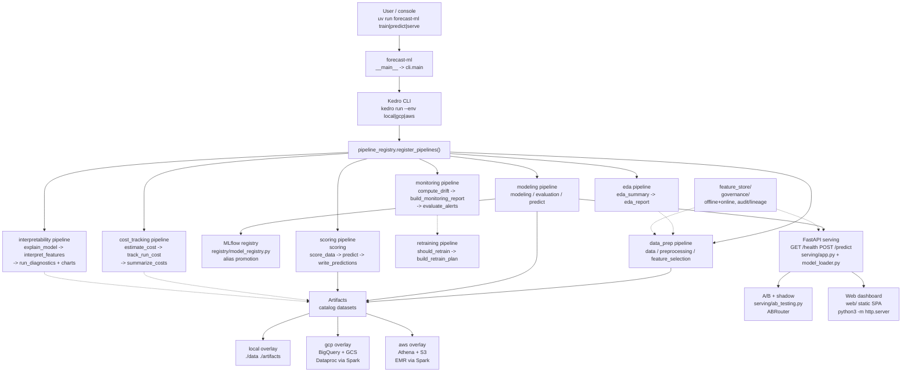
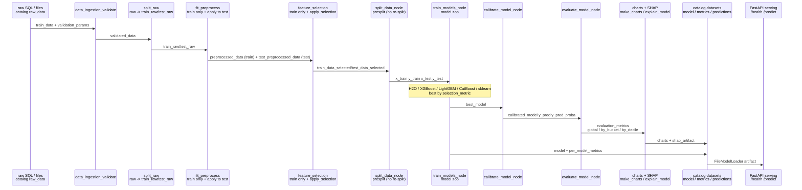
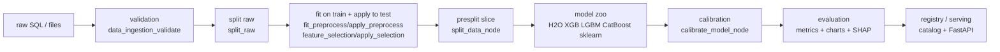
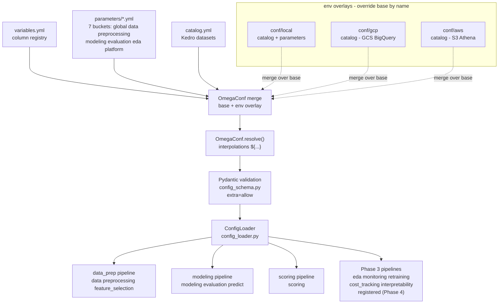
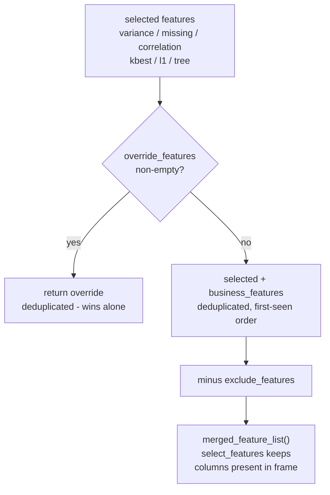

# Forecast ML Framework

Config-driven Kedro ML framework for forecasting and tabular prediction. One
repository runs the full lifecycle — ingest, validate, EDA, preprocess,
select features, train a model zoo, calibrate, evaluate, chart, explain
with SHAP/PDP/LIME, register and serve models, batch-score, monitor drift,
plan retraining, track cost, and govern artifacts — almost entirely from
configuration (`variables.yml`, the split `parameters/*.yml` buckets,
`catalog.yml`) plus per-environment overlays. Changing a dataset, a model,
or a loss function is a config edit, not a code edit.

Phases 1–7 plus the Cycle-1 fix loop (W1–W14, M1–M6), P1 contracts,
P2 platform, and P3 time-split are landed
(**2423 test functions** on disk — static `^def test_` count in
`tests/`, recounted 2026-11-08 in FIX-GATE-EVIDENCE by grep `^def test_` in
`tests/`; checked against `pipeline_registry.py` (12
registered pipelines, 8 modules) and current code. Last full-suite
handoff total (P3-D, `.opencode/handoffs/P3-D.md`): **3305 passed,
4 skipped, 0 failed** — transcribed from that handoff, not re-run in
this docs pass; see the Tests note. The static count
is the on-disk `def test_` total, the collected total is the
parametrized expansion — see the Tests note). Phase 7 (high-value) added the fitted preprocessing registry,
the tuning executor, class-imbalance handling, prior-rate probability
calibration, threshold application at scoring, KNN + sequence
routines, MLflow Kedro hooks, and two-stage scoring (see
[High-Value Additions](#high-value-additions-phase-7)). Phase 6 (parity) added ntile eval-metric grammar,
`selected_ntile`/`by_centile`, descriptive stats, the confusion rates
table, lift table, threshold selection, promotion gating, scoring
ntile columns, pipeline wiring, catalog anchors, and `eval_metric`
config. Phase 2 added the MLflow model registry, batch scoring,
Terraform IaC (`infra/`), and the static dashboard (`web/`). Phase 3
added EDA/leakage, monitoring/retraining, the feature store, A/B
shadow serving, cost tracking, governance, interpretability, metrics
v2, the full chart catalog, and Spark scaling. Phase 4 (hardening,
final) registered the Phase 3 pipelines, moved SHAP explanation to
`interpretability.nodes.shap_explain`, and tightened serving/registry
validation. Phase 5 (clean-ux) added Kedro project markers + CLI
introspection (`list-pipelines` / `validate-config` / `dry-run`),
degraded serving health, typed serving errors, sample data, EDA
params, a smoke local profile, and a strict config schema — see the
[Change Log](#change-log).

> **Current-state note (Phase 7 high-value).** This README documents the
> code *as found on disk*, verified against `pipeline_registry.py`
> (`_PIPELINE_MODULES`, 12 entries), every `pipelines/*/pipeline.py`,
> `conf/`, `cli.py`, and `serving/app.py`. All eight pipeline modules are **registered** for
> `kedro run --pipeline <name>` (12 display names; former Known
> Issue #12 is fixed).

## Features

- **Config-driven.** `conf/base/variables.yml` (column registry),
  `conf/base/parameters/*.yml` (7 buckets — see
  [Parameters split](#parameters-split-7-buckets)), and
  `conf/base/catalog.yml` (Kedro Data Catalog). No code edits are needed to
  point the framework at a new dataset.
- **Kedro pipelines.** Eight pipeline modules on disk — `data_prep`,
  `modeling`, `scoring`, `eda`, `monitoring`, `retraining`, `cost_tracking`,
  `interpretability` — each with `create_pipeline()` in
  `pipelines/<name>/pipeline.py`. `pipeline_registry.register_pipelines()`
  exposes 12 display names: `data`, `preprocessing`, `feature_selection`
  (`data_prep`), `modeling`, `evaluation`, `predict` (`modeling`),
  `scoring` (`scoring`), `eda`, `monitoring`, `retraining`,
  `cost_tracking`, and `interpretability` (Phase 4 registration;
  former Known Issue #12 fixed).
- **EDA + leakage** (`pipelines/eda/`): `eda_summary` → `eda_report`
  (summary statistics, `eda_quality_checks`, `detect_leakage` — correlation,
  AUC, near-duplicate, near-constant, post-outcome name keywords — wired
  into the report). See [Phase 3 pipelines](#phase-3-pipelines).
- **Monitoring + retraining** (`pipelines/monitoring/`, `pipelines/retraining/`):
  PSI/KS drift (`compute_drift` → `build_monitoring_report` →
  `evaluate_alerts`, severity-graded) and plan-only retraining triggers
  (`should_retrain` → `build_retrain_plan`; never executes Kedro).
- **Feature store, governance, cost** (`feature_store/`, `governance/`,
  `pipelines/cost_tracking/`): offline/online stores with point-in-time
  consistency checks; actor-required secret-scrubbed audit, lineage
  (config hash), retention keep/delete; offline cost estimation from
  `run_info` + config unit prices (no cloud API calls).
- **A/B + shadow serving** (`serving/ab_testing.py`): `ABRouter` with
  stable-hash bucketing, shadow/ab modes (random process salt + warning,
  bounded deque logs, scrubbed `request_id`), `compare_variants`
  aggregation (mean prediction, latency p50/p95, count).
- **Interpretability pipeline** (`pipelines/interpretability/`): SHAP +
  permutation (`explain_model`), PDP + LIME rows (`interpret_features`),
  diagnostics (`run_diagnostics`), and 27 distinct charts (12
  interpretability + 15 diagnostics) + `pdp_1d` alias — 28 `__all__`
  exports total (`interpretability/charts.py:63-92`); `pdp_1d` and
  `pdp_1d_chart` are the same function exported twice, so counting
  both double-counts one chart.
- **Metrics v2 + full charts.** 154-name `METRIC_REGISTRY`
  (`pipelines/modeling/metrics.py`), selectable via
  `metrics`/`metrics_to_calculate` (`'all'`, a list, or absent = curated
  default subset); chart groups I–VII in `pipelines/modeling/charts.py`
  (data, classification, regression, training, interpretability,
  comparison, specialized). See [Metrics + charts catalog (v2)](#metrics--charts-catalog-v2).
- **Scaling.** Spark partitioned scoring (`scoring_params.spark_scoring`,
  `mapPartitions`, no `toPandas()` on the driver), pandas 5M-row guard
  (`pandas_conversion_params.max_rows_for_pandas`), Dataproc autoscaling
  defaults in `spark_params` (dynamic allocation + AQE). See
  [Scaling: 100M-row guidance](#scaling-100m-row-guidance).
- **Model zoo** (`pipelines/modeling/adapters.py`): H2O AutoML, XGBoost,
  LightGBM, CatBoost, scikit-learn, and any estimator named by a dotted
  `model_handle` (e.g. `xgboost.XGBClassifier`). Train several at once,
  pick the best by `selection_metric`.
- **Calibration.** Classification only: `sigmoid`, `isotonic`, `betacal`, or
  `none` (with `betacal.BetaCalibration` fallback to sigmoid when the
  `betacal` package is absent). Regression calibration is a no-op.
- **Phase 7 high-value additions.** Fitted preprocessing registry
  (fit on train, replay at score), tuning executor (grid/random/halving),
  class-imbalance weighting (`balance`), prior-rate calibration
  (`calibrate_probability` → `calib_proba`), threshold application
  (`model_threshold`), KNN + sequence routines (`KnnImputation`,
  `SequenceChangeRatio`, `SequenceCov`), MLflow Kedro hooks
  (`ForecastHooks`), and two-stage scoring (`score_data_prep`). See
  [High-Value Additions](#high-value-additions-phase-7).
- **SHAP explainability.** `shap.Explainer` with permutation-importance
  fallback (`pipelines/interpretability/nodes.py:shap_explain`); the
  legacy `pipelines/modeling/pipeline.py:explain_model` node wraps it
  for the modeling pipeline. `method: auto` tries SHAP then falls
  back, `method: shap` raises if SHAP is unavailable.
- **Metrics and charts, global and per-bucket/per-decile.** Full metric
  catalogues for classification and regression (below), evaluated globally,
  by `bucket_segment_col`, and by prediction decile
  (`pipelines/modeling/evaluate.py`). Matplotlib charts for both task types
  (`pipelines/modeling/charts.py`).
- **Feature selection plus business/override rules.** Variance, missingness,
  correlation, SelectKBest, L1, and tree-importance filters, then a merge
  rule with `business_*`, `override_*`, and `exclude_*` lists
  (`core/config_loader.py:ConfigLoader.merged_feature_list`,
  `pipelines/data_prep/nodes.py:select_features`).
- **Configurable loss functions per model.** A top-level `loss_function`
  default with per-model overrides, mapped per adapter through a loss
  registry (aliases accepted; exact-allowlist callables only —
  `forecast_ml_framework.losses.huber_loss` and
  `sklearn.metrics.mean_absolute_error` and other names in
  `losses.LOSS_CALLABLES`); any other dotted name raises `ValueError`
  listing valid losses
  (`pipelines/modeling/adapters.py:get_loss`,
  `LOSS_REGISTRY`, `LOSS_KWARGS`; see
  [Loss functions per model](#loss-functions-per-model)).
- **FastAPI serving + registry.** `GET /health`, `POST /predict` with strict
  input validation and payload caps (`serving/app.py`); `create_app()`
  accepts an injected loader or registry config (env `MODEL_REGISTRY_URI` /
  `MODEL_NAME` / `MODEL_ALIAS`), and `RegistryModelLoader`
  (`serving/model_loader.py`) loads via the MLflow registry
  (`registry/model_registry.py`, alias promotion). Serving validation
  uses the model's `feature_names_in_` when present (required feature
  set + order), otherwise the first record's keys; unknown/missing
  features return 422. Registration uses
  `mlflow.sklearn.log_model` (sklearn flavor only, no pyfunc flavor);
  registry loading downloads the artifact bytes via the MLflow
  tracking client and decodes them with `restricted_loads`
  (`serving/model_loader.py:6-13,543-588`; size cap plus optional
  SHA-256 pin via `MODEL_SHA256` / `expected_sha256`) — it never
  calls `mlflow.sklearn.load_model` on registry bytes — with the
  pyfunc fallback gated behind `allow_pyfunc=True` (opt-in only).
  Docker image shipped (Dockerfile, fail-closed entrypoint);
  production promotion gated P11. Serving auth is fail-closed: `FORECAST_REQUIRE_AUTH=1`
  or a prod profile without `FORECAST_API_KEY` refuses startup, keys
  shorter than 16 chars are refused, and every `/predict` writes a
  structured access log + persisted audit entry with an HMAC key-id
  (`serving/app.py:151-174,225-238,241-267,270-287`; see
  [Serving API](#serving-api)).
- **MLflow / DVC.** `mlflow_params` / `dvc_params` in `parameters/platform.yml`
  are validated by the schema; MLflow tracking/registry runs through
  `registry/model_registry.py` (lazy import — importing the module never
  imports mlflow). DVC remains parameters/config only (no execution code).
- **Spark / BigQuery / GCS / S3 abstraction.** `SparkSessionFactory` with
  graceful local fallback (`core/spark_factory.py`), `SQLQueryDataSet` and
  `SparkSQLDataSet` Kedro datasets (`core/datasets.py`), and
  local/GCS/S3 artifact stores selected by `artifact_store_params.type`
  (`core/artifact_store.py:create_artifact_store`).
  `restricted_loads` runs a `pickletools` pre-scan rejecting
  `REDUCE`/`NEWOBJ_EX` to XGBoost/LightGBM `Booster` (file-load
  vectors) plus a `MAX_ARTIFACT_BYTES` size cap (512 MiB default,
  `core/artifact_store.py:346-351,365-384,583,773-800`) before unpickling
  (W2). `core/__init__.py` and `pipelines/modeling/__init__.py` are
  PEP 562 lazy inits (V11/I12).
- **Pydantic + OmegaConf config validation.** `core/config_schema.py`
  validates every shipped section: the top level is `extra='forbid'`
  (`core/config_schema.py:541`, so a typo'd section like
  `cost_tracking_param` fails and `validate-config` exits 2) while
  submodels keep `extra='allow'` so named extension subkeys inside a
  typed section pass; `load_config()` merges env overlays and resolves
  `${...}` interpolations in *variables and parameters* to plain
  dicts (the catalog is left `resolve=False` for Kedro,
  `core/config_schema.py:1256-1259`). `ConfigLoader` accepts plain dicts,
  OmegaConf objects, or pydantic models.

## Quick start

### Prerequisites

- Python **3.14** (`requires-python = '>=3.14'` in `pyproject.toml`).
  Python is not downgraded; libraries that fail on 3.14 move to the
  `extras-314-failures` optional group instead. The compatibility spike
  found all 17 libraries OK (see
  [Python 3.14 compatibility spike](#python-314-compatibility-spike)).
- [uv](https://docs.astral.sh/uv/) (package manager and runner).

### Install

```bash
cd forecast_ml_framework
uv sync
```

This creates `.venv/` inside `forecast_ml_framework/` (never commit it).

### Quickstart: train smoke (under 2 minutes)

From `forecast_ml_framework/` (verified against `cli.py:242-278`):

```bash
cd forecast_ml_framework
uv sync
uv run forecast-ml validate-config --env local   # prints "config ok (local)"
uv run forecast-ml train --env local             # kedro run --pipeline modeling --env local
```

The `local` overlay is the smoke profile: `models_to_use: ['sklearn']`
only (`conf/local/parameters.yml:60-62`), local MLflow URI
(`./mlruns`), DVC off, `validation_params.fail_fast: true`,
`artifact_store_params.type: local`. Sample data ships at
`data/raw/raw_data.csv` (columns `id,f1,f2,f3,f4,cat,seq,target`,
100 rows, `synthetic_data` shape), so a fresh checkout trains with
no downloads. Kedro discovery needs the project markers in
`pyproject.toml:84-87` (`[tool.kedro]` with `package_name` /
`project_name` / `kedro_init_version` only — no `project_version`)
plus `<package>.cli:cli` (`cli.py:51-74,79`), which re-exports Kedro's
top-level Click group; without the marker Kedro 1.7 exits with
"unexpected keys" or fails to load project commands.
`forecast-ml` also exposes the alias `forecast-ml-framework`
(`pyproject.toml:82`) alongside `forecast-ml`.

```bash
uv run forecast-ml list-pipelines --env local    # 12 lines: "<name> <module>"
uv run forecast-ml validate-config --env local   # "config ok (local)"
uv run forecast-ml dry-run modeling --env local  # planned command + node names
uv run forecast-ml dry-run eda --env local
```

`list-pipelines` prints one `<name> <module>` line per registered
pipeline (`cli.py:242-255`). `validate-config` loads the env config
and validates parameters, printing `config ok (<env>)` on success
(`cli.py:258-278`). `dry-run <pipeline>` prints the planned
`kedro run --pipeline <name> --env <env>` command plus node names,
without running anything (`cli.py:281-298`). `--env` accepts
`base|local|gcp|aws` only; anything else exits 2 (`cli.py:91,102-104`).

### Environment variables

| Variable | Use | Default |
|---|---|---|
| `MODEL_REGISTRY_URI` | MLflow registry URI for `RegistryModelLoader` (env read in `serving/app.py:569`, `_resolve_loader` `serving/app.py:551-580`) | unset |
| `MODEL_NAME` | Registered model name | unset → degraded mode |
| `MODEL_ALIAS` | Registry alias | `production` |
| `MODEL_ARTIFACT_PATH` | File-loader artifact path (env read at `serving/app.py:562-563`, explicit `artifact_path=` wins) | unset |
| `FORECAST_API_KEY` | Fail-closed auth (see [Serving API](#serving-api)): when set, `/predict` requires it (`X-API-Key` or `Authorization: Bearer ...`); `/health` stays public (401 otherwise); required at startup when `FORECAST_REQUIRE_AUTH=1` or prod profile, min length 16 | off (dev, WARNING logged) |
| `GOOGLE_APPLICATION_CREDENTIALS` | GCP credentials for GCS/BigQuery | unset |
| `AWS_PROFILE` / AWS env vars | AWS credentials for S3/Athena | unset |
| `MLFLOW_DISABLE_AGENT_HINT` | Silence MLflow import banner | unset |

### Tests

Tests live in the top-level `tests/` directory (see the
[Testpaths note](#testpaths) in Known Issues for why the explicit path
below is required):

```bash
PYTHONPATH=src python -m pytest tests/ -q
```

Uv-run variants (same suite, inside the uv environment):

```bash
uv run python -m pytest tests/ -q
uv run pytest tests/ -q
```

Both forms were used to verify this README's commands. Expected result on
success: `pytest` exits 0 with all tests passing — last full-suite
handoff total (P3-D, `.opencode/handoffs/P3-D.md`): **3305 passed,
4 skipped, 0 failed** (transcribed from that handoff; `--collect-only`
was not re-run in the 2026-11-08 FIX-DOCS-1 docs pass — no shell /
pytest was available in that subagent environment, so no new collected
total is claimed here).
**2423 test functions** on disk (static `^def test_` count in
`tests/`, recounted 2026-11-08 in FIX-GATE-EVIDENCE by grep `^def test_` in
`tests/`; parametrize expands the static count to the collected total)
(including `test_high_fitted`, `test_high_tuning`,
`test_high_tuning_wiring`, `test_high_imbalance`, `test_high_calibrate`,
`test_high_priorrate`, `test_high_threshold_apply`, `test_high_routines`,
`test_high_twostage`, `test_high_hooks`, and the earlier `test_eda`, `test_monitoring`,
`test_retraining`, `test_cost_tracking`, `test_interpretability`,
`test_feature_store`, `test_governance`, `test_ab_testing`, `test_scaling`,
`test_phase3_config`, `test_pipeline_registry`, `test_demo_run`,
`test_kedro_markers`, `test_smoke_defaults`, `test_eda_params`,
`test_schema_strictness`, `test_validation_profile`, `test_cli`,
`test_main_entrypoint`, `test_catalog_gaps`). Note: the real-MLflow roundtrip test carries
`@pytest.mark.serial` and resets global mlflow state (Known Issue #17) —
run the full suite serially; do not parallelise it. `pyproject.toml` now
sets `testpaths = ['tests']` and `pythonpath = ['src']`, so a bare
`pytest` also works. Environment-dependent tests (Spark, cloud SDKs) are
mocked or skipped when the dependency or service is absent; `httpx` is a
dev-only dependency so the FastAPI `TestClient` works without polluting
production dependencies.

### Run the pipelines

```bash
uv run kedro run --env local
```

`--env local` selects the `conf/local/` overlay (local paths, local
artifact store, local MLflow tracking URI, DVC disabled). `--env gcp` and
`--env aws` select the GCS/BigQuery and S3/Athena overlays. Run a single
pipeline family with `--pipeline <name>` (registered names, 12 total:
`data`, `preprocessing`, `feature_selection`, `modeling`, `evaluation`,
`predict`, `scoring`, `eda`, `monitoring`, `retraining`, `cost_tracking`,
`interpretability`).

### Console usage

The console script is `forecast-ml` (declared in `pyproject.toml`,
entry point `forecast_ml_framework.__main__:main`, which delegates to
`forecast_ml_framework.cli:main`):

```bash
uv run forecast-ml --help
uv run forecast-ml train --help
uv run forecast-ml predict --help
uv run forecast-ml serve --help
uv run forecast-ml run --help
uv run forecast-ml list-pipelines --env local
uv run forecast-ml validate-config --env local
uv run forecast-ml dry-run modeling --env local
```

Subcommands: `train`, `predict`, `serve`, `run` each accept `--env`
(default `local`), `--artifact`, `--host` (default `127.0.0.1`), and
`--port` (default `8000`) (`cli.py:301-337`, with `train`/`predict`/
`serve`/`run` added at `cli.py:308-315`); `list-pipelines`,
`validate-config`, and `dry-run <pipeline>` accept `--env` only
(`cli.py:301-337`, at `cli.py:325-336` — `dry-run` also takes the
pipeline name). `_list_pipelines`
ignores the env value beyond the whitelist (`cli.py:242-255`).
The parser also exposes 11 registry-alias subparsers
(`cli.py:96-99,316-324`): `data`, `preprocessing`,
`feature_selection`, `modeling`, `evaluation`, `scoring`, `eda`,
`monitoring`, `retraining`, `cost_tracking`, and
`interpretability` (`predict` is already a subparser, so it is
excluded from this alias list to avoid a duplicate registration).
Each alias accepts the same `--env` / `--artifact` / `--host` /
`--port` flags and runs `kedro run --pipeline <alias>`.
`train`
delegates to `kedro run --pipeline modeling --env <env>`, `predict` to
`--pipeline scoring`, `run` to the default pipeline (no `--pipeline`),
`serve` to `uvicorn forecast_ml_framework.serving.app:app --host <host>
--port <port>` with the artifact passed via
`MODEL_ARTIFACT_PATH` (`cli.py:84-89,107-135,192-239`; `serve`
planned at `cli.py:126-131`). `serve` calls
`serving.app.validate_bind_host` before spawning uvicorn and exits 2
on `RuntimeError` (`cli.py:215-222`), so a non-loopback bind without
a valid API key is refused at the CLI entry point. When
`kedro`/`uvicorn` is not on
`PATH`, the CLI prints the planned command instead; when the Kedro
project root cannot be found it exits 2 (`cli.py:148-189,223-228`).

### Synthetic demo walkthrough

`pipelines/data_prep/nodes.py:synthetic_data()` generates a reproducible
demo frame (`n=100`, `seed=42`, `task='classification'` by default) with
columns `id`, `f1`–`f4` (numeric), `cat` (categorical `a`/`b`/`c`), `seq`
(list of floats), and `target` (binary). Walk the nodes in Python:

```python
import numpy as np  # noqa: F401 - available via the framework anyway

from forecast_ml_framework.pipelines.data_prep.nodes import (
    preprocess,
    select_features,
    synthetic_data,
    validate_data,
)

df = synthetic_data(n=100, task='classification', seed=42)
variables = {
    'target_col': 'target',
    'feature_cols': ['f1', 'f2', 'f3', 'f4'],
    'num_cols': ['f1', 'f2', 'f3', 'f4'],
    'cat_cols': ['cat'],
    'seq_cols': ['seq'],
}
params = {
    'validation_params': {'fail_fast': False, 'max_null_ratio': 0.5},
    'data_prep_params': [
        {'Imputations': {'skip': False, 'args': {
            'strategy': 'median',
            'cols': {'include_cols': ['f1', 'f2', 'f3', 'f4']}}}},
    ],
    'feature_selection_params': {'missing_threshold': 0.5},
}
df, report = validate_data(df, params, variables)
df = preprocess(df, params['data_prep_params'], variables)
df, selected, report = select_features(df, params, variables)
print(selected)  # merged feature list after business/override rules
```

For `task='regression'`, `target` becomes `2*f1 + 0.5*f2 + noise` and the
modeling pipeline consumes it as `modeling_reg_params`.

## Architecture

> **Diagrams.** All diagrams in this README are Mermaid fenced
> blocks and render natively on GitHub. Node names
> match `pipeline_registry.py` and the `name=` values in
> `pipelines/*/pipeline.py`. All eight modules are registered
> (12 display names, Phase 4 final).

### System architecture



### Folder structure

```text
forecast_ml_framework/
├── pyproject.toml              # deps, console script, pytest/ruff config
├── README.md                   # this file
├── uv.lock                     # resolved dependency lockfile
├── conf/                       # Kedro config (base + env overlays)
│   ├── base/
│   │   ├── variables.yml       # column registry (target, id/cat/num/date/seq/ind/drop)
│   │   ├── parameters/         # split parameters buckets (7 files, see below)
│   │   │   ├── global.yml      # runtime keys + global_params
│   │   │   ├── data.yml        # data sources, sampling, split, validation, pandas guard
│   │   │   ├── preprocessing.yml # FE registry + feature selection
│   │   │   ├── modeling.yml    # models, H2O, modeling(_reg), calibration, cv
│   │   │   ├── evaluation.yml  # evaluation_params incl. metrics_to_calculate
│   │   │   ├── eda.yml         # eda_params (EDA + leakage thresholds)
│   │   │   └── platform.yml    # spark, mlflow, dvc, shap, registry, scoring, infra, monitoring,
│   │   │                       #   retraining, feature_store, ab, cost, governance,
│   │   │                       #   cost_tracking + interpretability params
│   │   ├── catalog.yml         # Kedro Data Catalog entries (+ Phase 3: monitoring_report,
│   │                           #   alerts, cost_log, lineage, audit_log)
│   ├── local/                  # local overlay: catalog + parameters
│   ├── gcp/                    # GCS + BigQuery overlay: catalog
│   ├── azure/                  # Azure overlay: catalog (P2-I1)
│   └── aws/                    # S3 + Athena overlay: catalog
├── infra/                      # Terraform IaC (Phase 2)
│   ├── gcp/                    # GCS, BigQuery, Dataproc (off by default), scheduler, Pub/Sub alerts; secrets.tf (P2-S1)
│   ├── aws/                    # S3, Athena, EMR stub (off), EventBridge stub; secrets.tf (P2-S1)
│   ├── azure/                  # VNet, private endpoints, Entra OIDC, Key Vault, AKS stub (P2-I1); secrets.tf (P2-S1)
│   └── README.md               # apply order, state, costs, 100M-row sizing
├── deploy/                     # P2 platform deploy (see deploy/README.md)
│   ├── README.md               # deploy index (chart, observability, secrets wiring)
│   ├── helm/forecast-ml/       # Chart.yaml, values.yaml, templates/{deployment,service,ingress,serviceaccount,hpa,networkpolicy}.yaml
│   ├── k8s/                    # retention-cronjob.yaml (P2-S1)
│   ├── observability/          # otel-collector.yaml, prometheus.yaml, prometheus/rules.yaml, alertmanager/alertmanager.yaml, dashboards/{model-drift,api-latency}.json, scripts/synthetic-drift.sh
│   └── scripts/                # rollback-drill.sh
├── docs/
│   └── runbook-p2.md           # P2 operator runbook (deploy, rollback, OIDC, alerts, retention/erasure)
├── ci/
│   └── run_checks.sh           # local CI gate (terraform fmt/validate gcp+aws+azure, helm, tests)
├── Dockerfile                  # multi-stage serving image (P2-C1, digest-pinned, fail-closed entrypoint)
├── web/                        # static evaluation dashboard (Phase 2, no build step)
│   ├── index.html / app.js / styles.css
│   └── sample/                 # sample metrics.json + chart PNGs
├── src/forecast_ml_framework/  # importable package (PYTHONPATH=src)
│   ├── __init__.py             # __version__ = '0.1.0'
│   ├── __main__.py             # forecast-ml console entry point
│   ├── cli.py                  # train|predict|serve|run argparse CLI
│   ├── hooks.py                # ForecastHooks: MLflow Kedro hooks (Phase 7)
│   ├── settings.py             # Kedro settings: CONF_SOURCE, HOOKS=(ForecastHooks(),)
│   ├── pipeline_registry.py    # register_pipelines(), lazy imports (12 display names, 8 modules)
│   ├── losses.py               # loss callable allowlist (LOSS_CALLABLES)
│   ├── core/
│   │   ├── artifact_store.py   # local/GCS/S3 stores, restricted unpickler
│   │   ├── config_loader.py    # ConfigLoader: lookup, task_type, feature merge
│   │   ├── config_schema.py    # Pydantic models + OmegaConf load_config()
│   │   ├── datasets.py         # SQLQueryDataSet, SparkSQLDataSet, RestrictedPickleDataset
│   │   ├── handle.py           # canonical handle resolver
│   │   ├── params.py           # canonical parse_int/parse_float/get_first/parse_datetime
│   │   ├── predictions.py      # materialize_predictions + finite checks
│   │   └── spark_factory.py    # SparkSessionFactory, to_pandas(), pandas 5M guard, autoscaling defaults
│   ├── pipelines/
│   │   ├── data_prep/          # pipeline.py, nodes.py, fitted.py (fit/replay registry, Phase 7)
│   │   ├── modeling/           # pipeline.py, adapters.py, calibration.py, envelope.py (P1-A2 best_model v2),
│   │   │                       # data_split.py, purged_cv.py + backtest.py (P3), evaluate.py, metrics.py (154 registry),
│   │   │                       # charts.py (groups I-VII); SHAP via interpretability.nodes.shap_explain;
│   │   │                       # ntile.py, lift_table.py, threshold.py, validation.py (Phase 6 parity);
│   │   │                       # tuning.py, imbalance.py (Phase 7 high-value)
│   │   ├── scoring/            # pipeline.py, nodes.py (batch scoring, Spark partitioned)
│   │   ├── eda/                # pipeline.py, nodes.py (summary + leakage)
│   │   ├── monitoring/         # pipeline.py, nodes.py (PSI/KS drift, alerts)
│   │   ├── retraining/         # pipeline.py, nodes.py (plan-only triggers)
│   │   ├── cost_tracking/      # pipeline.py, nodes.py (offline cost estimation)
│   │   └── interpretability/   # pipeline.py, nodes.py, charts.py (SHAP/PDP/LIME + 27 charts)
│   ├── feature_store/          # store.py, offline.py, online.py (point-in-time consistency)
│   ├── governance/             # __init__.py, audit.py, consent.py, erasure.py, lineage.py, pii.py, retention.py, retention_job.py (P2-S1 CLI), scrub.py facade (851 lines), scrub_keys.py (1200 lines), scrub_text.py (1489 lines)
│   ├── telemetry/              # __init__.py + exceptions.py (FrameworkError hierarchy, wrap; public API, A2)
│   ├── registry/               # model_registry.py (MLflow registry, alias promotion, lazy import)
│   └── serving/                # app.py (FastAPI, GET /metrics), metrics.py (live /metrics producer), auth.py (P2-AU1 OIDC), model_loader.py, ab_testing.py
├── tests/                      # pytest suite (2423 test functions, recounted 2026-11-08 in FIX-GATE-EVIDENCE by grep `^def test_` in `tests/`; see Tests)
└── .venv/                      # created by `uv sync`, never commit
```

Tree regenerated 2026-11-08 from the filesystem (FIX-DOCS-3,
superseding the FIX-DOCS-2 pass): every entry above was verified
to exist on disk, including `deploy/`
(helm/k8s/observability/scripts — see `deploy/README.md`),
`docs/runbook-p2.md`, all `governance/` files (below: `scrub.py`
facade, 851 lines, plus `scrub_keys.py`, 1200 lines, and
`scrub_text.py`, 1489 lines),
`pipelines/modeling/envelope.py`, and `serving/metrics.py`
(live `/metrics` producer, listed in the `serving/` line above).

### Pipeline list and nodes

| Display name | Real module | Nodes (in order) |
|---|---|---|
| `data`, `preprocessing`, `feature_selection` | `pipelines/data_prep/pipeline.py` | `data_ingestion_validate` → `split_raw` → `fit_preprocess` → `apply_preprocess` → `feature_selection` → `apply_selection` (split-first, A9) |
| `modeling`, `evaluation`, `predict` | `pipelines/modeling/pipeline.py` | `split_data_node` → `train_models_node` → `calibrate_model_node` → `predict_node` → `predict_proba_node` → `evaluate_model_node` → `build_lift_table_node` → `build_promotion_node` → `select_model_threshold_node` → `build_tuning_report_node` → `make_charts_node` → `explain_model_node` (12 nodes) |
| `scoring` | `pipelines/scoring/pipeline.py` | `score_data_prep` (`fitted_registry` replay) → `predict` → `write_predictions` |
| `eda` | `pipelines/eda/pipeline.py` | `eda_summary` → `eda_report` |
| `monitoring` | `pipelines/monitoring/pipeline.py` | `compute_drift` → `build_monitoring_report` → `evaluate_alerts` |
| `retraining` | `pipelines/retraining/pipeline.py` | `should_retrain` → `build_retrain_plan` |
| `cost_tracking` | `pipelines/cost_tracking/pipeline.py` | `estimate_cost` → `track_run_cost` → `summarize_costs` |
| `interpretability` | `pipelines/interpretability/pipeline.py` | `explain_model` → `interpret_features` → `run_diagnostics` → `make_interpretability_charts` → `make_diagnostics_charts` |

`pipeline_registry.register_pipelines()` maps each of the 12 display
names to one cached pipeline object (aliases for the same module share
one object) and imports lazily, so an unavailable pipeline module is
skipped instead of breaking the registry. `_PIPELINE_MODULES`
(`pipeline_registry.py:38-51`) covers all eight modules; `kedro run
--pipeline eda` (etc.) works (Phase 4; former Known Issue #12 fixed).

### How data flows

```text
raw_data (catalog)
  │  pipelines/data_prep (split-first, A9 — breaking at 0.1.0)
  ▼
validated_data ── split_raw ──► train_raw / test_raw
                                      │                │
                                      ▼                ▼
                              fit_preprocess    apply_preprocess
                              (train only)      (replay fitted registry)
                                      │                │
                                      ▼                ▼
                              preprocessed_data  test_preprocessed_data
                              (train-only)            │
                                      │                ▼
                                      ▼         apply_selection
                              select_features (train only)
                                      │                │
                                      ▼                ▼
                              train_data_selected  test_data_selected
                                                        │
                                                        ▼  modeling pipeline
                              split_data_node (presplit) ──► x_train / x_test / y_train / y_test
                                                                   │ (split_meta.sampling_method='presplit')
                                        ▼ train_models (zoo, best by selection_metric)
                                   best_model ── calibrate_model ──► calibrated_model
                                        │                              │
                                        │                              ▼
                                        │                        y_pred / y_pred_proba
                                        │                              │
                                        ▼                              ▼
                                   per_model_metrics           evaluate_model ──► evaluation_metrics
                                                                  (global / by_bucket / by_decile)
                                        │                              │
                                        ▼                              ▼
                                   explanations              make_charts ──► charts
                                   (SHAP/permutation)        explain_model ──► shap_artifact
```

**Breaking change (A9, at 0.1.0):** the old `modeling_input`
(full frame, preprocess+select fitted on everything, then split) is
removed. Data-prep now splits raw validated data first, fits
preprocessing and selection on train only, and applies them to test;
modeling consumes the pre-split `train_data_selected` /
`test_data_selected` frames via `split_data_node`
(`pipelines/modeling/pipeline.py:436-441`) with
`split_meta.sampling_method='presplit'` (no re-split, `shuffle=False`,
`split_presplit_data` at `pipelines/modeling/pipeline.py:133-236`).
`split_data` remains as a
direct-use function only (`pipelines/modeling/data_split.py`, with
`stratified` / `random` / `time` methods). Catalog `modeling_input`
is deprecated (kept for name resolution only, no node consumes it).
`preprocessed_data` now means the train-only preprocessed frame;
`test_preprocessed_data` is the new test-side intermediate.

In practice the catalog wires `train_data` into the data-prep pipeline
and the modeling pipeline starts from `train_data_selected` /
`test_data_selected`; `model`,
`calibration_model`, and per-adapter model datasets persist the fitted
models, `metrics`/`metrics_csv` persist evaluation output, `predictions`
persists predictions, and `shap_values`/`shap_summary` persist the
explanation artifacts.

### Data flow (Mermaid)





## Phase 3 pipelines

All five Phase 3 pipelines are plain pandas/numpy modules under
`src/forecast_ml_framework/pipelines/<name>/` with `create_pipeline()` +
`nodes.py`. All five are **registered** in `pipeline_registry.py`
(Phase 4) and run via `kedro run --pipeline <name>`.
Params and catalog datasets are documented in each `pipeline.py` docstring.

### EDA + leakage — `pipelines/eda/`

`eda_summary(raw_data, params:eda_params, variables)` → `eda_report(...)`.
`eda_summary` computes standalone summary statistics (shape, dtypes,
missing rates, numeric descriptives, correlations, top categorical values).
`eda_report` adds `eda_quality_checks` findings (`high_missing`,
`cardinality_explosion`, `class_imbalance`, `constant_cols`,
`duplicates`) and `detect_leakage` findings — feature-target correlation
(`leakage_threshold`, default 0.95), single-feature AUC
(`leakage_auc_threshold`, 0.99), near-duplicate features (0.99),
near-constant features (0.95), and post-outcome name keywords
(`leakage_name_keywords`: `target`, `attrition`, `label`, `outcome`,
`result`, `after`, `post`). Outputs: `eda_summary`, `eda_report`
(summary + findings + recommendations). Catalog: `raw_data` in,
`variables` in (target column wins over `eda_params.target_col`).

### Monitoring / drift + alerts — `pipelines/monitoring/`

`compute_drift(reference_data, current_data, params:monitoring_params)` →
`build_monitoring_report(drift_report, reference_predictions,
current_predictions, current_metrics, ...)` → `evaluate_alerts(...)`.
Per-feature **PSI** (quantile bins for numeric, union-of-categories for
categorical; `bins` default 10, `epsilon` 1e-4 smoothing) and **KS**
(two-sample for numeric, total-variation analogue for categorical), plus
missing-rate deltas; `prediction_drift` and `performance_decay` cover
prediction and metric drift. Empty/small inputs (`min_rows` default 10)
return NaN stats + a warning, never raise. `evaluate_alerts` grades
severity from `thresholds` (defaults: psi 0.1/0.25, ks 0.1/0.25,
missing_rate_delta 0.05/0.1 for warning/critical). Outputs:
`drift_report`, `monitoring_report`, `alerts`. Catalog Phase 3 entries:
`monitoring_report`, `alerts` (`conf/base/catalog.yml`).

### Retraining triggers — `pipelines/retraining/`

`should_retrain(monitoring_report, last_train_info,
params:retraining_params)` → `build_retrain_plan(retrain_decision, ...)`.
**Plan only** — `build_retrain_plan` returns a plain dict describing a
would-be `modeling` run for `env`/`pipeline_name`; it never executes
Kedro, scores, or writes a catalog. Triggers (any fires → retrain; `null`
disables): drift-alert count ≥ `drift_alert_threshold` (default 1),
performance decay > `performance_decay_threshold` (0.05), schedule
elapsed ≥ `schedule_days` (30; `platform.yml` ships 7), data-volume
growth ≥ `data_volume_growth_threshold` (0.20). Inject `now` in params
for deterministic schedule checks in tests.

### Cost tracking — `pipelines/cost_tracking/`

`estimate_cost(run_info, params:cost_tracking_params)` → `track_run_cost`
→ `summarize_costs(cost_log)`. Offline arithmetic only — **no cloud API
calls**; usage numbers arrive as plain dict data in `run_info`
(`runtime_hours`, `bytes_scanned`, `artifact_gb`, model/env/month) and
unit prices come from config (`compute_price_per_hour`,
`data_scan_price_per_gb`, `storage_price_per_gb_month`, `currency`;
flat, `unit_prices`, `cost_tracking_params`, or `cost_params` nesting;
`platform.yml` ships `cost_params`). Missing/negative values warn and
count as 0, never crash. Outputs: `cost_estimate`, `cost_record`,
`cost_summary` (totals by model/env/month). Catalog: `cost_log`.

### Interpretability pipeline — `pipelines/interpretability/`

`explain_model(model, X, y, params:interpretability_params)` (SHAP via
`shap.Explainer`, permutation/occlusion surrogate fallback; `method`
records which ran) → `interpret_features(model, X, ...)` (PDP per
feature + LIME rows, LIME/permutation surrogate fallback) →
`run_diagnostics(model, X, y, ...)` (calibration, residuals, segments) →
`make_interpretability_charts` + `make_diagnostics_charts`. Params:
`max_rows` (20), `top_k` (10), `n_repeats` (5), `random_state`/`seed`
(42), `n_grid` (20), `pdp_features`, `n_calibration_bins` (10),
`segment_col`, `scorer`. **Chart catalog (27 charts)** in
`interpretability/charts.py` — interpretability (12): `shap_beeswarm`,
`shap_bar`, `shap_heatmap`, `shap_dependence`, `shap_waterfall`,
`shap_force`, `pdp_1d_chart` (+ICE), `pdp_2d_heatmap`,
`permutation_importance_bar`, `lime_bar`, `decision_boundary_chart`,
`tree_plot`; diagnostics (15): `calibration_curve`,
`residual_vs_fitted`, `residual_hist_qq`, `scale_location`,
`error_by_segment_bar`, `prediction_distribution_by_class`,
`confidence_histogram`, `residuals_over_time_chart`, `cooks_distance`,
`rec_curve`, `learning_curve`, `validation_curve`, `loss_vs_epoch`,
`cv_box`, `overfitting_gap`. Every chart returns a closed `Figure` or
`None` on insufficient data, never raises.

### Telemetry — `telemetry/`

`src/forecast_ml_framework/telemetry/{__init__,exceptions}.py` is a
public exported package (A2, not dead code): the `FrameworkError`
hierarchy and its subclass factories are its public API, plus
`CODE_REGISTRY` and `wrap` for copy-on-wrap conversion of arbitrary
exceptions into typed errors (`telemetry/__init__.py:1-40`).
Factories must not be deleted on YAGNI grounds. Scrubbing there
shares the `governance/scrub.py` leaf caps/helpers; the local
`_coerce` is kept rather than calling bare `scrub_details` because it
adds a size cap, bytes handling, DataFrame summarising, cycle
detection, OmegaConf rejection and tuple/frozenset key preservation
(A3 — investigated in W14, deliberately not unified; see
`telemetry/exceptions.py` / `telemetry/__init__.py` docstrings).
No `FeatureEngineeringError`-style duplication: factories are
documented as public contract.

### Feature store, governance, A/B shadow

- **Feature store** (`feature_store/`): `FeatureStore` ABC with
  `OfflineFeatureStore` / `OnlineFeatureStore`; frames are normalised to
  canonical `entity_id` + `as_of` columns; `check_consistency(offline,
  online, ...)` verifies offline/online agreement at a point in time.
  Config: `feature_store_params` (`offline_path`, `online_backend`,
  `entity_key`) in `platform.yml`. Entity-key mismatch between offline
  and online causes train/serve skew — keep `entity_key` in sync.
- **Governance** (`governance/`): pure functions, **no persistence** —
  the caller (or catalog) saves the returned dicts. `scrub.py` is the
  canonical public redaction facade (stdlib-only, no governance/telemetry
  imports, `governance/scrub.py:1-26`): markers/confusables/key
  normalization live in `scrub_keys.py` (1200 lines) and text/composite
  scrubbing in `scrub_text.py` (1489 lines), re-exported verbatim through
  the facade (`governance/scrub.py:280-290`); `audit.py` is now a short
  pointer to it
  (W1/F11) and `audit_log(event, actor, details, ...)` requires a
  non-blank actor and deep-scrubs secret-like keys
  (`password`/`secret`/`token`/`api_key`/…) to `***REDACTED***`.
  Bare `key`/`hash` are deliberately *not* secret markers (neither
  as substrings nor on their own) because the framework uses field
  names like `key_cols_list`; only unambiguous compounds redact
  (`api_key`, `encryption_key`, `master_key`, `signing_key`,
  `aws_key`, `gcp_key`, `otp`, `pin_code`/`pin_number`,
  `private_key`) — see `governance/scrub_keys.py:22-30`. `lineage.py`:
  run lineage with
  `config_hash` = sha256 of canonical JSON of `variables`+`parameters`.
  `retention.py`: `check_retention` splits artifacts into keep/delete
  by age (delete only when age **strictly greater** than
  `retention_days`; unusable ages are kept). Config: `governance_params`
  (`retention_days: 365`, `audit_actor_required: true`). Catalog:
  `lineage`, `audit_log`.
- **A/B + shadow** (`serving/ab_testing.py`): `ABRouter(champion_loader,
  challenger_loader, traffic_split=..., mode='shadow'|'ab')` buckets
  `request_id` by stable SHA-256 hash; shadow mode returns the champion
  prediction while logging the challenger, `ab` mode routes a fraction
  to the challenger. `compare_variants(logs)` aggregates per variant
  (mean prediction, latency p50/p95, count). Loaders are injected
  callables (e.g. `FileModelLoader` / `RegistryModelLoader`) — no MLflow
  access in this module. Config: `ab_params` (`traffic_split: 0.1`,
  `mode: 'shadow'`) in `platform.yml`.

## Configuration guide

Kedro loads `conf/base/` and merges the selected env overlay
(`conf/local/`, `conf/gcp/`, `conf/aws/`) over it — overlay entries
override base entries of the same name, everything else is inherited.
`settings.py` sets `CONF_SOURCE = 'conf'` and `HOOKS = (ForecastHooks(),)`
(`hooks.py:ForecastHooks`, wired in `settings.py:109-117`; MLflow
hooks — see [High-Value Additions](#high-value-additions-phase-7)).

Two loading paths exist:

- **Kedro runtime** — Kedro's `OmegaConfigLoader` reads the same files.
- **Programmatic** — `core/config_schema.py:load_config(env_dir)` merges
  base + overlay with OmegaConf, resolves interpolations, and returns
  `{'variables', 'parameters', 'catalog'}` as plain dicts.
  `validate_variables()` / `validate_parameters()` validate the result
  against the pydantic models.

### Config flow (Mermaid)



### `variables.yml` — the column registry

Delivered schema (synthetic demo: one row per customer snapshot,
classification by default):

```yaml
target_col: 'target'            # target column name
id_cols: ['id']                 # identifiers: never features
cat_cols: ['region', 'plan_type', 'channel']   # categorical → encoded
num_cols: ['age', 'income', 'tenure_days', 'purchase_count']  # numeric
date_cols: ['signup_date', 'last_purchase_date']               # dates
seq_cols: ['monthly_spend_seq'] # sequences → Sequence* FE steps
ind_cols: ['is_premium', 'has_support_ticket']                 # 0/1 indicators
drop_cols: ['email_hash']       # dropped before modelling (leakage/PII)
bucket_segment_col: ${.cat_cols[0]}   # segment for per-segment metrics
business_relevant_features: []  # always kept through selection
override_features: []           # forced in even if selection drops them
exclude_features: []            # always excluded
```

For a regression target, swap `target_col` to a continuous column and
point `data_params.train_data` at `raw_data_regression`: the
`target_col`/`num_cols` comment is at the bottom of `variables.yml`
(`conf/base/variables.yml:101-103`) and the `raw_data_regression`
pointer is in `conf/base/parameters/data.yml:12-13`. `bucket_segment_col`
uses an OmegaConf interpolation (`${.cat_cols[0]}`).

Validation model: `VariablesConfig` (`core/config_schema.py`).

### Parameters split (7 buckets)

The former single `conf/base/parameters.yml` **no longer exists**. Its
sections were split into 7 files under `conf/base/parameters/`; the
OmegaConf/Kedro loader merges every `*.yml` in that directory, so all
top-level section names are unchanged and existing `params:<section>`
references keep working. **Migration (Known Issue #13):** any tooling,
script, or checkout that reads/writes `conf/base/parameters.yml` directly
must be pointed at the bucket files below — edit the bucket that owns
your section.

| Bucket file | Owns (top-level sections) |
|---|---|
| `conf/base/parameters/global.yml` | Flat runtime keys (`score_model_id`, `run_date`, …) + `global_params` |
| `conf/base/parameters/data.yml` | `data_params`, `sampling_params`, `sampling_reg_params`, `pandas_conversion_params` (incl. `max_rows_for_pandas: 5000000`), `train_test_split_params`, `validation_params` |
| `conf/base/parameters/preprocessing.yml` | `data_prep_params` (FE registry), `feature_selection_params` |
| `conf/base/parameters/modeling.yml` | `models_to_use`, `h2o_automl_params`, `modeling_params`, `modeling_reg_params`, `model_params_by_name`, `calibration_params`, `cv_params` |
| `conf/base/parameters/evaluation.yml` | `evaluation_params` incl. `metrics_to_calculate` |
| `conf/base/parameters/eda.yml` | `eda_params` (EDA + leakage thresholds) |
| `conf/base/parameters/platform.yml` | `spark_params`, `artifact_store_params`, `mlflow_params`, `dvc_params`, `shap_params`, `chart_params`, `registry_params`, `scoring_params`, `infra_params`, `monitoring_params`, `retraining_params`, `feature_store_params`, `ab_params`, `cost_params`, `governance_params` |

`conf/local/parameters.yml` still exists and overrides only
`artifact_store_params`, `mlflow_params`, `dvc_params`, `spark_params`,
`validation_params` (fail_fast smoke), and `models_to_use` (sklearn-only
smoke). `conf/gcp/` and `conf/aws/` ship `catalog.yml` only, so all their
parameters come from base.

### `parameters/*.yml` — every section

Base defaults below (section → bucket mapping in the table above).
`eda_params` lives in its own bucket `conf/base/parameters/eda.yml`
(Phase 5): typed `EdaParams` in `core/config_schema.py:318-340`
field-for-field with `pipelines/eda/nodes.py` defaults —
`target_col`, `missing_threshold` (0.2), `cardinality_threshold` (50),
`leakage_threshold`/`leakage_corr_threshold` (0.95),
`duplicate_corr_threshold` (0.99), `leakage_auc_threshold` (0.99),
`near_constant_threshold` (0.95), `leakage_name_keywords` (7 keywords),
`imbalance_ratio_threshold` (5.0), `zscore_threshold` (3.0),
`top_correlations` (10), `top_values` (3). Wrong types raise
`ValidationError` (`tests/test_schema_strictness.py:21-34`);
`ConfigLoader.task_type` defaults to `'classification'` everywhere
(single default, `config_loader.py`).

#### Runtime params (catalog interpolations)

Flat keys referenced by `catalog.yml` as `${params:<key>}` (Kedro params
namespace), mostly interpolations of `global_params`:

```yaml
score_model_id: ${.global_params.score_model_id}
output_gcs_location: 'artifacts'
model_id_prefix: 'demo_model_v1'
suffix: 'v1'
run_date: ${.global_params.run_date}
train_run_dt: ${.global_params.run_date}
score_run_dt: ${.global_params.run_date}
# data_project, db_staging_data, etl_project, etl_dataset, etl_table,
# external_project, tmp_bucket, brand: '' ; is_external_platform: false
```

#### Global / run

```yaml
global_params:
  is_regression: false          # true → regression defaults
  is_external_platform: false
  score_model_id: 'demo_model_v1'
  run_date: '2026-11-06'
  model_type: 'sklearn'
  random_state: 42
  target_col: ${variables.target_col}   # interpolation into variables.yml
  key_cols_list: ['id']
```

#### Data sources

```yaml
data_params:
  train_data: 'raw_data'        # catalog dataset name (catalog.yml)
  test_data: 'raw_data'
```

#### Sampling (classification and regression)

```yaml
sampling_params:                # contract: {method, test_size, stratify_col}
  method: 'stratified'          # 'stratified' | 'random'
  test_size: 0.2
  stratify_col: ${..global_params.target_col}
sampling_reg_params:            # same shape, method 'random'
  method: 'random'
  test_size: 0.2
  stratify_col: ${..global_params.target_col}
```

#### Spark → pandas conversion

```yaml
pandas_conversion_params:
  convert_to_pandas: true       # false + Spark input → TypeError
  category_cols: []
```

#### Evaluation

```yaml
evaluation_params:
  multiclass_flag: false
  prediction_col: 'xgboost_pred'
  prediction_probability_col: 'score_value'
  metrics:
    classification: ['roc_auc', 'average_precision', 'f1']
    regression: ['rmse', 'mae', 'r2']
```

#### Train/test split

```yaml
train_test_split_params:        # {training_split_ratio, test_split_ratio, ...}
  training_split_ratio: 0.8
  test_split_ratio: 0.2
  stratify_col: ${..global_params.target_col}
  shuffle: true
  random_state: 42
```

#### Data preparation: the ordered FE registry

`data_prep_params` is a list of steps that run **in list order**. Each
step is `{StepName: {skip: false, args: {...}}}`; `skip: true` disables
it. Steps with a single importable class carry `args.handle` (a dotted
importable string resolved via `resolve_handle()`); steps with no single
importable class are implemented directly in `data_prep/nodes.py`
(`CapOutliers`, `HighLabelBinning`, `FixedLength`, `Slope`,
`Similarity`, `Sequence*` — see the `# Note:` comments in the file).
`args.cols` uses `{exclude_cols, include_cols}`; an empty `include_cols`
means "no-op / all, per implementation".

Shipped steps (enabled in base): `Imputations` (numeric, median,
`sklearn.impute.SimpleImputer`), `Imputations` (categorical, mode),
`CategoricalEncoding` (label via `pyspark.ml.feature.StringIndexer`,
one-hot via `pyspark.ml.feature.OneHotEncoder`, `ohe_flag: true`).
Disabled in base: `CapOutliers`, `QuantileDiscretizer`,
`Normalizations`, `HighLabelBinning`, `TargetEncoding` (skipped
`sklearn.preprocessing.TargetEncoder`), `FixedLength`, `Slope`,
`Similarity`, `SequenceAverage`, `SequenceMin`, `SequenceMax`,
`SequenceLast`, `SequenceDelta`, `SequenceNormalize`,
`KnnImputation`, `SequenceChangeRatio`, `SequenceCov` (all three
`skip: true`, `conf/base/parameters/preprocessing.yml:161-181`;
implemented in `data_prep/nodes.py`).

```yaml
# Enabled example (numeric imputation):
- Imputations:
    skip: false
    args:
      handle: 'sklearn.impute.SimpleImputer'
      strategy: 'median'
      custom_bounds: {}
      cols:
        exclude_cols: []
        include_cols: ['age', 'income', 'tenure_days', 'purchase_count']
# Disabled example:
- CapOutliers:
    skip: true
    args:
      method: 'bound'
      bound: {lower: 0.01, upper: 0.99}
      cols: {exclude_cols: [], include_cols: []}
```

Unknown step names do not crash: `preprocess()` logs a warning and
records them in the report (`unknown_steps`).

#### Feature selection

```yaml
feature_selection_params:       # code contract in data_prep.nodes.select_features
  enabled: true
  random_state: 42
  is_regression: false
  variance_threshold: 0.0       # drop numeric cols with var <= threshold
  missing_threshold: 0.5        # drop numeric cols with null ratio > threshold
  correlation: {enabled: false, threshold: 0.95}
  kbest: {enabled: false, k: 20, score_func: 'f_classif'}
  l1: {enabled: false, alpha: 0.01, C: 1.0}
  tree: {enabled: false, n_estimators: 200, threshold: 0.01}
  business_features: []         # aliases honoured: business_relevant_features,
  override_features: []         #   feature_override, features_override, ...
  exclude_features: []
  output: 'selected_features'
```

The merge rule is documented
[below](#feature-selection--businessoverride-rule). `kbest.score_func`
accepts `f_classif`, `f_regression`, `mutual_info_classif`,
`mutual_info_regression`.

#### Models to use

```yaml
models_to_use:
  - 'h2o_automl'
  - 'xgboost'
  - 'lightgbm'
  - 'catboost'
  - 'sklearn'
```

(Mirrored inside `modeling_params.models_to_use` /
`modeling_reg_params.models_to_use`.) Up to `MAX_MODELS = 10` distinct
models are fitted per `train_models` call; a missing optional library
(xgboost, lightgbm, catboost, h2o) raises an error naming the package
and telling you to remove the entry from `models_to_use`.

#### H2O AutoML

```yaml
h2o_automl_params:              # also mirrored as modeling_params.model_params.h2o_automl
  max_models: 10
  max_runtime_secs: 600
  seed: 42
  nfolds: 5
  sort_by: 'AUC'
  include_algos: ['GBM', 'XGBoost', 'DeepLearning', 'GLM', 'RandomForest']
  exclude_algos: []
  stopping_rounds: 5
  verbosity: 'info'
```

#### Modelling (classification and regression)

`modeling_params` (classification) and `modeling_reg_params`
(regression) share one shape:

```yaml
modeling_params:
  task_type: 'classification'   # 'classification' | 'regression'
  target_col: 'target'
  feature_cols: null            # null = every non-target column
  models_to_use: ['h2o_automl', 'xgboost', 'lightgbm', 'catboost', 'sklearn']
  selection_metric: 'f1_weighted'  # regression: 'rmse'
  random_state: 42
  test_size: 0.2
  sampling_params: {method: 'stratified', test_size: 0.2, stratify_col: 'target'}
  calibration: {method: 'betacal', cv: 5}   # sigmoid|isotonic|betacal|none
  model_handle: 'xgboost.XGBClassifier'     # dotted importable, or adapter name
  calibration_handle: 'sklearn.calibration.CalibratedClassifierCV'
  tuning_handle: 'sklearn.model_selection.GridSearchCV'
  loss_function: 'Logloss'                  # top-level default (see below)
  model_params:                             # per-adapter hyperparameters
    xgboost:
      model_handle: 'xgboost.XGBClassifier'
      n_estimators: 300
      max_depth: 5
      learning_rate: 0.05
      objective: 'binary:logistic'
      loss_function: 'binary:logistic'
      tree_method: 'hist'
      random_state: 42
    # lightgbm, catboost, sklearn, h2o_automl — same pattern
  bucket_segment_col: 'region'
  shap_params: {method: 'shap', n_repeats: 5, sample_rows: 100, random_state: 42}
```

The regression twin uses `task_type: 'regression'`,
`modeling_reg_params`, `XGBRegressor`/`LGBMRegressor`/`CatBoostRegressor`
/`RandomForestRegressor` handles, `selection_metric: 'rmse'`,
`calibration: {method: 'none'}`, top-level `loss_function:
'squared_error'` (`conf/base/parameters/modeling.yml:203`; `'RMSE'`
is only the catboost per-model value at `:234`), and
`sort_by: 'RMSE'` for H2O.

##### Loss functions per model

`loss_function` is a plain string. It is first normalised through the
per-adapter `LOSS_REGISTRY` in `pipelines/modeling/adapters.py`
(`get_loss()`) — aliases (case-insensitive) and native values map to
the adapter's native kwarg (`LOSS_KWARGS`: `objective` for xgboost /
lightgbm, `loss_function` for catboost / h2o_automl, `loss` for
sklearn). The top-level `loss_function` is the default for every
model; `model_params.<model>.loss_function` overrides it. XGBoost and
LightGBM also ship a native `objective` key; an explicit
`loss_function` overrides `objective`/`loss`, a recognised `objective`
is normalised, and an unrecognised native objective passes through
unchanged. No `loss_function` means estimator defaults are unchanged.
Unknown losses raise `ValueError` listing the valid losses for the
adapter.

**Exact-allowlist callables.** In addition to aliases, an exact dotted
name from the allowlist in `losses.py` (`LOSS_CALLABLES`, resolved by
`losses.get_loss_callable()`) is accepted and passed as the callable
itself. The allowlist is exactly:

- `sklearn.metrics.{mean_squared_error, mean_absolute_error,
  mean_squared_log_error, root_mean_squared_error,
  root_mean_squared_log_error, median_absolute_error,
  mean_absolute_percentage_error, log_loss, hinge_loss,
  brier_score_loss, mean_poisson_deviance, mean_gamma_deviance,
  mean_tweedie_deviance, mean_pinball_loss, zero_one_loss}` —
  e.g. `sklearn.metrics.mean_absolute_error`;
- `forecast_ml_framework.losses.huber_loss`,
  `forecast_ml_framework.losses.quantile_loss`,
  `forecast_ml_framework.losses.pinball_loss`.

Any other dotted name — including an arbitrary callable from an
allowlisted top-level module such as `forecast_ml_framework.cli` or
`sklearn.metrics.accuracy_score` — is rejected with `ValueError`
listing the valid callables. Config strings cannot register a new
loss: trusted code may add one only by calling
`forecast_ml_framework.losses.register_loss('forecast_ml_framework.losses.<name>', func)`
in code (name must be under that prefix, be callable, and not already
registered); that is a code-only extension point, not a config edit.

Valid built-in examples per adapter:

| Adapter | Native kwarg | Examples |
|---|---|---|
| `xgboost` | `objective` | `binary:logistic`, `binary:logitraw`, `reg:squarederror`, `reg:absoluteerror`, `count:poisson` |
| `lightgbm` | `objective` | `binary`, `multiclass`, `regression`, `regression_l1`, `huber` |
| `catboost` | `loss_function` | `Logloss`, `CrossEntropy`, `RMSE`, `MAE`, `Poisson` |
| `sklearn` | `loss` | `log_loss`, `squared_error`, `absolute_error`, `huber` |
| `h2o_automl` | `loss_function` | `cross_entropy`, `binomial_exp_deviance`, `mse`, `mae`, `huber` |

Aliases are accepted case-insensitively (`logloss`, `squared_error`/`mse`/`rmse`,
`mae`, `poisson`, …) and native values map to themselves. The full
registry is `LOSS_REGISTRY` in `pipelines/modeling/adapters.py` and
the callable allowlist is `LOSS_CALLABLES` in `losses.py`.

```yaml
# Change the optimisation objective for one model only:
modeling_params.model_params.xgboost.loss_function: 'binary:logitraw'
# Or use an allowlisted callable (exact dotted name only):
modeling_params.model_params.sklearn.loss_function: 'sklearn.metrics.mean_absolute_error'
# Framework custom loss (also exact-allowlisted):
modeling_params.model_params.sklearn.loss_function: 'forecast_ml_framework.losses.huber_loss'
```

#### Per-model params (multi-model fallback)

```yaml
model_params_by_name:           # used when models_to_use has >1 entry
  xgboost: {model_handle: 'xgboost.XGBClassifier', n_estimators: 300, ...}
  lightgbm: {model_handle: 'lightgbm.LGBMClassifier', ...}
  catboost: {model_handle: 'catboost.CatBoostClassifier', ...}
  sklearn: {model_handle: 'sklearn.ensemble.RandomForestClassifier', ...}
```

#### Calibration

```yaml
calibration_params:             # standalone equivalent of modeling_params.calibration
  enabled: true
  method: 'betacal'             # 'sigmoid' | 'isotonic' | 'betacal' | 'none'
  cv: 5
  handle: 'betacal.BetaCalibration'
  params: {parameters: 'abm'}
```

#### Cross-validation

```yaml
cv_params:
  n_splits: 5
  shuffle: true
  random_state: 42
  scoring: 'roc_auc'
  strategy: 'stratified_kfold'
```

#### Spark

```yaml
spark_params:
  master: 'local[*]'
  app_name: 'forecast-ml-framework'
  spark:
    spark.sql.shuffle.partitions: 1000
    spark.driver.memory: '4g'
  jar_packages: []
```

Spark is **opt-in**: `SparkSessionFactory.get_spark()` returns `None`
unless the config explicitly enables it (`enabled: true` / truthy
`spark_enabled` / `use_spark`, or a non-empty Spark section carrying
keys), and returns `None` gracefully when `pyspark` is missing, so
local pandas execution is never broken by missing Spark.

#### Artifact store

```yaml
artifact_store_params:
  type: 'local'                 # 'local' | 'gcs' | 's3' (overridden per env)
  base_path: 'artifacts'
  bucket: ''                    # gcp: gs://forecast-ml-artifacts | aws: s3://forecast-ml-artifacts
  versioning: true
```

#### MLflow

```yaml
mlflow_params:
  tracking_uri: 'mlruns'
  experiment_name: 'forecast-ml-framework'
  registry_uri: ''              # empty = no registry; set MODEL_REGISTRY_URI for registry loading
  log_params: true
  log_metrics: true
  log_artifacts: true
```

#### DVC

```yaml
dvc_params:
  enabled: true
  remote: 'local'
  remote_url: ''
  push_on_run: false
```

#### SHAP

```yaml
shap_params:                    # standalone (pipeline-level: modeling_params.shap_params)
  enabled: true
  explainer: 'TreeExplainer'
  background_size: 100
  top_k: 20
  output_dir: 'artifacts/shap'
```

#### Charts

```yaml
chart_params:
  enabled: true
  output_dir: 'artifacts/charts'
  figure_size: [10, 6]
  dpi: 150
  charts: ['confusion_matrix', 'roc_curve', 'feature_importance', 'calibration_curve']
```

#### Validation

```yaml
validation_params:              # contract in data_prep.nodes.validate_data
  fail_fast: false              # true → missing required cols raise ValueError
  required_cols: []
  max_null_ratio: 0.5
```

### `catalog.yml` — Kedro Data Catalog

Selected entries (env overlays re-declare the same names with
env-specific filepaths; Kedro merges by dataset name). Full list is
`conf/base/catalog.yml` (verified: pipeline datasets ⊆ catalog keys;
see `tests/test_catalog_gaps.py`):

| Dataset | Type | Notes |
|---|---|---|
| `raw_data` | `pandas.CSVDataset` | Raw CSV input |
| `raw_data_parquet` | `pandas.ParquetDataset` | Large-file alternative (same key name) |
| `raw_data_regression` | `pandas.CSVDataset` | Regression raw CSV |
| `processed_data`, `train_data`, `test_data` | `pandas.ParquetDataset` | Split/processed data |
| `validated_data`, `preprocessed_data`, `train_raw`, `test_raw`, `test_preprocessed_data`, `train_data_selected`, `test_data_selected` | `MemoryDataset` | Split-first intermediates (A9); `preprocessed_data` = train-only |
| `modeling_input` | `MemoryDataset` | **Deprecated** (A9) — kept for name resolution only, no node consumes it |
| `selected_features` | `kedro.io.MemoryDataset` | In-memory only (`conf/base/catalog.yml:263-266`) |
| `model`, `calibration_model`, `h2o_automl_model`, `xgboost_model`, `lightgbm_model`, `catboost_model`, `sklearn_model` | `RestrictedPickleDataset` ("forecast_ml_framework.core.datasets.RestrictedPickleDataset", `catalog.yml:269-302`) | Fitted models (`artifacts/models/*.pkl`; restricted unpickler with Booster pre-scan + size cap) |
| `model_memory`, `calibration_model_memory` | `MemoryDataset` | In-memory pipeline wiring |
| `x_train`, `x_test`, `y_train`, `y_test`, `split_meta` | `MemoryDataset` | Modeling presplit outputs (`sampling_method='presplit'`) |
| `best_model`, `calibrated_model`, `per_model_metrics`, `best_model_name`, `calibration_meta` | `MemoryDataset`/`RestrictedPickleDataset` | Modeling outputs |
| `evaluation_metrics`, `lift_table`, `promotion`, `selected_threshold`, `tuning_report`, `explanations`, `interpretation`, `diagnostics_report` | `MemoryDataset` (lift/promotion persist as parquet/JSON where catalogued) | Evaluation + parity outputs |
| `metrics` | `JSONDataset` | Evaluation metrics (`artifacts/metrics/metrics.json`) |
| `metrics_csv` | `pandas.CSVDataset` | Metrics CSV |
| `predictions` | `pandas.ParquetDataset` | Predictions (`artifacts/predictions/`) |
| `predictions_csv` | `pandas.CSVDataset` | Predictions CSV |
| `shap_values` | `pandas.ParquetDataset` | SHAP values (`artifacts/shap/`) |
| `shap_summary` | `JSONDataset` | SHAP summary |
| `shap_artifact` | `JSONDataset` | Modeling SHAP artifact (`artifacts/shap/shap_artifact.json`) |
| `charts`, `interpretability_charts`, `diagnostics_charts` | `kedro.io.MemoryDataset` | In-memory figure dicts (`catalog.yml:345-350,678-682`); persisted single figures need a separate `MatplotlibDataset` entry (comment only, no such entry ships) |
| `fitted_registry` | `kedro_datasets.json.JSONDataset` (`catalog.yml:643-645`) | Fitted preprocessing registry for scoring replay |
| `score_prep_params` | `kedro.io.MemoryDataset` (`catalog.yml:649-650`) | Scoring preprocessing params (in-memory) |
| `X`, `y` | `MemoryDataset` | Interpretability inputs |
| `scoring_input` / `scoring_output` | `pandas.ParquetDataset` | Batch scoring input / legacy writable alias (pipeline output is `predictions`) |
| `scoring_data`, `scored_predictions` | `MemoryDataset`/parquet | Scoring intermediates |
| `monitoring_report`, `alerts`, `drift_report` | `pandas.ParquetDataset` | Phase 3: drift report + severity-graded alerts (`artifacts/monitoring/`) |
| `reference_data`, `current_data`, `reference_predictions`, `current_predictions`, `current_metrics` | `MemoryDataset`/parquet | Monitoring inputs |
| `cost_log`, `run_info`, `cost_estimate`, `cost_record`, `cost_summary` | `pandas.ParquetDataset`/`MemoryDataset` | Phase 3: per-run cost rows (`artifacts/cost/`) |
| `lineage`, `audit_log` | `pandas.ParquetDataset` | Phase 3: governance lineage + audit trail (`artifacts/governance/`) |
| `last_train_info`, `retrain_decision`, `retrain_plan`, `selection_report`, `scoring_data` | `MemoryDataset`/parquet | Retraining + selection reports |
| `registry_model` | `RestrictedPickleDataset` | File-backed handle for the MLflow registry artifact (Phase 2) |
| `*_input_params`, `scoring_input_bq`/`scoring_input_athena`, `scoring_output_bq`/`scoring_output_athena` | `MemoryDataset` / `SQLQueryDataSet` / `SparkSQLDataSet` / parquet | BQ/Athena inputs (read-only) + writable parquet outputs; BQ metric anchors (`catalog.yml:72-245,463-612`) |

SQL placeholders are commented in the file (`sql.SQLTableDataset` for
BigQuery/Athena). **No credentials in this file** — SQL/cloud credentials
come from the environment (`GOOGLE_APPLICATION_CREDENTIALS`, `AWS_PROFILE`,
etc.). Two extra datasets ship in code
(`core/datasets.py`): `SQLQueryDataSet` (read-only SQL → pandas) and
`SparkSQLDataSet` (Spark SQL stub for BigQuery/Athena via Spark JDBC).

#### The `anchors` / `*_params` pattern

Catalog entries interpolate flat runtime keys with Kedro-style
`${params:<key>}` (resolved by Kedro at runtime) and share
YAML anchors for repeated blocks — YAML anchors defined *before*
use in `conf/base/catalog.yml`: `_spark_bq_data`
(`catalog.yml:29`), `_save_parquet` (`:38`), `_save_json` (`:47`),
`_regression_model_overall_metrics` (`:177`),
`_regression_model_decile_metrics` (`:201`),
`_classification_model_decile_metrics` (`:225`):

```yaml
# pattern used across the catalog:
train_data:
  type: 'pandas.ParquetDataset'
  filepath: 'data/processed/train_data.parquet'   # overridden per env
```

`params:<section>` inputs in the pipelines resolve to nested sections of
the merged `parameters/*.yml` buckets (e.g. `params:data_prep_params`,
`params:modeling_params.task_type`), and flat runtime keys are referenced
as `${params:<key>}` from the catalog. The CLI ships a distinct
bucket for training-interpretability config
(`interpretability_params`) and cost config
(`cost_tracking_params` + the twin `cost_params` with identical
keys/defaults, `conf/base/parameters/platform.yml:354-372`;
`core/config_schema.py:CostTrackingParams`). Define a new section in
the bucket that owns it, reference it as `params:<your_section>`,
and add its pydantic model to `core/config_schema.py` (submodels
keep `extra='allow'`; the *top level* is `extra='forbid'`, see below).

### Env overlays: `local` / `gcp` / `aws`

| Env | Ships | Overrides |
|---|---|---|
| `local` | `catalog.yml`, `parameters.yml` | Local `./data`, `./artifacts` filepaths; `artifact_store_params.type: local`, local MLflow tracking URI, DVC off, `local[*]` Spark |
| `gcp` | `catalog.yml` | `gs://forecast-ml-artifacts/...` filepaths (GCS + BigQuery); credentials via `GOOGLE_APPLICATION_CREDENTIALS` |
| `aws` | `catalog.yml` | `s3://forecast-ml-artifacts/...` filepaths (S3 + Athena); credentials via `AWS_PROFILE` / AWS env vars |

Only filepaths/URIs (and, for `local`, the minimal parameter overrides)
are overridden; everything else is inherited from `base/`.

### OmegaConf interpolations

- `target_col: ${variables.target_col}` (in `global_params`) pulls the
  target name from `variables.yml`.
- `stratify_col: ${..global_params.target_col}` (relative reference)
  re-uses the global target as the stratification column.
- `score_model_id: ${.global_params.score_model_id}`,
  `run_date: ${.global_params.run_date}` (and `train_run_dt` /
  `score_run_dt`) fan the global values out to flat runtime keys.
- `bucket_segment_col: ${.cat_cols[0]}` (in `variables.yml`) defaults
  the bucket segment to the first categorical column.

**Qualification:** `load_config()` resolves *variables and
parameters* together with `OmegaConf.resolve()` (`core/config_schema.py:1252-1254`),
but the *catalog* is converted with `resolve=False` and left for
Kedro to resolve (`core/config_schema.py:1256-1259`): catalog
`${params:…}` interpolations arrive unresolved (Kedro resolves them at
runtime). `${oc.*}` resolvers are never resolved against the process
environment (default-literal substitution instead). Kedro's
`OmegaConfigLoader` resolves the same syntax at runtime.

### Pydantic validation

`core/config_schema.py` defines one model per section
(`VariablesConfig`, `GlobalParams`, `DataParams`, `SamplingParams`,
`PandasConversionParams`, `EvaluationParams`, `TrainTestSplitParams`,
`FeatureSelectionParams`, `ModelingParams`, `ModelingRegParams`,
`CalibrationParams`, `CvParams`, `SparkParams`, `ArtifactStoreParams`,
`MlflowParams`, `DvcParams`, `ShapParams`, `ChartParams`,
`ValidationParams`, `EdaParams`, `CostTrackingParams`,
`InterpretabilityParams`, `RuntimeParams`, and the top-level
`ParametersConfig`). The *top level* is `extra='forbid'`
(`core/config_schema.py:541`, V4/F12) so a typo'd section like
`cost_tracking_param` fails validation and `validate-config` exits
2; submodels keep `extra='allow'` so named extension subkeys inside
a typed section still pass. Typo'd keys therefore *do not* pass
through silently (see W10 / `ParametersConfig` docstring). `ConfigLoader`
(core/config_loader.py) normalises dict / OmegaConf / pydantic inputs to
plain dicts on construction. Lazy inits (PEP 562): `core/__init__.py`
and `pipelines/modeling/__init__.py` resolve public names on first
access (no kedro/numpy import at package import, V11/I12).

### How to add a dataset / model / loss

**Add a dataset (config only).** Add an entry to
`conf/base/catalog.yml`, point `data_params.train_data`/`test_data` at
it, and list its columns in `conf/base/variables.yml`. For SQL: add a
`SQLQueryDataSet` entry with a `connection` (URL/engine/config dict) and
a single-statement `query`; credentials stay in the environment. For
Spark SQL: `SparkSQLDataSet` with a live session or JDBC config.

**Add a model (config only).** Add the name to `models_to_use` (and
`modeling_params.models_to_use`), then add
`model_params.<name>` with `model_handle` (dotted importable) plus
hyperparameters. A dotted name in `models_to_use` itself also works —
it becomes a `HandleAdapter`. Loss: set
`model_params.<name>.loss_function` (plain name, alias, or dotted
callable).

**Add a loss function.** Either use an existing alias/native value from
`LOSS_REGISTRY` or an exact dotted name from the allowlist
`LOSS_CALLABLES` in `losses.py` (see the
[loss table](#loss-functions-per-model)) — e.g.
`forecast_ml_framework.losses.huber_loss` or
`sklearn.metrics.mean_absolute_error`. Any other dotted name is
rejected. To add a genuinely new callable, trusted code calls
`forecast_ml_framework.losses.register_loss('forecast_ml_framework.losses.<name>', func)`
in code (code-only extension; config strings cannot register a loss).

## Feature selection + business/override rule

`ConfigLoader.merged_feature_list(selected)` implements one rule, in
three steps:

1. **Override wins alone.** A non-empty `override_features` (aliases:
   `feature_override`, `features_override`, `feature_list_override`) is
   returned deduplicated, ignoring everything else. A string override is
   one feature name, not a sequence of characters. Override length is
   capped at 10,000 entries (`ValueError` beyond that, or when the
   override is not a list/tuple).
2. **Otherwise merge business features.** The result is
   `selected + business_features` deduplicated in first-seen order
   (aliases: `business_feature_list`, `business_cols`,
   `business_columns`, `additional_features`; `variables.yml`'s
   `business_relevant_features` is translated to `business_features` by
   `select_features()` because core only knows `business_features`).
3. **Subtract exclusions.** `exclude_features` (aliases:
   `excluded_features`, `exclude`, `exclude_columns`,
   `dropped_features`) are removed last.

Existence of named columns is the caller's responsibility: non-existent
names pass through the merge unchanged; `select_features()` records them
as warnings (`'selected feature not in data: ...'`) and filters the final
list to columns actually present in the frame.

### Feature-selection decision (Mermaid)



```yaml
# variables.yml — business features always kept:
business_relevant_features: ['tenure_days']
override_features: []           # non-empty → wins alone (see caveat)
exclude_features: []            # always excluded
# feature_selection_params.business_features etc. — same meaning
```

> **Caveat.** `override_features` winning *alone* (dropping business
> features and selected features) is the documented behaviour of
> `merged_feature_list` (`core/config_loader.py`). If that rule ever
> changes to union-with-override, this section must be updated in the
> same change.

## Metrics + charts catalog (v2)

`pipelines/modeling/metrics.py:METRIC_REGISTRY` maps **154 metric names**
(90 `CLASSIFICATION_METRICS` at `metrics.py:2049-2077` + 64
`REGRESSION_METRICS` at `metrics.py:2079-2100`, verified by counting
both lists; registry built at `metrics.py:2145-2149`) to callables
`fn(y_true, y_pred, y_proba) -> {name:
value}`; `compute_metrics(y_true, y_pred, y_proba, task_type,
selected=...)` computes only the selected ones, sharing intermediates
(confusion matrix, MAE, ROC-AUC, …) once and skipping unselected
families. `evaluate.py:evaluate_model()` returns `{'global': ...,
'by_bucket': ..., 'by_decile': ..., 'metrics_calculated': [...],
'available_metrics': 154}` where `by_bucket` groups by
`bucket_segment_col` and `by_decile` groups by prediction decile.
Metrics never crash the pipeline: individual failures become `nan`.
`LOWER_BETTER` is used to infer `selection_metric_higher_better` when
picking the best model.

### Metrics selection (`metrics_to_calculate`)

```yaml
# evaluation.yml — shipped default: curated 16-name subset
# (11 classification + 5 regression), NOT all metrics:
evaluation_params:
  metrics_to_calculate: ['accuracy', 'balanced_accuracy',
    'precision_weighted', 'recall_weighted', 'f1_weighted', 'roc_auc',
    'pr_auc', 'log_loss', 'brier_score', 'cohen_kappa',
    'matthews_corrcoef', 'mae', 'rmse', 'r2', 'mape', 'smape']
  # metrics_to_calculate: 'all'          # every registry metric (~154, slower/noisier)
  # metrics_to_calculate: ['f1_weighted', 'roc_auc', 'mae']  # custom list only
```

**Shipped config vs code default (do not conflate):** the
`evaluation.yml` list above is the *shipped config* list
(`brier_score` / `cohen_kappa` / `matthews_corrcoef`); the *code
default* (`DEFAULT_CLASSIFICATION_METRICS` / `DEFAULT_REGRESSION_METRICS`,
`metrics.py:2104-2115`, `DEFAULT_METRICS` at `:2114-2115`) is
`accuracy`, `balanced_accuracy`, `precision_weighted`,
`recall_weighted`, `f1_weighted`, `roc_auc`, `pr_auc`, `log_loss`,
`brier`, `kappa`, `mcc` + `mae`, `rmse`, `r2`, `mape`, `smape`
(11 + 5). `pr_auc`/`pr_auc_ovr` are trapezoidal PR-curve AUC
(`metrics.py:24-26,370,513-529`), separate from
`average_precision`/`mean_average_precision`/`map` (step-interpolated
AP) — do not treat them as aliases.

Semantics (`metrics.py:2153`, `resolve_selected_metrics`):
absent → `DEFAULT_METRICS` (task-filtered curated subset, 11
classification / 5 regression in code); `'all'` → every registry metric
for the task; a list → only those names (unknown name → `ValueError`
listing valid names). **Wiring caveat (Known Issue #14):**
`evaluate_model_node` receives `params:modeling_params`, not
`evaluation_params` — so to select metrics for a Kedro modeling run, set
`metrics` (or `metrics_to_calculate`) inside `modeling_params`; the
`evaluation_params.metrics_to_calculate` in `evaluation.yml` documents
the selection but is **not fed into the node** by
`pipelines/modeling/pipeline.py`. `y_proba` is required for
classification metrics that need probabilities.

### Classification / regression highlights

Classification includes `accuracy`, `balanced_accuracy`,
`precision/recall/f1_{macro,micro,weighted}`, `per_class_f1`,
`roc_auc`, `pr_auc`, `log_loss`, `brier`, `kappa`, `mcc`,
`sensitivity`, `specificity`, `ks`, `confusion_matrix`, `ece`, plus
registry-only names (`f_beta`, `ndcg`, `kl_divergence`, `top_k_accuracy_*`,
`youden_j`, …). Regression includes `mae`, `medae`, `rmse`, `rmsle`,
`mse`, `r2`, `adj_r2`, `mape`, `smape`, `explained_variance`,
`max_error`, `bias`, plus `huber_loss`, `mase`, `pinball_*`,
`quantile_loss_*`, `pearson`/`spearman`, … Full lists:
`CLASSIFICATION_METRICS` / `REGRESSION_METRICS`
(`metrics.py:2049-2077` / `2079-2100`).

### Charts (groups I–VII)

`pipelines/modeling/charts.py:make_charts()` returns `{name: matplotlib
Figure}`; charts whose data are insufficient are skipped gracefully.
**Every figure is closed before returning** — save images inside the
call; callers receive closed figures. Charts are built with the `Agg`
backend. Phase 3 added groups I–VII on top of the original evaluation
charts:

| Group | Entry point | Charts |
|---|---|---|
| Original classification | `make_charts` | `roc`, `pr`, `calibration_curve`, `threshold_curve`, `lift_gain`, `ks_plot`, `prob_distribution`, `confusion_heatmap`, `per_class_bars` (`cost_curve` stub deleted in W14/F5 — absent from `make_charts`) |
| Original regression | `make_charts` | `pred_vs_actual`, `residuals_vs_fitted`, `residuals_vs_actual`, `residual_hist_qq` (hist + QQ), `scale_location`, `error_vs_actual`, `error_by_bucket`, `segment_curves`, `feature_vs_residual` |
| I. Data understanding | `make_data_charts` | target/feature distributions, correlation heatmap, pair plot, missing heatmap, outlier box, PCA scatter |
| II. Classification | `make_charts` | DET curve, confusion wheel, top-k accuracy, balanced accuracy, PR gain curve |
| III. Regression | `make_charts` | residual autocorrelation, Cook's distance, REC curve, prediction-interval coverage, residuals over time, forecast vs actual |
| IV. Training | `make_training_charts` | learning curve, validation curve, loss vs epoch, CV scores box, overfitting gap, bias-variance |
| V. Interpretability | `make_charts` / interpretability pipeline | SHAP dependence/waterfall/force, PDP 1D, ICE, LIME bar, decision boundary, tree plot |
| VI. Comparison | `make_comparison_charts` | model comparison box, Bland-Altman, ensemble diversity, ROC/PR overlays, error correlation heatmap |
| VII. Specialized | `make_charts` | quantile coverage, prediction interval vs actual |

For the 27-chart interpretability/diagnostics catalog, see
[Interpretability pipeline](#interpretability-pipeline--pipelinesinterpretability).

## Metrics Parity (Phase 6, parity)

Parity helpers live in `pipelines/modeling/ntile.py`,
`pipelines/modeling/lift_table.py`, `pipelines/modeling/threshold.py`,
and `pipelines/modeling/validation.py`, wired into
`pipelines/modeling/pipeline.py` (`build_lift_table_node` →
`lift_table`, `build_promotion_node` → `promotion`) and
`pipelines/modeling/evaluate.py:evaluate_model`.

### `eval_metric` grammar

Set top-level `eval_metric` in `modeling_params` /
`modeling_reg_params` (commented examples in
`conf/base/parameters/modeling.yml:86-91,180-184`; distinct from the
per-model `model_params.xgboost.eval_metric`). Parsed by
`ntile.parse_eval_metric(metric_name, task)`
(`ntile.py:89-164`) into `(metric, kind, n)`:

```yaml
modeling_params:            # classification
  eval_metric: 'LIFT_DECILE_10'   # or 'LIFT_CENTILE_100', 'AUC_DECILE_10'
modeling_reg_params:        # regression
  eval_metric: 'RMSE_CENTILE_100' # or 'RMSE', 'MAE_QUINTILE_5'
```

Grammar: `<M>_<DECILE|CENTILE|QUINTILE|QUARTILE>_<n>` where `M` is a
selectable metric — classification `LIFT|PRECISION|RECALL|ACCURACY|F1|
AUC|BRIER_SCORE|BRIER` (`ntile.py:35-39`), regression
`MAE|MAPE|MSE|MSLE|RMSE|RMSLE|ADJ_R2|R2` (`ntile.py:40-44`) — plus
forecast aliases (`lift_top_decile`, `roc_auc`, `f1_weighted`,
`root_mean_squared_error`, …; `ntile.py:47-57`). Bare selectable names
use the task default kind; names containing
`decile|quintile|quartile|centile` select that kind/count
(10/5/4/100); `overall|global` selects kind `overall`, `n=0`. Defaults
when omitted/empty: classification `('lift','decile',10)`, regression
`('rmse','overall',0)`. Unknown names warn and fall back to the task
default — they never raise.

### `selected_ntile` and `by_centile`

`evaluate_model` top (`evaluate.py:163-171`) sets
`result['selected_ntile'] = None` when
`eval_metric` is absent, else `_selected_ntile(...)`
(`evaluate.py:166-170,208-275`) returns
`{'eval_metric', 'metric', 'score', 'ntile'}`. The requested 1-based
ntile `n` maps to 1-based group label `str(n)` (`evaluate.py:252`);
if that label is absent (qcut collapsed), it falls back to the largest
available label (`evaluate.py:254`). For lift/gain metrics
(`_LIFT_METRICS`, `evaluate.py:174-178`) on classification the score
is overridden with the tile-vs-overall lift (`evaluate.py:258-265`),
adding `tile_precision` / `prevalence` extras
(`evaluate.py:264-265`).
`kind == 'centile'` recomputes 100 groups and also sets
`result['by_centile']`; `kind == 'decile'` recomputes decile groups
with the parsed metric included even when it is not in the user's
selected list; `kind == 'overall'` reads the global score
(recomputing if needed). `score` falls back to the global metric,
then `nan` — never raises.

### Descriptive stats (regression) and confusion rates table

Descriptive stats (regression) are computed only when selected
(`metrics.py:1706-1735`): `target_sum|min|max|mean`,
`pred_sum|min|max|mean`, `total_count`, and `max_pred_error`
(signed `max(y_true - y_pred)`, not max absolute error). The
parity-shaped confusion table is `metrics.confusion_rates_table(y_true,
y_pred)` (`metrics.py:1941-1970`): two rows (`Actual Positive` /
`Actual Negative`, each with `label` and `Actual` keys) carrying
`tpr|fpr|fnr|tnr` floats; a failed/non-2×2 confusion matrix yields
`nan` rates, never a crash.

### Lift table

`lift_table.compute_lift_table(y_true, y_pred, proba, n=10,
threshold=None)` (`lift_table.py:39-206`) returns a DataFrame with
exactly the `COLUMNS` list (`lift_table.py:13-26`): `decile`,
`min_prob`, `max_prob`, `avg_prob`, `decile_count`,
`non_target_count`, `target_count`, `target_percentage`,
`non_target_percentage`, `cum_target_percentage`,
`cum_non_target_percentage`, `ks`, `lift`, `decile_disconnect_rate`,
`predicted_positive`, `predicted_negative`, `tp`, `fp`, `tn`, `fn`,
`precision`, `recall`, `customers_at_or_above_threshold`,
`true_positive_at_or_above_threshold`,
`precision_at_or_above_threshold`, `recall_at_or_above_threshold`,
`tp_above_threshold`, `fp_above_threshold`, `tn_above_threshold`,
`fn_above_threshold`, `precision_above_threshold`,
`recall_above_threshold`. Rows are deciles 1..n (1 = lowest proba)
sorted descending; `threshold` is wired, not reserved: when given
(in [0, 1], validated at `lift_table.py:101-112`), the
above-threshold columns are cumulative-from-top sums over the
subset `proba >= threshold`; when `None` (default), they are
cumulative from the top decile down over all rows
(`lift_table.py:39-86,152-206`). `pipeline.build_lift_table`
(`pipeline.py:251-284`) passes the threshold from
`modeling_params` (`lift_threshold`, alias `model_threshold`)
through to `compute_lift_table`, extracts the positive-class
proba, and returns the empty frame when `y_proba is None`.

### Threshold methods

`threshold.select_threshold(y_true, proba, method)`
(`threshold.py:77+`) supports `pr_curve` (max F-score),
`roc_curve` (max G-mean), `mcc_curve` (max Matthews correlation,
0.01 → 0.0001 → 0.000001 step grids, MCC plateau midpoint at
`threshold.py:31-74`), and `ks_statistics` (max TPR−FPR). Unknown
methods, empty, or single-class input return `0.5`. Returns are at
**full precision** (`threshold.py:90-92`); `_round_threshold`
(`threshold.py:16-28`) is display-only (`<0.0001` → 6dp, `<0.01` →
4dp, else 2dp) and must not be used for selection.

### Promotion thresholds

`validation.should_promote(new_score, old_score, task, metric='')`
(`validation.py:78-131`, with `_is_lower_better` at
`validation.py:55-75`) returns `(promote, deviation_pct)` with
`deviation = (new - old) / old * 100` for a positive incumbent.
Classification (and
higher-better regression `r2`/`adj_r2`) promotes at
`deviation >= -5%`; lower-better regression promotes at
`deviation < +5%`. `old_score` of `None`, `nan`, or an
unparseable score never promotes (`(False, nan)`). For a
non-positive incumbent, signed metrics (`_SIGNED_METRICS` —
kappa family, MCC, r2 — at `validation.py:42-49`) use an
absolute-tolerance branch (`validation.py:111-121`): deviation is
`(new - old) * 100` percentage points and promotion requires
staying within 5 points (`±_SIGNED_TOLERANCE_PTS = 5.0`, `validation.py:52`); only
non-signed metrics with `old <= 0` return `(False, nan)`.
`pipeline.build_promotion` compares `selected_ntile.score` against
`params.old_score` and returns `{'promote', 'deviation_pct',
'new_score', 'old_score', 'eval_metric', 'metric', 'task_type'}`
(`pipeline.py:287-309`); missing `old_score`/`selected_ntile` never
promotes. `should_promote` only returns the decision — registry
promotion stays with the caller.

### Scoring ntile columns

`pipelines/scoring/nodes.py:_score_pandas_chunk` (`scoring/nodes.py:707`)
adds `score_decile` (10 tiles) and `score_centile` (100 tiles) via
`_ntile_labels` → `ntile.assign_ntile` (`ntile.py`; `assign_ntile`
is 1-based, lowest scores in tile 1, `overall` → all zeros). When a
calibrated source is present, it also adds `calib_decile` /
`calib_centile`. Classification rows also get `high_score_ind`
(`'Y'` when `proba >= model_threshold` (default 0.5) and
`score_decile >= 5`, else `'N'` — `>=` to match `prediction`, ML-19;
see `scoring/nodes.py:811-813,868-871`).

## High-Value Additions (Phase 7)

Eight pillars landed in Phase 7 (1218 tests at Phase-7 land — kept
here as dated history; current suite count is in Tests). All examples
use the config keys as they appear in code/tests; unknown *subkeys*
pass through pydantic validation (top level is `extra='forbid'`, see
Pydantic validation above).

### 1. Fitted preprocessing registry — `pipelines/data_prep/fitted.py`

`fit_preprocess(df, prep_params, variables)` (`fitted.py:898+`;
stateless wrapper in `data_prep/nodes.py:806+`)
fits step state on the training frame and returns `(transformed_df,
registry)`, where `registry` is `{step_name: {col: state}}` and is
JSON-serializable (`registry_to_json` / `registry_from_json`,
`fitted.py:978-983`). `apply_preprocess(df, registry)`
(`fitted.py:952+`) replays that state verbatim on scoring data —
it never recomputes statistics on the scoring frame, so train
medians/bounds/edges are what get applied at score time. Boundary
(`fitted.py:4-12`): exactly seven steps have fit/apply pairs —
`Imputations`, `Normalizations`, `QuantileDiscretizer`,
`HighLabelBinning`, `CategoricalEncoding`, `TargetEncoding`,
`CapOutliers`. KNN imputation lives in `nodes.py` only, not here;
unknown steps warn and skip, mirroring `preprocess()`.

```python
from forecast_ml_framework.pipelines.data_prep.fitted import (
    apply_preprocess, fit_preprocess)

train = pd.DataFrame({'f1': [0.0, 10.0], 'target': [0, 1]})
params = [{'Normalizations': {'args': {
    'handle': 'MinMaxScaler', 'cols': {'include_cols': ['f1']}}}}]
_, registry = fit_preprocess(
    train, params, {'num_cols': ['f1'], 'cat_cols': [], 'seq_cols': []})
apply_preprocess(pd.DataFrame({'f1': [20.0]}), registry)  # f1 == 2.0
```

Catalog: `fitted_registry` (`kedro_datasets.json.JSONDataset`,
`data/processed/fitted_registry.json`) and `score_prep_params`
(`MemoryDataset`) — `conf/base/catalog.yml:643-650`.

### 2. Tuning executor — `pipelines/modeling/tuning.py`

`tune_model(estimator, x, y, params)` (`tuning.py:275`) returns
`(best_estimator, best_params, report)` where `report` carries
`method`, `best_score`, `best_params`, `best_index`, `cv`, `scoring`,
`n_jobs`, `n_candidates` (plus `n_iter` for random). Methods are an
exact map (`tuning.py:21-36`): `grid` → `GridSearchCV`, `random` →
`RandomizedSearchCV`, `halving` → `HalvingGridSearchCV`,
`halving_random` → `HalvingRandomSearchCV` (aliases accepted,
e.g. `grid_search`, `randomizedsearchcv`). Config keys:
`method` (aliases `search_type`, `tuning_method`; default `grid`),
`param_grid` (aliases `param_distributions`, `grid`, `params`; must
be a non-empty dict of non-empty lists, product ≤ 1000),
`cv` (default 3; must be an int in `[2, min class count]` for
classification or `[2, n_samples]` for regression,
`tuning.py:252-272`), `scoring` (string or null), `n_jobs` (default 1),
`n_iter` (default 10, random methods), `random_state`/`seed`.
The tuning dict may sit under any of `tuning`, `tuning_params`,
`tuning_config`, `hyperparameter_tuning` (`tuning.py:39-40`;
`adapters.py:367`, `TUNING_KEYS`).

```yaml
# Top-level (applies to the zoo) or per-model inside
# model_params.<name>.tuning — both are honoured:
modeling_params:
  tuning:
    method: 'grid'          # grid | random | halving | halving_random
    param_grid: {C: [0.1, 1.0]}
    cv: 3
    scoring: 'accuracy'
```

Wiring: `train_models` tunes when a tuning dict is present and
stores the report as `per_model_metrics[name]['tuning']`
(`adapters.py:1006-1008`); without tuning, no `tuning` key is added.
`tuning_handle` remains a dotted importable validated via
`resolve_handle()` (`modeling/pipeline.py:68-69`) — it names a
search class, it is not itself the tuning config.

### 3. Class imbalance — `pipelines/modeling/imbalance.py`

`compute_imbalance(y, task='classification')` (`imbalance.py:94+`)
returns `{'real_rate', 'scale_pos_weight', 'class_weights'}`:
binary — `real_rate` = positive-class rate (larger label),
`scale_pos_weight` = `n_neg / n_pos`, `class_weights` = balanced
`n / (k * count)` per class; multiclass — `real_rate` = minority
rate, `scale_pos_weight` = 1.0; regression — neutral
(`0.0` / `1.0` / `{}`); empty `y` raises `ValueError`. Example
(90 negatives / 10 positives): `real_rate=0.1`,
`scale_pos_weight=9.0`, positive class weight `5.0`.

```yaml
modeling_params:
  balance: true             # top-level: propagated to each model
# or per-model:
# model_params:
#   sklearn: {balance: true, model_type: 'logistic_regression'}
```

Wiring: `adapters._balance_kwargs` (`adapters.py:389-426`) injects
the weights into estimator kwargs when `balance` is truthy —
preferring `scale_pos_weight` when the estimator signature supports
it, else `class_weight` / `class_weights` — and never passes
`balance` itself through. The top-level `balance` flag is copied
into per-model params in `train_models` (`adapters.py:932-933`).
Note: this is distinct from the EDA flag
`eda_params.imbalance_ratio_threshold` (majority/minority ratio,
default 5.0), which only flags `class_imbalance` in the EDA report.

### 4. Prior-rate calibration — `calibration.calibrate_probability`

`calibrate_probability(proba, real_rate, sample_rate)`
(`calibration.py:84+`) is a pure Saerens-style odds adjustment:
odds are rescaled by `(real/(1-real)) / (sample/(1-sample))` and
mapped back to a probability, monotonic and clipped to [0, 1].
Identity when `real_rate == sample_rate`; `real_rate <= 0` → all
zeros, `>= 1` → all ones. Accepts 1-D, two-column (adjusts column 1
and renormalises column 0), `Series` (in → out, same index/name),
and `DataFrame` inputs.

```python
from forecast_ml_framework.pipelines.modeling.calibration import (
    calibrate_probability)
calibrate_probability(np.array([0.5, 0.9]), 0.1, 0.5)
# → array([0.1, 0.5])  (lower real prevalence lowers proba)
```

### 5. Threshold application + prior-rate correction at scoring

`pipelines/scoring/nodes.py:_score_pandas_chunk` (`nodes.py:707`,
`_model_threshold` at `nodes.py:87`, `_calibrate_probability` at
`nodes.py:552`):

- **Threshold.** When `scoring_params.model_threshold` is present
  (not `None`) and the task is classification, `prediction` is
  `(positive-class proba >= threshold).astype(int)` for binary
  `predict_proba` output; `proba` is left unchanged
  (`nodes.py:760-765`). `_model_threshold` validates the value as a
  float in [0, 1] (default 0.5) and raises `ValueError` otherwise.
  Multiclass or `(n, 1)` proba warns and falls back to
  `model.predict` (binary-only `_positive_class_proba`,
  `nodes.py:450`); regression ignores the threshold entirely.
  `high_score_ind` uses `>= threshold` (ML-19, `nodes.py:811-813`),
  so `proba == threshold` gives prediction 1 and `Y` (when tile ≥ 5).
- **Prior-rate correction.** When **both** `real_rate` and
  `sample_rate` are present in scoring params, a `calib_proba`
  column corrected via `calibrate_probability` is appended;
  `_calibrate_probability` prefers the modeling implementation
  (`nodes.py:552`). `proba` and `prediction` are never mutated by
  the correction. With only one rate, or neither, no `calib_proba`
  column is added.

```yaml
# scoring_params (platform.yml) — keys are read from the params dict
# at score time, not required in shipped conf:
scoring_params:
  task_type: 'classification'
  model_threshold: 0.35     # prediction = 1 when proba >= 0.35
  real_rate: 0.1            # both rates → calib_proba column
  sample_rate: 0.5
```

`model_threshold` also ships in `modeling_params`
(`conf/base/parameters/modeling.yml:97-98`, alias of
`lift_threshold` there) and feeds the lift-table threshold in the
modeling pipeline (`modeling/pipeline.py:271-277`).

### 6. KNN + sequence routines — `pipelines/data_prep/nodes.py`

Three steps appended to the `_REGISTRY` (`nodes.py:742-762`),
leaving the first 16 registry entries in their original order:

- `KnnImputation` (`nodes.py:652-680`): fits
  `KNNImputer(n_neighbors=5 default, weights='uniform')` on the
  include-cols numeric block and transforms it. `n_neighbors` is
  capped at `len(df)`; on any error (including sklearn missing) it
  warns and falls back to per-column mean fill, then re-fills any
  remaining NaNs with the mean. **Not** part of the fitted registry
  (see pillar 1).
- `SequenceChangeRatio` (`nodes.py:683-711`): per seq column,
  `arr[-1] / mean(arr[-last_n_val:-1])` (defaults `last_n_val=2`,
  suffix `change_ratio` → `<col>_change_ratio`); empty/short seqs
  and zero prior mean give 0.0.
- `SequenceCov` (`nodes.py:714-739`): `std / mean` of the last-`n`
  segment (`last_n_val` default 2, suffix `cov` → `<col>_cov`);
  empty seqs and zero mean give 0.0.

```yaml
# data_prep_params (preprocessing.yml) — list order is run order:
- KnnImputation:
    skip: false
    args: {n_neighbors: 2, cols: {include_cols: ['f1', 'f2']}}
- SequenceChangeRatio:
    skip: false
    args: {last_n_val: 2, cols: {include_cols: ['seq']}}
- SequenceCov:
    skip: false
    args: {last_n_val: 3, cols: {include_cols: ['seq']}}
```

### 7. MLflow hooks — `hooks.py` + `settings.py`

`ForecastHooks` (`hooks.py:281+`) is a plain object (no Kedro
base class) implementing the Kedro 1.7 hook signatures:
`before_pipeline_run` (`hooks.py:411`) starts an MLflow run and
logs reproducibility params (`seed`, `git_sha`, `data_version` —
W6/MLops-6), `after_pipeline_run` (`hooks.py:448`) ends it
`FINISHED`, `on_pipeline_error` (`hooks.py:506`) ends it `FAILED`,
and `before_node_run` / `after_node_run` (`hooks.py:464,486`)
log real scalar inputs (stable keys, no timestamp params).
`mlflow_params` are resolved from run params > hook ctor >
shipped config via `load_config()` > ambient state. All MLflow
access is lazy; when `mlflow` is not importable every method is a
no-op that logs a warning, and no hook method ever raises.
`settings.py` wires it: `HOOKS = (ForecastHooks(),)` when the import
succeeds, else `()` (`settings.py:109-117`). (Docs-26: `settings.py:6` docstring now says
"Hooks are `ForecastHooks`" — previously stale.)

### 8. Two-stage scoring — `pipelines/scoring/pipeline.py`

The scoring pipeline is now three nodes (`scoring/pipeline.py:247-259`):
`score_data_prep` → `predict` → `write_predictions`.
`score_data_prep(data, fitted_registry, params)`
(`scoring/pipeline.py:185+`) is stage 1: it replays the fitted
preprocessing registry on scoring data via
`data_prep.fitted.apply_preprocess`. **Fail-closed (two-stage):**
when training used fitted steps (or a registry is required) and the
registry is empty, it raises `ValueError` (`scoring/pipeline.py:220-226`)
instead of silently scoring identity; only with no fitted steps
declared does an empty registry remain the identity for back-compat.
Stage 2 (`predict`) then scores the preprocessed frame, so preprocessing
statistics learned on train data — not the scoring batch — are
what get applied.

```yaml
# catalog.yml: fitted_registry (JSONDataset) is produced on the
# train side and consumed by score_data_prep via the
# 'fitted_registry' input wired in scoring/pipeline.py:247-251.
```

## Scaling: 100M-row guidance

The local pandas path is capped by design; the cloud path never
materialises the full frame on the driver.

| Lever | Local default | 100M-row setting |
|---|---|---|
| Pandas guard | `pandas_conversion_params.max_rows_for_pandas: 5000000` (`data.yml`); `check_pandas_limits` (`core/spark_factory.py`) raises above it, directing to Spark-native FE / distributed training | Keep the guard; route oversized frames to Spark |
| Spark scoring | `scoring_params.spark_scoring.enabled: false` (pandas, safe) | `enabled: true` — partitioned scoring via `mapPartitions` (`pipelines/scoring/`), `partition_batch_size: 10000` rows per partition sub-batch, `scoring_params.max_rows: null` (unbounded on Spark; pandas path is still capped) |
| Spark conf | `spark_params` in `platform.yml`: `spark.sql.shuffle.partitions: 1000` (~100k rows/partition at 100M rows), driver `4g` | Spark dynamic allocation on (min 2 / max 20 *executors*, `platform.yml:29-32`) + AQE/coalesce on — distinct from Dataproc autoscaling (min 0 / max 10 *workers*, `infra/gcp/variables.tf:137-147`; see `infra/README.md`) |
| Cluster submission | None — `get_spark` only builds the session config | Submit on Dataproc (`master=yarn`) / EMR yourself; **no submit automation or credentials in this repo** |

> **Known limitation (Known Issue #15).** Spark partitioned scoring
> closes over the model object — for real Spark the model must be
> **broadcast/picklable**; an unpicklable model fails on executors, not
> on the driver. Keep `batch_size` / `partition_batch_size` small enough
> for per-task memory at >500 features.

## Serving API

`serving/app.py:create_app(model_loader=None, registry_uri=None,
model_name=None, alias=None, artifact_path=None, host=None,
rate_limit_per_minute=None, health_cache_ttl=None)`
(`serving/app.py:861-863`) builds the FastAPI app
(`title='forecast-ml serving'`; `artifact_path=` is the 5th param,
W3). `model_loader` is a callable returning
a model or the model itself; wire it to
`serving/model_loader.py:FileModelLoader(artifact_path)` for file-based
loading, or inject a stub in tests. Alternatively pass registry config
(`registry_uri`/`model_name`/`alias`/`artifact_path`, or env
`MODEL_REGISTRY_URI` / `MODEL_NAME` / `MODEL_ALIAS` /
`MODEL_ARTIFACT_PATH`) — `create_app` then builds a
`RegistryModelLoader` (MLflow registry, `models/<name>@<alias>`) via
`registry/model_registry.py`: downloaded bytes go through
`restricted_loads` (size cap `MAX_ARTIFACT_BYTES` 512 MiB +
optional SHA-256 pin via `MODEL_SHA256`/`expected_sha256`), with
tracking/registry URIs kept separate. `create_app_from_registry(...)`
(`serving/app.py:1059-1079`) is the registry-only shortcut.
`RegistryModelLoader.load()` caches the model and raises `RuntimeError`
(no URI leaked) when the registry model is not found. A/B + shadow
routing lives in `serving/ab_testing.py` (`ABRouter`, modes `shadow`
| `ab` only — `serving/ab_testing.py:225-226`) — see
[Phase 3 pipelines](#phase-3-pipelines). Docker image shipped
(Dockerfile, fail-closed entrypoint); production promotion gated P11:
serving runs via uvicorn inside the image (`Dockerfile:39-43`).
**Remote TF backend:** `backend.tf.example` per stack (A6, opt-in —
no active `backend.tf`; see `infra/*/README.md`).

### `GET /health`

```bash
curl http://127.0.0.1:8000/health
# → {"status": "ok", "model_loaded": true}
```

`HealthResponse` carries `status` and `model_loaded`
(`serving/app.py:394-398`). The first probe loads the model: on success
`status: ok, model_loaded: true`; on any load failure `status:
degraded, model_loaded: false` (`serving/app.py:934-950`). The result
is cached on the app instance with a 30 s TTL (env
`FORECAST_HEALTH_CACHE_TTL`, refreshed on expiry and on successful
`/predict`, `serving/app.py:909,929-932,1048-1049`). With no model configured
(`DegradedLoader` — no injected loader, no `MODEL_ARTIFACT_PATH`,
no `MODEL_NAME`), `/predict` returns 503 `model not configured` and
`/health` reports `degraded`.

`/health` is always public (no API key required), for probes and
load-balancer health checks.

### `POST /predict`

Request schema: `{"features": {name: number, ...}}` (single record) or
`{"records": [{...}, {...}]}` (batch). At least one must be present.
Validation is strict: every feature must be a finite number (booleans,
nested values, non-finite floats, missing features → generic HTTP 422,
R-09 — see Typed errors below); payload caps (`MAX_RECORDS = 10000`,
`MAX_FEATURE_KEYS = 1000`) → HTTP 413; request bodies are capped at
**10 MB** by a streaming byte counter — chunked bodies without
`Content-Length` are rejected mid-stream with HTTP 413 as soon as the
running total passes `MAX_BODY_BYTES = 10 * 1024 * 1024`, not only by
header check; model load failures → HTTP 500
without leaking the server filesystem path. Feature-name contract
(Phase 4): when the model carries `feature_names_in_` (e.g. a fitted
sklearn estimator), that list is the required feature set and order;
otherwise the first record's keys are used. Unknown features → 422.

**Typed errors (`model_loader.py:253-262`).** Typed loader errors map to:
`ModelNotConfiguredError` → 503 `model not configured`; missing
artifact/version → `ModelNotFoundError` → 503 `model artifact not
found`; malformed artifact or registry flavour mismatch →
`ModelCorruptError` → 500 `model failed to load`. Validation
`ValueError` → generic 422 `validation failed` (R-09/X1 landed:
`serving/app.py:1026-1027` returns `detail='validation failed'`; the
offending field is logged scrubbed server-side only via
`_log_validation_error` at `serving/app.py:290-310`, never echoed to
the client); model execution errors → generic 500 `prediction failed`
(`serving/app.py:1046-1047`). Messages never contain the server
filesystem path or registry URI.

**Authentication (fail-closed, W3/X1 landed).** `_validate_auth_config`
(`serving/app.py:151-174`, called at startup by `create_app` at
`serving/app.py:898`) raises `RuntimeError` when
`FORECAST_REQUIRE_AUTH=1` or a production profile
(`FORECAST_ENV`/`ENVIRONMENT`/`APP_ENV` in `prod|production`) is set
without a key, and when a key shorter than `MIN_API_KEY_LENGTH=16`
(`serving/app.py:81`) is configured; a dev startup without a key logs
a WARNING (`serving/app.py:170-174`). Non-loopback binds (`host=`)
require a valid key (`validate_bind_host`, `serving/app.py:126-148`).
When `FORECAST_API_KEY` is set, every path except `/health` requires
the matching key (constant-time compare), else the app returns
`401 {"detail": "unauthorized"}` (`serving/app.py:763-773`).

**Access + audit logging (X1 landed, D7/A4).** Every `/predict` attempt
— success, 422, 500, 503, the endpoint `_check_caps` 413
(`serving/app.py:450-465,968-976`) and the middleware streaming body-cap 413
(`serving/app.py:794-803`), plus middleware 401/429
(`serving/app.py:763-773,774-783`) — writes a structured access log
(`predict_access key_id=… outcome=… latency_ms=… records=…`,
`_log_access` at `serving/app.py:270-287`) **and** a persisted audit
entry via `_audit_predict` (`serving/app.py:241-267`): `audit_log(
event='predict', actor='serving', details={key_id_hmac, outcome,
latency_ms, records})` appended to the bounded `app.state.audit_log`
list (`MAX_AUDIT_ENTRIES = 1000`, `serving/app.py:90`; shared list
wired at `serving/app.py:913-918`, oldest entries dropped past the
bound). The key-id is an HMAC-SHA256 truncated to 16 hex chars
(`_hmac_key_id`, `serving/app.py:225-238`): the HMAC secret is the
server `FORECAST_API_KEY` itself (or `'anonymous'` when no server
key is configured), empty provided keys yield `'anonymous'`, and the
raw key or payload is never logged. **Single-shared-key revocation
limit (R-04):** there is one shared `FORECAST_API_KEY` for all
callers — no per-client keys. Revoking means rotating that one key
and reissuing it to every caller; you cannot revoke one caller
selectively, and a leaked key grants every caller the same access
until rotation. Rate limiting is in-app and **single-process only
(R-07):** the token bucket (`FORECAST_RATE_LIMIT_PER_MINUTE`,
default **600/min**, burst = rate, `DEFAULT_RATE_LIMIT_PER_MINUTE`
at `serving/app.py:84`, `_rate_limit_per_minute` at
`serving/app.py:313-336`, `_TokenBucket` at `serving/app.py:356-389`,
enforced at `serving/app.py:774-783` → 429) is per-process memory —
it resets on restart, is not shared across replicas, and has no
per-IP limit or request timeout. In production you **MUST** put a
gateway / load balancer in front with distributed per-IP limits and
timeouts; the in-app bucket is defence in depth only. Exceptions are
logged as code + type only (no message/`exc_info`,
`_log_exception` at `serving/app.py:177-188`) so no secret leaks to
logs.

```bash
export FORECAST_API_KEY='...'   # set before starting uvicorn
curl http://127.0.0.1:8000/health          # public, no key
curl -X POST http://127.0.0.1:8000/predict \
  -H 'Content-Type: application/json' -H 'X-API-Key: ...' -d '...'
# or: -H 'Authorization: Bearer ...'
```

The key is accepted via `X-API-Key` or `Authorization: Bearer ...`
and compared in constant time. A missing or wrong key gets 401.

**Security headers.** Every response (including 401/413/429 errors)
carries `x-content-type-options: nosniff`,
`x-frame-options: DENY`, `referrer-policy: no-referrer`,
`cache-control: no-store`, a restrictive
`content-security-policy` (`default-src 'none'; frame-ancestors 'none'`),
`x-permitted-cross-domain-policies: none`, and `strict-transport-security`
(HSTS) when TLS is detected (`https` scheme, `X-Forwarded-Proto: https`,
or `FORECAST_TLS_ENABLED=1`, `serving/app.py:655-673`).

Registry note (Phase 4 final + W4, verified in
`registry/model_registry.py`): registration uses
`mlflow.sklearn.log_model` with `registered_model_name` + alias
promotion — sklearn flavor only, no pyfunc flavor, no model
signature/input-example wiring. `register_model(..., alias=None)`
defaults to `alias=None` (no silent production; passing an alias
opts in) and returns `promoted: bool` (True only when the alias was
actually set, `model_registry.py:728-762`). **Promotion gate wired
(W4/MLops-1):** when `promote_on_metric` is set (registry config or
per-call), the candidate must strictly improve on the incumbent
behind the alias (`get_model_by_alias` at `model_registry.py:841` +
`compare_runs` at `model_registry.py:916`); worse/equal/missing data fails closed
(alias unchanged, `promoted=False`); a missing alias promotes as
first version; `promote_alias` manual path is ungated. Wrong-version
and digit-`run_id` fallbacks were deleted (exact run_id match only).
Loading downloads the artifact bytes and decodes them with
`restricted_loads` (size cap plus optional SHA-256 pin via
`MODEL_SHA256` / `expected_sha256`, `serving/model_loader.py:6-13,543-588`)
— it never calls `mlflow.sklearn.load_model` on registry bytes;
the pyfunc fallback
is opt-in only via `RegistryModelLoader(..., allow_pyfunc=True)` (a
startup warning is logged; pyfunc executes arbitrary code shipped
with the model, so only enable it for fully trusted registries).
Docker image shipped (Dockerfile, fail-closed entrypoint);
production promotion gated P11 (`Dockerfile:39-43`).

**Registry DNS egress + TOCTOU (R-05):** registry/tracking URIs are
validated by resolving the hostname with `socket.getaddrinfo` and
rejecting any non-public resolved address, fail-closed on DNS error
(`_validate_dns_host` at `registry/model_registry.py:161-194`,
`_validate_uri_host` at `registry/model_registry.py:197-270`).
That check is not a
substitute for network egress control: validation resolves DNS once,
the MLflow client resolves again when it connects, so a DNS record
can change between check and connect (TOCTOU / rebinding). In
production you **MUST** run behind an egress allowlist — allow only
the registry hostname (and expected ports), block private,
link-local and metadata addresses at the network layer, and pin or
control DNS for that hostname. Do not rely on the in-app check alone.

### GCP buckets: CMEK + lifecycle (C3-R4/R6)

GCP artifacts/temp buckets (`infra/gcp/main.tf`): CMEK is opt-in in
dev but **required in production** — `kms_key_name = ""` (default)
uses Google-managed encryption, while `var.kms_key_name` wires a
customer-managed key via a dynamic `encryption` block on the
artifacts bucket (`infra/gcp/main.tf:75-83`) and the temp bucket
(`infra/gcp/main.tf:122-128`); `production = true` with an empty
`kms_key_name` fails `terraform plan` by design
(`variable "kms_key_name"` at `infra/gcp/variables.tf:121-130`,
`variable "production"` at `infra/gcp/variables.tf:115-119`).
Both buckets enforce `public_access_prevention = "enforced"`
(`infra/gcp/main.tf:69,116`). Lifecycle: the artifacts bucket
expires **noncurrent versions only after 90 days**
(`lifecycle_rule` at `infra/gcp/main.tf:94-102`, `age = 90` with
`with_state = "ARCHIVED"` — GCS's name for noncurrent versions;
live/current objects are never expired by this rule), while the
temp bucket purges current + noncurrent objects after 7 days
(`with_state = "ANY"`, `infra/gcp/main.tf:134-142`).

```bash
# Single record
curl -X POST http://127.0.0.1:8000/predict \
  -H 'Content-Type: application/json' \
  -d '{"features": {"f1": 0.1, "f2": 0.2, "f3": 0.3, "f4": 0.4}}'

# Batch
curl -X POST http://127.0.0.1:8000/predict \
  -H 'Content-Type: application/json' \
  -d '{"records": [{"f1": 0.1, "f2": 0.2, "f3": 0.3, "f4": 0.4},
                     {"f1": 0.5, "f2": 0.6, "f3": 0.7, "f4": 0.8}]}'
# → {"predictions": [0, 1]}
```

```python
import httpx

r = httpx.post(
    'http://127.0.0.1:8000/predict',
    json={'features': {'f1': 0.1, 'f2': 0.2, 'f3': 0.3, 'f4': 0.4}},
)
print(r.json())  # {'predictions': [...]}
```

> **Note.** The `forecast-ml serve` CLI subcommand delegates to
> `uvicorn forecast_ml_framework.serving.app:app --host <host> --port
> <port>` with the artifact passed via `MODEL_ARTIFACT_PATH`
> (`cli.py:126-131,215-222`, verified Phase 5). The programmatic path
> `create_app(FileModelLoader(path))` or `create_app_from_registry(...)`
> also works under uvicorn.

## Known Issues & Fixes

Each issue: symptom → cause → fix/workaround **now** in the code.
Status column: **Fixed** = verified in current code; **Workaround** =
live with it as documented.

| # | Issue | Status | Symptom / cause | Fix / workaround now |
|---|---|---|---|---|
| 1 | Pickle deserialization trust boundary | **Fixed** | `pickle.load` on an artifact executes `__reduce__` code | Restricted unpickler `restricted_loads()` (`core/artifact_store.py:773`) / `_RestrictedUnpickler` (`core/artifact_store.py:747`) allowlists only sklearn/numpy/pandas + safe builtin types; anything else raises `ValueError`. `FileModelLoader` (`serving/model_loader.py`) uses it. Artifacts are trusted only when produced by this framework; the unpickler is defence in depth |
| 2 | Path traversal jail | **Fixed** | A key like `../../etc/passwd` escapes the store root | `LocalArtifactStore._full_path()` (`core/artifact_store.py:926-947`) resolves and jail-checks every path against the base; cloud keys validated by `_validate_cloud_key()` (`core/artifact_store.py:840-858`, no absolute keys, no `..`). Absolute paths and escaping keys raise `ValueError` |
| 3 | SQL config-trust | **Fixed (documented)** | Arbitrary SQL string → arbitrary SQL execution | `SQLQueryDataSet` (`core/datasets.py:200,279`) validates intent: single statement, `SELECT`/`WITH` only (`_validate_read_only_query`, `core/datasets.py:149`), plus the extended denylist incl. server-file functions (`PG_READ_FILE`, `READFILE`, …) matched as prefix and double-quoted identifiers kept verbatim for the scan (`core/datasets.py:28-85,88-146`, A8). Documented trust boundary: connection and query come from trusted config (catalog/params), **never** untrusted user input — this is intent-checking, not a SQL sandbox. Only trusted queries may be used, with a read-only DB account |
| 4 | Matplotlib figure lifecycle | **Fixed** | Unclosed figures leak / "too many open figures" in long runs | `make_charts()` (`pipelines/modeling/charts.py:1743`) closes figures on failure (`_safe`, `pipelines/modeling/charts.py:129`) and closes **every** figure in a `finally` block before returning (e.g. `pipelines/modeling/charts.py:639-641`). Callers must save images inside the call; figures are returned closed |
| 5 | Env-dependent tests | **Fixed** | Serving tests fail without `httpx`; Spark/cloud tests fail without services | `httpx` is a dev dependency (`pyproject.toml:74-77`) so `fastapi.testclient` works; env-dependent behaviour is mocked/skipped (Spark returns `None` when disabled/missing; cloud SDKs imported lazily). Run `PYTHONPATH=src python -m pytest tests/ -q` |
| 6 | Python 3.14 lib compatibility | **Fixed (spike)** | Third-party libs may not import on 3.14 | Full spike below: all 17 libraries OK, nothing moved to `extras-314-failures`. Caveats: MLflow prints an agent-hint banner on import — silence with `MLFLOW_DISABLE_AGENT_HINT=1`. PySpark 4.3 on pandas >= 3 emits a `FutureWarning` — expected and harmless |
| 7 | Config drift | **Fixed** | `parameters.yml` shapes diverged from code contracts | Config aligned to code; bucket-file headers state the code contract per section (`sampling_params {method,test_size,stratify_col}`, `validation_params {fail_fast,required_cols,max_null_ratio}`, `modeling_params`, `feature_selection_params` flat keys, etc.) and `config_schema.py` models match |
| 8 | Testpaths | **Fixed** | Bare `pytest` discovered nothing: `testpaths = ['src']` while tests lived in `tests/` | `pyproject.toml:100-101` now sets `testpaths = ['tests']` + `pythonpath = ['src']`, so bare `pytest` works; the explicit `PYTHONPATH=src python -m pytest tests/ -q` form still works |
| 9 | H2O `predict_proba` | **Fixed** | H2O `predict()` returns labels, not probabilities; substituting them as proba silently corrupts metrics | `H2OAutoMLAdapter.predict_proba()` (`pipelines/modeling/adapters.py:766-782`) raises `NotImplementedError` when the fitted model has no callable `predict_proba`; labels are never used as a proba substitute. Use `predict()` for labels |
| 10 | Params mutation | **Fixed** | Mutating shared param dicts across models in the zoo | Adapters never mutate input params: `_loss_kwargs()` / `_estimator_kwargs()` build fresh kwargs (`pipelines/modeling/adapters.py:297,332`), and `train_models()` copies each model's params (`pipelines/modeling/adapters.py:924`, `mp = dict(source)`). `ConfigLoader` normalises inputs to plain dicts on construction |
| 11 | Console script name | **Fixed** | Old scaffold README invoked a non-existent `forecastin-ml` script | Only `forecast-ml` is declared (`pyproject.toml:81`); `__main__.py` delegates to `cli.main`. Use `uv run forecast-ml ...` |
| 12 | Phase 3 pipelines not registered | **Fixed (Phase 4)** | `kedro run --pipeline eda|monitoring|retraining|cost_tracking|interpretability` failed — "pipeline not found" | `pipeline_registry._PIPELINE_MODULES` (`pipeline_registry.py:38-51`) now maps all 12 display names across 8 modules; verified by `tests/test_pipeline_registry.py` (12 keys) |
| 13 | `parameters.yml` split migration | **Workaround** | Code/scripts reading `conf/base/parameters.yml` break — the file no longer exists | Edit the bucket that owns your section under `conf/base/parameters/` (see [Parameters split](#parameters-split-7-buckets)); Kedro/OmegaConf merges all `*.yml` there, so `params:<section>` references are unchanged. `conf/local/parameters.yml` still exists |
| 14 | Metrics default-subset semantics | **Workaround (documented)** | Setting only `evaluation_params.metrics_to_calculate` in `evaluation.yml` has no effect on a Kedro `modeling` run — `evaluate_model_node` receives `params:modeling_params`, not `evaluation_params` (`pipelines/modeling/pipeline.py:462-466`) | Put `metrics`/`metrics_to_calculate` inside `modeling_params` for Kedro runs (absent → curated `DEFAULT_METRICS` subset; `'all'` → all 154; list → only those). See [Metrics selection](#metrics-selection-metrics_to_calculate) |
| 15 | Spark scoring model broadcast | **Workaround** | Partitioned Spark scoring fails on executors with a pickling error for an unpicklable model object | The partition function closes over / broadcasts the model (`pipelines/scoring/pipeline.py:64-82`) — use a picklable sklearn/XGBoost/LightGBM/CatBoost estimator; keep batch sizes bounded. See also accepted-risk #40 |
| 16 | `terraform validate` CI gate | **Fixed (W5)** | CI + `ci/run_checks.sh` run `terraform fmt -check` + `init -backend=false` + `terraform validate` for both stacks (`ci/run_checks.sh:55-83`) | Review `terraform plan` before `apply` |
| 17 | MLflow serial marker | **Workaround** | Running the real-MLflow roundtrip test in parallel corrupts global mlflow state (tracking/registry URIs) | The test carries `@pytest.mark.serial` + a state-reset fixture (`tests/test_registry.py:543`) — run the full suite serially; do not parallelise with `pytest-xdist -n auto` |

### Known-issues audit — 2026-11-07 (post-cycle-2 re-verification, docs pass)

Re-verified against current code 2026-11-07 (no code changed by this
docs pass). Updates from the earlier W13 pass are preserved here:
items #21–#23, #25, #28 are **Fixed** where W3/W4/W2/W5 landed; #3
and #20 now name the server-file denylist plus double-quote
identifier scanning (A8); #18, #19, #24, #27, #29–#30 kept with
freshly read-verified line refs (e.g.
`core/artifact_store.py:_SAFE_GLOBALS :47`,
`_BOOSTER_GLOBALS :346`;
`serving/model_loader.py:391,432-436,590-592`;
`core/datasets.py:28-85,88-146,149`;
`serving/app.py:83-84,313-336,356-389,339-353,934-950,1048-1049`);
#31–#40 are new accepted-risk entries from Lead ADRs D6/D7/D8
(`.opencode/context/decisions.md`) and
`.opencode/flaw-reports/forecast-qa-final.md` accepted risks.
Counts (2794/2792/1759) unchanged by this docs pass.

| # | Issue | Symptom | Impact | Workaround / config |
|---|---|---|---|---|
| 18 | H2O pickle serving rejected (no cluster) — re-verified (softened refs) | H2O globals are absent from the exact allowlist (`core/artifact_store.py:_SAFE_GLOBALS :47`, no `h2o` entries; zoo pickles referencing non-allowlisted globals are rejected by design). Training is in-process only; there is no H2O cluster connect/load path | H2O models train in the modeling pipeline but cannot be re-loaded for serving/scoring in this repo; serving an H2O model fails at load (`ModelCorruptError`) | Serve sklearn/XGBoost/LightGBM/CatBoost pickles (allowlisted), or export the H2O model to MOJO/POJO outside this repo. Widening the allowlist with H2O globals requires a reviewed change |
| 19 | pyfunc opt-in, trusted registry only — re-verified | `RegistryModelLoader` loads the sklearn flavour only by default; a flavour mismatch raises `ModelCorruptError` instead of falling back (`serving/model_loader.py:590-592`). The pyfunc fallback executes arbitrary code shipped with the model | A non-sklearn-flavour model cannot serve by default; enabling pyfunc grants code execution to whoever controls the registry | Keep `allow_pyfunc=False` (default, `serving/model_loader.py:391`). Only pass `allow_pyfunc=True` for a fully trusted registry — a startup warning is logged (`serving/model_loader.py:432-436`) |
| 20 | SQL trusted-config, not a sandbox (re-verifies #3) — re-verified | `SQLQueryDataSet` / `SparkSQLDataSet` (`core/datasets.py:200,340`) accept only a single `SELECT`/`WITH` statement with the extended denylist incl. server-file primitives (`PG_READ_FILE`, `READFILE`, …) and double-quoted identifiers scanned verbatim (`core/datasets.py:28-85,88-146,149`, A8), but a `SELECT` against any readable table still executes; the DB account itself must be read-only | Any trusted-config query can read whatever the DB account can read; this does not make untrusted SQL safe | Only put trusted catalog/params queries in config, never user input; use a read-only DB account |
| 21 | No rate limiting — **Fixed (W3)** | Was: payload caps only. Now: in-app token-bucket rate limit (`FORECAST_RATE_LIMIT_PER_MINUTE`, default 600/min, `serving/app.py:83-84,313-336`, bucket `serving/app.py:356-389`, check `serving/app.py:774-783`) → HTTP 429 | Gateway still recommended for production per-client quotas, but the app no longer has no limiter. The bucket is single-process (see #33) | Keep gateway in front for production; set `FORECAST_API_KEY` in production |
| 22 | DNS rebinding — **Fixed (W4) + egress required (R-05)** | `_validate_uri_host` now re-validates via `socket.getaddrinfo` and rejects *any* non-global resolved address, fail-closed on error (`registry/model_registry.py:161,173,197-270`) | Hostnames resolving to private/metadata IPs are caught at validation time; residual TOCTOU between validation and the MLflow client's own DNS resolution remains (see #32) | Keep allowlisted registry hostname you control **and** run behind a network egress allowlist (allow only that hostname; block private/metadata) — see Registry DNS egress note above |
| 23 | Pickle native-booster file-load — **Fixed (W2)** | `restricted_loads` (`core/artifact_store.py:773`) runs a `pickletools` pre-scan rejecting `REDUCE`/`NEWOBJ_EX` to XGBoost/LightGBM `Booster` (`core/artifact_store.py:346,439`) + `MAX_ARTIFACT_BYTES` size cap before unpickling; legit `NEWOBJ`+`BUILD` roundtrips still load | Booster file-load / oversized-pickle vectors closed | Load only artifacts produced by this framework from a fully trusted registry/store; treat any other pickle source as untrusted |
| 24 | Dataproc / EMR stubs off by default | GCP Dataproc defaults `enable_dataproc = false` (`infra/gcp/variables.tf:47-48`, `infra/gcp/main.tf:166` `count = var.enable_dataproc ? 1 : 0`); AWS EMR defaults `enable_emr = false` (`infra/aws/variables.tf:31-32`, `infra/aws/main.tf:199` `count = var.enable_emr ? 1 : 0`). EMR autoscaling and the EventBridge scheduler ship commented-out | No cloud Spark compute exists until explicitly enabled; 100M-row cloud runs need manual provisioning | Set `-var="enable_dataproc=true"` (+ `autoscaling_enabled=true`) or `-var="enable_emr=true"` (+ `emr_subnet_id`), plan/apply, and destroy when idle (see `infra/README.md`) |
| 25 | `terraform validate` in CI — **Fixed (W5)** | CI + `ci/run_checks.sh` run `terraform fmt -check` + `init -backend=false` + `terraform validate` for both stacks (`ci/run_checks.sh:55-83`, fail-loud when binary absent in CI) | Plan-time syntax errors are caught in CI | Still review `terraform plan` before `apply` |
| 26 | System-Anaconda skips | The uv venv is canonical; the system Anaconda env is explicitly not canonical and skips for missing deps (e.g. mlflow extras) are expected there | Running pytest under system Anaconda yields skips/false failures that do not reflect the real suite | Always use the uv environment: `uv sync`, then `uv run python -m pytest tests/ -q`. Do not treat Anaconda skips as regressions |
| 27 | Metrics / charts size | `METRIC_REGISTRY` holds the full 154-name catalog (`pipelines/modeling/metrics.py:2145-2149`); `make_charts` (`pipelines/modeling/charts.py:1743`) builds every chart for the task in one call and returns them closed. `'all'` selects every registry metric (`resolve_selected_metrics`, `metrics.py:2153`) | Selecting `'all'` metrics and/or all chart groups on large eval frames inflates time, memory, and artifact size | Keep metrics at the curated default (absent → `DEFAULT_METRICS`, `metrics.py:2114-2181`) unless you need more; select an explicit list, and save figures inside `make_charts` (they return closed) |
| 28 | Health cache TTL — **Fixed (W3/R7)** | `/health` cache has a 30 s TTL (`FORECAST_HEALTH_CACHE_TTL`, `serving/app.py:87,339-353`, endpoint `serving/app.py:934-950`) and refreshes on expiry and on successful `/predict` (`serving/app.py:1048-1049`) | Staleness window is 30 s, not process lifetime | Do not rely on `/health` changes alone to detect a model swapped at runtime |
| 29 | Localhost allowed by design — re-verified | Canonical `localhost`, `127.0.0.1`, and `::1` are explicitly allowed as registry hosts (`registry/model_registry.py:129,197-270`); subdomains of `localhost` and encoded/mapped loopback forms are rejected. Fail-closed auth (`serving/app.py:99-101,151-174`) refuses non-loopback binds without a key | Loopback registry URIs work by design — intended for local dev, but a misconfigured non-loopback deployment could still reach a local registry | Bind the CLI to `127.0.0.1` by default (`cli.py:314,323`) and only use loopback registry URIs for local development; do not expose the service with a loopback registry in production |
| 30 | Dashboard sample data | The dashboard defaults to `sample/metrics.json` + `sample/charts/` (`web/app.js:6-7`), and that file self-identifies as sample/synthetic (`web/sample/metrics.json:12`, `generated_by: ... (sample/synthetic)`; `web/README.md:26-27`) | Opening the dashboard shows demo numbers, not your evaluation output — easy to mistake for real results | Point `CONFIG.metricsUrl` / `chartsBase` at real artifacts or copy them into `web/sample/` (`web/README.md:31,87`); serve via `python3 -m http.server` (fetch is blocked under `file://`) |

### Accepted risks — 2026-11-07 (new #31–#40, Lead ADRs D6/D7/D8)

These are documented limits, not regressions. Each cites the
code that enforces or bounds it.

| # | Issue | Symptom | Impact | Workaround / config |
|---|---|---|---|---|
| 31 | Single shared API key | Only one `FORECAST_API_KEY` exists (`serving/app.py:41-46,151-174`); revocation is all-or-nothing. Audit carries `actor='serving'` with an HMAC key-id (`serving/app.py:225-267`), not a human actor | No per-client identity; one compromised key compromises the service; key rotation requires redeploy | Use a gateway with per-client auth in front; rotate `FORECAST_API_KEY` by redeploying the service |
| 32 | DNS TOCTOU | Validation resolves hostnames via `getaddrinfo` (`registry/model_registry.py:161,173,197-270`), but the MLflow client's own later DNS resolution can differ | A hostname that validates as global can still resolve to a private/metadata IP at connect time | Network egress allowlist MUST (allow only your registry hostname; block private/metadata) — the app-level check is not sufficient alone |
| 33 | Global single-process rate bucket | Token bucket is in-process only (`serving/app.py:45-46,356-389,774-783`); no per-IP or per-client quota, no timeout backoff | Multi-process/multi-instance deployments limit independently; one noisy client can exhaust the shared bucket | Gateway MUST for production (per-client quotas, timeouts, distributed limits); the app bucket is a single-process safety net only |
| 34 | CMEK opt-in | Artifact buckets use Google/AWS-managed encryption by default; CMEK key is optional (`infra/gcp/variables.tf:105-128`) | Dev default is not customer-managed encryption; prod deployments can silently run without CMEK unless gated | When `production = true`, validation requires a KMS key (GCP `kms_key_name` / AWS `kms_key_id`); set it and keep the role at `objectViewer` (`infra/gcp/main.tf:48`) |
| 35 | Docker image shipped; production promotion gated P11 | A container image **is** shipped: multi-stage digest-pinned `Dockerfile` (`Dockerfile:9,21`, `python:3.14-slim@sha256:9aaa…`) with a fail-closed entrypoint that validates the non-loopback bind (`FORECAST_API_KEY` or OIDC) before serving (`Dockerfile:39-43`); serving runs via uvicorn inside the image | The image is **not** production promotion: production traffic, model promotion, and release remain gated on P11 (D-MVP-READINESS-1) | Run the shipped image with `FORECAST_REQUIRE_AUTH=1` + `FORECAST_API_KEY` (or OIDC); do not promote to production before the P11 gate passes |
| 36 | `predict` name divergence | Registry display name `predict` maps to the `modeling` pipeline, while `forecast-ml predict` runs the `scoring` pipeline (`pipeline_registry.py:25-33`) | `kedro run --pipeline predict` and `forecast-ml predict` do different work despite similar names | Use the explicit pipeline name (`scoring`) when batch scoring is intended; both mappings are pinned by tests |
| 37 | `X-Forwarded-Proto` HSTS trust | HSTS is sent when the ASGI scheme is `https`, when `X-Forwarded-Proto` is `https`, or when `FORECAST_TLS_ENABLED=1` (`serving/app.py:655-673`) | A spoofed `X-Forwarded-Proto: https` header on a plain-HTTP request triggers HSTS; plain-HTTP responses otherwise omit it | Behind a TLS-terminating proxy, set `FORECAST_TLS_ENABLED=1` and strip/override the header at the proxy; do not expose the app without TLS |
| 38 | `/health` public model probe | `/health` is unauthenticated by design and returns `model_loaded` + a cached load probe (`serving/app.py:14-17,934-950`) | The endpoint leaks whether a model is loaded and can be used to probe service state | Keep it for probes/monitoring only; do not put sensitive state in the health payload; gate the full service with `FORECAST_REQUIRE_AUTH=1` where needed |
| 39 | Audit bounded volatile list | Per-`/predict` audit entries go to the bounded in-process `app.state.audit_log` list, capped at 1000 entries, oldest dropped (`serving/app.py:89-90,241-267,913-918`) | Audit history is volatile and truncated under load; entries are lost on restart | Persist externally if retention is required; treat the in-process list as a bounded diagnostic, not a compliance record |
| 40 | Spark partitioned scoring pickling | Partitioned scoring closes over / broadcasts the model for `mapPartitions`; the model must be picklable (`pipelines/scoring/pipeline.py:64-82`, see #15) | Unpicklable estimators fail on executors at runtime, not at plan time | Use picklable sklearn/XGBoost/LightGBM/CatBoost estimators; keep batch sizes bounded; validate the closure locally before cloud runs |

### Python 3.14 compatibility spike

`uv sync` resolution + import probe run on CPython 3.14.10, uv 0.13.7:

| Library | Result | Version |
|---|---|---|
| kedro | OK | 1.7.0 |
| h2o | OK | 3.46.0.12 |
| pyspark | OK | 4.3.0 |
| xgboost | OK | 3.4.1 |
| lightgbm | OK | 4.7.0 |
| catboost | OK | 1.2.10 |
| mlflow | OK | 3.18.0 |
| shap | OK | 0.54.1 |
| dvc | OK | 3.67.1 |
| fastapi | OK | 0.162.0 |
| scikit-learn | OK | 1.9.1 |
| pandas | OK | 3.1.1 |
| polars | OK | 2.1.0 |
| pyyaml | OK | 6.0.3 |
| matplotlib | OK | 3.11.2 |
| seaborn | OK | 0.13.2 |
| uvicorn | OK | 0.54.0 |

All 17 libraries import on CPython 3.14.10, so nothing was moved to the
`extras-314-failures` optional group and `uv sync` succeeds with every
dependency in the core set.

## Troubleshooting FAQ

| Question | Answer |
|---|---|
| `pytest` collects no tests | `testpaths = ['tests']` is now set, so bare `pytest` works; the explicit `PYTHONPATH=src python -m pytest tests/ -q` form also works (Known Issue #8, fixed) |
| `kedro run --pipeline eda` (etc.) fails | All 12 names are registered (Phase 4); check the name against `pipeline_registry._PIPELINE_MODULES` — only those 12 work (former Known Issue #12, fixed) |
| FileNotFound: `conf/base/parameters.yml` | The file was split into `conf/base/parameters/*.yml` (7 buckets) — edit the owning bucket; `params:<section>` references are unchanged (Known Issue #13) |
| My `metrics_to_calculate` had no effect | `evaluate_model_node` reads `modeling_params`, not `evaluation_params` — set `metrics`/`metrics_to_calculate` in `modeling_params` (Known Issue #14) |
| Spark scoring fails with a pickling error | The model must be broadcast/picklable for partitioned scoring (Known Issue #15) |
| `check_pandas_limits` / conversion raises on a large frame | Frame exceeds `max_rows_for_pandas` (default 5,000,000) — enable `scoring_params.spark_scoring` for the Spark path (see Scaling) |
| Real-MLflow test fails / state leaks when run in parallel | It is `@pytest.mark.serial` — run the suite serially (Known Issue #17) |
| `terraform validate` / first apply | Run `terraform init && terraform validate` in each stack first; it was not run in the docs environment (Known Issue #16) |
| Dashboard shows a fallback message | Browsers block `fetch()` under `file://` — serve it: `cd web && python3 -m http.server 8000` (see `web/README.md`) |
| `ImportError: ... requires the 'xgboost' library` | Remove `xgboost` from `models_to_use` / `modeling_params.models_to_use`, or install the library |
| `ValueError: Unknown loss_function ...` | The loss name is not in `LOSS_REGISTRY` for that adapter (or, for a dotted callable, not in the exact allowlist `LOSS_CALLABLES` in `losses.py` — e.g. use `'forecast_ml_framework.losses.huber_loss'` or `'sklearn.metrics.mean_absolute_error'`). The error lists valid losses |
| MLflow prints a banner on import | Harmless. Silence with `MLFLOW_DISABLE_AGENT_HINT=1` |
| PySpark `FutureWarning` on pandas >= 3 | Expected with PySpark 4.3 + pandas 3.x; harmless and ignored by the pipeline |
| `SQLQueryDataSet` rejects my query | Only a single `SELECT`/`WITH` statement is allowed. Multi-statement queries or writes raise `ValueError`. The query must come from trusted config |
| `SparkSQLDataSet` won't load | A live Spark session is required (passed in, or creatable via `SparkSessionFactory` config). Without Spark it raises `RuntimeError` by design |
| No charts returned / empty `charts` dict | Charts with insufficient data are skipped gracefully; check that `y_proba` is present for classification. Remember figures are returned closed — save inside the call |
| MLflow registry / DVC does nothing | MLflow registry loads via `RegistryModelLoader` / `registry/model_registry.py` (needs `tracking_uri`/`registry_uri` or `MODEL_*` env vars). DVC remains parameters/config only — no execution code |
| `forecast-ml serve` doesn't start the API | It delegates to `uvicorn forecast_ml_framework.serving.app:app` with `MODEL_ARTIFACT_PATH` (verified Phase 5); check the artifact path exists and `MODEL_NAME`/`MODEL_REGISTRY_URI` for registry mode. Without a model, `/health` reports `degraded` and `/predict` returns 503 |
| Override feature list was ignored / merged unexpectedly | A non-empty override wins alone by design. Empty it to get `selected + business − exclude` |
| Keys in my new config section are rejected | A new *top-level* section is rejected by design: `ParametersConfig` is `extra='forbid'` (`core/config_schema.py:541`) — add a model for the section in `config_schema.py`. New *subkeys inside* an existing typed section pass (`extra='allow'` on submodels) |
| First Kedro run fails on missing data files | `conf/base/catalog.yml` points at `data/raw/raw_data.csv` (or the env overlay path). Place your CSV/Parquet there, or re-point `data_params.train_data` at your catalog entry |
| `/predict` returns 429 | The in-process token bucket is exhausted (Known Issue #21, fixed; single-process limit, Known Issue #33) — raise `FORECAST_RATE_LIMIT_PER_MINUTE` or put a gateway in front for production |
| I need to revoke one client but not all | Not supported: there is a single shared `FORECAST_API_KEY` — rotation is all-or-nothing by redeploy (Known Issue #31) |
| `production = true` plan fails | CMEK is required in production: set `kms_key_name` (GCP) / `kms_key_id` (AWS) to a real KMS key (Known Issue #34) |
| HSTS missing on plain HTTP | Expected: HSTS is sent over TLS or when `X-Forwarded-Proto` is `https`; behind a TLS-terminating proxy set `FORECAST_TLS_ENABLED=1` (Known Issue #37) |
| `/health` shows `model_loaded: false` | No model is configured/loaded; the endpoint is public by design (Known Issue #38) — check `MODEL_ARTIFACT_PATH` or the registry env vars |
| Audit entries disappeared | The audit list is bounded and volatile (1000 entries, oldest dropped; Known Issue #39) — persist externally if retention is required |
| Registry hostname resolves to a private IP | Expected fail-closed rejection at validation; add a network egress allowlist for your registry hostname (Known Issues #22, #32) |

## Phase 2 + Phase 3: landed

```mermaid
flowchart LR
  P1["Phase 1 - done<br/>scaffold configs pipelines serving<br/>2026-11-05"] --> P2["Phase 2 - done<br/>MLflow registry<br/>batch scoring (scoring)<br/>Terraform IaC (infra/)<br/>web dashboard (web/)"]
  P2 --> P3["Phase 3 - done<br/>eda + leakage<br/>monitoring + retraining<br/>feature store + governance<br/>A/B shadow + cost<br/>interpretability + metrics v2<br/>scaling (Spark, Dataproc)"]
  P3 --> P4["Phase 4 - done<br/>register Phase 3 pipelines (12 names)<br/>SHAP -> interpretability.nodes<br/>serving feature_names + registry hardening<br/>821 tests"]
  P4 --> P5["Phase 5 - done (clean-ux)<br/>kedro markers + CLI list-pipelines / validate-config / dry-run<br/>degraded health + typed errors<br/>sample data + eda params + smoke local profile<br/>strict schema<br/>955 tests"]
  P5 --> P6["Phase 6 - done (parity)<br/>ntile eval-metric grammar<br/>lift table + threshold selection + promotion gate<br/>descriptive stats + confusion rates<br/>catalog anchors + eval_metric config<br/>1075 tests"]
  P6 --> P7["Phase 7 - done (high-value)<br/>fitted registry + tuning executor + imbalance<br/>prior-rate calibration + threshold application<br/>KNN + sequence routines + MLflow hooks<br/>two-stage scoring<br/>1218 tests"]
  P7 --> LOOP["Cycle-1 fix loop (W1-W14, M1-M6)<br/>split-first + split-first breaking change<br/>registry/auth/rate-limit/scrub hardening<br/>2423 test functions (static, recounted 2026-11-08 in FIX-GATE-EVIDENCE by grep ^def test_ in tests/)"]
  LOOP --> PP1["P1 - done<br/>fitted_registry v2 dual-read<br/>best_model v2 envelope (envelope.py)<br/>temporal_split + assert_no_leakage"]
  PP1 --> PP2["P2 - done<br/>Dockerfile + Helm/K8s (deploy/)<br/>Azure IaC + observability + OIDC<br/>runbook docs/runbook-p2.md"]
  PP2 --> PP3["P3 - done<br/>purged_cv + backtest<br/>embargo/overlap guards<br/>calibrate prohibition"]
  PP3 --> REM["Remaining<br/>P4+ per program.md<br/>DVC exec<br/>pyfunc registration"]
```



| Area | Status on disk |
|---|---|
| Model registry | **Done (Phase 2):** `registry/model_registry.py` (alias promotion, lazy mlflow import), `RegistryModelLoader.load()` works via `models/<name>@<alias>`; `create_app_from_registry` |
| MLflow integration | Tracking/registry via `registry/` + `registry_params`; Kedro run-lifecycle hooks via `hooks.ForecastHooks` in `settings.HOOKS` (Phase 7) |
| DVC integration | Parameters/config only; no execution code |
| IaC | **Done (Phase 2):** Terraform in `infra/gcp` + `infra/aws` (Dataproc/EMR off by default, retraining scheduler + alerts Pub/Sub; AWS EventBridge stub commented). `terraform validate` gate in CI (`ci/run_checks.sh`, W5); remote backend as `backend.tf.example` per stack (A6, opt-in) |
| Monitoring / observability | **Done (Phase 3):** PSI/KS drift + alerts (`pipelines/monitoring`), plan-only retraining, cost tracking; static dashboard in `web/` (offline viewer only, A7) |
| Serving | FastAPI + fail-closed API-key auth (`FORECAST_API_KEY`, `FORECAST_REQUIRE_AUTH`) + in-app rate limit (429) + registry (`alias=None` + `promoted`, promotion gate wired) + A/B shadow (`ABRouter`); `serve` CLI wired to uvicorn; degraded health (30 s TTL) when no model; Docker image shipped (Dockerfile, fail-closed entrypoint); production promotion gated P11 |
| Phase 3 pipelines | **Registered (Phase 4):** all 12 display names in `pipeline_registry.py`; `tests/test_pipeline_registry.py` asserts 12 keys (former Known Issue #12 fixed) |
| Phase 4 hardening | SHAP moved to `interpretability.nodes.shap_explain` (legacy `modeling.pipeline.explain_model` wraps it); serving validates against `feature_names_in_`; registry verified unchanged (sklearn flavor registration; pyfunc loading is opt-in only via `allow_pyfunc=True`) — Phase 4 final |

## Change Log

### 2026-11-08 — FIX-GATE-EVIDENCE recount tests + gate/scope ADR sync

- Docs only (no code changes): recounted test functions by grep
  `^def test_` in `tests/` → **2423** (2026-11-08,
  FIX-GATE-EVIDENCE); replaced the stale 2414 counts at the
  current-state count sites (intro, Tests, folder tree, phase
  diagram) with 2423 plus the date/command above. The
  FIX-DOCS-5 and earlier entries below keep their dated counts
  as the record at those passes.
- Gate files synced in the same pass (no verdict invented by
  this recount): P3-A/B/C implementation **APPROVED** and
  P1/P2 phase-gate **APPROVED** verdicts transcribed in
  `.opencode/critique-log/` from arch Cycle 6/7 APPROVED
  evidence + P3 handoffs GREEN + dual gates, flaw-report
  **PASS** transcribed in `.opencode/flaw-reports/P1-flaws.md`
  / `P2-flaws.md`, and scope + accepted-risk ADRs
  (`D-SCOPE-FORECAST-1`, `D-ACCEPTED-RISK-1`,
  `D-ACCEPTED-RISK-2`) recorded in
  `.opencode/context/decisions.md` — forecast scope only,
  F2/F6 periphery OUT, residuals JWKS TOCTOU / rate /
  PII N1/N6 as accepted risk (Lead adjudication).

### 2026-11-08 — FIX-DOCS-5 recount tests

- Docs only (no code changes): recounted test functions by grep
  `^def test_` in `tests/` → **2414** (2026-11-08, FIX-DOCS-5);
  replaced the stale 2403 counts at the current-state count sites
  (intro, Tests, folder tree, phase diagram) with 2414 plus the
  date/command above. The FIX-DOCS-4 and earlier entries below
  keep their dated counts as the record at those passes.

### 2026-11-08 — FIX-DOCS-4 recount tests

- Docs only (no code changes): recounted test functions by grep
  `^def test_` in `tests/` → **2403** (2026-11-08, FIX-DOCS-4);
  replaced the stale 2366 counts at the current-state count sites
  (intro, Tests, folder tree, phase diagram) with 2403 plus the
  date/command above. The FIX-DOCS-3 and earlier entries below
  keep their dated counts as the record at those passes.

### 2026-11-08 — FIX-DOCS-3 counts, scrub tree, Docker

- Docs only (no code changes): recounted test functions by grep
  `^def test_` in `tests/` → **2366** (2026-11-08, FIX-DOCS-3);
  replaced the stale pre-FIX-DOCS-3 counts at all five count
  sites (intro, Tests, folder tree, phase diagram, this log)
  with 2366 plus the date/command above. The FIX-DOCS-2 entry
  below keeps its dated 2359 count as the record at that pass.
- Updated the governance tree to the scrub split, verified on
  disk: `scrub.py` facade (851 lines), `scrub_keys.py`
  (1200 lines), `scrub_text.py` (1489 lines); the Governance
  bullet now cites the facade (`scrub.py:1-26,280-290`) and
  the marker list in `scrub_keys.py:22-30`.
- Flipped current-state no-Docker claims to the shipped-image
  wording — Docker image shipped (Dockerfile, fail-closed
  entrypoint); production promotion gated P11 — in Features
  (README:157), Serving API, registry note, Known Issue #35,
  and the Serving status row, verified against `Dockerfile`
  (digest-pinned base `Dockerfile:9,21`, fail-closed
  entrypoint `Dockerfile:39-43`). Dated changelog entries
  below retain their dated no-Docker wording as history.

### 2026-11-08 — FIX-DOCS-2 stale wording + recount + tree fix

- Docs only (no code changes): recounted test functions by grep
  `^def test_` in `tests/` → **2359** (2026-11-08, FIX-DOCS-2);
  replaced the stale pre-FIX-DOCS-2 counts at all five count
  sites (intro, Tests, folder tree, phase diagram, this log)
  with 2359 plus the date/command above. The FIX-DOCS-1 entry
  below keeps its dated count as the record at that pass.
- Flipped stale stub / no-producer wording to live-producer wording
  in `deploy/README.md`, `deploy/observability/scripts/synthetic-drift.sh`,
  and `docs/runbook-p2.md`: `/metrics` is live
  (`src/forecast_ml_framework/serving/metrics.py`, served by
  `serving/app.py` `GET /metrics`); `synthetic-drift.sh` feeds
  synthetic `drift_psi = 0.25` values against the live-named
  `DriftPsiHigh` rule — the values are synthetic, the metric
  name is live.
- Regenerated the folder tree from the filesystem: added the
  missing `serving/metrics.py` to the `serving/` tree line
  (verified on disk alongside `app.py`, `auth.py`,
  `model_loader.py`, `ab_testing.py`).

### 2026-11-08 — FIX-DOCS-1 docs recount + tree regeneration

- Docs only (no code changes): recounted test functions by grep
  `^def test_` in `tests/` → **2303** (2026-11-08); replaced the stale
  pre-FIX-DOCS-1 counts at all five count sites (intro, Tests, folder
  tree, phase diagram, this log) with 2303 plus the last full-suite
  handoff total (P3-D: 3305 passed, 4 skipped, transcribed from
  `.opencode/handoffs/P3-D.md`; `--collect-only` was not re-run in
  this docs pass, so no new collected total is claimed).
- Regenerated the folder tree from the filesystem: added `deploy/`
  (helm/k8s/observability/scripts), `docs/runbook-p2.md`, all
  `governance/` files (`audit, consent, erasure, lineage, pii,
  retention, retention_job, scrub`), and
  `pipelines/modeling/envelope.py` (plus `purged_cv.py`,
  `backtest.py`, `serving/auth.py`, `core/handle.py`).
- Fixed `deploy/README.md` runbook links to `../docs/runbook-p2.md`
  and `../../.github/workflows/forecast-ml-ci.yml`, and flipped
  `.opencode/plans/contracts.md` status headers `proposed` → `frozen`
  (FIX4 banner, 2026-11-08) to align with `decisions.md`.

### 2026-11-07 — Cycle-1 fix loop (W1–W14, M1–M6), docs pass W13

- **Breaking (A9/D6, at 0.1.0): split-first redesign.** Data-prep
  now validates → `split_raw` (train_raw/test_raw) → `fit_preprocess`
  (train only) → `apply_preprocess` (test) → `feature_selection`
  (train only) → `apply_selection`; modeling consumes the pre-split
  `train_data_selected`/`test_data_selected` frames via
  `split_data_node` with `split_meta.sampling_method='presplit'`.
  The old `modeling_input` full-frame flow (preprocess+select on
  everything, then split) is removed; catalog `modeling_input` is
  deprecated. `split_data` stays as a direct-use function
  (`stratified` / `random` / `time`, W8b). Numeric changes: standard
  scaling now ddof=0 (sklearn parity); target encoding is OOF on
  train with smoothing (shipped `m=10`) + global fallback.
  Data-prep nodes 3 → 6.
- Metrics/losses (W7/W8b): `pr_auc` is trapezoidal PR AUC separate
  from `average_precision`; `log_loss`/`g_mean`/KS fixes; out-of-support
  deviances → NaN; threshold returns full precision (display rounding
  only); CV selection inside train only; betacal on OOF probas;
  lift/`selected_ntile` units; `high_score_ind` uses `>=` (ML-19).
- Registry/serving (W3/W4): `register_model(alias=None)` +
  `promoted: bool`; promotion gate wired (`get_model_by_alias` +
  `compare_runs`, strict improvement, fail-closed); fail-closed auth
  (`FORECAST_REQUIRE_AUTH`, min key length 16, bind-host check);
  in-app rate limit (429, 600/min); HSTS; structured access log with
  HMAC key-id + persisted audit entry `actor='serving'` in bounded
  `app.state.audit_log` (1000), generic 422 `validation failed`, 413
  outcomes logged (X1/A4); registry load via `restricted_loads` + size cap
  + optional SHA pin; health cache 30 s TTL. No Docker (A5, dev-only);
  `backend.tf.example` per stack (A6).
- Scrub/security (W1/W2/W10): bare `key`/`hash` deliberately not
  markers (compounds only); Booster `REDUCE`/`NEWOBJ_EX` pre-scan +
  `MAX_ARTIFACT_BYTES` cap; top-level `extra='forbid'` (submodels
  `allow`); twin `cost_params`/`cost_tracking_params` buckets;
  `interpretability_params` bucket; 23 catalog entries; PEP 562 lazy
  `core` + `modeling` inits; SQL denylist extended (A8, read-only role).
- Docs (W13): metrics 144 → **154** (90 + 64, `metrics.py:2049-2100`),
  node tables (modeling 12, data-prep `fit_preprocess` + split-first),
  Phase-7 File:Line refs, `run_date`/`shuffle.partitions`/regression
  loss defaults, folder tree + Telemetry section + catalog table,
  anchors + `load_config` qualification, serving refs + 5th
  `artifact_path` param, CLI flags split, two-stage raise, chart
  alias, FE list, variables pointer, web offline-viewer note (A7),
  `cost_curve` row removed (W14/F5). 1218/1075 counts kept below as
  dated history.
- Tests: **2366 test functions** on disk (static `^def test_` count in
  `tests/`, recounted 2026-11-08 in FIX-DOCS-3 by grep `^def test_` in
  `tests/`);
  last full-suite handoff total (P3-D, `.opencode/handoffs/P3-D.md`):
  **3305 passed, 4 skipped, 0 failed** (transcribed from that handoff;
  `--collect-only` was not re-run in the 2026-11-08 docs pass).

### 2026-11-06 — Phase 7 high-value

- Fitted preprocessing registry: `data_prep/fitted.py`
  (`fit_preprocess` → JSON registry → `apply_preprocess`) covering
  the seven fit/apply steps; catalog `fitted_registry` +
  `score_prep_params`; two-stage scoring (`score_data_prep` →
  `predict` → `write_predictions` in `scoring/pipeline.py`, empty
  registry = identity).
- Tuning executor: `modeling/tuning.py:tune_model`
  (grid/random/halving, `tuning`/`tuning_params`/`tuning_config`/
  `hyperparameter_tuning` keys), wired through `train_models`
  (`per_model_metrics[name]['tuning']`).
- Class imbalance: `modeling/imbalance.py:compute_imbalance`
  (`real_rate`, `scale_pos_weight`, `class_weights`) injected by
  `adapters._balance_kwargs` when `balance: true` (top-level or
  per-model), preferring `scale_pos_weight`.
- Prior-rate calibration: `calibration.calibrate_probability`
  (Saerens odds adjustment) applied at scoring as the `calib_proba`
  column when both `real_rate` and `sample_rate` are present;
  `model_threshold` application at scoring (binary proba `>=`
  threshold → label, `proba` unchanged, multiclass/regression
  fallback).
- KNN + sequence routines: `KnnImputation` (mean fallback),
  `SequenceChangeRatio`, `SequenceCov` in `data_prep/nodes.py`
  `_REGISTRY` (first 16 entries unchanged).
- MLflow hooks: `hooks.ForecastHooks` (Kedro 1.7 signatures,
  lazy/no-op without mlflow, never raises) wired as
  `settings.HOOKS = (ForecastHooks(),)` (was `()`).
- Tests: 1218 pass (count supplied by Phase 7 teams; docs pass
  verified the code above, not a full suite re-run).
- Docs: test count 1160 → 1218; new High-Value Additions
  (Phase 7) section with per-pillar config keys and examples;
  scoring pipeline nodes and `settings.HOOKS` claims corrected.

### 2026-11-06 — Known-issues documentation pass

- Docs only (no code changes): added the post-Phase 6 known-issues
  audit (#18–#30) under Known Issues & Fixes, each verified against
  current code with File:Line cites — H2O pickle serving rejected
  (no cluster), pyfunc opt-in / trusted registry, SQL
  trusted-config not a sandbox, no rate limiting, DNS rebinding
  (literal-IP check only), pickle native-Booster trust, Dataproc/EMR
  stubs off, `terraform validate` not run locally, system-Anaconda
  skips, metrics/charts size, health-cache staleness, localhost
  allowed by design, and dashboard sample data. #3 and #16 were
  re-verified in place as #20 and #25.
- Test count confirmed at **1075 tests** (Phase 6 land; supplied by
  the Phase 6 teams — the suite was not re-run in this docs pass).

### 2026-11-06 — Phase 6 parity

- Ntile eval-metric grammar: `ntile.parse_eval_metric` (Parity
  `<M>_<KIND>_<n>`, selectable + forecast aliases, task defaults
  `lift/decile/10` and `rmse/overall/0`, warn-and-fallback on unknown)
  behind top-level `eval_metric` in `modeling_params` /
  `modeling_reg_params` (`conf/base/parameters/modeling.yml`).
- `selected_ntile` (`{eval_metric, metric, score, ntile}`, 1-based
  ntile → 1-based group label `str(n)` with largest-label fallback) and
  `by_centile` in `evaluate_model`; regression descriptive stats
  (`target_*/pred_*`, `total_count`, signed `max_pred_error`) and
  `confusion_rates_table` (`tpr/fpr/fnr/tnr`, `Actual Positive` /
  `Actual Negative` rows) in `metrics.py`.
- Lift table (`lift_table.COLUMNS`, 32 parity columns, decile-descending),
  threshold selection (`pr_curve`/`roc_curve`/`mcc_curve`/
  `ks_statistics`, parity rounding, unknown → 0.5), promotion gate
  (`should_promote`: classification/higher-better ≥ −5%,
  lower-better < +5%, signed metrics within ±5 pts, non-signed
  `old_score` 0/None never promotes), scoring
  ntile columns (`score_decile`/`score_centile`,
  `calib_decile`/`calib_centile`, `high_score_ind`), modeling
  pipeline wiring (`build_lift_table` → `lift_table`,
  `build_promotion` → `promotion`), catalog anchors, and
  `eval_metric` config.
- Tests: 1075 pass (count supplied by Phase 6 teams; docs pass
  verified parity code against `ntile.py`, `evaluate.py`,
  `lift_table.py`, `threshold.py`, `validation.py`,
  `metrics.py`, `scoring/nodes.py`, and `modeling.yml`; the suite
  was not re-run here).
- Docs: test count 955 → 1075; new Metrics Parity (Phase 6, parity)
  section with grammar examples, `selected_ntile`, lift columns,
  threshold methods, promotion thresholds, scoring columns, and
  descriptive stats.

### 2026-11-06 — Phase 5 clean-ux

- Kedro project markers (`pyproject.toml:[tool.kedro]` with only
  `package_name` / `project_name` / `kedro_init_version`; alias
  `forecast-ml-framework` added) + CLI introspection verified
  against `cli.py:242-298,301-337`: `list-pipelines` (12 lines
  `<name> <module>`), `validate-config --env <env>` prints
  `config ok (<env>)`, `dry-run <pipeline> --env <env>` prints the
  planned command + node names; `--env` whitelist
  `base|local|gcp|aws` rejects traversal with exit 2.
- Serving: degraded health (`HealthResponse status: ok|degraded`,
  `model_loaded`, cached probe, `serving/app.py:934-950`);
  `serve` CLI wired to uvicorn with `MODEL_ARTIFACT_PATH`
  (`cli.py:126-131,215-222`); typed errors (`ModelNotConfiguredError` → 503,
  `ModelNotFoundError` → 503, `ModelCorruptError` → 500;
  validation → 422; execution → generic 500, no path/URI leaks,
  `serving/model_loader.py:253-262`, `serving/app.py:952-1054`).
- Smoke local profile: `conf/local/parameters.yml` pins
  `models_to_use: ['sklearn']`, `validation_params.fail_fast: true`,
  local MLflow URI, DVC off; sample data at
  `data/raw/raw_data.csv` (100 rows, `id,f1-f4,cat,seq,target`)
  trains with no downloads (<2min sklearn local).
- EDA params: `conf/base/parameters/eda.yml` owns typed `eda_params`
  (`core/config_schema.py:318-340`, `EdaParams`); strict schema rejects
  wrong types (`tests/test_schema_strictness.py`); single
  `task_type` default `classification`.
- Tests: 955 pass (count supplied by Phase 5 teams; docs pass
  verified CLI/serving/config code, not a full suite re-run).
- Docs: test count 821 → 955, bucket count 6 → 7, stale serve and
  registry-stub claims removed.

### 2026-11-06 — Phase 4 hardening (final, all-teams pass)

- Pipelines registered: `pipeline_registry._PIPELINE_MODULES` now
  covers 12 display names across 8 modules (`data_prep`, `modeling`,
  `scoring`, `eda`, `monitoring`, `retraining`, `cost_tracking`,
  `interpretability`); former Known Issue #12 dropped as fixed.
  Verified against `pipeline_registry.py:38-51` and
  `tests/test_pipeline_registry.py` (asserts 12 keys).
- SHAP path corrected: `pipelines/interpretability/nodes.py:shap_explain`
  is the implementation; `pipelines/modeling/pipeline.py:explain_model`
  remains as the legacy modeling-pipeline wrapper node.
- Serving: `feature_names_in_` contract documented — required feature
  set/order comes from the model when present, else the first record's
  keys; unknown/missing features → 422 (`serving/app.py:_validate_records`).
- Registry (Phase 4 final, verified unchanged by docs pass):
  `mlflow.sklearn.log_model` + alias promotion, no pyfunc flavor;
  pyfunc loading is opt-in only via `RegistryModelLoader(allow_pyfunc=True)`.
  No Docker added.
- Docs: stale 549-test count corrected to 821, duplicated Parameters
  override paragraph removed, all "not registered" diagram/table text
  updated. Tests: 821 pass (count from Phase 4 teams; docs pass
  verified the 12-pipeline registry, not a full suite re-run).
- Dead code reported to Lead only (not fixed in this docs pass):
  `pipelines/eda/nodes.py:_try_data_charts` (return value ignored at
  call site), `__main__.py:_build_parser` duplicating `cli.py` parser,
  scipy `spearmanr` import in `pipelines/modeling/metrics.py:_spearman`
  (manual fallback exists), `feature_store/` offline/online
  copy-paste, and the `TODO parameters.yml` docstring in
  `pipelines/data_prep/pipeline.py:6`.

### 2026-11-05 — Phase 3

- Pipelines: `pipelines/eda` (`eda_summary` → `eda_report`, leakage
  detection), `pipelines/monitoring` (PSI/KS drift + severity alerts),
  `pipelines/retraining` (plan-only triggers), `pipelines/cost_tracking`
  (offline cost estimation, no cloud APIs), `pipelines/interpretability`
  (SHAP/PDP/LIME + 27 charts), plus Phase 2 `pipelines/scoring` (batch
  scoring, Spark partitioned). **Not registered** in
  `pipeline_registry.py` yet (Known Issue #12).
- Feature store (`feature_store/`: offline/online, point-in-time
  consistency), governance (`governance/`: secret-scrubbed audit,
  lineage with config hash, retention), A/B shadow serving
  (`serving/ab_testing.py:ABRouter`, `compare_variants`).
- Metrics v2: 154-name `METRIC_REGISTRY` with selectable
  `metrics`/`metrics_to_calculate` (`'all'` / list / absent = curated
  default subset); full chart catalog groups I–VII in
  `pipelines/modeling/charts.py`.
- Config split (breaking): `conf/base/parameters.yml` →
  `conf/base/parameters/*.yml` (6 buckets: global, data, preprocessing,
  modeling, evaluation, platform); section names unchanged, loader
  merges all `*.yml` (Known Issue #13). `evaluation.yml` ships a
  16-name `metrics_to_calculate` default (Known Issue #14 wiring note).
- Scaling: Spark partitioned scoring (`spark_scoring.enabled`,
  `mapPartitions`), pandas 5M-row guard
  (`pandas_conversion_params.max_rows_for_pandas`), Dataproc
  autoscaling defaults (`spark_params`: dynamic allocation + AQE,
  `shuffle.partitions: 1000`); 100M-row guidance in this README and
  `infra/README.md`.
- Dashboard + IaC (Phase 2, now documented): static evaluation
  dashboard in `web/` (serve via `http.server`, not `file://`),
  Terraform in `infra/gcp` + `infra/aws`; MLflow registry
  (`registry/model_registry.py`, `RegistryModelLoader.load()` works);
  catalog Phase 3 datasets (`monitoring_report`, `alerts`, `cost_log`,
  `lineage`, `audit_log`).
- Tests: 549 tests pass across 28 files in `tests/` (new: `test_eda`,
  `test_monitoring`, `test_retraining`, `test_cost_tracking`,
  `test_interpretability`, `test_feature_store`, `test_governance`,
  `test_ab_testing`, `test_scaling`, `test_phase3_config`, plus Phase 2
  `test_registry`, `test_scoring`, `test_phase2_config`).
  `pyproject.toml` `testpaths` fixed to `['tests']` (Known Issue #8);
  real-MLflow test is `@pytest.mark.serial` (Known Issue #17).
- Known Issues added: #12 Phase 3 pipelines not registered, #13
  `parameters.yml` split migration, #14 metrics default-subset
  semantics, #15 Spark scoring model broadcast, #16 terraform validate
  not run locally, #17 MLflow serial marker. Stale claims removed
  (Phase 1-only header, "dashboard NOT implemented", registry stub).

### 2026-11-05 — Phase 1 initial

- Scaffold: `pyproject.toml` (Python >= 3.14, uv, hatchling build,
  `forecast-ml` console script, pytest/ruff config), `.venv` inside
  `forecast_ml_framework/`, `src/forecast_ml_framework/__init__.py`
  (`__version__ = '0.1.0'`).
- Configs: `conf/base/{variables,parameters,catalog}.yml` plus
  `conf/local/`, `conf/gcp/`, `conf/aws/` overlays; flat runtime params
  for catalog interpolations; regression and classification modelling
  sections; per-env artifact/mlflow/dvc/spark overrides.
- Pipelines: `pipelines/data_prep` (validate → preprocess → select) and
  `pipelines/modeling` (split → train zoo → calibrate → predict →
  evaluate → charts → SHAP); `pipeline_registry.register_pipelines()`
  with lazy imports and alias names; `settings.py` (`CONF_SOURCE`,
  empty `HOOKS`).
- Serving: FastAPI app (`/health`, `/predict`) with strict validation
  and payload caps; `FileModelLoader` with the restricted unpickler;
  `RegistryModelLoader` Phase 2 stub.
- Core: artifact stores (local/GCS/S3) with path jail and restricted
  unpickler; `ConfigLoader` with business/override/exclude merge rule;
  `SparkSessionFactory` with graceful fallback; `SQLQueryDataSet` /
  `SparkSQLDataSet` Kedro datasets.
- Reviewer / adversarial fixes: restricted pickle unpickler, artifact
  path jail, SQL single-statement `SELECT`/`WITH` validation, matplotlib
  figure lifecycle (close-on-failure + close-all), H2O `predict_proba`
  guard (no label substitution), params non-mutation, console script
  corrected to `forecast-ml`, `httpx` dev dependency for `TestClient`.
- Importable strings: dotted `model_handle` / `calibration_handle` /
  `tuning_handle` / `handle` resolution via `resolve_handle()`
  (`data_prep/nodes.py`, `modeling/adapters.py`); `HandleAdapter` for
  any estimator; loss-function dotted callables.
- Loss functions: `LOSS_REGISTRY` + `LOSS_KWARGS` per adapter;
  top-level default with per-model overrides; aliases; `ValueError`
  listing valid losses on unknown losses.
- Pydantic + OmegaConf: `core/config_schema.py` (per-section models,
  `extra='allow'`, `validate_*`, merged `load_config()` with resolved
  interpolations); `ConfigLoader` accepts dict / OmegaConf / pydantic.
- Kedro datasets: `pandas.CSVDataset` / `pandas.ParquetDataset` /
  `PickleDataset` / `JSONDataset` / `MemoryDataset` catalog entries,
  `anchors`/`*_params` pattern, SQL/Spark datasets in code.
- Tests: 16 test files in top-level `tests/` (`test_app`, `test_catalog_params`,
  `test_cli`, `test_conf_omegaconf`, `test_config_schema`, `test_core`,
  `test_data_prep`, `test_handles`, `test_loss_params`,
  `test_model_loader`, `test_modeling_adapters`,
  `test_modeling_evaluate_charts`, `test_modeling_loss`,
  `test_modeling_pipeline`, `test_modeling_split_calibrate`).
- Python 3.14 compatibility spike: all 17 libraries OK (table in
  Known Issues); `MLFLOW_DISABLE_AGENT_HINT=1` documented; PySpark
  pandas >= 3 `FutureWarning` documented.
- README rewrite: comprehensive Phase 1 documentation (this file) —
  features, quickstart, architecture, full configuration guide,
  feature-selection rule, metrics/charts catalog, serving API, Known
  Issues & Fixes, Troubleshooting FAQ, Phase 2 roadmap, Change Log.

### 2026-11-05 — Mermaid diagrams

- Added Mermaid fenced diagrams (GitHub-renderable) to this
  README: system architecture flowchart (console → Kedro → pipelines
  → artifacts/MLflow/DVC → FastAPI, with local/GCP/AWS env overlays),
  data-flow sequence + flowchart (raw → validation → FE → selection →
  split → model zoo → calibration → evaluation/charts/SHAP →
  registry/serving), config-flow diagram (variables + parameters +
  catalog → OmegaConf merge → Pydantic → ConfigLoader → pipelines),
  feature-selection decision flowchart (override wins, else
  selected + business − exclude), and phase roadmap flowchart
  (Phase 1 → Phase 2 → Phase 3 with red-team acceptance + commit
  gates). Node names verified against `pipeline_registry.py` and
  `pipelines/*/pipeline.py`; dashboard and Phase 2 execution boxes
  marked not yet implemented.

### YYYY-MM-DD — <version / milestone name>

```
- Added: ...
- Fixed: ...
- Changed (breaking): ...
```
