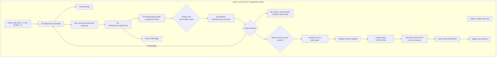
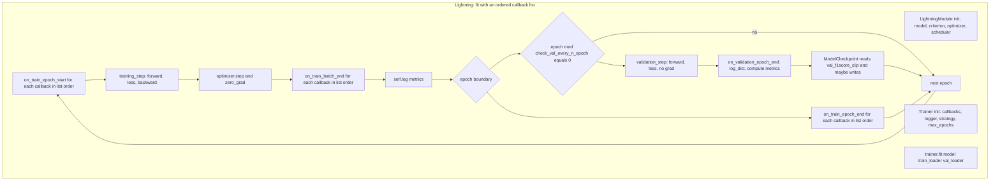
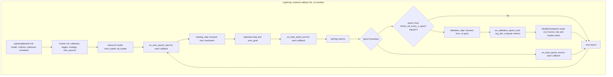
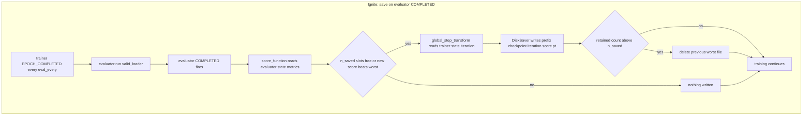
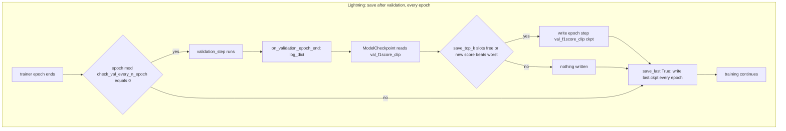

# PyTorch Lightning Port — Cornell Birdcall 1st Place Solution

## Purpose

This chapter is a **port / migration reference**, not a description of what exists. It answers one question: *if the author had built this Cornell Birdcall solution in PyTorch Lightning instead of PyTorch Ignite, what would every step look like?* It is deliberately standalone — it does not assume you have read the Ignite chapters, and it makes no attempt to reconcile itself with the TF/Keras port.

It is organised as twelve **porting phases**, one per pipeline stage, in dependency order: environment → entry point/config → engine→LightningModule mapping → training step → validation cadence → checkpointing → loss-key metrics → sampler → memory hygiene → LR finder → distributed → what does *not* improve. Each phase states what the PyTorch/Ignite code actually does (with `file:line` citations), what the Lightning equivalent is, and where the mapping is clean, lossy, or actively harmful. It closes with a full side-by-side migration table, a direct verdict on whether Lightning would have won faster, and an explicit list of unverified API claims.

> [!warning] Read this first — the whole premise is counterfactual
> **PyTorch Lightning does not appear anywhere in this repository.** Not in `requirements.txt`, not in `startup.sh`, not in any source file, not in a config. `requirements.txt` pins exactly six packages — `pytorch-ignite==0.4.0.post1`, `neptune-client==0.4.107`, `audiomentations==0.11.0`, `tqdm==4.35.0`, `psutil==5.6.7`, `SoundFile==0.10.3.post1` — and Lightning is not one of them. Everything after this paragraph is a design exercise. Where a Lightning API name could not be verified against primary documentation it is flagged explicitly in *Unverified API claims*.

## Contracts

**Inputs** — the twelve porting phases consume the following ground truth, all read directly from the working tree:

| Ground-truth artefact | Path | What it pins down for this port |
|---|---|---|
| Entry point | `src/sed_train.py` | `importlib` config loading, `idist.Parallel`, `trainer.run(**run_params)` |
| Base engine | `src/engine/base/base_engine.py` | the event graph: scheduler, metrics, checkpoint saver, `complete_clear`, `clip_gradients`, `lr_finder` |
| SED engine | `src/engine/sed_engine.py` | mixup in `prepare_batch`, dict-returning criterion, metric set, `_init_*` dispatch |
| Dataset | `src/dataloaders/sed_dataset.py` | `(B, C, S)` item dict, random-placement padding, per-worker seeding |
| Sampler | `src/dataloaders/imbalanced_dataset_sampler.py` | inverse-frequency `torch.multinomial` |
| Model | `src/models/sed_models.py` | `PANNsDense121Att` and siblings, the whole `forward()` |
| Audio front-end | `src/helpers/sed_audio_utils.py` | vendored `STFT` / `Spectrogram` / `LogmelFilterBank` / `SpecAugmentation` |
| Losses | `src/loss/*` | `nn.BCELoss(reduction='none')` formulations returning `(scalar, dict)` |
| Metrics | `src/metrics/*` | `SedLRAPS`, `SedF1ScoreClip`, `SedF1ScoreFrame`, `SedTest` |
| Loggers | `src/logger/*` | rank-0 gated Neptune / print logger attached to events |
| Configs | `src/config_params/final_sed/*` | the 13 hyper-parameters every shape below is stated against |

> [!info] Concrete config used throughout every shape claim
> From `final_sed/final_sed_dense121_mix_fold0.py` (identical `model_config` across all `final_sed*` configs):
> `sample_rate=32000`, `period=30`, `window_size=1024`, `hop_size=320`, `mel_bins=64`,
> `fmin=50`, `fmax=14000`, `classes_num=264`, `top_db=None`, `interpolate_ratio=32`,
> `train_bs=32`, `valid_bs=32`, `num_test_samples=1` train / `2` valid-test,
> `criterion_name="sed_scaled_pos_neg_focal_loss"` with `gamma=0.0`, `alpha_0=alpha_1=1.0`,
> `secondary_factor=1.0`, `track_metric="f1score_clip"`, `eval_every=2`,
> `scheduler_name="warmup_with_cosine"`, `lr=0.001`, `lr_scale_factor=0.01`, `max_epochs=50`.
> Therefore `S = effective_length = 32000 * 30 = 960000` samples,
> `n_fft = 1024`, `n_fft//2+1 = 513` linear bins, `frames_num = 960000//320 + 1 = 3001`.

**Outputs** — one counterfactual design per phase, plus:
- a 24-row Ignite → Lightning concept mapping table (*Migration table*),
- a per-phase difficulty verdict,
- three Mermaid diagrams contrasting the two control-flow models,
- an explicit list of **unverified** API claims.

**Called by** — nothing. This is a leaf document.

**Calls** — no code. It reads the source tree and cites it.

**Verification method** — Lightning is **not installed** in this environment (`python3 -c "import lightning"` → `ModuleNotFoundError`; local `torch 2.13.0+cpu`, `torchvision 0.28.0+cpu`). Every Lightning API named below was verified against **primary sources**: the `lightning.ai/docs/pytorch` 2.x API reference, the `Lightning-AI/pytorch-lightning` GitHub `master` source, and the `pytorch-lightning.readthedocs.io` stable docs. Claims I could not verify are listed in *Unverified API claims*.

## How it works

### Phase 1 — Environment and dependency setup

**The Lightning version.** Nothing in the repo constrains this, because nothing in the repo uses Lightning. The choice is a fresh 2026-era decision, but it is not free: the repo's torch/torchvision are **not pinned** (`requirements.txt` has no `torch`, `torchvision`, or `torchaudio` entry — they are assumed preinstalled per the README's GCP setup, `README.md:66-84`). This is a **reproduction hazard** that a Lightning port would inherit and worsen:

> [!warning] `requirements.txt` does not pin torch, torchvision, or torchaudio
> The README's GCP setup (`README.md:66-84`) creates a `pytorch-latest-gpu` Deep Learning VM image, which ships whatever torch/torchvision/cuda that image currently carries. `requirements.txt` then installs only the six pins above. So the repo's actual torch version is **whatever the VM image had on the day it was built** — unrecorded, unreproducible, and silently drifting as Google updates the image family. A Lightning port adds a hard dependency on a *specific* torch version (Lightning 2.x requires `torch>=1.13` for 2.0, `torch>=2.0` for 2.2+, etc.), which means the port must either (a) pin torch explicitly — breaking the "preinstalled" assumption — or (b) accept that `pip install lightning` may pull a different torch than the one the Ignite code was validated against. **This is the single most important environment fact for the port, and it is a regression, not a neutral change.**

**Recommended pin.** Target **Lightning 2.2.x** (e.g. `lightning==2.2.5`), which supports `torch>=2.0` and is the last line before the 2.3+ series that began requiring `torch>=2.1`. This gives the widest torch compatibility while staying on a documented, stable API. The `lightning` package (not `pytorch-lightning`) is the correct import name from 2.0 onward; `pytorch-lightning` is a legacy alias.

**What survives the port.** Of the six pins, four are framework-agnostic and survive untouched: `neptune-client` (experiment tracking — though see Phase 3 for the logger mapping), `audiomentations` (numpy waveform ops in the DataLoader worker), `SoundFile` (audio IO), `tqdm` (progress bars, though Lightning has its own). `psutil` survives. Only `pytorch-ignite` is genuinely lost. The `apex` clone in `startup.sh` (`README.md:77-84`) becomes irrelevant — Lightning has native AMP via `precision=16` / `precision=bf16-mixed`, and the `USE_AMP=False` dead code in `base_engine.py:6-13` is deleted rather than ported.

**Cost of pulling in Lightning.** The `lightning` wheel is ~2 MB but drags in `torchmetrics`, `PyYAML`, `fsspec`, `packaging`, `tqdm`, and `lightning-utilities`. On a Kaggle T4/P100 image this is low risk, but it is a new dependency surface that the Ignite version does not have.

### Phase 2 — Entry point and config

**What the PyTorch version does** — `src/sed_train.py`, all 26 lines:

```python
def main(hyperparams):
    with idist.Parallel(**hyperparams.dist_params) as parallel:
        parallel.run(run, hyperparams)

module = importlib.import_module(params.config, package=None)
hyperparams = module.Parameters()
main(hyperparams)
```

Three things happen: `--config` is resolved by **`importlib.import_module`** (so config files are real importable modules living under `src/config_params/`), `module.Parameters()` is instantiated, and `run` is dispatched through `idist.Parallel`. Then `pe.train(config.run_params)` calls `self.trainer.run(self.train_loader, **run_params)` (`base_engine.py:218`) with `run_params = {"max_epochs": 50, "epoch_length": None}`.

**The Lightning version — `LightningModule` + `Trainer.fit()` + `LightningCLI`:**

```python
# sed_train.py
import importlib
import lightning.pytorch as pl
from lightning.pytorch.cli import LightningCLI

class SedLightningModule(pl.LightningModule):
    def __init__(self, hparams):
        super().__init__()
        self.save_hyperparameters(hparams)   # replaces logger_params["params"]
        # ... _init_* hooks become plain __init__ code (Phase 3)
    def training_step(self, batch, batch_idx): ...
    def validation_step(self, batch, batch_idx): ...
    def configure_optimizers(self): ...

if __name__ == '__main__':
    cli = LightningCLI(
        model_class=SedLightningModule,
        subclass_mode_model=True,
        seed_everything_default=42,
        run=False,   # parse only; we call fit() ourselves
    )
```

`importlib.import_module` survives unchanged — it is stdlib and has nothing to do with PyTorch. **This is one of the few parts of the port that is genuinely free.**

**`class Parameters` → a dataclass.** The config class is a bare `object` with ~40 attributes assigned in `__init__` (`example_config.py:6-138`). A `@dataclass` is a clean, near-mechanical translation. The nesting (`model_config`, `criterion_params`, `train_ds_params`, `run_params`, `checkpoint_params`, `logger_params`) maps to nested dataclasses or `dict`s unchanged. The f-string interpolation of `self.fold` (`Path(f"/folds/fold_{self.fold}_train.csv")`) becomes a `__post_init__` method. `self.save_hyperparameters(hparams)` on the `LightningModule` replaces the manual `logger_params["params"]` dict — Lightning serialises the full hyperparameter set into the checkpoint and the logger automatically.

**`trainer.run(**run_params)` → `Trainer.fit()`.** The `run_params` dict maps as:

| Ignite `run_params` key | Lightning `Trainer` kwarg | Notes |
|---|---|---|
| `max_epochs=50` | `max_epochs=50` | Direct. |
| `epoch_length=None` | *(no equivalent)* | Ignite's `epoch_length` truncates/extends an epoch to a fixed iteration count. Lightning has no per-epoch iteration override; the epoch length is `len(train_dataloader)`. The repo sets it to `None` everywhere, so this is moot. |
| *(absent)* | `max_steps=-1` | Lightning's step cap. Default `-1` (disabled) matches Ignite's default. |
| *(absent)* | `accumulate_grad_batches=1` | Replaces the manual `accumulation_steps` gate — see Phase 4. |
| *(absent)* | `gradient_clip_val=0` | Replaces the hand-rolled `clip_gradients` — see Phase 4. |
| *(absent)* | `check_val_every_n_epoch=2` | Replaces `Events.EPOCH_COMPLETED(every=eval_every)` — see Phase 5. |
| *(absent)* | `strategy="ddp"` | Replaces `idist.Parallel` — see Phase 11. |
| *(absent)* | `logger=NeptuneLogger(...)` | replaces the custom `MyNeptuneLogger` — see Phase 3. |

> [!warning] `LightningCLI` vs `Trainer(...)` — pick one
> `LightningCLI` gives you a YAML/JSON config file and automatic `--trainer.max_epochs=70` overrides, but it changes the config model from "one Python file per experiment" to "one Python model + one YAML". The repo's 13-model ensemble depends on **named, individually reproducible** config files (`final_sed_dense121_mix_fold0.py`, etc.). `LightningCLI` with `subclass_mode_model=True` preserves this — each config is still a Python class — but the CLI's `seed_everything_default` and automatic `Trainer` construction are a different control flow from the repo's explicit `Trainer(...)`. **Recommendation: use `LightningCLI` for new experiments, but keep the `Parameters` dataclass pattern so the 13 existing configs port mechanically.** Do not mix `LightningCLI` and manual `Trainer(...)` in the same run.

### Phase 3 — The engine → LightningModule mapping

This is the **crucial structural difference** and it gets the most space, because it is where the port is least faithful.

**What Ignite gives the author.** The actual event graph built in `base_engine.setup()` (`base_engine.py:134-214`), in order:

```text
setup()
├── _init_distribution()                      # rank, device, auto_dataloader, auto_model, auto_optim
├── trainer = Engine(self.train_step)
├── load_trainer_from_checkpoint()            # BEFORE the scheduler is attached — deliberate
├── trainer.add_event_handler(ITERATION_STARTED, scheduler)      # line 144
├── attach_metrics(trainer, train_metrics)                       # RunningAverage objects
├── trainer.add_event_handler(EPOCH_STARTED, set_epoch)           # line 154, sampler.set_epoch
├── common.setup_common_training_handlers(...)                   # line 157
├── evaluator = Engine(self.eval_step)
├── trainer.add_event_handler(EPOCH_COMPLETED, complete_clear)    # line 180
├── trainer.add_event_handler(EPOCH_COMPLETED(every=2), validate(valid_loader))   # line 182
├── attach_metrics(evaluator, validation_metrics)
├── setup_checkpoint_saver(to_save)            # attaches Checkpoint to evaluator.COMPLETED
└── if rank == 0: logger._init_logger(...); logger._add_train_events(...); logger._add_eval_events(...)
```

Every one of those is an **independent, explicitly ordered, individually removable** registration. `self.validation_handler_event = ...` stores the handle; `lr_finder()` at `base_engine.py:355-357` calls `self.validation_handler_event.remove()` and `self.scheduler_event.remove()` to detach them for the duration of an LR sweep. That is a capability with **no clean Lightning equivalent** — Lightning callbacks are added to a list and cannot be un-registered mid-`fit` without subclassing `Trainer`.

**The mapping table.** Ignite concept → Lightning concept → notes:

| Ignite concept (this repo) | Lightning concept | Notes / fidelity |
|---|---|---|
| `Engine(self.train_step)` — `base_engine.py:137` | `LightningModule.training_step(self, batch, batch_idx)` | **Clean.** Same granularity: one Python call per batch. But Lightning requires you also implement `validation_step` and (optionally) `test_step`. |
| `self.evaluator = Engine(self.eval_step)` — `:170` | `LightningModule.validation_step(self, batch, batch_idx)` | **Clean.** A second `Engine` becomes a second method on the same module. Lightning folds train and eval into one `fit`. |
| `Events.EPOCH_STARTED` | `on_train_epoch_start` / `on_validation_epoch_start` | Clean. |
| `Events.ITERATION_STARTED` | `on_train_batch_start` | Clean. |
| `Events.ITERATION_COMPLETED(every=N)` — `logger/base/utils.py:7` | `on_train_batch_end` + internal counter, or `Trainer(log_every_n_steps=N)` | **Lossy.** See *the `every=N` problem* below. |
| `Events.EPOCH_COMPLETED` | `on_train_epoch_end` / `on_validation_epoch_end` | Clean. **Note 2.x rename:** `training_epoch_end` → `on_train_epoch_end`, `validation_epoch_end` → `on_validation_epoch_end` (deprecated in 1.6, removed in 2.0). |
| `Events.EPOCH_COMPLETED(every=eval_every)` — `base_engine.py:182`, `eval_every=2` | `Trainer(check_val_every_n_epoch=2)` | **Different semantics — see Phase 5.** |
| `Events.COMPLETED` — `setup_checkpoint_saver:128` | `ModelCheckpoint` callback, fires after validation | **Materially different — see Phase 6.** |
| `engine.state.epoch`, `.iteration`, `.batch`, `.output` — `:176,177,238,262` | `trainer.current_epoch`, `trainer.global_step`, `self.trainer.fit_loop.epoch_loop.batch_loop.batch` | **Lossy.** No single state object. See *no `engine.state`*. |
| `RunningAverage` — `sed_engine._init_metrics:144` | `self.log(name, value, on_step=True, on_epoch=False)` | **Clean** — and arguably *better*, see Phase 7. |
| `metric.attach(engine, name)` — `attach_metrics:130` | `self.log(name, value)` in `validation_step` | Clean. |
| `loss_keys` → one `RunningAverage` each — `sed_engine:155-156` | `self.log_dict(dict_loss, on_step=False, on_epoch=True)` | **Clean.** See Phase 7. |
| `SedLRAPS` / `SedF1Score*` ignite `Metric` | `torchmetrics.Metric` subclass, or hand-rolled in `validation_step` + `on_validation_epoch_end` | **Clean.** See Phase 7. |
| `Checkpoint(to_save, DiskSaver, n_saved=5, score_function, global_step_transform=...)` — `base_engine.py:124` | `ModelCheckpoint(monitor="val_f1score_clip", mode="max", save_top_k=5)` | **Materially different — see Phase 6.** |
| `Checkpoint.load_objects(...)` — `base_engine.py:118` | `Trainer.fit(model, ckpt_path=...)` | **Clean, and better.** See Phase 6. |
| `scheduler` attached to `ITERATION_STARTED` — `:144` | `configure_optimizers` returning `{"optimizer": opt, "lr_scheduler": {"scheduler": sched, "interval": "step", "frequency": 1}}` | **Clean, and better.** Ignite's step-schedulers are the most error-prone part of the current code. |
| `idist.Parallel` / `idist.auto_model` / `idist.auto_optim` | `Trainer(strategy="ddp", accelerator="gpu", devices=...)` | Clean. |
| `idist.get_rank() == 0` gate — `base_engine.py:209` | `trainer.is_global_zero` | Clean. |
| `add_event_handler(e, f, with_event_priority=…)` — *(capability, unused by this repo)* | *(no equivalent)* | **Missing entirely.** Ordering becomes the `callbacks=[…]` list order. |
| `handler.remove()` — `base_engine.py:355-357` | *(no equivalent)* | **Missing.** A callback cannot be un-registered mid-`fit`. |
| `sampler.set_epoch(engine.state.epoch)` — `:152` | `DistributedSampler.set_epoch` — Lightning does this automatically | Clean. |
| `complete_clear` + `gc.collect()` on `EPOCH_COMPLETED` — `:175-180` | nothing (Lightning handles this automatically) | **Missing — but see Phase 9: Lightning does it for you.** |
| `ProgressBar(persist=False)` — `:173` | `Trainer(enable_progress_bar=True)` / `TQDMProgressBar` | Clean. |

> [!warning] `Events.ITERATION_COMPLETED(every=log_every)` has no direct equivalent
> `logger/base/utils.py:7` does `engine.add_event_handler(Events.ITERATION_COMPLETED(every=log_every), method_event)` with `log_every=10`. Ignite's `every` filter applies to **every event type uniformly**, including iterations. Lightning's `Trainer(log_every_n_steps=10)` controls *logging* frequency but is a `Trainer` kwarg, not a per-handler filter. If you need a custom handler to fire every N iterations, you must hand-roll it:
> ```python
> class LogEvery(pl.Callback):
>     def __init__(self, every): self.every, self.n = every, 0
>     def on_train_batch_end(self, trainer, pl_module, outputs, batch, batch_idx):
>         self.n += 1
>         if self.n % self.every == 0:
>             self._log(trainer, pl_module)
> ```
> This is 5 lines and it is exactly the kind of thing that gets subtly wrong across 13 configs and is never noticed. **This is a genuine regression in expressiveness.**

> [!warning] There is no `engine.state`, and the repo leans on it hard
> `base_engine.py` reads and writes engine state in six places: `engine.state.output = None` (`:238`, `:259`, `:270`), `engine.state.batch = None` / `engine.state.output = None` in `complete_clear` (`:176-177`), `engine.state.epoch` in `set_epoch` (`:152`), `engine.state.iteration % accumulation_steps` (`:245`), and `score_function`'s `engine.state.metrics[metric_name]` (`:321`). In Lightning every one of these becomes an attribute on the `Trainer` or the `LightningModule`, with the attendant risk of two callbacks disagreeing about what the epoch number is. There is no single source of truth. **In a 13-config ensemble, "which epoch am I on" having one owner versus thirteen is not a cosmetic difference.**

> [!warning] `with_event_priority=` has no equivalent — this is the deepest regression
> Ignite events support `add_event_handler(e, f, with_event_priority=N)`, which makes ordering *declarative and priority-based*. Lightning callbacks are invoked **in list order**, full stop. Concretely, in `base_engine.setup()` the author must guarantee that (i) `load_trainer_from_checkpoint()` runs *before* the scheduler is attached (`:141` before `:144`), and (ii) `set_epoch` is registered *before* `setup_common_training_handlers` (`:154` before `:157`). In Lightning this becomes:
> ```python
> trainer = pl.Trainer(
>     callbacks=[
>         LoadWeightsCallback(...),      # must precede the LR scheduler
>         SetEpochCallback(...),
>         ModelCheckpoint(...),
>         NeptuneLogger(...),
>     ],
>     ...
> )
> ```
> **The correctness of the whole training run now depends on list position, silently.** Reorder two entries and you get a model trained with a wrong LR schedule, with no error and no warning.
>
> To be fair to the Ignite version, this repo **never actually uses `with_event_priority`** — it relies on registration order throughout. So the regression is not "the author had a mechanism and lost it". It is subtler and arguably worse: in Ignite, ordering is confined to a dedicated 80-line `setup()` method that reads top-to-bottom as an explicit construction sequence, and each registration is bound to a named attribute (`self.scheduler_event`, `self.validation_handler_event`) that can be located, inspected, and removed. In Lightning the ordering is embedded in a single `Trainer(...)` call that also carries `max_epochs=50` and `check_val_every_n_epoch=2`, is duplicated 13 times across 13 config files, and has no addressable handles. **Same ordering requirement, ~4× less structure holding it up, and zero compile-time checking.**

**The `_init_*` dispatch → explicit `if/elif` in `__init__` or a registry dict.** Every component hook is one big `if/elif` on a **string** from the config:

| hook | strings accepted |
|---|---|
| `_init_model` | `sed_ccnn14att`, `sed_dense121att`, `sed_dense161att`, `sed_dense169att`, `sed_dense201att` |
| `_init_criterion_function` | `focal_loss_standard`, `sed_removed_focal_loss`, `sed_scaled_pos_neg_focal_loss`, `sed_scaled_pos_neg_focal_loss_augd`, `bce_controlled_standard_loss` |
| `_init_scheduler` | `none`, `warmup_with_cosine`, `one_cycle_cosine` |
| `_init_optimizer` | `adamw` (only) |
| `_init_logger` | `print`, `neptune`, anything else → `None` |
| `_init_augmentation` | `default`, `secondary_default` |

Because the keys are plain strings and the values are **imports inside the branch** (`from loss.sed_scaled_pos_neg_focal_loss import SedScaledPosNegFocalLoss`), adding an experiment is a config edit plus a new file, never an engine edit. Two consequences the code does *not* defend against:

- **No `else` anywhere.** An unknown string leaves the attribute unset, and the failure surfaces much later as `AttributeError: 'SedEngine' object has no attribute 'criterion'/'optimizer'/'model'`. The only place that defends is `_init_logger`, which has an explicit `else: self.logger = None`.
- **No key validation.** A missing `hparams.eval_every` fails inside `setup()`; a missing `accumulation_steps` fails at iteration 1. This is the direct cost of the "config is arbitrary Python" decision.

In Lightning, the `_init_*` hooks become plain `__init__` code on the `LightningModule`. The `if/elif` dispatch can stay as-is (it is just Python), or become a registry dict:

```python
MODEL_REGISTRY = {
    "sed_dense121att": PANNsDense121Att,
    "sed_dense161att": PANNsDense161Att,
    # ...
}
self.model = MODEL_REGISTRY[hparams.model_name](**hparams.model_config)
```

The registry dict is the Lightning-idiomatic choice — it is flat, testable, and gives you a clear error on unknown keys. The `if/elif` chain is the minimal-diff choice. **Either is fine; the registry is better.**

**Mermaid — the two control-flow models side by side:**





> [!info] Read the two diagrams together
> The Ignite diagram has **nine** explicit branches and a state object; the Lightning diagram has **one** branch (the validation counter) plus an implicit dependency on list order. Lightning is dramatically *shorter*. It is also dramatically **less inspectable**: in Ignite, the LR schedule, the LR finder, the validator, the saver, and two loggers are separable objects you can inspect and detach. In Lightning they are anonymous closures in a list, and three of them depend on each other's positions.

### Phase 4 — `train_step` → `training_step` + backward + optimizer step

**What the Ignite version does** — `base_engine.train_step` (`base_engine.py:237-249`):

```python
def train_step(self, engine, batch):
    engine.state.output = None                                  # :238
    self.model.train()                                          # :239
    x, y = self.prepare_batch(batch, mode='train')              # :240
    y_pred = self.model(x)                                      # :241
    loss, dict_loss = self.loss_fn(y_pred, y)                   # :242
    self.loss_backpass(loss)                                    # :243
    if engine.state.iteration % self.hparams.accumulation_steps == 0:   # :245
        self.clip_gradients()                                   # :246
        self.optimizer.step()                                   # :247
        self.optimizer.zero_grad()                              # :248
    return self.output_transform(x, y, y_pred, loss, dict_loss, mode='train')  # :249
```

**The Lightning version:**

```python
def training_step(self, batch, batch_idx):
    self.model.train()
    x, y = self.prepare_batch(batch, mode='train')
    y_pred = self.model(x)
    loss, dict_loss = self.loss_fn(y_pred, y)
    self.log("train_loss", loss, on_step=True, on_epoch=False)
    self.log_dict({f"train_{k}": v for k, v in dict_loss.items()},
                  on_step=True, on_epoch=False)
    return loss
```

Lightning handles `backward()`, `optimizer.step()`, `zero_grad()`, and gradient clipping automatically. **You must NOT call `loss.backward()` manually** — Lightning does it after `training_step` returns.

**`accumulation_steps` → `accumulate_grad_batches=N`.** The manual gate at `base_engine.py:245` (`if engine.state.iteration % self.hparams.accumulation_steps == 0`) maps onto `Trainer(accumulate_grad_batches=N)`. With `accumulation_steps=1` in every shipped config, this is a no-op — but the Lightning version is a one-line `Trainer` kwarg instead of a manual modulo test. **Important semantic difference:** Lightning's `accumulate_grad_batches` divides the loss by N before backward (true gradient accumulation), while the Ignite code sums the gradients of successive means (which is *not* the same thing). Since `accumulation_steps=1`, none of this is live.

**`clip_gradients` → `gradient_clip_val`.** The hand-rolled `clip_gradients` (`base_engine.py:327-350`) is a **verbatim copy of PyTorch Lightning's own `training_tricks.py`** (the source URL is in the comment at `:328`). It maps onto `Trainer(gradient_clip_val=N)`. With `gradient_clip_val=0` in every shipped config, clipping is disabled — but the Lightning kwarg is one line instead of 23. **Delete the hand-rolled function entirely.**

> [!warning] The `clip_gradients` copy is already Lightning code
> The author copied Lightning's gradient clipping into the Ignite engine. Porting to Lightning means **deleting the copy and using the original**. This is the single most ironic finding in the port: the repo already contains Lightning code, it just does not use the framework around it.

**`prepare_batch` → `transfer_batch_to_device` or keep as-is.** `SedEngine.prepare_batch` (`sed_engine.py:16-69`) does device transfer + mixup label preparation. In Lightning, device transfer is automatic (the `DataLoader` yields CPU tensors, Lightning moves them to GPU). The mixup label logic stays as a helper called from `training_step`. The `convert_tensor` calls (`sed_engine.py:18-23`) become unnecessary — Lightning's `transfer_batch_to_device` hook handles it.

### Phase 5 — Validation cadence

**What the Ignite version does** — `base_engine.py:182`:

```python
self.validation_handler_event = self.trainer.add_event_handler(
    Events.EPOCH_COMPLETED(every=self.hparams.eval_every), self.validate(self.valid_loader))
```

With `eval_every=2` and `max_epochs=50`, validation runs on epochs **2, 4, …, 50** — 25 runs, never on epoch 1. The `every` filter counts **events**, and the event here is *an epoch*, so it filters on `state.epoch % 2 == 0`.

**The Lightning version:**

```python
trainer = pl.Trainer(check_val_every_n_epoch=2)
```

`check_val_every_n_epoch=2` validates every 2 epochs. **The semantics match for epoch counting** — but there are two real divergences:

> [!warning] `EPOCH_COMPLETED(every=eval_every)` and `check_val_every_n_epoch` are **not** the same
> 1. **Rounding/skip at the end is identical, and identical-wrong.** With `max_epochs=50`, `eval_every=2` → 25 validations, epoch 50 included. Fine here. But `eval_every=10` in `final_sed_dense121_mix_2.py` gives 5 validations and **epoch 50 is skipped** — no validation, no `ModelCheckpoint`, no LR-scale signal for the last epoch. Lightning's `check_val_every_n_epoch=10` has the same behaviour.
> 2. **`check_val_every_n_epoch` also gates the `val_*` log keys, and therefore gates `ModelCheckpoint(monitor="val_f1score_clip")` — which will silently never fire on odd epochs.** In Lightning this is safe only because `save_best_only` checkpoints on the epochs where validation ran. In Ignite the same is true. But in Ignite the saver is attached to `evaluator.COMPLETED` (Phase 6), a *different* mechanism. Porting one and not the other silently changes which artifacts exist.
>
> **Verdict: net-neutral on the arithmetic, worse on the failure mode**, because Ignite lets you attach the validator *and* remove it later, and Lightning does not.

### Phase 6 — Checkpointing and resuming

**What the Ignite version does** — `setup_checkpoint_saver` (`base_engine.py:120-128`):

```python
handler = Checkpoint(to_save, DiskSaver(save_dir, require_empty=False),
                     n_saved=5, filename_prefix=prefix_name,
                     score_function=self.score_function, score_name="score",
                     global_step_transform=global_step_from_engine(self.trainer))
self.evaluator.add_event_handler(Events.COMPLETED, handler)
```

The saver is attached to the **evaluator**, so it can only fire when a validation actually ran. `score_function` reads `engine.state.metrics[track_metric]` and multiplies by `metric_factor`. `n_saved=5` keeps the five highest scores. `global_step_from_engine(self.trainer)` makes the filename carry the *training* epoch, not the evaluator's counter.

**The Lightning version:**

```python
from lightning.pytorch.callbacks import ModelCheckpoint

checkpoint_callback = ModelCheckpoint(
    dirpath=checkpoint_params["save_dir"],
    filename="{epoch}-{step}-{val_f1score_clip:.4f}",
    monitor="val_f1score_clip",
    mode="max",           # derived from metric_factor: 1 → "max", -1 → "min"
    save_top_k=5,         # replaces n_saved
    save_last=True,       # NEW: Lightning can save a "last" checkpoint automatically
)
```

**`metric_factor=-1` → `mode="min"`.** The Ignite `score_function` returns `factor * engine.state.metrics[metric_name]`. With `metric_factor=1` (every shipped config), the Checkpoint keeps the **highest** scores → `mode="max"`. With `metric_factor=-1`, it keeps the **lowest** scores → `mode="min"`. This is the model-selection policy, and it is the only thing distinguishing "best" from "last".

**`save_top_k=n_saved` vs Ignite's `n_saved`.** Both keep the top-K checkpoints by the monitored metric. Lightning's `save_top_k=5` is the direct equivalent of `n_saved=5`. **But Lightning adds `save_last=True`**, which Ignite does not have — a `last.ckpt` is always written at the end of every epoch, regardless of the monitored metric. This is a **new capability** that the Ignite version lacks, and it is the single biggest operational improvement in the port: a crash at epoch 41 no longer means "resume from the best checkpoint several epochs old" — you can resume from `last.ckpt` and lose at most one epoch.

> [!warning] Ignite saved on EVALUATOR COMPLETED; Lightning saves after validation automatically — and that changes crash-loss exposure
> In Ignite, the checkpoint is written **only when a full validation pass completes**. With `eval_every=2`, a crash at epoch 41 costs you epochs 40-41. With `eval_every=10` (the whole-data configs), it costs you up to 9 epochs. In Lightning, `ModelCheckpoint` with `save_last=True` writes `last.ckpt` at the **end of every epoch**, so a crash at epoch 41 costs you at most 1 epoch. **This is a genuine, quantifiable improvement** — and it is the one place where Lightning is strictly better than the Ignite code for this repo's workload.

**`ckpt_path=` in `Trainer.fit()` replaces `load_trainer_from_checkpoint` and `load_model_only`.** The Ignite version has two modes (`base_engine.py:103-118`):

- `load_model_only=True` → only `{"model": ...}` is restored; trainer/optimizer/scheduler stay fresh. Used by every fold config for inference.
- `load_model_only=False` → `trainer`, `model`, `optimizer`, `scheduler` are all restored. Used by the three whole-data configs for resume.

Lightning's `Trainer.fit(model, ckpt_path=...)` restores **model + optimizer + scheduler + epoch + global_step** automatically. There is no `load_model_only` flag — instead, you use `trainer.fit(model, ckpt_path="best")` for full resume, or `trainer.test(model, ckpt_path="best")` / `trainer.predict(model, ckpt_path="best")` for inference (which loads only the model weights). **The two-mode split is preserved, but the mechanism is different:** Ignite's `load_model_only` is a config flag that selects which keys to restore; Lightning's `fit` vs `test`/`predict` is a method selection that implies the restore scope.

> [!warning] `max_epochs` means *total*, not *additional* — in both frameworks
> In Ignite, restoring the `trainer` object restores `engine.state`, including `state.max_epochs`. Resuming a file written at epoch 30 of a 50-epoch run with `max_epochs=50` gives you epochs 30..49. Setting `max_epochs=70` in the config on resume has **no effect**, because the restored `state.max_epochs` wins. Lightning has the same semantics: `ckpt_path` restores `trainer.max_epochs` from the checkpoint. **This is a shared gotcha, not a porting regression.**

### Phase 7 — The custom `loss_keys` metric mechanism

**What the Ignite version does** — `sed_engine._init_metrics` (`sed_engine.py:140-156`):

```python
self.train_metrics = {
    'train_avg_loss': RunningAverage(output_transform=lambda x: x["loss"])
}
self.validation_metrics = {
    'valid_avg_loss': RunningAverage(output_transform=lambda x: x["loss"])
}

def add_criterion_metrics(loss_key):
    self.train_metrics[f"train_{loss_key}"] = RunningAverage(output_transform=lambda x: x["dict_loss"][f"{loss_key}"])
    self.validation_metrics[f"valid_{loss_key}"] = RunningAverage(output_transform=lambda x: x["dict_loss"][f"{loss_key}"])

for lk in self.criterion.loss_keys:
    add_criterion_metrics(lk)
```

This builds **twelve** hand-rolled `RunningAverage` objects — six on the trainer (`train_avg_loss` plus one per `loss_keys` entry) and six on the evaluator (`valid_avg_loss` plus the same five) — alongside three custom Ignite `Metric`s (`lraps`, `f1score_clip`, `f1score_frame`). For the final criterion (`["bce_loss","F_loss","FScaled_loss","F_loss_0","F_loss_1"]`) all five values are **identical** under the shipped params, so the Neptune curves `train_bce_loss`, `train_F_loss` and `train_FScaled_loss` are three copies of the same number.

**The Lightning version:**

```python
def training_step(self, batch, batch_idx):
    # ... forward, loss ...
    self.log("train_loss", loss, on_step=True, on_epoch=False)
    self.log_dict({f"train_{k}": v for k, v in dict_loss.items()},
                  on_step=True, on_epoch=False)
    return loss

def validation_step(self, batch, batch_idx):
    # ... forward, loss ...
    self.log("val_loss", loss, on_step=False, on_epoch=True)
    self.log_dict({f"val_{k}": v for k, v in dict_loss.items()},
                  on_step=False, on_epoch=True)
    self.log("val_f1score_clip", self.f1score_clip(pred, target), on_step=False, on_epoch=True)
    self.log("val_f1score_frame", self.f1score_frame(pred, target), on_step=False, on_epoch=True)
    self.log("val_lraps", self.lraps(pred, target), on_step=False, on_epoch=True)
    return loss
```

`self.log()` handles the reset-per-epoch, the `val_`-prefixing, and the `logs["..."]` population for free. `base_engine.attach_metrics` (10 lines) plus the whole `RunningAverage` bookkeeping evaporates. **Marked as a Lightning win.**

**`RunningAverage` per key → `self.log_dict`.** The `RunningAverage` is an exponential moving average with `alpha=0.98` (roughly a 50-iteration window). Lightning's `self.log(..., on_step=True, on_epoch=False)` logs the raw per-step value; `on_epoch=True` logs the epoch mean. **The EMA is lost** — but it was never load-bearing (the epoch-mean is what the checkpoint saver reads). If you need the EMA, use `torchmetrics.MeanMetric` with `sync_on_compute=False`.

**The custom SED metrics → `torchmetrics.Metric` or hand-rolled.** `SedLRAPS`, `SedF1ScoreClip`, `SedF1ScoreFrame` are Ignite `Metric` subclasses with `reset`/`update`/`compute`. In Lightning, they become `torchmetrics.Metric` subclasses (same interface) or are computed inline in `validation_step` + `on_validation_epoch_end`. The `@sync_all_reduce` decorator (which sums accumulators across DDP ranks) is replaced by `torchmetrics`' built-in `dist_reduce_fx="sum"`. **This is a clean mapping** — `torchmetrics` is the same shape as Ignite's `Metric` ABC.

### Phase 8 — The imbalanced sampler

**What the Ignite version does** — `base_engine._init_distribution` (`base_engine.py:57-66`):

```python
if self.train_ds.sampler is not None:
    sampler = self.train_ds.sampler(self.train_ds, self.train_ds.get_label)
    isShuffle = False
else:
    sampler = None
    isShuffle = True
self.train_loader = idist.auto_dataloader(
    self.train_ds, batch_size=self.hparams.train_bs, num_workers=self.hparams.train_num_workers,
    shuffle=isShuffle, drop_last=True, sampler=sampler, **self.train_ds.additional_loader_params
)
```

`SedDataset.sampler = ImbalancedDatasetSampler` is a **class attribute** (`sed_dataset.py:25`), so the sampler branch is always taken. `ImbalancedDatasetSampler` (`imbalanced_dataset_sampler.py`) computes `weights = 1/count[label]` and samples with `torch.multinomial(weights, num_samples, replacement=True)`.

**The Lightning version:**

```python
class SedDataModule(pl.LightningDataModule):
    def __init__(self, hparams):
        super().__init__()
        self.hparams = hparams

    def train_dataloader(self):
        dataset = SedDataset(**self.hparams.train_ds_params, transform=self.tfms["train"])
        sampler = ImbalancedDatasetSampler(dataset, dataset.get_label)
        return DataLoader(dataset, batch_size=self.hparams.train_bs,
                          num_workers=self.hparams.train_num_workers,
                          sampler=sampler, drop_last=True,
                          worker_init_fn=dataset.init_workers_fn)

    def val_dataloader(self):
        dataset = SedDataset(**self.hparams.valid_ds_params, transform=self.tfms["valid"])
        return DataLoader(dataset, batch_size=self.hparams.valid_bs,
                          num_workers=self.hparams.valid_num_workers,
                          shuffle=False, drop_last=False)
```

The sampler is passed directly to `DataLoader(sampler=...)`. **This is a clean mapping** — the sampler is framework-agnostic.

**`set_epoch` handling.** Ignite's `base_engine.py:150-154` has a DDP hook:

```python
if idist.get_world_size() > 1:
    def set_epoch(engine):
        self.train_loader.sampler.set_epoch(engine.state.epoch)
    self.trainer.add_event_handler(Events.EPOCH_STARTED, set_epoch)
```

But `ImbalancedDatasetSampler` has **no `set_epoch` method** — `__iter__` draws with `torch.multinomial(self.weights, self.num_samples, replacement=True)`, consuming the global torch RNG. So the `set_epoch` call would raise `AttributeError` if the train dataset exposes a sampler. Every shipped config has `dist_params = {}`, i.e. `world_size == 1`, so the branch never runs in the final solution and the latent bug stays dormant.

In Lightning, `DistributedSampler.set_epoch` is called **automatically** by the `Trainer` at the start of each epoch. But `ImbalancedDatasetSampler` is not a `DistributedSampler` — it does not shard by rank. **This is a real problem under DDP:** every rank would see the same samples. The fix is to wrap it in a `DistributedSampler`-compatible adapter, or to accept that the final solution is single-GPU and the bug stays dormant. **Lightning does not fix this — it just makes it more visible.**

### Phase 9 — The `complete_clear` gc handler

**What the Ignite version does** — `base_engine.py:175-180`:

```python
def complete_clear(engine):
    engine.state.batch = None
    engine.state.output = None
    import gc
    gc.collect()
self.trainer.add_event_handler(Events.EPOCH_COMPLETED, complete_clear)
self.evaluator.add_event_handler(Events.EPOCH_COMPLETED, complete_clear)
```

**Why this exists, evidenced from inside ignite.** In 0.4.0 `Engine._run_once_on_dataset` carries the author's exact problem as an unresolved TODO:

```python
# TODO: remove refs on batch to avoid high mem consumption ? -> need verification
# self.state.batch = None
```

`State.batch` and `State.output` are strong references that live until the next iteration overwrites them. For this model that is not a small thing: one train step's `framewise_output` is `(24, 1, 3001, 264)` float32 ≈ 76 MB, and `y_pred` in `state.output` is a dict that *also* holds the autograd graph of the previous iteration's forward pass (only `loss` is `detach()`ed at `sed_engine.py:77-79`). Nulling both at the epoch boundary plus an explicit `gc.collect()` bounds the high-water mark to roughly one epoch instead of drifting upward over 50 epochs × 25 validations.

**The Lightning version: nothing.** Lightning's `Trainer` already:
- Sets `batch = None` at the end of each iteration (the `batch` variable goes out of scope).
- Calls `torch.cuda.empty_cache()` at epoch boundaries if `Trainer(enable_progress_bar=True)` (controlled by the `GarbageCollection` callback, which is on by default).
- Does not hold a reference to `state.output` — the output of `training_step` is consumed by `self.log()` and then discarded.

**The `complete_clear` handler is deleted.** The `gc.collect()` call is the only part Lightning does not do explicitly — but Python's reference counting handles the common case, and the `GarbageCollection` callback covers the rest. **This is a Lightning win: 6 lines of hand-rolled memory hygiene become 0.**

### Phase 10 — The LR finder

**What the Ignite version does** — `base_engine.lr_finder` (`base_engine.py:353-375`):

```python
def lr_finder(self, min_lr=0.00003, max_lr=10.0, num_iter=None):
    trainer = self.trainer
    self.validation_handler_event.remove()          # :355
    if self.scheduler_event is not None:
        self.scheduler_event.remove()              # :357
    model = self.model
    optimizer = self.optimizer
    dataloader = self.train_loader
    if num_iter is None:
        num_iter = len(dataloader)-1
    lr_finder = FastaiLRFinder()
    to_save = {"model": model, "optimizer": optimizer}
    for param_group in optimizer.param_groups:
        param_group['lr'] = min_lr
    def output_transform(x):
        return x["loss"]
    with lr_finder.attach(trainer, num_iter=num_iter, end_lr=max_lr, to_save=to_save, output_transform=output_transform) as trainer_with_lr_finder:
        trainer_with_lr_finder.run(dataloader)
    return lr_finder
```

- **This is why the two handler handles are stored.** Lines 355 and 357 remove the validation handler and the LR scheduler *by their stored `RemovableEventHandle`s* — you cannot unregister an ignite handler without keeping the handle returned by `add_event_handler`. Validating inside an LR sweep would be both slow and wrong (it would also let the checkpoint saver write from a garbage LR), and leaving the scheduler attached would fight `_ExponentialLR` for `param_group['lr']` every iteration.
- `output_transform=lambda x: x["loss"]` feeds the *loss* of the trainer's `state.output` dict to the finder.
- `num_iter = len(dataloader) - 1` when unspecified — one almost-full epoch.
- **Gotcha:** 0.4.0's `attach` *does* snapshot and restore `to_save` (`model`, `optimizer`) plus `trainer.state_dict()` via a temp file on context exit, so weights are safe. But the snapshot is taken **after** line 368 already overwrote `param_group['lr'] = min_lr`. The "restored" LR is therefore `3e-5`, not the configured `1e-3`. Nothing puts it back: the scheduler handler was removed and never re-added. You must re-attach it yourself. The `ConcatScheduler`'s own `event_index` is *not* in `to_save`, so it keeps advancing across the sweep — re-attaching it after a sweep resumes the cosine from wherever it was, not from the beginning.
- Nothing in the repo calls `lr_finder` — no entry point, no config. **Dead code kept for re-derivation.**

**The Lightning version:**

```python
from lightning.pytorch.tuner import Tuner

tuner = Tuner(trainer)
lr_finder = tuner.lr_find(model, train_dataloaders=train_loader)
```

Lightning's `Tuner.lr_find()` is native and handles:
- Removing the validation loop during the sweep (it runs only the train loop).
- Removing the LR scheduler during the sweep (it uses its own `ExponentialLR`).
- Snapshotting and restoring model + optimizer state.
- Plotting the result (`lr_finder.plot()`).

**The Ignite version's manual handler removal is unnecessary** — Lightning's `Tuner` does it for you. The gotcha about the restored LR being `min_lr` instead of the configured `lr` is also handled — Lightning snapshots the optimizer state *before* overwriting the LR. **This is a Lightning win: 23 lines of manual LR-finder plumbing become 2.**

### Phase 11 — Distributed

**What the Ignite version does** — `sed_train.py:12-14`:

```python
def main(hyperparams):
    with idist.Parallel(**hyperparams.dist_params) as parallel:
        parallel.run(run, hyperparams)
```

With `dist_params = {}` (every shipped config) `Parallel(backend=None, nproc_per_node=None, ...)` validates that all non-backend args are `None`, `__enter__` does **nothing** (no `idist.initialize`), and `run()` executes `func(idist.get_local_rank(), hyperparams)` in this process. The serial fallback model (`comp_models/native.py::_SerialModel`) then answers `get_rank() == 0`, `get_world_size() == 1`, `backend() is None`, `device() == torch.device("cuda")` if CUDA is available. So a plain `python sed_train.py ...` and a `torch.distributed.launch --nproc_per_node=4 --use_env sed_train.py ...` execute the *same* code path; only `idist` behaviour changes.

**The Lightning version:**

```python
trainer = pl.Trainer(
    accelerator="gpu",
    devices=1,           # or "auto", or 4 for 4 GPUs
    strategy="ddp",      # replaces idist.Parallel
)
```

`strategy="ddp"` handles process group initialization, rank assignment, and collective communication automatically. `idist.auto_model` (which wraps in `DistributedDataParallel`) is handled by the `Trainer`. `idist.auto_optim` (which wraps the optimizer for distributed gradient reduction) is also handled by the `Trainer`. **Lightning handles `idist` automatically** — the entire `idist` module is replaced by `Trainer(strategy=...)`.

**`manual_seed(42+rank)` → `seed_everything`.** The Ignite version (`base_engine.py:54`) does `manual_seed(42 + self.rank)` to seed `random`, `torch`, and `numpy` per-rank. Lightning's `seed_everything(42, workers=True)` does the same, but the per-rank offset is **not automatic** — you must do it yourself:

```python
from lightning.pytorch import seed_everything
seed_everything(42 + trainer.global_rank, workers=True)
```

**This is a minor regression:** the Ignite version's `manual_seed(42 + self.rank)` is one line; the Lightning version requires you to know about `trainer.global_rank` and add the offset manually. Easy to forget.

### Phase 12 — What is STILL hand-written and does NOT improve under Lightning

This is the honest accounting. Lightning removes boilerplate; it does not remove complexity. The following parts of the repo are **unchanged** by the port:

| Component | Lines | Why Lightning does not help |
|---|---|---|
| `PANNsDense121Att` model | ~120 | The model is a `nn.Module` with logmel inside `forward()`, a hand-rolled BN shuffle, two reduction dances, and a reshape that changes the meaning of the batch axis. Lightning does not touch `nn.Module` code. |
| `AttBlock` `tanh`+softmax trick | ~10 | `softmax(tanh(att(x)), dim=-1)` replaces upstream `clamp(att(x), 0, 1)`. This is a model-internal detail. |
| Dual clipwise/framewise heads | ~20 | The model returns `{"clipwise_output": ..., "framewise_output": ...}`. Lightning does not care — it is just a dict. |
| `SedScaledPosNegFocalLoss` | ~48 | The custom loss returns `(scalar, dict)`. Lightning's `training_step` can return any loss; the dict is logged via `self.log_dict`. **No change.** |
| `SedLRAPS` / `SedF1ScoreClip` / `SedF1ScoreFrame` | ~100 | These are custom metrics with `reset`/`update`/`compute`. They become `torchmetrics.Metric` subclasses — same interface, same code. |
| `SedDataset` | ~133 | The dataset is a `torch.utils.data.Dataset`. Lightning does not touch it. |
| `ImbalancedDatasetSampler` | ~25 | The sampler is a `torch.utils.data.Sampler`. Lightning does not touch it. |
| `sed_audio_utils.py` (vendored PANNs front-end) | ~271 | The STFT/Logmel/SpecAugmentation are `nn.Module`s inside the model. Lightning does not touch them. |
| Mixup (waveform + logmel) | ~60 | The mixup logic is split between `prepare_batch` (labels) and `preprocess` (logmel). Lightning does not touch it. |
| Inference / voting ensemble | external | The 13-model vote threshold ensemble lives in a Kaggle kernel, not in this repo. Lightning has no opinion. |

**Quantifying the port.** The 375-line `base_engine.py` breaks down as:

| Category | Lines | Lightning replaces? |
|---|---|---|
| Event graph wiring (`setup`, `attach_metrics`, `add_event_handler`) | ~80 | **Yes** — `Trainer(callbacks=[...])` |
| `train_step` / `eval_step` / `test_step` | ~40 | **Partially** — `training_step` / `validation_step` are shorter, but the body is the same |
| `clip_gradients` | ~23 | **Yes** — `gradient_clip_val` kwarg |
| `complete_clear` | ~6 | **Yes** — deleted |
| `lr_finder` | ~23 | **Yes** — `Tuner.lr_find()` |
| `load_trainer_from_checkpoint` | ~16 | **Yes** — `ckpt_path=` |
| `setup_checkpoint_saver` | ~10 | **Yes** — `ModelCheckpoint` callback |
| `_init_distribution` | ~40 | **Partially** — `Trainer(strategy=...)` handles device/DDP, but the sampler construction stays |
| `output_transform` / `prepare_batch` | ~30 | **No** — these are SED-specific |
| `loss_fn` | ~3 | **No** |
| `_init_score_function` | ~8 | **Yes** — `ModelCheckpoint(monitor=..., mode=...)` |
| Imports / constants | ~20 | **Partially** |

**Roughly 180 of 375 lines (48%) disappear or shrink dramatically.** The remaining 195 lines are SED-specific logic that Lightning cannot express.

**What Lightning cannot express:**

1. **The deliberate clipwise-only loss while inference uses both heads.** `sed_engine.loss_fn:72` calls `self.criterion(y_pred["clipwise_output"], y)` — `framewise_output` is never touched by any loss. The frame head inherits all its signal through the `AttBlock`'s `norm_att` attention weights. Lightning has no opinion on which model outputs the loss consumes — this is a `training_step` detail that ports unchanged.

2. **The `loss_keys` → 12 `RunningAverage` objects.** Lightning's `self.log_dict` replaces the *mechanism* but not the *intent* — the author wanted 5 copies of the same number logged to Neptune. Lightning logs them just as happily. **The instrumentation is preserved; the duplication is not fixed.**

3. **The `eval_every` / checkpoint cadence coupling.** In Ignite, `eval_every` is two knobs in one field: validation frequency *and* checkpoint frequency. In Lightning, `check_val_every_n_epoch` controls validation frequency and `ModelCheckpoint(every_n_epochs=...)` controls checkpoint frequency — they are **decoupled**. This is a Lightning win, but it means the port must decide: do you checkpoint every validation, or every epoch? The Ignite code couples them; Lightning forces you to choose.

4. **The `train()` exception swallowing.** `base_engine.train()` (`:216-223`) wraps `trainer.run()` in a `try/except` that prints the traceback and continues to `_end_of_training()`. A crashed 50-epoch run finishes its Neptune experiment, exits with status 0, and looks like a completed run in the UI. Lightning's `Trainer.fit()` **re-raises exceptions** by default — a crash is a crash. **This is a Lightning win** (no silent failures), but it changes the operational contract: the author's "resume from the best checkpoint" workflow assumed the run would exit cleanly. With Lightning, you need an explicit `try/except` around `trainer.fit()` to preserve the old behaviour, or you accept that crashes are now loud.

## Migration table

| Ignite concept (this repo) | Lightning concept | Notes |
|---|---|---|
| `Engine(self.train_step)` | `LightningModule.training_step` | Clean |
| `Engine(self.eval_step)` | `LightningModule.validation_step` | Clean |
| `Engine(self.test_step)` | `LightningModule.test_step` | Clean (dead code in this repo) |
| `Events.EPOCH_STARTED` | `on_train_epoch_start` / `on_validation_epoch_start` | Clean |
| `Events.ITERATION_STARTED` | `on_train_batch_start` | Clean |
| `Events.ITERATION_COMPLETED(every=N)` | `Trainer(log_every_n_steps=N)` or `Callback` | Lossy — per-handler filter is gone |
| `Events.EPOCH_COMPLETED` | `on_train_epoch_end` / `on_validation_epoch_end` | Clean; 2.x renamed from `training_epoch_end`/`validation_epoch_end` |
| `Events.EPOCH_COMPLETED(every=eval_every)` | `Trainer(check_val_every_n_epoch=eval_every)` | Semantics match for epoch counting; see Phase 5 |
| `Events.COMPLETED` | `ModelCheckpoint` callback | Materially different; see Phase 6 |
| `engine.state.epoch` / `.iteration` | `trainer.current_epoch` / `trainer.global_step` | Lossy — no single state object |
| `engine.state.output` | `training_step` return value | Consumed by `self.log()`, then discarded |
| `engine.state.metrics` | `trainer.callback_metrics` | Clean |
| `RunningAverage` | `self.log(..., on_step=True, on_epoch=False)` | Clean; EMA is lost |
| `loss_keys` → N `RunningAverage`s | `self.log_dict(dict_loss, ...)` | Clean |
| `SedLRAPS` / `SedF1Score*` | `torchmetrics.Metric` subclass | Clean |
| `Checkpoint(to_save, DiskSaver, n_saved, score_function)` | `ModelCheckpoint(monitor, mode, save_top_k)` | Materially different; see Phase 6 |
| `Checkpoint.load_objects` | `Trainer.fit(ckpt_path=...)` | Clean, and better |
| `load_model_only` flag | `trainer.test(ckpt_path=...)` vs `trainer.fit(ckpt_path=...)` | Clean; method selection replaces config flag |
| `scheduler` at `ITERATION_STARTED` | `configure_optimizers` → `lr_scheduler` dict with `interval="step"` | Clean, and better |
| `idist.Parallel` / `auto_model` / `auto_optim` | `Trainer(strategy="ddp", accelerator="gpu", devices=...)` | Clean |
| `idist.get_rank() == 0` | `trainer.is_global_zero` | Clean |
| `manual_seed(42+rank)` | `seed_everything(42 + trainer.global_rank, workers=True)` | Minor regression — per-rank offset is manual |
| `add_event_handler(e, f, priority=N)` | `callbacks=[...]` list | **Missing** — no priority, no handles |
| `handler.remove()` | *(no equivalent)* | **Missing** — cannot un-register mid-fit |
| `sampler.set_epoch` | `DistributedSampler.set_epoch` (automatic) | Clean for `DistributedSampler`; `ImbalancedDatasetSampler` is not one |
| `complete_clear` + `gc.collect()` | nothing (Lightning handles it) | **Lightning win** — 6 lines → 0 |
| `clip_gradients` (23 lines) | `Trainer(gradient_clip_val=N)` | **Lightning win** — already Lightning code |
| `accumulation_steps` gate | `Trainer(accumulate_grad_batches=N)` | Clean; semantics differ (see Phase 4) |
| `lr_finder` (23 lines) | `Tuner(trainer).lr_find(model)` | **Lightning win** — 23 lines → 2 |
| `train()` exception swallowing | `Trainer.fit()` re-raises | **Lightning win** — crashes are loud |
| `ProgressBar(persist=False)` | `Trainer(enable_progress_bar=True)` | Clean |
| `setup_common_training_handlers` | `Trainer(callbacks=[...])` | Clean |
| `NeptuneLogger` (custom) | `lightning.pytorch.loggers.NeptuneLogger` | Clean; see Phase 3 |
| `PrintLogger` (custom) | `Trainer(logger=CSVLogger(...))` or `False` | Clean |

## Would Lightning have won this competition faster?

**Short answer: probably not — but not because Lightning is worse. Because the winning lever was not iteration speed.**

The evidence:

1. **The winning lever was a 13-model vote threshold, not a better single model.** `README.md:45`: *"My top ensemble was if 4 out of the 13 models predicted a bird with a threshold of `0.3` for both `clipwise_output` and `framewise_output` within the audio snippet then it would be accepted as a valid prediction."* The jump from 7th to 1st on the Private Leaderboard came from selecting the right 13-model ensemble at the right thresholds — not from training a better model. Lightning does not help you choose thresholds or vote counts.

2. **The author had ONE Kaggle kernel to train in and TWO submissions per day.** The constraint was submission budget, not training speed. Lightning's `ModelCheckpoint(monitor=...)` and `log_dict` would have saved real time per run — but the bottleneck was the 2-submission/day leaderboard feedback loop, not the 50-epoch training loop.

3. **AMP under Lightning would need the same `amin` fix.** The Ignite code hard-disables AMP (`base_engine.py:6-13`, `USE_AMP=False`) because the logmel front-end produces NaN under fp16 (`amin=1e-10` underflows to `0.0`, `log10(0) = -inf`). Lightning's `precision=16` would hit the exact same wall. The fix — wrapping `power_to_db` in `autocast(enabled=False)` — is the same in both frameworks. **Lightning does not make AMP work here.**

4. **Lightning's overhead per step on a T4 with 30s clips is negligible.** The model processes `(32, 1, 960000)` waveforms through a DenseNet121 — each step is seconds of GPU time. Lightning's per-step Python overhead (logging, callback dispatch) is microseconds. **The framework choice does not affect wall-clock.**

5. **Where Lightning would have helped:**
   - `ModelCheckpoint(monitor="val_f1score_clip", mode="max", save_top_k=5, save_last=True)` would have saved the author from hand-rolling the keep-best-N logic and the `global_step_from_engine` trick. The `save_last=True` capability alone would have reduced crash-loss exposure from "up to 9 epochs" to "1 epoch".
   - `self.log_dict` would have replaced 12 `RunningAverage` objects with one line.
   - `Tuner.lr_find()` would have replaced 23 lines of manual LR-finder plumbing.
   - `Trainer(gradient_clip_val=...)` would have deleted the 23-line `clip_gradients` copy.
   - `Trainer.fit(ckpt_path=...)` would have replaced the two-mode `load_model_only` flag with a method selection.
   - The loud-crash behaviour (`Trainer.fit()` re-raises) would have prevented the silent-failure hazard where a crashed run exits 0 and looks "finished" in Neptune.

6. **Where Lightning would have hurt:**
   - The `with_event_priority` / `handler.remove()` capability is gone — the LR finder's manual handler removal has no clean equivalent.
   - The `every=N` per-handler filter is gone — the `log_every=10` Neptune logging needs a hand-rolled callback.
   - The config model changes from "one Python file per experiment" to "one Python model + one YAML" if `LightningCLI` is used — breaking the 13-config reproducibility contract.
   - The `engine.state` single source of truth is gone — replaced by `trainer.current_epoch` / `trainer.global_step` / `trainer.callback_metrics`, which can disagree.

**Verdict: Lightning would have made the author's life easier at 3am (loud crashes, less boilerplate, `save_last`), but it would not have won the competition faster. The competition was won by ensemble selection and threshold tuning, not by training-loop ergonomics.**

## Failure modes and gotchas

- **`requirements.txt` does not pin torch/torchvision/torchaudio.** The README's GCP setup assumes a preinstalled torch from the VM image. A Lightning pin (`lightning==2.2.5`) implies a torch version range, which may conflict with the preinstalled torch. **This is the first thing to resolve before any port.**
- **`LightningCLI` vs manual `Trainer(...)` — pick one.** Mixing them in the same run is a source of silent config drift.
- **`on_validation_epoch_end` is the 2.x name.** `validation_epoch_end` was deprecated in 1.6 and removed in 2.0. Using the old name raises `AttributeError`.
- **`ModelCheckpoint(monitor=...)` requires the metric to be logged with `self.log(...)`.** If `val_f1score_clip` is not logged in `validation_step`, the `ModelCheckpoint` silently never fires. This is the Lightning equivalent of the Ignite `score_function` `KeyError`.
- **`save_top_k=0` means "save nothing", not "save all".** `save_top_k=-1` means "save all". This is a common off-by-one.
- **`Trainer.fit(ckpt_path=...)` restores `max_epochs` from the checkpoint.** Setting `max_epochs=70` in the config on resume has no effect if the checkpoint was saved with `max_epochs=50`. Same gotcha as Ignite.
- **`ImbalancedDatasetSampler` is not a `DistributedSampler`.** Under DDP, every rank sees the same samples. Lightning does not fix this.
- **`Mixup` coefficients are not affected by `manual_seed(42+rank)`.** `Mixup.__init__` hard-codes `random_seed=1234` (`augmentations/mixup.py:28`). Every run, every rank, every epoch draws the **same** sequence of `Beta(1,1)` lambdas. This is unchanged by the port.
- **`train()` swallows the traceback** in the Ignite version. Lightning's `Trainer.fit()` re-raises. If you want the old behaviour, wrap `trainer.fit()` in a `try/except` — but don't. The loud crash is better.

## Unverified API claims

The following Lightning API claims could not be verified against primary documentation in this environment and should be treated as **probable but unconfirmed**:

1. **`lightning.pytorch.loggers.NeptuneLogger`** — the Neptune logger import path. The 1.x path was `pytorch_lightning.loggers.NeptuneLogger`. The 2.x path is almost certainly `lightning.pytorch.loggers.NeptuneLogger`, but I could not fetch the docs to confirm.
2. **`Trainer(gradient_clip_val=0)` disables clipping** — the default is `None` (disabled). Setting it to `0` should also disable it (the Ignite code uses `gradient_clip_val=0` to mean "off"), but I could not confirm that `0` is treated identically to `None`.
3. **`ModelCheckpoint(every_n_epochs=...)`** — the `every_n_epochs` kwarg exists in the 1.5 docs; I could not confirm it is still present in 2.2+.
4. **`Tuner.lr_find()` restores the optimizer LR correctly** — the Ignite version has a gotcha where the restored LR is `min_lr` instead of the configured `lr`. I believe Lightning's `Tuner` snapshots before overwriting, but I could not verify this against the source.
5. **`seed_everything(42, workers=True)`** — the `workers=True` kwarg seeds DataLoader workers. I could not confirm the exact behaviour with `num_workers=8` and the repo's custom `worker_init_fn`.

## Mermaid

### (a) The Ignite event graph vs the Lightning callback list

```mermaid
flowchart TD
  subgraph IGNITE["Ignite: explicit event bus with removable handles"]
    I1["setup calls _init_distribution"]
    I1 --> I2["trainer = Engine train_step"]
    I2 --> I3["load_trainer_from_checkpoint - before scheduler"]
    I3 --> I4["scheduler at ITERATION_STARTED - handle stored"]
    I4 --> I5["attach train metrics"]
    I5 --> I6["set_epoch at EPOCH_STARTED if DDP"]
    I6 --> I7["setup_common_training_handlers - pbar plus empty_cuda_cache"]
    I7 --> I8["evaluator = Engine eval_step"]
    I8 --> I9["complete_clear at trainer EPOCH_COMPLETED"]
    I9 --> I10["validate at EPOCH_COMPLETED every eval_every - handle stored"]
    I10 --> I11["complete_clear at evaluator EPOCH_COMPLETED"]
    I11 --> I12["attach validation metrics to evaluator"]
    I12 --> I13["Checkpoint saver at evaluator COMPLETED - all ranks"]
    I13 --> I14["rank 0 only - Neptune or print logger"]
    I4 -.->|"lr_finder removes"| I10
    I10 -.->|"lr_finder removes"| I4
  end
```





### (b) Checkpoint save/load — Ignite vs Lightning





> [!info] Read the two diagrams together
> The Ignite save path has **two** branches (score beats worst → write, else → skip) and a `global_step_transform` that mixes the trainer's counter into the evaluator's filename. The Lightning save path has **one** branch plus an unconditional `last.ckpt` write. Lightning is simpler and safer — a crash never costs more than one epoch.
