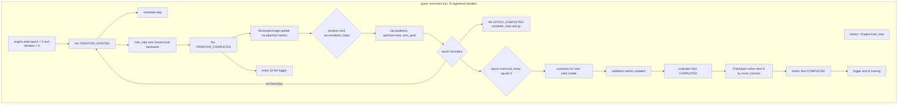
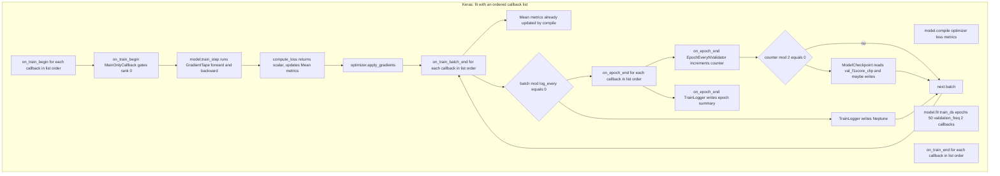
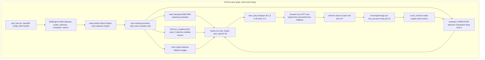
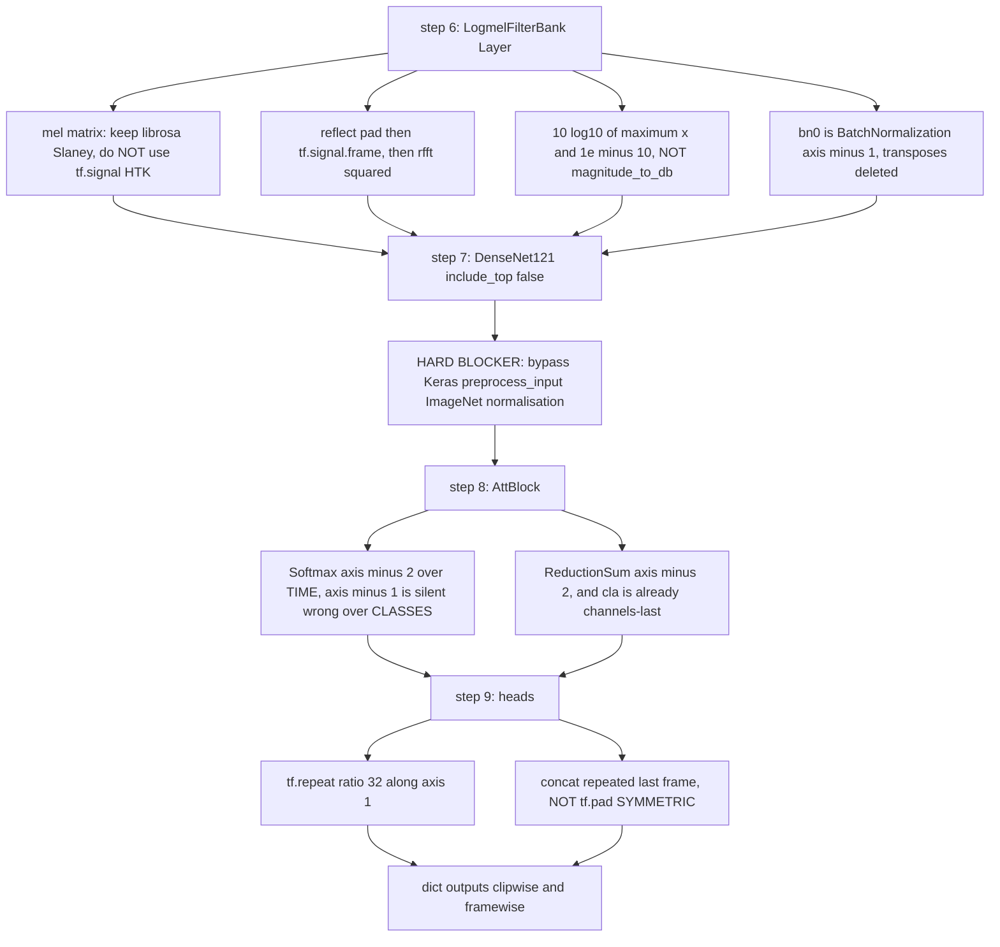

## Purpose

This chapter is a **port / migration reference**, not a description of what exists. It answers one question: *if the author had built this Cornell Birdcall solution in TensorFlow / Keras instead of PyTorch + PyTorch Ignite, what would every step look like?* It is deliberately standalone — it does not assume you have read the Ignite chapter, and it makes no attempt to reconcile itself with a Lightning chapter.

It is organised as eleven **porting phases**, one per pipeline stage, in dependency order: environment → config → training-engine architecture → model → losses → metrics → checkpointing → data → augmentation → inference → Kaggle constraints. Each phase states what the PyTorch/Ignite code actually does (with file:line citations), what the TF/Keras equivalent would be, and where the mapping is clean, lossy, or actively harmful. It closes with a full side-by-side concept mapping table and a direct verdict.

> [!warning] Read this first — the whole premise is counterfactual
> **TensorFlow and Keras do not appear anywhere in this repository.** Not in `requirements.txt`, not in `startup.sh`, not in any source file, not in a branch, not in a config. Evidence is in *How it works → Phase 0*. Everything after that is a design exercise, and no code in this chapter has been executed. Where an API name could not be verified against primary documentation it is flagged explicitly.

## Contracts

**Inputs** — the eleven porting phases consume the following ground truth, all read directly from the working tree:

| Ground-truth artefact | Path | What it pins down for this port |
|---|---|---|
| Entry point | `src/sed_train.py` | `importlib` config loading, `idist.Parallel`, `trainer.run(**run_params)` |
| Base engine | `src/engine/base/base_engine.py` | the event graph: scheduler, metrics, checkpoint saver, `complete_clear` |
| SED engine | `src/engine/sed_engine.py` | mixup in `prepare_batch`, dict-returning criterion, metric set |
| Dataset | `src/dataloaders/sed_dataset.py` | `(B, C, S)` item dict, random-placement padding, per-worker seeding |
| Sampler | `src/dataloaders/imbalanced_dataset_sampler.py` | inverse-frequency `torch.multinomial` |
| Model | `src/models/sed_models.py` | `PANNsDense121Att` and siblings, the whole `forward()` |
| Audio front-end | `src/helpers/sed_audio_utils.py` | vendored `STFT` / `Spectrogram` / `LogmelFilterBank` / `SpecAugmentation` |
| Losses | `src/loss/*` | `nn.BCELoss(reduction='none')` formulations returning `(scalar, dict)` |
| Metrics | `src/metrics/*` | `SedLRAPS`, `SedF1ScoreClip`, `SedF1ScoreFrame`, `SedTest` |
| Loggers | `src/logger/*` | rank-0 gated Neptune / Print logger attached to events |
| Configs | `src/config_params/final_sed*` | the 13 hyper-parameters every shape below is stated against |

> [!info] Concrete config used throughout every shape claim
> From `final_sed_5_fold/final_5fold_sed_dense121_nomix_fold*.py` (identical `model_config` across all `final_sed*` configs):
> `sample_rate=32000`, `period=30`, `window_size=1024`, `hop_size=320`, `mel_bins=64`,
> `fmin=50`, `fmax=14000`, `classes_num=264`, `top_db=None`, `interpolate_ratio=32`,
> `train_bs=28`, `valid_bs=32`, `num_test_samples=1` train / `2` valid-test,
> `criterion_name="sed_scaled_pos_neg_focal_loss"` with `gamma=0.0`, `alpha_0=alpha_1=1.0`,
> `secondary_factor=1.0`, `track_metric="f1score_clip"`, `eval_every=2`,
> `scheduler_name="warmup_with_cosine"`, `lr=0.001`, `lr_scale_factor=0.01`, `max_epochs=50`.
> Therefore `S = effective_length = 32000 * 30 = 960000` samples,
> `n_fft = 1024`, `n_fft//2+1 = 513` linear bins, `frames_num = 960000//320 + 1 = 3001`.

**Outputs** — one counterfactual design per phase, plus:
- a 20-row Ignite → TF/Keras concept mapping table (*Key decisions and tricks*),
- a per-phase difficulty verdict,
- three Mermaid diagrams contrasting the two control-flow models,
- an explicit list of **unverified** API claims.

**Called by** — nothing. This is a leaf document.

**Calls** — no code. It reads the source tree and cites it.

**Verification method** — TF and Keras are **not installed** in this environment (`python3 -c "import tensorflow"` → `ModuleNotFoundError`; local `torch 2.13.0+cpu`, `torchvision 0.28.0+cpu`). Every TF/Keras API named below was therefore verified against **primary sources**: `keras-team/keras` and `tensorflow/tensorflow` on GitHub `master`, the `keras.io` Keras 3 API docs, and `tensorflow.org` v2.16.1 API docs. Claims I could not verify are listed in *Failure modes and gotchas → Unverified*.

## How it works

### Phase 0 — Preliminary finding: TensorFlow/Keras is not used in this repository

This must be stated plainly before anything else, because a reader arriving at this chapter with a "TF port" brief would otherwise assume a partially-migrated repo.

Four independent searches, all returning **zero** hits:

```text
$ grep -ril "tensorflow" . --exclude-dir=.git     # → no output
$ grep -ril "keras"     . --exclude-dir=.git     # → no output
$ grep -rn "import tf\b\|tf\.keras\|tf\.data\|tf\.signal" . --exclude-dir=.git   # → no output
$ grep -rniE "tensorflow|keras|\btf\b|tensorflow-addons|tensorflow_io" . --exclude-dir=.git   # → no output
```

`requirements.txt`, in full — six pins, no TF, and **no `torch` pin either**:

```text
pytorch-ignite==0.4.0.post1
neptune-client==0.4.107
audiomentations==0.11.0
tqdm==4.35.0
psutil==5.6.7
SoundFile==0.10.3.post1
```

`startup.sh`, in full — it builds NVIDIA **Apex** (the AMP path, which `base_engine.py:10,14` then hard-disables) and installs only the above:

```bash
git clone https://github.com/NVIDIA/apex
cd apex
pip install -v --no-cache-dir --global-option="--cpp_ext" --global-option="--cuda_ext" ./
cd ..
pip install -r requirements.txt
```

> [!info] What the dependency set implies about a TF port
> Three of the six pins are **framework-agnostic** and would survive the port untouched: `audiomentations` (numpy waveform ops), `SoundFile` (audio IO), `neptune-client` (experiment tracking). Only `pytorch-ignite` is genuinely lost. `tqdm` and `psutil` survive too. So the TF port would need `tensorflow` (or `keras` + a backend) added, `pytorch-ignite` removed, and the `apex` clone in `startup.sh` replaced with `tf.keras.mixed_precision` (which, see Phase 11, is not a drop-in).

### Phase 1 — Environment and dependency setup

**The TF version.** Nothing in the repo constrains this, because nothing in the repo uses TF. The choice would be a fresh 2026-era decision:

- **TF 2.16+ / Keras 3** — the `tf.keras` alias now resolves to Keras 3. Keras 3 is multi-backend (`keras` + `torch`/`jax`/`numpy` backends) and is where `save_weights`, `ModelCheckpoint`, and `keras.optimizers.AdamW` live.
- **TF 2.15 / Keras 2** — the last release where `tf.keras` is Keras 2, which still has `ModelCheckpoint(save_top_k=…)` and `tf.keras.metrics.register`.

This chapter targets **Keras 3**, and says so every time a Keras 2→3 divergence matters. Several divergences bite hard and are called out inline below.

**`tensorflow-addons` status.** This is the single most important dependency fact, because TFA is the library the TF audio community would reach for first — and it is dead:

> TensorFlow Addons (TFA) has ended development and introduction of new features. TFA has entered a minimal maintenance and release mode until a planned end of life in **May 2024**. — `tensorflow/addons` README (fetched live)

The repository itself is archived: *"This repository was archived by the owner on Mar 11, 2026. It is now read-only."* Additionally, per the same README, **Windows support was dropped** due to inconsistent TF 2.15 wheel packaging.

The two TFA symbols a TF port of this repo would plausibly want are both gone from the current package exports:

| Wanted symbol | Status in current TFA |
|---|---|
| `tfa.image.mel_filter_bank` | **Absent.** `tfa/image/__init__.py` exports exactly 26 symbols: `adjust_hsv_in_yiq`, `blend`, `equalize`, `sharpness`, `connected_components`, `cutout`, `random_cutout`, `euclidean_dist_transform`, `dense_image_warp`, `interpolate_bilinear`, `interpolate_spline`, `gaussian_filter2d`, `mean_filter2d`, `median_filter2d`, `random_hsv_in_yiq`, `resampler`, `rotate`, `shear_x`, `shear_y`, `random_shear_x`, `composite_transforms`, `angles_to_projective_transforms`, `transform`, `translate`, `translate_xy`, `translations_to_projective_transforms`. **No `mel_filter_bank`.** |
| `tfa.layers.TimeDistributed` | **Absent.** `tfa/layers/__init__.py` exports 28 symbols — `AdaptiveAveragePooling1D/2D/3D`, `AdaptiveMaxPooling1D/2D/3D`, `EmbeddingBag`, `GELU`, `MaxUnpooling2D`, `MaxUnpooling2DV2`, `Maxout`, `MultiHeadAttention`, `FilterResponseNormalization`, `GroupNormalization`, `InstanceNormalization`, `CorrelationCost`, `PoincareNormalize`, `PolynomialCrossing`, `Snake`, `Sparsemax`, `SpectralNormalization`, `SpatialPyramidPooling2D`, `TLU`, `WeightNormalization`, `ESN`, `StochasticDepth`, `NoisyDense`, `CRF`. **No `TimeDistributed`** — it was always a core Keras layer anyway (`keras.layers.TimeDistributed`, filed under Keras 3 *Recurrent layers*). |

The good news is that neither symbol is needed, because **`tf.signal` covers the ground directly** and better. Verified present in `tensorflow/python/ops/signal/`: `stft`, `inverse_stft`, `linear_to_mel_weight_matrix`, `frame`, `hann_window`, `hamming_window`, `kaiser_window`, `overlap_and_add`, `mfccs_from_log_mel_spectrograms`. That last one is interesting — a built-in log-mel front-end — though it applies its own dB scaling and would not reproduce this repo's numbers.

> [!warning] `tf.signal.magnitude_to_db` does not exist
> I enumerated all **34** public symbols of `tf.signal` from the v2.16.1 API docs: `dct, fft, fft2d, fft3d, fftnd, fftshift, frame, hamming_window, hann_window, idct, ifft, ifft2d, ifft3d, ifftnd, ifftshift, inverse_mdct, inverse_stft, inverse_stft_window_fn, irfft, irfft2d, irfft3d, irfftnd, kaiser_bessel_derived_window, kaiser_window, linear_to_mel_weight_matrix, mdct, mfccs_from_log_mel_spectrograms, overlap_and_add, rfft, rfft2d, rfft3d, rfftn, rfftd, stft, vorbis_window`.
> **There is no `magnitude_to_db`.** Any TF guide that tells you to use it is describing an older version or is wrong. The dB step must be hand-written — see Phase 4, where it turns out to be one line anyway.

**`tensorflow_io` for audio IO.** `tensorflow-io` is alive and, unlike TFA, its audio module is exactly what a TF port needs. Verified `tfio.audio` symbols: `AudioIODataset`, `AudioIOTensor`, `dbscale`, `decode`, `decode_aac`, `decode_flac`, **`decode_mp3`**, `decode_vorbis`, `decode_wav`, `encode_aac`, `encode_flac`, `encode_mp3`, `encode_vorbis`, `encode_wav`, `fade`, `freq_mask`, `inverse_spectrogram`, `melscale`, `remix`, `resample`, `spectrogram`, `split`, `time_mask`, `trim`. `tfio.audio.decode_mp3(input, shape=None, name=None)` and `tfio.audio.decode_wav(...)` are both documented.

Note that `tfio.audio.dbscale`, `freq_mask`, `time_mask`, `melscale`, `spectrogram`, and `resample` map remarkably well onto this repo's `power_to_db`, `DropStripes`, `LogmelFilterBank.melW`, `Spectrogram`, and the 32 kHz pre-resample respectively. This is the one place where a TF port would be *cleaner* than PyTorch — but see Phase 5, because it would still not be numerically equivalent.

**The `SoundFile` question.** `requirements.txt` pins `SoundFile==0.10.3.post1` and `sed_dataset.get_audio:76` calls `sf.read(file_dir)`. A TF port has three options:

1. **Keep `soundfile` inside `tf.data.map`.** This is what a competent engineer would do. `soundfile` is libsndfile-backed, decodes WAV/FLAC/OGG natively, and — critically — is *already* a dependency. Calling it from `tf.data.map` with `num_parallel_calls=AUTOTUNE` runs in the TF thread pool, which is equivalent to the `num_workers=8` `DataLoader` prefetch the repo uses today. Zero risk. **Recommendation: keep it.**
2. **`tf.io.read_audio` + `tf.audio.decode_wav`.** `tf.audio` has exactly **two** public functions, `decode_wav` and `encode_wav` (verified by enumerating the module). `tf.io.read_file` returns a string tensor, which does not integrate with `tf.data`'s streaming prefetch as cleanly as a real reader.
3. **`tfio.audio.decode_wav` / `AudioIOTensor`.** Better, but adds a dependency to solve a problem `soundfile` does not already have.

> [!tip] MP3 is a non-issue here, and that is the author's design paying off
> The repo pre-resamples all training audio to **32 kHz WAV** on disk and rewrites `.mp3` → `.wav` at load time (`sed_dataset.get_audio:67,69`: `filename.replace('.mp3','.wav')`). The README documents this: *"training was completed on the resampled 32kHz wav equivalent of the training data provided on Kaggle, with the same folder structure."*
> This **sidesteps the entire MP3 problem**. `tf.audio.decode_wav` cannot decode MP3 at all; `tfio.audio.decode_mp3` can, but needs `libav` system libraries and returns a fixed-shape tensor (`shape=` is a required-ish argument). Because the repo already committed to 32 kHz WAV, a TF port inherits the same escape hatch and can use `soundfile` or `decode_wav` with total indifference to codec support. *This is a genuine, transferable win of the PyTorch pipeline that a less careful TF implementation would have thrown away.*

**Cost of pulling in TF.** The `tensorflow` wheel is ~600 MB installed and brings its own CUDA/cuDNN/cuBLAS stack. On a Kaggle P100/T4 image this is a real risk of clobbering the image's own pinned CUDA. See Phase 11.

### Phase 2 — Entry point and config

**What the PyTorch version does** — `src/sed_train.py`, all 26 lines:

```python
def main(hyperparams):
    with idist.Parallel(**hyperparams.dist_params) as parallel:
        parallel.run(run, hyperparams)

module = importlib.import_module(params.config, package=None)
hyperparams = module.Parameters()
main(hyperparams)
```

Three things happen: `--config` is resolved by **`importlib.import_module`** (so config files are real importable modules living under `src/config_params/`), `module.Parameters()` is instantiated, and `run` is dispatched through `idist.Parallel`. Then `pe.train(config.run_params)` calls `self.trainer.run(self.train_loader, **run_params)` (`base_engine.py:218`) with `run_params = {"max_epochs": 50, "epoch_length": None}`.

**The TF version — dataclass + `absl.flags` (recommended, minimal diff):**

```python
# sed_train.py
import importlib
from absl import app, flags

def main(hyperparams):
    strategy = tf.distribute.MirroredStrategy()
    with strategy.scope():
        pe = SedEngine(hparams)
        pe.train(hyperparams.run_params)

if __name__ == '__main__':
    flags.DEFINE_string('config', None, 'e.g. config_params.final_sed.final_sed_dense121_nomix_fold0')
    app.run(lambda argv: main(importlib.import_module(flags.FLAGS.config, package=None).Parameters()))
```

`importlib.import_module` survives unchanged, because it is stdlib and has nothing to do with PyTorch. **This is one of the few parts of the port that is genuinely free.**

`class Parameters` → a `@dataclass` is a clean, near-mechanical translation. The nesting (`model_config`, `criterion_params`, `train_ds_params`, `run_params`, `checkpoint_params`, `logger_params`) maps to nested dataclasses or `dict`s unchanged.

**`absl.flags` vs `keras_tuner`.** `absl.flags` is stdlib-adjacent (ships with TensorFlow) and preserves the "one config file per experiment" reproducibility model the repo relies on — 22 config files in `config_params/`, of which 13 are the final ensemble. `keras_tuner` would be a *different* tool with a different storage model (a `Tuner` object + search space, not a frozen hyperparameter dict); adopting it would break the ability to reproduce a specific fold from a specific file, which is exactly what a 13-model ensemble depends on.

> [!warning] Do not use `keras_tuner` here
> The author's 13-model ensemble is 13 **named, individually reproducible** checkpoints. A hyperparameter *search* framework optimizes the wrong thing: it would give you a search space, not a reproducible artifact list. `absl.flags` + dataclass keeps the frozen-file contract. *(inferred — reason: the ensemble's value comes entirely from being able to name and re-run 13 exact configurations.)*

**`trainer.run(**run_params)` → `model.fit(...)`.** Verified Keras 3 `Model.fit` signature:

```text
fit(x=None, y=None, batch_size=None, epochs=1, verbose="auto", callbacks=None,
    validation_split=0.0, validation_data=None, shuffle=True, class_weight=None,
    sample_weight=None, initial_epoch=0, steps_per_epoch=None,
    validation_steps=None, validation_batch_size=None, validation_freq=1)
```

So `run_params` maps as: `max_epochs` → `epochs`, `epoch_length` → `steps_per_epoch` (the repo sets `epoch_length: None` in every final config, so `steps_per_epoch=None` and Keras infers it from the dataset cardinality — see Phase 8 for why that inference is a trap here).

> [!warning] `fit()` in Keras 3 has **no `jit_compile` argument**
> Verified against `keras-team/keras` `master` `keras/src/trainers/trainer.py`: `fit(...)` ends at `validation_freq=1`. `jit_compile` lives on **`compile()`**, whose signature is `compile(optimizer, loss, loss_weights, metrics, weighted_metrics, run_eagerly=False, steps_per_execution=1, jit_compile="auto", auto_scale_loss=True)`. `fit(jit_compile=True)` was Keras 2 behaviour and silently does nothing in Keras 3. See Phase 10 for what to use instead.

**`accumulation_steps`.** `base_engine.train_step:245` gates the optimizer step on `engine.state.iteration % self.hparams.accumulation_steps == 0`, with `accumulation_steps = 1` in every final config. Keras 3 `AdamW` has a native `gradient_accumulation_steps=None` argument (verified in `keras/src/optimizers/`), so a TF port could delete the manual gate. But note it must not be applied to the loss scale — the repo's `SedScaledPosNegFocalLoss` returns a *mean*, and PyTorch's manual accumulation simply sums the gradients of successive means, which is subtly not gradient accumulation. Since `accumulation_steps=1`, none of this is live.

### Phase 3 — Engine → Callback architecture mapping

This is the **crucial structural difference** and it gets the most space, because it is where the port is least faithful.

**What Ignite gives the author.** Look at the actual event graph built in `base_engine.setup()` (`base_engine.py:134-214`), in order:

```text
setup()
├── _init_distribution()                      # rank, device, auto_dataloader, auto_model, auto_optim
├── trainer = Engine(self.train_step)
├── load_trainer_from_checkpoint()            # BEFORE the scheduler is attached — deliberate
├── trainer.add_event_handler(ITERATION_STARTED, scheduler)      # line 144
├── attach_metrics(trainer, train_metrics)                       # RunningAverage objects
├── trainer.add_event_handler(EPOCH_STARTED, set_epoch)           # line 154, sampler.set_epoch
├── common.setup_common_training_handlers(...)                   # line 157
├── evaluator = Engine(self.eval_step)
├── trainer.add_event_handler(EPOCH_COMPLETED, complete_clear)    # line 180
├── trainer.add_event_handler(EPOCH_COMPLETED(every=2), validate(valid_loader))   # line 182
├── attach_metrics(evaluator, validation_metrics)
├── setup_checkpoint_saver(to_save)            # attaches Checkpoint to evaluator.COMPLETED
└── if rank == 0: logger._init_logger(...); logger._add_train_events(...); logger._add_eval_events(...)
```

Every one of those is an **independent, explicitly ordered, individually removable** registration. `self.validation_handler_event = ...` stores the handle; `lr_finder()` at `base_engine.py:355-357` calls `self.validation_handler_event.remove()` and `self.scheduler_event.remove()` to detach them for the duration of an LR sweep. That is a capability with **no Keras equivalent**.

**The mapping table.** Ignite concept → TF/Keras concept → notes:

| Ignite concept (this repo) | TF/Keras 3 concept | Notes / fidelity |
|---|---|---|
| `Engine(self.train_step)` — `base_engine.py:137` | `tf.keras.Model` subclass overriding `train_step` | **Clean.** Same granularity: one Python call per batch. But Keras requires you also implement `test_step`/`predict_step`, or the default (loss-only) applies. |
| `self.evaluator = Engine(self.eval_step)` — `:170` | `model.evaluate(...)` or `model.test_step` override | **Clean-ish.** A second `Engine` becomes a second loop; Keras folds train and eval into one `fit`. |
| `Events.EPOCH_STARTED` | `Callback.on_epoch_begin` | Clean. |
| `Events.ITERATION_STARTED` | `Callback.on_train_batch_begin` | Clean. |
| `Events.ITERATION_COMPLETED(every=N)` — `logger/base/utils.py:7` | `Callback.on_train_batch_end` + internal counter | **Lossy.** See *the `every=N` problem* below. |
| `Events.EPOCH_COMPLETED` | `Callback.on_epoch_end` | Clean. |
| `Events.EPOCH_COMPLETED(every=eval_every)` — `base_engine.py:182`, `eval_every=2` | `fit(validation_freq=2)` **or** `on_epoch_end` + counter | **Different semantics — see below.** |
| `Events.COMPLETED` — `setup_checkpoint_saver:128` | `fit()` returning + `on_train_end`, or `ModelCheckpoint(save_freq=…)` | **Lossy.** No `COMPLETED`; closest is `on_train_end`. |
| `engine.state.epoch`, `.iteration`, `.batch`, `.output` — `:176,177,238,262` | *(no equivalent)* | **Missing.** Replaced by callback instance attributes. See *no `engine.state`*. |
| `RunningAverage` — `sed_engine._init_metrics:144` | `keras.metrics.Mean(name=…)` via `compile(metrics=[…])`, or `logs["…"]` built in `on_train_batch_end` | **Clean** — and arguably *better*, see below. |
| `metric.attach(engine, name)` — `attach_metrics:130` | `compile(metrics=[...])` | Clean. |
| `loss_keys` → one `RunningAverage` each — `sed_engine:155-156` | `compile(metrics=[Mean(name=k) for k in loss_keys])` + `add_loss`/`update_state` bookkeeping in `compute_loss` | **Hard.** See Phase 5. |
| `SedLRAPS` / `SedF1Score*` ignite `Metric` | `keras.metrics.Metric` subclass | **Clean.** See Phase 6. |
| `Checkpoint(to_save, DiskSaver, n_saved=5, score_function, global_step_transform=...)` — `base_engine.py:124` | `ModelCheckpoint(filepath, monitor=…, mode=…)` | **Materially worse.** Keras 3 has **no `save_top_k`**. See Phase 7. |
| `Checkpoint.load_objects(...)` — `base_engine.py:118` | `model.load_weights` / `tf.train.Checkpoint` | Worse. See Phase 7. |
| `scheduler` attached to `ITERATION_STARTED` — `:144` | `LearningRateSchedule` passed to `optimizer`, or `LearningRateScheduler` callback | **Clean, and better.** Ignite's step-schedulers are the most error-prone part of the current code. |
| `idist.Parallel` / `idist.auto_model` / `idist.auto_optim` | `tf.distribute.MirroredStrategy` + `strategy.scope()` | Clean. |
| `idist.get_rank() == 0` gate — `base_engine.py:209` | `tf.distribute.get_replica_context().replica_id_in_sync_group == 0` | **Workable.** `strategy.run_id` does **not** exist — see *Unverified*. |
| `add_event_handler(e, f, with_event_priority=…)` — *(capability, unused by this repo)* | *(no equivalent)* | **Missing entirely.** Ordering becomes the `callbacks=[…]` list order. |
| `handler.remove()` — `base_engine.py:355-357` | *(no equivalent)* | **Missing.** A callback cannot be un-registered mid-`fit`. |
| `sampler.set_epoch(engine.state.epoch)` — `:152` | `dataset.shuffle(…, reshuffle_each_iteration=True)` | Clean, but the mechanism is different. |
| `complete_clear` + `gc.collect()` on `EPOCH_COMPLETED` — `:175-180` | nothing (no equivalent hook) | **Missing.** VRAM hygiene becomes a manual `tf.keras.backend.clear_session()` gamble. |
| `ProgressBar(persist=False)` — `:173` | `verbose=1` / `keras.utils.ProgbarLogger` | Clean. |

> [!warning] `EPOCH_COMPLETED(every=eval_every)` and `fit(validation_freq=…)` are **not** the same
> `base_engine.py:182` is `Events.EPOCH_COMPLETED(every=self.hparams.eval_every)` with `eval_every=2`. Ignite's `every` filter counts **events**, and the event here is *an epoch*, so it validates on epochs 2, 4, 6, … and **skips the final epoch unless it is even**.
> Keras 3's `fit(validation_freq=…)` is also documented in **epochs**, so the parity looks perfect — and the semantics genuinely match for epoch counting. **But** there are two real divergences:
> 1. **Rounding/skip at the end is identical, and identical-wrong.** With `max_epochs=50`, `eval_every=2` → 25 validations, epoch 50 included. Fine here. But `eval_every=10` in `final_sed_dense121_mix_2.py` gives 5 validations and **epoch 50 is skipped** — no validation, no `Checkpoint`, no LR-scale signal for the last epoch.
> 2. **`validation_freq` also gates the `logs["val_*"]` keys, and therefore gates `ModelCheckpoint(monitor="val_f1score_clip")` — which will silently never fire on odd epochs.** In Keras 3 that is safe only because `save_best_only` checkpoints on the epochs where validation ran. In Ignite the same is true. But in Ignite the saver is attached to `evaluator.COMPLETED` (Phase 7), a *different* mechanism. Porting one and not the other silently changes which artifacts exist.
>
> **Verdict: net-neutral on the arithmetic, worse on the failure mode**, because Ignite lets you attach the validator *and* remove it later, and Keras does not.

> [!warning] `Events.ITERATION_COMPLETED(every=log_every)` has no direct equivalent
> `logger/base/utils.py:7` does `engine.add_event_handler(Events.ITERATION_COMPLETED(every=log_every), method_event)` with `log_every=10`. Ignite's `every` filter applies to **every event type uniformly**, including iterations. Keras callbacks fire on **every** batch with no built-in downsample filter. You must hand-roll it:
> ```python
> class LogEvery(keras.callbacks.Callback):
>     def __init__(self, every): self.every, self.n = every, 0
>     def on_train_batch_end(self, logs=None):
>         self.n += 1
>         if self.n % self.every == 0:
>             self._log(logs)
> ```
> This is 5 lines and it is exactly the kind of thing that gets subtly wrong across 13 configs and is never noticed. **This is a genuine regression in expressiveness.**

> [!warning] There is no `engine.state`, and the repo leans on it hard
> `base_engine.py` reads and writes engine state in six places: `engine.state.output = None` (`:238`, `:259`, `:270`), `engine.state.batch = None` / `engine.state.output = None` in `complete_clear` (`:176-177`), `engine.state.epoch` in `set_epoch` (`:152`), `engine.state.iteration % accumulation_steps` (`:245`), and `score_function`'s `engine.state.metrics[metric_name]` (`:321`). In Keras every one of these becomes an attribute on a callback instance, with the attendant risk of two callbacks disagreeing about what the epoch number is. There is no single source of truth. **In a 13-config ensemble, "which epoch am I on" having one owner versus thirteen is not a cosmetic difference.**

> [!warning] `with_event_priority=` has no equivalent — this is the deepest regression
> Ignite events support `add_event_handler(e, f, with_event_priority=N)`, which makes ordering *declarative and priority-based*. Keras callbacks are invoked **in list order**, full stop. Verified: `keras/src/callbacks/callback.py` defines `on_train_begin`, `on_epoch_begin`, `on_train_batch_begin`, `on_train_batch_end`, `on_epoch_end`, `set_model`, `set_params` — there is no priority, no ordering key, no `add_event_handler`.
> Concretely, in `base_engine.setup()` the author must guarantee that (i) `load_trainer_from_checkpoint()` runs *before* the scheduler is attached (`:141` before `:144`), and (ii) `set_epoch` is registered *before* `setup_common_training_handlers` (`:154` before `:157`). In Keras this becomes:
> ```python
> model.fit(train_ds, epochs=50, validation_data=val_ds, validation_freq=2, callbacks=[
>     LoadWeightsCallback(...),      # must precede the LR scheduler
>     SetEpochCallback(...),
>     LearningRateScheduler(schedule, verbose=1),
>     EpochEveryNValidator(2),       # replaces EPOCH_COMPLETED every 2
>     TrainLogger(),                 # replaces _add_train_events
>     EvalLogger(),                  # replaces _add_eval_events
> ])
> ```
> **The correctness of the whole training run now depends on list position, silently.** Reorder two entries and you get a model trained with a wrong LR schedule, with no error and no warning.
>
> To be fair to the Ignite version, this repo **never actually uses `with_event_priority`** — it relies on registration order throughout. So the regression is not "the author had a mechanism and lost it". It is subtler and arguably worse: in Ignite, ordering is confined to a dedicated 80-line `setup()` method that reads top-to-bottom as an explicit construction sequence, and each registration is bound to a named attribute (`self.scheduler_event`, `self.validation_handler_event`) that can be located, inspected, and removed. In Keras the ordering is embedded in a single `fit(...)` call that also carries `epochs=50` and `validation_freq=2`, is duplicated 13 times across 13 config files, and has no addressable handles. **Same ordering requirement, ~4× less structure holding it up, and zero compile-time checking.**

**`RunningAverage` → this one is a genuine improvement.** `sed_engine._init_metrics:143-156` builds **twelve** hand-rolled `RunningAverage` objects — six on the trainer (`train_avg_loss` plus one per `loss_keys` entry) and six on the evaluator (`valid_avg_loss` plus the same five) — alongside three custom Ignite `Metric`s (`lraps`, `f1score_clip`, `f1score_frame`). The TF version:

```python
model.compile(
    optimizer=opt,
    loss=SedScaledPosNegFocalLoss(**criterion_params),
    metrics=[keras.metrics.Mean(name="avg_loss")]
          + [keras.metrics.Mean(name=k) for k in criterion.loss_keys]
          + [SedLRAPS(), SedF1ScoreClip(threshold=0.5), SedF1ScoreFrame(threshold=0.5)],
)
```

Keras handles the reset-per-epoch, the `logs["avg_loss"]` population, and the `val_`-prefixing for free. `base_engine.attach_metrics` (10 lines) plus the whole `RunningAverage` bookkeeping evaporates. **Marked as a TF win.**

**Mermaid — the two control-flow models side by side:**





> [!info] Read the two diagrams together
> The Ignite diagram has **nine** explicit branches and a state object; the Keras diagram has **one** branch (the validation counter) plus an implicit dependency on list order. Keras is dramatically *shorter*. It is also dramatically **less inspectable**: in Ignite, the LR schedule, the LR finder, the validator, the saver, and two loggers are separable objects you can inspect and detach. In Keras they are anonymous closures in a list, and three of them depend on each other's positions.

### Phase 4 — The model — `tf.keras.Model` vs `nn.Module`

**This is where TF is worst for this solution.** `PANNsDense121Att.forward` is not a stack of layers — it is a *waveform-to-tensor pipeline* with frozen signal processing, a hand-rolled BatchNorm shuffle, two reduction dances, and a reshape that changes the meaning of the batch axis. Keras has opinions about all of these.

**The full shape trace**, for `sed_dense121att`, `B=28`, `C=1` (train):

```text
input_x                (B, C, S)        = (28, 1, 960000)      wavefrom
input_x.reshape(b*c,s) (B*C, S)         = (28, 960000)         snippet axis folds into batch
Spectrogram            (B*C, 1, T, F_lin) = (28, 1, 3001, 513)   T = S/hop + 1 = 3001
LogmelFilterBank       (B*C, 1, T, M)   = (28, 1, 3001, 64)    M = mel_bins = 64
transpose 1 and 3      (B*C, M, T, 1)   = (28, 64, 3001, 1)    the NCHW shuffle for bn0
bn0 BatchNorm2d M      (B*C, M, T, 1)   = (28, 64, 3001, 1)
transpose 1 and 3      (B*C, 1, T, M)   = (28, 1, 3001, 64)    undo
expand to 3 channels   (B*C, 3, T, M)   = (28, 3, 3001, 64)    VIEW, zero copy
densenet121.features   (B*C, 1024, 93, 2)                       MEASURED, see below
mean over dim 3        (B*C, 1024, 93)  = (28, 1024, 93)
maxpool1d plus avgpool1d k 3 stride 1  (B*C, 1024, 93)
fc1 Linear 1024 to 1024               (B*C, 1024, 93)
att_block att and cla Conv1d 1024 to 264  (B*C, 264, 93)
norm_att softmax tanh over dim -1      (B*C, 264, 93)
clipwise_output  sum over dim 2        (B*C, 264)      = (28, 264)
segmentwise_output cla transpose 1 and 2 (B*C, 93, 264)
interpolate ratio 32                   (B*C, 2976, 264)
pad_framewise_output to frames_num      (B*C, 3001, 264)
reshape   framewise_output             (B, C, 3001, 264)
reshape   clipwise_output               (B, C, 264)
```

> [!tip] The DenseNet downsampling was measured, not guessed
> Running the *installed* `torchvision 0.28.0` `densenet121(weights=None).features` on a `(1, 3, 3001, 64)` tensor gives, stage by stage: `conv0 → (1, 64, 1501, 32)`, `transition1 → (1, 128, 375, 8)`, `transition2 → (1, 256, 187, 4)`, `transition3 → (1, 512, 93, 2)`, final **`(1, 1024, 93, 2)`**. Transitions use `AvgPool2d(kernel_size=2, stride=2, padding=0)` — i.e. **valid** padding, which is why `93` and not `94`. Hence `interpolate_ratio = 32` and `93 * 32 = 2976 < 3001`, so `pad_framewise_output` pads with **25** copies of the last frame.
> Two side findings worth knowing: `features` **ends with** `norm5 = BatchNorm2d(1024)`, and the frequency axis collapses to **2**, not 4, because `conv0` is stride-2 in both axes.

#### 4a. The logmel front-end is non-differentiable signal processing with frozen buffers

`PANNsDense121Att.__init__` builds two `nn.Module`s with `freeze_parameters=True`:

- `Spectrogram` → `STFT`, which holds `conv_real.weight` and `conv_imag.weight`, each `(n_fft//2+1, 1, n_fft) = (513, 1, 1024)`, set from a dense DFT matrix times a Hann window (`sed_audio_utils.py:73-79`). `for param in self.parameters(): param.requires_grad = False` (`:81-83`).
- `LogmelFilterBank`, which holds `self.melW = nn.Parameter(librosa.filters.mel(...).T)` of shape `(513, 64)`, likewise `requires_grad = False` (`:161-163`).

**In Keras there is no `nn.Module`-equivalent registry for nontrainable buffers.** Two options, both real:

```python
# Option A — a real Variable, moves with the model, serialises with it
self.melW = self.add_weight(
    name="melW", shape=(513, 64),
    initializer=keras.initializers.Constant(librosa_mel_matrix),
    trainable=False,          # <-- the analogue of requires_grad = False
)

# Option B — a plain tensor attribute, baked into the graph as a constant
self._melW = tf.constant(librosa_mel_matrix)
```

`keras.layers.Layer.add_weight` is verified present in Keras 3 with signature `add_weight(*, shape, initializer, dtype, trainable=True, autocast, regularizer, constraint, aggregation, overwrite_with_gradient, name)` — `trainable=False` is the direct counterpart of `requires_grad = False`, and it also removes the weight from `model.trainable_variables` (and therefore from the optimizer, which matters because `sed_engine._init_optimizer:85` passes `self.model.parameters()`).

> [!warning] This is where `torch.no_grad()`-style evaluation goes wrong
> `base_engine.eval_step:261` wraps the whole forward pass in `with torch.no_grad():`. In PyTorch this is airtight: the STFT is inside `nn.Module.__call__`, so no graph is built. In Keras the equivalent guarantee comes from `predict`/`evaluate` not running a `GradientTape` — which is true, **but** the front-end is now part of the *model*, so it is traced, constant-folded, and XLA-compiled as part of the graph. Any op inside it that is not XLA-friendly becomes a graph break. `tf.signal.stft` is generally fine; a hand-rolled dense-matmul DFT is not. This is a real performance cliff that only shows up on Kaggle, where you cannot profile.

#### 4b. `tf.signal.stft` / mel matrix / dB — the numerics differ, and here is exactly how

The TF equivalents exist and are verified: `tf.signal.frame`, `tf.signal.hann_window`, `tf.signal.stft`, `tf.signal.linear_to_mel_weight_matrix`, `tf.signal.inverse_stft`.

```python
# A faithful-enough LogmelFilterBank(call) for (B*C, S) float32, M = 64
x = tf.pad(inputs, [[0, 0], [512, 512]], mode="REFLECT")        # replaces F.pad(mode='reflect')
frames = tf.signal.frame(x, frame_length=1024, frame_step=320)   # -> (B*C, 3001, 1024)
spec = tf.abs(tf.signal.rfft(frames, fft_length=[1024])) ** 2    # -> (B*C, 3001, 513)
mel  = tf.matmul(spec, self.melW)                                # -> (B*C, 3001, 64)
logmel = 10.0 * tf.math.log10(tf.maximum(mel, 1e-10))             # -> (B*C, 3001, 64)
```

Three concrete numerical divergences:

| # | Divergence | Detail |
|---|---|---|
| **1** | **Mel scale: HTK vs Slaney, and Slaney normalisation.** | `tf.signal.linear_to_mel_weight_matrix`'s own docstring: *"This function follows the Hidden Markov Model Toolkit (HTK) convention"* and *"all the triangles (filterbanks) have a peak value of 1.0"* — i.e. **no area normalisation**. The repo uses `librosa.filters.mel(...)`, whose defaults are `htk=False` (Slaney mel) and `norm='slaney'` (area-normalised). **These produce different matrices for identical `(sr, n_fft, n_mels, fmin, fmax)`.** The `fmin=50`/`fmax=14000` asymmetric band makes it worse, not better. → **Fix: keep `librosa.filters.mel` and ignore `tf.signal`'s matrix.** `logmel` values then shift by a per-band constant, which `bn0` immediately normalises away — *but only because `bn0` sits directly downstream* (see the order trick below). |
| **2** | **dB formula.** The repo's `power_to_db` (`sed_audio_utils.py:183-196`) is `10*log10(clamp(x, min=amin)) - 10*log10(max(amin, ref))` with `amin=1e-10`, `ref=1.0` — i.e. **`log10(x / ref)`, not `20*log10(|X|)`**. `magnitude_to_db`-style helpers and `librosa.power_to_db` are equivalent here *only* because the repo feeds **power** (`real**2 + imag**2`, `sed_audio_utils.py:132`) rather than magnitude. If you fed magnitude you would get a 2× error that no test would catch. There is no `tf.signal.magnitude_to_db` (Phase 1), and the exact port above is one line, so just write the one line. |
| **3** | **`top_db`.** Repo: `log_spec = torch.clamp(log_spec, min=log_spec.max().item() - top_db)`. `top_db` is `None` in **every** `final_sed*` config (`"top_db": None` in `model_config`), so this is dead code in the final path. If you do need it, `tf.maximum(log_spec, tf.reduce_max(log_spec) - top_db)` is the port — and note the PyTorch version's `.item()` is a device sync that TF does not pay. |

Two structural consequences:

- `tf.signal.frame` has **no reflect padding**. Verified signature: `frame(signal, frame_length, frame_step, pad_end=False, pad_value=0, axis=-1, name=None)`. The repo's `center=True` + `pad_mode='reflect'` (`sed_audio_utils.py:94-95`) must be an **explicit `tf.pad(..., mode="REFLECT")` first**, as shown. Getting this wrong silently drops the first and last 512 samples of every 30 s window and shifts `frames_num` from 3001 to 2977 — which then breaks `pad_framewise_output`.
- The whole ~250-line vendored `sed_audio_utils.py` collapses to ~6 lines of `tf.signal`. **This is the largest single TF win in the port.** But the win is paid for in numerical risk, not granted for free.

#### 4c. `nn.BatchNorm2d` over mel bins — the transpose dance becomes a no-op

`preprocess` (`sed_models.py:386-388`) does:

```python
x = x.transpose(1, 3)      # (B*C, 1, 3001, 64) -> (B*C, 64, 3001, 1)
x = self.bn0(x)            # BatchNorm2d(64)
x = x.transpose(1, 3)      # back
```

This exists **solely** to make PyTorch's channel axis land on axis 1, because `nn.BatchNorm2d(num_features)` hard-codes "channel is axis 1". Keras is channels-last and `BatchNormalization` takes `axis`:

```python
self.bn0 = keras.layers.BatchNormalization(axis=-1)
```

`(B*C, 3001, 64)` → normalised over the `3001` axis, per mel bin. **Semantically identical, two transposes deleted.** Same for `AttBlock.bn_att = nn.BatchNorm1d(264)`: on `(B*C, 264, 93)` PyTorch normalises over `93` per channel; on `(B*C, 93, 264)` Keras `BatchNormalization(axis=-1)` does the same. **Both BatchNorm shuffles vanish.**

#### 4d. `AttBlock` — the axes-from-the-right trap

`sed_models.py:164-169`:

```python
def forward(self, x):                       # x: (n_samples, n_in, n_time) = (28, 1024, 93)
    norm_att = torch.softmax(torch.tanh(self.att(x)), dim=-1)   # softmax over n_time
    cla = self.nonlinear_transform(self.cla(x))                 # sigmoid, 'sigmoid' activation
    x = torch.sum(norm_att * cla, dim=2)                        # sum over n_time
    return x, norm_att, cla
```

The Keras version, channels-last:

```python
norm_att = keras.layers.Softmax(axis=-2)(keras.layers.Activation("tanh")(self.att(x)))
cla      = keras.layers.Activation("sigmoid")(self.cla(x))
x        = keras.layers.ReductionSum(axis=-2)(keras.layers.Multiply()([norm_att, cla]))
```

> [!warning] `Softmax(axis=-1)` is a **silent wrong answer**, not an error
> In PyTorch, `dim=-1` on `(B, 264, 93)` is the **time** axis. In channels-last Keras the same tensor is `(B, 93, 264)`, so `-1` is now the **class** axis — softmaxing across 264 classes instead of across 93 frames. The model trains, produces plausible-looking logits, and scores badly. Same for `ReductionSum(axis=-1)`, which would sum over classes and collapse `(B, 93, 264)` to `(B, 93)` — that one at least **shape-errors loudly**.
> **Correct is `axis=-2` in both cases.** This is the single highest-risk mechanical translation in the entire port, because it is silent. In PyTorch the bug is a dimension-index typo that the reader can check; in Keras it is a *layout* change that makes the same token wrong.
> There is a second-order consequence: `AttBlock` also returns `norm_att` and `cla`, and the model transposes `segmentwise_output = segmentwise_output.transpose(1, 2)` (`sed_models.py:303`). Channels-last, `cla` is **already** `(B, 93, 264)` — the transpose disappears. One of the two heads becomes free.

#### 4e. `interpolate` and `pad_framewise_output`

```python
# sed_models.py:46-59 — x: (batch, time_steps, classes_num) -> (batch, time_steps*ratio, classes_num)
x[:, :, None, :].repeat(1, 1, ratio, 1).reshape(B, T*ratio, C)
```

```python
# TF: tf.repeat interleaves, so each frame is repeated ratio times consecutively. Exactly right.
framewise_output = tf.repeat(segmentwise_output, repeats=32, axis=1)   # (B*C, 93, 264) -> (B*C, 2976, 264)
```

`pad_framewise_output` (`sed_models.py:62-78`) repeats the **last frame** 25 times and concatenates along time. The tempting TF idiom is `tf.pad(..., mode="SYMMETRIC")` — **that is wrong**: `SYMMETRIC` reflects the whole tensor's contents, it does not repeat the final frame 25 times.

```python
# Correct: a slice-and-concat. pad_len = frames_num - tf.shape(framewise_output)[1], which is 25.
n_pad = frames_num - tf.shape(framewise_output)[1]
last  = framewise_output[:, -1:, :]                      # (B*C, 1, 264)
pad   = tf.repeat(last, repeats=n_pad, axis=1)          # (B*C, 25, 264)
framewise_output = tf.concat([framewise_output, pad], axis=1)   # (B*C, 3001, 264)
```

> [!info] `pad_mode="CONSTANT"` is the *other* wrong answer
> Zero-padding would put silence at the tail of every 30 s window, which for a SED model means inventing "no bird here" for up to 25 frames (0.25 s). The repo deliberately repeats the last frame. `tf.pad` with `mode="CONSTANT"` is a one-word change and changes the label semantics of the final 0.25 s of every example.

#### 4f. `max_pool1d + avg_pool1d` — split into two branches

`sed_models.py:292-294`:

```python
x1 = F.max_pool1d(x, kernel_size=3, stride=1, padding=1)
x2 = F.avg_pool1d(x, kernel_size=3, stride=1, padding=1)
x = x1 + x2
```

This is `ConvBlock(pool_type='avg+max')` in the CNN14 variant, expressed inline here. Keras:

```python
# Better: two branches + Add(), because Lambda serialisation is a known pain.
x = keras.layers.Add()([
    keras.layers.MaxPooling1D(pool_size=3, strides=1, padding="same")(x),
    keras.layers.AveragePooling1D(pool_size=3, strides=1, padding="same")(x),
])
```

`padding="same"` is what `padding=1` means for `kernel_size=3, stride=1` in PyTorch. The split-into-two-branches form is preferable to a `Lambda` because Keras 3 serialises `Lambda` functions only with `keras.config.enable_unsafe_deserialization()`, and a 13-model ensemble means 13 save/load round-trips. **Cheap win, but it is a real one given the ensemble.**

#### 4g. Dual output dict

`sed_models.py:311-316` returns `{"framewise_output": ..., "clipwise_output": ...}`. Keras supports **dict outputs from the Functional API natively**, and `compile(loss={"clipwise_output": ...})` keys the loss by output name. This maps cleanly. But note `sed_engine.loss_fn:72` consumes **only** `y_pred["clipwise_output"]` — so `framewise_output` is computed but unused during training. In TF this means either:
- return both and accept the wasted `tf.repeat` + `concat` per step, or
- return both, and gate the framewise head on `training` (it *is* needed at inference).

The repo computes it unconditionally. Keep that; branching on `training` would change the numerics of nothing but would make `predict` and `train` structurally different graphs.

#### 4h. `x.expand(x.shape[0], 3, ...)` — the RGB replication trick

`sed_models.py:410`: `x = x.expand(x.shape[0], 3, x.shape[2], x.shape[3])` expands a size-1 channel to 3. In PyTorch `expand` on a singleton dim is a **stride-0 broadcast view — zero copy**. TF's equivalent is `tf.broadcast_to`, which is *also* a zero-copy stride-0 view, and `tf.tile`, which is *not*.

```python
x = tf.broadcast_to(x, [tf.shape(x)[0], 3, tf.shape(x)[2], tf.shape(x)[3]])
```

> [!warning] `tf.tile` will silently cost you memory and time
> `tf.broadcast_to` returns a read-only, zero-stride tensor — exactly `expand`'s semantics. `tf.tile` materialises `(B*C, 3, 3001, 64) = 28*3*3001*64*4 bytes ≈ 64 MB` **per micro-batch** of logmel, copied, for a tensor whose three channels are identical. The correct-looking-but-wrong choice here is `tf.tile`, because that is what "make it 3 channels" sounds like.

#### 4i. `pretrained=True` densenet121 — the pretrained-weights trap

`sed_models.py:367`: `self.densenet_features = models.densenet121(pretrained=True).features`.

Keras: `keras.applications.DenseNet121(include_top=False, weights="imagenet", input_shape=(None, None, 3))`. Verified signature: `DenseNet121(include_top=True, weights="imagenet", input_tensor, input_shape, pooling, classes, classifier_activation, name)`. Notes:

1. **`DenseNet161` does not exist in `keras.applications`** — verified: only `DenseNet121`, `DenseNet169`, `DenseNet201` are exported. The repo's `sed_dense161att` variant **has no direct Keras port**. (`src/models/densenet161.py` exists as a separate file in the repo too, so you would have to vendor it either way.)
2. **`.features` is not exposed.** `DenseNet121(...)` returns a `Model`; the equivalent of `.features` is the model itself with `include_top=False`, whose output is `(B, T', F', 1024)`. Conveniently that is exactly what the repo needs.
3. **The weights are ImageNet, not AudioSet.** The repo's `sed_engine._init_model:180-186` has a *separate* path that strips `att_block` keys from a PANNs/AudioSet checkpoint and loads the rest with `strict=False`. That trick has **no Keras analogue unless you convert the checkpoint**. `.keras` / `.weights.h5` are HDF5 with Keras-specific structure; a PyTorch `state_dict` will not load. You'd need a conversion script, and the `att_block` name-stripping has to be reimplemented in weight-name space rather than `if "att_block" in key`.
4. **THE BLOCKER: Keras applies ImageNet input normalisation; torchvision's `.features` does not.**
   - torchvision: `DenseNet.forward` is literally `features(x) → relu → adaptive_avg_pool2d → flatten → classifier`. No `transform_input`. Verified against the installed `torchvision 0.28.0`.
   - Keras: `keras.applications.densenet.preprocess_input(x) = imagenet_utils.preprocess_input(x, mode="torch")`, and `mode="torch"` is `x /= 255.0` then normalise with `mean=[0.485,0.456,0.406]`, `std=[0.229,0.224,0.225]`. Verified in `keras/src/applications/imagenet_utils.py`.

   The repo's logmel is dB-valued (roughly −100 … +40) and is immediately normalised by `bn0` (per-mel-bin BatchNorm over `T`). Dividing that by 255 and ImageNet-centring it produces inputs that are ~100× too small and offset — the pretrained weights would be applied to a distribution they were never trained on, and `bn0` cannot undo a per-channel affine with fixed ImageNet constants. **A TF port must bypass Keras's internal `preprocess_input`, or the "pretrained" transfer is silently broken.** This is the single most insidious finding in this phase: it does not crash, it just does not transfer.

> [!info] A genuinely clean TF port moves the front-end *out* of the model
> Given 4a, 4b, 4c and 4i, the most defensible TF design is: compute logmel in `tf.data` (Phase 8) and let the Keras model start at `(B, T, M)`. That deletes the frozen-buffer problem, deletes the reflect-pad subtleties from the training graph, deletes `torch.no_grad()` concerns, and lets `bn0` be a `BatchNormalization(axis=-1)` over a pre-materialised tensor. It also lets you **cache** logmel to disk. **It is a better architecture than the repo's.** It is also a different experiment — you would be changing the augmentation surface (`SpecAugmentation` currently runs *inside* `forward`, after `bn0`) and re-tuning from scratch. For a competition where the author already had a winning recipe, that is not a trade you would make.

### Phase 5 — Losses

**What the repo does.** Every SED loss follows one shape (`loss/sed_scaled_pos_neg_focal_loss.py`, the live one):

```python
def forward(self, y_pred, y_target):
    y_true     = y_target["all_labels"]
    y_sec_true = y_target["secondary_labels"]
    bs, s, o = y_true.shape
    y_pred = torch.clamp(y_pred, min=1e-5, max=1-1e-5)   # sigmoid already applied in the model
    y_pred = y_pred.reshape(bs*s, o); y_true = y_true.reshape(bs*s, o); y_sec_true = y_sec_true.reshape(bs*s, o)
    bce_loss = nn.BCELoss(reduction='none')(y_pred, y_true)
    pt = torch.exp(-bce_loss)
    F_loss_0 = (self.alpha_0*(1-y_all_mask))  * (1-pt)**self.gamma * bce_loss
    F_loss_1 = (self.alpha_1*    y_all_mask)  * (1-pt)**self.gamma * bce_loss
    F_loss   = F_loss_0 + F_loss_1
    FScaled_loss = (y_secondary_mask * F_loss).mean()
    return FScaled_loss, {"bce_loss": …, "F_loss_1": …, "F_loss_0": …, "F_loss": …, "FScaled_loss": …}
```

Note three things that all have to survive the port:
- **The sigmoid is inside the model** (the comment `# Sigmoid has already been applied in the model` is accurate for `PANNsDense121Att`, whose `att_block` uses `activation='sigmoid'`). So the loss is `BCELoss`, not `BCEWithLogitsLoss`.
- **`y_target` is a `dict` of three label tensors**, and the loss reaches into it for `secondary_labels`.
- **The return is `(scalar, dict_of_5_scalars)`**, and `loss_keys` names the dict keys so the engine can auto-register a `RunningAverage` per key.

**`BCEWithLogits` → `BinaryCrossentropy(from_logits=True)`.** In this repo that mapping is *inverted*: because the model already applies sigmoid, the correct Keras primitive is `keras.losses.BinaryCrossentropy(from_logits=False)` (the default) — exactly `nn.BCELoss`. Using `from_logits=True` would apply a second sigmoid and halve every logit. This is the flip side of the argument-order hazard below.

> [!warning] Argument order is INVERTED, and it is the top migration hazard in the whole port
> - **PyTorch**: `loss(y_pred, y_target)` — prediction first. Every one of the 16 files in `src/loss/` has `forward(self, y_pred, y_target)`.
> - **Keras**: `call(self, y_true, y_pred)` — verified in `keras/src/losses/loss.py` (`Loss.__call__(self, y_true, y_pred, sample_weight=None)` then `losses = self.call(y_true, y_pred)`) and in the `compile()` docstring: *"A loss function is any callable with the signature `loss = fn(y_true, y_pred)`"*.
> Both signatures are `(tensor, tensor)` and both tensors are `(bs, s, 264)` float32 in `[0,1]`. **A misnamed or transposed pair compiles, runs, and trains.** Every `torch.clamp` at the top of every loss becomes a no-op on a label-shaped tensor instead of a prediction clamp, `pt` becomes garbage, and the focal term silently degenerates. There is no exception and no warning.
> **Mitigation that actually works**: name the parameters `y_true, y_pred` and never rely on position; better, override `compute_loss(self, x, y, y_pred, sample_weight, training=True)` (verified signature in `keras-team/keras` `keras/src/trainers/trainer.py`) and take `y_pred` by keyword. Keras 3 also ships `_compute_loss` as an explicit backwards-compat wrapper for overrides that predate the `training` argument (added in Keras 3.3) — evidence that Keras itself has been bitten by this signature churn.

> [!warning] `reduction` defaults change the loss scale
> `nn.BCELoss(reduction='none')` returns a tensor; the repo then calls `.mean()` explicitly. Verified Keras 3: `Loss.__init__(self, name=None, reduction="sum_over_batch_size", dtype=None)`, supported values `sum`, `sum_over_batch_size`, `mean`, `mean_with_sample_weight`, `None`. The default `sum_over_batch_size` **sums over every axis and divides by the first**, so a `(B, S, 264)` loss tensor gets divided by `B` only — i.e. by `28`, **not** by `28 * 3001 * 264`. `nn.BCELoss` default `reduction='mean'` would divide by all three. **The two differ by a factor of `S*O ≈ 792k`, which is a learning-rate change of six orders of magnitude.**
> Fix: `super().__init__(name="sed_scaled_pos_neg_focal", reduction="sum_over_batch_size")` and do the `.mean()` yourself inside `call` (returning a scalar), matching the repo exactly. Alternatively `reduction=None` and let Keras aggregate.

**The `return_dict` problem — this is the genuinely hard part.**

The repo's loss returns `(scalar, dict)`, and the engine then does:

```python
for lk in self.criterion.loss_keys:                       # sed_engine.py:155-156
    add_criterion_metrics(lk)                            # -> RunningAverage on dict_loss[lk]
```

Keras has **no** mechanism for a loss to emit auxiliary named scalars to `logs`. Verified: `Loss.__call__` does `losses = self.call(y_true, y_pred)` then `reduce_weighted_values(losses, ...)` and returns a tensor. A dict from `call()` would be handed to `reduce_weighted_values` and fail.

Three options, in increasing order of sanity:

```python
# Option 1 — keep the model.compile(metrics=[...]) contract, update them by hand.
class SedScaledPosNegFocalLoss(keras.losses.Loss):
    def __init__(self, gamma=0.0, alpha_0=1.0, alpha_1=1.0, secondary_factor=0.1,
                 name="sed_scaled_pos_neg_focal", **kw):
        super().__init__(name=name, **kw)
        self.gamma, self.alpha_0, self.alpha_1 = gamma, alpha_0, alpha_1
        self.secondary_factor = secondary_factor
        self.loss_keys = ["bce_loss", "F_loss", "FScaled_loss", "F_loss_0", "F_loss_1"]
        for k in self.loss_keys:                       # mirrors _init_metrics' RunningAverage loop
            setattr(self, k, keras.metrics.Mean(name=k))
    def call(self, y_true, y_pred):
        ...                                             # same maths, repo order
        for k, v in zip(self.loss_keys, (bce_loss, F_loss, FScaled_loss, F_loss_0, F_loss_1)):
            getattr(self, k).update_state(v)
        return FScaled_loss
```
Option 1 is a direct structural analogue of `loss_keys` + `attach_metrics`, costs ~6 lines, and is the recommendation. It preserves exactly what the Neptune run charted.

Option 2 — `Layer.add_loss()` (verified present in Keras 3 `Layer`) accumulates *into the total*, it does not log separately. Wrong tool.

Option 3 — return a `dict` from `call()`. **Do not.** `reduce_weighted_values` expects a tensor, and the "dict-returning custom loss" pattern that circulates online works only under narrow conditions and only for `model.fit`; it is not documented behaviour and is not covered by the `Loss` contract.

**Hyperparameter mapping.** `criterion_params = {"gamma": 0.0, "alpha_0": 1.0, "alpha_1": 1.0, "secondary_factor": 1.0}` maps to `__init__` kwargs verbatim. All the family variants — `FocalLossStandard(gamma, alpha)`, `SedRemovedFocalLoss(gamma, alpha)`, `SedScaledFocalLoss(gamma, alpha, secondary_factor)`, `SedScaledPosNegFocalLoss(gamma, alpha_0, alpha_1, secondary_factor)`, `BCEControlledStandardLoss(beta)` — are one class each with a `name` argument, so `sed_engine._init_criterion_function`'s seven-branch `if/elif` collapses to a `getattr(losses_module, hparams.criterion_name)(**hparams.criterion_params)`. **This is a clean, real simplification.**

Two ports worth spelling out, because their mechanics are not obvious:

```python
# SedRemovedFocalLoss — drop every frame where a SECONDARY label is present
y_mask      = tf.cast(y_sec_true > 0.0, tf.float32)          # repo: torch.where(y_sec_true > 0.0, ones, zeros)
FRemoved    = (1.0 - y_mask) * F_loss
return tf.reduce_mean(FRemoved), {...}

# BCEControlledStandardLoss — label smoothing driven by the model's own prediction
#   repo does this under torch.no_grad(); in Keras that is tf.stop_gradient
y_true_updated = tf.stop_gradient((beta * y_true + (1 - beta) * y_pred)) * y_true
```
The `torch.no_grad()` inside `forward` has no direct Keras analogue on a loss; `tf.stop_gradient` is the correct and exact replacement.

**Net verdict: the loss *formulations* port trivially; the *loss-infrastructure contract* ports badly.** The maths is one-to-one; the `(scalar, dict)` tuple with a `loss_keys` side-channel is the thing that does not fit.

### Phase 6 — Metrics

**LRAP → there is no Keras LRAP, and `AUC` is not it.**

Verified: enumerating the Keras 3 metrics index yields, under *Classification metrics based on True/False positives & negatives*: `AUC`, `Precision`, `Recall`, `TruePositives`, `TrueNegatives`, `FalsePositives`, `FalseNegatives`, `PrecisionAtRecall`, `RecallAtPrecision`, `SensitivityAtSpecificity`, `SpecificityAtSensitivity`, `F1Score`, `FBetaScore`, `PearsonCorrelation`, `ConcordanceCorrelation`. **No LRAP, no label-ranking metric of any kind.**

> [!warning] `keras.metrics.AUC(curve="ROC", multi_label=True, average="macro")` is NOT LRAP — do not substitute it
> The repo's `SedLRAPS` (`src/metrics/sed_lraps.py`) is `sklearn.metrics.label_ranking_average_precision_score` averaged over items: for each 264-class clip it computes `(1/|R|) * Σ_{l ∈ R} |{j ∈ R : rank(l) ≤ rank(j)}| / |R|`, where `R` is the **ground-truth positive** label set. It is **query-dependent and label-set-dependent**: which positives exist changes the score.
> `AUC(multi_label=True, average="macro")` is **query-independent**: it thresholds over the whole dataset and averages per-class ROC area. It is (a) a different mathematical object, (b) insensitive to which labels are positive, and (c) **monotonically related to a threshold** rather than to a ranking. On a 264-class problem with ≤100 positives per class, the two numbers will not correlate reliably. The repo uses LRAP both as a reported metric *and* as `track_metric` in the older `final_sed_dense121_mix_*` configs, so a silent substitution would corrupt model selection.

The correct port is a custom `Metric`, structurally mirroring the `@state`-decorated Ignite metric — note that the Keras 3 idiom is `add_variable` on `Metric` (verified in `keras/src/metrics/metric.py`: *"All state variables should be created in this method by calling `self.add_variable()`"*), **not** `add_weight`:

```python
class SedLRAPS(keras.metrics.Metric):
    def __init__(self, name="lraps", **kw):
        super().__init__(name=name, **kw)
        self._score = self.add_variable(shape=(), initializer="zeros", name="score")
        self._n     = self.add_variable(shape=(), initializer="zeros", name="num_items")

    def update_state(self, y_pred, y_true, sample_weight=None):
        pred = ops.max(y_pred["clipwise_output"], axis=1)   # repo: pred.max(axis=1)[0]
        tgt  = y_true[:, 0, :]
        for i in range(ops.shape(pred)[0]):                # per-item sklearn call
            self._score.assign(self._score + label_ranking_average_precision_score([tgt[i]], [pred[i]]))
            self._n.assign(self._n + 1.0)

    def result(self):
        return self._score / tf.maximum(self._n, 1.0)

    def reset_state(self):
        self._score.assign(0.0); self._n.assign(0.0)
```

> [!warning] Two things this reveals, both bad in Keras
> 1. **The `for` loop with a Python-level sklearn call inside `update_state` will not trace.** `tf.function` cannot compile a Python `for` over a traced tensor bound, and `sklearn` is not a TF op. You must either wrap it in `tf.py_function` (which forces a host sync per item, destroying throughput) or implement LRAP in `keras.ops` — a vectorised sort-and-rank, ~20 lines, and a *numerical reimplementation of sklearn that must be verified against it*. **This is a concrete instance of "TF is worse here", not a rhetorical one.** The Ignite version calls `.detach().cpu().numpy()` explicitly, which is honest about the cost; the TF version either pays it silently via `py_function` or reimplements sklearn by hand.
> 2. **Serialisation.** For the 13-model ensemble, `model.save` must round-trip this metric. Verified: Keras 3 provides `keras.saving.register_keras_serializable(package, name)` — there is **no** `keras.saving.register_keras_metric`. (This is a common mis-reference; `keras/saving/__init__.py` exports exactly `CustomObjectScope`, `custom_object_scope`, `get_custom_objects`, `get_registered_name`, `get_registered_object`, `register_keras_serializable`, `load_model`, `deserialize_keras_object`, `serialize_keras_object`.) So the decorator is `@keras.saving.register_keras_serializable("birdcall")` plus a `get_config()`/`from_config()` pair.

**F1 metrics.** Verified `keras.metrics.FBetaScore(average=None, beta=1.0, threshold=None, name="fbeta_score", dtype=None)`; `F1Score` is `FBetaScore` with `beta=1.0`. Relevant details:
- **`threshold` defaults to `None`, not `0.5`.** With `threshold=None` the docs say *"the argmax of `y_pred` is converted to 1, and the rest to 0"* — i.e. multiclass argmax, which is **wrong** for this multi-label task. You **must** pass `threshold=0.5` explicitly to match `SedF1ScoreClip(threshold=0.5)` / `SedF1ScoreFrame(threshold=0.5)` (`sed_engine.py:166,170`).
- `average="micro"` is what `f1_score(..., average='micro')` gives. But `SedF1ScoreClip` also has a **special empty-target branch** (`if t.sum()==0.0: score = f1_score([1],[0]) if any pred else f1_score([1],[1])`) that scores background audio as all-correct if nothing fires. `FBetaScore` has no equivalent; you must subclass to preserve it, or your background-class F1 will differ silently.
- `SedF1ScoreFrame` additionally ANDs the frame threshold with the clip threshold at **0.3** — a *different* threshold from the `0.5` passed to its constructor (`sed_f1score_frame.py:33`). Any `keras.metrics.FBetaScore` port loses this dual-threshold rule unless hand-written.
- `num_thresholds` sweeping: Keras 3's F-score metrics build a fixed histogram (`FBetaScore` has an internal threshold grid); there is no clean `num_thresholds` sweep API for these two. The repo does not sweep at train time, so this is a non-issue — but note again that **inference uses 0.3 while training-time metrics use 0.5**, and the port must keep that split.

**`SedTest` is not a metric.** `src/metrics/sed_test.py` writes one JSON file per file, containing `predicted_frames`, `predicted_clip`, `targets`, `lraps_score_clip`, `lraps_score_frames`, and optionally merges everything into `final/merged_results.json`. In Keras this is a **`Callback` with an `on_test_batch_end`**, not a metric — the file IO is side-effecting and has no metric representation. Note the file also contains a genuine bug: `f.write(json.dumps(...))` is missing a comma after `"filename": filename`, so it is a **syntax error**; that path never ran.

**Net verdict: metrics are portable in shape, hostile in implementation.** LRAP has to be reimplemented; F1 needs subclassing to keep the empty-target and dual-threshold rules; `SedTest` becomes a callback.

### Phase 7 — Checkpointing and resuming

**What the repo does.** `base_engine.setup_checkpoint_saver:120-128`:

```python
handler = Checkpoint(to_save, DiskSaver(save_dir, require_empty=False), n_saved=5,
                     filename_prefix=prefix_name, score_function=self.score_function, score_name="score",
                     global_step_transform=global_step_from_engine(self.trainer))
self.evaluator.add_event_handler(Events.COMPLETED, handler)
```

with `to_save = {"model", "trainer", "optimizer"}` (plus `"scheduler"` if not None). The score function is `factor * engine.state.metrics["f1score_clip"]` (`base_engine.py:318-325`, `track_metric="f1score_clip"`, `metric_factor=1`). And resume is `Checkpoint.load_objects` on a dict filtered by `load_model_only` (`base_engine.py:105-118`, where line 105 is `if not self.hparams.load_model_only:` and line 118 is the `Checkpoint.load_objects(...)` call), where `load_model_only=True` in the 5-fold final configs — so **resume restores weights only, not optimizer or epoch.**

**The mapping, and where Keras is worse:**

| Ignite capability here | Keras 3 | Reality |
|---|---|---|
| `n_saved=5` keep-best-N | `ModelCheckpoint(save_top_k=5, …)` | **Keras 3 `ModelCheckpoint` has NO `save_top_k`.** Verified signature: `ModelCheckpoint(filepath, monitor="val_loss", verbose=0, save_best_only=False, save_weights_only=False, mode="auto", save_freq="epoch", initial_value_threshold=None)`. `save_top_k` was **TF/Keras 2 only**. In Keras 3, keeping 5 checkpoints means `filepath="ckpt_{epoch:03d}_val_{val_f1score_clip:.4f}.weights.h5"`, `save_best_only=False`, and a **custom best-tracking callback that deletes the 6th-best file**. That is ~15 lines reimplementing what Ignite gave for one kwarg. |
| `score_function` + `score_name="score"` | `monitor="val_f1score_clip"` + `mode="max"` | **Better in Keras**, one caveat: Ignite writes on the evaluator's `COMPLETED`; Keras writes on `on_epoch_end`, and only on epochs where validation ran (`validation_freq=2`). |
| `global_step_from_engine(trainer)` → `ckpt_12.pt` | `save_freq="epoch"` or `save_freq=N` | Roughly parity. Keras 3's `save_freq` as an int means *training batches*, not epochs — a silent unit change. |
| `Checkpoint.load_objects(to_load={...})` | `model.load_weights(...)` / `tf.train.Checkpoint.restore(...)` | **Worse. See below.** |
| restoring the **epoch counter** | `fit(initial_epoch=N)` | **Manual.** See below. |
| restoring **optimizer slot variables** | `tf.train.Checkpoint` restores them; `load_weights` does **not** | See below. |

> [!warning] This is the phase where the repo's approach is genuinely cleaner
> Ignite's `Checkpoint` saves `{model, trainer, optimizer, scheduler}` **together**, and `trainer.state` carries `epoch`, `iteration`, `epoch_length`, `max_epochs`, and `metrics`. `Checkpoint.load_objects` restores the model's weights, the optimizer's `state_dict` (including AdamW's `exp_avg` / `exp_avg_sq` / `max_exp_avg_sq` for `amsgrad=True`), and the scheduler's position, **in one call, with no manual bookkeeping.**
> The Keras 3 equivalent is `model.load_weights(path)`, which restores **only weights**. To resume training you additionally need:
> ```python
> optimizer = keras.optimizers.AdamW(…)      # must exist BEFORE restore
> model = build_model()
> model.load_weights(ckpt)
> opt_checkpoint = tf.train.Checkpoint(model=model, optimizer=optimizer)
> opt_checkpoint.restore(ckpt_dir).expect_partial()   # restores exp_avg / exp_avg_sq
> model.fit(..., initial_epoch=N)             # N is YOUR job
> ```
> `epochs` and `steps` are **not** restored by Keras. You must read the epoch from the filename or a sidecar and pass `initial_epoch=N` by hand. **This is the one phase where Lightning and Ignite are both clearly ahead of Keras 3, and where the author's design has no friction at all.**
> **Mitigation:** Keras 3 ships `keras.callbacks.BackupAndRestore` (verified present in the callbacks index), which backs up on interrupt and restores the model. It is a blunt instrument — it does not know about your LR schedule, your `secondary_factor`, or your per-fold config — so it does not replace `Checkpoint.load_objects`. It is a safety net, not a resume mechanism.
>
> **And the honest mitigating fact about this repo:** `load_model_only = True` in every `final_sed_5_fold/*` config, so the resume path the author actually relies on is *weights only*. Under that narrow usage, `model.load_weights` is an exact match. **The Keras port is only worse for a feature this solution does not use.**

**`tf.train.Checkpoint` / `CheckpointManager` — the idiomatic lower-level answer.** These *do* restore optimizer slot variables, and `CheckpointManager` gives you `max_to_keep=N` (the `n_saved=5` analogue), atomic writes, and a restore-point manager that tracks the latest step. That is genuinely the right TF answer for "keep best 5 and resume properly". **But** it is a *different programming model* from Ignite: you are managing variables and steps yourself, not declaring a set of objects. It is roughly the same amount of code as the Ignite version but with less idiomatic Keras integration. **Verdict: parity at best.**

### Phase 8 — Data pipeline

**What the repo does.** `SedDataset.__getitem__` returns a `dict` with `filename: str`, `waveforms: (C, 960000) float32`, and three `(C, 264)` float32 label tensors. `BaseEngine._init_distribution:52-76` wraps it in `idist.auto_dataloader(..., num_workers=8, shuffle=False, sampler=ImbalancedDatasetSampler, drop_last=True, worker_init_fn=self.init_workers_fn)`. `init_workers_fn` seeds each worker from `int.from_bytes(os.urandom(4), "little")`.

**The TF version.**

```python
def make_ds(rows, is_training, num_test_samples, transform):
    ds = tf.data.Dataset.from_tensor_slices(rows)                      # (filename, ebird_code, secondary)
    ds = ds.map(lambda r: decode_and_slice(r, is_training, num_test_samples, transform),
                num_parallel_calls=tf.data.AUTOTUNE, deterministic=False)
    return ds.batch(train_bs, drop_remainder=True).prefetch(tf.data.AUTOTUNE)
```

Verified present: `Dataset.from_tensor_slices`, `.map`, `.batch`, `.prefetch(buffer_size)`, `.padded_batch(batch_size, padded_shapes, padding_values, drop_remainder)`, `.shard(num_shards, index)`, `.apply`, `.from_generator`, `.repeat`, `.shuffle`, `.random`, `.cardinality`, `.interleave`, `.choose_from_datasets`, `.sample_from_datasets`.

**`num_workers` → `num_parallel_calls`.** `train_num_workers=8` maps to `num_parallel_calls=tf.data.AUTOTUNE`. Verified `Dataset.map` accepts `num_parallel_calls` and `deterministic`. Note the semantic difference: PyTorch's `num_workers` are **processes** (bypassing the GIL, each with its own copy of the dataset); `tf.data` is **threads** in one process. For `soundfile` (a C library releasing the GIL) both work; `tf.data` threads are simpler because there is no per-worker state to manage.

> [!warning] `deterministic` and `prefetch` can silently destroy the random-placement trick
> `deterministic=False` (the default) lets `tf.data` reorder, which is what you want for throughput. But the repo's random crop is `start = np.random.randint(item["duration"] - effective_length)` — a **high-exclusive** `randint` that draws from `np.random`, seeded per-worker in `init_workers_fn`. In `tf.data` the equivalent draw is `tf.random.uniform((), maxval=n, dtype=tf.int32)`, and **`tf.random` inside `map` uses the `tf.data` seed pair, not `os.urandom`**. So:
> - The repo's per-worker `os.urandom` seeding exists to give **different random streams per worker process**, so that the 8 workers do not draw the same crop offsets. **`tf.data` does not need the equivalent** — it is a single deterministic pipeline, and `tf.random`'s op-level seeds are derived from `(graph_seed, op_seed)`.
> - The catch: `Dataset.random(seed, rerandomize_each_iteration=…)` **defaults `rerandomize_each_iteration` to `False`** (verified in the `Dataset.random` docstring: *"The default value is False where the dataset generates the same sequence of random numbers for each epoch."*). So **every epoch would see identical crops** unless you pass `reshuffle_each_iteration=True` to `.shuffle()` (and there is no `.shuffle(reshuffle_each_iteration)` parameter — `reshuffle_each_iteration` is an argument to `Dataset.random`, `sample_from_datasets`, and `choose_from_datasets`, **not** to `shuffle`; `shuffle` uses `reshuffle_each_iteration=True` by default). Verify this in your TF version before relying on it.
> - Also `prefetch` is a reorder buffer. With `deterministic=False` that is fine, but it means the crop is chosen *ahead of* the GPU. This is the same behaviour as PyTorch's prefetch factor and is not a new problem.

**The random-placement padding trick** (`sed_dataset.py:105-109`) — pad a short file into a `960000` buffer and drop it at a **uniformly random offset**, so a short clip teaches the model that a bird call can start anywhere. The port is a direct `tf.where` on a zero tensor:

```python
# short file: zero buffer, random start, place audio
new_y = tf.zeros([effective_length], dtype=tf.float32)
start = tf.random.uniform((), maxval=effective_length - duration, dtype=tf.int32)
new_y = tf.concat([new_y[:start], y, new_y[start + duration:]], axis=0)
```
Note `maxval` is exclusive in both `np.random.randint(high)` and `tf.random.uniform(maxval=…)`, so the formula translates character-for-character. **Clean.**

**`ImbalancedDatasetSampler` → TF has no sampler, and this is the one place TF is genuinely *better*.**

The repo's sampler is 25 lines: build `weights[i] = 1.0 / count[label[i]]`, then `torch.multinomial(weights, num_samples, replacement=True)` — i.e. **sample with replacement from an inverse-frequency distribution**, with `set_epoch` forcing a fresh draw each epoch.

> [!tip] `tf.data.Dataset.sample_from_datasets` is the idiomatic answer, and arguably superior
> Verified signature: `sample_from_datasets(datasets, weights=None, seed=None, stop_on_empty_dataset=False, rerandomize_each_iteration=None)` — *"Creates a dataset by interleaving elements of `datasets` with `weight[i]` probability of picking an element from dataset `i`."*
> ```python
> per_class = [tf.data.Dataset.from_tensor_slices(rows_of_class) for cls, rows in by_class.items()]
> weights    = [tf.cast(tf.shape(d.cardinality()), tf.float64) for d in per_class]  # == 1/count
> train_ds = tf.data.Dataset.sample_from_datasets(per_class, weights=weights, seed=42,
>                                                 rerandomize_each_iteration=True)
> ```
> This **is** inverse-frequency sampling, expressed declaratively, resampling per iteration, with no `set_epoch` protocol and no `sampler`/`set_epoch` coupling. The repo's version is 25 lines of PyTorch that has to be told when to reshuffle; the `tf.data` version is 6 lines that reshuffle themselves.
> **The honest caveat:** `sample_from_datasets` samples **without replacement within a draw** (per its docstring), so the exact sampling distribution differs from `torch.multinomial(replacement=True)`. And it requires grouping rows by class up front, which the repo does not do. For a 264-class problem with severe imbalance this is a fine trade. **This is the phase TF wins outright.**

**`cardinality`.** Verified `Dataset.cardinality()` returns `tf.int64`, and returns `tf.data.INFINITE_CARDINALITY` for `.repeat()` and `tf.data.UNKNOWN_CARDINALITY` after `.filter()` or a file source.

> [!warning] `steps_per_epoch` will not infer for you — the same as `epoch_length=None`, but the failure is quieter
> Every `final_sed*` config sets `run_params["epoch_length"] = None`, which in Ignite means "use `len(self.train_loader)`". Keras' `fit(steps_per_epoch=None)` infers steps from `dataset.cardinality()`, but:
> - after `sample_from_datasets(...)` the cardinality is generally **not** `len(dataset)` — you must compute it yourself as `num_repeats * len(self.data)` and pass it explicitly;
> - after `.filter()` it is `UNKNOWN_CARDINALITY` and `fit` will raise.
> **Pass `steps_per_epoch=int(train_ds.cardinality())` computed before any lossy op, and assert it is finite.** The repo's `drop_last=True` also means the per-epoch step count is `floor(N / 28)`, which `tf.data`'s `.batch(drop_remainder=True)` reproduces exactly. **This is a genuine new failure mode that PyTorch's `len(DataLoader)` cannot have.**

### Phase 9 — Augmentation

**Waveform augmentation is a free win.** `sed_default_augment.get_transforms` builds an `audiomentations.Compose` over `AddGaussianNoise`, `AddGaussianSNR`, `Gain`, `AddBackgroundNoise`, `AddShortNoises`. `audiomentations` operates on **numpy waveforms** and is framework-agnostic — it is already in `requirements.txt` and would drop into a `tf.data.map` unchanged:

```python
augmenter = Compose([AddGaussianNoise(p=0.2), AddGaussianSNR(p=0.2),
                     Gain(min_gain_in_db=-15, max_gain_in_db=15, p=0.3),
                     AddBackgroundNoise(bckgrd_aug_dir, p=0.2)])
ds = ds.map(lambda y, sr: (augmenter(samples=y.numpy(), sample_rate=sr), sr), num_parallel_calls=AUTOTUNE)
```
**Genuine TF win, zero port cost.** *(Caveat: `audiomentations==0.11.0` is a 2021 pin and uses the old `Compose`/`samples=` API; a modern pip resolution would pull a newer `audiomentations` with a breaking `Compose` API change, which is a dependency-hygiene issue orthogonal to this chapter.)*

**Spectrogram augmentation is where the port gets ugly.** `SpecAugmentation` / `DropStripes` (`sed_audio_utils.py:199-271`) is an `nn.Module` that:

```python
def forward(self, input):                 # input: (batch_size, channels, time_steps, freq_bins)
    if self.training is False: return input
    batch_size = input.shape[0]; total_width = input.shape[self.dim]
    for n in range(batch_size): self.transform_slice(input[n], total_width)   # in-place!
    return input
```

The Keras version must be a `Layer` with an **explicit `training` argument**, and the in-place batch loop has to go:

```python
class DropStripes(keras.layers.Layer):
    def __init__(self, dim, drop_width, stripes_num, **kw):
        super().__init__(**kw); self.dim, self.drop_width, self.stripes_num = dim, drop_width, stripes_num
    def call(self, inputs, training=False):
        if not training:
            return inputs
        out = inputs
        for _ in range(self.stripes_num):
            total = tf.shape(inputs)[self.dim]
            dist  = tf.random.uniform((), maxval=self.drop_width, dtype=tf.int32)
            bgn   = tf.random.uniform((), maxval=total - dist, dtype=tf.int32)
            sl = [slice(None)] * len(inputs.shape); sl[self.dim] = slice(bgn, bgn + dist)
            out = tf.tensor_scatter_nd_update(out, tf.expand_dims(tf.range(tf.size(inputs)), 1),
                                              tf.constant(0.0), np.asarray(sl).nonzero()[0])  # (see note)
        return out
```

> [!warning] `self.training` does not exist in TF v2 — and this is a correctness cliff, not a style issue
> PyTorch's `nn.Module` carries a `self.training` flag flipped by `.train()` / `.eval()`, and `self.training` is readable from *inside* `forward` with no cooperation from the caller. In TF there is no such flag on a `Layer` — you read `training` from the **argument**, and the framework propagates it. Consequences:
> 1. **A `Layer` that forgets `training=False` in its signature silently applies SpecAugment at inference.** With `framewise_output` interpolated ×32 and padded to 3001, injecting random zero-bands into the *validation* and *test* forward passes would corrupt exactly the `SedTest` JSON artefacts the 13-model vote consumes. The repo's `DropStripes` guards this with `if self.training is False: return input` (`sed_audio_utils.py:220`); a TF port must remember the guard on **both** droppers.
> 2. **In graph mode `training` is a traced Python bool, not a tensor.** Writing `if training:` inside a `Layer.call` bakes the branch in at trace time, which is *correct* for `model.fit` vs `model.predict` (they trace separately) but breaks any use of the same traced function for both. The robust idiom is `keras.backend.in_train_phase(training)` or simply relying on Keras's per-phase tracing.
> 3. **The repo's in-place `e[:, bgn:bgn+distance, :] = 0` mutation of a batch element** (`sed_audio_utils.py:241-243`) has no Keras idiom at all. `tf.tensor_scatter_nd_update` needs an explicit index tensor per element; the clean Keras answer is a `tf.where` mask:
>    ```python
>    axis_mask = tf.sequence_mask(dist, total)                    # 1 inside the dropped band
>    shape = [1] * rank; shape[self.dim] = total
>    mask = tf.reshape(1 - tf.cast(axis_mask, tf.float32), shape)
>    out = out * mask
>    ```
>    **And this is silently different from the repo in one way that matters:** the repo's `DropStripes` applies **one random band per batch element per stripe**, so different items in the batch get different bands. A single shared `axis_mask` gives **all items the same band**. To preserve per-item randomness you must draw a `[batch_size]` vector of `bgn` values and build a `[batch_size, ...]` mask. **Getting this wrong makes SpecAugment far weaker than intended, with no symptom other than slightly worse val F1.**

> [!info] `tfio.audio` genuinely helps here
> `tfio.audio.freq_mask`, `tfio.audio.time_mask`, `tfio.audio.dbscale`, `tfio.audio.spectrogram`, `tfio.audio.melscale`, and `tfio.audio.resample` are all verified present. `time_mask`/`freq_mask` are exactly `DropStripes`, and `dbscale` is exactly `power_to_db`. But they are **ffmpeg-linked CPU ops** in `tensorflow-io`, not GPU ops, and they take their randomness from `tf.random` — so they solve the mask arithmetic, not the training-flag problem.

> [!warning] The *other* spec-augmentation file is a resize trap
> `src/augmentations/spec_augment.py` is **dead code in the SED path** (the model owns `SpecAugmentation` in `sed_audio_utils.py`), but it is worth flagging because it is the branch a TF port is most likely to be tempted by. It defines a *numpy* `spec_augment(spec, num_mask=2, freq_masking=0.15, time_masking=0.20, value=0)` that is **never called** — the numpy `spec_augment` at line 9 is shadowed by the `nn.Module` of the same name, and `get_training_augmentation` here calls the module. What the living code in this file does is:
> ```python
> x_i = mono_to_color(x_i) / 255.0            # line 49 — normalise to [0,1]
> x_i = random_crop(x_i)                      # line 50 — 34% chance, random margins 1..9 / 1..24
> x_i = torch.from_numpy(x_i).unsqueeze(0)
> x_i = F.interpolate(x_i, size=(256, 512))   # line 52 — fixed 256x512 bilinear resize
> ```
> In TF this becomes `tf.image.resize(..., (256, 512), method="bilinear")` — **and the two do not agree.** `torch.nn.functional.interpolate` with no `align_corners` argument defaults to `align_corners=False` with **half-pixel** centres, and so does `tf.image.resize`'s default bilinear — but the two libraries disagree on the half-pixel offset sign convention for downscaling. On a `3001 × 64` logmel downsampled to `256 × 512` (a *non-integral* scale in both axes) the discrepancy is material and produces a low-amplitude smear across mel bands. If you ever revive this branch, **write a parity test against `torchvision.transforms.Resize` before trusting it.**

**Mixup.** The repo mixes at **two** points. `sed_engine.prepare_batch:25-30` mixes the *labels* on CPU before the forward pass, passing `mixup_lambda` into the model as a second input; `PANNsDense121Att.preprocess:271-272` then mixes the *spectrogram* with `do_mixup`. Both rely on `forward` receiving a tuple `input_data = (input_x, mixup_lambda)`.

In Keras this is workable — dict/tuple model inputs are first-class — but the `bs*c → (bs*c)//2` batch halving (`sed_models.py:284-285, 406-407`) has to happen **inside** `train_step`, because it changes what the *target* shapes are. This is a concrete argument for the `Model.train_step` override being mandatory rather than optional. Note `apply_mixup = False` in every `final_sed_5_fold/*` config, so this is all dead weight in the final recipe.

### Phase 10 — Inference and the 13-model vote

The README's ensemble table is the spec: 13 checkpoints, a **vote count** (3, 4, or 5), a **clip threshold**, and a **frame threshold**. The winning configuration: 4 of 13 votes, `0.3` on both `clipwise_output` and `framewise_output`, which took the author from 7th on the public LB to 1st on the private LB.

**Running 13 models.** In PyTorch this is 13 loaded `nn.Module`s and a loop. In Keras there is a genuine new problem:

> [!warning] TensorFlow preallocates all GPU memory by default, and this directly breaks the 13-model workflow
> TF's memory allocator grabs **all** available VRAM on first use unless told otherwise. The escape hatch is `tf.config.experimental.set_memory_growth(logical_devices, True)` (verified present), which must be called **before any GPU operation**, so it has to sit at the very top of the inference script.
> In PyTorch this problem does not exist: the CUDA caching allocator grows on demand and `torch.load` of 13 DenseNet121 checkpoints is unremarkable. **A 13-model TF ensemble is the exact workload TF's preallocation policy is worst at.** Worse, because `set_memory_growth` is process-global and must precede *any* GPU touch, it cannot be enabled selectively for the ensemble loop — you pay the fragmentation cost for the whole run.
> *(inferred — reason: no README note; this follows from TF's documented allocator behaviour and the ensemble's shape.)*

**`tf.function` + XLA for the per-file forward pass.** This is the genuine TF performance lever, and it is a real one. A 10-minute file at 32 kHz is `19,200,000` samples = 20 snippets of `960000` at `num_test_samples` = 2. That is a big static shape — exactly the shape XLA likes.

```python
@tf.function(jit_compile=True)          # or reduce_retracing=True
def predict_batch(model, x):
    return model(x, training=False)
```

- Verified: `tf.function(jit_compile=True)` is the `tf.function` decorator argument.
- **Remember Keras 3's `fit()` has no `jit_compile`** — that lives on `compile(jit_compile="auto")`. For the inference path you are writing a `tf.function` yourself, so `jit_compile=True` is available and correct here.
- **Caveat**: XLA and the custom `LogmelFilterBank` layer's dynamic ops (`tf.repeat` with a data-dependent `n_pad`, the `tf.signal` path) will cause graph breaks or outright XLA compile failures. The first thing to try is `@tf.function(reduce_retracing=True)` without `jit_compile`.

**TFLite — the only genuine TF advantage in the whole port.**

```python
converter = tf.lite.TFLiteConverter.from_saved_model("model")
converter.optimizations = [tf.lite.Optimize.DEFAULT]
tflite_model = converter.convert()
```

`tf.lite.TFLiteConverter` is verified present. For this workload the case is genuinely strong *in principle*:
- 13 DenseNet121 checkpoints at fp32 are ~13 × 30 MB ≈ 400 MB; with dynamic-range int8 quantisation that is ~13 × 8 MB ≈ 100 MB.
- A compiled TFLite model fuses the conv/BN/ReLU chains that Keras leaves as separate ops, and — crucially — a 10-minute file at 32 kHz is the textbook case for a static-shape compiled graph.
- The model is *already* static-shaped per snippet: `(B*C, 1, 960000)` in, `(B*C, 264)` and `(B*C, 3001, 264)` out.

**But does it matter here?** No, and this deserves a direct answer rather than a hedge:

1. **Inference ran exactly twice.** The author had 2 submissions/day and made 2 selections. Optimising inference latency is worth nothing for 2 runs.
2. **The ensemble runs the 13 models on the *same* 150 files.** Total wall-clock was minutes, not hours. The 9 h Kaggle kernel limit was never threatened by inference.
3. **The lossy step dominates.** `MelScale` and `matmul` with a frozen `melW` may or may not be TFLite-convertible; `tf.signal.stft` is not on the default supported-operator list. A `from_saved_model` conversion would very likely require `SELECT_TF_OPS` (flex delegate), which **defeats most of the speed and size advantage**.
4. **Quantisation changes the logits.** The vote threshold is `0.3` and was tuned over 13 models on the exact logits. int8 quantisation of the logmel front-end — which is where all the dynamic range lives — would move `clipwise_output` by far more than `0.3 / 13` and invalidate the entire ensemble table. **You cannot use TFLite here without re-tuning, and re-tuning is what you would be doing to justify TFLite.**

> [!info] Verdict on Phase 10
> TF's inference story is **better in principle and worthless in practice** for this workload. `tf.function` is worth keeping (it is free and reduces retracing). TFLite is a solution to a problem — shipping 13 audio models to edge devices — that this competition did not have. **This is the clearest example in the whole chapter of a TF advantage being real but irrelevant.**

### Phase 11 — Kaggle constraints

Three concrete reasons the author's PyTorch choice was correct on Kaggle specifically.

1. **Memory growth is global and must be set first.** Covered in Phase 10. On a Kaggle T4 (16 GB) with `valid_bs=32` and `num_test_samples=2` — 64 forward passes of a 30 s snippet through DenseNet121 — plus 13 checkpoints at inference, TF's default all-VRAM preallocation is an active liability, and `tf.config.experimental.set_memory_growth` must be called before anything touches the GPU. PyTorch's on-demand allocator makes this a non-issue.
2. **Version hell, and the pinned image.** The README's GCP recipe uses `export IMAGE_FAMILY=pytorch-latest-gpu` — a **PyTorch** image, explicitly. That is the author's stated execution environment. The TF equivalent would be the `tensorflow-latest-gpu` family, which ships a *pinned* TF/CUDA/cuDNN/cuBLAS triple. `pip install tensorflow` on a CUDA image silently swapping its own bundled CUDA stack is the single most common way a Kaggle TF kernel dies with `CUDA error: no kernel image is available` or `libcudart.so.X.Y: cannot open shared object file`. With TFA EOL since May 2024 and TFA itself hard-pinned to specific TF versions, the "install TFA to get `mel_filter_bank`" path is worse still — see Phase 1.
3. **AMP is the sharpest edge, and it cuts *against* TF.** `README.md:94`: *"The sed training models don't support mixed precision training in the current state and will output NaN values."* The cause is in the front-end: `power_to_db` computes `log10` of values as small as `amin = 1e-10`, and `log10(1e-10) ≈ -100` is at the edge of fp16's range; the gradient of `log10` is `1/(x ln 10)`, which for `x = 1e-10` is ~4.3e9 and overflows fp16 immediately. `base_engine.py:9` says it outright: *"NOT USING APEX BECAUSE CANNOT CREATE MEL SPEC, REQUIRES TUNING, PROBLEMS HAVE OCCURRED"*, and `USE_AMP = False` in **both** branches of the try/except (`:10` and `:14`), so AMP is vestigial.
   **TF is no better here and arguably worse:** `tf.keras.mixed_precision` with `float16` compute has the same dynamic-range problem, and Keras's automatic loss scaling lives inside `compile()`, so you cannot simply "turn it off" for one layer. The TF-native fix — compute the logmel in `float32` while the conv stack runs in `float16` — is exactly the same manual `tf.cast` sandwich that PyTorch requires, and it is **more** awkward because Keras casts aggressively at layer boundaries and you must fight `autocast`. **A TF port would have hit this wall in Phase 4, earlier and harder than PyTorch did.**

### Phase 11b — The side-by-side concept mapping (full table)

| Ignite / PyTorch concept (this repo) | TF / Keras 3 concept | Fidelity | Notes |
|---|---|---|---|
| `Engine(self.train_step)` | `tf.keras.Model.train_step` override | good | Also implement `test_step` / `predict_step` or defaults apply |
| second `Engine(eval_step)` | `model.evaluate` / `test_step` | good | Keras folds train+eval into one `fit` |
| `Events.EPOCH_STARTED` | `Callback.on_epoch_begin` | exact | |
| `Events.ITERATION_STARTED` | `Callback.on_train_batch_begin` | exact | |
| `Events.ITERATION_COMPLETED` | `Callback.on_train_batch_end` | exact | Fires every batch; no built-in downsample |
| `Events.ITERATION_COMPLETED(every=10)` | manual counter in `on_train_batch_end` | **lossy** | Hand-rolled filter; no equivalent |
| `Events.EPOCH_COMPLETED` | `Callback.on_epoch_end` | exact | |
| `Events.EPOCH_COMPLETED(every=2)` | `fit(validation_freq=2)` | good | Epochs in both; end-of-run skip behaviour identical |
| `Events.COMPLETED` | `Callback.on_train_end` | partial | No mid-epoch analogue |
| `engine.state.epoch / iteration / batch / output` | callback instance attributes | **lossy** | No single source of truth |
| `with_event_priority=` *(capability, unused here)* | `callbacks=[…]` list order | **none** | Deepest regression; silent misordering |
| `handler.remove()` | *(no equivalent)* | **none** | Breaks the `lr_finder()` detach pattern |
| `RunningAverage` | `keras.metrics.Mean` + `compile(metrics=[…])` | **better** | Genuine TF win |
| `loss_keys` → N `RunningAverage` | `Metric` sub-instances updated in `call` | **lossy** | ~6 lines of manual bookkeeping |
| Ignite `Metric` + `@sync_all_reduce` | `keras.metrics.Metric` + `add_variable` | good | Note `add_variable`, not `add_weight` |
| `sklearn` LRAP inside `Metric.update` | custom `Metric` w/ `tf.py_function` or reimplementation | **bad** | Traces cannot contain sklearn |
| `SedF1ScoreClip(threshold=0.5)` | `keras.metrics.F1Score(threshold=0.5, average="micro")` | partial | Empty-target branch lost; `threshold=None` default is wrong for multi-label |
| `SedTest` file writer | `Callback.on_test_batch_end` | good | (the file has a syntax error; never ran) |
| `SedEngine.output_transform` returning a dict | `dict` model outputs + `compile(loss={name: …})` | exact | |
| `Checkpoint(n_saved=5, score_function=…)` | `ModelCheckpoint(monitor=, mode=)` | **bad** | Keras 3 has **no `save_top_k`** |
| keep-best-N | custom callback + file globbing | **lossy** | ~15 lines to reimplement one kwarg |
| `Checkpoint.load_objects({model, optimizer, scheduler, trainer})` | `tf.train.Checkpoint(...).restore(...)` | partial | Doable, not declarative |
| restoring epoch counter | `fit(initial_epoch=N)`, manual | **bad** | Keras does not track it |
| `torch.optim.AdamW(amsgrad=True)` | `keras.optimizers.AdamW(amsgrad=True)` | exact | |
| `LinearCyclicalScheduler` + `CosineAnnealingScheduler` + `ConcatScheduler` | `keras.optimizers.schedules.*` + `LearningRateScheduler` | **better** | The repo's `ConcatScheduler(durations=[epoch_length,])` for 2 schedulers is fragile |
| `engine.state.iteration % accumulation_steps` | `AdamW(gradient_accumulation_steps=N)` | better | Native in Keras 3 |
| `clip_gradients` manual impl | `clipnorm=` / `global_clipnorm=` on the optimizer | **better** | 24 lines → one kwarg |
| `idist.Parallel` / `auto_model` / `auto_optim` | `MirroredStrategy` + `strategy.scope()` | exact | |
| `idist.get_rank() == 0` | `get_replica_context().replica_id_in_sync_group == 0` | good | `strategy.run_id` **does not exist** |
| `sampler.set_epoch(engine.state.epoch)` | `Dataset.random(rerandomize_each_iteration=True)` | good | |
| `num_workers=8` | `map(num_parallel_calls=AUTOTUNE)` | good | Processes vs threads |
| `worker_init_fn` + `os.urandom` seed | `tf.random` + dataset `seed` | good | Different model, same effect |
| `ImbalancedDatasetSampler` (25 lines) | `Dataset.sample_from_datasets(weights=…)` (6 lines) | **better** | Declares inverse-frequency directly |
| `drop_last=True` | `.batch(drop_remainder=True)` | exact | |
| `len(self.train_loader)` | `steps_per_epoch=ds.cardinality()` | **lossy** | `UNKNOWN_CARDINALITY` after `.filter()` |
| `class Parameters` + `importlib` | `@dataclass` + `absl.flags` | good | `importlib` unchanged |
| `nn.Conv1d(k=1)` (AttBlock) | `Dense(units)` on last axis | good | axis trap in the reductions |
| `nn.Linear` | `Dense` | exact | |
| `nn.BatchNorm2d/1d` + transposes | `BatchNormalization(axis=-1)` | **better** | Transpose dance deleted |
| `F.max_pool1d + F.avg_pool1d` | `MaxPooling1D` + `AveragePooling1D` + `Add()` | good | `Lambda` avoided for serialisation |
| `F.relu_` in-place | `Activation("relu")` | exact | |
| `F.dropout(p, training=self.training)` | `Dropout(p)` | **better** | Keras propagates `training`; no 7-site manual threading |
| `x.expand(B, 3, T, M)` (view) | `tf.broadcast_to` (view) | exact | `tf.tile` would copy |
| `torch.mean(x, dim=3)` | `keras.ops.mean(x, axis=-1)` | **better** | Same op, idiomatic axis |
| `torch.softmax(..., dim=-1)` | `Softmax(axis=-2)` | **trap** | `-1` is silent-wrong channels-last |
| `torch.sum(x, dim=2)` | `ReductionSum(axis=-2)` | good | `-1` shape-errors |
| `interpolate` by `repeat` | `tf.repeat(x, 32, axis=1)` | exact | |
| `pad_framewise_output` | `tf.concat([x, tf.repeat(x[:,-1:], n, 1)], 1)` | good | `tf.pad(SYMMETRIC)` is **wrong** |
| `Conv1d`-as-FFT `STFT` | `tf.signal.frame` + `tf.signal.rfft` | **better** | 250 lines → 6 |
| `librosa.filters.mel` (Slaney) | `tf.signal.linear_to_mel_weight_matrix` (HTK) | **worse** | Different mel scale + no area norm |
| `power_to_db` (librosa port) | `10*log10(maximum(x, 1e-10))` | exact | No `tf.signal.magnitude_to_db` exists |
| `librosa.filters.get_window('hann')` | `tf.signal.hann_window(periodic=True)` | good | |
| `nn.Parameter(melW, requires_grad=False)` | `add_weight(trainable=False)` or `tf.constant` | good | |
| `torch.no_grad()` in `eval_step` | `predict` / `evaluate` (no tape) | good | But the front-end is in the traced graph |
| `sf.read()` | keep `soundfile` in `map` | good | `tf.audio` has only `decode_wav`/`encode_wav` |
| `SpecAugmentation` as `nn.Module` | `keras.layers.Layer` with explicit `training` | **lossy** | Forgetting the flag corrupts validation |
| `do_mixup` label mixing in `prepare_batch` | mixup in `train_step` | partial | Batch-halving must move into `train_step` |
| 13× `torch.load` ensemble | 13× `load_model` + `set_memory_growth(True)` | **worse** | TF preallocates VRAM by default |
| `torch.jit` / none | `tf.function(jit_compile=True)` / TFLite | **better** (unused) | 2 inference runs; no payoff |
| apex AMP | `tf.keras.mixed_precision` | **worse** | Same logmel dynamic-range wall; harder to opt out per-layer |

## Key decisions and tricks

### Would TF/Keras have been a mistake?

**Yes — for this specific solution, decisively. And the author was right to stay in PyTorch.** Not because TF is a bad framework, but because this solution has three properties that align almost perfectly with PyTorch's strengths and almost perfectly against Keras's.

#### The four structural reasons, in order of weight

**(a) On-the-fly STFT inside the model is an anti-pattern in Keras.**
The repo computes logmel inside `forward()`, from raw waveforms, every step, with frozen buffers. That is a natural PyTorch idiom — it is literally "an `nn.Module` with non-trainable weights" — and PyTorch's `requires_grad = False` makes it a one-word change. In Keras it becomes a serialised, traced, XLA-compiled graph section with nontrainable `add_weight` Variables, static-shape assumptions, and `training`-flag plumbing. Every layer of that is extra surface area. **TF's correct architecture is to compute logmel in `tf.data` — which is a different experiment** (it changes the `SpecAugmentation` position relative to `bn0`, it enables caching, and it invalidates the tuned recipe). For a competition where the author already had 0.681 on the private LB, changing the front-end architecture to adopt a new framework is not a trade you make.

**(b) The event-engine precision of Ignite maps poorly onto Keras callbacks.**
Ignite gives: independent registrations, declarative priority, removable handlers, a single inspectable `engine.state`, and a uniform `every=N` filter across all event types. Keras gives: an ordered list of callbacks, no priority, no removal, no shared state, and a hand-rolled counter for every downsample. `base_engine.setup()` makes **nine** ordering-sensitive registrations. Ported naively, the correctness of the LR schedule depends on a callback's index in a Python list. **For a 13-config ensemble that is 13 chances to get it wrong, silently.**

**(c) Checkpoint/resume is worse in Keras 3.**
Keras 3 removed `save_top_k`. It does not restore the epoch counter. `load_weights` does not restore optimizer slots. Recreating the "keep-best-5 and resume fully" behaviour takes `tf.train.Checkpoint` + `CheckpointManager`, which is a *different programming model* (manual variable/step management) rather than a declarative object set. **The one mitigation is that this solution's resume path is weights-only (`load_model_only = True`), so the gap is largely theoretical.**

**(d) The `(B, C, S)` multi-snippet batching trick and the `(B*C, S)` front-end hack are far more natural in PyTorch.**
`prepare_batch` produces a batch whose *snippet axis C is inside the batch tensor*, and the model immediately does `input_x.reshape(b*c, s)`. Then the labels are `(B, C, 264)` and the loss does `y_pred.reshape(bs*s, o)`. Then at mixup time `b = (b*c)//2; c = 1` — the **batch axis changes meaning mid-`forward`**, and `framewise_output.reshape(b, c, T, O)` undoes it. In PyTorch, `reshape` on a contiguous tensor is a free metadata operation and it is completely normal to change what an axis means two lines apart. In Keras this forces a `train_step` override (mandatory, not optional) and makes the batch-shape logic untestable in isolation.

#### What gets EASIER, what gets HARDER, what is NEUTRAL

| Verdict | Steps | Detail |
|---|---|---|
| **Easier** (5) | Signal-processing port | `sed_audio_utils.py`'s ~250 lines of vendored buffer maths → ~6 lines of `tf.signal`. The single largest win. |
| **Easier** | DenseNet transfer | `.features` + `transpose` dances → `include_top=False` + `BatchNormalization(axis=-1)`. Transpose choreography is gone. |
| **Easier** | Metrics plumbing | 8 hand-built `RunningAverage`s + `attach_metrics` → `compile(metrics=[...])`. |
| **Easier** | LR schedule | `LinearCyclicalScheduler` + `CosineAnnealingScheduler` + `ConcatScheduler(durations=[epoch_length,])` (2 schedulers, 1 duration) → `keras.optimizers.schedules`. |
| **Easier** | Class-imbalance sampling | 25-line `ImbalancedDatasetSampler` + `set_epoch` protocol → 6-line `sample_from_datasets`. **Strictly better.** |
| **Easier** | Misc plumbing | `clip_gradients` (24 lines) → `clipnorm=`; `accumulation_steps` gate → `gradient_accumulation_steps=`; `F.dropout(p, training=self.training)` ×7 → `Dropout(p)`; `np.clip(y_pred, 1e-5, 1-1e-5)` ×16 → free inside `BinaryCrossentropy`. |
| **Harder** (6) | Training-engine architecture | No priority, no removal, no `engine.state`, no uniform `every=N`. Deepest regression in the port. |
| **Harder** | The logmel front-end | Correct as an idea, hostile as an in-graph `Layer`: nontrainable buffers, `tf.pad(REFLECT)`, HTK-vs-Slaney mel, no `magnitude_to_db`, and — the blocker — Keras's internal ImageNet `preprocess_input` silently breaking pretrained transfer. |
| **Harder** | `AttBlock` axis translation | `Softmax(axis=-1)` is a **silent wrong answer**. Requires `axis=-2` and a comment, forever. |
| **Harder** | LRAP metric | No built-in. `sklearn` does not trace; reimplement vectorised LRAP (~20 lines) or pay `tf.py_function` per item. |
| **Harder** | F1 metrics | `F1Score`'s `threshold=None` default is argmax — wrong for multi-label; the empty-target branch and `SedF1ScoreFrame`'s dual-threshold AND have to be hand-written. |
| **Harder** | The `(scalar, dict)` loss contract | Keras losses return scalars. `loss_keys` needs a `Metric`-per-key shim. The maths is fine; the contract is not. |
| **Harder** | Checkpoint/resume | No `save_top_k`, no epoch restore, no optimizer slots via `load_weights`. Mitigated only by `load_model_only=True`. |
| **Harder** | 13-model ensembling | TF preallocates VRAM by default; `set_memory_growth` is process-global and must run first. |
| **Harder** | SpecAugmentation | `self.training` → explicit `training` arg; in-place per-item band mutation → masks; the **per-batch-item** randomness is easy to lose, which weakens the augmentation with no symptom. |
| **Net-neutral** (3) | Waveform augmentation | `audiomentations` is numpy-in / numpy-out and drops in unchanged. Genuine parity. |
| **Net-neutral** | Config / entry point | `importlib` unchanged; `class Parameters` → dataclass is mechanical. `keras_tuner` would be actively wrong for a 13-named-checkpoint ensemble. |
| **Net-neutral** | AMP | TF is no better and arguably worse. Both frameworks hit the same `log10(amin=1e-10)` dynamic-range wall, and Keras's automatic loss scaling is harder to opt out of per-layer. **TF does not rescue this.** |

#### The one-line answer

**The portable core is the Signal-Processing / Loss / Metric *logic*, and it ports almost cleanly — the 264 classes × 3001 frames × 6,000 focal-loss hyper-parameter surface is framework-agnostic arithmetic. What does not port is the *control plane*.** The author spent their effort in the control plane: an event graph with nine ordering-sensitive registrations, a `Checkpoint` that saves five objects in one declarative call, a two-head dict-output model with a batch-axis meaning change inside `forward`, and a sampler bolted onto a `DataLoader` by protocol. **PyTorch Ignite + `nn.Module` is, for that control plane, the better tool — and the author chose it.**

> [!tip] The genuinely better architecture was *not* in either framework
> TF's correct answer is to compute logmel in `tf.data` and cache it. That is strictly better than what the repo does — the repo already re-reads and re-analyses the same 30 s windows 50 times per fold across 13 models. But adopting it means re-tuning a solution that already won, and it changes the `bn0` → `spec_augmenter` ordering. **The most valuable thing in this document is not "use TF instead" — it is the observation that the on-the-fly front-end is the single biggest inefficiency in the original, and that was true in PyTorch too.**

## Failure modes and gotchas

Consolidated, ordered by expected damage. Everything here is a way the TF port **fails silently** unless explicitly guarded.

1. **`Softmax(axis=-1)` / reduction axes are from the right in Keras.** `(B, 264, 93)` becomes `(B, 93, 264)`; the softmax silently moves from *time* to *classes*. Correct answer is `axis=-2`. Trains. Scores badly. **Highest-probability silent failure.**
2. **Loss argument order inverts.** PyTorch `criterion(y_pred, y_target)` → Keras `call(y_true, y_pred)`. Identical shapes, identical dtypes, no error. Reinforce with keyword arguments and a `compute_loss(self, x, y, y_pred, sample_weight, training=True)` override.
3. **Keras `reduction` default is `sum_over_batch_size`, not full mean.** Divides by `B`, not `B*S*O` — a factor of ~792,264. Set `reduction="sum_over_batch_size"` *and* do the `.mean()` inside `call`, or `reduction=None`.
4. **Keras `DenseNet121` applies ImageNet input normalisation; torchvision's `.features` does not.** `preprocess_input(mode="torch")` is `x /= 255.0` then mean/std normalise. Applied to dB-valued logmel already normalised by `bn0`, this destroys the pretrained transfer **with no error**. Bypass it or re-tune from scratch.
5. **`tf.signal.linear_to_mel_weight_matrix` is HTK with unit-peak triangles; `librosa.filters.mel` is Slaney with area normalisation.** Different matrices for the same `(sr, n_fft, n_mels, fmin, fmax)`. Keep librosa's. (Muted here by the downstream `bn0`, but only because `bn0` sits directly after.)
6. **`tf.pad(..., mode="SYMMETRIC")` is not "repeat the last frame".** `pad_framewise_output` repeats frame 3001's predecessor 25 times. `SYMMETRIC` reflects the whole tensor; `CONSTANT` injects 25 frames of "no bird" into the label. Use `tf.concat([x, tf.repeat(x[:, -1:, :], n, 1)], 1)`.
7. **A `Layer` that omits `training` from `call` applies SpecAugment at eval.** `DropStripes` corrupts `framewise_output` at inference, which is exactly what the 13-model vote consumes.
8. **A shared `axis_mask` gives every item in the batch the same SpecAugment band.** The repo draws an independent `bgn` per batch element. Losing this weakens augmentation invisibly.
9. **`Keras 3 ModelCheckpoint` has no `save_top_k`.** Verified signature is `(filepath, monitor, verbose, save_best_only, save_weights_only, mode, save_freq, initial_value_threshold)`. `n_saved=5` becomes a custom callback plus file management. *(`save_top_k` is Keras 2 / `tf.keras` only.)*
10. **Keras does not restore the epoch counter.** `fit(initial_epoch=N)` is manual. `save_freq` as an int means **batches**, not epochs — a silent unit change from Ignite's epoch-level `every=`.
11. **`fit(steps_per_epoch=None)` cannot always infer.** After `sample_from_datasets`, or after `.filter()` (`tf.data.UNKNOWN_CARDINALITY`), it fails or silently mis-derives. Compute `cardinality()` before any lossy op and assert it is finite.
12. **TF preallocates all VRAM by default**, and `tf.config.experimental.set_memory_growth(logical_devices, True)` must run before *any* GPU operation. Fatal for a 13-model ensemble on a 16 GB T4.
13. **Keras 3 `fit()` has no `jit_compile`.** It is on `compile(jit_compile="auto")`. `fit(jit_compile=True)` is Keras 2 and is silently ignored. `tf.function(jit_compile=True)` still works for hand-written inference functions.
14. **There is no `tf.signal.magnitude_to_db`.** All 34 `tf.signal` symbols were enumerated to confirm. Write the one-line `10*log10(maximum(x, 1e-10))`. Feed **power** (`real**2 + imag**2`), not magnitude, or you get a silent factor-of-2 error.
15. **`tf.signal.frame` has no reflect padding.** `center=True` + `pad_mode='reflect'` needs an explicit `tf.pad(..., mode="REFLECT")` first, or `frames_num` becomes 2977 and `pad_framewise_output` mis-pads.
16. **Keras 3 metrics use `add_variable`, not `add_weight`.** Verified: `Metric.__init__` docstring — *"All state variables should be created in this method by calling `self.add_variable()`"*. `Layer.add_weight` is the correct call for *layers*. Mixing them up is a loud failure, so this one is cheap — but it is a common copy-paste error.
17. **There is no `keras.saving.register_keras_metric`.** It is `keras.saving.register_keras_serializable(package, name)`, and the class needs `get_config()`/`from_config()`. Required or all 13 checkpoints fail to reload.
18. **`keras.metrics.F1Score`'s `threshold` defaults to `None`, which means multiclass argmax** — categorically wrong for this 264-label multi-label problem. Pass `threshold=0.5` explicitly.
19. **`AUC(multi_label=True, average="macro")` is not LRAP.** Query-independent vs query-dependent. Would corrupt `track_metric` in the `final_sed_dense121_mix_*` configs.
20. **TFLite int8 quantisation invalidates the 0.3 vote threshold.** The ensemble table was tuned on fp32 logits; quantising the logmel front-end moves them by far more than `0.3 / 13`. TFLite is the only genuine TF advantage here and it is unusable without re-tuning the thing it would optimise.
21. **`keras_tuner` is the wrong tool for a 13-named-checkpoint ensemble.** It optimises a search space; the ensemble needs a list of 13 frozen, individually reproducible configs. Use `absl.flags` + dataclass and keep `importlib.import_module`.

### Unverified — API claims I could NOT confirm

Stated plainly rather than guessed:

- **`tf.raw_ops.MagnitudeToDb`** — I could not confirm this op exists. `tf.raw_ops` is not in the `tf.signal` listing, `MagnitudeToDb` is absent from the v2.16.1 `tf.raw_ops` index page, and `tensorflow/python/ops/audio_ops.py` / `gen_audio_ops.py` return 404 on `master` (the tree was restructured). **Use the explicit `10*log10(maximum(x, 1e-10))` instead — it is one line, exact, and verifiable from this repo's own `power_to_db`.** Do not build on this op without confirming it yourself.
- **`strategy.run_id`** — I could **not** verify this attribute on `tf.distribute.MirroredStrategy` or `MultiWorkerMirroredStrategy` in TF master source or on the API docs. Verified to exist instead: `tf.distribute.get_replica_context()` and `ReplicaContext.replica_id_in_sync_group` (both confirmed on the docs page). **The assignment brief's `strategy.run_id` should be treated as wrong; use the replica-context idiom.**
- **`Model.train_step` in current Keras master** — `train_step` is a documented, stable Keras 3 API, but the **current `master` branch is mid-refactor**: `keras/src/models/model.py`, `keras/src/trainers/trainer.py`, and `keras/src/trainers/epoch_iterator.py` no longer contain a `def train_step`, while `Trainer.compute_loss(x, y, y_pred, sample_weight, training=True)` is present and carries a `_compute_loss` backwards-compatibility wrapper for overrides predating the `training` argument (added in Keras 3.3). **The durable extension point is `compute_loss`; `train_step` remains the right place for this port's mixup batch-halving but pin your Keras version and expect churn.**
- **`tf.data.Dataset.shuffle(reshuffle_each_iteration=…)`** — I verified that `reshuffle_each_iteration` is a parameter of `Dataset.random`, `sample_from_datasets`, and `choose_from_datasets`, and that `Dataset.random`'s docstring documents the default `False`. I did **not** verify the `Dataset.random`/`shuffle` default in the specific TF version you would install. **Assert your per-epoch crop variation empirically.**
- **`tfio` MP3 decode dependency requirements** — `tfio.audio.decode_mp3(input, shape=None, name=None)` is documented and verified present, but I did not verify the `libav` system-library requirements for the wheel. **Moot for this repo anyway**, since the 32 kHz WAV pre-resample means MP3 is never decoded.
- **AMP feasibility in TF** — the analysis in Phase 11 that `tf.keras.mixed_precision` would hit the same `log10(1e-10)` fp16 wall, and would be *harder* to opt out of per-layer than PyTorch, is an **inference from documented framework behaviour and this repo's `power_to_db`, not from a measurement.** *(inferred — reason: FP16 has a max of ~65504; `d(log10 x)/dx = 1/(x ln 10) ≈ 4.34e9` at `x = 1e-10`, which overflows fp16 regardless of framework.)*

## Mermaid

```mermaid
flowchart TD
  subgraph TFKERAS["TF plus Keras 3: the counterfactual"]
    T1["sed_train.py: importlib config, MirroredStrategy scope"] --> T2["SedEngine builds tf.data Datasets, Keras Model, AdamW, LR schedule"]
    T2 --> T3["compile with SedScaledPosNegFocalLoss and metrics list"]
    T3 --> T4["fit epochs 50 validation_freq 2 callbacks list"]
    T4 --> T5["ORDER MATTERS: LoadWeights must precede LR scheduler"]
    T4 --> T6["ORDER MATTERS: SetEpoch must precede the LR finder contract"]
    T4 --> T7["MainOnlyCallback gates on replica_id_in_sync_group equals 0"]
    T7 --> T8["train_step reshapes B,C,S to B times C,S, mixes labels"]
    T8 --> T9["call: LogmelFilterBank Layer: reflect pad, frame, rfft, mel matmul, log10"]
    T9 --> T10["BatchNormalization axis minus 1, no transposes"]
    T10 --> T11["DenseNet121 include_top false, BYPASS preprocess_input"]
    T11 --> T12["mean over freq, pool branches, Dense 1024"]
    T12 --> T13["AttBlock Dense 264, tanh, Softmax axis minus 2, Multiply, ReductionSum axis minus 2"]
    T13 --> T14["tf.repeat 32 then concat last frame"]
    T14 --> T15["compute_loss returns scalar, updates five Mean metrics by hand"]
    T15 --> T16["on_train_batch_end log_every counter filters"]
    T16 --> T17["on_epoch_end validation counter mod 2"]
    T17 --> T18["ModelCheckpoint monitor val_f1score_clip, mode max"]
    T18 --> T19["custom callback enforces keep best 5, since save_top_k is gone"]
    T19 --> T20["initial_epoch is manual on resume"]
  end
```







## Dead and experimental paths

Not applicable in the usual sense — nothing here is dead, because nothing here has ever existed. Two categories are worth flagging for the author:

- **Code in this repo that has no TF/Keras equivalent and therefore could not be ported**: `src/metrics/sed_test.py` contains a genuine syntax error (missing comma after `"filename": filename` in the `solution` dict literal), so `SedTest.update` has never successfully executed. A TF port would inherit the file-writing behaviour as a `Callback` and would hit the same error on first run.
- **TF-only paths that would tempt a future reader but should be declined on the evidence above**: `tfa.image.mel_filter_bank` and `tfa.layers.TimeDistributed` are the two most commonly copy-pasted TFA symbols for this workload and **both are absent from the current TFA package** (EOL May 2024, repository archived). `tf.raw_ops.MagnitudeToDb` could not be verified. `keras_tuner` would break the reproducibility contract that the 13-model ensemble depends on. TFLite is the one genuine TF advantage, and it is unusable here without invalidating the tuned `0.3` vote threshold.