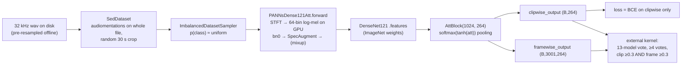

# 00 — Overview and "Secret Sauce"

> [!info] Provenance rule for this page
> Every statement is tagged with its source: **[code]** = verified in `src/`,
> **[README]** = stated in the repo's own `README.md` (the author's account; not
> independently verifiable), **[inferred]** = my interpretation, with the reason.
> Deep detail lives in the module chapters; this page only links and summarises.

---

## 1. The task, in one paragraph

Identify which of **264** bird species are calling in soundscape recordings
**[code: `len(BIRD_CODE) == 264`]**. The hidden test set is ~150 mp3 recordings of
~10 min each, from three sites; sites 1–2 are scored per **5-second row**, site 3 at
**file level**; the metric is **row-wise micro-averaged F1** **[README]**. Training
labels are **weak**: one primary species per file (+ optional secondary species),
no timestamps **[code: `sed_dataset.py:58-64`, labels broadcast to every snippet at
`:87-92`]**.

## 2. The solution, end to end

| Stage | What it does | Source | Chapter |
|---|---|---|---|
| Data | 32 kHz wav, `.mp3`→`.wav` path rewrite, 30 s random crop (train, 1 snippet) / first 2×30 s (valid) | **[code]** `sed_dataset.py` | [01](01-data-pipeline.md) |
| Sampling | inverse-frequency weights per primary label → class-balanced batches | **[code]** `imbalanced_dataset_sampler.py` | [01](01-data-pipeline.md) |
| Front-end | vendored PANNs STFT + log-mel: `sr=32000, n_fft=1024, hop=320, 64 mels, 50–14000 Hz`; 30 s → **3001** frames | **[code]** `sed_audio_utils.py`, configs | [02](02-audio-frontend.md) |
| Augmentation | waveform: AddGaussianNoise, AddGaussianSNR, Gain, AddBackgroundNoise, AddShortNoises (pink noise from `/pinknoise`); spectrogram: SpecAugmentation; mix family: mixup `alpha=1.0` | **[code]** `augmentations/`, `sed_engine.py:208-212`; **[README]** | [03](03-augmentations.md) |
| Model | `PANNsDense121Att`: DenseNet121 `.features` replaces CNN14, `tanh` replaces `clamp` in attention, `AttBlock(1024, 264)`; 9.63 M params | **[code]** `sed_models.py:319-432` | [04](04-model-architecture.md) |
| Training | PyTorch Ignite 0.4.0.post1, AdamW, `warmup_with_cosine`, `lr=1e-3`, 50 epochs, validate every 2 epochs, keep best by `track_metric` | **[code]** `base_engine.py`, `sed_engine.py`, configs | [05](05-training-engine.md), [06](06-checkpointing-and-resuming.md) |
| Loss | `SedScaledPosNegFocalLoss` at `gamma=0, α₀=α₁=secondary_factor=1` ⇒ **bit-identical to mean BCE** (verified numerically) | **[code]** `loss/sed_scaled_pos_neg_focal_loss.py` | [07](07-losses.md) |
| Validation metrics | LRAP (clip), F1 clip (`≥0.5`), F1 frame (`frame ≥0.5 AND clip ≥0.3`) — **file-level**, not 5-s rows | **[code]** `metrics/sed_*.py`, `sed_engine.py:160-170` | [10](10-metrics-and-tracking.md) |
| Inference / vote | **Not in this repo.** `sed_test.py` does not compile; the vote ran in the external Kaggle kernel | **[code]** + **[README]** | [08](08-inference-and-submission.md) |

## 3. The 13-model ensemble (verified file list)

**[README]** names three families; **[code]** the config files map onto them as
follows (full reconciliation in [09 §8](09-config-and-cross-validation.md)):

| Family | Config files | `train_bs` | `track_metric` |
|---|---|---|---|
| 4-fold, no mixup | `final_sed/final_sed_dense121_nomix_fold0.py`, `_fold1.py`, `_fold2_augd.py`, `_fold3_augd.py` | 24 | `f1score_clip` |
| 5-fold, no mixup | `final_sed_5_fold/final_5fold_sed_dense121_nomix_fold{0..4}.py` | 28 | fold0 `f1score_clip`, folds 1-4 `f1score_frame` |
| 4-fold, mixup | `final_sed/final_sed_dense121_mix_fold{0..3}.py` (+ `_2` = stage-2 fine-tune at `lr=5e-4` from the epoch-50 checkpoint) | 32 | `f1score_clip` |

Not in the 13: `nomix_1.py`, `nomix_3.py`, `mix_2.py` (train/valid on
`/folds/all_data.csv`). Which of `mix_foldN` / `mix_foldN_2` was the actual
member is **not determinable** from the repo.

## 4. The decision that won — from the README, verbatim numbers

| Ensemble | Votes needed | Clip thr | Frame thr | Public LB | Private LB | Selected |
|---|---|---|---|---|---|---|
| 13 models | **4** | **0.3** | **0.3** | 0.616 | **0.681** | ✅ final #1 |
| 13 models | 3 | 0.3 | 0.3 | **0.617** (best public) | 0.679 | |
| 9 models (nomix) | 3 | 0.3 | 0.5 | 0.613 | 0.676 | ✅ final #2 |

Full tables: repo `README.md` → *Inference*. Outcome: **7th public → 1st private**
**[README]**.

## 5. The "secret sauce", reverse-engineered

1. **A precision-oriented vote, picked against the public LB.** A species is
   emitted for a 5 s row only if **≥4 of 13** models fire with **both** the clip
   head ≥ 0.3 **and** the frame head ≥ 0.3 **[README]**. The 3-vote ensemble scored
   higher on public (0.617) but the author chose 4 votes because "3 votes felt too
   low for 13 models" **[README]**; it won private by 0.002. *[inferred — reason:
   under row-wise micro-F1 a false positive on a no-bird row costs as much as a
   miss, and most soundscape rows are silent, so a stricter quorum trades a little
   recall for a lot of precision and is less tuned to the small public split.]*
2. **Two heads, two gates.** Training supervises only `clipwise_output`
   **[code: `sed_engine.py:72`]**; `framewise_output` is never in any loss, it is
   shaped only through the shared attention weights **[code]**. Inference
   nevertheless thresholds both **[README]** — the frame head localises the call in
   time, the clip head vetoes frames from files the model doesn't believe in. The
   in-repo `SedF1ScoreFrame` encodes an AND-gate (`frame ≥ thr AND clip ≥ 0.3`,
   the 0.3 hard-coded) **[code: `metrics/sed_f1score_frame.py:35,40`]** — but it
   max-pools both heads over the **whole file**, and since `clipwise = Σₜ
   norm_attₜ·claₜ` with `Σₜ norm_attₜ = 1` while `framewise` is `cla` repeated
   and edge-padded, **`max framewise ≥ clipwise` always** **[code:
   `sed_models.py:164-168, 426-432`]**. So at any frame threshold ≤ 0.3 that
   metric degenerates to clip-only. The same inequality holds per snippet, so in
   the winning setting (clip 0.3 = frame 0.3) the frame gate only adds
   information if the frame max is taken over a window **shorter** than the
   snippet the clip score comes from — e.g. a 5-s row inside a longer snippet.
   *[inferred — reason: the task scores 5-s rows (README), and the inference
   kernel is not in the repo, so the window sizes it used are unknown.]*
3. **Small-data regularisation of the backbone.** DenseNet121 (ImageNet) instead of
   CNN14, `tanh` instead of `clamp`, attention width 1024 — "to avoid overfitting
   because of ... ≤100 labelled samples per bird class" **[README]**; ~9.6 M params
   **[code]**.
4. **Noise-robustness augmentation.** Pink noise background + short noises +
   SNR/gain jitter on the waveform, SpecAugment on the spectrogram **[code]**, plus
   an injected no-bird validation set (`/background/data_ssw`) that punishes false
   positives in model selection **[code + README]**.
5. **Diversity across folds/splits/mixup**, not across architectures — every
   member is the same `sed_dense121att` **[code: all configs]**.

What did **not** contribute, despite being present in code:

- Focal / pos-neg / secondary weighting — all knobs at identity ⇒ plain BCE **[code, numerically verified]**. Only the `_augd` loss variant has an active term (`primary_drop_out_factor=0.3`).
- Mixed precision — `USE_AMP = False` in both branches; README: AMP gives NaN because of `amin` **[code + README]**.

## 6. What is NOT in the repo (reproduction gaps)

| Missing | Consequence | Where it lived |
|---|---|---|
| Fold CSVs `/folds/*.csv`, `/folds5/*.csv` | CV split not reproducible | offline |
| 32 kHz resampled wav mirror | must be rebuilt from Kaggle mp3 | Kaggle datasets `birdsong-resampled-train-audio-0{0..4}` (named in `configs.py:get_dict_value`) |
| Pink noise files | must regenerate | kernel `taggatle/noise-generator` **[README]** |
| Vote / 5-second row / CSV code | no submission path in repo | kernel `taggatle/cornell-birdcall-identification-1st-place-solution` **[README]** |
| torch / torchvision / torchaudio / librosa versions | unpinned | GCP `pytorch-latest-gpu` image **[README]** |

## 7. Reading order

[README](../README.md) → this page → [01](01-data-pipeline.md) …
[11](11-legacy-research-paths.md) → [12 constraints](12-kaggle-constraints.md) →
[13 experiment log](13-experiment-log.md) → framework ports.
Fact base and correction history: [FINDINGS.md](../FINDINGS.md).
