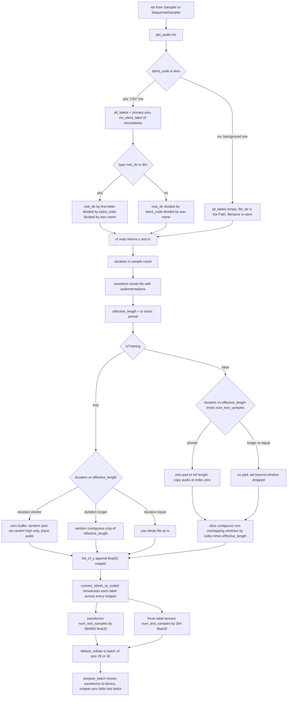
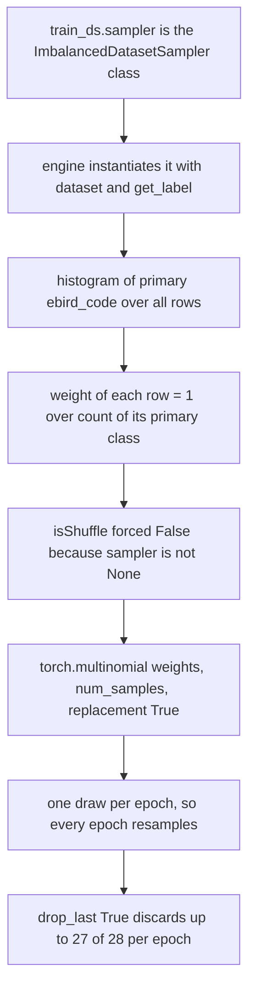

## Purpose

This module turns the Kaggle `train.csv` plus a tree of `.wav` files into fixed-length, float32 waveform tensors with multi-hot label targets. It owns four things that nothing downstream can recover: **which file a CSV row points at on disk**, **which three label sets a row produces**, **how a variable-length recording is cut into a `PERIOD`-second training window**, and **how a randomly-placed 30 s window becomes the supervised example**. `SedDataset` is the only dataset class used by the final solution (`src/dataloaders/sed_dataset.py`); `ImbalancedDatasetSampler` (`src/dataloaders/imbalanced_dataset_sampler.py`) is the sampler it hands to the engine. The four other dataset classes in `src/dataloaders/` (`audio_dataset.py`, `audio_dataset_v2.py`, `audio_dataset_v3.py`, `audio_dataset_v4.py`) belong to the image/melspectrogram branch driven by `train.py`…`train_v4.py` and are abandoned — see *Dead and experimental paths* below.

> [!info] Concrete config used throughout
> All shapes below are stated for `final_sed_5_fold/final_5fold_sed_dense121_nomix_fold*.py`:
> `period=30`, `sample_rate=32000`, `model_config["classes_num"]=264`,
> `train_bs=28`, `train_num_workers=8`, `valid_bs=32`, `valid_num_workers=4`,
> `num_test_samples=1` (train) / `2` (valid, test).
> So `effective_length = 32000 * 30 = 960000` samples and `len(BIRD_CODE) == 264`.

## Contracts

**Inputs** — constructor kwargs from `hparams.train_ds_params` / `valid_ds_params` / `test_ds_params`:

| kwarg | type | live value | used for |
|---|---|---|---|
| `root_dir` | `pathlib.Path` **or** `dict` | `Path("/data/")` | prefix for audio paths |
| `csv_dir` | `pathlib.Path` | `Path("/folds5/fold_{f}_train.csv")` | row source |
| `period` | `int` | `30` | window length in seconds |
| `bird_code` | `dict` | `BIRD_CODE` | `str -> int`, 264 entries |
| `inv_ebird_label` | `dict` | `INV_EBIRD_LABEL` | `'Genus species_Common Name' -> str` |
| `isTraining` | `bool` | `True` / `False` | selects crop vs slice |
| `num_test_samples` | `int` | `1` / `2` | snippets per item |
| `transform` | `callable` or `None` | `tfms["train"]` / `tfms["valid"]` | waveform aug |
| `background_audio_dir` | `pathlib.Path` or `None` | `None` / `Path("/background/data_ssw")` | negative-only rows |

`__getitem__(idx: int)` inputs one integer index into `self.data` (a plain `list[dict]`).

**Outputs** — one `dict` per item:

```text
filename       : str                                  # CSV row value, or background Path.stem
waveforms      : np.ndarray (num_test_samples, 960000) float32
all_labels     : torch.Tensor (num_test_samples, 264)  float32
primary_labels : torch.Tensor (num_test_samples, 264)  float32
secondary_labels: torch.Tensor (num_test_samples, 264) float32
```

After `default_collate` (B = `train_bs` 28 or `valid_bs` 32):

```text
waveforms       : (B, num_test_samples, 960000)   train (28, 1, 960000) | valid (32, 2, 960000)
all_labels      : (B, num_test_samples, 264)       train (28, 1, 264)    | valid (32, 2, 264)
primary_labels  : (B, num_test_samples, 264)
secondary_labels: (B, num_test_samples, 264)
filename        : list[str] of length B
```

`sed_engine.prepare_batch` (`src/engine/sed_engine.py:16`) moves `waveforms` to device and reads it as `bs, c, s = x.shape`; the model then does `input_x.reshape(b*c, s)` (`src/models/sed_models.py:404`). **The snippet axis `c` is folded into the batch axis**, so valid "batch 32" is really 64 forward passes of 30 s each.

**Called by** — `SedEngine._init_train_datalader` / `_init_valid_dataloader` / `_init_test_dataloader` (`src/engine/sed_engine.py:214-224`), which construct it as `SedDataset(**hparams.<split>_ds_params, transform=self.tfms[<split>])`. `BaseEngine._init_distribution` (`src/engine/base/base_engine.py:52`) then builds the loader and sampler.

**Calls** — `pandas.read_csv`, `soundfile.read`, `numpy.random.randint`, `pathlib.Path.glob`, and `ImbalancedDatasetSampler`. Downstream it calls nothing; `SedEngine` consumes its output.

## How it works

### 1. Constructor builds a flat list of dicts

```text
sed_dataset.py:27-30   df = pd.read_csv(csv_dir)
                       df.secondary_labels = df.secondary_labels.apply(eval)
                       self.data = list(df[["filename","ebird_code","secondary_labels"]].to_dict('index').values())
                       del df
```

Exactly three columns are read, and the DataFrame is immediately flattened to a `list[dict]` (the `'index'` key from `to_dict('index')` is dropped by `.values()`). Every later access is `self.data[idx]["..."]`.

**CSV schema — required columns:**

- `filename` — the bare filename string, **not** a path. The directory is reconstructed from `root_dir` + `ebird_code`.
- `ebird_code` — the primary species code, e.g. `"amecro"`. This is the key used for both the on-disk folder name and the `get_label` callback.
- `secondary_labels` — a Python-repr list of **`'Genus species_Common Name'` strings**, stored in the file as a Python-repr literal. A bare common name or eBird code never matches `INV_EBIRD_LABEL` and is silently dropped.

**Why `apply(eval)`.** Kaggle's `train.csv` stores `secondary_labels` as text: `"['American Crow', 'Bell\\'s Sparrow']"`, and `"[]"` when empty. `pd.read_csv` does not parse that back into a list — it stays a `str`. `apply(eval)` runs `eval()` on each cell to recover the `list`. Consequences that must be honoured when generating the fold CSVs:

- The column must be the **repr of a Python list**, with square brackets and quoted elements. A bare `"American Crow"` would `eval` to a `str`, and `for ln in item["secondary_labels"]` would iterate *characters*.
- Element strings must match keys of `INV_EBIRD_LABEL`, which are the `EBIRD_LABEL` values of the form `'Genus species_Common Name'` (e.g. `'Corvus brachyrhynchos_American Crow'`). **Not** eBird codes.
- `eval` on a missing/empty cell raises: `pd.read_csv` gives `NaN`, and `eval(nan)` is a `TypeError`. There is no `try/except`.
- `eval` executes arbitrary Python from the CSV. Fine for a self-generated fold file; it is an injection vector for an untrusted one. *(inferred — reason: the literal-string format has no schema-safe alternative in `pandas` without `ast.literal_eval`.)*

`INV_EBIRD_LABEL = {v: k for k, v in EBIRD_LABEL.items()}` (`src/config_params/configs.py:351`) is the exact inverse of `EBIRD_LABEL`, so it is keyed on common names, not codes.

### 2. Constructor appends background audio as label-less rows

```text
sed_dataset.py:32-43   for bk in background_audio_dir.glob('**/*.wav'):
                           self.data.append({"filename": bk})
                       if has_background: print("Background audio was added to dataloader")
```

See *Background audio injection* under Key decisions. Rows are appended **after** the CSV rows, so background indices occupy the tail of `self.data`.

### 3. `get_audio(idx)` — path resolution and the three label sets

```text
sed_dataset.py:55-85
item = self.data[idx]
filename = item["filename"]
if "ebird_code" in item:
    primary_label = item["ebird_code"]
    all_labels = [primary_label]
    for ln in item["secondary_labels"]:
        if ln in self.inv_ebird_label:
            all_labels.append(self.inv_ebird_label[ln])
    if type(self.root_dir) is dict:
        file_dir = self.root_dir[primary_label[0]]/f"{primary_label}"/f"{filename.replace('.mp3','.wav')}"
    else:
        file_dir = self.root_dir/f"{primary_label}"/f"{filename.replace('.mp3','.wav')}"
else:
    primary_label = None
    all_labels = []
    file_dir = filename
    filename = filename.stem
y, sr = sf.read(file_dir)
```

The **membership test `"ebird_code" in item` is the sole discriminator** between a real CSV row and a background row. CSV rows always carry all three keys; background rows carry only `"filename"`.

`sf.read` returns `(y, sr)` with `y` `float64` and **1-D for mono, 2-D for stereo**. There is no channel handling. For stereo, `y.shape == (frames, 2)` and `len(y)` is still the **frame** count, so the length arithmetic is right but the arrays are not: a file shorter than the window raises `ValueError: could not broadcast input array from shape (N,2) into shape (N,)` at the zero-pad assignment (`sed_dataset.py:108` / `:119`), and a longer file yields a `(960000, 2)` snippet → `(S, 960000, 2)` waveforms, which breaks collation/the model's `(B, S, L)` contract (verified with numpy). *(inferred — reason: the README says training used a resampled 32 kHz wav mirror; mono is assumed because the code would fail otherwise, but the mirror is not in the repo.)*

`"duration": len(y)` is a **sample count, not seconds** — the name is misleading and every use treats it as samples.

**The three label sets, and the non-obvious derivation:**

| key | value for a CSV row | derivation |
|---|---|---|
| `all_labels` | `[primary] + [inv_ebird_label[ln] for ln in secondary_labels if ln in inv_ebird_label]` | codes, primary first |
| `primary_labels` | `[primary_label]` | straight from the CSV column |
| `secondary_labels` | `[x for x in all_labels if x != primary_label]` | **`all_labels` minus the primary** |

> [!warning] `secondary_labels` is a *filter*, not a slice
> `sed_dataset.py:81` computes `[x for x in all_labels if x != primary_label]`. Because `all_labels[0]` *is* the primary, the first element is always dropped — but so is any later element equal to the primary. If a fold CSV lists the primary species again in its own `secondary_labels` cell, that duplicate is silently removed. The result is the same as `all_labels[1:]` whenever there are no duplicates.
> All three lists hold **ebird code strings**, not integers — `BIRD_CODE` is applied later, in `convert_labels_to_coded`.

Unknown secondary names are dropped by the `if ln in self.inv_ebird_label` guard — a name absent from `EBIRD_LABEL` (264 species) contributes nothing rather than raising.

> [!warning] The `Sakpsucker` misspelling
> `EBIRD_LABEL['yebsap']` is spelled `'Sphyrapicus varius_Yellow-bellied Sakpsucker'` (`configs.py:345`) — note the transposed *k-s-a-p*. If Kaggle's `train.csv` spells it `'...Sapsucker'`, that secondary label is silently dropped by the `in self.inv_ebird_label` guard. As a **primary** `ebird_code` it is unaffected (it routes through `BIRD_CODE`). *(Whether Kaggle's CSV uses the correct spelling: unverifiable locally — no CSV in repo.)*

### 4. `__getitem__` — augmentation, then crop/slice

```text
sed_dataset.py:94-133
item = self.get_audio(idx)
y = item["y"]
if self.transform:
    y = self.transform(y, item["sr"])
effective_length = item["sr"] * self.period
```

`effective_length` is computed from the **file's own** `sr`, not from a config value. At 32 kHz resampled wav with `period=30` that is `960000`.

**The transform runs on the whole file, before cropping.** `audiomentations` is applied to the full-length signal, then a 30 s window is cut out of the result. For multi-minute soundscape recordings this is a lot of wasted CPU per item — the reason `train_num_workers=8`. Also note that `item["duration"]` was captured inside `get_audio`, **before** the transform, and is never refreshed; if a transform ever changed the length, the branch arithmetic below would be comparing against a stale count. The live transform (`augmentations/sed_background_augment.py`) contains no resampling, so this is latent, not active.

### 5. `convert_labels_to_coded` — the broadcast that defines weak-label SED

```text
sed_dataset.py:87-92
coded_labels = np.zeros((num_images, len(self.bird_code)))
for index, temp_label in enumerate(labels):
    label_index = self.bird_code[temp_label]
    coded_labels[:, label_index] = 1
return torch.from_numpy(coded_labels).float()
```

`coded_labels[:, label_index] = 1` sets the **entire column**, i.e. every one of the `num_images` snippets, for every label. `index` from `enumerate` is never used — the loop is over labels, not images. Output is `(num_snippets, 264)` `float32`.

`__getitem__` calls this three times with `len(list_of_y)` as `num_images`:

```text
sed_dataset.py:128-130
all_labels      = self.convert_labels_to_coded(len(list_of_y), item["all_labels"])
primary_labels  = self.convert_labels_to_coded(len(list_of_y), item["primary_labels"])
secondary_labels= self.convert_labels_to_coded(len(list_of_y), item["secondary_labels"])
```

See *Weak-label SED* under Key decisions for what this means for the targets.

## Key decisions and tricks

### `root_dir` as a dict vs a Path

`type(self.root_dir) is dict` is an **exact type check**, not `isinstance`. A `dict` subclass, a `collections.abc.Mapping`, or a `Path` subclass would all take the wrong branch silently.

**Path branch** (what the final solution uses — `root_dir = Path("/data/")` in every `final_sed_5_fold/*.py`):

```text
/data/{ebird_code}/{filename with .mp3 replaced by .wav}
```

i.e. `/data/amecro/BARC01_2016_05_05_0947_2624.mp3` → reads `/data/amecro/BARC01_2016_05_05_0947_2624.wav`.

**Dict branch** — the unzipped-Kaggle-competition layout, where species are sharded across five extracted zip archives. The dict maps the **first letter of the eBird code** to the extracted archive root:

```text
/config_params/configs.py:21-28   get_dict_value(input_dir) builds
  a–b -> input_dir/"birdsong-resampled-train-audio-00"
  c–f -> input_dir/"birdsong-resampled-train-audio-01"
  g–m -> input_dir/"birdsong-resampled-train-audio-02"
  n–r -> input_dir/"birdsong-resampled-train-audio-03"
  s–y -> input_dir/"birdsong-resampled-train-audio-04"
```

giving `{input_dir}/birdsong-resampled-train-audio-0{0..4}/{ebird_code}/{filename}.wav` after substitution of `root_dir[primary_label[0]]` for the archive root. The letter bucketing is derived purely from `string.ascii_lowercase` indexing — every one of the 264 codes in `BIRD_CODE` starts with a letter in `a`–`y` (`y00475` → `y`, covered by the `s`–`y` fill), so `KeyError` is not reachable from the shipped label set.

`get_dict_value` is **imported by all 21 config files** (`example_config.py`, 5 in `final_sed_5_fold/`, 15 in `final_sed/` — all of them `from config_params.configs import get_dict_value, BIRD_CODE, INV_EBIRD_LABEL`) and **called by none of them**; the only occurrence of `get_dict_value(` in the repo is its own `def`. So in the final run the dict branch is dead code that survives from the Kaggle-notebook phase.

### The `.mp3` → `.wav` rewrite

`filename.replace('.mp3', '.wav')` happens on the *string from the CSV*, and the CSV is never regenerated. So the fold CSVs are the Kaggle `train.csv` verbatim, and the dataset reads a **different tree of files with the same layout**: the 32 kHz resampled wav conversion of the training audio. README line 119:

> "training was completed on the resampled 32kHz wav equivalent of the training data provided on Kaggle, with the same folder structure… store the training data in `/data`"

Two properties follow. First, this is a pure string substitution — it does not check the file exists and gives no error if you point `root_dir` at the original mp3 tree (you'd get a `soundfile` "file does not exist" on the `.wav`). Second, because `sf.read` uses whatever `sr` the file has and `effective_length = sr * period` is derived from it, a mixed-rate tree would silently produce windows of different sample lengths and break the `(B, C, T)` contract at collation.

### The padding / truncation logic in `__getitem__`

`effective_length = item["sr"] * self.period = 960000`. Three branches, training:

```text
sed_dataset.py:103-115
if self.isTraining:
    for i in range(self.num_test_samples):          # 1 iteration in the final config
        if item["duration"] < effective_length:
            new_y = np.zeros(effective_length, dtype=y.dtype)
            start = np.random.randint(effective_length - item["duration"])
            new_y[start:start + item["duration"]] = y
            y_snippet = new_y.astype(np.float32)
        elif item["duration"] > effective_length:
            start = np.random.randint(item["duration"] - effective_length)
            y_snippet = y[start:start + effective_length].astype(np.float32)
        else:
            y_snippet = y.astype(np.float32)
        list_of_y.append(y_snippet)
```

- **Shorter than the window** — allocate a zero buffer of `effective_length`, drop the audio at a uniformly random offset, cast. The audio keeps its duration; only its *position* changes.
- **Longer than the window** — uniformly random contiguous crop of exactly `effective_length` samples. Each epoch, each worker visit, a different 30 s.
- **Exactly equal** — the whole file, no copy, no randomness.

**`np.random.randint` with one argument.** The single-argument form is `randint(low=0, high)`, returning a uniform integer in the half-open interval `[0, high)`. So `np.random.randint(effective_length - duration)` yields `start ∈ [0, effective_length - duration)` — the audio is placed with **at least one trailing zero sample**, and the flush-right placement `start == effective_length - duration` is never chosen. Same for the crop branch: `start ∈ [0, duration - effective_length)`. `low` defaults to `0` for `np.random.randint` (unlike `np.random.randint_integers`, whose default `low` is `1`) — the same call with the legacy alias would place audio one sample later and behave differently. No crash is possible: the `<` branch guarantees `effective_length - duration >= 1`.

**Random placement is the augmentation.** Two things vary per epoch, and they vary together:

1. *Which 30 s* — a long soundscape recording contributes a different, essentially non-overlapping window every time it is drawn.
2. *How much silence frames the call* — for a short file (say a 4 s clean `aldfly` clip) the 26 s of surrounding zeros are randomly distributed before and after. The model cannot key on absolute position, and it learns to detect a call anywhere in the window, including adjacent to pure silence at either edge. That robustness matters at inference, where `clipwise_output` is thresholded per 5 s chunk.

With `num_test_samples=1` the training loop only ever draws **one** window per item; the diversity comes from `ImbalancedDatasetSampler`'s replacement sampling plus `worker_init_fn` reseeding, not from multiple windows per item.

**Non-training path — deterministic, contiguous slicing:**

```text
sed_dataset.py:116-125
else:
    if item["duration"] < effective_length * self.num_test_samples:
        new_y = np.zeros(effective_length*self.num_test_samples, dtype=y.dtype)
        new_y[0:item["duration"]] = y
        y = new_y.astype(np.float32)
        item["duration"] = len(y)
    for i in range(self.num_test_samples):
        y_snippet = y[effective_length*i : effective_length*i+effective_length].astype(np.float32)
        list_of_y.append(y_snippet)
```

The contrast with training is the whole point:

- Target length is `effective_length * num_test_samples` = `960000 * 2` = **60 s** for the valid/test splits.
- Padding, when needed, is **at index 0** — top-left anchored, no randomness. Validation must be reproducible across epochs, otherwise the tracked metric `f1score_clip` (`hparams.track_metric`) would jitter for reasons unrelated to the model.
- Slices are **contiguous and non-overlapping**: `[0:960000]`, `[960000:1920000]`. No hop, no overlap, no striding.
- With `num_test_samples=2`, a 45 s file yields `[0:30]` full-of-audio and `[30:60]` with 15 s of audio then 15 s of zeros. No averaging, no window function.
- A file **longer than 60 s is silently truncated**: the `if` is not taken, no padding happens, and `y[0:1920000]` throws away the remainder without warning. *(inferred — reason: the intended corpus is file-level 30 s-ish training audio and short folds; the Kaggle site-3 recordings are ~10 min but those are inference-time, never fed through this loader.)*

`sed_dataset.py:121`, `item["duration"] = len(y)`, is **dead**: nothing below reads `item["duration"]` in this branch. The slice loop uses `effective_length` only. Harmless, but do not read it as "duration is now the padded length" downstream.

Final assembly:

```text
sed_dataset.py:132-133   list_of_y = np.array(list_of_y)
                          return {"filename":..., "waveforms": list_of_y, "all_labels":..., ...}
```

`np.array` of equal-length float32 snippets gives `(num_test_samples, 960000)` `float32`. Every branch ends in `.astype(np.float32)`, so dtype is uniform whether the snippet came from a zero buffer or a direct slice — `np.zeros(..., dtype=y.dtype)` is `float64` (from `sf.read`) and is cast only at the end.

### Weak-label SED — what the broadcast buys and costs

`convert_labels_to_coded` writes each label into **all** snippet rows. The target for a 60 s validation file with species `amecro` and `blujay` is therefore

```text
all_labels[0] = all_labels[1] = same 264-vector: amecro=1, blujay=1, everything else 0
```

Not "the crow is in snippet 0", but "a crow is somewhere in this file".

The consequence for framewise targets is sharp, and it is worth stating precisely:

- The loss **only ever sees `clipwise_output`**. `sed_engine.loss_fn` is `self.criterion(y_pred["clipwise_output"], y)` (`src/engine/sed_engine.py:72`). `framewise_output` is **never in the loss**.
- So the broadcast target is exactly the right supervision for the clipwise head: pool over time, ask "is it in this window". No temporal precision is required and none is claimed.
- `framewise_output` is a **by-product**, not a supervised output. `AttBlock` produces `segmentwise_output`, which is `interpolate`d ×32 and `pad_framewise_output`-trimmed to `frames_num` (`src/models/sed_models.py:426-432`) purely so the inference code can *pool over time* — `pred.max(axis=1)[0].max(axis=1)[0]` in `sed_f1score_clip.py:27`, `sed_f1score_frame.py:27`, `sed_test.py:50`. Those `.max()` reductions are lossy; nothing is asserting frame-level correctness.
- The only thing that teaches the model anything about *where* sound is, is the random-crop + random-placement augmentation forcing the clipwise answer to stay true for arbitrary 30 s sub-windows, plus the `AttBlock` attention pooling as an architectural prior.
- This matches the competition's own framing, which the README quotes: "they contain weak labels… with a particular labeled bird species in the foreground". The foreground assumption is baked in at the file level.

Also note `all_labels` includes secondaries as full positives, not as weak/soft targets. `primary_labels` and `secondary_labels` exist only so the loss can **down-weight the secondary positives**: `sed_scaled_pos_neg_focal_loss.py:33-35` builds `y_secondary_mask = where(y_sec_true > 0, secondary_factor, 1.0)` with `secondary_factor` in `hparams.criterion_params` (1.0 in the final 5-fold configs). The three-way split is bookkeeping for the loss, not three different notions of ground truth.

### `init_workers_fn` — seeding with `os.urandom`

```text
sed_dataset.py:22-24, 51-53
self.additional_loader_params = {"worker_init_fn": self.init_workers_fn}
...
def init_workers_fn(self, worker_id):
    new_seed = int.from_bytes(os.urandom(4), byteorder='little')
    np.random.seed(new_seed)
```

It is wired in via `additional_loader_params`, splatted into the `DataLoader` in `base_engine.py:65` (`**self.train_ds.additional_loader_params`).

**The problem it solves.** `SedDataset` calls the *global* `np.random`, and `__getitem__` runs in a worker process. `fork`-ed workers inherit the parent's numpy global state, so all 8 workers would draw the same sequence. Both the crop offset (`randint`) and the whole `audiomentations` `Compose` (which samples from `np.random`) would advance in lockstep across workers: worker 3 and worker 4 would produce byte-identical augmentations for the same index. 8× the workers, 1× the augmentation diversity.

**Why `worker_id` alone is not enough.** `np.random.seed(worker_id)` would give 8 distinct streams — but the *same* 8 streams every epoch, because the mapping epoch → worker_id is fixed. `worker_init_fn` is re-invoked on every worker respawn, and `persistent_workers` is not set in `base_engine.py:64-66`, so workers are recreated each epoch. `int.from_bytes(os.urandom(4))` therefore yields a fresh 32-bit seed per worker **per epoch**: stream diversity is 8 × `max_epochs` (50) instead of 8. Each visit to a long file lands on a different window *and* a different noise realization.

`byteorder='little'` is irrelevant to correctness — only the 32-bit width matters for numpy's accepted seed range. Note `os.urandom` is **not** seeded from torch's `base_seed`, so this stream is not reproducible from `manual_seed(42 + rank)` in `base_engine._init_distribution`; per-worker augmentation is intentionally irreproducible, while the model's own RNG (SpecAugment) stays torch-seeded.

Contrast: torch's own per-worker seeding (`base_seed + worker_id`) already gives distinct streams for torch RNG, which is why the model's `SpecAugmentation` does not need anything like this.

### Background audio injection — trace of a label-less row

```text
sed_dataset.py:32-43
self.background_audio_dir = background_audio_dir
has_background = False
if self.background_audio_dir is not None:
    for bk in background_audio_dir.glob('**/*.wav'):
        self.data.append({"filename": bk})
        has_background = True
if has_background:
    print("Background audio was added to dataloader")
```

`background_audio_dir` must be a `pathlib.Path` — `.glob` does not exist on `str`. It is recursive (`**/*.wav`).

The row is `{"filename": <Path>}` — **one key, and it holds a `Path`, not a `str`**. Now trace it through `get_audio`:

1. `filename = item["filename"]` → a `Path`.
2. `"ebird_code" in item` → **False**. Take the `else` branch.
3. `primary_label = None`; `all_labels = []`.
4. `file_dir = filename` → the `Path` itself is the full path; no `root_dir`, no species folder.
5. `filename = filename.stem` → the returned `"filename"` is a plain stem `str`, e.g. `"SSW_002"`. **This is why the field is a `str` for background rows and a `str` for CSV rows** — both ends of `__getitem__` return a `str`, which is what `sed_test.py:67` (`open(save_dir / f'{filename}.json', 'w')`) needs.
6. `y, sr = sf.read(file_dir)`, `duration = len(y)` — ordinary audio, real samples.

Then in `__getitem__`, the same three-branch crop/slice runs on real background audio; there is no special-casing. The all-zero target comes from the label path, in three steps:

```text
convert_labels_to_coded(num_images, [])       # sed_dataset.py:87-92
  coded_labels = np.zeros((num_images, 264))  # all zeros, 264 classes
  for ... in []: ...                         # loop body never executes
  -> torch.from_numpy(zeros).float()          # (num_snippets, 264) float32, all 0.0
```

`all_labels`, `primary_labels`, and `secondary_labels` are **all** `[]` for such a row (`primary_labels` is `[]` because `primary_label is None`; `secondary_labels` is a list-comprehension over an empty `all_labels`), so all three returned tensors are all-zero. A background clip is a hard negative on every one of the 264 classes.

The metrics are built to expect exactly this. `sed_f1score_clip.py:31-36` and `sed_f1score_frame.py:34-38` branch on `t.sum()==0.0` and score **1.0 for silence** (any prediction above threshold scores 0.0), which is the standard trick for folding a negative-only class into a micro-F1.

Wiring: `background_audio_dir` appears in `valid_ds_params` and `test_ds_params` but **not** in `train_ds_params`, in every `final_sed_5_fold/*.py` and in `example_config.py`. README: "`/background/data_ssw` … with 5-30 second clips extracted where no bird call was found… **Adding this is not required.**"

### `ImbalancedDatasetSampler` — exact algorithm

```text
imbalanced_dataset_sampler.py
class ImbalancedDatasetSampler(torch.utils.data.sampler.Sampler):
    def __init__(self, dataset, get_label):
        self.indices = list(range(len(dataset)))
        self.num_samples = len(self.indices)
        label_to_count = {}
        for idx in self.indices:
            label = dataset.get_label(dataset, idx)
            label_to_count[label] = label_to_count.get(label, 0) + 1
        weights = [1.0 / label_to_count[dataset.get_label(dataset, idx)] for idx in self.indices]
        self.weights = torch.DoubleTensor(weights)
    def __iter__(self):
        return (self.indices[i] for i in torch.multinomial(self.weights, self.num_samples, replacement=True))
    def __len__(self):
        return self.num_samples
```

Copied from `ufoym/imbalanced-dataset-sampler` (README reference [3]).

**Instantiation.** `SedDataset` stores the **class**, not an instance, at `sed_dataset.py:25`:

```text
sed_dataset.py:25          self.sampler = ImbalancedDatasetSampler
base_engine.py:58-62       if self.train_ds.sampler is not None:
                               sampler = self.train_ds.sampler(self.train_ds, self.train_ds.get_label)
                               isShuffle = False
```

The `sampler is not None` test is therefore always true, and `isShuffle` is always `False` for train. This is a factory-by-attribute pattern: the engine calls `dataset.sampler(dataset, dataset.get_label)`. `SedDataset.get_label(self, dataset, idx)` ignores `self` and reads `dataset.data[idx]["ebird_code"]` — hence the unusual `get_label(dataset, idx)` signature the callback must accept.

**The label used is the primary species only.** Secondaries never enter `label_to_count`. A 45 s recording whose primary is common but which carries five secondaries is weighted as one instance of its primary.

**Class weights.** `weights[i] = 1 / count(primary_label[i])`, `float64`. Total weight per class `c` is `count(c) × 1/count(c) = 1`, so the whole weight vector sums to the number of distinct classes and each class holds an equal share of total mass. `torch.multinomial` normalises internally, so each class is drawn with probability ≈ `1/num_classes` per slot — **perfect class balance in expectation**.

**Sample-aware, not batch-aware.** `weights` has one entry per dataset index, and `multinomial` draws *indices* directly. There is no notion of a batch slot or of a joint class-composition distribution. (The upstream project later grew a batch-aware variant; this copy predates it and has no `num_samples` parameter, no `set_epoch`, and no batch sampler.)

**`__iter__` is a generator over one `multinomial` draw of `num_samples = len(dataset)` indices, with replacement.** Three consequences: an epoch still yields exactly `len(dataset)` samples, so `len(train_loader)` is constant and the cosine scheduler's `epoch_length` (`base_engine.py:113`) is stable; some samples are drawn zero times in a given epoch while others are drawn many times; and each call to `__iter__` re-draws from the **global torch RNG**, which is why epochs differ without any explicit reseeding.

**`set_epoch` — absent.** The class has no `set_epoch` method, but `base_engine.py:150-154` registers `self.train_loader.sampler.set_epoch(engine.state.epoch)` on `EPOCH_STARTED` **only when `idist.get_world_size() > 1`**. Since every `final_sed_5_fold/*.py` ships `dist_params = {}` (single process), the handler is never attached and the missing method is never called. Multi-GPU would raise `AttributeError` on the first epoch.

**Why imbalance handling matters here.** README line 25:

> "The reasons for making the changes was to avoid overfitting because of the lack of data with less than or equal to 100 labelled samples per bird class."

264 classes, some with a handful of recordings. Unweighted sampling would let a species with 3,000 clips contribute ~100× more gradient steps than one with 30 clips. `1/count` equalises the expected per-class gradient share. The model regularisation that *pairs* with this (smaller DenseNet + `AttBlock(1024, …)`, per README "Main Model Differences") is what stops the balanced-but-tiny rare classes from memorising.

**Interaction with `shuffle=False, drop_last=True`.** `base_engine.py:64-66`:

```text
self.train_loader = idist.auto_dataloader(
    self.train_ds, batch_size=self.hparams.train_bs, num_workers=self.hparams.train_num_workers,
    shuffle=isShuffle, drop_last=True, sampler=sampler, **self.train_ds.additional_loader_params)
```

- `shuffle=False` is **required**, not lazy: `torch.utils.data.DataLoader` raises `ValueError: sampler option is mutually exclusive with shuffle` if both are set. All randomness is the sampler's job. It is harmless that `drop_last=True` follows, since `sampler` is not `None`.
- `drop_last=True` with `train_bs=28` **discards up to 27 sampled items per epoch**. Combined with `__len__` returning `num_samples`, epoch size is `floor(len(train_ds)/28) * 28`.
- Valid and test loaders are built with `shuffle=False, drop_last=False` and **no sampler** (`base_engine.py:68-76`), so they are sequential and see every row exactly once, in CSV order, background rows last. This is what makes the deterministic validation slicing meaningful.

## Failure modes and gotchas

> [!warning] `background_audio_dir` on the *training* dataset crashes the sampler
> `get_label` reads `dataset.data[idx]["ebird_code"]`, and background rows have no such key → `KeyError` inside `ImbalancedDatasetSampler.__init__` (the histogram loop, `imbalanced_dataset_sampler.py:9-14`). The shipped configs only set `background_audio_dir` on valid/test, so it never fires. Adding it to `train_ds_params` fails at engine construction, not at first batch.

> [!warning] `item["duration"]` is pre-transform and post-hoc-stale
> Captured in `get_audio` before `self.transform(y, item["sr"])`. Every `if item["duration"] < effective_length` comparison then uses it against a possibly-resampled `y`. The live transforms do not change length, so this is latent. If a resampling transform is ever added here, the branches silently mis-slice.

> [!warning] Silent truncation of files longer than `effective_length * num_test_samples`
> Valid/test path, no exception and no log. Only the first 60 s is ever seen.

> [!warning] `eval` on `secondary_labels`
> Requires Python-repr literals; `NaN` cells raise `TypeError`. If you rewrite the fold CSVs with a different serialiser (real CSV lists, JSON arrays, `ast.literal_eval`-only content), this line breaks. It is also arbitrary code execution from a file.

> [!warning] `type(...) is dict` and `Path` requirements
> `root_dir` must be a `Path` for the `/` operator to work; `background_audio_dir` must be a `Path` for `.glob`; `csv_dir` may be either. `root_dir` must be a plain `dict` to hit the archive-sharding branch.

> [!warning] Stereo files silently corrupt every shape
> `sf.read` returns `(frames, channels)` for multi-channel files; `len(y)` is still the frame count, but the zero-pad assignment raises a broadcast `ValueError` (short files) or the snippet becomes `(960000, 2)` (long files). Nothing checks `y.ndim`. Mono input is assumed, not verified (the wav mirror is not in the repo).

> [!warning] `filename` in the output is the CSV string, including `.mp3`
> The rewrite to `.wav` happens only in the local variable `file_dir`. `sed_test.py:67` therefore writes `BARC01_....mp3.json`. Harmless, but confusing when matching dumps to disk.

> [!warning] The `framewise_output` is unsupervised
> Nothing in the loss touches it. Do not read a good `f1score_frame` as evidence of temporal localisation — `sed_f1score_frame.py:27` max-pools it away before scoring.

> [!info] Off-by-one in placement, deliberate or not
> `randint(high)` is `[0, high)`, so the flush-right case is never drawn. The audio always has ≥1 zero sample after it. Harmless; worth knowing before someone "fixes" it and silently changes the augmentation distribution. *(inferred — reason: the author comments nowhere on this; it reads as the natural reading of `randint`.)*

> [!info] `item["duration"] = len(y)` at `sed_dataset.py:121` is dead
> Nothing in the non-training path reads it afterwards.

> [!info] Valid/test batches are `valid_bs * num_test_samples` forward passes
> `valid_bs=32`, `num_test_samples=2` → the model runs `reshape(64, 960000)`. Memory scales with the product, not with `valid_bs`.

## Mermaid



Sampler wiring, for contrast with the sequential valid/test loaders:



## Dead and experimental paths

- **The `dict` branch of `root_dir`.** `get_dict_value` is imported by all 22 config files and called by none. Every `final_sed_5_fold/*.py` passes `Path("/data/")`, so the `type(self.root_dir) is dict` path never executes in the final solution. It survives from the Kaggle notebook, where audio was read out of five extracted `birdsong-resampled-train-audio-0X` zips.
- **`audio_dataset.py`, `audio_dataset_v2.py`, `audio_dataset_v3.py`, `audio_dataset_v4.py`** — the earlier melspectrogram-as-image branch, driven by `train.py` / `train_v2.py` / `train_v3.py` / `train_v4.py` through `main_engine*.py`. `audio_dataset.py:20` reads only `filename` and `ebird_code`. `audio_dataset_v4.py` is the closest living relative: it keeps the `type(root_dir) is dict` branch and the identical `convert_labels_to_coded` broadcast, but crops with `np.random.randint(0, duration - samples + 1)`, splits deterministically via `math.ceil` hop for eval, and returns spectrograms plus `coded_labels`/`primary_codes` under different key names. The final solution replaced this with the PANNs SED formulation, where the model consumes raw waveforms and does its own log-mel.
- **Mixup on labels.** `sed_engine.prepare_batch:25-30` still contains the mixup branch over the label tensors, and `sed_dataset` still exports `primary_labels`/`secondary_labels` in the shape mixup needs. It is disabled in every final 5-fold config (`apply_mixup = False`); only the older `final_sed_dense121_mix_*` configs enable it.
- **`loss/sed_scaled_pos_neg_focal_loss_augd.py`, `sed_removed_focal_loss.py`, `sed_scaled_focal_loss.py`** and the corresponding `*_augd` configs are alternative losses; `final_sed_5_fold/*` uses `sed_scaled_pos_neg_focal_loss` with `gamma=0.0`, `alpha_0=alpha_1=1.0`, `secondary_factor=1.0`.