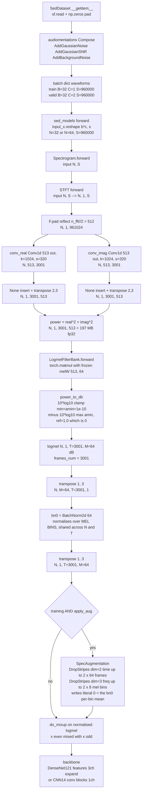

## Purpose

This chapter covers the **signal-processing layer that lives inside the model graph** — the code that turns a raw 30-second waveform into the `(B, 1, T, M)` log-mel tensor that `PANNsDense121Att` and friends hand to their backbone. It is two files: `src/helpers/sed_audio_utils.py` (the live path, imported at `src/models/sed_models.py:177` via `from helpers.sed_audio_utils import *`) and `src/helpers/audio_utils.py` (the legacy, librosa-based, *dead* path used by `audio_dataset*.py`).

It exists as a separate unit because the log-mel is not precomputed: the STFT and mel projection are `nn.Module`s that run **inside `forward()`**, every iteration, on the GPU. That single decision drives most of this chapter's memory, augmentation and mixed-precision content.

> [!warning] Correcting a common assumption
> **`src/helpers/sed_audio_utils.py` is *not* a transcription of PANNs.** It is a trimmed copy of **torchlibrosa** (`stft.py`: DFTBase/STFT/Spectrogram/LogmelFilterBank; `augmentation.py`: DropStripes/SpecAugmentation), the package PANNs depends on. It most likely arrived via the hidehisaarai1213 Kaggle kernel cited at `README.md:17/140` *(inferred)*. PANNs itself also computes log-mel on the fly with torchlibrosa, so the same "vendor it" logic applies.
>
> *Where the Conv1d-with-precomputed-DFT-weights STFT idiom itself comes from is not determinable from this repo* — a Conv1d-with-precomputed-DFT-weights STFT did circulate in torchaudio's `contrib` tree around 0.3/0.4. But **this file is a near-verbatim transcription of torchlibrosa, not of PANNs or torchaudio**, and must not be described as either. *(inferred — reason: the class set is a 4-class subset of an older torchlibrosa `stft.py`; `DropStripes` exists in torchlibrosa's `augmentation.py`, not as PANNs-specific code; the Qiuqiang Kong MIT header lives in `sed_models.py`, not in `sed_audio_utils.py`.)*

### Why vendor it at all?

`librosa.feature.melspectrogram` **cannot** be called inside an `nn.Module.forward()` that autograd needs to trace through. Vendoring buys:

- **Gradient path / in-graph execution.** The mel projection is a dense `torch.matmul`, so it is a real tensor op. Upstream PANNs wanted to pre-train the audio tagger on AudioSet where the spectrogram is a cheap CPU precompute; this repo dropped that assumption and moved to 32 kHz / 30-second / on-the-fly, so it needs the graph.
- **Control over `amin`, `ref`, `top_db`, `n_mels`, `fmin`, `fmax`.** These are hard-wired librosa defaults (`librosa.filters.mel(..., htk=True, norm='slaney')`, `librosa.power_to_db(..., top_db=80.0)`) that the author could not reach without reimplementing them anyway. Making them explicit constructor arguments is what makes the AMP discussion in §"Failure modes" possible at all.
- **Determinism of the filterbank across workers.** The matrix is built **once** in `__init__` and shipped to GPU as a frozen parameter, so every worker/iteration/every fold uses bit-identical mel weights.
- **No version drift.** *(partially realised — see gotcha #2)* `librosa.filters.get_window` and `librosa.filters.mel` are still called, so the vendored code is *not* drift-free.

---

## Contracts

### Inputs / outputs

| Component | In | Out |
|---|---|---|
| `STFT.forward(input)` | `(N, L)` — `L = 960_000` samples, float32, **CPU-side numpy→torch cast already done by the dataloader** | `real, imag`, each `(N, 1, T, F) = (N, 1, 3001, 513)` |
| `Spectrogram.forward(input)` | `(N, L)` — note the **docstring is wrong**, see gotcha #1 | `(N, 1, 3001, 513)` float32 power spectrogram |
| `LogmelFilterBank.forward(input)` | `(N, 1, T, 513)` | `(N, 1, 3001, 64)` dB |
| `SpecAugmentation.forward(input)` | `(N, 1, T, 64)` — 4-D asserted | `(N, 1, T, 64)`, **mutated in place**, identity when `not self.training` |
| `audio_to_melspectrogram(audio, config)` *(legacy)* | `np.ndarray (960_000,)` | `np.ndarray (64, T)` float32 dB — note **mel-major**, the transpose of the live path |

Where `N = B * C`. Concrete values used by **every** config in `src/config_params/final_sed*`:

```python
sample_rate = 32000    window_size = 1024    hop_size = 320    mel_bins = 64
fmin = 50             fmax = 14000           period = 30       classes_num = 264
```

- `B` = `train_bs = 32` / `valid_bs = 32`
- `C` = `num_test_samples` — **1 for train**, **2 for valid/test** (`final_sed_dense121_mix_fold0.py:57,77`)
- `L = sr * period = 32_000 * 30 = 960_000`
- `N = 32` (train) / `64` (valid, test)
- `F = n_fft // 2 + 1 = 513` → bin width `32000/1024 = 31.25 Hz`
- `T = L // hop + 1 = 960_000 // 320 + 1 = 3001` → **10 ms hop, 32 ms window**
- `M = n_mels = 64`

> [!tip] I verified `T = 3001` numerically rather than by hand
> `center=True` pads `n_fft // 2 = 512` on each side, so the conv sees `L + n_fft = 961_024` samples and emits `floor((961_024 - 1024)/320) + 1 = 3001` frames. Confirmed by running the actual `nn.Conv1d` from `STFT` on a `(32, 960000)` tensor → `torch.Size([32, 513, 3001])`.

### Called by

Exactly one file, five call sites, all inside `src/models/sed_models.py`:

| Model class | `Spectrogram` | `LogmelFilterBank` | `SpecAugmentation` | `top_db` |
|---|---|---|---|---|
| `PANNsCNN14Att` (l. 180) | l. 195 | l. 205 | l. 217 | **hardcoded local `None`** — the class has no `top_db` ctor arg |
| `PANNsDense121Att` (l. 319) | l. 333 | l. 343 | l. 355 | ctor kwarg `top_db=None` (l. 321) |
| `PANNsDense161Att` (l. 443) | l. 457 | l. 467 | l. 479 | ctor kwarg |
| `PANNsDense169Att` | l. 580 | l. 590 | l. 602 | ctor kwarg |
| `PANNsDense201Att` | l. 703 | l. 713 | l. 725 | ctor kwarg |

All five wire identically:

```python
window = 'hann'; center = True; pad_mode = 'reflect'
ref = 1.0; amin = 1e-10
self.spectrogram_extractor = Spectrogram(n_fft=window_size, hop_length=hop_size,
    win_length=window_size, window=window, center=center, pad_mode=pad_mode,
    freeze_parameters=True)
```

and all five are instantiated from `sed_engine.py:176-198` as `PANNsXxxAtt(**self.hparams.model_config)`, where `model_config["top_db"] = None` in all 14 final configs. **`top_db` is `None` on every run that was actually performed.** The DenseNet `top_db` plumbing exists but was never exercised.

### Calls

- `librosa.filters.get_window(window, win_length, fftbins=True)` — Hann window, periodic
- `librosa.util.pad_center(fft_window, n_fft)`
- `librosa.filters.mel(sr=..., n_fft=..., n_mels=..., fmin=..., fmax=...)` — **no `htk=` argument**
- `numpy` for the DFT matrix
- `torch.matmul`, `torch.clamp`, `torch.log10`
- `augmentations.mixup.do_mixup` (downstream, in `preprocess`)

---

## How it works

### 1. `DFTBase.dft_matrix(n)` — `sed_audio_utils.py:20-23`

```python
(x, y) = np.meshgrid(np.arange(n), np.arange(n))
omega = np.exp(-2 * np.pi * 1j / n)
W = np.power(omega, x * y)          # W[i, j] = exp(-2j*pi*i*j/n)
```

Textbook **analysis** DFT matrix, `(n_fft, n_fft)` `complex128`. The sign is negative (`-2j*pi`), i.e. `W[:, k]` is the `k`-th DFT basis vector, not the inverse. `idft_matrix` (l. 26) is defined but **never called** — dead code.

### 2. `STFT.__init__` — the Conv1d-as-FFT trick, l. 33-83

1. **Window**: `fft_window = librosa.filters.get_window('hann', 1024, fftbins=True)`, length `(1024,)`. `fftbins=True` gives the **periodic** Hann, `0.5 - 0.5*cos(2*pi*n/N)`, not the symmetric N-1 variant. Same convention as `torch.hann_window(periodic=True)`.
2. **Padding the window**: `librosa.util.pad_center(fft_window, n_fft)`. Since `win_length == n_fft` here, `pad_center` hits its `if lpad == 0 and ...: return data` short-circuit and is a **no-op**. It exists purely so the vendored code still works if someone sets `win_length < n_fft`.
3. **Bake window into DFT**: `self.W[:, 0:513] * fft_window[:, None]` broadcasts `(1024, 513)` → element `W[n, k] * w[n]`, i.e. the window is folded into the basis vector. One conv does window + FFT together.
4. **Two Conv1d, `bias=False`**, `in_channels=1, out_channels=513, kernel_size=1024, stride=320, padding=0, dilation=1, groups=1`:
   - `conv_real.weight.data = torch.Tensor(np.real(...).T)[:, None, :]` → `(513, 1, 1024)`
   - `conv_imag.weight.data = torch.Tensor(np.imag(...).T)[:, None, :]` → `(513, 1, 1024)`
   The `.T[:, None, :]` is exactly the `(out_ch, in_ch, kernel)` conv-weight layout.
5. **`freeze_parameters=True`** (hardcoded by `Spectrogram`, which always passes `freeze_parameters=True` on l. 121) loops `for param in self.parameters(): param.requires_grad = False`.

> [!tip] The legacy `torch.Tensor(...)` constructor is load-bearing
> `torch.Tensor(np_float64_array)` returns a **float32** tensor — `torch.Tensor` is an alias for the legacy default-float `FloatTensor`, so it *downcasts*. If this had been written `torch.tensor(...)` or `torch.from_numpy(...)` the weights would stay **float64** and `F.conv1d` would raise `weight of type DoubleTensor` on a float32 input. I confirmed both halves empirically: `torch.Tensor(np_array).dtype == torch.float32`, and `conv.weight.dtype == torch.float32` after the `.data =` assignment.

### 3. `STFT.forward` — l. 85-105

```python
x = input[:, None, :]                       # (N, 1, L) = (N, 1, 960000)
if self.center:
    x = F.pad(x, pad=(self.n_fft // 2, self.n_fft // 2), mode=self.pad_mode)
                                           # (N, 1, 961024) reflect-padded
real = self.conv_real(x)                   # (N, 513, 3001)
imag = self.conv_imag(x)                   # (N, 513, 3001)
real = real[:, None, :, :].transpose(2, 3) # (N, 1, 3001, 513)
```

- **`center=True`** (l. 45, always `True` here) → symmetric reflect-pad of `n_fft // 2 = 512` samples on both ends. This is what librosa does and what `pad_framewise_output`/`interpolate` alignment implicitly assumes: the frame at index `t` is centred on sample `t * 320`. Centre padding is *why* `T = L//hop + 1` and not `L//hop` — without it the last 320-sample step would be dropped.
- **`pad_mode='reflect'`** (l. 46). `STFT.__init__` asserts `pad_mode in ['constant', 'reflect']` (l. 41); `'constant'` is never used. Reflect (not zero) padding avoids a hard spectral discontinuity at both ends — important here because `SedDataset` zero-pads short clips, so zero-padding would stack two discontinuities.
- **The shape dance**: Conv1d emits `(N, out_ch, time) = (N, 513, T)`. `[:, None, :, :]` inserts a singleton channel → `(N, 1, 513, T)`, then `.transpose(2, 3)` swaps the last two axes → `(N, 1, T, 513)`. The singleton channel is what makes `real**2 + imag**2` and the later `matmul` broadcast cleanly without any reshaping in the model.

### 4. `Spectrogram.forward` — l. 123-139

```python
(real, imag) = self.stft.forward(input)
spectrogram = real ** 2 + imag ** 2          # power=2.0
```

`power` defaults to `2.0`; if `power != 2.0` it applies `** (power / 2.0)` (magnitude for `power=1.0`). **`power=2.0` is the branch actually taken** — no model passes anything else. Magnitude spectrograms have a much heavier-tailed distribution and would not match AudioSet-pretrained DenseNet statistics; *(inferred — reason: power=2.0 is the PANNs/AudioSet convention and keeps `power_to_db` in its intended dB-power domain.)*

### 5. `LogmelFilterBank.__init__` — l. 142-163

```python
self.melW = librosa.filters.mel(sr=sr, n_fft=n_fft, n_mels=n_mels,
                                fmin=fmin, fmax=fmax).T   # (513, 64)
self.melW = nn.Parameter(torch.Tensor(self.melW))
if freeze_parameters: for param in self.parameters(): param.requires_grad = False
```

- **`librosa.filters.mel` returns `(n_mels, 1 + n_fft//2) = (64, 513)`**; the `.T` makes it `(513, 64)` so a bare `torch.matmul` contracts the frequency axis. Dense, **not** sparse, **not** built from `hz_to_mel` in this repo.
- `nn.Parameter` (not `register_buffer`) is deliberate: an `nn.Parameter` is picked up by `.to(device)`, by `state_dict()`, and by DDP's parameter broadcast — a plain attribute would have stayed on CPU. It is then frozen with `requires_grad = False`.
- `is_log=True` is the default and is what makes the class a *Log*melFilterBank.

### 6. `LogmelFilterBank.forward` → `power_to_db` — l. 165-196

```python
mel_spectrogram = torch.matmul(input, self.melW)   # (N,1,T,513) @ (513,64) -> (N,1,T,64)
```

`torch.matmul` with a 4-D LHS and a 2-D RHS broadcasts the RHS to `(1, 1, 513, 64)` and runs a batched matmul over the `(N, 1)` batch axes. No explicit reshape needed.

```python
ref_value = self.ref
log_spec = 10.0 * torch.log10(torch.clamp(input, min=self.amin, max=np.inf))
log_spec -= 10.0 * np.log10(np.maximum(self.amin, ref_value))
if self.top_db is not None:
    log_spec = torch.clamp(log_spec, min=log_spec.max().item() - self.top_db, max=np.inf)
```

---

## Key decisions and tricks

### A. `window_size == win_length == n_fft == 1024`

All three arguments are set to the same `window_size` (`sed_models.py:196-198`). `win_length == n_fft` is the standard "no extra zero-padding of the analysis window" choice; `librosa` defaults to it too, and `librosa.util.pad_center` then no-ops. The only reason `win_length` is a separate parameter at all is that PANNs is downstream of `audioset_tagging_cnn`, which uses `win_length < n_fft` to trade resolution against aliasing.

32 ms windows / 10 ms hops at 32 kHz is the AudioSet/PANNs canonical setting — chosen here because the backbone is `torchvision.models.densenet121(pretrained=True)`, i.e. **ImageNet-pretrained**. The log-mel is doing double duty: it is the AudioSet-standard representation *and* a 2-D image for a vision backbone.

### B. `f_min = 50 Hz`, `f_max = 14000 Hz` (the parameters are named `fmin`/`fmax`)

Nyquist is 16 kHz, so `fmax=14000` drops the top 6.25 % of the spectrum. Bird fundamentals here run roughly 2–10 kHz; the `fmin=50` cut removes DC, rumble and handling noise. Because `librosa.filters.mel` builds **triangular** filters, every one of the 64 mel rows has a non-zero overlap, so no mel row is all-zero and no band is spuriously pinned to the `amin` floor. But the 31.25 Hz-wide FFT bins below 50 Hz and above 14 kHz receive **zero weight from every row** — they simply do not appear in the 64-channel output.

**Signalling note.** The brief asked about `f_min`/`f_max`; the actual constructor signature is
`__init__(self, sr=32000, n_fft=2048, n_mels=64, fmin=50, fmax=14000, is_log=True, ref=1.0, amin=1e-10, top_db=80.0, freeze_parameters=True)` — no underscores. (Compare `spectrogram_torch`, which does use `f_min`/`f_max`.) And the **defaults in the class** are *not* what the models use: the class defaults `fmax=14000` matches, but the class defaults `n_fft=2048`, `sr=32000`, and crucially **`top_db=80.0`**, whereas every model passes `top_db=None`.

### C. Mel scale: Slaney, unchanged across librosa versions

`librosa.filters.mel` is called with **no `htk=` argument**, so the scale is whatever the installed librosa defaults to:

- `librosa <= 0.7`: `htk=False` → **Slaney** (area normalised with `norm='slaney'`)
- `librosa >= 0.8`: `htk=False` → **Slaney** (area normalised with `norm='slaney'`)

`requirements.txt` pins `pytorch-ignite==0.4.0.post1`, `neptune-client==0.4.107`, `audiomentations==0.11.0`, `tqdm==4.35.0`, `psutil==5.6.7`, `SoundFile==0.10.3.post1` — **librosa is not pinned at all**, and the "requires pytorch preinstalled" note in `README.md:88` means torch/librosa came from the Google GCP image `pytorch-latest-gpu` (`README.md:69`), which tracks whatever was current. The real version risk is the API: librosa ≥0.10 made arguments keyword-only, so `librosa.util.pad_center(fft_window, n_fft)` (`sed_audio_utils.py:58`) raises `TypeError`. So do audiomentations 0.11's `librosa.load(file_path, sample_rate)` and `audio_utils.py:23` `melspectrogram(audio, …)`. Pin `librosa<0.10`. `norm='slaney'` (area normalisation) is the librosa default in all versions and is still in force.

**`hz_to_mel` and `mel_frequencies` do not appear anywhere in this repo.** They are librosa-internal. If the author had implemented the filterbank by hand (as torchaudio 0.8+ `melscale_fbanks` does), the choice would be explicit and version-stable. Because it delegates to librosa, the scale is an *unpinned transitive dependency*. **This is the one place the "vendor it to avoid version drift" argument leaks.**

### D. Sparse vs dense matmul, and `torch.stft_frequencies`

There is **no `torch.stft_frequencies`** call in this repo. That identifier belongs to torchaudio ≥ 0.8's `torchaudio.functional.melscale_fbanks(..., sparse=True)`, which builds a `(n_freqs, n_mels)` **COO sparse** bank plus the `freqs` vector and uses `torch.sparse.mm`. None of that machinery is present. This implementation is unconditionally **dense**: a materialised `(513, 64)` float32 matrix, i.e. **32,832 weights**, and a plain `torch.matmul`. At these dimensions the dense form is both faster (no sparse-kernel launch overhead) and denser in memory than a 64-triangle-per-column sparse bank would be. `torch.stft_frequencies` also never appears — the frequency axis is implicit in the `W` column order.

### E. `amin = 1e-10` and `ref = 1.0` — the AMP story

Both are hardcoded at the top of every `PANNsXxxAtt.__init__` (`sed_models.py:189, 328, 452, …`), *not* read from the config.

**`amin = 1e-10`** is the floor of the `torch.clamp` before `log10`. It is the single value the README blames for the NaNs:

> *"NOTE: The sed training models don't support mixed precision training in the current state and will output NaN values. This can be fixed by adjusting the `amin` value but this is an untested change and may impact model performance."* — `README.md:94`

I traced the mechanism and it checks out numerically:

```python
torch.tensor(1e-10, dtype=torch.float16).item()   # -> 0.0
torch.log10(torch.tensor(0., dtype=torch.float16))# -> -inf
torch.finfo(torch.float16).smallest_normal        # -> 6.103515625e-05
```

1e-10 is **~7 orders of magnitude below fp16's smallest normal (6.1e-5)** and ~7 orders below its smallest *subnormal* (5.96e-8). When anything casts this scalar or the clamped tensor to fp16, `clamp(x, min=1e-10)` degenerates to `clamp(x, min=0)` and any exact-zero frame — of which there are many, see below — gives `log10(0) = -inf`. In fp32 the same expression is perfectly safe and finite:

```python
10 * np.log10(max(1e-10, 1.0))   # -> 0.0
10 * np.log10(1e-10)             # -> -100.0
```

so **digital silence maps to exactly −100 dB**, a large but finite negative number. `SedDataset` produces exact zeros constantly — `np.zeros(effective_length, dtype=y.dtype)` for clips shorter than 30 s (train, `sed_dataset.py:106`) and the same for the tail of the valid/test buffer (`sed_dataset.py:118`). Those −100 dB frames are the ones that detonate under fp16.

The naive "fix" the README gestures at — raise `amin` to something like `1e-5` so it survives fp16 — **silently changes the model**: it clips every quiet-but-real bin 50 dB higher, and the downstream `bn0` statistics shift. That is presumably why it was left untested.

**`ref = 1.0`** makes the second line a no-op, because `np.maximum(1e-10, 1.0) == 1.0` and `10*log10(1.0) == 0.0`. The output is therefore **absolute dB relative to full-scale power**, not dB-above-max, and it is directly comparable to `librosa.power_to_db(S, ref=1.0)`. The `np.maximum(self.amin, ref_value)` guard exists so that a user setting `ref < amin` degrades gracefully to the `amin` floor instead of producing a positive offset — that is librosa's code, transcribed faithfully. It is written this way so `ref` stays a live knob: set `ref = mel_spectrogram.max()` upstream and the output becomes peak-normalised dB.

**Two mitigations exist and one does not.** `power_to_db` is *not* decorated `@torch.jit.script` and there is no `autocast(enabled=False)` guard around it, so the front-end is not explicitly protected. Under **native `torch.cuda.amp` autocast** the `pow` and `log10` ops are on PyTorch's fp32 autocast list and would be up-cast, which likely *would* survive — but this repo uses **Apex**, which has no op whitelist and simply casts the module's weights and activations to half. That is the path that fails. *(inferred — reason: `base_engine.py:81` is `amp.initialize(..., opt_level="O1")`, and O1 casts weights + activations wholesale.)*

### F. `top_db` — passed `None` for CNN14, a config param for DenseNet

The brief's framing is right in spirit but the mechanism is different:

- `PANNsCNN14Att.__init__` has **no `top_db` parameter at all**. `top_db = None` is a *local variable* on l. 190, and the local is the one passed to `LogmelFilterBank`. There is no way to switch it on for CNN14 without editing the file.
- `PANNsDense121Att / 161 / 169 / 201.__init__` **do** take `top_db=None` (l. 321, 445, …) and forward it. `sed_engine.py:189` does `PANNsDense121Att(**self.hparams.model_config)`, and `model_config` contains `"top_db": None` — so the kwarg is plumbed and then fed `None`.
- Every one of the 14 `final_sed*` configs and `example_config.py:24` sets `"top_db": None`.

So **in every run that exists, the `top_db` branch is dead code**. Three separate things it would have done:

1. `log_spec.max()` is a **whole-tensor** max — across the entire batch, not per-sample. Any non-`None` `top_db` would make one loud clip in the batch set the ceiling for all 32/64 others. That batch-coupling is almost certainly why it was left off. *(inferred — reason: librosa's `power_to_db` computes the max over the array it is given, and here that array is the batch.)*
2. `.item()` forces a **device→host sync** every step, inside the forward pass.
3. Clamping to `max - top_db` would compress the dynamic range and, combined with `bn0`, largely cancel out the per-bin normalisation the batch norm is there to provide.

### G. `SpecAugmentation` — `DropStripes`, not torchaudio's `SpecMasking`

`sed_audio_utils.py:246-271` defines:

```python
self.time_dropper = DropStripes(dim=2, drop_width=time_drop_width, stripes_num=time_stripes_num)
self.freq_dropper = DropStripes(dim=3, drop_width=freq_drop_width,  stripes_num=freq_stripes_num)
def forward(self, input):
    x = self.time_dropper(input); x = self.freq_dropper(x); return x
```

The brief says `dim=1` for mel and `dim=2` for time. **That is the torchaudio convention, not this file's.** Here the input is **4-D `(N, 1, T, F)`** (the docstring on `DropStripes.forward` says so, l. 216, and `assert input.ndimension() == 4` enforces it), so:

| | axis | size in this repo | DropStripes dim |
|---|---|---|---|
| batch | 0 | 32 / 64 | — |
| channel | 1 | 1 | — |
| **time** | 2 | **3001** | `dim=2` → `e[:, bgn:bgn+dist, :]` |
| **mel/freq** | 3 | **64** | `dim=3` → `e[:, :, bgn:bgn+dist]` |

`DropStripes.transform_slice` (l. 233-243) draws `distance = torch.randint(0, drop_width)` (note: `high` is exclusive, so width ∈ `[0, 63]` for `time_drop_width=64`, `[0, 7]` for `freq_drop_width=8`) and `bgn = torch.randint(0, total_width - distance)`, then **writes literal `0`** in place. It does **not** have `replace_with_zero` — there is no flag, and the only value ever written is `0`. It also has no `mask_param` and no per-call masking count beyond `stripes_num`.

Instantiated identically in all five models: `time_drop_width=64, time_stripes_num=2, freq_drop_width=8, freq_stripes_num=2`. So up to 2 time bands (≤64 frames ≈ ≤640 ms each) and 2 mel bands (≤8 bins) are zeroed per example, per batch element, **independently** — the loop is `for n in range(batch_size)` (l. 227), i.e. per-example rather than per-batch.

`DropStripes.forward` short-circuits on `if self.training is False: return input`, so it is a no-op at eval even if `apply_aug` were somehow true. It is still guarded by `if self.training and self.apply_aug` in `preprocess`.

#### Comparison table — three different "SpecAugmentations" in this repo

| | `helpers/sed_audio_utils.SpecAugmentation` **(live)** | `augmentations/spec_augment.spec_augment` **(legacy)** | `torchaudio.transforms.SpecAugmentation` |
|---|---|---|---|
| Domain | torch tensor, in-graph | numpy array, in-Dataloader worker | torch tensor |
| Layout | `(N, 1, T, F)` 4-D | `(M, T)` 2-D | `(..., freq, time)` |
| Freq axis index | `dim=3` | `spec[f0:f0+n, :]` (axis 0) | `freq_dim` |
| Time axis index | `dim=2` | `spec[:, t0:t0+n]` (axis 1) | `time_dim` |
| Fill value | hard-coded `0` | `value=0` default, **called with `value=x_i.min()`** (`spec_augment.py:48`) | `replace_with_zero: bool` or `mask_param: float` |
| Fractional widths | no — absolute frame counts | yes — `np.random.uniform(0, 0.15)` / `(0, 0.20)` | absolute (`F`, `T`) |
| Count | `stripes_num` fixed | `num_mask = np.random.randint(1, 2)` → **always exactly 1** | `n_freq_masks`, `n_time_masks` |
| Applied at | after `bn0`, inside `forward()` | before `mono_to_color` → `/255.0` | configurable |
| Other steps | — | `mono_to_color` → `/255.0`, `random_crop`, `F.interpolate` to `(256, 512)` | — |

The legacy path is the one with a `replace_with_zero`-like escape hatch, and it is used in the *safer* direction: `spec_augment(x_i, value=x_i.min())` (l. 48) fills with the **per-example minimum dB**, not `0`. That is the whole reason the "0 is dangerous in dB" concern below is not a problem there.

> [!warning] `src/augmentations/spec_augment.py` is unimportable
> L. 8: `from helpers.audio_utils import mono_to_color`. **`mono_to_color` does not exist in `helpers/audio_utils.py`** — that file defines only `read_audio`, `audio_to_melspectrogram`, `show_melspectrogram`, `count_parameters`, `normalise`. I grepped the whole tree: the only definition-looking references are call sites (`spec_augment.py:49,63` and `audio_dataset.py:112`), never a `def`. So `import augmentations.spec_augment` raises `ImportError`, which means `main_engine_v2.py:153` and `main_engine_v3.py:153` — the *only* importers of `get_transforms` — **cannot run**. The same missing symbol breaks `audio_dataset.py:112`, and `get_snippets` (used at `audio_dataset.py:102`, `audio_dataset_v2.py:145`, `audio_dataset_v3.py:142`) is missing too. The entire legacy spectrogram-as-image branch is dead-on-arrival.

### H. THE ORDER TRICK: `bn0` *before* `spec_augmenter`

This is the single most non-obvious thing in the front-end, and it is not commented anywhere. All five `preprocess` methods do:

```python
x = self.spectrogram_extractor(input_x)   # (N, 1, 3001, 513)
x = self.logmel_extractor(x)              # (N, 1, 3001, 64)
frames_num = x.shape[2]                   # 3001

x = x.transpose(1, 3)                     # (N, 64, 3001, 1)
x = self.bn0(x)                           # BatchNorm2d(64) over MEL BINS
x = x.transpose(1, 3)                     # (N, 1, 3001, 64)

if self.training and self.apply_aug:
    x = self.spec_augmenter(x)            # writes literal 0
```

`DropStripes` writes **literal 0**. In raw log-mel dB, `0` dB means *power = 1.0 = full scale* — the loudest thing the tensor could contain. Zeroing a mel band **before** normalisation would replace a quiet passage with a full-scale-relative impulse. After `bn0`, `0` is instead the **per-bin batch mean**, so masking substitutes "nothing was here" in the model's own units.

That is why the `transpose(1, 3)` / `bn0` / `transpose(1, 3)` sandwich exists, and why `bn0 = nn.BatchNorm2d(mel_bins)` — the transpose puts the **64 mel bins on axis 1**, which is exactly the axis `BatchNorm2d` normalises over (per-bin mean/var, shared across all N examples and all 3001 frames). `bn0` also happens to *fix the layout* for the DenseNets, which need `(N, 3, H, W)` with mel on W.

Related: `bn0` also absorbs the −100 dB silence floor. Because `init_bn` sets `bn.bias = 0`, `bn.weight = 1` (l. 41-43) at init, and BatchNorm subtracts the per-bin mean, a long run of pure-zero audio is normalised to ≈0 rather than poisoning the activation scale. Without `bn0` that −100 would be a 100σ outlier.

`bn0` is applied **before** mixup too (`do_mixup` at l. 272/395, on the already-normalised tensor). `do_mixup` (`augmentations/mixup.py:49`) mixes even-indexed with odd-indexed examples on the normalised spectrogram and folds `b` down by 2 in `forward` (l. 283-285).

`frames_num` is captured **before** augmentation and before mixup, then used by `pad_framewise_output` to stretch the `interpolate_ratio = 32`-upsampled output back to 3001. Note the ordering is load-bearing: capturing it early means augmentation cannot change the output frame count.

### I. On-the-fly vs precomputed

**There is no disk cache of mel spectrograms in this repo.** I grepped for `np.savez`, `.npy`, `.npz`, `.png`, `imread`, `tofile`, `cache` across `src/` — the only hit is `clear_cuda_cache=True` in `base_engine.py:166`. The two paths are:

| | live SED path | legacy image path |
|---|---|---|
| where log-mel is computed | `Spectrogram.forward`, on GPU, in-graph | `audio_to_melspectrogram`, `librosa`, **in the DataLoader worker** |
| what reaches the network | `(N, 1, 3001, 64)` float32 dB | `(C, 1, 256, 512)` float32 uint8-scaled |
| spectrogram-level augmentation | possible (SpecAugment + mixup in-graph) | possible (numpy, pre-network) |
| waveform augmentation | **possible** — audiomentations runs on the waveform in `sed_default_augment.py` before the front-end, so `Gain`/`AddGaussianSNR`/`AddBackgroundNoise`/`PitchShift` all act *before* the STFT | impossible — the mel was already fixed |
| cost | GPU STFT every step | 8 CPU workers × librosa STFT every step |

So it is **on-the-fly vs on-the-fly-in-workers**, not on-the-fly vs cached. The real comparison is GPU-graph vs CPU-worker, and it matters because:

- **Waveform-domain augmentation becomes possible only on the fly.** `AddBackgroundNoise` and `PitchShift` are meaningless once you have a fixed log-mel image. `README.md:29-35` lists five waveform augmentations — that is the decisive argument for on-the-fly.
- **Memory.** Per training batch of 32 clips, the front-end transiently materialises:
  - power spectrogram `(32, 1, 3001, 513)` float32 = **197 MB**
  - `real` + `imag` held simultaneously = **394 MB**
  - reflect-padded input `(32, 1, 961_024)` = **123 MB**
  - log-mel `(32, 1, 3001, 64)` = **24.6 MB**
  - ≈ **740 MB of activations per step** for the front-end alone. At valid/test `num_test_samples=2` that doubles to ~1.5 GB. Under Apex O1 half precision these would halve — one more reason AMP mattered.
  - For comparison, a cached float32 log-mel is `3001 × 64 × 4 = 768 KB` per 30 s clip, i.e. ~24 MB for the whole batch. That is the ~30× gap that on-the-fly costs.
- **AMP.** On-the-fly is exactly why Apex is a problem at all. A precomputed cached tensor is just data — the model never runs a `log10` in half. Computing it on the fly puts the numerically fragile `log10(clamp(·, 1e-10))` on the critical path of every forward pass, under a loss scaler, and the failure is silent NaN rather than a crash.

### J. Apex disabled *because* of the mel spec

`src/engine/base/base_engine.py:6-13`:

```python
try:
    from apex import amp
    print("Found NVIDIA Apex, using mixed precision")
    print("NOT USING APEX BECAUSE CANNOT CREATE MEL SPEC, REQUIRES TUNING, PROBLEMS HAVE OCCURRED")
    USE_AMP = False
except:
    print("NVIDIA Apex not found, not using mixed precision")
    USE_AMP = False
```

Two things worth flagging:

1. `USE_AMP` is `False` in **both** branches. Even a successful `from apex import amp` leaves AMP off. The second `print` is the actual author note — "cannot create mel spec" is the front-end, and it lines up exactly with the `amin`/`log10` analysis in §E. `README.md:94` restates it: *"`USE_AMP` in the `base_engine.py` will also need to be set to `True` (currently disabled even if amp is installed)"*.
2. **The `try/except` body is dead weight and slightly misleading** — an Apex-installed environment prints "Found NVIDIA Apex, using mixed precision" immediately followed by "NOT USING APEX". The first message is now a lie. A cleaner form would be a module-level `USE_AMP = False` with the reason as a comment. *(inferred — reason: the `try` block looks like it originally assigned `USE_AMP = True` and was later overwritten without removing the print.)*

Everything downstream is already `if USE_AMP:`-gated: `amp.initialize(..., opt_level="O1")` (l. 81), checkpoint save/load of the `"amp"` key (l. 113, 205), `with amp.scale_loss(loss, self.optimizer)` (l. 253), and — nicely — `eps = EPSILON_FP16 if USE_AMP or XLA_USE_BF16==1 else EPSILON` in the grad-clipping helper (l. 346), so gradient clipping picks the right epsilon for the active precision.

### K. `audio_utils.py` — a different, older, *broken* front-end

`src/helpers/audio_utils.py` is 56 lines, unheadered, and is a **different design**, not a variant of `sed_audio_utils.py`:

| | `sed_audio_utils` (live) | `audio_utils` (legacy) |
|---|---|---|
| melbank | `librosa.filters.mel(sr, n_fft, n_mels, fmin, fmax).T` → `(513, 64)` | `librosa.feature.melspectrogram(..., n_fft, n_mels, fmin, fmax, hop_length)` — same defaults, same librosa call, so **the same unpinned HTK/Slaney exposure** |
| power | `real**2 + imag**2` in torch | librosa internal (also power) |
| dB | hand-ported `power_to_db`: `10*log10(clamp(x, amin, inf)) - 10*log10(max(amin, ref))`, optional `top_db` | `librosa.power_to_db(spectrogram)` — **`top_db` defaults to 80.0**, so the legacy path *does* apply an 80 dB dynamic-range floor that the live path does not |
| output shape | `(N, 1, T, 64)` — time-major | `(64, T)` — **mel-major**, the transpose |
| returns | torch tensor in the graph | `np.float32` numpy array |
| extras | — | `read_audio` (soundfile/librosa load + `np.pad` to `conf.samples`), `show_melspectrogram`, `count_parameters`, `normalise` |
| `fmax` | `14000` in config | `15000` at `config_params/configs.py:9` |
| status | live | **dead** — `mono_to_color` and `get_snippets` are missing, so every `audio_dataset*.py` that does `from helpers.audio_utils import *` and then calls them is broken |

Two further oddities in `audio_utils.py`:

- `read_audio` l. 10: `if pathname.suffix==".wav"` — comparing to a bare string, not `.wav`. `pathname` is a `Path` from the dataloaders, so `Path.suffix` is `'.wav'` (with the dot) and this test is **always False**; every file goes down the `librosa.load` branch. Harmless but wrong.
- `audio_to_melspectrogram` l. 22-32 does **not** pass `power=` or `fmin` defaults from `config` beyond what is listed, and it calls `librosa.power_to_db` **without** `ref`, so it inherits `ref=1.0` — coincidentally the same choice as the live path.

The verdict: `audio_utils.py` is the **FCBC 2018 Kaggle-competition branch** (`audio_dataset*.py`, `train.py`, `main_engine.py`, the `image` path) kept as a record. `sed_audio_utils.py` is the **PANNs 2019-2020 branch** (`sed_dataset.py`, `sed_train.py`, `sed_engine.py`). The live solution is entirely the latter.

---

## Failure modes and gotchas

1. **`Spectrogram.forward`'s docstring is wrong.** L. 124-126 says *"input: (batch_size, 1, time_steps, n_fft // 2 + 1)"* and returns the same shape. The actual input is `(batch_size, data_length)` — a 2-D waveform, which `STFT.forward` proves at l. 92 (`x = input[:, None, :]`). Copied verbatim from the PANNs original; harmless but misleading.

2. **`ParameterError` is never imported.** L. 193 raises `ParameterError('top_db must be non-negative')`, but the file's imports are only `torch.nn as nn`, `numpy as np`, `torch`, `librosa`, `torch.nn.functional as F`. `librosa.ParameterError` exists but is not brought into scope. Triggering that branch raises **`NameError`, not `ParameterError`**. Dead because `top_db` is always `None` — but it is a live trap for anyone who sets `top_db = -1`.

3. **`self.W` is a numpy array held as a plain attribute.** `STFT.__init__` l. 61 does `self.W = self.dft_matrix(n_fft)` — a `(1024, 1024)` `complex128` array, **16.8 MB**, never freed, never registered as a buffer, never moved to GPU, never in `state_dict`. `nn.Module.__setattr__` only intercepts `Parameter`/`Module`/`Tensor` values, so this lands in `__dict__`. It is unused after `__init__`, so the fix is one line: `del self.W` at the end of `__init__`. *(inferred — reason: the forward never touches it.)*

4. **`idft_matrix` (l. 26-30) is dead code** — never called anywhere.

5. **`DropStripes` mutates its input in place.** `transform_slice` does `e[:, bgn:bgn+dist, :] = 0` on `e = input[n]`, a view into the tensor `bn0` just produced — so `bn0`'s output is overwritten. This is safe here only because the front-end upstream (`conv_real`, `conv_imag`, `melW`) has `requires_grad = False`, and it is gated on `self.training and self.apply_aug`. It also runs a **Python loop over the batch** (`for n in range(batch_size)`, l. 227) plus 2 nested `torch.randint` per stripe — pure host-side overhead, ~4 randint calls + 2 slice-writes per example per step. At `train_bs=32` × 2 droppers × 2 stripes ≈ 256 host-side random draws per forward.

6. **The −100 dB silence floor is real and common.** See §E. `SedDataset` zero-pads every clip shorter than `period=30` s (train, l. 106) and pads the valid/test buffer with zeros (l. 118). Those exact-zero frames → power `0` → clamped to `amin=1e-10` → **−100 dB**. `bn0` absorbs them, but any config that sets `is_log=False` or swaps `bn0` out will see them.

7. **`torch.stft_frequencies` does not exist here; the melbank scale is an unpinned librosa default.** See §C. If the model is re-trained under librosa ≥ 0.8 it will silently get the Slaney scale instead of HTK, a different filterbank, different statistics, and no error. Pin `librosa<0.8` if reproducing.

8. **`top_db`'s `.max()` is batch-global and syncs the device.** See §F. Never enable it.

9. **Everything in the front-end is frozen, so `count_parameters` (`audio_utils.py:44`) counts 0 for it.** Front-end footprint: 2 × `513 × 1024` conv weights + `513 × 64` mel weights = **1,083,456 params, all `requires_grad=False`** — ~4.3 MB of the checkpoint.

10. **The `README.md:94` AMP claim is accurate and the suggested fix is incomplete.** Raising `amin` to an fp16-representable value stops the `log10(0) = -inf`, but `amp.initialize(opt_level="O1")` would *also* cast `ref_value = 1.0` and the `10.0` coefficients into half, and — more importantly — `bn0`'s statistics are then computed on dB values whose scale changed. A belt-and-braces fix would wrap `power_to_db` in `with torch.cuda.amp.autocast(enabled=False):` or make the constants dtype-explicit. **Untested by the author, as stated.**

11. **`src/augmentations/spec_augment.py` and `src/dataloaders/audio_dataset*.py` are unimportable.** See §G. Neither `mono_to_color` nor `get_snippets` exists in `helpers/audio_utils.py`.

---

## Mermaid

```mermaid
flowchart TD
    subgraph live["LIVE - sed_audio_utils.py, inside forward on GPU"]
        LA["waveform N, 960000"] --> LB["STFT via frozen Conv1d<br/>window hann folded into DFT matrix"]
        LB --> LC["power spectrogram N, 1, 3001, 513"]
        LC --> LD["dense matmul melW 513, 64<br/>librosa.filters.mel frozen Parameter"]
        LD --> LE["logmel dB N, 1, 3001, 64"]
        LE --> LF["bn0 BatchNorm2d over mel bins"]
        LF --> LG["SpecAugmentation DropStripes zeros"]
    end
    subgraph legacy["DEAD - audio_utils.py, librosa in DataLoader worker"]
        LA2["waveform 960000"] --> LB2["librosa.feature.melspectrogram<br/>sr 32000 n_fft 1024 n_mels 64<br/>fmin 50 fmax 15000"]
        LB2 --> LC2["librosa.power_to_db<br/>top_db default 80.0<br/>mel-major M=64, T"]
        LC2 --> LD2["mono_to_color MISSING ImportError"]
        LD2 --> LE2["spec_augment numpy value = x_i.min()<br/>mono_to_color then random_crop<br/>then F.interpolate to 1, 256, 512"]
    end
```



