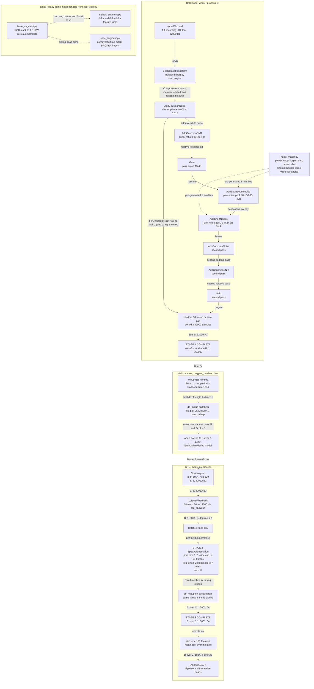
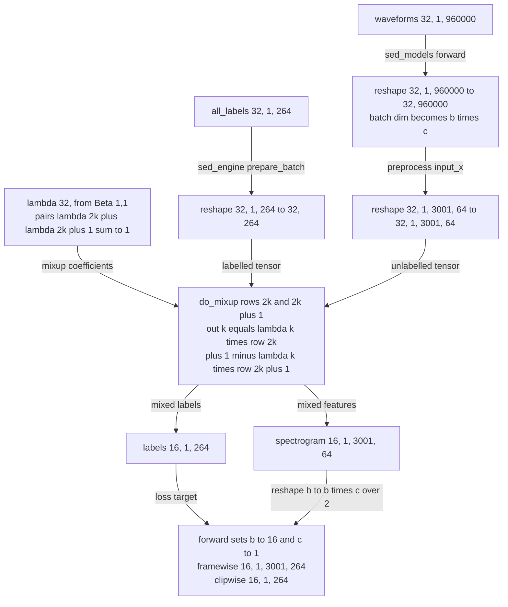
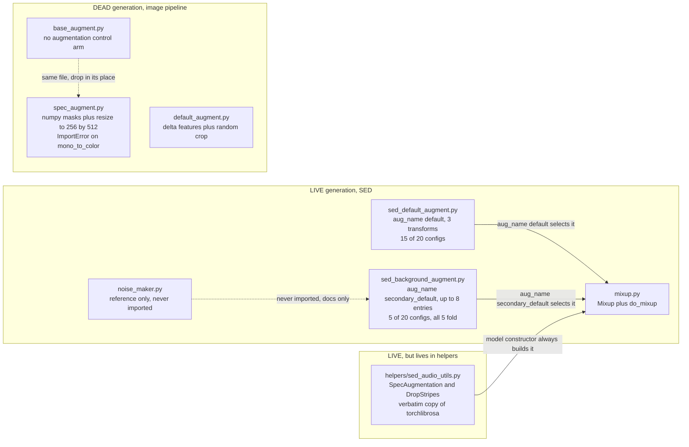

## Purpose

`src/augmentations/` holds every training-time augmentation in the repository, but it is **not one coherent module** — it is three generations of research code stacked on top of each other. The **live** generation is the SED waveform augmenter (`sed_default_augment.py`, `sed_background_augment.py`) plus the mixup coefficient generator (`mixup.py`) and the pink-noise generator reference (`noise_maker.py`). The spectrogram-stage augmentation (`SpecAugmentation`) does **not** live here — it is vendored into `src/helpers/sed_audio_utils.py` and constructed inside each model in `src/models/sed_models.py`. The **abandoned** generation is the image-classification-style transform set (`base_augment.py`, `default_augment.py`, `spec_augment.py`), which operates on pre-rendered mel image arrays and is wired only into the dead `train_v2/v3/v4.py` + `main_engine_vN.py` research paths.

The reason it exists as a separate unit is that augmentation in this solution is **split across two stages of the pipeline** — raw waveform in the dataloader worker, log-mel spectrogram inside the model's `preprocess()` — and each stage models a different physical nuisance. This chapter documents both, plus the exact hyper-parameters of the final stack, and traces `do_mixup` precisely because its semantics are easy to misread.

> [!warning] Live vs dead inventory
> | File | Status | Reached from |
> |---|---|---|
> | `sed_default_augment.py` | **LIVE** — `aug_name="default"` | 15 of 20 final configs |
> | `sed_background_augment.py` | **LIVE** — `aug_name="secondary_default"` | 5 of 20 final configs (all 5-fold) |
> | `mixup.py` | **LIVE** | `engine/sed_engine.py`, `models/sed_models.py` |
> | `noise_maker.py` | **REFERENCE ONLY** — never imported by `src/` | nothing (external Kaggle kernel did the work) |
> | `spec_augment.py` | **DEAD + BROKEN** (`ImportError` on `mono_to_color`) | `engine/main_engine_v2.py`, `main_engine_v3.py` only |
> | `base_augment.py` | **DEAD** | `engine/main_engine.py`, `main_engine_v2.py`, `main_engine_v3.py` only |
> | `default_augment.py` | **DEAD** | `engine/main_engine_v4.py` only |

---

## Contracts

### Waveform stage (`sed_default_augment.py` / `sed_background_augment.py`)

**Inputs** — a 1-D `numpy.ndarray` of shape `(num_samples,)`, dtype `float64` (straight out of `soundfile.read`, i.e. PCM normalised to `[-1, 1]`), plus an `int` sample rate.

The contract is fixed by the single call site, `src/dataloaders/sed_dataset.py:98-99`:

```python
if self.transform:
    y = self.transform(y, item["sr"])
```

> [!danger] The transform receives the **entire recording**, not the 30 s training crop
> `SedDataset.__getitem__` calls the transform at line 99 and only *afterwards* performs the random 30 s crop / zero-pad at lines 101-115. Kaggle `train_audio` files are ~10 minutes. **This single ordering fact changes the behaviour of both background augmenters** — see [Failure modes](#failure-modes-and-gotchas).

**Outputs** — same shape `(num_samples,)`, same length; dtype is whatever `audiomentations` returns (`float32` from the individual `apply()` methods). `SedDataset` immediately re-casts with `.astype(np.float32)` at lines 109/112/114.

**Called by** — `SedEngine._init_augmentation()` (`src/engine/sed_engine.py:200-206`), which dispatches on `hparams.aug_name`:

```python
if self.hparams.aug_name == "default":
    from augmentations.sed_default_augment import get_transforms
    self.tfms = get_transforms(bckgrd_aug_dir=self.hparams.bckgrd_aug_dir)
elif self.hparams.aug_name == "secondary_default":
    from augmentations.sed_background_augment import get_transforms
    self.tfms = get_transforms(bckgrd_aug_dir=self.hparams.bckgrd_aug_dir, secondary_bckgrd_aug_dir=self.hparams.secondary_bckgrd_aug_dir)
```

The returned dict is handed to the dataset constructors at `sed_engine.py:216/220/224` as `transform=self.tfms["train"]` / `self.tfms["valid"]`.

**Calls** — `audiomentations==0.11.0` (pinned in `requirements.txt`): `Compose`, `AddGaussianNoise`, `AddGaussianSNR`, `AddBackgroundNoise`, and in the background variant additionally `Gain`, `AddShortNoises`. `librosa` is pulled in transitively by audiomentations for loading the noise files.

### Mixup (`mixup.py`)

**Inputs**
- `Mixup.get_lambda(batch_size: int, device)` → returns `torch.Tensor` of shape `(batch_size,)`, dtype `float32`, `requires_grad=False`, on `device`.
- `do_mixup(x, mixup_lambda)` → `x` is `(N, ...)` with **even** `N`; `mixup_lambda` is `(N,)`. Returns `(N/2, ...)`.

**Outputs / Called by**
- `Mixup` — constructed once in `SedEngine._init_augmentation()` at `sed_engine.py:210`: `self.mixup_augmenter = Mixup(mixup_alpha=1.)`. Called from `SedEngine.prepare_batch()` at `sed_engine.py:26`.
- `do_mixup` — imported **twice**: `sed_engine.py:10` (top level) and again inside `_init_augmentation` at `sed_engine.py:209` (unused shadow import). Also imported by `models/sed_models.py:31`. Called at `sed_engine.py:28/29/30` (three label tensors) and `sed_models.py:395` (the spectrogram).

**Calls** — nothing. Pure `numpy` + `torch`.

Provenance, verified by fetching upstream [2]: `do_mixup` is a **byte-identical** copy of `pytorch_utils.do_mixup` from `qiuqiangkong/audioset_tagging_cnn` — same body, same docstring, even line wrapping. The `Mixup` class with `random_seed=1234` is **not** in that file (upstream has no `Mixup` class at all); it is a separate contribution and its origin is not recorded in this repo.

### `noise_maker.py`

**Inputs** — `powerlaw_psd_gaussian(exponent, size, fmin=0)`; `size` is an int or iterable of ints, last dim = number of samples.

**Outputs** — `numpy.ndarray` float64, shape == `size`, **normalised to unit variance**.

**Called by** — *nobody*. `grep -rn "powerlaw_psd_gaussian\|noise_maker" src/` returns only the definition itself and its own docstring example. See the [pink noise section](#6-pink-noise-generation-noise_makerpy) for how the files were actually produced.

### Spectrogram stage (`SpecAugmentation`, from `helpers/sed_audio_utils.py`)

**Inputs** — `(B, C, T, M)` with `B` = batch, `C` = 1, `T` = frames, `M` = mel bins. With the final configs (`sample_rate=32000`, `window_size=1024`, `hop_size=320`, `mel_bins=64`, `period=30`) that is `(B, 1, 3001, 64)`.

**Outputs** — same shape, **modified in place**, same tensor object.

---

## How it works

### 1. `get_transforms()` — the exact construction

Both live files expose the identical shape:

```python
def get_transforms(bckgrd_aug_dir=None):                                                    # sed_default_augment.py:21
def get_transforms(bckgrd_aug_dir=None, secondary_bckgrd_aug_dir=None):                     # sed_background_augment.py:21
```

and return a two-key dict:

```python
augmenter = Compose(list_of_aug)
transforms = {
    "train": get_training_augmentation(augmenter),
    "valid": get_validation_augmentation()
}
return transforms
```

The train/valid wrappers are thin (`sed_default_augment.py:9-19`, `sed_background_augment.py:9-19`):

```python
def get_training_augmentation(augmenter):
    def transform(x, sr):
        x = augmenter(samples=x, sample_rate=sr)
        return x
    return transform

def get_validation_augmentation():
    def transform(x, sr):
        return x
    return transform
```

> [!info] **Validation augmentation is the identity function.**
> The valid transform ignores `x` entirely and returns it unchanged. It still *accepts* two arguments because it is bound to the same `transform(y, item["sr"])` call site in `SedDataset`. No test-time-time-augmentation exists at this stage; the stochastic component of the final system is entirely the 13-model vote ensemble (README §Inference), not TTA.

`Compose(list_of_aug)` uses audiomentations defaults `p=1.0, shuffle=False` (verified against `audiomentations==v0.11.0` `core/composition.py`). So: **fixed order, each transform independently draws `random.random() < p`.**

### 2. `sed_default_augment.py` — the `default` stack (3 transforms)

```python
list_of_aug = [
    AddGaussianNoise(min_amplitude=0.001, max_amplitude=0.015, p=0.3),
    AddGaussianSNR(p=0.3)
]
if bckgrd_aug_dir is not None:
    list_of_aug.append(AddBackgroundNoise(bckgrd_aug_dir, p=0.5))
```

| # | Transform | Explicit hyper-parameters | Defaults inherited from audiomentations 0.11.0 |
|---|---|---|---|
| 1 | `AddGaussianNoise` | `min_amplitude=0.001`, `max_amplitude=0.015`, `p=0.3` | — (all given) |
| 2 | `AddGaussianSNR` | `p=0.3` | `min_SNR=0.001`, `max_SNR=1.0` |
| 3 | `AddBackgroundNoise` *(conditional)* | `sounds_path=bckgrd_aug_dir`, `p=0.5` | `min_snr_in_db=3`, `max_snr_in_db=30` |

Semantics of each, straight from the pinned audiomentations source:

- **`AddGaussianNoise`** — `apply()` is `samples + amplitude * np.random.randn(len(samples))` with `amplitude ~ U(0.001, 0.015)`. The amplitude is **absolute**, in the same units as the signal (which lives in `[-1, 1]`), so this is `−60 dBFS … −36 dBFS` of white noise **regardless of how loud the recording is**. It is the only transform here that does not adapt to the input level.
- **`AddGaussianSNR`** — `noise_std ~ U(min_SNR, max_SNR) · std(samples)`. **`min_SNR`/`max_SNR` are linear amplitude ratios, not dB**, despite the name. `0.001 → 1.0` therefore spans `1:1000 … 1:1`, i.e. `−60 dB … 0 dB` SNR. At the top of that range the white noise has the same standard deviation as the whole recording.
- **`AddBackgroundNoise`** — picks a random file from the folder, loads it with `librosa.load(path, sample_rate)` (**resampled to the input SR and downmixed to mono**), scales it to hit `snr_in_db ~ U(3, 30)` dB relative to `calculate_rms(samples)` over the *entire* input, then adds.

Noise directory: `hparams.bckgrd_aug_dir`, which in every final config is the string `"/pinknoise"`.

### 3. `sed_background_augment.py` — the `secondary_default` stack (up to 7 entries)

```python
list_of_aug = [
#         AddGaussianNoise(min_amplitude=0.001, max_amplitude=0.015, p=0.3),
    AddGaussianNoise(p=0.2),
    AddGaussianSNR(p=0.2),
    Gain(min_gain_in_db=-15,max_gain_in_db=15,p=0.3)
]
if bckgrd_aug_dir is not None:
    list_of_aug.append(AddBackgroundNoise(bckgrd_aug_dir,p=0.2))
if secondary_bckgrd_aug_dir is not None:
    list_of_aug.append(AddShortNoises(secondary_bckgrd_aug_dir,min_time_between_sounds=0.0, max_time_between_sounds=15.0, burst_probability=0.5, p=0.6))
list_of_aug += [
    AddGaussianNoise(p=0.2),
    AddGaussianSNR(p=0.2),
    Gain(min_gain_in_db=-15,max_gain_in_db=15,p=0.3)
]
```

The defining structural feature is the **palindromic bracket**: noise-and-gain transforms are applied *before and after* the two background augmenters, so an additive perturbation can be sandwiched and then re-gained.

| # | Transform | Hyper-parameters (explicit / inherited) | Position |
|---|---|---|---|
| 1 | `AddGaussianNoise` | `p=0.2` / `min_amplitude=0.001, max_amplitude=0.015` | pre |
| 2 | `AddGaussianSNR` | `p=0.2` / `min_SNR=0.001, max_SNR=1.0` | pre |
| 3 | `Gain` | `min_gain_in_db=-15`, `max_gain_in_db=15`, `p=0.3` | pre |
| 4 | `AddBackgroundNoise` | `sounds_path=bckgrd_aug_dir`, `p=0.2` / `min_snr_in_db=3, max_snr_in_db=30` | mid |
| 5 | `AddShortNoises` | `sounds_path=secondary_bckgrd_aug_dir`, `min_time_between_sounds=0.0`, `max_time_between_sounds=15.0`, `burst_probability=0.5`, `p=0.6` / `min_snr_in_db=0`, `max_snr_in_db=24`, `min_pause_factor_during_burst=0.1`, `max_pause_factor_during_burst=1.1`, `min_fade_in_time=0.005`, `max_fade_in_time=0.08`, `min_fade_out_time=0.01`, `max_fade_out_time=0.1` | mid |
| 6 | `AddGaussianNoise` | `p=0.2` / same amplitudes | post |
| 7 | `AddGaussianSNR` | `p=0.2` / same SNRs | post |
| 8 | `Gain` | `p=0.3` / `±15 dB` | post |

Note the commented-out first line (line 23). The `AddGaussianNoise(p=0.2)` on line 24 is **numerically identical** to the commented-out version because audiomentations 0.11.0's defaults *are* `min_amplitude=0.001, max_amplitude=0.015`. The only change from the `default` stack is the probability `0.3 → 0.2`.

Effective firing rates per sample (all draws independent, `Compose` runs every member every call):

| Transform | Probability of ≥ 1 application |
|---|---|
| `AddGaussianNoise` | `1 − 0.8² = 0.36` |
| `AddGaussianSNR` | `1 − 0.8² = 0.36` |
| `Gain` | `1 − 0.7² = 0.51`, **net gain `U(−30, +30) dB`** → amplitude `×0.0316 … ×31.6` |
| `AddBackgroundNoise` | `0.2` |
| `AddShortNoises` | `0.6` |

Noise directories: `hparams.bckgrd_aug_dir` and `hparams.secondary_bckgrd_aug_dir`, **both `"/pinknoise"` in every single config** — `example_config.py` uses the relative string `"pinknoise"`. Both point at the *same* pink-noise pool; `secondary_bckgrd_aug_dir` exists only so that `AddBackgroundNoise` and `AddShortNoises` draw independently (different `lru_cache`, different `random.choice` streams) from the same material.

### 4. The two-stage architecture — this is the important structural point

> [!tip] Waveform-stage noise vs spectrogram-stage masking model **different** nuisance factors
> - **Waveform stage (audiomentations, in the dataloader worker).** `AddGaussianNoise`, `AddGaussianSNR`, `Gain`, `AddBackgroundNoise`, `AddShortNoises` all operate on **physical units**: dB SNR, amplitude ratios, RMS. They are *channel/environment* models. They say: "the same bird recorded through a different microphone, at a different gain, at a different signal-to-noise ratio, with a different amount of wind/traffic/hum in the background, still sounds like this bird." Crucially they are **label-preserving**: they never touch `item["all_labels"]`, and the species present in the file is still present afterwards. They can only ever *add* nuisance energy or rescale it, never fabricate or remove a bird call.
> - **Spectrogram stage (`SpecAugmentation`, inside `model.preprocess()`).** Zero-fills rectangular blocks of the **log-mel** image along time and frequency. These are not physical audio operations — a zeroed mel block is not silence, it is "this model cannot rely on this evidence". They say: "the bird call still lands somewhere slightly earlier/later, and its energy is distributed slightly differently across the mel scale, and part of it is simply missing (wind, distance, occlusion by another call)". This is *temporal and frequency invariance* for the CNN, and it is **also label-preserving in expectation** because with ≤ 100 samples per class and blocks ≤ 0.63 s of ≤ 30 s, the diagnostic part of a call survives masking.
>
> **Why both are needed.** Neither stage can substitute for the other:
> 1. **SpecAugment cannot model the recording channel.** Zeroing mel bins is not the same thing as adding a noise floor. Because the model's `LogmelFilterBank` is preceded by a learnable `BatchNorm2d` (`bn0`, `sed_models.py:387`) and `top_db` is `None` in 19 of the 20 shipped configs, a spectrogram-scale shift is partially absorbed; what the network actually needs to learn is invariance to the *additive* noise energy that sits under the call in the physical recording. That is a waveform-domain quantity.
> 2. **audiomentations cannot model time/frequency invariance.** There is no `Shift`, `TimeMask`, or `TimeStretch` in either stack. Without SpecAugment the model can latch onto the exact STFT frame alignment of a call relative to the start of its 30 s window — which is precisely the kind of shortcut that overfits when you have ≤ 100 examples per class.
> 3. **They compose across the STFT, which is non-linear and non-commutative with them.** Masking then mixing is not mixing then masking. `sed_models.py:390-395` deliberately runs `spec_augmenter` **first** and `do_mixup` **second**, on the spectrogram.
> 4. **Cost asymmetry.** Waveform augmentation in workers costs CPU only and is embarrassingly parallel over `train_num_workers=8`; SpecAugment runs on GPU inside `preprocess()` and costs a handful of scalar `torch.randint` calls per batch element. Splitting them this way keeps the GPU feed cheap.
>
> *(inferred — reason: no code comment or README line explains the split; the reasoning above is reconstructed from what each transform physically computes and from the `sed_models.py` call ordering.)*

The critical consequence of the split is **where the augmentation sees the length of the recording**: the waveform stage sees the full ~10-minute file; the spectrogram stage sees only the 30 s crop that reached it. They do not see the same signal.

### 5. `mixup.py` — `Mixup` and the exact semantics of `do_mixup`

`Mixup.get_lambda(batch_size, device)`:

```python
mixup_lambdas = []
for n in range(0, batch_size, 2):
    lam = self.random_state.beta(self.mixup_alpha, self.mixup_alpha, 1)[0]
    mixup_lambdas.append(lam)
    mixup_lambdas.append(1. - lam)
return torch.tensor(mixup_lambdas, requires_grad=False).float().to(device)
```

Three facts to internalise:

- `sed_engine.py:210` passes **`mixup_alpha=1.`**, so `Beta(1, 1)` = **`Uniform(0, 1)`**. Mixup is maximally aggressive — the mixing coefficient is a flat random number, not the peaked `Beta(α, α)` most people use.
- The emitted lambda vector is **`[λ₀, 1−λ₀, λ₁, 1−λ₁, …]`** — adjacent entries sum to 1 by construction. Length is `2·ceil(batch_size/2)`, i.e. `batch_size` for even `batch_size`.
- `Mixup.__init__(self, mixup_alpha, random_seed=1234)` builds a **single long-lived `np.random.RandomState(1234)`** at engine construction. It is *not* re-seeded per epoch. `get_lambda` is called from `prepare_batch`, which ignite runs in the **main process** (not in the workers), so the stream advances once per training iteration. All final configs set `dist_params = {}` → `idist.get_world_size() == 1` → single process, no cross-rank lambda collision.

#### `do_mixup` is **NOT** swap-based. It is a λ-weighted lerp between *adjacent* elements.

> [!warning] Its own docstring is wrong, and the error is inherited from upstream
> `mixup.py:50-57` (byte-identical to upstream `pytorch_utils.do_mixup`) claims:
> ```
> Args:
>   x: (batch_size * 2, ...)
>   mixup_lambda: (batch_size * 2,)
> Returns:
>   out: (batch_size, ...)
> ```
> Both are false. Measured on the real code: `x` of length `N` returns `N/2` rows. The correct contract is `x: (N, ...)`, `mixup_lambda: (N,)`, `out: (N/2, ...)`. **Trust the code, not this docstring** — it is a copy-paste artefact from a different mixup convention, and reading it is probably the origin of the "swap-based, halve the batch" misreading.

The task framing to refute is "take half the batch, permute it, fill the other half." The code disproves it three ways:

1. **No permutation exists anywhere.** `grep -rn "permut" src/` returns exactly two hits, both `Tensor.permute` in `base_augment.py` lines 6 and 12, unrelated to mixup. `mixup.py` contains zero permutation logic.
2. **The output is a weighted sum, not a copy.** The body multiplies and adds:
   ```python
   out = (x[0 :: 2].transpose(0, -1) * mixup_lambda[0 :: 2] +
       x[1 :: 2].transpose(0, -1) * mixup_lambda[1 :: 2]).transpose(0, -1)
   ```
   A swap/copy scheme would be `out = x[perm[:n]]` with no arithmetic. Note also that `.transpose(0, -1)` moves the batch dim to the **end** purely so that the `(N/2,)` lambda broadcasts against every trailing dimension of an arbitrary-rank `x` — this only makes sense in a multiply-add.
3. **The pairing is fixed, not random.** `x[0::2]` and `x[1::2]` pair element `2k` with element `2k+1`. Combined with `get_lambda` emitting `[λ, 1−λ]`, the result is:

   ```
   out[k] = λ_k · x[2k] + (1 − λ_k) · x[2k+1],     λ_k ~ U(0, 1)
   ```

   Verified numerically against the repo's own `mixup.py` (`x = [0..7]`, `λ = [0.8, 0.2, 0.8, 0.2, 0.8, 0.2, 0.8, 0.2]`):

   ```
   out = [0·0.8 + 1·0.2, 2·0.8 + 3·0.2, 4·0.8 + 5·0.2, 6·0.8 + 7·0.2]
      = [0.2, 2.2, 4.2, 6.2]        # shape (4, 1)
   ```

   A second run confirms the two remaining structural claims, using one-hot `all_labels`
   `(32, 1, 264)` with class 5 set on every row:

   ```
   lambda len: 32   (bs*c = 32)
   out: (16, 1, 264)   row sums: 1.0 1.0          # convex combination of two valid label vectors
   lam[0], lam[1]: 0.2354, 0.7646   sum: 1.0      # adjacent lambdas are complementary

   rank-agnostic check, 4-D:
     do_mixup(arange(48).reshape(2,2,3,4), [0.25, 0.75])
     expected [18.0, 19.0, 20.0, 21.0]  ==  0.25*spec[0] + 0.75*spec[1]
     got      [18.0, 19.0, 20.0, 21.0]     -> same kernel works on (B, C, T, M)
   ```

> [!warning] What the coupling actually is
> The only thing that is random is **how much** of each partner survives, not **which** partner. This is PANN's original `do_mixup` (verbatim), and it differs from mainstream mixup in two ways that both matter here:
> - **No permutation** → partner choice is not random; it is whatever batch order produced.
> - **Fixed adjacency** → pair `(2k, 2k+1)`.
>
> This is *fine here, and arguably better than random*, because the sampler does the randomisation. `SedDataset.sampler = ImbalancedDatasetSampler` (`sed_dataset.py:25`), whose `__iter__` is `torch.multinomial(weights, num_samples, replacement=True)` with `weights = 1/count_per_species` — an i.i.d. resample proportional to inverse class frequency. Batch order is therefore **not** clustered by species, so consecutive elements `2k, 2k+1` are overwhelmingly two *different* bird species. Mixup therefore pairs genuinely different classes and creates a soft target that is `λ` on species A and `1−λ` on species B — the standard, and most useful, regime for mixup.

#### Tracing the call at `sed_engine.py:28`

```python
mixup_lambda = self.mixup_augmenter.get_lambda(batch_size=bs*c, device=x.device)
bs_al, s_al, c_al = all_labels.shape
all_labels = do_mixup(all_labels.reshape(bs_al*s_al,c_al), mixup_lambda).reshape((bs_al*s_al)//2,1,c_al)
```

Step by step, with concrete final-config values (`train_bs = 32` / `24` / `28` depending on config, `num_test_samples = 1` for train, `classes_num = 264`):

| Step | Value | Shape |
|---|---|---|
| `batch["waveforms"]` from `SedDataset` | `list_of_y` has `num_test_samples = 1` entries | `(32, 1, 960000)` |
| `bs, c, s = x.shape` (`sed_engine.py:19`) | `bs=32, c=1, s=960000` | — |
| `all_labels` from `convert_labels_to_coded(len(list_of_y), ...)` | 264-dim one-hot | `(32, 1, 264)` |
| `bs_al, s_al, c_al = all_labels.shape` | `32, 1, 264` — **note the confusing naming: `s_al` is the *snippet* axis, `c_al` is the *class* axis** | — |
| `get_lambda(batch_size=bs*c)` | `bs*c = 32` (NOT 960000, NOT 264) | `(32,)` |
| `all_labels.reshape(32*1, 264)` | flatten snippet axis into batch | `(32, 264)` |
| `do_mixup(..., (32,))` | pairs `(0,1) (2,3) … (30,31)` | `(16, 264)` |
| `.reshape((32*1)//2, 1, 264)` | re-insert the snippet axis | `(16, 1, 264)` |

The identical three-line treatment is applied to `primary_labels` and `secondary_labels` (lines 29-30) using the **same** `mixup_lambda`. That is the mechanism that keeps everything aligned.

#### How labels and waveforms stay aligned

They stay aligned because **the pairing is a pure function of the flattened batch index, identical in both places**:

- `sed_engine.py:28` pairs label rows `2k` and `2k+1` of the `(bs*c, 264)` flattened label matrix.
- `sed_models.py:395` pairs spectrogram rows `2k` and `2k+1` of the `(bs*c, 1, T, M)` spectrogram tensor.

Both tensors were built from the same `batch["waveforms"]` in the same order, with the same `(bs*c)` flattening (`sed_engine.py:19` and `sed_models.py:403-404`, `input_x.reshape(b*c, s)`). Same `mixup_lambda` object is passed through `prepare_batch` → `forward(input_data)` → `preprocess(input_x, mixup_lambda=mixup_lambda)` (`sed_models.py:400/405`). Therefore spectrogram row `2k` is always a lerp of spectrogram row `2k`, which corresponds to sample `2k`, whose label row `2k` was lerped with the identical `λ`. **Labels, waveforms, and spectrograms are all mixed by the same partition of the batch index.** No bookkeeping is needed beyond using the same lambda vector.

#### Why `b` and `c` are halved downstream

```python
# sed_models.py:399-408
b, c, s = input_x.shape          # (32, 1, 960000)
input_x = input_x.reshape(b*c, s)  # (32, 960000)
x, frames_num = self.preprocess(input_x, mixup_lambda=mixup_lambda)  # -> (16, 1, 3001, 64)
if mixup_lambda is not None:
    b = (b*c)//2                 # 16
    c = 1
```

`do_mixup` in `preprocess` returns `(16, 1, 3001, 64)` — the network trunk, the `fc1`, the `AttBlock`, and both output heads all operate on 16 rows. Only at `sed_models.py:436-437`:

```python
'framewise_output': framewise_output.reshape(b, c, frame_shape[1], frame_shape[2]),
'clipwise_output' : clipwise_output.reshape(b, c, clip_shape[1]),
```

are the outputs re-wrapped into `(16, 1, 3001, 264)` and `(16, 1, 264)` so they line up with the `(16, 1, 264)` labels from `sed_engine.py:28`. **Mixup halves the effective batch size**: the config's `train_bs = 32` means 32 waveforms ingested but only 16 gradient-carrying samples. With `drop_last=True` (`base_engine.py:65`) and even batch sizes this is clean; see failure modes for the odd-batch hazard.

### 6. Pink noise generation (`noise_maker.py`)

`noise_maker.py` is a **verbatim, unadapted copy of a single function** from [1] `colorednoise` (Felix Patzelt), MIT. It is 88 lines of docstring + 45 lines of code and it contains **exactly one public function**:

```python
def powerlaw_psd_gaussian(exponent, size, fmin=0):
    """Gaussian (1/f)**beta noise.
    Based on the algorithm in:
    Timmer, J. and Koenig, M.:
    On generating power law noise.
    Astron. Astrophys. 300, 707-710 (1995)
    Normalised to unit variance
```

**The algorithm**, line by line:

1. `f = rfftfreq(samples)` — build the one-sided frequency axis assuming `sample_rate = 1` (line 80, comment: *"we asume a sample rate of one"*).
2. `fmin = max(fmin, 1./samples)`; `ix = npsum(s_scale < fmin)`; `s_scale[:ix] = s_scale[ix]` — flatten the spectrum below the lowest representable frequency to `1/samples` instead of letting `1/f` diverge (lines 84-87).
3. `s_scale = s_scale**(-exponent/2.)` — **the spectral exponent**. This is the whole pink-noise knob. For `S(f) = (1/f)**beta`:
   - **`exponent = 1` → pink / flicker noise** (power `∝ 1/f`)
   - `exponent = 2` → brown / red noise (power `∝ 1/f²`)
   - `exponent = 0` → white noise
   
   The docstring's own example is `cn.powerlaw_psd_gaussian(1, 5)  # generate 1/f noise == pink noise == flicker noise`. The `-exponent/2.` is because the scale multiplies the *amplitude* of each Fourier coefficient, and power is amplitude².
4. `sigma = 2 * sqrt(npsum(w**2)) / samples` — the theoretical output standard deviation, so the result can be normalised (line 93).
5. `sr = normal(scale=s_scale, size=size); si = normal(scale=s_scale, size=size)` — **Gaussian magnitude and phase**: this is why the function is named `powerlaw_psd_*gaussian*`. Complex Gaussian Fourier coefficients give a Gaussian random process in time. Enforce realness: `si[...,0] = 0` (DC always real) and `si[...,-1] = 0` when `samples` is even (lines 109-112).
6. `y = irfft(s, n=samples, axis=-1) / sigma` — inverse real FFT, divided by `sigma` to give **unit variance**.

**Output format:** a bare `numpy.ndarray` of shape `size`, dtype `float64`, unit variance, last axis = time. There is no WAV-writing, no file loop, no sample-rate parameter anywhere in this file.

#### What could *not* be determined from the code, and where the facts actually come from

> [!danger] `noise_maker.py` is a reference copy. **The pink-noise files were not generated by this repo.**
> - `powerlaw_psd_gaussian` is **never called** anywhere in `src/`. It has no `if __name__ == "__main__"` block, no writer, no `main()`.
> - README §3 (Training) says: *"store the generated pink noise in `/pinknoise`"*.
> - README §Kaggle Solution names the generator: **"Kaggle Kernel used to generate pink noise: `https://www.kaggle.com/taggatle/noise-generator`"**.
>
> Therefore, for the questions "how many files", "what container format", "what sample rate", "exactly 60 s?", the only evidence is README prose:
>
> | Property | Value | Source | Confidence |
> |---|---|---|---|
> | Spectral exponent | `1` → pink, `1/f` | `noise_maker.py` docstring + its own example `powerlaw_psd_gaussian(1, 5)` | **code** |
> | Output normalisation | unit variance | `noise_maker.py:39, 93, 118` | **code** |
> | Duration | **1 minute** | README lines 34-35 (*"pre-generated 1 minute samples of pink noise"*, twice) | README only |
> | Directory | `/pinknoise` (absolute in all final configs; `"pinknoise"` relative in `example_config.py`) | configs | **code** |
> | Sample rate | 32 kHz | README line 119: *"training was completed on the resampled 32kHz wav equivalent of the training data"* — and it must match, because `AddBackgroundNoise`/`AddShortNoises` call `librosa.load(path, sample_rate)` and resample | inferred |
> | **Number of files** | **undetermined** | — | — |
> | Container format | `.wav` (implied) | audiomentations `get_file_paths` accepts `.aiff .flac .mp3 .ogg .wav`; the README only ever says "samples" | inferred, not certain |
> | Whether any other colour was generated | undetermined | — | — |
>
> The number of files matters more than it looks — see the `lru_cache(maxsize=2)` gotcha below.

#### Why **pink** and not white

The competition is what the README calls a *weak-label* problem: *"they contain weak labels. There might be anthropogenic sounds (e.g., airplane overflights) or other bird and non-bird (e.g., chipmunk) calls in the background, with a particular labeled bird species in the foreground."* The labelled signal is a **small foreground event sitting on a large, already-noisy background**, at a low signal-to-noise ratio.

- **A white noise floor is spectrally flat**, i.e. it puts *equal power per Hz*. But the filterbank is **mel-spaced** (`fmin=50`, `fmax=14000`, `mel_bins=64`), and mel bands get progressively **wider** in Hz as frequency rises, so a flat PSD maps to a per-mel-bin energy that grows toward the top of the scale. A white-noise floor therefore buries the **top mel bins** most heavily — while training the model to learn "ignore the top of the spectrum" rather than "ignore a background at any frequency".
- **Real recording-channel noise is `1/f`-shaped**: wind, distant foliage, HVAC, road rumble, mic self-noise, and the acoustic roll-off of the recorder all concentrate energy at low frequencies. Pink noise counteracts the mel-bandwidth effect of white noise, restoring roughly flat *per-mel-bin* energy — while still being physically shaped like a real environment. Birds, by contrast, put their discriminative energy into a few narrow harmonic/formant bands.
- So **training against `1/f` noise teaches the model to attend to narrow-band structure on top of a sloped floor — to ignore background rather than to rely on a flat synthetic floor.** A flat floor is a much easier, and therefore over-fitting-friendly, invariance to learn.
- *(inferred — reason: the exponent `1` is documented in `noise_maker.py`; the acoustic justification for preferring `1/f` over white is not stated anywhere in the repo and is reconstructed from the competition description in the README.)*

Note what the code *does not* say: nothing in the repo explains why pink was preferred over brown (`exponent=2`) or over a real recorded soundscape. Brown noise is arguably a closer model of wind/rumble; the choice of `exponent=1` is undocumented *(inferred — reason: the `colorednoise` docstring offers both 1 and 2 as first-class options and the code picks neither explicitly, so the choice lives in the external kernel.)*

### 7. Spectrogram stage — the vendored `SpecAugmentation`

**Correction to the obvious assumption:** there is no `SpecAugmentation` in `src/augmentations/`. `grep -rn "SpecAugmentation" src/` finds the class **only** in `src/helpers/sed_audio_utils.py:246`, and the import in `sed_models.py:177` is a star-import:

```python
from helpers.sed_audio_utils import *
```

Upstream, PANNs imports these from two separate third-party packages (`pytorch/models.py`: `from torchlibrosa.stft import Spectrogram, LogmelFilterBank` and `from torchlibrosa.augmentation import SpecAugmentation`). This repo **vendored both into one file** — `helpers/sed_audio_utils.py` is a byte-for-byte copy of `qiuqiangkong/torchlibrosa`'s `augmentation.py` plus `stft.py`. There is exactly **one** copy in the repo, not two; the "identical copy" framing does not apply. `src/augmentations/spec_augment.py` is a *different, unrelated, legacy* implementation (see §8).

**Time vs frequency masking: `dim=2` and `dim=3`.** Confirmed at `sed_audio_utils.py:262-266`:

```python
self.time_dropper = DropStripes(dim=2, drop_width=time_drop_width, stripes_num=time_stripes_num)
self.freq_dropper = DropStripes(dim=3, drop_width=freq_drop_width, freq_stripes_num=freq_stripes_num)
```

with the mapping asserted at line 209 — `assert dim in [2, 3]    # dim 2: time; dim 3: frequency` — and applied at lines 240-243:

```python
if self.dim == 2:
    e[:, bgn : bgn + distance, :] = 0     # slice is (C, T, M) -> zero a time stripe
elif self.dim == 3:
    e[:, :, bgn : bgn + distance] = 0     # slice is (C, T, M) -> zero a mel stripe
```

Since `forward` operates on `input[n]` of shape `(C, T, M)`, `dim=2` is the **frame/time** axis and `dim=3` is the **mel bin** axis. **Not** `dim=2`/`dim=1` — the axis index is 3 because the tensor is rank-4 `(B, C, T, M)`.

**Parameters actually used by the model.** Identical, hard-coded, at **five** call sites in `sed_models.py` — lines 217-221 (`PANNsCNN14Att`), 355-359 (`PANNsDense121Att`), 479-483 (`Dense161`), 602-606 (`Dense169`), 725-729 (`Dense201`):

```python
self.spec_augmenter = SpecAugmentation(
    time_drop_width=64,
    time_stripes_num=2,
    freq_drop_width=8,
    freq_stripes_num=2)
```

These are **not configurable via `hparams`** — they are literals in each model class. (The final configs all use `sed_dense121att`, so `sed_models.py:355` is the live one.) They match the PANNs defaults exactly, i.e. **the author never tuned them**. *(inferred — reason: the values are identical to upstream `audioset_tagging_cnn` and to the example in the torchlibrosa docstring.)*

Concrete magnitudes with `sample_rate=32000, hop_size=320, mel_bins=64`:

| Quantity | Value | Derivation |
|---|---|---|
| Frames `T` | `3001` | `960000/320 + 1` (`center=True` padding in `STFT.forward`) |
| `distance` for time | `U{0..63}` frames | `torch.randint(low=0, high=64)` — **`high` is exclusive**, so `distance ∈ [0, 63]`, mean `31.5` |
| Max time stripe | `0.63 s` | `63 × 320 / 32000` |
| Mean time stripe | `0.315 s` | `31.5 × 320 / 32000` |
| `distance` for freq | `U{0..7}` mel bins | `torch.randint(low=0, high=8)` |
| Max freq stripe | `7 / 64 = 10.9 %` of the mel scale | |
| Mean freq stripe | `3.5 / 64 = 5.5 %` | |
| Order of application | **time first, then frequency** | `forward`: `time_dropper` then `freq_dropper` (lines 268-271) |

Note the `distance == 0` case: `torch.randint(low=0, high=64)` can return 0, and the slice `e[:, bgn:bgn+0, :]` is empty — so **each "stripe" has a `1/64` ≈ 1.6 % chance of being a no-op**. With 2 time stripes and 2 freq stripes per element per iteration that is a small but non-zero fraction of the batch with fewer than 4 masks.

**The `replace_with_zero` variant: it does not exist here.** You asked to document it. Truthfully:

- `DropStripes.__init__(self, dim, drop_width, stripes_num)` — **three parameters, no `replace_with_zero` flag**.
- `SpecAugmentation.__init__(self, time_drop_width, time_stripes_num, freq_drop_width, freq_stripes_num)` — **no `replace_with_zero` flag**.
- Masking is **unconditionally zero-fill** at lines 241 and 243.

I verified against the upstream `qiuqiangkong/torchlibrosa/torchlibrosa/augmentation.py`, which is what this file is copied from: it likewise has **no** `replace_with_zero`. That flag exists in *other* SpecAugment lineages — **ESPnet** (`espnet/transform/spec_augment.py`: `replace_with_zero=True` → zero, else fill with `cloned.mean()`) and **SpeechBrain** (`speechbrain/lobes/augment.py`: `replace_with_zero=True` → `val = 0.0` else `val = x.mean()`). PANNs/torchlibrosa is on the **zero-only** branch. So there is nothing to contrast against within this repo; the divergence is between *torchlibrosa (what this repo has)* and *ESPnet/SpeechBrain (what has the flag)*.

Why the choice matters for this problem: `LogmelFilterBank.power_to_db` (`sed_audio_utils.py:183-196`) only clamps **below** at `amin=1e-10`, and the upper `top_db` clamp is `None` in 19 of 20 configs. So the log-mel has **no floor** (infininitely attenuated) and a zero-filled region is not "average background level" — it is off the bottom of the scale. *(inferred — reason: read `power_to_db` together with the per-config `"top_db"` value; the one exception is `final_sed_dense121_nomix_3.py`, which sets `"top_db": 80` and therefore does clamp the log-mel to `max − 80 dB`.)*

**Guard by `self.training`.** `DropStripes.forward` at lines 220-222:

```python
if self.training is False:
    return input
```

and the call site additionally gates it (`sed_models.py:390`): `if self.training and self.apply_aug:`. `apply_aug` is `True` in all 20 configs. So SpecAugment runs **only** in training — and note that the `sed_engine.py` valid/test path reuses `self.tfms["valid"]` (identity) and the model is in `.eval()` mode, so validation is fully augmentation-free.

**Also missing from this implementation:** SpecAugment's third component, **time warping (`W`)**. Park et al. define warp + frequency mask + time mask; torchlibrosa implements only the two masks. *(inferred — reason: exhaustive read of `sed_audio_utils.py:199-271`; there is no warp anywhere in the file.)*

### 8. `spec_augment.py` — legacy, unrelated, and broken

`src/augmentations/spec_augment.py` is a **completely different implementation** from a **completely different lineage** (the DCASE/kaggle-1st-place-style image pipeline, hence `from torchvision import transforms`, `cv2`, `skimage.transform.resize`). It shares no code with the vendored torchlibrosa class.

```python
def spec_augment(spec: np.ndarray, num_mask=2, freq_masking=0.15, time_masking=0.20, value=0):
```

- `num_mask = np.random.randint(1, num_mask)` → `num_mask ∈ {1}` always. **`num_mask=2` combined with `randint(1, 2)` means the loop body runs exactly once.** An off-by-one: the parameter is effectively hard-coded to 1 mask pair regardless of its default.
- `freq_percentage ~ U(0.0, 0.15)` → `num_freqs_to_mask = int(pct × all_freqs_num)`; `f0 ~ U(0, F − num_freqs_to_mask)`.
- `time_percentage ~ U(0.0, 0.20)` → `num_frames_to_mask = int(pct × all_frames_num)`.
- `spec[f0:f0+num_freqs_to_mask, :] = value` then `spec[:, t0:t0+num_frames_to_mask] = value` — note `spec.shape` is read as `(all_freqs_num, all_frames_num)`, i.e. **this implementation assumes a `(freq, time)` array**, the transpose of the `(B, C, T, M)` layout the SED model uses. Percentage-based rather than absolute-stripe-based, unlike torchlibrosa.
- Mask value: called with `value=x_i.min()` (line 48), i.e. **floor-fill, not zero-fill** — closer in spirit to ESPnet/SpeechBrain's `replace_with_zero=False`. Applied with probability `P(random() > 0.5) = 0.5`.
- Plus `random_crop` (p ≈ 0.34, random inset crop of up to 9 frames and 24 bins) and `mono_to_color(x_i)/255.0` then `F.interpolate(size=(256, 512))` — an **RGB image pipeline**.

> [!danger] This file cannot be imported
> Line 8: `from helpers.audio_utils import mono_to_color`. `src/helpers/audio_utils.py` defines only `read_audio`, `audio_to_melspectrogram`, `show_melspectrogram`, `count_parameters`, `normalise`. **`mono_to_color` does not exist there.** The import raises `ImportError`. Confirmed by `python3 -c "from augmentations.spec_augment import get_transforms"`.
>
> It is also dead: only `engine/main_engine_v2.py:153` and `engine/main_engine_v3.py:153` reference it, behind `aug_name == "spec_aug"`, and neither engine is reachable from `sed_train.py`. (The `__pycache__/spec_augment.cpython-314.pyc` in `src/augmentations/` is a stale artifact from an environment where `librosa`/`cv2` were present.)

### 9. `base_augment.py` and `default_augment.py` — the abandoned abstraction and transform set

Both are ~20-55 lines and share a common **abstraction**, which is worth naming because the live SED files deliberately break it:

- The legacy pattern is `get_transforms()` → `{"train": fn, "valid": fn}` where each `fn` takes **one argument** and returns a pre-processed `torch.Tensor` directly. The dataset then does **no** further work; the model receives already-shaped, already-normalised input.
- `base_augment.py` is the null implementation of that abstraction — train and valid are **byte-identical**:
  ```python
  def get_training_augmentation():
      def transform(x):
          return torch.tensor(x/255).permute(0,3, 1, 2).float()
      return transform
  ```
  Input is an **RGB image array** `(H, W, 3)` uint8 → `(1, 3, H, W)` float in `[0, 1]`. `.permute(0, 3, 1, 2)` requires 4-D input, so `x` must be a **stack** of images. **Zero augmentation.** This is the `aug_name="baseline"` control arm.
- `default_augment.py` is the only non-trivial legacy set, and its augmentations are **feature-side, not signal-side**: it computes `librosa.feature.delta(x_i)` and `order=2` deltas, stacks them into `(3, freq, time)` (a delta/delta-delta feature triple), divides by 30, applies the same `random_crop`, and interpolates to `(256, 256)`. Train and valid differ **only** by `random_crop`.

Why the legacy files are dead and the SED files won: the SED path had to move the entire feature extraction **inside** the model (`sed_models.py:379-396` `preprocess()`), because (a) SpecAugment and mixup must operate on the log-mel, (b) the STFT is a `Conv1d` pair whose weights are fixed tensors, so it must live in the module tree to be moved to GPU, and (c) `do_mixup` on the spectrogram happens between preprocessing and the trunk. A dataloader-side transform that emits `(1, 3, 256, 256)` cannot express any of that. **The SED transform contract is consequently different in kind**: it is `transform(y, sr) -> y`, identity at validation, and does *no* shape casting at all.

> [!info] Contract drift summary
> | | legacy (`base_/default_/spec_augment`) | live (`sed_*_augment`) |
> |---|---|---|
> | Signature | `transform(x)` | `transform(x, sr)` |
> | Input | RGB image stack / mel array | raw 1-D waveform `[-1, 1]` |
> | Output | `torch.Tensor` shaped for the model | `numpy.ndarray`, same length as input |
> | `get_transforms` args | none | `bckgrd_aug_dir`, `secondary_bckgrd_aug_dir` |
> | Valid behaviour | ~identity (except `random_crop`) | exactly identity |
> | Does cast/permute? | yes | no |

---

## Key decisions and tricks

### The palindromic bracket in `sed_background_augment.py`

The `[A, B, C] + [D, E] + [C, B, A]` shape is the single most distinctive thing in this module. *Why it is there is not documented.* Two readings:

- **Reading 1 — noise sandwiched between gain stages.** A pre-gain moves the operating point of the file before `AddBackgroundNoise` measures `calculate_rms(samples)` and chooses a noise level, and a post-gain then re-randomises the absolute level afterwards. This decouples "how loud is the background relative to the bird" from "how loud is the whole recording", which are two genuinely different nuisance factors in a field-recording dataset.
- **Reading 2 — deliberate over-regularisation.** With ≤ 100 samples per class, the author simply wanted more noise. Duplicating the three cheap transforms doubles the per-sample perturbation count for zero extra I/O.

*(inferred — reason: no comment; reading 1 is derived from the order of operations inside `AddBackgroundNoise.apply`, reading 2 from the stated ≤ 100-sample constraint in README §Main Model Differences.)*

### Same folder, two different noise augmenters

Wherever both parameters exist, they are **the same directory** — `bckgrd_aug_dir = secondary_bckgrd_aug_dir = "/pinknoise"` in the 5 five-fold configs and in `example_config.py` (`"pinknoise"`, relative). Only 6 of 20 configs define `secondary_bckgrd_aug_dir` at all, because only `aug_name="secondary_default"` reads it. Yet two separate folder parameters are threaded through. The split is **not** about different audio material. It is about two different *audiomentations* code paths, which have different loading, caching and mixing semantics:

| | `AddBackgroundNoise` | `AddShortNoises` |
|---|---|---|
| SNR range | `U(3, 30)` dB | `U(0, 24)` dB, **per burst** |
| Mixing | one global level, `samples + noise_sound` | per-burst level, accumulated into `noise_placeholder` |
| Fade | none | `0.005–0.08 s` in, `0.01–0.1 s` out |
| Overlap | n/a | `burst_probability` — overlapping bursts |
| Noise cache | `lru_cache(maxsize=2)` | `lru_cache(maxsize=64)` |

`AddShortNoises` is up to 3 dB **louder** at the top end and *variable within a single sample*, which is a different perturbation distribution even from identical source material. `(inferred — reason: read directly off the two `apply()` implementations in audiomentations v0.11.0.)`

### Mixup on labels and on the spectrogram, both with the same lambda

The elegance is that `do_mixup` is rank-agnostic (via `transpose(0, -1)`) so the *exact same function* mixes a `(32, 264)` label matrix and a `(32, 1, 3001, 64)` spectrogram. One call site each, one shared lambda vector, zero explicit bookkeeping. `(inferred — reason: no comment; this is upstream PANNs's design.)`

### SpecAugment is destructively in-place

`DropStripes.forward` mutates its input (`e[...] = 0` where `e = input[n]` is a view) and returns the *same tensor object*. This is only safe because the call site hands it a tensor freshly produced by `self.bn0(x)` — BatchNorm in training mode allocates a new output, so no autograd graph node or earlier tensor is corrupted. It is also safe with respect to autograd because masked positions receive a **constant 0**, which has zero gradient; the gradient of the masked region flows nowhere, which is exactly the intended "ignore this evidence" behaviour. On a `top_db=None` log-mel the zero is a hard floor, so no gradient leaks back into the unmasked bins through the `log10`.

### `spec_augment` runs *before* `do_mixup`

`sed_models.py:390-395`. Consequence: the mixup partner's spectrogram is *also* SpecAugment-masked, independently. So a mixed sample is a lerp of two *separately corrupted* spectrograms. The reverse order would mix then mask, which would mask the same bins in both operands and cancel part of the mixup signal.

---

## Failure modes and gotchas

> [!danger] 1. Waveform augmentation runs on the **whole 10-minute file**, before the 30 s crop
> `sed_dataset.py:99` precedes lines 101-115. Two consequences that materially change the two background transforms:
>
> - **`AddBackgroundNoise` tiles the 60 s pink-noise file ~10×.** Its `randomize_parameters` computes `max_noise_offset = max(0, num_noise_samples - num_samples - 1)`; with `num_samples = 600 s` and `num_noise_samples = 60 s` that is `max(0, 60 - 600 - 1) = 0`, so `noise_start_index = 0` and then `while len(noise_sound) < num_samples: noise_sound = concatenate(...)` repeats the **same 60-second segment** ten times. It is not a random 60 s slice of a long noise bed. Also `clean_rms` is measured over the whole 10 minutes, so the effective SNR *inside the eventual 30 s crop* varies with how much of that crop is quiet.
> - **`AddShortNoises` degenerates into a near-continuous overlay.** `sound_duration = len(sound)/sample_rate` is **60 s for a 1-minute pink-noise file** — each "short noise" burst is the *entire* 60 s file. Pauses are `U(0.0, 15.0)` s (mean 7.5 s). So bursts are 60 s long separated by ≤ 15 s gaps: **≈ 89 % continuous coverage even without `burst_probability`**, and with `burst_probability=0.5` it saturates to ~100 %. The "burst" character (which is what makes it a good stand-in for anthropogenic events like an airplane overflight) only materialises if the input is **shorter than 60 s** — which never happens here. `global_offset = U(-15, +15)` s only shifts the pattern.
>
> Fixing this would mean moving `self.transform(y, item["sr"])` to *after* the crop in `SedDataset.__getitem__`. It was not fixed; document before you "correct" it. *(inferred — reason: the ordering is explicit in the code; the degeneracy is arithmetic from the pinned audiomentations source + the README's "1 minute" duration.)*

> [!danger] 2. `AddGaussianSNR` is **linear ratio, not dB** — the upper end nearly drowns the signal
> Defaults `min_SNR=0.001, max_SNR=1.0` → `noise_std ~ U(0.001, 1.0)·std(samples)`. That is `−60 dB … 0 dB` SNR. In the `secondary_default` stack this can fire **twice** per sample (`p=0.2` each), giving an effective SNR as low as `−3 dB` if both fire. At those levels the log-mel of a training example is dominated by `log10` of a Gaussian floor. This is arguably intentional (it is exactly the "birdsong sits in a low-SNR region" regime the README describes), but it is *not* what the parameter name suggests.

> [!danger] 3. `Gain` is applied twice in `sed_background_augment` → net `U(−30, +30) dB`, with no clipping protection
> `amplitude_ratio = 10^(db/20)` per firing; two independent `p=0.3` draws → up to `10^(30/20) = 31.6×`. audiomentations' own docstring warns: *"This transform can return samples outside the `[-1, 1]` range."* Nothing downstream clips: `LogmelFilterBank.power_to_db` does `torch.clamp(input, min=self.amin, max=np.inf)` and `top_db=None` in every config, so there is no upper clamp either. A `+30 dB` sample simply produces a proportionally larger log-mel, which `bn0` then normalises — so the effect is a *near-total* `bn0` normalisation for over-driven samples, degrading their signal contrast. This is the strongest argument for preferring the `default` stack (single `Gain` at `p=0.3`, no `AddShortNoises`) over `secondary_default`.

> [!warning] 4. `AddBackgroundNoise` caches only **2** noise files per process
> audiomentations v0.11.0: `@functools.lru_cache(maxsize=2)` on `AddBackgroundNoise.__load_sound`. With `train_num_workers=8` and each worker running its own copy, that is 16 cached noise files across the loader. If `/pinknoise` contains more than ~2 files per worker, **every augmentation uses one of at most 2 distinct noise realisations** — which silently destroys the diversity that motivated generating a pool in the first place. `AddShortNoises` caches 64, and also picks a *fresh* `sound_file_path` per burst inside `randomize_parameters`. **The number of files in `/pinknoise` is therefore a load-bearing hyperparameter, and it is not recorded anywhere in this repo.**

> [!warning] 5. Mixup halves the effective batch; an **odd** `bs*c` crashes inside `do_mixup`
> This is worse than a bad `reshape`. Verified by running the repo's own code:
>
> | `bs*c` | `get_lambda` returns | `x[0::2]` rows | `x[1::2]` rows | `lambda[0::2]` | `lambda[1::2]` | result |
> |---|---|---|---|---|---|---|
> | 1 | **2** | 1 | 0 | 1 | 1 | survives by luck (empty odd stride) |
> | 3 | **4** | 2 | 1 | 2 | **2** | survives `do_mixup`, then **crashes** the `reshape` |
> | 5 | **6** | 3 | 2 | 3 | **3** | **`RuntimeError` inside `do_mixup`** |
>
> Root cause: `get_lambda` loops `for n in range(0, batch_size, 2)` and appends **two** entries per iteration, so it emits `2·ceil(batch_size/2)` values. For odd `batch_size` the lambda vector is one element too long, and `mixup_lambda[1::2]` then has more entries than `x[1::2]` has rows. For `N = 5`:
> ```
> RuntimeError: The size of tensor a (2) must match the size of tensor b (3)
>                at non-singleton dimension 1
> ```
> For `N = 3`, `do_mixup` happens to get through and the failure surfaces one line later at `sed_engine.py:28`, because `.reshape((bs_al*s_al)//2, 1, c_al)` uses a **floor** while `do_mixup` returns `ceil(N/2)` rows.
>
> All shipped configs are safe: `train_bs` is 32 (mix), 24 (`final_sed` nomix), or 28 (`final_sed_5_fold`) — **all even** — `num_test_samples = 1` for train so `s_al = 1`, and `drop_last=True` (`base_engine.py:65`). **The invariant to preserve is that `bs * num_test_samples` is even.** Setting `train_bs = 25`, or `num_test_samples = 3` with odd `bs`, breaks it. *(Inherited verbatim from upstream PANNs, so not the author's bug — but it is undocumented.)*

> [!warning] 6. `Mixup`'s `RandomState(1234)` is created once and never re-seeded
> `Mixup.__init__`'s `random_seed=1234` default is used because `sed_engine.py:210` only passes `mixup_alpha`. The lambda stream is therefore: deterministic *given the exact sequence of `prepare_batch` calls*, but **not** reproducible across a resumed run, a changed `epoch_length`, or a different number of workers. With `dist_params = {}` there is only one process, so there is no cross-rank duplication — but if you ever set `dist_params` to real DDP params, every rank constructs its own `RandomState(1234)` and produces the **identical** lambda sequence, so per-rank lambdas would be duplicated rather than varied. *(inferred — reason: `Mixup` is constructed before `idist.Parallel` fans out and nothing calls `set_epoch` on it; `base_engine.py:150-154` only calls `set_epoch` on the sampler, and only when `world_size > 1`.)*

> [!warning] 7. `DropStripes` asserts rank 4 and hard-codes zeros — cannot be reused
> `assert input.ndimension() == 4` and `assert dim in [2, 3]`. Any change to the log-mel rank (e.g. adding a channel dim, or masking on `(B, T, M)` after the transpose) will trip the assert. The zero-fill is also unconditional; there is no mean-fill escape hatch.

> [!warning] 8. RNG provenance is split three ways, and one config silently re-seeds numpy
> PyTorch's DataLoader seeds `random`, `torch`, and `numpy` per worker from `base_seed + worker_id`, then calls the user `init_fn`. `SedDataset.init_workers_fn` (`sed_dataset.py:51-53`) then **re-seeds numpy a second time** from `os.urandom(4)`:
> ```python
> new_seed = int.from_bytes(os.urandom(4), byteorder='little')
> np.random.seed(new_seed)
> ```
> Consequence: Python's `random` (used by audiomentations `p` draws and `Compose`) and `torch` (used by `DropStripes`) follow PyTorch's deterministic per-worker scheme, while `numpy` follows OS entropy. So a run is *not* reproducible from `torch.manual_seed` alone. If you need bit-reproducibility you must seed `random` in `init_workers_fn` too — and remove the `urandom` reseed.

> [!info] 9. Harmless leftovers
> - `sed_default_augment.py:1` and `sed_background_augment.py:1` import `torchvision`; both files also `import torch`, `librosa`, `torch.nn.functional as F`, and **numpy twice** (lines 2 and 6). All unused. `librosa` is imported but never referenced in these files.
> - `sed_engine.py:209` re-imports `Mixup, do_mixup` inside `_init_augmentation`, shadowing the line-10 top-level import. Dead.
> - `sed_background_augment.py:23` — the commented-out `AddGaussianNoise` line. Numerically identical to line 24 (audiomentations defaults), so the only real change was `p: 0.3 → 0.2`.
> - `sed_audio_utils.py:193` — `raise ParameterError(...)` references a name that is **never imported or defined**. Only reachable when `top_db < 0`, which never happens (all configs pass `top_db=None`). Latent `NameError`.

---

## Mermaid

### Where each augmentation fires



### Batch geometry through mixup (B = 32, c = 1, S = 3001, M = 64, K = 264 classes)



### The two augmentation generations, side by side



---

## Appendix: config-to-stack mapping

Which augmentation module each shipped config actually selects:

| Config | `aug_name` | `apply_mixup` | `train_bs` | Waveform stack | SpecAug | Mixup |
|---|---|---|---|---|---|---|
| `final_sed/final_sed_dense121_mix_fold{0,1,2,3}.py` | `default` | `True` | 32 | 3 transforms | on | on |
| `final_sed/final_sed_dense121_mix_fold{0,1,2,3}_2.py` | `default` | `True` | 32 | 3 transforms | on | on |
| `final_sed/final_sed_dense121_mix_2.py` | `default` | `True` | 32 | 3 transforms | on | on |
| `final_sed/final_sed_dense121_nomix_fold{0,1}.py` | `default` | `False` | 24 | 3 transforms | on | off |
| `final_sed/final_sed_dense121_nomix_fold{2,3}_augd.py` | `default` | `False` | 24 | 3 transforms | on | off |
| `final_sed/final_sed_dense121_nomix_{1,3}.py` | `default` | `False` | 24 | 3 transforms | on | off |
| `final_sed_5_fold/final_5fold_sed_dense121_nomix_fold{0..4}.py` | `secondary_default` | `False` | 28 | up to 8 transforms | on | off |
| `example_config.py` | `secondary_default` | `False` | 28 | up to 8 transforms | on | off |

Totals across the 20 shipped configs: **15 `default` / 5 `secondary_default`**, **9 mixup / 11 nomix**. `bckgrd_aug_dir` is `"/pinknoise"` in all 19 final configs (`"pinknoise"` relative in `example_config.py`); `secondary_bckgrd_aug_dir` is `"/pinknoise"` wherever it appears. `apply_aug` is `True` in all 20.

> [!warning] `top_db` is **not** uniform
> `"top_db": None` in 19 of 20 configs — **except `final_sed_dense121_nomix_3.py`, which sets `"top_db": 80`.** That config therefore *does* clamp the log-mel to `log_spec.max() - 80` in `power_to_db`, which changes the dynamic range of the masked regions after SpecAugment zeroes them. Since that config is one of the 4-fold no-mixup models, it is very likely inside the 13-model ensemble. If you are re-tuning SpecAugment, this is an uncontrolled difference between two otherwise-identical arms.

> [!warning] README vs code discrepancy
> README §Data Augmentation lists a **single** stack of five transforms:
> `AddGaussianNoise, AddGaussianSNR, Gain, AddBackgroundNoise, AddShortNoises`.
> That list matches `sed_background_augment.py` **exactly** — i.e. it describes `aug_name="secondary_default"`, which only the **5** five-fold no-mixup configs use. The other **15** configs (including every one of the 4-fold mixup models) use `sed_default_augment.py`, which has **no `Gain` and no `AddShortNoises`** and uses different probabilities (`AddGaussianNoise p=0.3`, `AddGaussianSNR p=0.3`, `AddBackgroundNoise p=0.5`, vs `0.2/0.2/0.2`). The README presents one stack for a pipeline that ran two.

---

## References

1. [colorednoise](https://github.com/felixpatzelt/colorednoise) — source of `noise_maker.py`, and README ref [1].
2. [audioset_tagging_cnn](https://github.com/qiuqiangkong/audioset_tagging_cnn) — source of `mixup.py` and of `sed_models.py`; README ref [2].
3. [qiuqiangkong/torchlibrosa](https://github.com/qiuqiangkong/torchlibrosa) `torchlibrosa/augmentation.py` — the exact file `helpers/sed_audio_utils.py:199-271` was copied from. Not listed in the README references; worth adding.
4. [audiomentations](https://github.com/iver56/audiomentations) v0.11.0 — pinned in `requirements.txt`; all default hyper-parameters above were read off the `v0.11.0` tag, not assumed.
