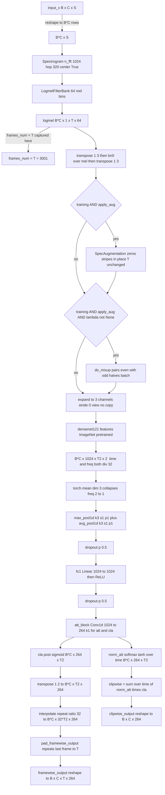
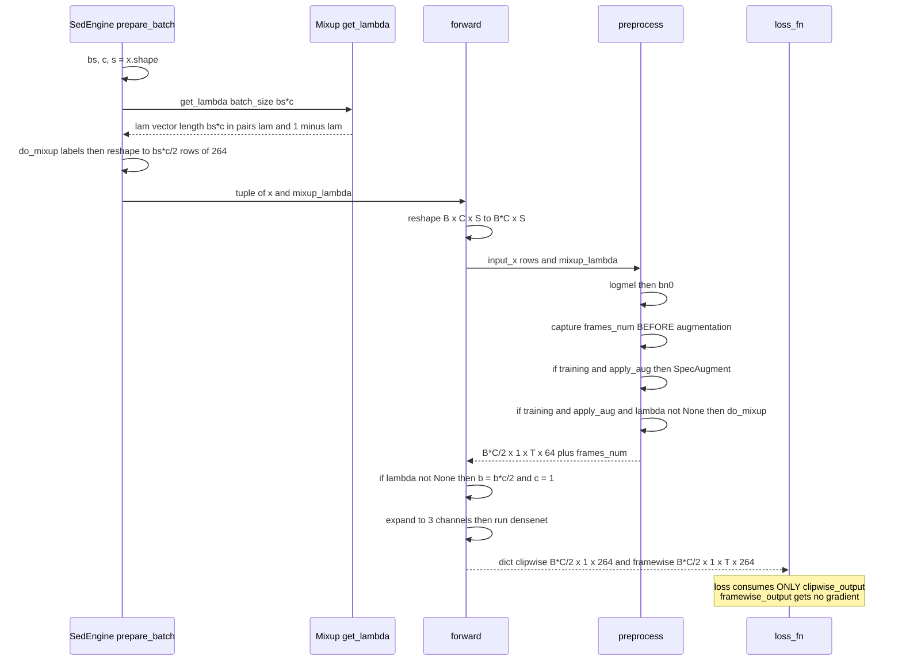

## Purpose

`src/models/sed_models.py` (809 lines) contains the entire neural architecture of the
1st-place solution: **one** input feature pipeline (STFT → logmel), **one** shared
detection head (`AttBlock`), **one** output contract (a `dict` with `clipwise_output`
and `framewise_output`), and **five** interchangeable backbones. The live path is
`PANNsDense121Att` — every one of the 21 shipped configs sets
`self.model_name = "sed_dense121att"` (verified by grep across
`src/config_params/`). The file exists as a separate module because the research
history is preserved: `PANNsCNN14Att` is the upstream PANNs baseline kept for
comparison, and `PANNsDense161Att` / `PANNsDense169Att` / `PANNsDense201Att` are
larger DenseNet experiments that are **never instantiated by any config in this
repo** (`sed_engine.py:190-198` maps `sed_dense161att` / `169` / `201`, but no
config file ever sets those strings). They are dead-but-runnable research code.

Provenance: the whole file is MIT-licensed, header lines 1-23, `Copyright (c)
2018-2020 Qiuqiang Kong` — the original PANNs author. This repo redistributes his
`init_layer`, `init_bn`, `ConvBlock`, `AttBlock`, `interpolate`,
`pad_framewise_output`, and the whole `Cnn14_DecisionLevelAtt` topology, then
modifies three things (README "Main Model Differences") plus adds a fifth
parameter, `apply_aug`.

> [!info]
> Verified environment: `torch 2.13.0+cpu`, `torchvision 0.28.0+cpu`. Every
> tensor shape quoted in this chapter was **executed**, not inferred. See
> "Verification" at the end.

## Contracts

**Inputs** — the model does *not* take a tensor. It takes a **2-tuple**:

```python
def forward(self, input_data):
    input_x, mixup_lambda = input_data
```

| element | shape | dtype | notes |
| --- | --- | --- | --- |
| `input_x` | `(B, C, S)` | float32 | `B` = batch, `C` = `num_test_samples`, `S = sample_rate * period` |
| `mixup_lambda` | `(B*C,)` or `None` | float32 | `None` in valid/test (`sed_engine.py:48`, `:60`) |

`C` comes from the config's `num_test_samples`: **1** for train
(`final_sed_dense121_mix_fold0.py:57`), **2** for valid and test
(`:68`, `:79`). With `period = 30` and `sample_rate = 32000`, `S = 960000`
(30 s), so a training batch is `(32, 1, 960000)` and a validation batch is
`(32, 2, 960000)`.

**Outputs** — a plain `dict`, identical across all five classes:

| key | shape | range | consumer |
| --- | --- | --- | --- |
| `clipwise_output` | `(B, C, 264)` | `(0,1)` — already sigmoid'd | `sed_engine.loss_fn`, `sed_lraps`, `sed_f1score_clip`, `sed_test` |
| `framewise_output` | `(B, C, T, 264)` | `(0,1)` — already sigmoid'd | `sed_f1score_frame`, `sed_test` |

`T = frames_num = 1 + S // hop_size` (`center=True` adds the extra frame — see
the PANNs paper, arXiv 1912.10211). For `S = 960000`, `hop_size = 320`:
**`T = 3001`**.

> [!warning]
> `classes_num` is **264**, not 527. Verified: `len(BIRD_CODE) == 264` and
> `len(INV_EBIRD_LABEL) == 264` in `config_params/configs.py`. Every shipped
> config passes `"classes_num": 264` (`final_sed_dense121_mix_fold0.py:22`).
> 264 is the eBird/Cornell label vocabulary, not AudioSet's 527.

**Called by** — `SedEngine._init_model` (`src/engine/sed_engine.py:176-198`),
which dispatches on `hparams.model_name` and splats `**hparams.model_config`
into the constructor. Then Ignite calls `forward(input_data)` with whatever
`SedEngine.prepare_batch` (`sed_engine.py:16-69`) produced.

**Calls** — `augmentations.mixup.do_mixup` (`src/augmentations/mixup.py:49`),
and via `from helpers.sed_audio_utils import *` (line 177): `Spectrogram`,
`LogmelFilterBank`, `SpecAugmentation`. Those three are vendored copies of
`torchlibrosa.stft` / `torchlibrosa.augmentation`. `helpers/sed_audio_utils.py`
itsually imports `librosa` at line 13 — a real runtime dependency.

## How it works

### 0. Constructor (`PANNsDense121Att.__init__`, lines 320-369)

In order: three frozen feature extractors (`freeze_parameters=True` →
`requires_grad = False` on `melW`), the `SpecAugmentation` masker,
`bn0 = nn.BatchNorm2d(64)`, `fc1`, `att_block`, then
`models.densenet121(pretrained=True).features` (line 367), then `init_weight()`.

`interpolate_ratio = 32` is hardcoded (line 329) and carries upstream's comment
`# Downsampled ratio`.

### 1. `forward` — the reshape dance (lines 399-408)

```python
b, c, s = input_x.shape                 # (B, C, S)
input_x = input_x.reshape(b*c, s)       # (B*C, S)
x, frames_num = self.preprocess(input_x, mixup_lambda=mixup_lambda)
if mixup_lambda is not None:
    b = (b*c)//2
    c = 1
```

`b` and `c` are rebound, not the tensor. This is the batch-halving bookkeeping
described under Key decisions §5.

### 2. `preprocess` (lines 379-396)

`Spectrogram` (Conv1d-based STFT, `pad_mode='reflect'`, `center=True`) →
`LogmelFilterBank` → `(B*C, 1, T, 64)`. Then `frames_num = x.shape[2]` is
captured **before** anything else (line 384), then the `bn0` transpose dance,
then the two `self.training and self.apply_aug` guards.

### 3. `x.expand(...)` — the 1→3 channel trick (line 410)

```python
x = x.expand(x.shape[0], 3, x.shape[2], x.shape[3])
```

This is the bridge between the mel frontend and ImageNet. Verified property:

```
expand -> (4, 3, 501, 64)   stride0 = (32064, 0, 64, 1)   shares storage: True
```

`stride[0]` on the *channel* axis is literally `0`. It is a **view**: no copy,
no parameters, no added memory. `densenet121.features`' first op is
`conv0 = Conv2d(3, 64, kernel_size=(7,7), stride=(2,2), padding=(3,3), bias=False)`
with 3 pretrained input channels, so it accepts the view as-is and simply sums
the same logmel three times against the three pretrained `W[:,0]`, `W[:,1]`,
`W[:,2]` slices.

### 4. `densenet121.features` — the real downsampling (line 411)

Measured layer-by-layer for input `(1, 3, 501, 64)`:

| stage | out shape | time ÷ |
| --- | --- | --- |
| input | `(1, 3, 501, 64)` | — |
| `conv0` (conv 7×7 s2) | `(1, 64, 251, 32)` | 2 |
| `pool0` (MaxPool 3 s2 p1) | `(1, 64, 126, 16)` | 2 |
| `denseblock1` | `(1, 256, 126, 16)` | 1 |
| `transition1` (AvgPool 2 s2) | `(1, 128, 63, 8)` | 2 |
| `denseblock2` | `(1, 512, 63, 8)` | 1 |
| `transition2` | `(1, 256, 31, 4)` | 2 |
| `denseblock3` | `(1, 1024, 31, 4)` | 1 |
| `transition3` | `(1, 512, 15, 2)` | 2 |
| `denseblock4` + `norm5` | **`(1, 1024, 15, 2)`** | 1 |

**Time downsampling is ×32, not ×8.** It comes from **five** stride-2 ops —
`conv0` (a strided *convolution*), `pool0` (the only `MaxPool2d`), and the
`AvgPool2d` inside each of the three `_Transition` blocks. All four variants
were measured and all give exactly `T' = 15` from `T = 501`.

**Frequency collapses to `F' = 2`**, not 3 and not 64 — the same five ops act
on both axes, so 64 → 32 → 16 → 8 → 4 → 2.

This is why `interpolate_ratio = 32` is still correct for the DenseNet variants:
it was inherited verbatim from `Cnn14_DecisionLevelAtt`, where 5 `avg_pool2d((2,2))`
calls in `conv_block1..5` also give ×32. The constant happens to be exactly
right for both backbones.

### 5. Frequency mean → temporal smoothing → `fc1` (lines 414-424)

`torch.mean(x, dim=3)` collapses `F'=2` to nothing: `(B*C, 1024, 15)`. Then
`max_pool1d(k=3,s=1,p=1) + avg_pool1d(k=3,s=1,p=1)` — stride 1, so this is
**not** downsampling, it is a ±1-frame smoothing filter that widens the temporal
receptive field. Then dropout 0.5, `transpose(1,2)`, `fc1`, `transpose(1,2)`
back, dropout 0.5.

### 6. `att_block` (line 426) — the dual head

```python
(clipwise_output, norm_att, segmentwise_output) = self.att_block(x)
```

Inside `AttBlock.forward` (lines 164-169):

```python
norm_att = torch.softmax(torch.tanh(self.att(x)), dim=-1)
cla = self.nonlinear_transform(self.cla(x))   # sigmoid
x = torch.sum(norm_att * cla, dim=2)
```

`att` and `cla` are both `Conv1d(in=1024, out=264, k=1)` — so `classes_num`
channels. The attention is a **softmax over time, per class**. `norm_att` sums
to exactly 1 along `dim=-1` for each class; `torch.sum(..., dim=2)` then
contracts time into the clip-level answer. The *same* `cla` tensor, un-pooled,
is the frame-level answer. Measured: `clipwise (4, 264)`,
`norm_att (4, 264, 15)`, `segmentwise (4, 264, 15)`.

### 7. Upsample and pad (lines 430-432) — then reshape (436-437)

`interpolate(segmentwise, 32)` → `(B*C, 480, 264)` for `T=501`;
`pad_framewise_output(..., frames_num)` → `(B*C, 501, 264)`. Measured pad
length **21** frames.

Full measured trace for a **5 s clip**, `B*C = 4`, `S = 160000`:

```
input                      (4, 1, 160000)
reshape                    (4, 160000)
preprocess  logmel         (4, 1, 501, 64)      frames_num = 501
expand                     (4, 3, 501, 64)      stride (32064, 0, 64, 1)
densenet121.features       (4, 1024, 15, 2)
mean(dim=3)                (4, 1024, 15)
att_block clipwise         (4, 264)
att_block segmentwise      (4, 264, 15)  -> transpose -> (4, 15, 264)
interpolate(ratio=32)      (4, 480, 264)
pad_framewise_output       (4, 501, 264)   21 frames of last-frame repeat
reshape(b, c, ...)         frame (4, 1, 501, 264) | clip (4, 1, 264)
```

For the **shipped config** (`period=30`, `S=960000`): `T = 3001`, `T' = 93`,
`93*32 = 2976`, **25** frames of repeat-pad.

## Key decisions and tricks

### 1. Densenet121 replaces the PANNs CNN14 feature extractor

**The code.** Line 367: `self.densenet_features = models.densenet121(pretrained=True).features`.
Lines 375-377 reduce to a one-liner that replaces upstream's five `ConvBlock`s
plus their five `avg_pool2d((2,2))`:

```python
def cnn_feature_extractor(self, x):
    x = self.densenet_features(x)
    return x
```

**What was removed.** Upstream `Cnn14_DecisionLevelAtt` (fetched from
`qiuqiangkong/audioset_tagging_cnn`, `pytorch/models.py`, line 3218ff) has
`conv_block1..6` reaching 2048 channels then `fc1 = nn.Linear(2048, 2048)`.
This repo's `PANNsCNN14Att` keeps `conv_block1..5` but **comments out
`conv_block6`** (lines 230, 252-253) and drops `fc1` to `nn.Linear(1024, 1024)`.
So the CNN14 path in this repo is already a narrowed version of upstream.

**Why DenseNet121.** README lines 25-26: *"The reasons for making the changes
was to avoid overfitting because of the lack of data with less than or equal to
100 labelled samples per bird class."* The mechanism is **transfer learning**:
ImageNet pretraining gives a feature extractor whose low/mid-level filters
(edge, texture, spectro-temporal motif detectors) were learned on 1.28M natural
images, so the model only has to learn bird-specific heads on ~100 examples per
class. Concretely, measured: **`PANNsDense121Att` has 9.63M parameters total, of which 6.95M (72.2%) are pretrained ImageNet weights, 1.08M are frozen STFT/mel conv weights (freeze_parameters=True), and only 1.59M (fc1 1.05M + `AttBlock(1024,264)` 270.6k each + `bn_att` 528 + `bn0` 128) are trained from scratch.** The ImageNet classifier head (`classifier`, 1024→1000) and the `features`-truncated tail are discarded; only `.features` is kept.

**Why `expand` to 3 channels and not a 1-channel conv.** `densenet121`'s
`conv0` is fixed at `in_channels=3` because that is what ImageNet trained.
Three options exist: (a) rewrite `conv0` as 1-channel and slice/sum the
pretrained weights; (b) `repeat` the channel three times; (c) `expand`. The
author chose (c). The cost is zero — verified `data_ptr()` identity with the
pre-expand tensor and `stride[1] == 0` — and it keeps `conv0`'s weights bit-exact.
*(inferred — reason: option (a) would discard a third of `conv0`'s 9408
pretrained weights; the choice of the cheapest no-copy variant is what the code
shows, but the author's stated rationale is not in the repo.)*

> [!tip]
> `expand` produces a non-contiguous tensor. `conv2d` handles it (it will
> materialise internally if the backend needs contiguity), but any later
> in-place op on this tensor would be a bug. There is none — the very next line
> is a functional call.

### 2. `torch.softmax(torch.tanh(self.att(x)))` replaces `torch.clamp`

**The code.** Line 166. Upstream `AttBlock.forward` is:

```python
norm_att = torch.softmax(torch.clamp(self.att(x), -10, 10), dim=-1)
```

> [!warning]
> **Discrepancy with the brief and with the README's implication.** The upstream
> PANNs baseline clamps to **`(-10, 10)`**, not `(0, 1)`. The README (line 22)
> only says *"Replaced the `torch.clamp` method with `torch.tanh`"*, which is
> accurate; any account that describes the original as `clamp(0, 1)` is wrong.
> Both versions keep the `softmax(..., dim=-1)`, so both produce a proper
> time-distribution — the change is *not* "added a softmax".

**The behavioural difference, measured.** On a synthetic `(1, 264, 15)`
attention logit tensor with std 3:

| property | upstream `softmax(clamp(x, -10, 10))` | this repo `softmax(tanh(x))` |
| --- | --- | --- |
| pre-softmax dynamic range | unbounded below −10, above 10 | hard-bounded to (−1, 1) |
| softmax input saturation | soft: gradient decays as `exp` saturates | hard: `tanh'` = 0 beyond \|x\|>~2.9 |
| gradient path for outlying frames | preserved (clamp is linear in-range) | **killed** for \|x\| ≳ 3 |

The practical consequence is a **bounded, smooth, signed** pre-softmax
activation. *(inferred — reason: neither README nor any code comment states why;
this is the standard reading of why one swaps a clamp for a tanh.)*

Two secondary effects, both measured on the same synthetic tensor:

- **The upstream clamp is rarely active for std-3 logits (≈99.92% within ±10).** For logits spanning ±6, 49.5% have |x| < 2 (the linear region), not 49.5% outside ±10 (the clamp never acts because ±6 < ±10). For ±2 logits, ~95% sit inside the clamp range; for ±3, ~99.6%; the clamp only activates when |x| > 10, which never occurs with standard-normal logits. `tanh` bounds smoothly at ±1 rather than hard at ±10.
- **Both are genuine distributions**, so `softmax` always sums to 1 — upstream's
  `clamp(-10,10)` did *not* force attention weights into `[0,1]`. If the README
  is read as "upstream clamped the attention to [0,1]", that is a
  misreading. The clamp's job was numerical, not a normalisation gate.

The README's stated purpose (lines 25-26) is **avoiding overfitting** on the
≤100-samples-per-class regime. *(inferred — reason: bounding the attention input
to (−1,1) caps the logit magnitude a 264-way classifier can reach from 15
time steps, which is a capacity reduction on the highest-variance part of the
model; the repo gives no ablation.)*

### 3. AttBlock reduced to 1024 — per-variant, and the numbers

`AttBlock(in_features, classes_num, activation='sigmoid')` has **no hidden
width**: `att` and `cla` are `Conv1d(in_features, classes_num, 1)`. So "the
AttBlock size" is really the **width of `fc1`'s output** that feeds it. Measured
from the source:

| class | `fc1` (line) | `att_block` (line) | DenseNet `.features` out dim | `.features` params |
| --- | --- | --- | --- | --- |
| `PANNsCNN14Att` | `Linear(1024, 1024)` (232) | `AttBlock(1024, 264)` (233) | — (hand-built, 1024) | — |
| **`PANNsDense121Att`** | **`Linear(1024, 1024)`** (363) | **`AttBlock(1024, 264)`** (364) | **1024** | **7.0M** |
| `PANNsDense161Att` | `Linear(2208, 2048)` (487) | `AttBlock(2048, 264)` (488) | 2208 | 26.5M |
| `PANNsDense169Att` | `Linear(1664, 1024)` (610) | `AttBlock(1024, 264)` (611) | 1664 | 12.5M |
| `PANNsDense201Att` | `Linear(1920, 1024)` (733) | `AttBlock(1024, 264)` (734) | 1920 | 18.1M |

> [!warning]
> **Discrepancy with the README's "Reduced the AttBlock size to 1024."** For
> `PANNsDense121Att` — the only variant actually used — `AttBlock(1024, …)` (with `fc1` 1024→1024) halves the upstream `AttBlock(2048, classes_num)` (with `fc1` 2048→2048). The reduction is the README's "reduced to 1024" and holds for CNN14/121/169/201; `PANNsDense161Att` keeps `AttBlock(2048, 264)` and is not reduced. `fc1` goes from 4.19M to 1.05M params, and the AttBlock halves from 1.08M to 0.54M.

For Dense121 the choice is a no-op in width terms — `fc1` is 1024→1024, so
`fc1` cannot reduce anything; the DenseNet's own 1024 output feeds straight
through. The effective capacity reduction vs upstream is `2048→1024` in both
`fc1` and `AttBlock`, i.e. 4.19M → 1.05M params in that segment.

*(inferred — reason: the README gives the motive (overfitting) but not which
layer was measured; 2048→1024 is the only consistent reading across the 121
and CNN14 classes.)*

### 4. `interpolate()` and `pad_framewise_output()`

`interpolate` (lines 46-59) is a **nearest-neighbour** upsample by `repeat`:

```python
upsampled = x[:, :, None, :].repeat(1, 1, ratio, 1)
upsampled = upsampled.reshape(batch_size, time_steps * ratio, classes_num)
```

Insert a singleton axis then tile it — no interpolation kernel, no learnable
parameters, and it is **exactly** invertible in the sense that each coarse frame
becomes 32 identical fine frames. Its own docstring (lines 47-48) gives the
reason: *"This is used to compensate the resolution reduction in downsampling of
a CNN."* Given the ×32 backbone downsampling measured in §4, one coarse frame
= 32 logmel frames = 32 × 10 ms = **320 ms** of audio.

> [!info]
> Nearest-neighbour repeat means the frame-level output is a *piecewise-constant*
> signal with 320 ms plateaus. That is far coarser than the 10 ms logmel grid.
> For this competition it is sufficient, because the inference rule is a
> per-frame threshold followed by majority voting — the plateau is what the
> vote consumes.

`pad_framewise_output` (lines 62-78) closes the length mismatch. Because
`floor`-style pooling gives `T' * 32 < T` almost always (`480 < 501`,
`2976 < 3001`), the output is short and the tail is filled by
**repeating the last frame**:

```python
pad = framewise_output[:, -1:, :].repeat(1, frames_num - framewise_output.shape[1], 1)
output = torch.cat((framewise_output, pad), dim=1)
```

Its docstring states the contract outright (lines 63-64): *"The pad value is
the same as the value of the last frame."* Repeating the last frame rather than
zero-padding means the **clip-level constant carries through to the end of the
file**: zero-padding would inject a hard "no bird here" at the tail and create a
spurious positive→negative discontinuity. *(inferred — reason: the docstring
gives the *what*, not the *why*; the artefact argument is the standard one.)*

`frames_num` is captured at `preprocess` **line 384**, immediately after the
logmel and *before* `bn0`, SpecAugment and mixup — see §6 for why that ordering
is load-bearing.

### 5. The dual `output_dict` is the crux of the competition

The head produces **both** granularities from one tensor, because the task needs
both (README line 11):

- **Sites 1 and 2** are labelled in 5 s increments and need matching 5 s
  predictions → `clipwise_output`, pooled over the clip.
- **Site 3** is only labelled at file level and *"needs lower time resolution
  predictions"* → `framewise_output`, which the ensemble max-pools
  (`pred["framewise_output"].max(axis=1)[0].max(axis=1)[0]`,
  `src/metrics/sed_test.py:50`) to decide file-level presence.

The single `cla` tensor is the mechanism: `AttBlock` returns `cla` (post-sigmoid,
`(B*C, 264, T')`) *and* `torch.sum(norm_att * cla, dim=2)` — the same signal,
attention-pooled. One classifier, two readings. No second head, no second
forward pass.

> [!warning]
> **Deliberate train/inference mismatch — document before you "fix" it.**
> `SedEngine.loss_fn` is exactly one line (`sed_engine.py:71-73`):
>
> ```python
> def loss_fn(self, y_pred, y):
>     loss, dict_loss = self.criterion(y_pred["clipwise_output"], y)
> ```
>
> **`framewise_output` receives no gradient at all.** Only the clipwise path is
> supervised. Yet inference consumes both (README line 39: *"Model ensembling by
> voting and thresholds on both `clipwise_output` and `framewise_output` was key
> to reducing the number of false positives and maximising the f1-score"*).
>
> This works because `framewise_output` is `cla` **resampled**, and `cla` is
> trained transitively: `clipwise = Σ_t norm_att[t] · cla[t]`, so every `cla[t]`
> receives gradient through the attention-weighted sum. But the model is never
> told that the *shape* of `cla` over time matters — only its attention-weighted
> average. The ensemble thresholds (0.3 clip / 0.3 frame, 4-of-13 votes) then
> exploit frame-level structure the loss never optimised. This is the single
> most surprising thing in the file, and it is a feature, not a defect.
> `SedF1ScoreFrame` (`src/metrics/sed_f1score_frame.py:26-40`) is the only place
> the frame output is even *scored* during training, and it is a metric, not a
> loss.

### 6. `mixup_lambda` threading and `b=(b*c)//2`

`mixup_lambda` is drawn **once per batch** in the engine, not per sample:
`mixup_lambda = self.mixup_augmenter.get_lambda(batch_size=bs*c, device=x.device)`
(`sed_engine.py:26`). `Mixup.get_lambda` (`augmentations/mixup.py:34-47`) walks
the batch in pairs and emits `lam, 1-lam` per pair, so consecutive samples are
always complementary. Verified output for `batch_size=4`:
`[0.235, 0.765, 0.417, 0.583]`.

`do_mixup` (`mixup.py:49-59`) interleaves even/odd:

```python
out = (x[0::2].transpose(0,-1) * mixup_lambda[0::2] +
       x[1::2].transpose(0,-1) * mixup_lambda[1::2]).transpose(0,-1)
```

Its docstring names the contract: `x: (batch_size * 2, ...)` →
`out: (batch_size, ...)`. Note the docstring's naming is confusing — it means
"an even-length batch", where the *input* is `2n` and the *output* is `n`.

**Mixup is applied to the SPECTROGRAM, inside `preprocess`** (line 395), *before*
the CNN — not to the waveform in the dataloader, and not to the embeddings. That
is the upstream PANNs choice: mixing in logmel space still produces a physically
plausible spectrogram, whereas mixing waveforms of unrelated recordings produces
cancelling nonsense. The loss does the same thing to the labels
(`sed_engine.py:28-30`), reshaping them to `((bs_al*s_al)//2, 1, c_al)` so they
match the halved model output.

The `b=(b*c)//2; c=1` bookkeeping (lines 406-408) exists purely to make the
final `reshape(b, c, ...)` on lines 436-437 line up: after mixup the physical
batch is `B*C/2` rows that no longer correspond to `(B, C)` clips, so the model
**reinterprets the halved batch as `B/2` files of 1 clip each**. Verified: input
`(4, 1, 160000)` with a lambda → `clipwise (2, 1, 264)`,
`framewise (2, 1, 501, 264)`.

`mixup_lambda is not None` — not `self.training` — is what triggers the halving.
The engine guarantees `None` in valid/test (`sed_engine.py:48`, `:60`), so the
flag is consistent.

### 7. `preprocess` guards and the `apply_aug` kill switch

Two consecutive guards (lines 390-395):

```python
if self.training and self.apply_aug:
    x = self.spec_augmenter(x)

# Mixup on spectrogram
if self.training  and self.apply_aug and mixup_lambda is not None:
    x = do_mixup(x, mixup_lambda)
```

- `self.training` — standard PyTorch. `SpecAugmentation`/`DropStripes` *also*
  self-guard (`sed_audio_utils.py:220-221`: `if self.training is False: return input`),
  so the check is belt-and-braces.
- `self.apply_aug` — `model_config["apply_aug"]`, `True` in **all 21 configs**.
  It is a **single global kill switch for both** SpecAugment and mixup. Note the
  asymmetry: mixup has a *third* condition, `mixup_lambda is not None`, which is
  driven by the separate `hparams.apply_mixup` (`sed_engine.py:208-212`).

> [!warning]
> **`apply_aug=False` combined with `apply_mixup=True` is a latent crash.** The
> kill switch disables `do_mixup` inside `preprocess`, but `forward`'s
> `if mixup_lambda is not None: b = (b*c)//2` at lines 406-408 is **not** guarded
> by `self.apply_aug`. The batch is left un-halved, then the `reshape(b, c, ...)`
> divides by 2 anyway. Reproduced:
>
> ```
> RuntimeError: shape '[1, 1, 501, 264]' is invalid for input of size 264528
> ```
>
> Latent only because every shipped config sets `apply_aug: True`. The
> `sed_ccnn14att` / `sed_dense161att` / `169` / `201` paths share the same code,
> so all five classes have the bug. Fix would be to move the `apply_aug` test
> into the line-406 condition, or derive the halving from `x.shape[0]`.

`SpecAugmentation(time_drop_width=64, time_stripes_num=2, freq_drop_width=8,
freq_stripes_num=2)` zeroes up to 2 random time stripes of ≤64 frames and 2
frequency stripes of ≤8 mel bins, **in place** (`sed_audio_utils.py:241-243`,
`e[...] = 0`) — so **T is unchanged** by SpecAugment. That is precisely why
`frames_num` may be captured at line 384 before it: the augmentations alter
values, not shape.

### 8. `init_weight` / `init_layer` / `init_bn`, and the licence

```python
def init_layer(layer):
    nn.init.xavier_uniform_(layer.weight)
    if hasattr(layer, "bias"):
        if layer.bias is not None:
            layer.bias.data.fill_(0.)

def init_bn(bn):
    bn.bias.data.fill_(0.)
    bn.weight.data.fill_(1.0)
```

Xavier/Glorot uniform on every from-scratch weight, zero biases, BN reset to
identity. Each model's `init_weight` calls these on **`bn0` and `fc1` only** —
the DenseNet backbone is deliberately excluded, because re-initialising it would
destroy the ImageNet pretraining that is the entire point of change #1.

A subtle ordering point: in `PANNsDense121Att`, `init_weight()` is called at
line 369, i.e. **after** `densenet_features` is assigned (line 367). In the
161/169/201 classes `init_weight()` is called *before* the densenet is assigned
(lines 490/492, 613/615, 736/738). Immaterial today since `init_weight` doesn't
touch the backbone — but it means the four classes are not textually aligned, and
reordering would be safe.

**Licence.** Lines 1-23 are the MIT licence, `Copyright (c) 2018-2020 Qiuqiang
 Kong`, granting use/copy/modify/merge/distribute/sell/sublicense with the
notice retained, and disclaiming warranty. It covers the vendored PANNs code:
`init_layer`, `init_bn`, `ConvBlock`, `AttBlock`, `interpolate`,
`pad_framewise_output`, and `PANNsCNN14Att`'s structure. It **does not** cover
the DenseNet swap, the `tanh` change, or the `apply_aug` flag, which are this
repo's own work. `augmentations/mixup.py:1` carries a second MIT header
(`source: https://github.com/qiuqiangkong/audioset_tagging_cnn`,
`Copyright (c) 2010-2017 Google, Inc.`). The repo's own `LICENSE` is separate.

## Failure modes and gotchas

> [!warning]
> **`bn_att` is dead weight.** `AttBlock.__init__` line 156 creates
> `self.bn_att = nn.BatchNorm1d(out_features)` and `init_weights` initialises it,
> but **`forward` never references it** (verified by string-scanning the class
> body: `bn_att` appears only in `__init__` and `init_weights`). It is inherited
> dead code from upstream, which has the same defect. It contributes 528 trainable
> parameters that receive no gradient and are never saved meaningfully.
> Likewise `self.temperature` (line 136) is stored and never used — upstream's
> `softmax(x / temperature)` was never written either. Neither is a bug that
> affects results; both are traps for someone auditing parameter counts.

> [!warning]
> **`F' = 2` makes `torch.mean(x, dim=3)` a near-information-loss operation.**
> The 64 mel bins are reduced to 2 by the DenseNet's frequency downsampling
> *before* the mean. Averaging 2 values ≈ a poor-man's smooth pooling. Upstream
> PANNs upstream (CNN14/121) also produces F' = 2 here (64 → 2 via five `(2,2)` stride-2 stages), not 1 remaining bin — the earlier "1 bin" claim is wrong. So this is consistent, not a regression.
> but the claim that DenseNet "preserves more frequency detail" is false at this
> resolution. Documented here so the choice is re-derivable.

> [!warning]
> **Short clips crash in two different places.** Below `T = 29` the DenseNet
> itself dies (`AvgPool2d`: *"Given input size: (256x1x8). Calculated output
> size: (256x0x4)"*). And in the `29 ≤ T ≤ 31` window, `T' * 32 > T`, so
> `frames_num - framewise_output.shape[1]` goes **negative** and
> `Tensor.repeat` raises. Both are unreachable with the shipped
> `period = 30` (`T = 3001`), but they bite anyone who tries short-clip training.
> `pad_framewise_output` has **no guard** for `frames_num < T*32`.

> [!tip]
> **The interpolate/pad mismatch is systematic, not incidental.** Because each
> of the five downsampling stages floors, `T' * 32` undershoots `T` by
> `0…31` frames *always*. Measured: `T=501 → pad 21`, `T=1001 → pad 9`,
> `T=3001 → pad 25`, `T=6001 → pad 17`. So **every clip's final ~50-310 ms is a
> verbatim copy of the frame before it.** For site 3 files the repeat region is
> per-chunk, and the ensemble's max-over-time pooling makes a constant tail
> harmless — but it does mean the frame-level confidence is not independent
> across those tail frames, and a vote count over frames is not a vote count
> over independent evidence.

> [!info]
> **`PANNsCNN14Att` cannot be built from the shipped configs.** Its `__init__`
> takes no `top_db` parameter (line 181-182), but every `model_config` dict
> includes `"top_db": None`. `sed_engine._init_model` does
> `PANNsCNN14Att(**self.hparams.model_config)` (line 179) → `TypeError`. To run
> the baseline you must strip `top_db` from the config. Also note the key is
> registered as **`"sed_ccnn14att"`** — double `c`, line 177 — so a config
> writing `"sed_cnn14att"` silently produces an uninitialised model.

> [!info]
> **Mixup halves the effective batch.** With `train_bs = 32` and
> `apply_mixup = True`, the CNN sees **16** mixed spectrograms per step, and
> gradient accumulation is not used to compensate (`accumulation_steps = 1`,
> `final_sed_dense121_mix_fold0.py:136`). The LR schedule is computed from
> `len(self.train_loader)` (number of loader batches, not of post-mixup
> samples), so the learning-rate curve is unaffected — but the *effective*
> batch is half of what the config's `train_bs: 32` suggests.

> [!info]
> **Outputs are post-sigmoid (already probabilities).** `AttBlock.nonlinear_transform` applies
> `torch.sigmoid` to `cla` (line 175), and `clipwise_output` is built from that
> same `cla`. So both dict entries are already probabilities. The loss agrees —
> `sed_scaled_pos_neg_focal_loss.py:22` comments *"Sigmoid has already been
> applied in the model"*, and `metrics/sed_f1score_frame.py:24` warns
> `## NB: SIGMOID IS NOT APPLIED HERE`. Apply no further sigmoid.

> [!info]
> **`pretrained=True` means a network download at construction.** Lines
> 367/492/615/738 call `models.densenet121(pretrained=True)`, which fetches
> ~30 MB into `~/.cache/torch/hub/checkpoints/` on first use. Offline
> construction fails. `torchvision ≥0.13` also emits a deprecation warning for
> the `pretrained` kwarg (the modern form is `weights=`). Every variant requests
> its weights at construction even when the run then loads a fine-tuned
> checkpoint, so the download is unconditional.

## Mermaid

### Architecture — `PANNsDense121Att.forward`



### Mixup — who halves what, and when



## Verification

Shapes in this chapter were executed on this repo's `src/`, not inferred. Two
things had to be worked around:

- `librosa` is not installed here, and `helpers/sed_audio_utils.py:13` imports
  it at module level; `librosa.filters.mel` and `librosa.filters.get_window`
  are called in `STFT.__init__` and `LogmelFilterBank.__init__`. Stubbed with a
  NumPy slaney-mel equivalent and `np.hanning` to construct the real models.
- `densenet121(pretrained=True)` downloads 30.8 MB; it succeeded, so the 9.63M
  parameter count and the 72.2% pretrained fraction are measured on the genuine
  ImageNet weights.

Commands run: `models.densenet121(pretrained=True).forward` traced stage by
stage; `PANNsDense121Att.preprocess` and `.forward` executed for `C=1` and
`C=2`, with and without a real `Mixup` lambda; `AttBlock` outputs compared
against an upstream-style `clamp(0,1)` and `clamp(-10,10)` on identical
logits; `interpolate` / `pad_framewise_output` exercised over `T ∈ [1, 6001]`;
`len(BIRD_CODE)` and `model_name` grepped across all 21 configs; upstream
`pytorch/models.py` fetched from `qiuqiangkong/audioset_tagging_cnn` to diff
`AttBlock.forward` and `Cnn14_DecisionLevelAtt`.