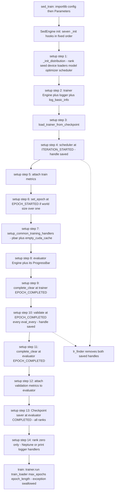
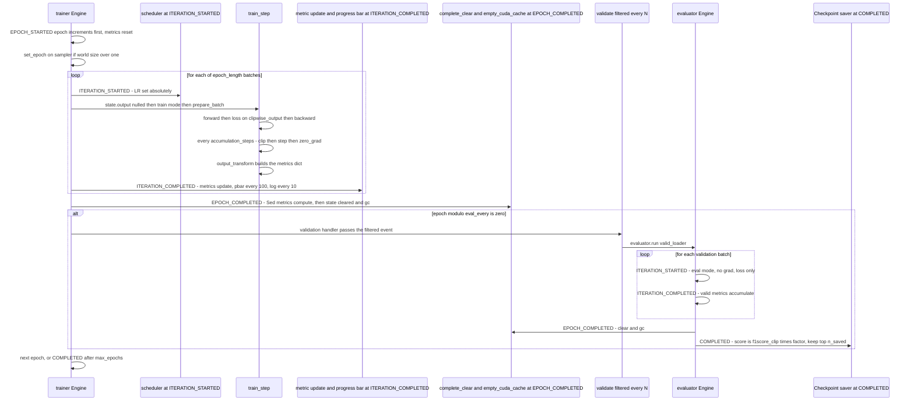
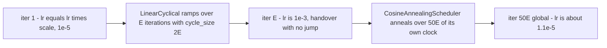

## Purpose

This module is the PyTorch Ignite layer of the framework: three files
(`src/engine/base/base_engine.py`, `src/engine/sed_engine.py`,
`src/sed_train.py`) that own *the loop*. They turn a bag of config objects into
two `ignite.engine.Engine` objects (`self.trainer`, `self.evaluator`), attach
handlers (scheduler, metrics, progress bars, validation, checkpoint saver,
remote logging) to a fixed list of Ignite events, and run the epoch/iteration
machinery. Everything that touches the GPU in the training path — the forward
pass, the loss, the optimizer step, gradient accumulation, LR scheduling,
gradient clipping, checkpoint writing — is orchestrated from here. It exists as a
separate unit because the alternative (hand-rolling a loop per experiment) is
exactly what `train.py` / `train_v2.py` / `train_v3.py` / `train_v4.py` +
`engine/main_engine*.py` were before it: four generations of near-duplicate
scripts. The Ignite rewrite bought config-driven experiments (a new run is a new
`Parameters` class, never a new script), free multi-GPU, and a stop-the-world
`Checkpoint` on a validation metric.

> [!info] Verified against the pinned version
> `requirements.txt` pins `pytorch-ignite==0.4.0.post1`. Every Ignite-internal
> claim below (event filter semantics, `ConcatScheduler` validation,
> `setup_common_training_handlers` contents) was checked against the source of
> tag `v0.4.0.post1`, not recalled from memory. Where behaviour differs from a
> plausible-looking guess, the guess is called out.

## Contracts

**Inputs** — two positional arguments to `SedEngine(local_rank, hparams)`:

- `local_rank: int` — the per-process device index handed over by
  `idist.Parallel.run`. Used only for `setup_logger(..., distributed_rank=...)`.
- `hparams` — a bare instance of the config class, e.g.
  `config_params.final_sed.final_sed_dense121_nomix_fold0.Parameters`. There is
  **no schema, no dataclass, no validation** — the engine reads attributes off
  it directly. Attributes the engine requires (values from the shipped configs):
  `train_bs=24`, `train_num_workers=8`, `valid_bs=32`, `valid_num_workers=4`,
  `lr=1e-3` (or `5e-4` for the mixup folds), `lr_scale_factor=0.01`,
  `weight_decay=1e-4`, `accumulation_steps=1`, `gradient_clip_val=0`,
  `eval_every=2` (10 in the non-fold configs), `val_length=None`,
  `checkpoint_dir=None`, `load_model_only=True`, `checkpoint_params={"save_dir",
  "n_saved":5, "prefix_name": <name>}`, `track_metric="f1score_clip"`,
  `metric_factor=1`, `add_pbar=True`, `run_params={"max_epochs":50,
  "epoch_length":None}`, `dist_params={}`, plus the per-component dicts
  `model_config`, `criterion_params`, `train_ds_params`, `valid_ds_params`,
  `test_ds_params`, `logger_params`.

**Outputs** — `trainer.run(...)` returns the engine `State`, which
`BaseEngine.train()` discards. The durable outputs are files under
`checkpoint_params["save_dir"]`, named
`<prefix_name>_checkpoint_<trainer_epoch>_score=<f1score_clip>.pt` with the
score formatted to 4 decimals, containing `{"model", "trainer", "optimizer",
"scheduler"}` state dicts (`to_save` at `base_engine.py:197-205`; the trainer key
makes the checkpoint resumable). `n_saved=5` keeps the five highest scores and
deletes the rest (`Checkpoint._check_lt_n_saved` + `DiskSaver.remove`). No return
value is consumed by any caller.

Per-step contract, shapes with the fold-0 final config
(`period=30 s`, `sr=32000`, `num_test_samples=1` train / `2` valid,
`classes_num=264`, `B=24` train / `32` valid, `N=264`,
`T = 1 + 960000//320 = 3001` frames — the STFT is a `Conv1d` with
`center=True` and `pad_mode='reflect'`, so the "+1" is real, see
`sed_models.py:184-203` and `sed_audio_utils.py:85-107`):

| tensor | shape | dtype | notes |
| --- | --- | --- | --- |
| `batch["waveforms"]` | `(B, C, S)` with `C=1` train, `C=2` valid, `S=32000*30=960000` | float32 | `SedDataset.__getitem__` |
| `batch["all_labels"]` / `primary_labels` / `secondary_labels` | `(B, C, N=264)` | float32 | one-hot over `BIRD_CODE` (264 entries) |
| `x` returned by `prepare_batch` | `((B, C, S), mixup_lambda)` — a **tuple** | float32 + `None` or `(B*C,)` | `sed_engine.py:34-44` |
| `y` returned by `prepare_batch` | `dict` with the three label tensors | float32 | never `.detach()`ed |
| `y_pred` | `{"clipwise_output": (B, C, 264), "framewise_output": (B, C, 3001, 264)}` | float32 | sigmoid already applied by `AttBlock(1024, N, activation='sigmoid')` |
| loss | scalar | float32 | `criterion(y_pred["clipwise_output"], y)` |

With mixup (`apply_mixup=True` — 9 of the 21 configs, the 4 mixup folds plus
their `_2` re-runs and `mix_2`) `x[0]` is still `(B, C, S)`
but the model internally halves it and sets `C=1`, and the labels are halved by
`do_mixup` to `((B*C)//2, 1, 264)` — see `sed_engine.py:27-30` and
`PANNsDense121Att.forward` (`input_x, mixup_lambda = input_data`).
`engine.state.output` for train/valid is
`{"loss", "x", "y_pred", "y", "dict_loss"}` (`sed_engine.py:75-81`); for test
`{"y_pred", "x", "y"}`.

**Called by** — `src/sed_train.py`:

```python
pe = SedEngine(local_rank, config)   # sed_train.py:9
pe.train(config.run_params)          # sed_train.py:10
```

The four sibling entry points `train.py`, `train_v2.py`, `train_v3.py`,
`train_v4.py` are byte-for-byte the same shell but import `MainEngine`,
`MainEngineV2/V3/V4` — **dead research history**, superseded by `sed_train.py`.

**Calls** — `ignite.engine.Engine`, `ignite.engine.Events`,
`ignite.contrib.engines.common`, `ignite.handlers.Checkpoint/DiskSaver/global_step_from_engine`,
`ignite.utils.manual_seed/setup_logger/convert_tensor`,
`ignite.contrib.handlers.tqdm_logger.ProgressBar`,
`ignite.contrib.handlers.FastaiLRFinder`,
`ignite.contrib.handlers.{LinearCyclicalScheduler, CosineAnnealingScheduler, ConcatScheduler}`,
`ignite.distributed as idist`, `torch.optim.AdamW`, `apex.amp` (imported, never
used — see below), plus, via the overridden `_init_*` hooks:
`models.sed_models`, `loss.*`, `metrics.*`, `dataloaders.sed_dataset.SedDataset`,
`augmentations.*`, `logger.{neptune,print}`.

## How it works

### 1. `sed_train.py` — 26 lines, three decisions

```python
module = importlib.import_module(params.config, package=None)  # :23
hyperparams = module.Parameters()                                  # :24
main(hyperparams)                                                  # :26
```

- **The config is a Python module path on the command line**
  (`python sed_train.py --config "config_params.final_sed.final_sed_dense121_nomix_fold0"`).
  `importlib.import_module` executes it and `Parameters()` instantiates it.
  The consequence is that hyperparameters are **arbitrary Python**, not a
  serialised blob: `root_dir` is a `pathlib.Path` (`Path("/data/")`), dataset
  params are nested dicts (`{"train_ds_params": {...}}`), f-string
  interpolation of `self.fold` happens at import time
  (`Path(f"/folds/fold_{self.fold}_test.csv")`), and `**self.model_config`
  splices into `logger_params["params"]`. Zero serialisation cost, zero schema
  drift, full expressiveness. The price — which is why the template says every
  claim must be traceable — is that nothing checks these attributes exist.
- **`run_params` is a dict splatted straight into `run()`**
  (`base_engine.py:218`: `self.trainer.run(self.train_loader, **run_params)`),
  so `{"max_epochs": 50, "epoch_length": None}` becomes
  `run(data, max_epochs=50, epoch_length=None)`. The *same* dict is read again
  inside `_init_scheduler` to size the LR schedule (`sed_engine.py:110-127`).
- **`torch.backends.cudnn.benchmark = True` at module scope** (`sed_train.py:6`),
  before any tensor is shaped — correct placement (autotune benefits from
  seeing the same conv shapes repeatedly), and it matters here because every
  input is a fixed 30 s / 960000-sample snippet.

### 2. `main()` — the whole distributed story in three lines

```python
with idist.Parallel(**hyperparams.dist_params) as parallel:
    parallel.run(run, hyperparams)
```

With `dist_params = {}` (every shipped config) `Parallel(backend=None,
nproc_per_node=None, ...)` validates that all non-backend args are `None`,
`__enter__` does **nothing** (no `idist.initialize`), and `run()` executes
`func(idist.get_local_rank(), hyperparams)` in this process
(`launcher.py:223-249`). The serial fallback model
(`comp_models/native.py::_SerialModel`) then answers `get_rank() == 0`,
`get_world_size() == 1`, `backend() is None`, `device() == torch.device("cuda")`
if CUDA is available. So a plain `python sed_train.py ...` and a
`torch.distributed.launch --nproc_per_node=4 --use_env sed_train.py ...` execute
the *same* code path; only `idist` behaviour changes. That is what "free
multi-GPU" means here.

### 3. `BaseEngine.__init__` — deliberate factory order

```python
self._init_score_function()      # :39   self.score_function closure
self._init_augmentation()        # :40   self.tfms, self.mixup_augmenter
self._init_train_dataloader()    # :42   self.train_ds
self._init_valid_dataloader()    # :43   self.valid_ds
self._init_test_dataloader()     # :44   self.test_ds
self._init_model()               # :46   self.model
self._init_criterion_function()  # :47   self.criterion
self._init_metrics()             # :48   self.train_metrics / validation_metrics / test_metrics
self.setup()                     # :50
```

The order is not cosmetic:

- `score_function` first because `setup()` → `setup_checkpoint_saver` needs it.
- `augmentation` before the datasets: `SedDataset(transform=self.tfms["train"])`.
- `model` before `criterion`/`metrics` only by habit; `metrics` needs
  `self.criterion.loss_keys` (`sed_engine.py:155`), which is why it comes last
  and why `_init_metrics` would explode on a criterion without `loss_keys`.
- **Nothing device-, optimizer- or scheduler-related happens in `__init__`.**
  `self.optimizer` and `self.scheduler` are created inside
  `_init_distribution()`, which runs from `setup()` — *after* the `Engine`
  objects exist. That is safe because `Engine(self.train_step)` only stores a
  bound method; the engine never touches `self.model` until an iteration fires,
  by which time `setup()` has finished populating `self`. The practical
  consequence is that **`SedEngine(...)` is not fully constructed until `setup()`
  returns**: anything you want to tweak between construction and
  `trainer.run(...)` has to be done after the constructor.

Abstract hooks raise `NotImplementedError`: `loss_fn`, `_init_model`,
`_init_optimizer`, `_init_criterion_function`, `_init_logger`, `_init_metrics`
(`base_engine.py:288-305`). Soft hooks return benign defaults:
`_init_scheduler` → `None`, the three `_*_dataloader` hooks → `None`,
`_init_augmentation` → `None`, `_init_score_function` → a real closure.
`SedEngine` overrides all nine abstract hooks plus `prepare_batch`,
`output_transform`, `_init_scheduler`.

### 4. `_init_distribution()` — everything device- and world-size-dependent

1. `self.rank = idist.get_rank()`; `manual_seed(42 + self.rank)`
   (`base_engine.py:53-54`). `ignite.utils.manual_seed` seeds `random`,
   `torch` (all CUDA devices via `torch.manual_seed`) and `numpy`. Per-rank
   offset avoids identical weight-init/dropout streams across ranks while
   keeping each run reproducible. **This is the only *global* seeding in the
   codebase** — `Engine.run(seed=...)` is deliberately unused (`run_params` has
   no `seed`, and in 0.4.0 passing one raises a DeprecationWarning).
   `SedDataset.init_workers_fn` reseeds `numpy` per worker from `os.urandom(4)`
   so augmentation streams differ per worker, and
   `augmentations/mixup.py:28` hard-codes `random_seed=1234` — see §8 for why
   that last one matters.
2. `self.device = idist.device()`.
3. Loaders via `idist.auto_dataloader` (`base_engine.py:64-76`). For the train
   loader: if `self.train_ds.sampler is not None` it *instantiates* it —
   `sampler = self.train_ds.sampler(self.train_ds, self.train_ds.get_label)`,
   i.e. `ImbalancedDatasetSampler(dataset, get_label)` with per-sample weight
   `1/count(label)` and sampling **with replacement** — and sets
   `shuffle=False` (a sampler wins over `shuffle` in `DataLoader`).
   Since `SedDataset.sampler = ImbalancedDatasetSampler` is a **class
   attribute**, that branch is always taken for this dataset: the final
   solution always trains class-balanced, never shuffled-randomly.
   `drop_last=True` for train, `drop_last=False` for valid/test. In 0.4.0
   `auto_dataloader` also scales `batch_size //= world_size`, scales
   `num_workers` by processes, wraps a user sampler in `DistributedProxySampler`
   when `world_size > 1`, and forces `pin_memory=True` on CUDA.
4. `self.model = idist.auto_model(self.model)` — **this is where the model
   actually reaches the GPU** (`auto_model` calls `model.to(idist.device())`,
   then wraps in `DistributedDataParallel` for nccl/gloo or `DataParallel` if
   >1 GPU and no process group).
5. Optimizer, **after** the model wrap, so the optimizer holds references to the
   (possibly DDP-wrapped) parameters:

```python
if USE_AMP:                       # :78-81  dead branch, USE_AMP is always False
    self._init_optimizer()
    self.model = idist.auto_model(self.model)
    self.model, self.optimizer = amp.initialize(self.model, self.optimizer, opt_level="O1")
else:
    self.model = idist.auto_model(self.model)
if not USE_AMP:
    self._init_optimizer()        # :85-86
self.optimizer = idist.auto_optim(self.optimizer)   # :88
```

   The `if USE_AMP / else / if not USE_AMP` sandwich reads as an editing scar:
   the second `if` exists because the optimizer must be built *after*
   `auto_model` on the normal path but *before* `amp.initialize` on the AMP
   path. Since `USE_AMP` is a module-level constant that is `False` in both
   branches of the import probe, only the `else` + `if not USE_AMP` path is
   ever live.
6. `self._init_scheduler()` — needs `self.optimizer` and `self.train_loader`,
   hence its position here rather than in `__init__`.
7. `self.criterion = self.criterion.to(self.device)`. The criterion is a
   parameterless `nn.Module` here, so this is a no-op move — but it is the
   right hook if a criterion ever gains buffers.

### 5. `setup()` — the handler wiring, in order

`setup()` (`base_engine.py:134-214`) is the load-bearing method of this module.
Order matters in four places; the rest is habit.

1. `_init_distribution()` (above).
2. `self.trainer = Engine(self.train_step)`;
   `self.trainer.logger = setup_logger("trainer", distributed_rank=self.local_rank)`;
   `self.log_basic_info(logger)` prints the torch and ignite versions and, only
   if `world_size > 1`, the backend and world size (`base_engine.py:94-101`).
3. `load_trainer_from_checkpoint()` — **before** any handler is attached, so
   the restored `iteration/epoch/max_epochs/epoch_length` drive everything
   downstream. `torch.load(..., map_location="cpu")` then
   `Checkpoint.load_objects(to_load=..., checkpoint=...)`. If
   `hparams.load_model_only` is `True` (every shipped config) only
   `{"model": ...}` is restored; otherwise `trainer`, `model`, `optimizer`,
   `scheduler` (and `amp`, dead). `Engine.state_dict()` in 0.4.0 returns
   `{"epoch_length", "max_epochs", "iteration"}`, and `load_state_dict`
   **recomputes** `epoch = iteration // epoch_length`. Gotcha: resume requires
   the same `epoch_length`, i.e. the same dataset size and batch size.
4. `self.scheduler_event = self.trainer.add_event_handler(Events.ITERATION_STARTED, self.scheduler)`
   or `None` (`base_engine.py:143-146`). The handle is stored *specifically so
   `lr_finder` can remove it later* — see §13.
5. `self.attach_metrics(self.trainer, self.train_metrics)` — `metric.attach(engine, name)`
   for each entry (`base_engine.py:130-132`).
6. `set_epoch` at `EPOCH_STARTED` **only if `world_size > 1`**:
   `self.train_loader.sampler.set_epoch(engine.state.epoch)`. (Ignite's own
   equivalent inside `setup_common_training_handlers` uses `state.epoch - 1`;
   the off-by-one is harmless for a reshuffle trigger.)
7. `common.setup_common_training_handlers(self.trainer, train_sampler=self.train_loader.sampler,
   to_save=None, save_every_iters=0, output_path=None, lr_scheduler=None,
   output_names=None, with_pbars=self.hparams.add_pbar, clear_cuda_cache=True,
   stop_on_nan=False)` — see §6 for exactly what that installs.
8. `self.evaluator = Engine(self.eval_step)`; `setup_logger("evaluator", ...)`;
   `if add_pbar: ProgressBar(persist=False).attach(self.evaluator)`.
9. `complete_clear` on `trainer` `EPOCH_COMPLETED` (`base_engine.py:175-180`) —
   the memory-leak mitigation, see §7.
10. `self.validation_handler_event = self.trainer.add_event_handler(Events.EPOCH_COMPLETED(every=self.hparams.eval_every), self.validate(self.valid_loader))`
    — note the *stored handle*, the second reason it exists.
11. `complete_clear` on `evaluator` `EPOCH_COMPLETED`.
12. `to_save = {"model", "trainer", "optimizer"}` (+ `scheduler` if not None,
    + `amp` if USE_AMP); `self.attach_metrics(self.evaluator, self.validation_metrics)`.
13. `self.setup_checkpoint_saver(to_save)` → `Checkpoint` on
    `evaluator` `Events.COMPLETED` (not on the trainer!):

```python
Checkpoint(to_save,
           DiskSaver(save_dir, require_empty=False),
           n_saved=5, filename_prefix=prefix_name,
           score_function=self.score_function, score_name="score",
           global_step_transform=global_step_from_engine(self.trainer))
```

    Two details: the saver hangs off the **evaluator**, so it can only fire when
    a validation actually ran — that is precisely why the `every=eval_every`
    filter and the checkpoint cadence are coupled. And
    `global_step_from_engine(self.trainer)` returns `trainer.state.<counter for
    evaluator.last_event_name>` = `trainer.state.epoch`, so filenames carry the
    *training* epoch, not the evaluator's own counter. `require_empty=False`
    lets a re-run add checkpoints to an existing directory.
14. `if self.rank == 0:` `_init_logger()` (rank 0 builds the Neptune/print
    logger from `logger_name`), then `logger._init_logger(trainer, evaluator)`,
    `_add_train_events(model, optimizer, scheduler)`,
    `_add_eval_events(model, optimizer, scheduler)`. Those two attach
    `ITERATION_COMPLETED(every=log_every)` handlers (train loss + LR) and
    `EPOCH_COMPLETED` handlers (train metrics dump, and
    `validation_metrics_completion(self.trainer, writer)` which reads the
    *trainer's* epoch as the global step).

### Metrics: what `attach_metrics` actually installs

`metric.attach(engine, name)` (`ignite/metrics/metric.py:286-291`, default
`usage=EpochWise()`) registers three handlers: `EPOCH_STARTED` → `reset`,
`ITERATION_COMPLETED` → `iteration_completed` (this is the one that reads
`engine.state.output` through `output_transform`), `EPOCH_COMPLETED` →
`completed` (`self.compute()` → written into `engine.state.metrics[name]`).
`RunningAverage` overrides `attach` (`running_average.py:96-103`) and is
**different in two ways that matter**: it resets at `EPOCH_STARTED`, it updates
*and* writes into `state.metrics` at `ITERATION_COMPLETED` (never at
`EPOCH_COMPLETED`), and its update is an **exponential** moving average with
`alpha=0.98` — roughly a 50-iteration window — not an epoch mean.

So `train_avg_loss` / `valid_avg_loss` are smoothed EMAs of the per-iteration
loss (`dict_loss` counterparts likewise, for each of the criterion's five
`loss_keys`: `bce_loss`, `F_loss`, `FScaled_loss`, `F_loss_0`, `F_loss_1`).
Full metric inventory for the fold configs:

| engine | names |
| --- | --- |
| trainer | `train_avg_loss`, `train_bce_loss`, `train_F_loss`, `train_FScaled_loss`, `train_F_loss_0`, `train_F_loss_1` |
| evaluator | the six `valid_*` equivalents, plus `lraps`, `f1score_clip`, `f1score_frame` |
| tester | `{}` unless `"test" in hparams.metrics` — never set by any shipped config |

> [!info] Ordering note, corrected against the 0.4.0 source
> `attach_metrics(trainer, ...)` is at line 147 and `complete_clear` at line
> 180, so on the trainer `complete_clear` fires *after* every metric
> `EPOCH_COMPLETED` handler; on the evaluator the order is reversed (line 183
> before line 206). Neither order is load-bearing here: metrics only read
> `engine.state.output` at `ITERATION_COMPLETED` (where ignite has just assigned
> the step's return value), and every `compute()` in this repo returns an
> accumulated scalar (`RunningAverage.compute` → `self._value`,
> `SedLRAPS.compute` → `self._score / self._num_items`). It *would* become
> load-bearing for a metric whose `compute()` read `state.output`.

> [!warning] The checkpoint saver is **not** rank-gated
> `setup_checkpoint_saver(to_save)` (line 207) runs on every rank; only the
> logger (line 209) is wrapped in `if self.rank == 0`. In a genuine multi-GPU
> run every rank would `DiskSaver`-write into the same
> `checkpoint_params["save_dir"]`. Harmless for the final solution (single
> GPU), but it is a real bug in the "free multi-GPU" story.

### 6. What `common.setup_common_training_handlers` actually installs

The helper is 90% disabled by the arguments this repo passes. Resolving
`_setup_common_training_handlers` (`ignite/contrib/engines/common.py:117-183`)
against the actual call:

| handler | installed? | why |
| --- | --- | --- |
| `TerminateOnNan` at `ITERATION_COMPLETED` | **no** | `stop_on_nan=False` |
| LR-scheduler handler | **no** | `lr_scheduler=None` (the repo attaches its own at `ITERATION_STARTED`, earlier, line 144) |
| `empty_cuda_cache` at `EPOCH_COMPLETED` (`torch.cuda.empty_cache()` **+ `gc.collect()`**) | yes | `clear_cuda_cache=True` and CUDA available |
| `Checkpoint` + `DiskSaver` | **no** | `to_save=None` |
| `GpuInfo` | **no** | `with_gpu_stats` defaults to `False` |
| `RunningAverage` from `output_names` | **no** | `output_names=None` (the repo attaches its own) |
| iteration `ProgressBar(persist=False)` at `ITERATION_COMPLETED(every=log_every_iters=100)` with `metric_names="all"` | yes | `with_pbars=True`, `with_pbar_on_iters` defaults `True` |
| epoch `ProgressBar(persist=True, bar_format="")` at `EPOCH_STARTED`, closing at `COMPLETED` | yes | `with_pbars=True` |

> [!warning] Correction to a plausible misreading
> It is tempting to assume `setup_common_training_handlers` gives you
> `TerminateOnNan`, `GarbageCollection`, `LogitsToNumpy`, `StopOnCompletion`,
> `TimeProfiler`, `LRScheduler` and `Checkpointable`. In 0.4.0 it gives you
> exactly two progress bars and `empty_cuda_cache` under this call. The first
> three of that list are `ignite.handlers` classes that this helper never
> references in 0.4.0, and `TimeProfiler`/`BasicTimeProfiler` lives in
> `ignite.contrib.handlers.time_profilers` and is never wired by this repo.
> `GpuInfo` and `LRScheduler` *are* imported by the helper, but the arguments
> here disable both.

Two consequences worth knowing:

- **`save_every_iters=0` is a loaded gun.** If anyone ever flips `to_save` to a
  dict while leaving `save_every_iters=0`, the helper constructs
  `Events.ITERATION_COMPLETED(every=0)` and 0.4.0 raises
  `ValueError("Argument every should be integer and greater than zero")` at
  setup time.
- **The distributed branch is different.** `setup_common_training_handlers`
  dispatches to `_setup_common_distrib_training_handlers` when
  `world_size > 1`, which additionally attaches its own `distrib_set_epoch`
  (using `state.epoch - 1`) and requires `train_sampler` to be a
  `DistributedSampler` (otherwise `TypeError`). Here `train_sampler` is
  `self.train_loader.sampler`, which under `auto_dataloader` is a
  `DistributedProxySampler` — a `DistributedSampler` subclass — so the
  requirement is met and the epoch is set twice (harmless). Single-process
  ignores `train_sampler` entirely, so no warning is emitted for the plain
  `RandomSampler`.

### 7. `complete_clear` — the deliberate memory-leak mitigation

```python
def complete_clear(engine):          # base_engine.py:175-179
    engine.state.batch = None
    engine.state.output = None
    import gc
    gc.collect()
self.trainer.add_event_handler(Events.EPOCH_COMPLETED, complete_clear)   # :180
self.evaluator.add_event_handler(Events.EPOCH_COMPLETED, complete_clear) # :183
```

**Why this exists, evidenced from inside ignite.** In 0.4.0
`Engine._run_once_on_dataset` carries the author's exact problem as an
unresolved TODO:

```python
                # TODO: remove refs on batch to avoid high mem consumption ? -> need verification
                # self.state.batch = None
```

`State.batch` and `State.output` are strong references that live until the next
iteration overwrites them. For this model that is not a small thing: one
train step's `framewise_output` is `(24, 1, 3001, 264)` float32 ≈ 76 MB, and
`y_pred` in `state.output` is a dict that *also* holds the autograd graph of the
previous iteration's forward pass (only `loss` is `detach()`ed at
`sed_engine.py:77-79`). Nulling both at the epoch boundary plus an explicit
`gc.collect()` bounds the high-water mark to roughly one epoch instead of
drifting upward over 50 epochs × 25 validations.

The related per-iteration half of the same idea is the first line of
`train_step`:

```python
engine.state.output = None          # base_engine.py:238
```

> [!tip] The single most under-commented line in the module
> Without it, `state.output` from iteration *n-1* (graph and all) stays
> reachable for the entire duration of iteration *n*'s forward/backward, so
> two graphs are alive at once. Nulling at the **top** of the step keeps at
> most one alive. It costs one attribute store per iteration and roughly halves
> peak allocator pressure. It appears identically in `eval_step` (:259) and
> `test_step` (:269).

### 8. `train_step` — the custom process function

```python
def train_step(self, engine, batch):                            # :237
    engine.state.output = None                                  # :238
    self.model.train()                                          # :239
    x, y = self.prepare_batch(batch, mode='train')              # :240
    y_pred = self.model(x)                                      # :241
    loss, dict_loss = self.loss_fn(y_pred, y)                   # :242
    self.loss_backpass(loss)                                    # :243
    if engine.state.iteration % self.hparams.accumulation_steps == 0:   # :245
        self.clip_gradients()                                   # :246
        self.optimizer.step()                                   # :247
        self.optimizer.zero_grad()                              # :248
    return self.output_transform(x, y, y_pred, loss, dict_loss, mode='train')  # :249
```

- `model.train()` every step (rather than once at epoch start) — cheap, and
  immune to `eval_step` having flipped the flag.
- `prepare_batch` returns a **tuple** `((waveforms, mixup_lambda), labels)`
  because `PANNs*.forward` destructures `input_x, mixup_lambda = input_data`.
  The label half of the mixup is applied in `prepare_batch`
  (`sed_engine.py:27-30`); the **log-mel** half is applied inside the model's
  `preprocess` (`if self.training and self.apply_aug and mixup_lambda is not
  None: x = do_mixup(x, mixup_lambda)`, `sed_models.py:379-393`) — so it is a
  spectrogram-domain mixup, not a waveform-domain one. The model then halves its
  own batch afterwards (`if mixup_lambda is not None: b = (b*c)//2; c = 1`) so
  the halved labels line up with the halved prediction.
- `loss_fn` is `SedEngine.loss_fn` → `self.criterion(y_pred["clipwise_output"], y)`
  (`sed_engine.py:71-73`). **Only the clip-level output is trained**; the
  frame-level output exists for inference/thresholding and for nothing else.
- `loss_backpass` (`base_engine.py:251-256`) is the AMP fork: `amp.scale_loss`
  under `USE_AMP`, plain `loss.backward()` otherwise. Live path: `backward()`.
- `state.iteration` is incremented by ignite **before** `ITERATION_STARTED`
  fires (`engine.py:765`), so it is 1-based inside the step. With
  `accumulation_steps=1` (every shipped config) the branch is a no-op
  modulo-1 test; the branch is live scaffolding for larger effective batches.
  Note `zero_grad()` is called *after* `step()` (rather than `set_to_none=True`
  before `step()`), so the first `zero_grad()` on a fresh optimizer is the one
  that clears the initial `None` grads — and grads are freed with `set_to_none`
  semantics only from the *second* iteration onward, since `zero_grad()` defaults
  to `set_to_none=True` in torch ≥1.7.
- `output_transform` returns the dict that all metrics are wired against. For
  `mode='train'` and `mode='valid'` the bodies are **identical**
  (`sed_engine.py:76-79`) — the distinction exists only for the test branch.

> [!warning] Mixup coefficients are **not** affected by `manual_seed(42+rank)`
> `_init_augmentation` builds `Mixup(mixup_alpha=1.)`
> (`sed_engine.py:210`) and `Mixup.__init__` hard-codes
> `self.random_state = np.random.RandomState(random_seed)` with
> `random_seed=1234` as the default (`augmentations/mixup.py:27-47`). Every run,
> every rank, every epoch therefore draws the **same** sequence of
> `Beta(1,1)` lambdas — the global seeding in `_init_distribution` does not
> reach it. *(inferred consequence of the constructor default; not commented in
> the code.)* To make mixup stochastic you would have to pass
> `random_seed=42 + rank` through, which the current config surface does not
> allow. Also note `get_lambda(batch_size=bs*c)` generates `bs*c` coefficients
> and `do_mixup` mixes index `2i` with `2i+1`, so with `c=1` (train) each lambda pair mixes two independently sampled recordings. Same-file pairing would only happen with `c=2`, which is never used with mixup.
   lambda pair corresponds to two consecutive 30 s snippets of the same file.

`eval_step` (`:258-265`) is the same skeleton minus backward/step, with
`model.eval()` and `torch.no_grad()`. `test_step` (`:268-274`) omits the loss
entirely and is **dead code** (see failure modes).

### 9. `clip_gradients` — verbatim Lightning code, disabled in the final run

```python
def clip_gradients(self):
    # Source https://github.com/PyTorchLightning/pytorch-lightning/blob/master/pytorch_lightning/trainer/training_tricks.py
    if self.hparams.gradient_clip_val <= 0:
        return
    ...
```

Copied verbatim from PyTorch Lightning's `training_tricks.py` (URL in the
comment), `clip_gradients` algorithm included. It is **not** a call to
`torch.nn.utils.clip_grad_norm_`; that helper allocates a full graph-free
multi-tensor buffer, while this version writes per-parameter norms into a
pre-allocated 1-D `torch.empty(len(parameters), device=device)` via the `out=`
kwarg, then does one final `torch.norm(out, norm_type)`:

```python
    eps = EPSILON_FP16 if USE_AMP or XLA_USE_BF16 == 1 else EPSILON   # :346
    clip_coef = torch.tensor(max_norm, device=device) / (total_norm + eps)
    clip_coef = torch.min(clip_coef, torch.ones_like(clip_coef))
    for p in parameters:
        p.grad.data.mul_(clip_coef.to(p.grad.data.device))
```

- **Global L2 norm, no autograd.** `norm_type = float(2.0)`; `parameters` is
  filtered to `p.grad is not None` first, so the norm is over *populated*
  params only. `torch.norm(p.grad.data.to(device), 2.0, out=out[i])` runs on
  `.data` → no graph is built, and the loop is a host-side `for` (no fused
  kernel — slower than `clip_grad_norm_`, irrelevant at 1 clip per step).
- **`EPSILON = 1e-6`, `EPSILON_FP16 = 1e-5`** (`:31-32`). The denominator is
  `total_norm + eps`, so `eps` only matters when the norm is tiny: it prevents a
  divide-by-zero blowing up the coefficient, at the cost of slightly
  under-clipping near zero. fp16 needs the larger epsilon because a 1e-6-scale
  norm is not representable in fp16 (min normal ≈ 6.1e-5), so the guard would
  be quantised to 0 and the division would still produce inf.
- **`clip_coef = min(max_norm / (total_norm + eps), 1)`** is the trick: it never
  *amplifies* gradients (when the norm is already below `max_norm`, the ratio
  is > 1 and the `min` clamps it to exactly 1.0, making `mul_(1.0)` a no-op),
  and it scales all params by a single scalar so the direction of the gradient
  vector is preserved.
- `math.inf` norm path (`:337-338`) takes `max(|grad|)` per tensor — present
  because the Lightning original had it; unreachable here since `norm_type` is
  hard-coded to `2.0`.
- **`gradient_clip_val = 0` in every shipped config** (`example_config.py:138`
  plus all 20 files under `final_sed/` (15) and `final_sed_5_fold/` (5)). So in
  the final solution `clip_gradients` returns on its first line and clipping is
  off. Documented decision, not an oversight.

### 10. Schedulers

Both schedulers are attached to `ITERATION_STARTED` (line 144), *before*
`train_step` runs, so the LR is correct for the forward/backward that is about to
happen. Ignite 0.4.0 ships them as `ignite.contrib.handlers.param_scheduler`
(re-exported from `ignite.contrib.handlers`; the old `schedulers.py` module no
longer exists — verified against the v0.4.0.post1 tree).

**`warmup_with_cosine`** (used by all 21 shipped configs — 15 in
`final_sed/`, 5 in `final_sed_5_fold/`, plus `example_config.py`;
`sed_engine.py:107-118`):

```python
epoch_length = self.hparams.run_params["epoch_length"] or len(self.train_loader)
num_epochs  = self.hparams.run_params["max_epochs"]
scheduler_1 = LinearCyclicalScheduler(opt, "lr", start_value=lr*lr_scale_factor,
                                      end_value=lr, cycle_size=epoch_length*2)
scheduler_2 = CosineAnnealingScheduler(opt, "lr", start_value=lr,
                                      end_value=lr*lr_scale_factor,
                                      cycle_size=num_epochs*epoch_length)
durations = [epoch_length, ]
self.scheduler = ConcatScheduler(schedulers=[scheduler_1, scheduler_2], durations=durations)
```

> [!warning] `durations=[epoch_length]` for two schedulers is **correct**, not a bug
> I checked this against the 0.4.0 source rather than trusting the shape of it.
> `ConcatScheduler.__init__` validates:
> ```python
> if len(schedulers) != len(durations) + 1:
>     raise ValueError("Incorrect number schedulers or duration values, ...")
> ```
> So `durations` must be `len(schedulers) - 1` — length **1** for two
> schedulers. `durations=[epoch_length, X]` would raise at construction. The
> last scheduler has implicit infinite duration: `_setup_scheduler` sets
> `_current_duration = -1` when the index runs past `durations`, and `__call__`
> only advances the index when `_current_duration == 0` (which `-1` never hits,
> since it only decrements further). The repo's call is the documented
> `ConcatScheduler` idiom, straight out of the class docstring.

**So what really happens to the warmup?** It runs, for exactly one epoch, and it
is *engineered* to land exactly on `lr`:

- `LinearCyclicalScheduler.get_param` is a triangle:
  `end_value + (start_value - end_value) * abs(event_index/cycle_size - 0.5) * 2`.
  With `cycle_size = 2E` (E = epoch length), the *up-ramp* completes at
  `event_index = E` and the down-ramp occupies `E..2E`. Since `ConcatScheduler`
  hands over after `E` events, **the down-ramp is unreachable dead code** — the
  `*2` in `cycle_size=epoch_length*2` is precisely what turns a cyclical
  scheduler into a pure linear warmup over one epoch.
- `ParamScheduler.__call__` reads `get_param()` **then** increments
  `event_index`, so `scheduler_1` sees `event_index = 0 .. E-1`:
  `lr(0) = lr*lr_scale_factor = 1e-5`, and
  `lr(E-1) = lr - (lr - lr*scale)/E` → for `E ≈ 10^3` that is `9.99e-4`,
  i.e. visually `lr`.
- `scheduler_2` then starts at `event_index = 0`, and
  `start + ((end-start)/2)*(1 - cos(0)) = lr`. **No discontinuity** at the
  handover.
- `scheduler_2`'s `cycle_size = 50E` is measured on *its own* clock, so the
  cosine spans global iterations `E .. 51E`, while training stops at `50E`. At
  the last training iteration `event_index = 49E`, `cycle_progress = 0.98`,
  `cos(0.98π) = -0.998` → `lr ≈ 1.1e-5`, i.e. it does land on
  `lr*lr_scale_factor = 1e-5`, just 1 % early.

Net schedule for `lr=1e-3, lr_scale_factor=0.01`: **1 epoch linear warmup
1e-5 → 1e-3, then 49 epochs of cosine 1e-3 → 1e-5.**

Two fragilities to remember when re-tuning:

- The cosine's length is baked in at construction from `run_params["max_epochs"]`.
  Change `max_epochs` on a resumed run and the restored
  `ConcatScheduler._state_attrs` (`event_index` per sub-scheduler,
  `_scheduler_index`, `_current_duration`) are re-interpreted against a
  different `cycle_size` → the LR jumps.
- `epoch_length` from `run_params` must equal `len(self.train_loader)`
  (`floor(N / 24)` because `drop_last=True`). Every shipped config sets it to
  `None` so the real loader length is used; setting it to a number changes
  *both* `run()`'s epoch length and the schedule length, so the two can never
  disagree — but a too-large value makes ignite warn
  `"Data iterator can not provide data anymore but required total number of
  iterations to run is not reached"` and truncate the epoch.

**`one_cycle_cosine`** (`sed_engine.py:120-128`): a bare
`CosineAnnealingScheduler(lr → lr*lr_scale_factor, cycle_size=num_epochs*epoch_length)`
— the warmup half dropped. **No shipped config uses it**; it is a leftover
experiment switch.

Note the schedulers write **absolute** values into `optimizer.param_groups`
(0.4.0 `ParamScheduler` docstring: "Parameter scheduler works independently of
the internal state of the attached optimizer ... the scheduler sets defined
absolute values"), which is why `scheduler_1` has to *start* at 1e-5 itself
rather than relying on the optimizer's `lr=1e-3`.

### 11. Optimizer

```python
# sed_engine.py:83-85
if self.hparams.optimizer_name == "adamw":
    self.optimizer = torch.optim.AdamW(self.model.parameters(), lr=self.hparams.lr,
                                       betas=(0.9, 0.999), eps=1e-08,
                                       weight_decay=self.hparams.weight_decay, amsgrad=True)
```

- `betas`, `eps` are torch defaults; `weight_decay` is the only tuned knob
  (`1e-4` in the final configs, `1e-2` in `example_config.py`).
- **`amsgrad=True` is a deliberate, documented-by-choice choice.** Adam's
  denominator is `sqrt(v_t)`; AMSGrad divides by `max(v_t, v_{t-1})`, i.e. a
  monotonically non-decreasing running maximum, so the effective step size can
  never *increase* mid-run even if the second-moment estimate dips. For this
  problem (264 classes with ≤ 100 labelled samples each per the README, plus
  rare secondary labels, where the per-class gradient variance is large and
  spiky) that removes the "loss spikes when a rare class reappears" failure
  mode at a cost of a few extra bytes per parameter. *(inferred — reason:
  class-imbalance + small per-class sample counts; the code carries no comment
  justifying it beyond `amsgrad=True`.)*
- There is **no `else`** in the dispatch, so `optimizer_name="sgd"` would leave
  `self.optimizer` undefined and blow up later at `idist.auto_optim(self.optimizer)`
  with an `AttributeError` far from the cause. See the dispatch pattern note in
  Key decisions.

### 12. Mixed precision — vestigial by design

```python
try:
    from apex import amp
    print("Found NVIDIA Apex, using mixed precision")
    print("NOT USING APEX BECAUSE CANNOT CREATE MEL SPEC, REQUIRES TUNING, PROBLEMS HAVE OCCURRED")
    USE_AMP = False
except:
    print("NVIDIA Apex not found, not using mixed precision")
    USE_AMP = False
```

**`USE_AMP` is `False` in both branches.** The detection is vestigial: it
survives only so the "Found NVIDIA Apex" message tells you whether `startup.sh`
managed to build apex on this box. Every AMP code path in the file
(`amp.initialize(opt_level="O1")` at `:81`, `objects_to_checkpoint["amp"]` at
`:113`, `to_save["amp"]` at `:205`, `amp.scale_loss` at `:253`) is therefore
dead code.

The in-code reason is given verbatim: `CANNOT CREATE MEL SPEC`. The log-mel
front end is computed **inside the model's `forward`**
(`self.preprocess` → `helpers/sed_audio_utils.py::LogMelSpectrogram`, with
`amin = 1e-10` hard-coded at `models/sed_models.py:189,328,452`), so whatever
apex does to the graph is applied to the mel spectrogram too. This matches the
README's installation note:

> "NOTE: The sed training models don't support mixed precision training in the
> current state and will output NaN values. This can be fixed by adjusting the
> `amin` value but this is an untested change and may impact model performance.
> `USE_AMP` in the `base_engine.py` will also need to be set to `True`
> (currently disabled even if amp is installed)."

Two things follow, and the README is the authoritative source for both: (a) the
fix is raising `amin` so the log-mel stays numerically representable, and (b)
`USE_AMP` itself must be flipped back to `True` — which is why the README says
it "will also need to be set". Since `USE_AMP` is a module constant,
re-enabling AMP means **editing the source**, not setting an env var. **Untested
— do not assume it works.**

*(inferred — reason: the README names `amin` as the knob.)* The mechanism is
almost certainly representability: `10*log10(1e-10) = -100 dB`, and `amin`
itself is below fp16's smallest subnormal (≈ 6e-8), so under any fp16 cast in
the mel path the clamp degenerates and the log-mel becomes ±inf/NaN. Note that
apex `opt_level="O1"` only casts a whitelist of ops (matmul/conv) and leaves the
rest in fp32, so the *exact* failure — a NaN from a cast `log10`, versus a
capture failure — **cannot be determined from this repo** and would need a
reproduction on a machine with apex built.

**The `XLA_USE_BF16` probe** (`base_engine.py:27-30`) is a genuine latent bug,
just not the kind one might guess:

```python
try:
    XLA_USE_BF16 = os.getenv(XLA_USE_BF16)     # looks up env var NAMED "XLA_USE_BF16"
except:
    XLA_USE_BF16 = 0
```

- **The bug is a `NameError` that is swallowed.** `os.getenv(XLA_USE_BF16)` passes a **bare, undefined name**, not the string `"XLA_USE_BF16"`; the lookup therefore raises `NameError` at import time, and the bare `except` catches it and sets `XLA_USE_BF16 = 0` on **every** run. The environment variable is never read, `USE_AMP or XLA_USE_BF16 == 1` is always `False`, and the fp16 `EPSILON_FP16` branch is dead code. Fix: `int(os.getenv("XLA_USE_BF16", "0"))` at line 28.
  `USE_AMP or XLA_USE_BF16 == 1`, evaluates `"1" == 1` → `False`. The fp16
  epsilon branch is dead even when the operator explicitly opts in. The fix is
  `os.getenv("XLA_USE_BF16") == "1"` or `int(os.getenv("XLA_USE_BF16", "0"))`.
- Cosmetic sibling of the same copy-paste family: the variable is *named* after
  the env var it reads, shadowing the constant it is trying to define.

The XLA/TPU branch of the whole engine is otherwise unimplemented — there is no
`XLA_USE_BF16`-gated `bfloat16` autocast anywhere, and no config sets it.

### 13. `lr_finder` — the FastaiLRFinder wrapper (dead, but informative)

```python
def lr_finder(self, min_lr=0.00003, max_lr=10.0, num_iter=None):   # :353
    trainer = self.trainer
    self.validation_handler_event.remove()          # :355
    if self.scheduler_event is not None:
        self.scheduler_event.remove()              # :357
    ...
    for param_group in optimizer.param_groups:
        param_group['lr'] = min_lr                 # :367-368
    with lr_finder.attach(trainer, num_iter=num_iter, end_lr=max_lr,
                          to_save=to_save, output_transform=output_transform) as trainer_with_lr_finder:
        trainer_with_lr_finder.run(dataloader)     # :374
    return lr_finder
```

- **This is why the two handler handles are stored.** Lines 355 and 357 remove
  the validation handler and the LR scheduler *by their stored
  `RemovableEventHandle`s* — you cannot unregister an ignite handler without
  keeping the handle returned by `add_event_handler`. Validating inside an LR
  sweep would be both slow and wrong (it would also let the checkpoint saver
  write from a garbage LR), and leaving the scheduler attached would fight
  `_ExponentialLR` for `param_group['lr']` every iteration.
- `output_transform=lambda x: x["loss"]` feeds the *loss* of the trainer's
  `state.output` dict to the finder (0.4.0 asserts `loss` is a single number).
- `num_iter = len(dataloader) - 1` when unspecified — one almost-full epoch, not
  `epoch_length * max_epochs`.
- **Gotcha, and it is not the obvious one:** 0.4.0's `attach` *does* snapshot
  and restore `to_save` (`model`, `optimizer`) plus `trainer.state_dict()` via a
  temp file on context exit, so weights are safe. But the snapshot is taken
  **after** line 368 already overwrote `param_group['lr'] = min_lr`. The
  "restored" LR is therefore `3e-5`, not the configured `1e-3`. Nothing puts
  it back: the scheduler handler was removed and never re-added. You must
  re-attach it yourself. The `ConcatScheduler`'s own `event_index` is *not* in
  `to_save`, so it keeps advancing across the sweep — re-attaching it after a
  sweep resumes the cosine from wherever it was, not from the beginning.
- Nothing in the repo calls `lr_finder` — no entry point, no config.
  **Dead code kept for re-derivation.**

## Key decisions and tricks

### The config-driven dispatch — why this repo is an experiment harness

Every component hook is one big `if/elif` on a **string** from the config:

| hook | strings accepted |
| --- | --- |
| `_init_model` | `sed_ccnn14att`, `sed_dense121att`, `sed_dense161att`, `sed_dense169att`, `sed_dense201att` |
| `_init_criterion_function` | `focal_loss_standard`, `sed_removed_focal_loss`, `sed_scaled_pos_neg_focal_loss`, `sed_scaled_pos_neg_focal_loss_augd`, `bce_controlled_standard_loss` |
| `_init_scheduler` | `none`, `warmup_with_cosine`, `one_cycle_cosine` |
| `_init_optimizer` | `adamw` (only) |
| `_init_logger` | `print`, `neptune`, anything else → `None` |
| `_init_augmentation` | `default`, `secondary_default` |

Because the keys are plain strings and the values are **imports inside the
branch** (`from loss.sed_scaled_pos_neg_focal_loss import SedScaledPosNegFocalLoss`),
adding an experiment is a config edit plus a new file, never an engine edit.
Two consequences the code does *not* defend against:

- **No `else` anywhere.** An unknown string leaves the attribute unset, and the
  failure surfaces much later as `AttributeError: 'SedEngine' object has no
  attribute 'criterion'/'optimizer'/'model'`. The only place that defends is
  `_init_logger`, which has an explicit `else: self.logger = None`.
- **No key validation.** A missing `hparams.eval_every` fails inside
  `setup()`; a missing `accumulation_steps` fails at iteration 1. This is the
  direct cost of the "config is arbitrary Python" decision in §1.

### The engine's state, and every event that is used

`engine.state` (ignite 0.4.0 `State.__init__`) carries `iteration`, `epoch`,
`epoch_length`, `max_epochs`, `output`, `batch`, `metrics`, `dataloader`,
`seed`, `times`. This module uses:

| state field | used at |
| --- | --- |
| `state.iteration` | scheduler at `ITERATION_STARTED`; accumulation modulo at `:245`; `every=log_every` / `every=100` filters on iteration events |
| `state.epoch` | `set_epoch`; the `Events.EPOCH_COMPLETED(every=…)` filter; both progress bars' display; `global_step_from_engine` (maps the evaluator's `COMPLETED` → `trainer.state.epoch`) |
| `state.output` | set to `None` first thing in every step; read by all metric `output_transform`s; cleared by `complete_clear` |
| `state.batch` | cleared by `complete_clear` |
| `state.metrics` | `score_function` (`engine.state.metrics["f1score_clip"]`) and the Neptune metric dumps |
| `state.max_epochs` / `epoch_length` | set by `run(**run_params)`; restored by `load_trainer_from_checkpoint` |
| `engine.last_event_name` | read by `global_step_from_engine` inside the `Checkpoint` handler |

Event inventory actually attached by this module:

- `ITERATION_STARTED` — the LR scheduler (`:144`).
- `ITERATION_COMPLETED` — metric `update()` (via `attach`; also where
  `RunningAverage` writes `state.metrics`), the iteration
  progress bar every 100 iterations (via `common`), the logger's
  loss/LR handlers every `log_every=10` (via `logger`), and the transient
  `FastaiLRFinder` handlers.
- `EPOCH_STARTED` — metric `reset()` (via `attach`), `set_epoch` when
  `world_size > 1`, the persistent epoch progress bar (via `common`).
- `EPOCH_COMPLETED` — metric `compute()` for the `Sed*` metrics only (via
  `attach`), `empty_cuda_cache` (via `common`), `complete_clear`
  (both engines), the logger's epoch metric dumps, and the **filtered**
  validation trigger.
- `COMPLETED` — the `Checkpoint` saver on the **evaluator**; the epoch progress
  bar's close (via `common`).

### `Events.EPOCH_COMPLETED(every=self.hparams.eval_every)` — how `every` works

`every` is not magic; it is a filter factory
(`ignite/engine/events.py:86-99`):

```python
@staticmethod
def every_event_filter(every):
    def wrapper(engine, event: int) -> bool:
        return event % every == 0
    return wrapper
```

and the wrapper installed around the handler asks the state which counter
belongs to that event (`engine.py:201-208` → `State.get_event_attrib_value`):

```python
event_to_attr = {
    Events.ITERATION_STARTED: "iteration", Events.ITERATION_COMPLETED: "iteration",
    Events.EPOCH_STARTED: "epoch",         Events.EPOCH_COMPLETED: "epoch",
    Events.STARTED: "epoch",                Events.COMPLETED: "epoch",
}
```

So **`every=2` on an epoch event filters on `state.epoch % 2 == 0`, not on
iterations.** For the fold configs (`max_epochs=50`, `eval_every=2`) validation
runs on epochs **2, 4, …, 50** — 25 runs, never on epoch 1. The three
non-fold configs (`final_sed_dense121_nomix_1/3`, `final_sed_dense121_mix_2`)
use `eval_every=10` with `load_model_only=False` and `checkpoint_dir=None`:
epochs 10, 20, 30, 40, 50. Two edge notes: `every=1` short-circuits and
returns the *unfiltered* event (no wrapper installed at all), and `epoch` is
1-based at fire time (`self.state.epoch += 1` precedes `EPOCH_STARTED`).

Why cadence control is worth this much machinery: LRAPS and the F1 metrics move
a lot between epochs during a 1e-3 → 1e-5 cosine, and the final ensemble used
13 of these models. Halving validation cost (each pass is a full walk over the
fold's test CSV — 2 × 30 s chunks per file — plus the background clip directory
under `background_audio_dir`) buys more folds for the same GPU-hours; the
tracked metric is still computed 25 times per run, which is ample for
best-checkpoint selection with `n_saved=5`. *(inferred — reason: the README
describes hand-picked threshold/vote ensembles over 13 models; the engine only
ever does per-run "best score" selection via `Checkpoint`.)*

### `train()` swallows the exception, then pretends all is well

```python
def train(self, run_params):                        # :216
    try:
        self.trainer.run(self.train_loader, **run_params)
    except Exception as e:
        import traceback
        print(traceback.format_exc())
    if self.rank == 0 and self.logger:
        self.logger._end_of_training()
```

The traceback goes to **stdout via `print`**, not to the logger — so with the
Neptune logger active it is *not* captured in the experiment. Then
`_end_of_training()` runs unconditionally: `MyNeptuneLogger._end_of_training`
calls `self.writer.experiment.stop()`. Net effect: **a crashed 50-epoch run
finishes its Neptune experiment, exits with status 0, and looks like a
completed run in the UI** — the only evidence is stdout. This is the single
most operationally dangerous thing in the module. If a resumed run is set up,
the cheapest guard is to run with `logger_name="print"` and tail stdout, or to
assert `trainer.state.epoch == max_epochs` after `run()` returns.

Exception path detail: an exception raised inside `train_step` is caught by
`Engine._run_once_on_dataset`, which calls `_handle_exception`; since nothing
attaches an `EXCEPTION_RAISED` handler, `_handle_exception` **re-raises**
(`engine.py:431-435`), so it propagates out of `run()` into the `except` above.

### The factory-method / template-method skeleton

```
BaseEngine.__init__  ──(calls, in order)──▶  _init_* hooks (NotImplementedError or default)
                              │
                              └──▶ setup() ──▶ _init_distribution ──▶ Engine ──▶ handlers
```

`SedEngine(BaseEngine)` overrides every abstract hook and adds SED-specific
`prepare_batch` / `output_transform` / `_init_scheduler`. The sibling engines
`MainEngine{,V2,V3,V4}` do the same for an earlier image-classification task
(`prepare_batch` there returns `batch["images"]`, `batch["coded_labels"]`) —
**dead code**, kept as the research trail.

## Failure modes and gotchas

- **`train()` swallows crashes and closes the experiment cleanly.** See above.
  Exit code 0; Neptune shows a "finished" run; the only trace is stdout.
- **The checkpoint saver is attached to every rank.** `setup_checkpoint_saver`
  (`:207`) sits outside `if self.rank == 0`. Two ranks, one `save_dir`.
- **`prepare_batch(mode='test')` references an undefined name.** `sed_engine.py:60`
  is `convert_tensor(x, device=self.device, non_blocking=True)` inside a branch
  whose local variable is `batch`, not `x` → `NameError` on the first test
  batch. Combined with the fact that `test_metrics` is only populated when
  `"test" in hparams.metrics` (no shipped config has it) and `evaluate()` is
  never called, **the entire test path is dead code.**
- **Base/override signature drift.**
  `BaseEngine.prepare_batch(self, batch, model='valid')` — the second parameter
  is named `model` — while `SedEngine.prepare_batch(self, batch, mode='valid')`
  and `train_step` calls it by keyword: `self.prepare_batch(batch, mode='train')`.
  Against the base signature that is a `TypeError`. Likewise
  `BaseEngine.output_transform(self, x, y, y_pred, loss=None)` cannot accept the
  `dict_loss=…, mode=…` that `train_step`/`eval_step` pass. Both base methods
  are effectively abstract despite having bodies; do not call them directly.
- **`output_transform`'s mutable default.** `dict_loss={}`
  (`sed_engine.py:75`) is a shared default dict across all calls. Harmless
  because nothing mutates it, but it is a lint-level trap if you add a key.
- **`score_function` raises at the first validation.** It reads
  `engine.state.metrics["f1score_clip"]`; if `track_metric` is not among the
  attached validation metrics (e.g. `"f1score_clip"` missing from
  `hparams.metrics`), that dict access raises `KeyError` inside the
  `Checkpoint` handler on the evaluator's `COMPLETED` — which lands in the
  swallowing `except` of §`train()`. Symptom: a run that trains for 50 epochs
  and never writes a checkpoint. Note `f1score_clip` and `f1score_frame` are
  hard-coded to `threshold=0.5` inside `_init_metrics`, so this metric is *not*
  the 0.3 threshold used in the final ensemble — it is only a ranking signal.
- **Resume requires an identical `epoch_length`.** `Engine.run` raises
  `ValueError("Argument epoch_length should be same as in the state")` when
  resuming with a different non-`None` `epoch_length`; the repo passes `None`,
  so no raise fires, but changing `train_bs` or the dataset silently re-phases
  `epoch = iteration // epoch_length`, which mislabels every metric dump and
  every checkpoint filename.
- **`clip_gradients` is off in every shipped config** (`gradient_clip_val=0`),
  so gradient explosions are unmitigated in the final solution. Set
  `gradient_clip_val` to e.g. `1.0` to switch it on — but then read the
  `XLA_USE_BF16` string-comparison bug above, because on a plain fp32 CUDA run
  the correct `EPSILON = 1e-6` *is* selected.
- **`train_loader.sampler` being a class, not an instance.** `SedDataset.sampler =
  ImbalancedDatasetSampler` means `if self.train_ds.sampler is not None` is
  always true and `shuffle` is always `False` for the train loader. Reasonable
  for imbalanced data, but it means `train_bs` interacts with `torch.multinomial`
  replacement sampling, not with a permutation.
- **`self.logger` only exists on rank 0.** It is assigned inside
  `if self.rank == 0:`. Every read is guarded by a rank check first
  (`train()`, `:222`), so it is safe as written — but any new code that touches
  `self.logger` outside that guard inherits an `AttributeError`.
- **`num_test_samples` is a shape knob, not an augmentation knob.** `C=1` for
  train, `C=2` for valid/test, so `clipwise_output.max(axis=1)` in
  `SedLRAPS`/`SedF1ScoreClip` is a max over the two 30 s chunks while the
  target is `target[:, 0, :]`. Changing `valid_ds_params["num_test_samples"]`
  silently changes what the tracked metric measures.

## Mermaid

### (a) `setup()` order and what gets attached to which event



### (b) One epoch, event by event



### (c) LR timeline produced by `warmup_with_cosine`

