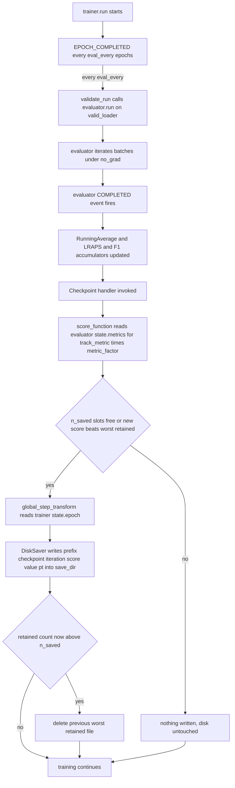
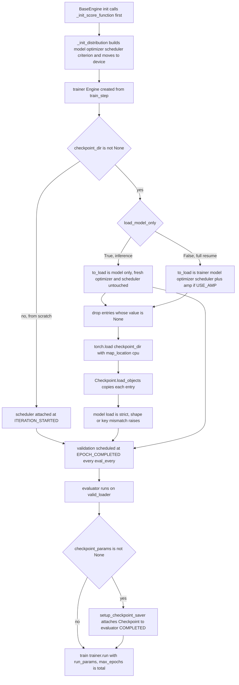

## Purpose

This module covers how a training run in this repo persists its state to disk and how it picks that state back up. Two symmetric halves live in `BaseEngine`: **the save side**, `setup_checkpoint_saver`, which wires an `ignite.handlers.Checkpoint` to the *evaluator* engine so that a file lands on disk every time a validation pass finishes and only if the tracked metric improved; and **the load side**, `load_trainer_from_checkpoint`, called from `setup()`, which either restores a full training session (engine state + optimizer + scheduler + model) or just the model weights for inference. It is a separate unit because the whole training-lifecycle policy — what gets written, how often, which model is "the best one", and what "resume" actually restores — is defined entirely by the interaction of these two methods plus five config fields (`checkpoint_params`, `checkpoint_dir`, `load_model_only`, `track_metric`/`metric_factor`, `eval_every`). No other part of the code writes or reads a `.pt` file.

## Contracts

**Inputs** — five config fields, all on the `Parameters` object (`src/config_params/**.py`):

| field | type | example value | role |
| --- | --- | --- | --- |
| `checkpoint_params` | `dict` or `None` | `{"save_dir": "/saved_models/final_sed_dense121_mix_fold0", "n_saved": 5, "prefix_name": "final_sed_dense121_mix_fold0"}` | **enable + destination** of the saver. `None` disables checkpointing entirely (`setup_checkpoint_saver` is a no-op). |
| `checkpoint_dir` | `str` or `None` | `"/saved_models/final_sed_dense121_nomix_1/final_sed_dense121_nomix_1_checkpoint_30_score=0.9117.pt"` | **enable + source** of the load. `None` disables loading. |
| `load_model_only` | `bool` | `True` in every fold config, `False` in `final_sed_dense121_nomix_1.py:135`, `final_sed_dense121_nomix_3.py:135`, `final_sed_dense121_mix_2.py:135` | selects the load *mode*: weights only vs full session. |
| `track_metric`, `metric_factor` | `str`, `int` | `"f1score_clip"`, `1` | the model-selection policy; both are read in `_init_score_function`. |
| `eval_every` | `int` | `2` (folds), `10` (whole-data runs) | double duty: how often validation runs **and therefore how often a checkpoint is written**. |

Objects handed to the handler: `self.model` (an `nn.Module`, `PANNsDense121Att` for every final config — `model_name = "sed_dense121att"` in all of `src/config_params/final_sed/`, with `classes_num: 264`), `self.trainer` (`ignite.engine.Engine`), `self.optimizer` (`torch.optim.AdamW(lr=hparams.lr, betas=(0.9, 0.999), eps=1e-08, weight_decay=hparams.weight_decay, amsgrad=True)`, `sed_engine.py:85`), `self.scheduler` (a `ConcatScheduler` for `scheduler_name = "warmup_with_cosine"`, or `None` for `"none"`, `sed_engine.py:104-128`), and `amp` from NVIDIA Apex — the Apex *module*, not a GradScaler-like object, and in any case only when `USE_AMP` is true.

**Outputs** — files of the form `{save_dir}/{prefix_name}_checkpoint_{iteration}_score={value}.pt`, e.g. `final_sed_dense121_mix_fold0_checkpoint_50_score=0.6328.pt`, which is the exact string hard-coded as `checkpoint_dir` in `final_sed_dense121_mix_fold0_2.py:97`. Each file contains a dict with keys `model`, `trainer`, `optimizer`, and — conditionally — `scheduler` and `amp`; the epoch number comes from `get_event_attrib_value("COMPLETED")` (ignite 0.4.0 sets this to "epoch"), so the filename's `{epoch}` is the **trainer's current epoch** (via `get_event_attrib_value("COMPLETED") = "epoch"), not the global iteration count or evaluator step and not the evaluator's step count. At most `n_saved` such files exist per `save_dir` at any time.

**Called by** — `BaseEngine.__init__` calls `self._init_score_function()` first (line 39) and `self.setup()` last (line 50); `setup()` calls `load_trainer_from_checkpoint()` (line 141) and `setup_checkpoint_saver(to_save)` (line 207); `SedEngine(local_rank, config)` is what `src/sed_train.py:9` instantiates, then `pe.train(config.run_params)` (line 10) calls `BaseEngine.train`.

**Calls** — `ignite.handlers.Checkpoint`, `ignite.handlers.DiskSaver`, `ignite.handlers.global_step_from_engine` (imported *inside* `setup_checkpoint_saver`, line 122, redundantly with the module-level `from ignite.handlers import Checkpoint` at line 20), `Checkpoint.load_objects` (class method, no import needed), `torch.load(map_location="cpu")`.

## How it works

### 1. `_init_score_function` — the ranking rule, built before anything else

`BaseEngine.__init__` calls it first, before augmentation, dataloaders, model, or metrics exist:

```python
def _init_score_function(self):
    def get_score_function(metric_name, factor=1):
        def score_function(engine):
            return factor*engine.state.metrics[metric_name]
        return score_function

    self.score_function = get_score_function(
        self.hparams.track_metric, self.hparams.metric_factor)
```

Two things follow. First, it is a **closure over `track_metric` and `metric_factor`**, frozen at construction — there is no way to change the tracked metric mid-run. Second, the `engine` argument is the engine the handler is attached to. Since the handler is attached to `self.evaluator` (see below), `engine.state.metrics` is the **evaluator's** metric dict, and `track_metric` must therefore name a key that `SedEngine._init_metrics` puts into `self.validation_metrics` and *not* into `self.train_metrics`. Valid choices with `hparams.metrics = ["lraps", "f1score_clip", "f1score_frame"]` are exactly those three (`sed_engine.py:160-170`); `valid_avg_loss` and the per-loss `RunningAverage`s would also work.

### 2. `setup()` — construction order, and why the load must come before the scheduler attach

```python
def setup(self):
    self._init_distribution()          # builds model, optimizer, scheduler, criterion, moves to device
    self.trainer = Engine(self.train_step)
    ...
    self.load_trainer_from_checkpoint()   # <-- line 141, BEFORE the scheduler event handler
    if self.scheduler:
        self.scheduler_event = self.trainer.add_event_handler(Events.ITERATION_STARTED, self.scheduler)
```

The ordering constraint is the whole reason `load_trainer_from_checkpoint` is called from `setup` and not from `__init__` directly after `_init_model`: by line 141 all four objects exist (`_init_distribution` at line 90 has already run `_init_scheduler`), so there is something to receive the checkpointed state. Reversing it — attaching the scheduler at iteration 0 with default LR before restoring — would silently restart the LR schedule.

Also note what `setup()` *does not* do: it does not create the trainer-level saver. Everything about saving is deferred to `setup_checkpoint_saver` at line 207, after the evaluator exists (line 170) and after `self.attach_metrics(self.evaluator, self.validation_metrics)` at line 206.

### 3. `setup_checkpoint_saver` — what gets written, and by whom

`to_save` is assembled in `setup()` itself (lines 197-205), not in `setup_checkpoint_saver`:

```python
to_save = {
        "model": self.model,
        "trainer": self.trainer,
        "optimizer": self.optimizer
    }
if self.scheduler is not None:
    to_save["scheduler"] = self.scheduler
if USE_AMP:
    to_save["amp"] = amp
```

So: **model, trainer, optimizer always; scheduler only when `_init_scheduler` produced one; amp only when Apex imported successfully.** The `scheduler` key is *not* present in the file for `scheduler_name = "none"` — and the load path has a matching filter for exactly that, see step 5.

Then:

```python
handler = Checkpoint(to_save, DiskSaver(self.hparams.checkpoint_params["save_dir"], require_empty=False),
                     n_saved=self.hparams.checkpoint_params["n_saved"],
                     filename_prefix=self.hparams.checkpoint_params["prefix_name"],
                     score_function=self.score_function, score_name="score",
                     global_step_transform=global_step_from_engine(self.trainer))
self.evaluator.add_event_handler(Events.COMPLETED, handler)
```

- `DiskSaver(save_dir, require_empty=False)` — `require_empty=False` is what makes restart-over-existing-directory legal: ignite's default is `True`, which raises if the directory is non-empty. Setting it `False` is mandatory here, because the natural thing to do after a crash is re-run the identical config, which writes into the *same* `save_dir`.
- `n_saved` — keep-best-N, see step 4.
- `filename_prefix` — from `checkpoint_params["prefix_name"]`, which in every final config is `self.name`, i.e. the config filename minus `.py` (`Parameters.__init__` line 9). That is why the checkpoint filenames echo the config name exactly.
- `score_function=self.score_function` + `score_name="score"` — the handler calls `self.score_function(engine)` on the attached engine and writes the result into the filename as `score={value}` and into the checkpoint dict as `"score"`.
- `global_step_transform=global_step_from_engine(self.trainer)` — **the handler is on the evaluator but the step number comes from the trainer.** `global_step_from_engine` returns a callable that reads `engine.state.iteration` of the engine it was constructed with. Without this, ignite's default would read the *evaluator's* iteration counter, which restarts at 0 on every validation pass, so every file would be named `_checkpoint_N_score=...` with the same `N` and the keep-best-N bookkeeping would be confused. This line is the load-bearing detail that makes it legal to attach the saver to the evaluator.

### 4. The keep-best-N mechanism

Ignite's `Checkpoint`, given `n_saved=k` and a `score_name`, keeps a dict of `k` in-memory `{filename: score}` entries, initially empty. On each firing it evaluates `score_function(engine)`, and:

- if fewer than `k` objects are retained, save and insert;
- otherwise, if the new score beats the **worst** retained score, save, insert, and delete the previous worst file;
- otherwise, **do not write anything**.

Consequences that matter here:

- The metric only has to be computed on validation epochs that actually run — but the *comparison* happens on every validation run. Running validation more often makes the top-N finer-grained and more likely to contain a genuinely best checkpoint.
- The final file on disk after a clean 50-epoch run is the **global best**, not the last epoch. For `final_sed_dense121_nomix_1` the best retained happened at iteration 30 with `lraps=0.9117`, and that is what `checkpoint_dir` points at — training went to 50 and epoch 30 was still the winner. This is the normal expectation, not a bug: with a cosine schedule decaying to `lr * lr_scale_factor` the last epochs are near-converged and often do not improve a strict-inequality ranking.
- `track_metric` and `metric_factor` *are* the model-selection policy, and they are the only thing distinguishing "best" from "last". `metric_factor = 1` maximises; `metric_factor = -1` turns the same code into "keep the N lowest values", which is what you would use with `track_metric = "valid_avg_loss"` or a per-loss `RunningAverage` key. No final config uses `-1` — every one of the 20 configs in `src/config_params/final_sed/` and `src/config_params/final_sed_5_fold/` has `metric_factor = 1` — so the loss-minimising branch is **available but unused in the shipped solution**.
- The ranking metric also varies *across* the shipped configs, which is worth knowing when comparing checkpoints: the 4-fold mixup and 4-fold no-mixup configs track `"f1score_clip"`, the 5-fold configs track `"f1score_frame"`, and the two whole-data configs differ from each other — `final_sed_dense121_nomix_1.py:94` tracks `"lraps"` while `final_sed_dense121_nomix_3.py:94` tracks `"f1score_clip"`. **The `score=` value in a filename is only comparable between runs that share the same `track_metric`.** A `score=0.63` from an `f1score_clip` run and a `score=0.63` from an `lraps` run are different quantities.

> [!warning]
> `score_function` reads `engine.state.metrics[metric_name]` with a bare subscript. If `track_metric` names a metric that is not in `hparams.metrics` (or is only a *training* metric), this raises `KeyError` inside the handler at the first validation completion — after training has already done the expensive part. Every final config lists all three of `lraps`, `f1score_clip`, `f1score_frame` in `self.metrics`, so the shipped configs are safe.

### 5. `load_trainer_from_checkpoint` — the two modes

```python
def load_trainer_from_checkpoint(self):
    if self.hparams.checkpoint_dir is not None:
        if not self.hparams.load_model_only:
            objects_to_checkpoint = {
                "trainer": self.trainer,
                "model": self.model, 
                "optimizer": self.optimizer,
                "scheduler": self.scheduler
            }
            if USE_AMP:
                objects_to_checkpoint["amp"] = amp
        else:
            objects_to_checkpoint = {"model": self.model}
        objects_to_checkpoint = {k: v for k, v in objects_to_checkpoint.items() if v is not None}
        checkpoint = torch.load(self.hparams.checkpoint_dir, map_location="cpu")
        Checkpoint.load_objects(to_load=objects_to_checkpoint, checkpoint=checkpoint)
```

Four things worth naming precisely:

- **`load_model_only=False` → full resume.** `trainer` carries ignite's `State` dict (epoch, iteration, `max_epochs`, `epoch_length`, plus the metric accumulators and any event-filter state), `optimizer` carries the AdamW moments and `param_group`s including `lr`, and `scheduler` carries the `ConcatScheduler` internal `event`/`durations`/`_current_iter` counters. Together these make the run pick up exactly where it stopped.
- **`load_model_only=True` → weights only.** Only `model` is in `to_load`; the trainer's `state.epoch`/`state.iteration` stay at 0 and the optimizer keeps its freshly initialised LR schedule. This is the mode every fold config carries (`load_model_only = True`) because those configs are the *inference* configs: the `*_2.py` variants are the ones that point `checkpoint_dir` at a trained fold's best checkpoint for test-time prediction.
- **The `if v is not None` filter.** When `scheduler_name = "none"`, `_init_scheduler` sets `self.scheduler = None`, so the dict would contain `{"scheduler": None}`. Passing `None` as a `to_load` value makes ignite's `load_objects` raise (it needs to look up `obj.state_dict()`). Dropping the key before the call means `load_objects` simply never touches that key, so the *same* resume code path serves `"none"` and `"warmup_with_cosine"` without branching. This is why the filter exists.
- **`map_location="cpu"`** on the `torch.load`. Without it, a checkpoint saved from a CUDA run unpickles tensors onto whichever device the file was saved from and a CPU-only inference box would fail. Mapping to CPU and then `load_state_dict`-ing into a model that `_init_distribution` has already moved to `self.device` (line 92/83) is the portable path. The model-load path itself is a plain `nn.Module.load_state_dict` — **strict**, i.e. `strict=True` — so a key mismatch between the checkpoint and the freshly built `PANNsDense121Att` raises rather than silently loading a partially-initialised network.

### 6. `sed_engine._init_model` — the *other*, separate pretrained path

This is a different mechanism from `checkpoint_dir` and it is easy to conflate with it. In `sed_engine.py:176-186`:

```python
if self.hparams.model_name == "sed_ccnn14att":
    from models.sed_models import PANNsCNN14Att
    self.model = PANNsCNN14Att(**self.hparams.model_config)
    if self.hparams.pretrained_path is not None:
        weights = torch.load(self.hparams.pretrained_path, map_location="cpu")["model"]
        weight_keys = weights.copy().keys()
        for key in weight_keys:
            if "att_block" in key:
                del weights[key]
        self.model.load_state_dict(weights, strict=False)
```

- It only exists for `model_name == "sed_ccnn14att"`. All the shipped configs use `sed_dense121att`, so in the final solution **this block is dead code** — `self.pretrained_path = None` in every config anyway, and `PANNsDense121Att.__init__` gets its ImageNet DenseNet-121 weights from `models.densenet121(pretrained=True).features` (`sed_models.py:367`) rather than from an AudioSet file.
- The `"model"` subscript on line 181 assumes the pretrained file was saved by ignite's `Checkpoint` — i.e. a file from *this* repo's saver. Loading a raw AudioSet PANNs `.ckpt` would need a different unpacking; the code does not show that path, so either the author repackaged the weights into an ignite checkpoint or this was only ever run against one of its own saves. *(inferred — reason: `["model"]` is exactly the key `to_save["model"]` uses.)*
- **Why delete `att_block` keys.** `AttBlock` (`sed_models.py:131-169`) holds the only `classes_num`-dependent parameters: `att` and `cla` are `nn.Conv1d(in_features, out_features, 1)` with `out_features = classes_num`, and `bn_att` is `nn.BatchNorm1d(out_features)` — here constructed as `AttBlock(1024, classes_num, activation='sigmoid')` (`sed_models.py:233, 364, 488, 611, 691, 734`). The pretrained AudioSet checkpoint has `out_features = 527`; this task has `classes_num = 264`. Those tensors cannot be loaded: `load_state_dict` would reject the shape mismatch (and even with `strict=True` it would). Deleting the keys before the call and then passing `strict=False` means: **load the feature extractor and `fc1`, discard the label-space-specific head, and let `att_block` keep its constructor-initialised weights.** The attention block is exactly the part that must be relearnt for a different label set — its output channels *are* the class logits, and the classifier and `cla` projections together define the embedding that the new classes are read out of.
- `strict=False` is doing double duty: it tolerates the missing `att_block` keys *and* any extra keys left in the pretrained dict (e.g. a checkpoint saved with a `framewise_output`/`normalization` pair whose names differ). It will print missing/unexpected keys rather than raise.

### 7. The full resume procedure

To resume a crashed or intentionally extended run, exactly:

1. **Pick the checkpoint file.** It lives in `checkpoint_params["save_dir"]` and is named `{prefix_name}_checkpoint_{iteration}_score={value}.pt`. Copy its path into `self.checkpoint_dir`. Nothing else in the repo reads these files — no globbing, no "latest" logic; you name the file.
2. **Set `self.checkpoint_dir = "<path>"`.** `load_trainer_from_checkpoint` is a no-op while this is `None`, which is why every from-scratch config has `checkpoint_dir = None`.
3. **Set `self.load_model_only = False`.** `True` loads only `model` and gives you a fresh trainer/optimizer/scheduler — fine-tuning the attention head from a trained trunk, but *not* a resume. The three whole-data configs (`final_sed_dense121_nomix_1.py`, `_nomix_3.py`, `_mix_2.py`) are the `False` ones; the `*_2.py` fold configs are `True`.
4. **Keep `scheduler_name` the same as the original run.** The checkpointed `scheduler` object must be structurally compatible with the one `_init_scheduler` builds. `"warmup_with_cosine"` → `ConcatScheduler([LinearCyclicalScheduler, CosineAnnealingScheduler], durations=[epoch_length])`; if you flip to `"none"`, the filter drops the key, the loaded LR is whatever the checkpoint's optimizer carries (see gotchas), and the run proceeds at a constant LR. That is not the same experiment.
5. **Do not touch `eval_every` unnecessarily.** It changes both how often you validate and how often you checkpoint, and `eval_every` participates in the epoch→iteration arithmetic the scheduler was built with (`cycle_size = epoch_length*2`, `num_epochs*epoch_length`).
6. **Leave `run_params["max_epochs"]` at the same value you actually want as the total.** See the semantics note below.
7. Run `python sed_train.py --config config_params.final_sed_dense121_nomix_1`. Construction order is: `_init_distribution` (model, optimizer, `ConcatScheduler`, criterion → device) → `Engine(self.train_step)` → **`load_trainer_from_checkpoint()`** → scheduler attached at `ITERATION_STARTED` → metrics attached → common handlers → evaluator created → validation scheduled at `EPOCH_COMPLETED(every=eval_every)` → saver attached to the evaluator.

> [!warning] `max_epochs` means *total*, not *additional*.
> Restoring the `trainer` object restores `engine.state`, including `state.epoch` and `state.max_epochs` as they were in the file. Ignite then counts `epoch >= max_epochs` for termination. So resuming a file written at epoch 30 of a 50-epoch run with `max_epochs = 50` gives you epochs 30..49 — the remaining 20. `run(max_epochs=N)` overrides the restored `state.max_epochs`. It raises only if `N <` the restored epoch. Resuming an epoch-30 file with `max_epochs=50` runs epochs 31..50, and `max_epochs=70` extends the run to 70. Caveat: if the restored state is already done (`iteration == epoch_length * max_epochs`), ignite starts a fresh state from epoch 0 (engine.py:635-646).

### 8. `train()` — why it swallows exceptions

```python
def train(self, run_params):
    try:
        self.trainer.run(self.train_loader, **run_params)
    except Exception as e:
        import traceback
        print(traceback.format_exc())
    if self.rank==0 and self.logger:
        self.logger._end_of_training()
```

`train` is passed `run_params` as `**kwargs` straight into `Engine.run`, which is why `{"max_epochs": 50, "epoch_length": None}` maps onto ignite's `max_epochs`/`epoch_length`. The bare `except Exception` prints the traceback and continues to `_end_of_training()` — the process exits, but the Neptune run is still closed cleanly. The practical consequence for this module: **an OOM or a NaN during an epoch is not a hard stop mid-checkpoint**; whatever checkpoint survived the last completed validation is intact and resumable, which is the design intent given that checkpoints are so infrequent.

## Key decisions and tricks

- **The saver is on the evaluator, not the trainer. This is the single most consequential decision in this module.** The handler is `self.evaluator.add_event_handler(Events.COMPLETED, handler)` (line 128) while the validation trigger is `self.trainer.add_event_handler(Events.EPOCH_COMPLETED(every=self.hparams.eval_every), self.validate(self.valid_loader))` (line 182). So a checkpoint is written **only when a full validation pass over `valid_loader` completes** — never at an epoch boundary by itself. `eval_every` is therefore *two* knobs in one field: validation frequency and checkpoint frequency. The upside is exactly the stated intent — the `score_function` reads `engine.state.metrics[metric_name]`, and `engine.state.metrics` on the *evaluator* is only populated once the evaluator's `RunningAverage`s and the `SedLRAPS`/`SedF1ScoreClip`/`SedF1ScoreFrame` accumulators have been updated over a complete pass. Attaching to the trainer at `EPOCH_COMPLETED` would either raise `KeyError` or have to run validation twice. The downside is the cost of `eval_every`: with `eval_every = 2` (all fold configs) a crash at epoch 41 costs you epochs 40-41, and with `eval_every = 10` (the whole-data configs) it costs you up to 9 epochs — a large fraction of a resumed run. Set `eval_every = 1` if the run is expensive enough that losing epochs hurts.
- **`global_step_from_engine(self.trainer)` on an evaluator-attached handler.** Ignite's `Checkpoint` derives the `{iteration}` in the filename from its own engine unless `global_step_transform` overrides it. Left to default, the counter would be the evaluator's iteration count, which resets on every `self.evaluator.run(...)` (line 227). Every validation run would produce `_checkpoint_<small constant>_score=...`, so `DiskSaver`'s filename uniqueness and its keep-best-N bookkeeping would both be wrong. Passing the *trainer* makes the filename a true global training-iteration counter.

  > [!warning] The `{iteration}` suffix is **not** an epoch number.
  > `final_sed_dense121_nomix_1_checkpoint_30_score=0.9117.pt` — the file `checkpoint_dir` points at in `final_sed_dense121_nomix_1.py:97` — carries `30`, and the config runs `max_epochs = 50`. Read as `state.iteration` that is a *very* early point in the run (that config uses `train_bs = 24` over a whole-data CSV). Either the file was produced by a variant with a different `global_step_transform`, or the number in the filename is not what this code would write today. **Do not infer the resume point from the filename** — read `state.epoch` from the loaded trainer, or simply note that a resume continues from whatever epoch the trainer entry holds.
- **`score_name="score"` and `score=` in the filename.** The value is baked into the path, so the checkpoint directory is a self-describing leaderboard of the run: you can pick the best of the retained N without opening any file, and `n_saved` directly controls how many candidates you keep. With `n_saved = 5` in all shipped configs, five distinct checkpoints per fold survive.
- **Conditional `scheduler` and `amp` in `to_save`, with a symmetric `is not None` filter on load.** The save side guards `if self.scheduler is not None`; the load side filters `if v is not None`. Because the key is genuinely *absent* from the file rather than present-and-null, the same `load_objects` call handles both worlds. The `USE_AMP` guard is the same shape but is currently moot: the `try: from apex import amp` block at lines 6-13 **prints Apex-not-found or found messages and then hard-sets `USE_AMP = False`** in both branches, with the reason inline — `"NOT USING APEX BECAUSE CANNOT CREATE MEL SPEC, REQUIRES TUNING, PROBLEMS HAVE OCCURRED"`. So `USE_AMP` is permanently `False`, `amp` is never in any checkpoint, and `loss_backpass` always takes the plain `loss.backward()` branch. Do not expect an `amp` key in any file this repo produced.
- **`require_empty=False`.** The author's intended workflow is re-running the same config into the same `save_dir` — which is also what a crash-resume looks like — and ignite's default would refuse. Note the interaction: because `n_saved` state is in-memory and starts empty on a fresh process, a *re-run into a populated directory* starts a fresh keep-best-N list over an existing set of files; nothing here prunes the old ones by score.
- **`map_location="cpu"` on both loads** — the checkpoint resume load (line 117) and the pretrained-PANNs load (`sed_engine.py:181`). Consistent policy: never let a pickle decide your device.
- **Two independent load paths, keep them apart.** `checkpoint_dir` + `load_model_only` (BaseEngine) is the run-lifecycle path, `strict` load, restores engine state. `pretrained_path` (sed_engine) is the model-initialisation path, `strict=False` load, partial, head-discarding. A file written by the saver can be consumed by either: it always has the `["model"]` key the pretrained path expects.

## Failure modes and gotchas

- **The sampler RNG is not checkpointed.** `setup()` only forwards an epoch counter to the sampler, and only in distributed mode:

  ```python
  if idist.get_world_size() >1:
      def set_epoch(engine):
          self.train_loader.sampler.set_epoch(engine.state.epoch)
      self.trainer.add_event_handler(Events.EPOCH_STARTED, set_epoch)
  ```

  And the sampler is `ImbalancedDatasetSampler` (`dataloaders/imbalanced_dataset_sampler.py`), which has **no `set_epoch` method at all** — `__iter__` draws with `torch.multinomial(self.weights, self.num_samples, replacement=True)`, consuming the global torch RNG. So:
  - the `set_epoch` call in the distributed branch would raise `AttributeError` if the train dataset exposes a sampler, and `SedDataset` *does* (`self.sampler = ImbalancedDatasetSampler`, `sed_dataset.py:25`, instantiated at `base_engine.py:59`). Every shipped config has `dist_params = {}`, i.e. `world_size == 1`, so the branch never runs in the final solution and the latent bug stays dormant;
  - the epoch counter is a no-op for RNG in any case — it does not reseed anything;
  - consequently, **the order of training samples after a resume is not the order that would have occurred without the crash.** Weights and optimizer moments are exact; the data stream is not reproducible. With `replacement=True` sampling of `num_samples` draws, this costs some epoch-to-epoch sample variety, not correctness.
- **Per-worker seeding is random and unreproducible.** `SedDataset.init_workers_fn` (`sed_dataset.py:51-53`) does `new_seed = int.from_bytes(os.urandom(4), byteorder='little'); np.random.seed(new_seed)` — entropy from the OS, not from the global seed and not from the epoch. It is passed as `worker_init_fn` via `self.additional_loader_params` (`sed_dataset.py:22-24`), which `_init_distribution` splats into the loader (line 65). So **every augmentation draw in every worker is different on every restart**, independent of `manual_seed(42 + rank)` at line 54. Reproducing an exact run requires patching `init_workers_fn` to a deterministic `torch.initial_seed()`-based seed; the repo does not.
- **Optimizer `param_group['lr']` from the checkpoint beats the scheduler's `start_value`.** Order matters: `_init_scheduler` constructs `LinearCyclicalScheduler(..., start_value=lr*lr_scale_factor, ...)` and `CosineAnnealingScheduler(..., start_value=lr, ...)` which immediately *write* the LR into `optimizer.param_groups`; then `load_objects` overwrites `optimizer`'s state_dict, including `param_groups`, with the checkpointed values; then the scheduler's restored internal counter (`_current_iter` / `event` / `durations` for `ConcatScheduler`) drives it from there. Net effect on a full resume: **the LR you actually resume at is the checkpointed LR**, and the scheduler's `start_value` is irrelevant. If you resume with a *different* `hparams.lr` expecting a new LR, you will not get one.
- **Resuming across a changed `classes_num` will fail loudly, not partially.** The `strict` model load in the checkpoint path means a `classes_num` mismatch raises. That is the desired behaviour — the whole model-selection story is per-label-space.
- **A checkpoint is a *best-so-far*, not a periodic safety net.** There is no "save every epoch regardless" handler anywhere. If the last thing that happened was an improvement, you resume from it; if not, you resume from the previous best, whose weights may be many epochs stale. Combined with `eval_every > 1`, "resume" can mean "resume from a checkpoint several epochs and several metric-improvements old".
- **`train()` swallows the traceback** (see step 8), so a crash mid-run looks like a clean-looking end followed by process exit. If the run died, check the printed traceback before assuming it completed all 50 epochs.
- **The `_end_of_training` / logger path is rank-0 only** (`if self.rank==0 and self.logger`), and the saver is attached on **every** rank, not just rank 0. With a multi-rank launch that means every rank's `DiskSaver` writing to the same `save_dir`. Ignite's `Checkpoint` normally requires an explicit `idist.maybe_save`/`__main__`-rank filter for this; this code has none. Harmless at `world_size == 1`, which is the only configuration used. *(inferred — reason: no `idist` guard exists anywhere in `setup_checkpoint_saver`.)*
- **`lr_finder()` removes the validation handler before its sweep** (`self.validation_handler_event.remove()`, line 355) — so if you run an LR finder first, you must re-add validation or you will train with no checkpoints at all, since checkpoints ride on validation. *(inferred — reason: `validation_handler_event` is the only place `setup_checkpoint_saver`'s handler can be triggered.)*

## Mermaid

Save path — the saver is attached to the **evaluator**, so `eval_every` gates checkpoints:



Load path — inside `setup()`, after `_init_distribution` has built model, optimizer and scheduler:


