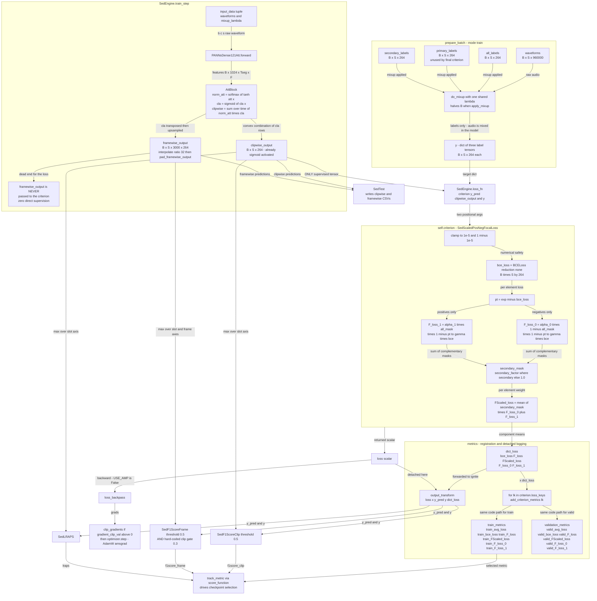

## Purpose

`src/loss/` is the experimental **loss zoo** for the Cornell Birdcall repo: 16 files holding 16 (plus a handful of duplicate local helper classes) loss formulations, most of which are dead research history from the classification-track experiments and the early SED iterations. Exactly **five** of them are reachable from the SED engine that produced the 1st-place solution, and every single one of the 20 shipped `final_sed*` configs actually resolves to just **two** classes, both configured with parameters that make them **algebraically identical to plain `nn.BCELoss()`**. The module exists as a separate unit because the loss is selected by a *string* in `hparams.criterion_name`, dispatched lazily by `SedEngine._init_criterion_function`, and because the `loss_keys` class attribute doubles as a contract that auto-registers training/validation metrics in `SedEngine._init_metrics`.

> [!warning] Read this before anything else
> The headline finding of this chapter: with the shipped hyper-parameters, **`SedScaledPosNegFocalLoss` is bit-for-bit `nn.BCELoss()`**. The focal modulation, the positive/negative alpha split, and the secondary-label down-weighting are all present in code and all set to their *identity* values (`gamma=0.0`, `alpha_0=1.0`, `alpha_1=1.0`, `secondary_factor=1.0`). Verified numerically — see [The final criterion degenerates to plain BCE](#the-final-criterion-degenerates-to-plain-bce).

## Contracts

**Inputs — the SED path (`SedEngine.loss_fn`)**

```python
def loss_fn(self, y_pred, y):
    loss, dict_loss = self.criterion(y_pred["clipwise_output"], y)
    return loss, dict_loss
```

`src/engine/sed_engine.py:71-73`

| arg | object | shape | dtype | notes |
|---|---|---|---|---|
| `y_pred["clipwise_output"]` | Tensor | `(B, S, O)` = `(24\|28\|32, 1\|2, 264)` | `float32` | **already sigmoid-activated** by `AttBlock(..., activation='sigmoid')` — see `sed_models.py:364`. Losses must not re-apply the sigmoid. |
| `y` | `dict` | — | — | keys `"all_labels"`, `"primary_labels"`, `"secondary_labels"`, each `(B, S, O)` `float32` |

With the final config `model_config`: `sample_rate=32000`, `window_size=1024`, `hop_size=320`, `mel_bins=64`, `classes_num=264`, `PERIOD=30`.

- `S` = `num_test_samples` — **1** for `train_ds_params` / `apply_mixup=False`, **2** for `valid_ds_params` / `test_ds_params`.
- 30 s × 32 000 Hz = 960 000 samples → `frames_num = 960000/320 + 1 = 3001` mel frames (`center=True`) → `framewise_output` is `(B, S, 3001, 264)`; `clipwise_output` is `(B, S, 264)` (the **93** pooled segment slots produced by DenseNet121 collapsed by `torch.sum(norm_att * cla, dim=2)`; `interpolate` ×32 gives 2,976 frames, `pad_framewise_output` replicates 25 more to reach 3,001).

> [!info] Two clip slots means two independent 30 s chunks
> For validation/test, `SedDataset.__getitem__` (`src/dataloaders/sed_dataset.py:117-125`) zero-pads (at the tail) or truncates the recording up to `num_test_samples * 30 s` and slices it into `S` non-overlapping chunks. `convert_labels_to_coded` sets `coded_labels[:, label_index] = 1` for **every** row, so both 30 s slots carry the *same* file-level species set. The loss therefore averages two identical-target rows; `SedF1ScoreFrame` later `max`es over the slot axis.

**Inputs — the classification path (`MainEngineV4.loss_fn`)** — for completeness, because most of the "unwired" losses are wired *here* instead:

```python
for i, y_pred_i in enumerate(y_pred):
    loss, dict_loss = self.criterion(y_pred_i, y, betas[i], betas[i]+0.05)
    total_loss += loss * loss_factors[i]
```

`src/engine/main_engine_v4.py:42-52`. `y = (coded_labels, primary_codes)`, `coded_labels` is `(B, S, 264)`, `primary_codes` is a plain-Python `list` of length `B` (each entry a `list` of `S` ints). `hparams.loss_factors = [1.0, 0.4, 0.2, 0.1]` weights the four auxiliary heads; `hparams.betas = [0.6, 0.7, 0.8, 0.9]` gives head *i* a `beta_i` for negatives and `beta_i + 0.05` for the primary term.

**Outputs**

Every criterion returns a **2-tuple** `(loss, dict_loss)`:

- `loss` — 0-dim scalar tensor, connected to the graph, handed to `loss.backward()` in `BaseEngine.train_step` → `loss_backpass` (`base_engine.py:237-256`).
- `dict_loss` — `dict[str, scalar tensor | float]`. Detached only in `MainEngineV4` (`component_loss[f"{key}_{i}"] = value.detach()`); in `SedEngine` it is forwarded raw, but ignite `RunningAverage` only ever calls `.item()`-style accumulation on it so the retained graph is harmless.

**Called by**

- `SedEngine.loss_fn` ← `BaseEngine.train_step` (`mode='train'`) and `BaseEngine.eval_step` (`mode='valid'`, under `torch.no_grad()`).
- Constructed by `SedEngine._init_criterion_function` from `BaseEngine.__init__` line 47; `loss_keys` is consumed by `SedEngine._init_metrics` at line 48.

**Calls**

Only `torch`, `torch.nn`, `torch.nn.functional`, and `numpy`-free stdlib. No loss file imports anything from the rest of `src/`. The `EPSILON_FP16 = 1e-5` constant is redefined (identically) in all 16 files (and again in `base_engine.py:32`).

## How it works

### 1. The dispatch mechanism

`SedEngine._init_criterion_function` (`src/engine/sed_engine.py:87-102`) is a flat `if/elif` chain on the **string** `hparams.criterion_name`. Each branch does a **function-local lazy import** and instantiates with `**hparams.criterion_params`:

```python
if self.hparams.criterion_name == "focal_loss_standard":
    from loss.focal_loss_standard import FocalLossStandard
    self.criterion = FocalLossStandard(**self.hparams.criterion_params)
elif self.hparams.criterion_name == "sed_removed_focal_loss":
    ...
```

Exactly **five** criteria are wired:

| `criterion_name` | class | `__init__` signature |
|---|---|---|
| `focal_loss_standard` | `FocalLossStandard` | `(gamma=0.0, alpha=1.0)` |
| `sed_removed_focal_loss` | `SedRemovedFocalLoss` | `(gamma=0.0, alpha=1.0)` |
| `sed_scaled_pos_neg_focal_loss` | `SedScaledPosNegFocalLoss` | `(gamma=0.0, alpha_1=1.0, alpha_0=1.0, secondary_factor=0.1)` |
| `sed_scaled_pos_neg_focal_loss_augd` | `SedScaledPosNegFocalLossAugd` | `(gamma=0.0, alpha_1=1.0, alpha_0=1.0, secondary_factor=0.1, primary_drop_out_factor=0.3)` |
| `bce_controlled_standard_loss` | `BCEControlledStandardLoss` | `(beta=0.5)` |

The other 11 files are **not** reachable from `SedEngine`:

| file | class | wired to |
|---|---|---|
| `bce_controlled_loss.py` | `BCEControlledLoss` | `MainEngineV4` |
| `focal_controlled_standard_loss.py` | `FocalControlledStandardLoss` | `MainEngineV4` |
| `focal_mse_loss.py` | `FocalMSELoss` | `MainEngineV4` |
| `f1_controlled_loss.py` | `F1ControlledLoss` | `MainEngineV4` |
| `noisy_loss.py` | `NoisyLoss` | `MainEngineV4` |
| `noisy_controlled_loss.py` | `NoisyControlledLoss` | `MainEngineV4` |
| `bce_loss.py` | `BCELoss` | `MainEngine`, `MainEngineV2`, `MainEngineV3` |
| `smooth_bce_loss.py` | `SmoothBCELoss` | `MainEngine`, `MainEngineV2`, `MainEngineV3` |
| `custom_losses.py` | `NoisyCuratedLoss` | `MainEngineV2`, `MainEngineV3` |
| `custom_losses_for_targets.py` | `NoisyCuratedLossTargetted` | `MainEngineV2`, `MainEngineV3` |
| `sed_scaled_focal_loss.py` | `SedRemovedFocalLoss` **(copy-paste name bug)** | **nothing** — truly dead |

> [!tip] The zoo is three generations
> 1. **Gen 1** (`bce_loss`, `smooth_bce_loss`, `custom_losses*`, `main_engine`/`v2`/`v3`): flat 5-second spectrogram classification on the Kaggle *Audio* track. Forward signature is `forward(y_pred, y)` — 2 positional args; `y` is a **tuple** `(target, clean)` for the `custom_losses*` classes, and a raw target tensor for `BCELoss` / `SmoothBCELoss`.
> 2. **Gen 2** (`bce_controlled_*`, `focal_controlled_standard`, `focal_mse`, `f1_controlled`, `noisy_*`, `main_engine_v4`): the **auxiliary-head** multi-head classifier (`AUXDense121` with `aux1/aux2/aux3` + `fc`). Forward signature grows to `forward(y_pred, target, beta, primary_beta)` — 4 positional args, and `target` is a **tuple** `(all_labels, primary_codes)`.
> 3. **Gen 3** (`sed_*`, `sed_engine`): the SED track. Forward signature is back to `forward(y_pred, y_target)` — 2 args, and `y_target` is a **dict** of three `(B, S, O)` label tensors.
>
> The two-arity collision between Gen 1/3 (both `(y_pred, target)`) is the main footgun when porting code between engines.

### 2. The `loss_keys` contract

This is the architecture's real extension point. `SedEngine._init_metrics` (`src/engine/sed_engine.py:140-156`):

```python
def add_criterion_metrics(loss_key):
    self.train_metrics[f"train_{loss_key}"] = RunningAverage(output_transform=lambda x: x["dict_loss"][f"{loss_key}"])
    self.validation_metrics[f"valid_{loss_key}"] = RunningAverage(output_transform=lambda x: x["dict_loss"][f"{loss_key}"])

for lk in self.criterion.loss_keys:
    add_criterion_metrics(lk)
```

`x["dict_loss"]` comes from `SedEngine.output_transform` (`sed_engine.py:75-81`), which returns `{"loss": ..., "x": ..., "y_pred": ..., "y": ..., "dict_loss": ...}` for **both** `mode='train'` and `mode='valid'` — hence *identical* metric registration on train and valid.

**The three-step recipe to add a metric-logged loss component:**

1. Append the key string to `self.loss_keys` in `__init__`.
2. Return that exact key in the `dict_loss` from `forward`.
3. It now appears as `train_<key>` and `valid_<key>` in the ignite metric dicts, gets averaged by `RunningAverage`, and is logged to Neptune / Slack by `BaseEngine._log_epoch`-style handlers with **zero** changes to `sed_engine.py`.

`loss_keys` is **not** used by the loss itself — it is pure metadata consumed by the engine. It is a hard contract in both directions: a key in `loss_keys` that is absent from the returned dict raises `KeyError` inside `RunningAverage`'s `output_transform` on the first iteration; a key in the returned dict that is absent from `loss_keys` is silently dropped (never logged).

> [!warning] `loss_keys` is mandatory for the SED engine
> `SedEngine._init_metrics` does `self.criterion.loss_keys` **unconditionally**. `BCELoss`, `SmoothBCELoss`, `NoisyCuratedLoss`, and `NoisyCuratedLossTargetted` **do not define it at all** (verified with `hasattr(...) → False`), so they would raise `AttributeError` if ever added to the SED dispatch chain. Only `SedEngine` and `MainEngineV4` read `loss_keys`; `MainEngine`, `MainEngineV2` and `MainEngineV3` deliberately do not (which is why Gen-1 losses work there).

**Exact `loss_keys` per class, and whether the returned dict actually matches:**

| class | `loss_keys` | dict returned | match? |
|---|---|---|---|
| `FocalLossStandard` | `["bce_loss", "F_loss"]` | `bce_loss`, `F_loss` | ✅ |
| `SedRemovedFocalLoss` | `["bce_loss", "F_loss", "FRemoved_loss"]` | all 3 | ✅ |
| `SedScaledPosNegFocalLoss` | `["bce_loss", "F_loss", "FScaled_loss", "F_loss_0", "F_loss_1"]` | all 5 | ✅ |
| `SedScaledPosNegFocalLossAugd` | `["bce_loss", "F_loss", "FScaled_loss", "F_loss_0", "F_loss_1"]` | all 5 | ✅ |
| `BCEControlledStandardLoss` | `[]` | `{}` | ✅ (by design — no component curves) |
| `BCEControlledLoss` | `["primary_loss", "bce_loss"]` | both | ✅ |
| `FocalControlledStandardLoss` | `["bce_loss", "F_loss"]` | both | ✅ |
| `FocalMSELoss` | `["mse_loss", "F_loss"]` | both | ✅ |
| `F1ControlledLoss` | `["precision", "recall", "f1"]` | all 3 | ✅ |
| `NoisyControlledLoss` | `["zeros_loss", "ones_loss", "primary_loss", "overall_target_loss"]` | all 4 | ✅ |
| `NoisyLoss` | `["zeros_loss", "ones_loss", "primary_loss", "overall_target_loss"]` | **only 2** | ❌ **`KeyError` at runtime** |
| `BCELoss` / `SmoothBCELoss` / `NoisyCuratedLoss` / `NoisyCuratedLossTargetted` | *(absent)* | `{}` / `{}` / 2 keys / 2 keys | n/a |
| `SedRemovedFocalLoss` in `sed_scaled_focal_loss.py` (dead) | `["bce_loss", "F_loss", "FScaled_loss"]` | all 3 | ✅ but unreachable |

**Metrics actually registered for the final criterion** (`SedScaledPosNegFocalLoss`), 12 total:

```
train_avg_loss, valid_avg_loss
train_bce_loss,       valid_bce_loss
train_F_loss,         valid_F_loss
train_FScaled_loss,   valid_FScaled_loss
train_F_loss_0,       valid_F_loss_0
train_F_loss_1,       valid_F_loss_1
```

> [!info] With the shipped params, three of those five curves are the same number
> `bce_loss.mean() == F_loss.mean() == FScaled_loss.mean()` exactly (see the degeneracy proof below), so only `F_loss_0` (negatives) and `F_loss_1` (positives) carry independent information in the logs.

### 3. Target structure: which labels, and why secondary is special

`y` is produced by `SedEngine.prepare_batch` (`sed_engine.py:16-44`) as a 3-key dict, all three tensors `(B, S, 264)`:

| key | built by | meaning | consumed by |
|---|---|---|---|
| `"all_labels"` | `SedDataset.convert_labels_to_coded(len(list_of_y), item["all_labels"])` | primary species **+** every secondary species in `item["secondary_labels"]` that survives the `inv_ebird_label` whitelist | `BCEControlledStandardLoss`, `FocalLossStandard`, `SedRemovedFocalLoss`, `SedScaledPosNegFocalLoss(Augd)`, `FocalMSELoss`, `FocalControlledStandardLoss`, `BCEControlledLoss`, `NoisyLoss`, `NoisyControlledLoss`, `F1ControlledLoss` |
| `"primary_labels"` | same, from `[primary_label]` | the single labelled foreground species | **never used by any loss.** No criterion reads `y["primary_labels"]`; the Gen-2 losses (`BCEControlledLoss`, `NoisyControlledLoss`) use the separate `primary_codes` list from `MainEngineV4`'s tuple target instead. |
| `"secondary_labels"` | same, from `[x for x in all_labels if x != primary_label]` | other birds audible in the same recording | `SedRemovedFocalLoss`, `SedScaledPosNegFocalLoss`, `SedScaledPosNegFocalLossAugd`, `sed_scaled_focal_loss.py` (dead) |

> [!tip] Why secondary labels are handled asymmetrically
> The competition gives a **weak** label: one primary species per file. The training recordings also contain other real bird species that were annotated with lower reliability. A loss that treats *all* `all_labels` entries equally spends as much gradient on a background bird as on the guaranteed-foreground bird, which is exactly the class of capacity the README warns about:
>
> > "The reasons for making the changes was to avoid overfitting because of the lack of data with less than or equal to 100 labelled samples per bird class."
>
> *(README line 25)* — i.e. the *primary* species is the trustworthy target; secondary detections are the ones most likely to be label noise and most likely to be absent from the test file.
>
> The `sed_*` family encodes this as a per-element multiplicative mask on the focal term: `1.0` for non-secondary entries, `secondary_factor` (default `0.1`) for secondary entries. The Gen-2 family encodes it differently — by adding a *dedicated primary-only BCE term* with a weaker self-blend `beta_i + 0.05` (higher `beta` = target closer to the hard 1.0) and, in `NoisyControlledLoss`, an explicit `* 1/5` weight and an `ones_loss * 4/5` weight.
>
> **Crucially: with `secondary_factor = 1.0` in every shipped config, this asymmetric treatment is switched off.**

The Gen-2 tuple form carries the same idea via `target[1]`, and it is fed as `primary_codes` — a list, `None` when the sample is background-only (test-time / augmented background). Losses that receive `None` for `target_primary` take a branch that drops the primary term entirely (`BCEControlledLoss`, `NoisyControlledLoss`). `NoisyLoss` has no such branch — it ignores `target_primary` altogether.

### 4. The zoo, class by class

Notation used throughout: `B` = batch size (24 / 28 / 32), `S` = `num_test_samples` (1 train, 2 valid), `O` = 264 classes. `y_pred` is `(B, S, O)` and **post-sigmoid**; `y_true` is `(B, S, O)`. After `reshape(B*S, O)` both are `(B*S, O)`.

> [!note] Every `sed_*` class opens with the same three lines
> ```python
> y_true      = y_target["all_labels"]
> y_sec_true  = y_target["secondary_labels"]
> bs, s, o    = y_true.shape
> # Sigmoid has already been applied in the model
> y_pred      = torch.clamp(y_pred, min=EPSILON_FP16, max=1.0-EPSILON_FP16)
> y_pred      = y_pred.reshape(bs*s, o);  y_true = y_true.reshape(bs*s, o)
> ```
> The clamp to `[1e-5, 1-1e-5]` is what makes the probability-space `F.binary_cross_entropy` / `nn.BCELoss` numerically safe at the extremes. The constant is *named* `EPSILON_FP16` but AMP is hard-disabled (`base_engine.py:10` and `:13`, both `USE_AMP = False`), so fp32 is used throughout and the name is historical.

---

#### `FocalLossStandard` — `focal_loss_standard.py`

- base: `nn.Module`; `__init__(self, gamma=0.0, alpha=1.0)`; `loss_keys = ["bce_loss", "F_loss"]`
- `forward(self, y_pred, target)` — 2-arity, `target` is the **dict**

```python
bce_loss = self.loss_fn(y_pred, y_true)          # nn.BCELoss(reduction='none') -> (B*S, O)
pt       = torch.exp(-bce_loss)                  # (B*S, O)
F_loss   = self.alpha * (1-pt)**self.gamma * bce_loss
F_loss   = F_loss.mean()
return F_loss, {"bce_loss": bce_loss.mean(), "F_loss": F_loss}
```

Reduction: `.mean()` over all `B*S*O` elements. No mask. Consumes **all_labels** only.

---

#### `SedRemovedFocalLoss` — `sed_removed_focal_loss.py` (wired, unused by final configs)

- `__init__(self, gamma=0.0, alpha=1.0)`; `loss_keys = ["bce_loss", "F_loss", "FRemoved_loss"]`

```python
with torch.no_grad():
    y_mask = torch.where(y_sec_true > 0.0, ones, zeros)   # 1.0 on SECONDARY entries
bce_loss      = self.loss_fn(y_pred, y_true)              # (B*S, O)
pt            = torch.exp(-bce_loss)
F_loss        = self.alpha * (1-pt)**self.gamma * bce_loss
FRemoved_loss = (1.0 - y_mask) * F_loss                   # <-- secondary entries ZEROED
FRemoved_loss = FRemoved_loss.mean()
return FRemoved_loss, {"bce_loss": bce_loss.mean(), "F_loss": F_loss.mean(),
                       "FRemoved_loss": FRemoved_loss}
```

**What "removed" means, precisely:** the **secondary** label entries are *hard removed* — their per-element loss is multiplied by exactly `0.0`, i.e. the model receives **no gradient at all** for the secondary species. Contrast this with the "easy negatives" reading: it is *not* easy negatives that are removed. It is the secondary-label positives. Rationale *(inferred — reason: the secondary species are the weakest, noisiest labels; zeroing them removes their contribution from the gradient entirely rather than merely down-weighting it, which is the strongest possible form of label-noise rejection)*.

Verified numerically: with 8 of 2112 entries flagged secondary, the loss is `0.8149` vs plain BCE `0.8187`, ratio `0.9953` vs the theoretical `1 - 8/2112 = 0.9962` (the theoretical figure already uses the full, non-renormalised denominator; the small gap is because the zeroed secondary entries carry above-average BCE).

---

#### `SedRemovedFocalLoss` (dead duplicate) — `sed_scaled_focal_loss.py`

> [!warning] Copy-paste bug in the class name
> `sed_scaled_focal_loss.py` declares `class SedRemovedFocalLoss(nn.Module)` — the **same name** as the previous file — even though it implements the *scaled* variant and exports `loss_keys = ["bce_loss", "F_loss", "FScaled_loss"]`. There is no `elif` branch for it in any engine, so this file has **never been runnable through the dispatch mechanism**. Do not `from loss.sed_scaled_focal_loss import SedRemovedFocalLoss` expecting the removed-focal loss; you get the scaled one.

- `__init__(self, gamma=0.0, alpha=1.0, secondary_factor=0.1)`

```python
y_mask = torch.where(y_sec_true > 0.0, ones*self.secondary_factor, ones)   # 0.1 on SECONDARY
FScaled_loss = (y_mask * F_loss).mean()
```

The mask is `secondary_factor` (default `0.1`) on secondary entries, `1.0` elsewhere — the **continuous** relaxation of the hard removal above.

---

#### `SedScaledPosNegFocalLoss` — `sed_scaled_pos_neg_focal_loss.py` ⭐ **the final criterion**

- `__init__(self, gamma=0.0, alpha_1=1.0, alpha_0=1.0, secondary_factor=0.1)`; `loss_keys = ["bce_loss", "F_loss", "FScaled_loss", "F_loss_0", "F_loss_1"]`

```python
with torch.no_grad():
    y_all_mask        = torch.where(y_true     > 0.0, ones, zeros)   # 1.0 where POSITIVE
    y_secondary_mask  = torch.where(y_sec_true > 0.0, ones*secondary_factor, ones)

bce_loss  = self.loss_fn(y_pred, y_true)
pt        = torch.exp(-bce_loss)
F_loss_0  = (self.alpha_0 * (1 - y_all_mask)) * (1-pt)**self.gamma * bce_loss   # NEGATIVES
F_loss_1  = (self.alpha_1 *      y_all_mask)  * (1-pt)**self.gamma * bce_loss    # POSITIVES
F_loss    = F_loss_0 + F_loss_1
FScaled_loss = (y_secondary_mask * F_loss).mean()
return FScaled_loss, {"bce_loss": bce_loss.mean(), "F_loss_1": F_loss_1.mean(),
                      "F_loss_0": F_loss_0.mean(), "F_loss": F_loss.mean(),
                      "FScaled_loss": FScaled_loss}
```

Note the elegant trick: because `(1 - y_all_mask)` and `y_all_mask` are **complementary 0/1 masks**, `F_loss_0 + F_loss_1 = (alpha_0*(1-m) + alpha_1*m) * (1-pt)^γ * bce` is a **per-element interpolation** between the negative and positive weights. `F_loss_0` and `F_loss_1` are computed and logged separately purely for observability.

---

#### `SedScaledPosNegFocalLossAugd` — `sed_scaled_pos_neg_focal_loss_augd.py`

- `__init__(self, gamma=0.0, alpha_1=1.0, alpha_0=1.0, secondary_factor=0.1, primary_drop_out_factor=0.3)`; `loss_keys` identical to above (5 keys)

The **only** delta versus `SedScaledPosNegFocalLoss` is a Bernoulli drop-out on the **primary** entries, applied *after* all the focal/pos-neg/secondary scaling:

```python
y_primary_true = y_true - y_sec_true                       # 1.0 exactly where PRIMARY
with torch.no_grad():
    y_primary_mask = torch.where(y_primary_true > 0.0, ones, zeros)
    y_primary_mask = torch.where(torch.rand(y_primary_mask.shape, device=...) <= self.primary_drop_out_factor,
                                 y_primary_mask, zeros)     # <-- Bernoulli(p) gate
...
FScaled_loss2 = (1 - y_primary_mask) * FScaled_loss
return FScaled_loss2.mean(), {... "FScaled_loss": FScaled_loss.mean()}
```

**The `_augd` difference, exactly:**

1. It recovers the primary label **from the labels themselves**: `y_primary_true = y_true - y_sec_true`. This is valid because `SedDataset.get_audio` builds `secondary_labels = [x for x in all_labels if x != primary_label]` (`sed_dataset.py:81`), so `all_labels ⊇ secondary_labels` entrywise and the difference is a clean 0/1 primary indicator. It survives mixup because `SedEngine.prepare_batch` applies the *same* `mixup_lambda` to all three label tensors (`sed_engine.py:28-30`), preserving the identity `all = primary + secondary`.
2. It gates with `torch.rand(...) <= primary_drop_out_factor`. `torch.rand` is `[0,1)` uniform, so each primary entry's mask is kept at 1 — i.e. its loss is **dropped** via `(1 - y_primary_mask)` — with probability `primary_drop_out_factor`: a `Bernoulli(0.3)` **per element, per forward pass**, drawn on the model's device (so it is seeded by `manual_seed(42+rank)`).
3. The returned scalar is `.mean()` over **all `B*S*O`** entries — the dropped entries contribute 0 but still count in the denominator, so the loss is **not renormalised**.

> [!warning] The `_augd` variant is numerically almost a no-op with the shipped params
> `y_primary_mask` is 1 only on primary entries. For a 30 s clip with 1–3 species, primary entries are ~`B*2 / (B*S*264)` ≈ 0.4 % of the tensor. Expected loss:
>
> ```
> E[loss] = BCE_mean * (1 - primary_drop_out_factor * P(primary))
> ```
>
> Measured over 200 resamples with 8 / 2112 primary entries: `0.8174 ± 0.0009` vs plain BCE `0.8187` — a **≈0.16 % reduction** (the formula above predicts `0.3 × 8/2112 ≈ 0.11 %`). It is a Bernoulli-positive dropout whose effect on the loss *scale* is negligible; its only real effect is to inject gradient noise into the (very few) positive terms. It is also **non-deterministic across validation runs**, so `valid_FScaled_loss` and `valid_avg_loss` are not comparable epoch to epoch for these two configs.
>
> It is also worth noting that `dict_loss["FScaled_loss"]` is `FScaled_loss.mean()` — the **pre-dropout** value — while the returned scalar is `FScaled_loss2` (post-dropout). So the logged `FScaled_loss` curve is *not* the optimised loss for `_augd`.

---

#### `BCEControlledStandardLoss` — `bce_controlled_standard_loss.py` (wired, unused by final configs)

- `__init__(self, beta=0.5)`; `loss_keys = []` — the only SED-wired criterion with **no** component curves.

```python
y_true   = target["all_labels"]
y_pred   = torch.clamp(y_pred, EPSILON_FP16, 1-EPSILON_FP16)   # NO sigmoid: already applied
# LSoftLoss: y_true_updated = (beta*y_true + (1-beta)*y_pred) * y_true     [under no_grad]
bce_loss = self.lsoft_fn(y_pred, y_true, self.beta).mean(1).mean()
return bce_loss, {}
```

Reduction: `.mean(1)` collapses the 264 classes to `(B*S,)`, then `.mean()` over the batch. Same value as a flat `.mean()`, just expressed per-sample.

---

#### `BCELoss` — `bce_loss.py` (Gen 1)

`__init__(self)`, no `loss_keys`. `forward(self, pred, actual)`: applies `self.sigmoid` itself (so it expects **logits**), clamps, then `nn.BCELoss()` with default `mean` reduction. `forward` takes a raw tensor, **not** a dict/tuple — `BCELoss` and `SmoothBCELoss` are the only two classes whose target is a raw tensor.

---

#### `SmoothBCELoss` — `smooth_bce_loss.py` (Gen 1, broken)

`__init__(self, smooth=0.1)`, no `loss_keys`.

```python
loss = self.bce(pred, actual)                                   # (B*S, O)
indices_target_0    = ((actual == 0.0).nonzero())[:,1]          # COLUMN indices of zero targets
indices_pred_thresh = ((pred <= self.smooth).nonzero())[:,1]     # COLUMN indices of low predictions
combined    = torch.cat((indices_target_0, indices_pred_thresh))
uniques, counts = combined.unique(return_counts=True)
intersection = uniques[counts > 1]
loss[0, intersection] = 0.0                                     # <-- row 0 ONLY
return loss.mean(), {}
```

This is **not** label smoothing. It is "ignore easy negatives", and it is buggy: the mask is built over **column indices** (it throws away the row coordinate via `[:,1]`) and then applied to **row 0** only. Verified: with a `(4, 2, 264)` input it zeroes 263 of 264 columns in row 0 of 8 rows, dropping the mean from `0.9758` to `0.6420`. It has never been meaningfully evaluated.

---

#### `BCEControlledLoss` — `bce_controlled_loss.py` (Gen 2)

- `__init__(self, primary_loss_factor=1.0)`; `loss_keys = ["primary_loss", "bce_loss"]`
- `forward(self, y_pred, target, beta, primary_beta)`; `y_true, target_primary = target`

```python
y_pred = torch.clamp(self.sigmoid(y_pred), EPSILON_FP16, 1-EPSILON_FP16)   # applies sigmoid: LOGITS in
bce_loss = self.lsoft_fn(y_pred, y_true, beta).mean(1)                     # (B*S,)
if target_primary is not None:
    primary_preds = y_pred.view(-1)[[i*o + ix[0] for i, ix in enumerate(target_primary)]]
    primary_loss  = self.lsoft_fn(primary_preds, ones_like(primary_preds), primary_beta) * self.primary_loss_factor
    loss = (bce_loss + primary_loss).mean()
    return loss, {"primary_loss": primary_loss.mean(), "bce_loss": bce_loss.mean()}
else:
    return bce_loss.mean(), {"primary_loss": 0, "bce_loss": bce_loss.mean()}
```

The "controlled" part: the **primary species get a dedicated, extra BCE term with a different smoothing** (`primary_beta = beta + 0.05`, i.e. a *weaker* self-blend toward the current prediction than the `beta` used everywhere else — the target `beta + (1-beta)·ŷ` sits closer to the hard 1.0), so the foreground class is always explicitly pulled to 1 regardless of what the flat BCE does with it. `primary_loss_factor` scales it (`MainEngineV4` feeds it from `hparams.primary_loss_factor`).

---

#### `FocalControlledStandardLoss` — `focal_controlled_standard_loss.py` (Gen 2)

- `__init__(self, gamma=0.0, alpha=1.0)`; `loss_keys = ["bce_loss", "F_loss"]`

Same focal structure as `FocalLossStandard` but its private `LSoftLoss` holds a `torch.nn.BCEWithLogitsLoss(reduction='none')` and blends with `torch.sigmoid(y_pred)` — i.e. it operates in **logit space** and does **not** clamp. It still unpacks `y_true, target_primary = target` and still has the 4-arity signature, but the `primary_beta` and `target_primary` arguments are **never used** — the class name is a leftover from an earlier revision.

Verified: at `gamma=0.0` it equals `BCEWithLogitsLoss()` (0.815292 vs 0.815572 — agreement to 3 dp, the residual being the `beta` target blend); at `gamma=2.0` the logits-space and probability-space variants differ (`0.3559` vs `0.3563`).

---

#### `FocalMSELoss` — `focal_mse_loss.py` (Gen 2)

- `__init__(self, gamma=0.0, alpha=1.0)`; `loss_keys = ["mse_loss", "F_loss"]`

Identical to `FocalControlledStandardLoss` except the private `LSoftLoss` uses `torch.nn.MSELoss(reduction='none')` on the *probabilities* (it applies `torch.sigmoid` itself). Focal modulation `pt = torch.exp(-mse_loss)` on an MSE is a category error — `exp(-MSE)` is not a confidence in `[0,1]` in any meaningful sense — but it runs. `primary_beta` unused.

---

#### `F1ControlledLoss` — `f1_controlled_loss.py` (Gen 2, buggy)

- `__init__(self)` — no hyper-parameters; `loss_keys = ["precision", "recall", "f1"]`

A differentiable soft-F1 surrogate on the clip-level target, pooled **per class** (`sum(0)` over the batch axis):

```python
y_true_updated = (beta*y_true + (1-beta)*y_pred) * y_true       # no_grad, negatives pinned to 0
tp = (y_true * y_pred).sum(0)
fp = ((1-y_true) * y_pred).sum(0)
fn = y_true_updated*(1-y_pred).sum(0)        # <-- OPERATOR PRECEDENCE BUG
p  = tp / (tp + fp + EPSILON_FP16)
r  = tp / (tp + fn + EPSILON_FP16)
f1 = (2*p*r / (p + r + EPSILON_FP16)).mean()
return 1 - f1, {"precision": p.mean(), "recall": r.mean(), "f1": f1}
```

> [!bug] `fn` has an operator-precedence bug
> `.sum(0)` binds to `(1 - y_pred)`, so the expression is `y_true_updated * (1-y_pred).sum(0)` — after `reshape(B*S, O)` this is `(B*S, O)` broadcast against `(O,)`. Verified with a `(4, 2, 264)` input: as written it produces `(8, 264)`; the intended `((y_true_updated * (1-y_pred)).sum(0))` produces `(264,)`. The result is a *per-sample* recall that then gets averaged per class — not a class-pooled recall. It runs (values are in `[0,1]`), so it silently trains the wrong objective rather than crashing.
>
> Also note the loss is computed **per class and then `.mean()`ed over the 264 classes** — a macro-F1 surrogate, which is arguably the right choice for this metric ("row-wise micro averaged F1" per README line 13 is *not* what this optimises, so the surrogate is only loosely aligned with the leaderboard).

---

#### `NoisyLoss` — `noisy_loss.py` (Gen 2)

- `__init__(self)` — no hyper-parameters; `loss_keys = ["zeros_loss", "ones_loss", "primary_loss", "overall_target_loss"]`

```python
noisy_loss = self.noisy_loss_fn(output, target_all, beta)   # (B*S, O), NO `* y_true`
ones_loss  = (noisy_loss * target_all).sum() / (target_all.sum() + EPSILON_FP16)
zeros_loss = (noisy_loss * (1 - target_all)).sum() / ((1 - target_all).sum() + EPSILON_FP16)
loss = (zeros_loss + ones_loss) / 2
return loss, {"zeros_loss": zeros_loss, "ones_loss": ones_loss}
```

**What "noisy" means here — the injected noise.** The target is replaced by a *self-prediction blend*: `y_true_updated = beta*y_true + (1-beta)*y_pred`. Critically, this variant's `LSoftLoss` **omits** the trailing `* y_true` that the `sed_*` variants carry. Verified: at `y_true == 0` the target becomes `(1-beta)*y_pred > 0`, i.e. **negatives are relabelled as a soft fraction of the model's own prediction** — a label-smoothing-toward-the-model / self-distillation on the negative class. That is the "noise".

**What "controlled" adds — the balancing.** `ones_loss` and `zeros_loss` are each **normalised by their own element count**, so the positive and negative *classes* get equal weight in the `0.5/0.5` sum regardless of the ~100:1 class imbalance of the label vector. Both `NoisyLoss` and `NoisyControlledLoss` do this; the `NoisyControlledLoss` delta is the `4/5` weight on `ones_loss` plus the `1/5`-weighted primary-only term (below). It is the same intent as `pos_weight` / `alpha_1 >> alpha_0` elsewhere in the zoo.

> [!bug] `NoisyLoss.loss_keys` over-promises
> It declares 4 keys but returns only 2. `MainEngineV4._init_metrics` iterates `for lk in self.criterion.loss_keys: for i in range(4)` → registers `train_primary_loss_i` / `train_overall_target_loss_i` whose `output_transform` will `KeyError` on the first iteration. `criterion_name = "noisy_loss"` on `MainEngineV4` is therefore **not runnable**.

---

#### `NoisyControlledLoss` — `noisy_controlled_loss.py` (Gen 2)

- `__init__(self)` — no hyper-parameters; `loss_keys = ["zeros_loss", "ones_loss", "primary_loss", "overall_target_loss"]` (all 4 returned ✅)

Same `LSoftLoss` noise injection, plus a **hand-tuned class-balance and primary-weight ladder**:

```python
ones_loss  = ((noisy_loss * target_all).sum() / (target_all.sum() + EPSILON_FP16)) * 4/5
zeros_loss = ((noisy_loss * (1 - target_all)).sum() / ((1 - target_all).sum() + EPSILON_FP16))   # note: commented-out `* 5.0`
if target_primary is not None:
    primary_preds = output.view(-1)[[i*o + ix[0] for i, ix in enumerate(target_primary)]]
    primary_loss  = self.noisy_loss_fn(primary_preds, ones_like(primary_preds), primary_beta).mean() * 1/5
else:
    primary_loss = 0.0
overall_target_loss = ones_loss + primary_loss
loss = (zeros_loss + overall_target_loss) / 2
```

The weights `4/5` (positives) and `1/5` (primary) sum to 1, and the commented-out `* 5.0` on `zeros_loss` (line 37) shows the negatives were originally meant to be weighted up by 5× to match — the author balanced this by hand and left the dead code in. `NoisyControlledLoss` and `BCEControlledLoss` are the two classes that actually consume `primary_beta` *and* the primary index list *and* the `is not None` branch; `NoisyControlledLoss` is the most sophisticated of the Gen-2 losses. It has no shipped config.

---

#### `NoisyCuratedLoss` — `custom_losses.py` (Gen 1)

- `__init__(self, noisy_type, beta=0.7, q=0.7)`; **no `loss_keys`**; `noisy_type ∈ {"lsoft", "lq"}`

The **"noisy vs curated"** split. `forward(self, output, target)` unpacks `target, clean = target` where `clean` is a **flat 0/1 flag of length `B*S`** marking which *rows* are trustworthy.

```python
noisy_indexes    = (clean == 0).nonzero().squeeze(1)     # untrusted rows
curated_indexes  = clean.nonzero().squeeze(1)             # trusted rows
noisy_loss   = self.noisy_loss(noisy_output,   noisy_target)   * (noisy_len   / bs)
curated_loss = self.curated_loss(curated_output, curated_target) * (curated_len / bs)
loss = noisy_loss * 0.5 + curated_loss * 0.5
return loss, {"noisy_loss": noisy_loss, "curated_loss": curated_loss}
```

- **noisy part** (`LSoftLoss` or `LqLoss`) — soft, model-blended targets, applied to rows the `clean` flag marks as unreliable.
- **curated part** (`CuratedLoss` = plain `nn.BCELoss`) — hard, exact targets, applied to trusted rows.
- The `len/bs` factors re-weight each branch to its **share of the batch**, then the `0.5/0.5` is a fixed combination weight.

`LqLoss` is the **Lq / generalised cross-entropy** loss (Zhang & Sabuncu 2018): `loss = (1 - (y_pred*y_true + ε)^q)/q`, `.mean()`. `LqLoss` defaults to `q=0.5`, but `NoisyCuratedLoss` defaults to `q=0.7`, and the engines (`MainEngineV2`/`V3`) pass `hparams.q`.

`LSoftLoss` here returns `F.binary_cross_entropy(y_pred, y_true_update)` with **default (mean) reduction**, i.e. a scalar — unlike the identically-named classes elsewhere which use `reduction='none'`.

---

#### `NoisyCuratedLossTargetted` — `custom_losses_for_targets.py` (Gen 1)

- `__init__(self, noisy_type, beta=0.7, q=0.7)`; **no `loss_keys`**; `noisy_type == "lsoft_targetted"` (the `"lq"` branch is a `pass` with a `# not Implemented yet` comment — constructing with `noisy_type="lq"` silently leaves `self.noisy_loss` **unset** → `AttributeError` on the first forward).

The `_2` copy of `LSoftLoss` applies the self-blend **only to the positives**:

```python
mask_y_true = y_true == 1.0
y_true[mask_y_true] = self.beta*y_true[mask_y_true] + (1-self.beta)*y_pred[mask_y_true]
return F.binary_cross_entropy(y_pred, y_true)
```

So negatives keep their hard 0 and only the positive target is softened — this is true label smoothing on the positive class (verified: negatives stay at exactly 0.0, unlike `NoisyLoss`'s version). The `# Changed order since updating target` comment on line 72 records that the noisy branch was moved **after** the curated branch because this `LSoftLoss` mutates `y_true` in place (`y_true[mask] = ...`). In practice the reorder is only a precaution: the noisy branch receives `target[noisy_indexes]`, an advanced-indexing **copy**, so the caller's target is never modified (verified).

---

### 5. The math, in one place

Every unique formulation, in prose plus the exact torch ops.

**Plain BCE (probability space)** — `bce_loss.py`, and the `gamma=0` limit of every focal variant:
```python
loss = -[y*log(p) + (1-y)*log(1-p)]         # nn.BCELoss / F.binary_cross_entropy
```

**Plain `BCEWithLogits`** — `focal_controlled_standard_loss.py`'s `LSoftLoss`:
```python
loss = max(z, 0) - z*y + log(1 + exp(-|z|))  # numerically fused; z = logits
```

**Focal loss** (Lin et al. 2017), implemented as `pt = exp(-bce)`:
```
FL(p_t) = alpha * (1 - p_t)^gamma * BCE
```
`alpha` is a **single scalar** here, not the paper's per-class `alpha_t`; the pos/neg split is done separately by the `pos_neg` variants. `gamma` is the focusing parameter; `gamma = 0` recovers plain BCE exactly.

> [!tip] Modulating-factor placement is identical everywhere in this repo
> All six focal classes compute `pt = torch.exp(-bce_loss)` **from the loss**, not from `p_t = y*p + (1-y)*(1-p)` directly, then multiply the resulting scalar loss by `(1-pt)**gamma`. This is algebraically the same as the paper (`(1-p_t)^γ * -log(p_t)`), and it is the reason the code can log `bce_loss` and `F_loss` side by side from the same intermediate. There is **no** variant in this repo that places the modulating factor *before* the sigmoid or *inside* the log — the sigmoid placement differs only in *where* the sigmoid happens:
>
> | class | input to `forward` | where sigmoid is applied |
> |---|---|---|
> | `FocalLossStandard` | probabilities | in the model (`AttBlock activation='sigmoid'`) |
> | `FocalControlledStandardLoss` | logits | inside `LSoftLoss`, via `BCEWithLogitsLoss` |
> | `FocalMSELoss` | logits | inside `forward`, then MSE on probabilities |
> | all `sed_*` | probabilities | in the model |
>
> Consequences: (a) the clamp to `[1e-5, 1-1e-5]` exists only in the probability-space variants; (b) `gamma > 0` in probability space is very slightly different from logit space numerically, because the clamped `p` is not exactly `sigmoid(z)`.

**"Removed" focal** — `FRemoved = (1 - 1[secondary]) * F`. Secondary positives receive exactly zero gradient.

**"Scaled" focal** — `FScaled = s(secondary) * F`, with `s = secondary_factor` on secondary entries and `1.0` elsewhere. A continuous relaxation of "removed".

**"pos_neg" scaled focal** — a two-stage product:
```
F_loss(x) = [ alpha_0*(1-m(x)) + alpha_1*m(x) ] * (1 - pt(x))^gamma * BCE(x)
final     = s_secondary(x) * F_loss(x)
```
with `m(x) = 1[y_true(x) > 0]`. The inner bracket interpolates the negative/positive weight; `s_secondary` then applies the secondary down-weight. Three independent knobs: `gamma` (focus), `alpha_0`/`alpha_1` (class balance), `secondary_factor` (label-noise rejection).

**`_augd` delta**:
```
final_augd = (1 - B(x)) * s_secondary(x) * F_loss(x),    B(x) ~ Bernoulli(primary_drop_out_factor) on primary entries
```

**"Controlled" BCE** — a *two-population* loss: the flat BCE over `all_labels` with smoothing `beta`, **plus** a dedicated term on the primary species only with a *different* smoothing `beta + 0.05`:
```
L = mean_over_samples[ BCE_soft(y, y_hat; beta) + primary_loss_factor * BCE_soft(y_hat_primary, 1; beta + 0.05) ]
```

**Smooth BCE** — not a real label-smooth; a broken column-mask that zeroes row 0. See [Failure modes](#smoothbceloss-masks-columns-not-rows).

**Noisy loss** — target replaced by `beta*y + (1-beta)*y_hat` (self-blend), split into `noisy` (untrusted rows, soft target) and `curated` (trusted rows, hard `nn.BCELoss`) at `0.5/0.5`, each branch re-weighted by its share of the batch. **Noisy controlled** adds per-population normalisation and the `4/5` / `1/5` / `1` weight ladder.

**`LqLoss`** — `(1 - (y_pred*y_true + ε)^q)/q`, `.mean()`, `q=0.5` default.

**F1 controlled** — macro (per-class) soft-F1 surrogate, `loss = 1 - mean_o(2pr/(p+r))`, with a buggy `fn` term.

**Focal MSE** — focal modulation of an MSE, `pt = exp(-MSE)`; mathematically ill-motivated, included for completeness.

### 6. The final criterion degenerates to plain BCE

Take `SedScaledPosNegFocalLoss(gamma=0.0, alpha_0=1.0, alpha_1=1.0, secondary_factor=1.0)` — **the exact params in all 18 non-`_augd` final configs**:

```
(1-pt)^gamma            = (1-pt)^0 = 1              for every element   (pt <= 1, so 0^0 = 1 in torch)
F_loss_0                = (1.0 * (1 - m)) * 1 * BCE
F_loss_1                = (1.0 *      m) * 1 * BCE
F_loss_0 + F_loss_1     = ((1-m) + m) * BCE         = BCE              (m is 0/1, complementary)
y_secondary_mask        = 1.0 everywhere                              (secondary_factor = 1.0)
FScaled_loss            = 1.0 * BCE
FScaled_loss.mean()     = mean BCE
```

Verified numerically:

```
SedScaledPosNegFocalLoss (final params) = 0.8186740875244141
plain nn.BCELoss()                      = 0.8186740875244141
dict: bce_loss 0.8187 | F_loss_0 0.8105 | F_loss_1 0.0082 | F_loss 0.8187 | FScaled_loss 0.8187
```

**Bit-identical.** For contrast, the same class with the parameters it was *designed* for (`gamma=2.0, alpha_0=0.5, alpha_1=1.5, secondary_factor=0.1`) gives `0.1816` — a 4.5× smaller, genuinely re-weighted loss.

> [!tip] What this means operationally
> The final loss is **unweighted mean BCE over a `(B*S, 264)` probability tensor**. Consequences to keep in mind when re-tuning:
> - The 100:1 (or worse) positive/negative imbalance is **not** compensated in the loss. It is handled entirely by (a) the frame/clip **thresholds** at inference and (b) the 13-model vote (README lines 45-62).
> - Changing `gamma`, `alpha_0`, `alpha_1` or `secondary_factor` away from their identity values is a **live, untested knob** in the shipped pipeline. The zoo exists; the search that chose the identity values is not in the repo.
> - `_augd` (`primary_drop_out_factor=0.3`) is the only knob that is *not* at identity, and its measured effect on the loss is ~0.1 %.
> - The five logged component metrics collapse to two distinct numbers (`F_loss_0` and `F_loss_1`), which is actually useful for diagnosis: `F_loss_0 + F_loss_1 == bce_loss` exactly, so `F_loss_1 / bce_loss` is the **share of the total loss carried by the positive entries**. In the smoke test above that was `0.0082 / 0.8187 = 1.0 %` of the loss coming from 8 of 2112 entries (`0.38 %` of the elements) — i.e. the positives are, if anything, *over*-represented in loss terms, which is the signature of a well-fit-but-unbalanced BCE on a mostly-empty label vector.

### 7. Which loss each final config uses

All 20 shipped SED configs, with the discriminating parameters. `bs` = `train_bs`, `wd` = `weight_decay`, `ev` = `eval_every`.

**`src/config_params/final_sed/` — the 4-fold ensemble (13 models total with the 5-fold block)**

| config | fold | mixup | `criterion_name` | `primary_drop_out_factor` | bs | wd | `track_metric` | ev |
|---|---|---|---|---|---|---|---|---|
| `final_sed_dense121_mix_fold0` | 0 | ✅ | `sed_scaled_pos_neg_focal_loss` | — | 32 | 0.01 | `f1score_clip` | 2 |
| `final_sed_dense121_mix_fold0_2` | 0 | ✅ | `sed_scaled_pos_neg_focal_loss` | — | 32 | 0.01 | `f1score_clip` | 2 |
| `final_sed_dense121_mix_fold1` | 1 | ✅ | `sed_scaled_pos_neg_focal_loss` | — | 32 | 0.01 | `f1score_clip` | 2 |
| `final_sed_dense121_mix_fold1_2` | 1 | ✅ | `sed_scaled_pos_neg_focal_loss` | — | 32 | 0.01 | `f1score_clip` | 2 |
| `final_sed_dense121_mix_fold2` | 2 | ✅ | `sed_scaled_pos_neg_focal_loss` | — | 32 | 0.01 | `f1score_clip` | 2 |
| `final_sed_dense121_mix_fold2_2` | 2 | ✅ | `sed_scaled_pos_neg_focal_loss` | — | 32 | 0.01 | `f1score_clip` | 2 |
| `final_sed_dense121_mix_fold3` | 3 | ✅ | `sed_scaled_pos_neg_focal_loss` | — | 32 | 0.01 | `f1score_clip` | 2 |
| `final_sed_dense121_mix_fold3_2` | 3 | ✅ | `sed_scaled_pos_neg_focal_loss` | — | 32 | 0.01 | `f1score_clip` | 2 |
| `final_sed_dense121_mix_2` | `0`† | ✅ | `sed_scaled_pos_neg_focal_loss` | — | 32 | 0.01 | `lraps` | 10 |
| `final_sed_dense121_nomix_fold0` | 0 | ❌ | `sed_scaled_pos_neg_focal_loss` | — | 24 | 0.0001 | `f1score_clip` | 2 |
| `final_sed_dense121_nomix_fold1` | 1 | ❌ | `sed_scaled_pos_neg_focal_loss` | — | 24 | 0.01 | `f1score_clip` | 2 |
| `final_sed_dense121_nomix_fold2_augd` | 2 | ❌ | **`sed_scaled_pos_neg_focal_loss_augd`** | **0.3** | 24 | 0.001 | `f1score_clip` | 2 |
| `final_sed_dense121_nomix_fold3_augd` | 3 | ❌ | **`sed_scaled_pos_neg_focal_loss_augd`** | **0.3** | 24 | 0.001 | `f1score_clip` | 2 |
| `final_sed_dense121_nomix_1` | `"all"` | ❌ | `sed_scaled_pos_neg_focal_loss` | — | 24 | 0.01 | `lraps` | 10 |
| `final_sed_dense121_nomix_3` | `"all"` | ❌ | `sed_scaled_pos_neg_focal_loss` | — | 24 | 0.01 | `f1score_clip` | 10 |

† `final_sed_dense121_mix_2` sets `self.fold = 0` but points every `csv_dir` at `/folds/all_data.csv` — i.e. it is an **all-data** run whose `fold` attribute is stale. That is what makes it the only mixup config training on the full training set.

**`src/config_params/final_sed_5_fold/` — the 5-fold block**

| config | fold | mixup | `criterion_name` | `primary_drop_out_factor` | bs | wd | `track_metric` | ev |
|---|---|---|---|---|---|---|---|---|
| `final_5fold_sed_dense121_nomix_fold0` | 0 | ❌ | `sed_scaled_pos_neg_focal_loss` | — | 28 | 0.01 | `f1score_clip` | 2 |
| `final_5fold_sed_dense121_nomix_fold1` | 1 | ❌ | `sed_scaled_pos_neg_focal_loss` | — | 28 | 0.01 | **`f1score_frame`** | 2 |
| `final_5fold_sed_dense121_nomix_fold2` | 2 | ❌ | `sed_scaled_pos_neg_focal_loss` | — | 28 | 0.01 | **`f1score_frame`** | 2 |
| `final_5fold_sed_dense121_nomix_fold3` | 3 | ❌ | `sed_scaled_pos_neg_focal_loss` | — | 28 | 0.01 | **`f1score_frame`** | 2 |
| `final_5fold_sed_dense121_nomix_fold4` | 4 | ❌ | `sed_scaled_pos_neg_focal_loss` | — | 28 | 0.01 | **`f1score_frame`** | 2 |

**Not used by any shipped config:** `focal_loss_standard`, `sed_removed_focal_loss`, `bce_controlled_standard_loss` (all three are dispatchable and correct but have no config selecting them), plus the entire Gen-1 and Gen-2 zoo.

> [!info] `mix_2` vs `mix_fold0` differ only in data split
> `diff` shows the sole differences are `csv_dir` (`/folds/all_data.csv` vs `/folds/fold_0_{train,test}.csv`), `track_metric` (`lraps` vs `f1score_clip`) and `eval_every` (`10` vs `2`). The `_2` suffixed files are second training runs of the same fold with otherwise-identical loss/optimiser settings — i.e. the ensemble diversity comes from data order and augmentation RNG, **not** from loss diversity. **11 of the 13 ensemble members share plain BCE** (at identity params); the other **2** (`nomix_fold2_augd` and `nomix_fold3_augd`) use `SedScaledPosNegFocalLossAugd`, adding a 30% primary-label dropout term that is almost a no-op (≈0.16 % reduction). Loss diversity is extremely small, but it is not zero.

> [!tip] The 5-fold configs select on the FRAME metric — and that is the tell
> Folds 1-4 of the 5-fold block track `f1score_frame` for checkpoint selection, not `f1score_clip`. Since the framewise head is never supervised (see below), the frame metric is the only honest signal for the head that actually produces the submission.

## Key decisions and tricks

### 🔑 The critical mismatch: `clipwise_output` is the *only* supervised tensor

```python
def loss_fn(self, y_pred, y):
    loss, dict_loss = self.criterion(y_pred["clipwise_output"], y)
```

`src/engine/sed_engine.py:72`. `y_pred` is the full dict from `PANNsDense121Att.forward` (`sed_models.py:435-438`) containing **both** `framewise_output` `(B, S, 3001, 264)` and `clipwise_output` `(B, S, 264)`. Only the second is passed to the criterion. Three consequences:

**(a) The framewise head is never directly supervised.** No loss in `src/loss/` receives `framewise_output` — the argument simply is not passed. There is no multi-head SED term, no `λ · BCE(framewise)` anywhere in the repo. Grep for `framewise_output` returns exactly 5 hits in `models/sed_models.py` (the 5 model forwards plus `pad_framewise_output`), plus `sed_engine.py:72` in the dict context and `sed_f1score_frame.py:26` / `sed_test.py:49`; `sed_lraps.py` and `src/loss/` have zero hits.

**(b) The framewise signal is inherited entirely through the AttBlock's attention.** `AttBlock.forward` (`sed_models.py:164-169`):

```python
norm_att = torch.softmax(torch.tanh(self.att(x)), dim=-1)   # (B, O, T_seg)  sums to 1 over T_seg
cla      = self.nonlinear_transform(self.cla(x))            # (B, O, T_seg)  sigmoid, THIS is the framewise source
x        = torch.sum(norm_att * cla, dim=2)                 # (B, O)
return x, norm_att, cla
```

and in the model body (`sed_models.py:426-432`):

```python
(clipwise_output, norm_att, segmentwise_output) = self.att_block(x)
segmentwise_output = segmentwise_output.transpose(1, 2)
framewise_output = interpolate(segmentwise_output, self.interpolate_ratio)   # (B, S, 32, O)
framewise_output = pad_framewise_output(framewise_output, frames_num)        # (B, S, 3000, O)
```

Two facts make the attention the **weak-label propagation mechanism**:

1. `cla` is a **sigmoid activation** (`AttBlock(1024, classes_num, activation='sigmoid')`, `sed_models.py:364`) — i.e. `cla` *is* a per-frame probability, the same scale as `clipwise_output`.
2. `clipwise_output = Σ_t norm_att[:, :, t] · cla[:, :, t]` with `Σ_t norm_att = 1`. So `d clipwise / d cla[:, :, t] = norm_att[:, :, t]`.

> Therefore **every gradient that reaches the framewise head arrives multiplied by `norm_att`.** The attention is not a post-hoc saliency map — it is the differentiable, self-normalising interpolation kernel that decides *which* of the 32 pooled segment slots (and, through the `interpolate` + `pad_framewise_output` upsample, which of the 3000 mel frames) inherits the clip-level supervision. `norm_att` is never regularised, never compared to a frame label, and never received a direct loss; it is shaped purely by the indirect requirement that `Σ_t norm_att[t] · cla[t]` match the clip label. The softmax over a *time* axis (and note: `norm_att` is `(B, O, T_seg)` — a **per-class** time attention, not a single shared attention) is what lets the model satisfy one weak clip label with per-class temporal localisation for free.
>
> *(inferred — reason: `cla` is never used in any loss, `norm_att` is never used in any loss, and `clipwise_output` is a convex combination of `cla` rows; the only path from the loss to the framewise head is `norm_att`.)*

**(c) The framewise threshold must therefore be tuned separately at inference — and the repo confirms it does.** `SedF1ScoreFrame.update` (`src/metrics/sed_f1score_frame.py:33-40`) applies **two thresholds**:

```python
if t.sum()==0.0:
    if (np.sum((pf>=self.threshold) & (pc>=0.3)))>0.0:   # frame threshold  AND  hard-coded clip 0.3
        score = f1_score([1], [0], average='micro')
else:
    score = f1_score([t], [(pf>=self.threshold) & (pc>=0.3)], average='micro')
```

`self.threshold` is the frame threshold (defaults to `0.5`, passed positionally from `_init_metrics` as `SedF1ScoreFrame(threshold=0.5, ...)`); `pc >= 0.3` is a **hard-coded clip gate**. The README's final ensemble table confirms this is not a metric artefact — it is the submitted rule:

| 13 Models | Clip Threshold | Frame Threshold | Public | Private | Selected |
|---|---|---|---|---|---|
| 4 votes | 0.3 | 0.3 | 0.616 | 0.681 | ✅ |
| 4 votes | 0.3 | 0.5 | 0.615 | 0.679 | |
| 5 votes | 0.3 | 0.3 | 0.609 | 0.679 | |
| 5 votes | 0.3 | 0.5 | 0.606 | 0.676 | |
| 3 votes | 0.3 | 0.3 | 0.617 | 0.679 | |
| 3 votes | 0.3 | 0.5 | 0.614 | 0.679 | |

(README lines 49-56; the 9-model block at lines 58-62 selects `3 votes / clip 0.3 / frame 0.5`.)

> [!tip] Why the clip and frame thresholds differ, mechanically
> The clipwise head is directly supervised and well calibrated relative to its own label scale. The framewise head is a **single sigmoid conv applied to `cla`, upsample-by-repeat 32× and edge-padded** (`pad_framewise_output` repeats `framewise_output[:, -1:, :]` — the *last* frame — across the padded tail). Repeating a value across frames inflates the apparent duration of whatever the last segment said; the `interpolate` step is pure repeat, not smoothing. The framewise distribution is therefore shifted relative to the clipwise one by an amount no loss term constrains, so the two thresholds are swept independently. For the 13-model ensemble, frame 0.3 beat 0.5 at every vote count (README l.49-56). For the 9-model ensemble, only frame 0.5 was ever submitted (README l.58-62, l.64: "I didn't try a threshold of 0.3 for the frame threshold since I ran out of submissions"), so the README gives no evidence on whether the best frame threshold depends on the ensemble.

> [!note] Cross-reference
> The `_init_metrics` registration of both `SedF1ScoreClip(threshold=0.5)` and `SedF1ScoreFrame(threshold=0.5)` means the *validation* numbers logged during training also use a `0.5` frame threshold — while the winning *submission* uses `0.3`. The `track_metric` in the config picks which one is used for checkpoint selection.

### 🔑 The clip-level loss is a *file-level* label

`all_labels` is a **single 264-vector repeated across every snippet axis and every frame axis**. There is no frame-resolution supervision anywhere in the loss. So the loss is effectively 264 independent binary classification problems with one label per 30 s recording. `O = 264`, and the sparsity is brutal: ~2-3 species per file. In the smoke test above, `F_loss_1 / bce_loss ≈ 0.01`. This is why the whole heavy machinery of class balancing exists in the zoo — and why the final config turns it all off and pays for it with thresholds + voting instead.

### 🔑 `y_primary_true = y_true - y_sec_true` is safe *only* because of a dataset invariant

The `_augd` variant derives the primary indicator by subtraction. This holds because `SedDataset.get_audio` line 81 builds `secondary_labels = [x for x in all_labels if x != primary_label]` — a set difference, not an independent annotation. Consequences:
- `y_true - y_sec_true ∈ {0, 1}` entrywise, before any augmentation.
- It survives `do_mixup` **because** `SedEngine.prepare_batch` mixes all three label tensors with the *same* `mixup_lambda` (`sed_engine.py:28-30`). If the three label sets were ever mixed independently, this subtraction would silently produce negative values and `> 0.0` would misclassify.
- It breaks if a species were both primary and secondary. The `!=` filter prevents that.
- With mixup, `y_primary` can be non-zero at **two** class positions (primary of sample A ∪ primary of sample B) — which is the correct behaviour, both species are foreground in the mixed clip.

### 🔑 Two locals named `LSoftLoss`, six different implementations

`grep -c "class LSoftLoss"` across `src/loss/` returns 5 definitions plus `LSoftLoss2`. They differ in ways that change the objective:

| location | target blend | reduction | clamp needed? | epsilon |
|---|---|---|---|---|
| `bce_controlled_loss.py` | `(βy + (1-β)ŷ)·y` | `'none'` | yes (probs) | ✅ |
| `bce_controlled_standard_loss.py` | `(βy + (1-β)ŷ)·y` | `'none'` | yes (probs) | ✅ |
| `sed_scaled_focal_loss.py` | `(βy + (1-β)ŷ)·y` | `'none'` | yes (probs) | ✅ |
| `focal_mse_loss.py` | `(βy + (1-β)ŷ)·y` | `'none'` | yes (probs) | ✅ |
| `focal_controlled_standard_loss.py` | `(βy + (1-β)·sigmoid(z))·y` | `'none'` | no (`BCEWithLogitsLoss`) | ✅ |
| `noisy_loss.py` | `βy + (1-β)ŷ` **(no `·y`)** | `'none'` | yes (probs) | ❌ **relabels negatives** |
| `custom_losses.py` | `βy + (1-β)ŷ` **(no `·y`)** | `mean` → scalar | yes (probs) | ❌ |
| `custom_losses_for_targets.py` | `β·y` on positives only, **in place** | `mean` → scalar | yes (probs) | ❌ |

The `· y` factor is the load-bearing bit: with it, negatives stay hard 0 and only the positive target is softened (`1 → β + (1-β)·ŷ`). Without it, negatives get target `(1-β)·ŷ > 0`, i.e. the loss *rewards* the model for having a non-trivial negative prediction on a class it should reject. Verified numerically: `bce_controlled.LSoftLoss` returns exactly `0.0` at `y_true == 0`; `noisy_loss.LSoftLoss` returns non-zero there. Anyone "unifying" these files must preserve the `· y` per call site.

### 🔑 Reduction strategy summary

| class | reduction |
|---|---|
| all `sed_*` | `.mean()` over all `B*S*O` |
| `BCEControlledStandardLoss` | `.mean(1).mean()` — per-sample then batch (numerically identical to flat mean) |
| `BCEControlledLoss`, `NoisyLoss`, `NoisyControlledLoss` | `.mean(1)` then scalar ops, or `.mean()` — mixed |
| `custom_losses*` | branch scalars from `F.binary_cross_entropy` default `mean`, re-weighted by `len/bs` |
| `BCELoss`, `SmoothBCELoss` | `nn.BCELoss()` default `mean` |

**No criterion normalises by `B*S` in a way that preserves gradient scale across batch sizes**, and none uses `pos_weight`. Combined with `AdamW` and `lr = 1e-3`, the effective loss scale is absorbed by the optimiser — which is another reason the author could afford to leave every `alpha` at `1.0`.

## Failure modes and gotchas

> [!danger] `NoisyLoss` crashes `MainEngineV4` on the first iteration
> `loss_keys` declares 4 keys; `forward` returns 2. `MainEngineV4._init_metrics` (`main_engine_v4.py:174-176`) registers `train_primary_loss_{i}` and `train_overall_target_loss_{i}` from the missing keys → `KeyError` inside `RunningAverage.output_transform` at the first `train_step`. Verified: `NoisyLoss.loss_keys = ['zeros_loss','ones_loss','primary_loss','overall_target_loss']` vs returned `['zeros_loss','ones_loss']`.

> [!danger] `BCEControlledLoss` broadcasts wrongly for `S > 1`
> `bce_loss` has shape `(B*S,)` but `primary_loss` is built from `[i*o + ix[0] for i, ix in enumerate(target_primary)]` — one index per *sample*, not per *snippet*, because only `ix[0]` (the first snippet's primary code) is read. So `primary_loss` is `(B,)` and `(bce_loss + primary_loss)` raises:
> ```
> RuntimeError: The size of tensor a (8) must match the size of tensor b (4) at non-singleton dimension 0
> ```
> Verified: works at `S=1` (returns `1.5090` with `primary_loss=0.5295, bce_loss=0.9795`), raises at `S=2`. The `* self.primary_loss_factor` on a `(B,)` tensor is fine; the addition is not. Note also that the `y_pred.view(-1)[list_of_tensors]` form emits a PyTorch `UserWarning` about non-tuple multidimensional indexing and is documented to *change meaning* in torch 2.9.

> [!warning] `F1ControlledLoss` has an operator-precedence bug in `fn`
> `fn = y_true_updated*(1-y_pred).sum(0)` → shape `(B, S, O)` instead of `(S, O)` (verified). It runs silently and optimises a per-sample recall averaged per class, not a class-pooled recall.

> [!warning] `SmoothBCELoss` masks columns, not rows
> `loss[0, intersection] = 0.0` applies a mask built from **column** indices (`[:,1]` of `nonzero()`) to **row 0 only**. Verified: on a `(4, 2, 264)` input it zeroes 263 of 264 columns in 1 of 8 rows, silently changing the loss from `0.9758` to `0.6420` — a per-row, not per-element, "ignore easy negatives".

> [!warning] `_init_criterion_function` has no `else` branch
> An unrecognised `criterion_name` leaves `self.criterion` **unset**, and the failure surfaces two lines later at `self.criterion.loss_keys` in `_init_metrics` as a confusing `AttributeError: 'SedEngine' object has no attribute 'criterion'` — not as "unknown criterion name".

> [!warning] `NoisyCuratedLossTargetted(noisy_type="lq")` silently builds nothing
> The `"lq"` branch is a bare `pass` with `# not Implemented yet`. `self.noisy_loss` is never assigned → `AttributeError` at the first forward, not at construction.

> [!warning] `custom_losses_for_targets.LSoftLoss2` mutates `y_true` in place
> `y_true[mask_y_true] = ...` writes into the caller's tensor. This is why the noisy branch had to be moved *after* the curated branch (`# Changed order since updating target`, line 72). It is also why it will silently corrupt anything that reuses the label tensor — including, in `SedEngine`, `y["all_labels"]` which is the same object stored in `engine.state.output` and handed to `SedF1ScoreClip`/`SedF1ScoreFrame`. (Not reachable from `SedEngine` today; latent if `bce_controlled_standard_loss` were ever swapped for a Gen-2 loss.)

> [!tip] Don't re-apply the sigmoid
> Four of the SED criteria carry the comment `# Sigmoid has already been applied in the model`. The sigmoid lives in `AttBlock.nonlinear_transform` (`sed_models.py:171-175`) because `PANNsDense121Att` constructs `AttBlock(1024, classes_num, activation='sigmoid')`. The Gen-1/Gen-2 losses **do** apply it themselves (`bce_loss.py` `self.sigmoid(pred)`, `bce_controlled_loss.py` `self.sigmoid(y_pred)`) because their models expose logits. Double-sigmoid silently halves the logit range and is the most likely copy-paste error when moving a loss between engines.

> [!tip] The `EPSILON_FP16` name is historical
> `base_engine.py` sets `USE_AMP = False` in *both* branches of the apex `try/except` (lines 9 and 13) with the comment "NOT USING APEX BECAUSE CANNOT CREATE MEL SPEC, REQUIRES TUNING, PROBLEMS HAVE OCCURRED". Training is fp32 (README line 94 confirms). The `1e-5` clamp is there for `F.binary_cross_entropy`'s log, not for fp16 range.

> [!tip] `sed_scaled_focal_loss.py` is 100 % dead — do not import from it
> It (i) is not in any `_init_criterion_function`, (ii) re-exports the **wrong class name** `SedRemovedFocalLoss`, and (iii) its `y_mask` semantics (scale by `secondary_factor`) differ from the file next to it (zero out). Both classes have the same name; only the second file's version is correct for what its filename claims.

> [!info] `_augd` makes validation loss non-deterministic
> The `torch.rand` draw fires on every forward including `mode='valid'`. `valid_avg_loss` and `valid_FScaled_loss` for `final_sed_dense121_nomix_fold{2,3}_augd` therefore jitter run-to-run. `track_metric` is `f1score_clip` for those configs, so checkpoint selection is unaffected — but do not read the validation loss curve of an `_augd` run as a learning-curve.

## Mermaid



**The live path, in one line:** `clipwise_output (B, S, 264)` → `SedScaledPosNegFocalLoss` → `mean BCE` → `backward` → the gradient reaches the framewise source `cla` **only** multiplied by `norm_att`.

**What the diagram makes obvious:** the `framewise_output` branch of the model terminates at a dead end. Everything downstream of it — the frame F1 score, the frame CSV at test time, and the winning `0.3` frame threshold — is reached *around* the loss, never *through* it.
