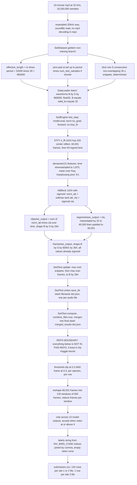
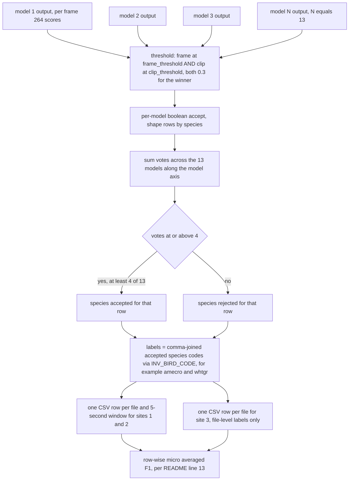
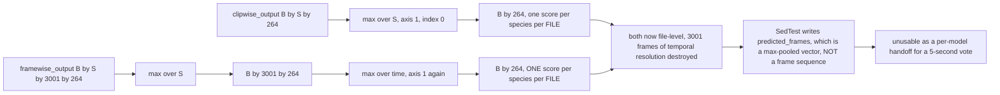

## Purpose

This module covers the **end of the pipeline**: turning a trained `SedEngine` checkpoint into per-audio-file prediction artifacts, and the thresholded 13-model vote that became a `submission.csv`. It exists as a separate unit because in this repo it is *not one*. The repo ships a training-and-validation codebase plus one abandoned inference scaffold (`src/metrics/sed_test.py`); the actual submission assembly — 5-second row slicing, site-3 row emission, cross-model voting, CSV writing — lived entirely in an external Kaggle kernel (README line 130: `https://www.kaggle.com/taggatle/cornell-birdcall-identification-1st-place-solution`). This chapter documents exactly what is in the repo, reconstructs the inference *semantics* that survive in the validation metrics, reconstructs the ensemble from the README, and states plainly what is unrecoverable.

Every claim below is tagged with its provenance:

- **CODE** — traceable to a line in this repo.
- **README** — traceable to a line in `README.md`.
- **INFERRED** — my reasoning; labelled with the reason.

> [!warning] Headline finding
> `src/metrics/sed_test.py` **does not compile**. `ast.parse` fails with `SyntaxError: invalid syntax` at line 60. This is not a stylistic nit — it makes `SedTest` unreachable dead code, and it is the *only* inference-oriented metric for the SED path. **The repository contains no submission-generation code at all.** Repo-wide: `row_id` = 0 hits, `to_csv` / `writerow` / `np.save` = 0 hits, `submission` / `test_audio` / `site` in tracked files = 0 hits.

---

## Contracts

**Inputs**

| Producer | Object | Shape / type | Dtype |
|---|---|---|---|
| `SedDataset.__getitem__` | `batch["waveforms"]` | `(B, S, effective_length)` where `B` = `valid_bs` = 32, `S` = `num_test_samples`, `effective_length = sr * period = 32000 * 30 = 960000` | `float32` (np) |
| `SedDataset.__getitem__` | `batch["all_labels"]` | `(B, S, 264)` one-hot over `BIRD_CODE` | `float32` |
| `SedDataset.__getitem__` | `batch["filename"]` | list of `B` strings | `str` |
| `PANNsDense121Att.forward` | `y_pred["clipwise_output"]` | `(B, S, 264)` — already sigmoid-activated | `float32` |
| `PANNsDense121Att.forward` | `y_pred["framewise_output"]` | `(B, S, T, 264)` where `T = 3001` for `period=30` | `float32` |
| `BaseEngine.evaluate` | `dl` | a DataLoader built from `hparams.test_ds_params` | — |

**Outputs**

| Object | Meaning | Where |
|---|---|---|
| `save_dir/{filename}.json` | ONE file per audio file. Keys: `filename`, `predicted_frames` (264 raw scores), `predicted_clip` (264 raw scores), `targets` (264), `lraps_score_clip` (float), `lraps_score_frames` (float) | `sed_test.py:67-68` — **never executed, does not compile** |
| `save_dir/final/merged_results.json` | A JSON *array* of every per-file JSON, produced by string concatenation of file contents joined with `,` | `sed_test.py:77-81` — same |
| `engine.state.metrics["test"]` | `_score_frame / _num_items`, a single float, mean per-file frame LRAP | `sed_test.py:83` — same |
| **Nothing else.** No CSV, no `row_id`, no `labels` string, no site handling exists in this repo. | | |

**Called by**

Nothing. **CODE:** `BaseEngine.evaluate()` is *defined* at `base_engine.py:230` and *never called* — `grep -rn "evaluate(" src/` returns only the definition. `src/sed_train.py` (the only entry point for the SED path) does `pe = SedEngine(...)` then `pe.train(config.run_params)`. There is no `sed_test.py` script, no `--mode test` flag, no inference notebook.

**Calls**

`SedEngine.test_step` → `self.model(x)` → `PANNsDense121Att.forward`; `SedTest.update` → `sklearn.metrics.label_ranking_average_precision_score`, `json.dumps`. `BaseEngine.evaluate` → `ignite.engine.Engine`, `attach_metrics`, `ignite.contrib.handlers.tqdm_logger.ProgressBar`.

---

## How it works

### Part A — The shipped code: `SedTest`, exactly as written

#### A.1 Registration — three independent reasons it can never fire

**CODE.** `SedEngine._init_metrics` guards the registration behind a string:

```python
if "test" in self.hparams.metrics:
    from metrics.sed_test import SedTest
    self.test_metrics["test"] = SedTest(save_dir=self.hparams.save_dir,
                                        combine_files=self.hparams.combine_files,
                                        output_transform=lambda x: (x["y_pred"], x["y"]))
```

All **21** config files in `src/config_params/` set the identical list:

```python
self.metrics = ["lraps", "f1score_clip", "f1score_frame"]
```

So the `if` is always False. Even if it were True:

1. **No config defines `self.save_dir`.** Only `self.checkpoint_params["save_dir"]` exists (a nested dict key, e.g. `"/saved_models/{self.name}"`). `self.hparams.save_dir` → `AttributeError`. Worse, it would be a `str`, and `SedTest.__init__` immediately calls `save_dir.mkdir(parents=True, exist_ok=True)` (`sed_test.py:28`) — a `str` has no `.mkdir`.
2. **No config defines `self.combine_files`.** → `AttributeError`.
3. **The file does not parse.** `import metrics.sed_test` raises `SyntaxError` before any of the above is reached.

**CODE.** The syntax error is a single missing comma. `sed_test.py:58-65`:

```python
solution = {
    "filename": filename          # <-- line 59, no comma
    "predicted_frames": p_f,
    ...
```

Python reads `filename` followed by a string literal and reports the error at line 60, `"predicted_frames": p_f,`. Verified: adding a single `,` at the end of line 59 makes the file parse cleanly (I checked this on a copy — `ast.parse` succeeds, nothing else needed).

> [!tip] The one-character fix
> ```diff
> -                "filename": filename
> +                "filename": filename,
> ```
> **Fixing this does not make it a submission pipeline.** It restores an *abandoned scaffold* that max-pools away all temporal information (A.3), emits no CSV, and is still gated off by all three blockers above.

#### A.2 The Ignite Metric lifecycle

`Metric.attach(engine, name)` with default `usage=EpochWise()` registers three handlers (**CODE**, verified against the pinned `pytorch-ignite==0.4.0.post1` wheel in `requirements.txt`):

| Handler | Event | Method | Effect on `SedTest` |
|---|---|---|---|
| `started` | `EPOCH_STARTED` | `self.reset()` | `_score_frame = 0.0`, `_score_clip = 0.0`, `_num_items = 0` |
| `iteration_completed` | `ITERATION_COMPLETED` (one per batch) | `self.update(engine.state.output)` | writes one JSON per file in the batch, accumulates |
| `completed` | `EPOCH_COMPLETED` | `self.compute()` | optionally merges, returns a float |

`output_transform=lambda x: (x["y_pred"], x["y"])` makes `update` receive `output = (pred, y_true)`. `sed_test.py:42-50` unpacks it:

```python
pred, y_true = output
target    = y_true["all_labels"]     # (B, S, 264)
filenames = y_true["filename"]       # list of B strings
pred_clip = pred["clipwise_output"]  # (B, S, 264)
pred_clip = pred_clip.max(axis=1)[0].detach().cpu().numpy()   # (B, 264)
target    = target[:,0,:].detach().cpu().numpy()              # (B, 264)
pred_frames = pred["framewise_output"]                          # (B, S, 3001, 264)
pred_frames = pred_frames.max(axis=1)[0].max(axis=1)[0].detach().cpu().numpy()  # (B, 264)
```

**Accumulators.** `SedTest` maintains exactly three, all reset in `reset()` and all initialised to `None` in `__init__`:

| Attribute | Type | Written where | Read where |
|---|---|---|---|
| `self._score_frame` | float, running sum | `sed_test.py:70` — `+= score_frames` | `sed_test.py:83` |
| `self._score_clip` | float, running sum | `sed_test.py:71` — `+= score_clip` | **nowhere** — accumulated and discarded |
| `self._num_items` | int, file counter | `sed_test.py:72` — `+= 1` per file | `sed_test.py:83` |

Plus `self.sigmoid` — a `torch.nn.Sigmoid()` created at `sed_test.py:25` and **never called**. That is *correct*, not a bug: `AttBlock.nonlinear_transform` (`sed_models.py:171-175`) already applies `torch.sigmoid` when `activation == 'sigmoid'`, and every SED model is constructed with `AttBlock(1024, classes_num, activation='sigmoid')`. Both `sed_f1score_clip.py:24` and `sed_f1score_frame.py:24` say so explicitly: `## NB: SIGMOID IS NOT APPLIED HERE`.

#### A.3 How the batch dimension is undone — and what that costs

The batch axis carries **two** levels of nesting. For the final configs `period = 30` s at `sample_rate = 32000`:

```
input waveform (B, S, 960000)
        |
        |  sed_dataset.py:116-125, non-training branch
        v
  S consecutive, NON-overlapping 30 s snippets  ->  S = 60 s of audio per dataset row
        |
        |  SedDataset.get_audio:  filename is one whole audio file
        v
(B, S, 960000)   where B = number of FILES, S = num_test_samples
        |
        |  sed_models.py:403-404   input_x.reshape(b*c, s)
        v
(B*S, 960000)  -> STFT n_fft=1024 hop=320 -> (B*S, 1, 3001, 513) -> logmel 64 bins
        |
        v
(B*S, 1024, 93, 2)  densenet121 .features, then torch.mean(dim=3) -> (B*S, 1024, 93)
        |
        v
AttBlock: norm_att = softmax(tanh(att(x))); cla = sigmoid(cla(x))
        |    clipwise_output   = sum(norm_att * cla, dim=2)  -> (B*S, 264)
        |    segmentwise_output= cla                        -> (B*S, 264, 93)
        v
interpolate(segmentwise_output, ratio=32) :  93*32 = 2976 -> pad_framewise_output -> 3001
        |
        v
framewise_output (B*S, 3001, 264)
        |
        |  sed_models.py:436-437
        v
framewise_output (B, S, 3001, 264)   clipwise_output (B, S, 264)
```

`SedTest.update` then performs **two** reductions:

```python
pred_clip   = pred["clipwise_output"].max(axis=1)[0]        # (B,S,264) -> (B,264)  max over snippets
pred_frames = pred["framewise_output"].max(axis=1)[0].max(axis=1)[0]
              #     (B,S,3001,264) -> (B,3001,264) -> (B,264)   max over snippets, then over frames
```

`.max(axis=1)[0]` is `torch.max(dim=...)` returning a namedtuple; `[0]` takes the **values**. Both reductions are verified numerically: a `(4,2,100,264)` tensor gives `(4,264)`.

> [!danger] What is destroyed
> `pred_frames` is reduced **over time**. Of `B x S x 3001 x 264` values, `(B, 264)` survive — one number per species per file, the **maximum** over all 6,002 frames of a 60-second slice. **No temporal information whatsoever survives.** Even a correct, compiling `SedTest` could not produce a 5-second row. Temporal information is structurally unrecoverable from `predicted_frames`, so the file it writes is not a viable handoff to a submission builder — only the 264-wide score vectors are.

The `"predicted_frames"` key name is therefore a misnomer: it holds a **file-level max-pooled** vector, not a frame sequence.

#### A.4 Per-file LRAP — and a free 1.0 for background audio

**CODE**, `sed_test.py:56-57`:

```python
score_clip   = label_ranking_average_precision_score([t], [p_c])
score_frames = label_ranking_average_precision_score([t], [p_f])
```

with `t = target[i]`, a 1-D `float32` length-264 one-hot. Verified on sklearn 1.9.1: LRAP rejects a *3-D* input but accepts `[t]` (a list holding one 1-D array → `(1, 264)`), so the call shape is correct.

**The degenerate-case clause.** Inside sklearn's `label_ranking_average_precision_score`:

```python
if relevant.size == 0 or relevant.size == n_labels:
    # If all labels are relevant or unrelevant, the score is also
    # equal to 1. The label ranking has no meaning.
    aux = 1.
```

Verified locally: a target of all zeros returns **1.0** regardless of the scores. Same clause is present in sklearn 0.24.2 (the era of this repo). This matters because `SedDataset.__init__` appends every wav under `background_audio_dir` as an unlabelled row (`sed_dataset.py:34-39`), and *every* final config sets `"background_audio_dir": Path("/background/data_ssw")` in `valid_ds_params`/`test_ds_params`. So:

> [!warning] `SedTest` gives every background file a free 1.0
> There is no `if t.sum() == 0:` guard in `sed_test.py` — unlike `sed_f1score_clip.py:31` and `sed_f1score_frame.py:34`, which *do* special-case it. Background items therefore contribute exactly `1.0` to `_score_frame` regardless of what the model predicted. The metric is inflated, not deflated. **Correction to a common assumption: LRAP does not return 0.0 for zero-positive samples — it returns 1.0.**

#### A.5 The JSON artefact

**CODE**, `sed_test.py:58-68`:

```python
solution = {
    "filename": filename,
    "predicted_frames": p_f,     # 264 float32 — max over snippets AND frames
    "predicted_clip":   p_c,     # 264 float32 — max over snippets
    "targets":          t,       # 264 float32 — ground truth, snippet 0
    "lraps_score_clip": score_clip,
    "lraps_score_frames": score_frames
}
with open(self._save_dir/f'{filename}.json', 'w') as f:
    f.write(json.dumps(solution, cls=NumpyEncoder))
```

`NumpyEncoder.default` (`sed_test.py:15-19`) converts any `np.ndarray` via `.tolist()`, which is how the raw float32 arrays become JSON numbers.

**Filename gotcha.** `filename` comes from `SedDataset.get_audio` (`sed_dataset.py:56-74`):
- A labelled CSV row → `filename = item["filename"]`, the raw CSV value, which for this dataset **includes the `.mp3` extension**. The artefact is therefore `015d84e5-….mp3.json`.
- A background row (no `"ebird_code"` key) → `filename = filename.stem`, so the artefact is `BIRD00001.json`.

#### A.6 `combine_files` — the merge, and the glob that almost ate itself

**CODE**, `sed_test.py:77-81`:

```python
if self._combine_files:
    read_files = self._save_dir.glob('*.json')
    with open(self._save_dir/f"final/merged_results.json", "w") as outfile:
        outfile.write('[{}]'.format(
            ','.join([open(f, "r").read() for f in read_files])))
```

- **`combine_files=True`** → hand-rolls a JSON array by string-concatenating the *raw text* of every `save_dir/*.json`, joined with `,`, wrapped in `[...]`. This works only because each per-file file is a self-delimiting `{...}` object.
- **`combine_files=False`** (the default, `sed_test.py:22`) → no merge; only the per-file JSONs exist.

> [!tip] The `final/` subdirectory exists for exactly one reason
> `__init__` pre-creates it (`sed_test.py:29`): `(save_dir/"final").mkdir(parents=True, exist_ok=True)`. `Path.glob('*.json')` is **non-recursive**, so `save_dir/final/merged_results.json` does not match its own glob. Had the merge target been `save_dir/merged_results.json`, the *second* run would have globbed the merged file and produced nested garbage. The subdirectory is load-bearing. It is also created unconditionally, even when `combine_files=False` and nothing is ever written into it.

Two further defects: `open(f, "r").read()` never closes the handles (reliant on CPython refcounting), and the result is **unparseable if any per-file JSON is empty or truncated** — e.g. a run killed mid-write leaves a half-written `{...` that the merge happily concatenates into the middle of the array.

#### A.7 A real DDP bug, more subtle than it looks

**CODE**, `sed_test.py:74`:

```python
@sync_all_reduce("_score", "_num_items")
def compute(self):
```

`SedTest` defines `_score_frame` and `_score_clip`. It never defines `_score`. Looking at the pinned ignite 0.4.0.post1 implementation:

```python
for attr in attrs:
    t = getattr(self, attr, None)          # <-- default None, no exception
    if t is not None and idist.get_world_size() > 1:
        t = idist.all_reduce(t); ...
```

`getattr` has a `None` default, so the missing `_score` **does not raise**. It is silently skipped. The actual failure is a silent arithmetic inconsistency under DDP:

| Attribute | Declared to `sync_all_reduce` | Actually reduced? |
|---|---|---|
| `_score` | yes | **no** — does not exist |
| `_num_items` | yes | **yes** |
| `_score_frame` (the numerator!) | no | **no** |

So under world_size > 1 the denominator becomes a global sum while the numerator stays per-rank, and `compute()` returns a meaningless number with no error. The correct declaration would be `@sync_all_reduce("_score_frame", "_score_clip", "_num_items")`. In this repo it is moot — `dist_params = {}` in all 21 configs, so world_size is always 1 and the decorator is a no-op.

#### A.8 Two unused imports — the strongest evidence of the missing pipeline

**CODE.** `sed_test.py:10-13`:

```python
from config_params.configs import BIRD_CODE
INV_BIRD_CODE = {v: k for k, v in BIRD_CODE.items()}
```

`grep -rn "INV_BIRD_CODE" src/` → exactly one hit, the definition. It is **never used**. This is precisely the index→species-code map you need to turn a 264-wide score vector into a submission's species-code `labels` string. Its presence, in a file that otherwise only needs raw scores for LRAP, is the fingerprint of planned submission assembly.

Two more: `f1_score` (line 9) and `glob` (line 8) are imported and unused; `NotComputableError` (line 2) is imported and unused.

---

### Part B — The real inference semantics, reconstructed from the code that *does* run

Since `SedTest` is dead, the only surviving implementation of the final decision rule is in the **validation** metrics. It is worth reading closely, because it is the in-repo ancestor of the README's "threshold 0.3 for both".

#### B.1 The single most important line in the repo

**CODE**, `src/metrics/sed_f1score_frame.py:33-42`:

```python
for i, (pf, pc, t) in enumerate(zip(pred_frame, pred_clip, target)):
    if t.sum() == 0.0:
        if (np.sum((pf >= self.threshold) & (pc >= 0.3))) > 0.0:
            score = f1_score([1], [0], average='micro')     # false alarm on background -> 0.0
        else:
            score = f1_score([1], [1], average='micro')     # correctly silent      -> 1.0
    else:
        score = f1_score([t], [(pf >= self.threshold) & (pc >= 0.3)], average='micro')
    self._score += score
    self._num_items += 1
```

Read that boolean AND literally, element by element:

```python
accept_species_i  ==  (max_frame_score_i  >= self.threshold)  &  (max_clip_score_i  >= 0.3)
#                    \________ configurable ________/             \_______ hard-coded ________/
#                     passed as SedF1ScoreFrame(threshold=0.5)      literal 0.3, no config knob
```

**CODE.** The asymmetry is real and confirmed by grep:

| | Where set | Value | Configurable? |
|---|---|---|---|
| Frame threshold | `sed_engine.py:170` — `SedF1ScoreFrame(threshold=0.5, ...)` | `0.5` | **yes**, constructor arg |
| Clip threshold | `sed_f1score_frame.py:35` and `:40` — literal `0.3` | `0.3` | **no** — hard-coded in two places |

> [!warning] Latent hazard
> A reader would reasonably assume `threshold=0.5` is the decision threshold for *both* heads. It is not. The clip head's 0.3 is duplicated as a bare literal on two lines, and the README's winning configuration (`clip 0.3 / frame 0.3`) is *not* expressible with this class at all — you would need `SedF1ScoreFrame(threshold=0.3)` for the frame side. If anyone retunes this, the two sites must be changed together or the metric silently stops matching the submission rule.

**Semantics of the reduction, restated.** `pf` and `pc` arrive already max-pooled (`sed_f1score_frame.py:27` and `:31`):

```python
pred_frame = pred["framewise_output"].max(axis=1)[0].max(axis=1)[0]   # (B,264): max over snippets, then frames
pred_clip  = pred["clipwise_output"].max(axis=1)[0]                  # (B,264): max over snippets
```

So `f1score_frame`, **despite its name, is a FILE-level metric**. It reduces all `3001` frames to one number per species, then compares that single number to a threshold. The frame evidence is used purely as a *gate*, not as a temporal prediction. `f1_score([t], [...], average='micro')` then does a flat micro-F1 over the 264-element binary vectors — identical in structure to the competition's "row-wise micro averaged F1 score" (README line 13), one file standing in for one row.

The background branch is the interesting part: for an unlabelled file, ground truth is "all negative", and the score is `f1_score([1],[0]) = 0.0` if **anything at all** crosses either threshold. Verified numerically. This is a per-file *any*-positive reduction — one spurious species out of 264 zeroes the entire file.

Contrast `sed_f1score_clip.py:26-37`, which is clip-only and symmetric:

```python
score = f1_score([t], [p >= self.threshold], average='micro')   # threshold = 0.5, no 0.3 literal
```

#### B.2 Why the two thresholds must be tuned separately

**CODE.** `AttBlock.forward` (`sed_models.py:164-169`):

```python
norm_att = torch.softmax(torch.tanh(self.att(x)), dim=-1)
cla = self.nonlinear_transform(self.cla(x))          # sigmoid
x = torch.sum(norm_att * cla, dim=2)                # clipwise_output
return x, norm_att, cla                             # segmentwise_output == cla
```

And `SedEngine.loss_fn` (`sed_engine.py:71-73`):

```python
loss, dict_loss = self.criterion(y_pred["clipwise_output"], y)
```

**The frame head receives no gradient target of its own.** The loss is computed *only* against `clipwise_output`. The frame head is shaped by the attention weights `norm_att` reshaping `cla`'s magnitude into a time profile — supervision is entirely implicit.

The consequence for calibration is structural, and it is *inferred* but follows directly from the two lines above *(reason: one head is an explicit trained sigmoid; the other is a re-tiling of that same sigmoid's values, so its per-cell scale is fixed by the attention distribution rather than by any per-cell loss)*:

1. **Clip head**: trained as "P(this species is in this 30 s snippet)". Its sigmoid output is calibrated to that question. Threshold 0.3 means "30% posterior that the species appears *somewhere* in 30 s". Reasonable to compare against a low threshold.
2. **Frame head**: a `sigmoid(cla)` value selected and interpolated by `norm_att`. Its per-cell value is **not** "P(bird in this 10 ms frame)". Where attention is spread thin over a long call, every frame inherits a small score; where it is peaked, one frame inherits nearly the whole score. The same underlying evidence yields wildly different per-cell maxima depending on the *duration* of the call — a 2-second call can peak at 0.6 in one frame while a 20-second call never exceeds 0.25 in any frame.

Therefore a single shared threshold would systematically favour short, sharp calls and miss long, spread-out ones. Separate thresholds absorb the systematic difference in scale between the two heads. This is exactly what the README's table parameterises — **README lines 49-62** sweep `Clip Threshold` and `Frame Threshold` as two independent columns, and both models were selected with *different* clip and frame values (0.3/0.3 and 0.3/0.5 respectively). A shared threshold would make those columns redundant, and they are not.

#### B.3 `SedDataset`'s non-training branch

**CODE**, `sed_dataset.py:116-125`:

```python
else:                                                       # isTraining == False
    if item["duration"] < effective_length * self.num_test_samples:
        new_y = np.zeros(effective_length * self.num_test_samples, dtype=y.dtype)
        new_y[0:item["duration"]] = y
        y = new_y.astype(np.float32)
        item["duration"] = len(y)

    for i in range(self.num_test_samples):
        y_snippet = y[effective_length*i : effective_length*i + effective_length].astype(np.float32)
        list_of_y.append(y_snippet)
```

- **Deterministic.** No randomness whatsoever, unlike the training branch (`:104-115`) which uses `np.random.randint` for both random-offset crop and random-placement padding. Validation and inference are reproducible by construction.
- **Zero-pad upward, always at the tail.** Short files are padded on the **right** with digital silence; note the contrast with training, which pads at a **random** `start` offset (`:107-108`).
- **Truncates downward, silently.** `item["duration"] > effective_length * num_test_samples` is never handled — the loop just reads the first `period * num_test_samples` seconds. For the final configs that is **60 s**; a 10-minute file is truncated to its first 60 seconds and the rest is discarded with no warning and no flag in the output.
- **Labels are duplicated across snippets.** `convert_labels_to_coded(len(list_of_y), item["all_labels"])` (`:128`) returns `(S, 264)` with every snippet carrying the file's full label set. This is why `target[:, 0, :]` in every metric is safe.

> [!tip] The number that matters
> `num_test_samples = 20` would be needed to cover a 600-second file at `period = 30` (`600 / 30 = 20`). **Every config in this repo ships `num_test_samples = 2`** (`1` for training). The repo's inference configuration therefore covers 60 of 600 seconds. This is further proof that the shipped configs target *fold validation*, not the Kaggle test set — see also that every `test_ds_params["csv_dir"]` points at `/folds/fold_{n}_test.csv`, not at `test_audio`.

#### B.4 `BaseEngine.evaluate` — the third engine

**CODE**, `base_engine.py:230-235`:

```python
def evaluate(self, dl):
    self.tester = Engine(self.test_step)
    self.attach_metrics(self.tester, self.test_metrics)
    if self.hparams.add_pbar:
        ProgressBar(persist=False).attach(self.tester)
    self.tester.run(dl, epoch_length=self.hparams.val_length)
```

Three Ignite engines exist, constructed in three different places:

| Engine | Constructed at | Process fn | Metrics |
|---|---|---|---|
| `self.trainer` | `base_engine.py:137`, inside `setup()` | `train_step` | `train_metrics` (`:147`) |
| `self.evaluator` | `base_engine.py:170`, inside `setup()` | `eval_step` | `validation_metrics` (`:206`) |
| `self.tester` | `base_engine.py:231`, inside `evaluate()` | `test_step` | `test_metrics` (`:232`) |

`self.tester` is the **only** one created lazily per call, not during `setup()` — calling `evaluate()` twice gives you two independent engines but reuses the *same* `self.test_metrics` objects, which are already attached to the first engine. (Harmless in practice because `Metric.started` calls `reset()`.)

**`epoch_length=self.hparams.val_length`.** `val_length = None` in all 21 configs. Verified against ignite 0.4.0.post1: `Engine.run` resolves `epoch_length is None` to `self._get_data_length(data)`, i.e. `len(dataloader)`. So the third engine does exactly one epoch over the whole test loader.

**No loss on the test path — by design of `output_transform`.** `sed_engine.py:75-81`:

```python
def output_transform(self, x, y, y_pred, loss=None, dict_loss={}, mode='valid'):
    if mode == 'train':  return {"loss": loss.detach(), "x": x, "y_pred": y_pred, "y": y, "dict_loss": dict_loss}
    elif mode == 'valid':return {"loss": loss.detach(), "x": x, "y_pred": y_pred, "y": y, "dict_loss": dict_loss}
    elif mode == 'test': return {"y_pred": y_pred, "x": x, "y": y}      # <-- no "loss"
```

`BaseEngine.test_step` (`:268-274`) calls `self.loss_fn` **zero** times, unlike `eval_step` (`:264`). There is consequently no `test_avg_loss` metric and no loss number in `engine.state.metrics` on this path. That is deliberate: computing the loss at test time would require the ground truth, and the Kaggle test set has none.

> [!bug] Independent bug on the `mode == 'test'` branch
> `sed_engine.py:57-69`:
> ```python
> elif mode == 'test':
>     return (
>         (
>             convert_tensor(x, device=self.device, non_blocking=True),   # <-- `x` is UNDEFINED
>             None
>         ),
> ```
> The method signature is `prepare_batch(self, batch, mode='valid')` — there is no local `x` anywhere in it. `x` is only bound in the `'valid'` branch (`:48`). This raises `NameError: name 'x' is not defined` on the very first call. Compare `main_engine_v3.py:20-25`, which correctly writes `x, inputs = batch["images"], batch`. The intended line is `convert_tensor(batch["waveforms"], ...)`. **Third independent blocker** on the test path, independent of the syntax error and the missing config keys.

---

### Part D — Row granularity, reconstructed

**README.** Lines 9-13 state the target format:

> The hidden test_audio directory contains approximately 150 recordings in mp3 format, each roughly 10 minutes long. […] The recordings were taken at three separate remote locations in North America. **Sites 1 and 2 were labeled in 5 second increments and need matching predictions, but due to the time consuming nature of the labeling process the site 3 files are only labeled at the file level. Accordingly, site 3 has relatively few rows in the test set and needs lower time resolution predictions.**
>
> Scores were evaluated based on their row-wise micro averaged F1 score.

**CODE — negative result.** The repo has **no notion of 5 seconds, no site, no `row_id`, no CSV.** The finest temporal unit that exists anywhere is `period = 30` seconds. Grep results: `row_id` → 0 hits; `site` → 0 hits; `submission` → 0 hits; `to_csv` → 0 hits. 5-second slicing and site-3 row emission lived entirely in the Kaggle kernel and are **not recoverable from this repo**.

> [!info] One ghost directory is suggestive
> `directory_structure.txt` (committed) lists four config directories that do **not** exist in the working tree and were **never committed** (`git log --all --name-only` shows only `final_sed/` and `final_sed_5_fold/`):
> ```
> ./src/config_params/old
> ./src/config_params/final
> ./src/config_params/final_sed
> ./src/config_params/final_sed_5_fold
> ./src/config_params/final_5sec_sed_5_fold      <-- "5sec"
> ```
> `final_5sec_sed_5_fold` is precisely where 5-second-granularity inference configs would have lived. Its listing without its contents is corroborating — not proof — that a 5-second pipeline existed outside what was published.

#### D.1 The arithmetic you need to rebuild it

All figures below are **CODE**-derived from the real config values, with the STFT/densenet step **verified numerically** by instantiating `torchvision.models.densenet121().features` and running a real tensor through it.

| Quantity | Value | Derivation |
|---|---|---|
| Sample rate | 32,000 Hz | `model_config["sample_rate"] = 32000` |
| 10-minute file | **19,200,000** samples | `32000 * 600` |
| Snippet length `effective_length` | **960,000** samples = 30.0 s | `sed_dataset.py:101`, `period = 30` |
| Snippets to cover the file | **20** | `600 / 30` |
| `n_fft` / `hop` | 1024 / 320 | `model_config` |
| Seconds per mel frame | **0.01 s** | `320 / 32000` |
| Spectrogram frames for 600 s | **60,001** | `(19,200,000 + 2*512 − 1024) / 320 + 1`, `center=True` reflect pad (`sed_audio_utils.py:94-95`) |
| Frames after `densenet121.features` | **1,875** | **measured**, `densenet121` time downsample ≈ 32× |
| After `interpolate(segmentwise, ratio=32)` | 60,000 | `sed_models.py:430-431`, `interpolate_ratio = 32` |
| After `pad_framewise_output(…, 60001)` | **60,001** | `sed_models.py:432`; 1 extra frame, replicating the last |
| **Frames per 5-second row** | **500** | `5 / 0.01` |
| **Five-second rows per 10-minute file** | **120** | `600 / 5` |

For the 30-second snippet the configs actually produce: 960,000 samples → **3,001** frames → **93** after densenet121 → `93 * 32 = 2,976` → padded to **3,001** (25 frames replicated). 3,001 / 30 s = 100.03 frames/s. One 30 s snippet = exactly **6** five-second windows of 500 frames.

#### D.2 The shape dance from a per-frame score vector to a CSV

**INFERRED** — the code that performs this is not in the repo; this is the minimal bridge implied by the verified shapes plus the competition format quoted in the README.

```
per model, per file
  framewise_output (T=60001, 264)      clipwise_output (264)      [sigmoid already applied]
        |
        |  ---- X >= clip_threshold (0.3)     Y >= frame_threshold (0.3)
        v
  accept[t, i]  (60001, 264) bool      gate[i] = (Y[i] >= 0.3)  (264,) bool
        |                                    |
        |  AND the gate across every frame   |
        v                                    |
  m[i] = max_t accept[t, i]   (264,) bool <--+      # any-of-500 style reduction
        |
        |  reshape to (120, 500, 264) and reduce the 500-frames axis
        v
  per-row species votes (120, 264) bool
        |
        |  vote across the 13 models: v[i] = sum_{m=1..13} accept_m[t,i] >= 4
        v
  winning species per row
        |
        |  birds_row = " ".join(INV_BIRD_CODE[i] for i where v[i]) or "nocall"
        v
  one CSV row per (file, 5-second window) for site 1/2; one row per file for site 3
```

The `INV_BIRD_CODE` map from `sed_test.py:13` — defined, never used — is exactly the `INV_BIRD_CODE[i]` lookup the `birds` column needs. Multiple species in one row are the **space-separated** subset; a row with no surviving species is the **string `nocall`**. *(external — Kaggle competition data page, not in this repo.)*

> [!warning] Row-count implication
> 120 five-second rows for each site-1/2 file plus 1 row for each site-3 file. Any silent max over `T` — exactly what `SedTest.update` does — yields **1** row per file, which is 120× too few rows for sites 1 and 2. This is the quantitative reason the shipped scaffold could never have produced a scoreable submission, independent of the syntax error.

---

## Key decisions and tricks

### Part C — The 13-model ensemble (README-DERIVED ONLY)

Everything in this section comes from `README.md` lines 37-62. **No ensemble, vote, or submission code exists anywhere in the repository.** Treat it as a design record, not an implementation.

#### C.1 The three model families

**README lines 41-43**, verbatim:

> - 4 fold models (without mixup)
> - 5 fold models (without mixup)
> - 4 fold models (with mixup)

4 + 5 + 4 = **13**, matching the "13 Models" table heading.

**CODE cross-reference.** The published configs map onto these families exactly — 21 configs, of which 13 are fold models:

| Family | Configs | `apply_mixup` | `aug_name` | `criterion_name` |
|---|---|---|---|---|
| 4-fold nomix | `final_sed_dense121_nomix_fold{0,1}`, `..._fold{2,3}_augd` | `False` | `default` | `..._pos_neg_focal_loss` (folds 0,1) / `..._pos_neg_focal_loss_augd` (folds 2,3) |
| 5-fold nomix | `final_5fold_sed_dense121_nomix_fold{0..4}` | `False` | `secondary_default` | `..._pos_neg_focal_loss` |
| 4-fold mixup | `final_sed_dense121_mix_fold{0,1,2,3}` | **`True`** | `default` | `..._pos_neg_focal_loss` |

The **9-model** ensemble (README line 47: *"9 models (the models without mixup)"*) is therefore the **4-fold nomix + 5-fold nomix** families = 9. The mixup family is the one dropped. Also present but outside all three families: `final_sed_dense121_nomix_1`, `final_sed_dense121_nomix_3` (both `self.fold = "all"`, trained on `/folds/all_data.csv`) and `final_sed_dense121_mix_2` (`fold = 0`, `track_metric = "lraps"`). Those three are the `*_1` / `*_2` / `*_3` variants visible in the config listing and are *not* counted in the 13.

#### C.2 The two leaderboard tables, verbatim

**README lines 49-56:**

| **13 Models**        | Clip Threshold | Frame Threshold | Public Leaderboard | Private Leaderboard | Selected |
|---------|----------------|-----------------|--------------------|---------------------|----------|
| 4 votes | 0.3            | 0.3             | 0.616              | 0.681               | x        |
| 4 votes | 0.3            | 0.5             | 0.615              | 0.679               |         |
| 5 votes | 0.3            | 0.3             | 0.609              | 0.679               |         |
| 5 votes | 0.3            | 0.5             | 0.606              | 0.676               |         |
| 3 votes | 0.3            | 0.3             | 0.617              | 0.679               |         |
| 3 votes | 0.3            | 0.5             | 0.614              | 0.679               |         |

**README lines 58-62:**

| **9 Models**        | Clip Threshold | Frame Threshold | Public Leaderboard | Private Leaderboard | Selected |
|---------|----------------|-----------------|--------------------|---------------------|----------|
| 3 votes | 0.3            | 0.5             | 0.613              | 0.676               | x        |
| 2 votes | 0.3            | 0.5             | 0.614              | 0.669               |         |
| 4 votes | 0.3            | 0.5             | 0.610              | 0.675               |         |

#### C.3 The winning choice was deliberately NOT the best public score

**README line 45**, verbatim:

> 2 submissions were allowed to be selected before the Private Leaderboard was revealed. My top ensemble was if 4 out of the 13 models predicted a bird with a threshold of `0.3` for both `clipwise_output` and `framewise_output` was within the audio snippet then it would be accepted as a valid prediction. This ensemble was not a the highest model on the public leaderboard but I selected it based on what I felt would be the most confident in as 3 votes felt too low for 13 models (highest on Public Leaderboard). With this ensemble I was able to jump from 7th on the Public Leaderboard to 1st on the Private Leaderboard.

The reasoning, stated plainly:

- **3 votes / 0.3 / 0.3 scored 0.617 public — the best public number in the table** — and was rejected.
- **4 votes / 0.3 / 0.3 scored 0.616 public — one thousandth lower — and was selected.**
- The stated criterion was a *prior*, not a measurement: *"3 votes felt too low for 13 models."* A 3/13 ≈ 23% consensus is too weak a quorum to trust; 4/13 ≈ 31% is the minimum you would defend in a review.
- **Result: 7th public → 1st private.** The public/private gap of 0.065 for the selected row versus 0.062 for the rejected row is exactly what the intuition bought.

This is the most transferable decision in the whole repo: with two submission slots and a noisy public leaderboard, the author spent one on the most *defensible* configuration rather than the best-scoring one, on the reasoning that public-LB ranking among near-ties is noise and the quorum fraction is the thing that transfers.

The threshold columns vary independently and consistently across both tables: `clip` is **always 0.3**, only `frame` moves (0.3 or 0.5). Combined with the `pc >= 0.3` hard-coded literal in `sed_f1score_frame.py:35,40`, this is consistent with the author's judgement that the **clip head is well calibrated enough to leave alone and the frame head needs loosening from 0.5 to 0.3 to recover long, spread-out calls** — the failure mode described in B.2.

#### C.4 What a per-model artefact must contain for a vote to be countable

**INFERRED** (reason: the README describes a per-*row*, per-*species* quorum; the only per-file, per-species array the repo produces is the 264-vector).

For model *m*, file *f*, species *i*, five-second row *k* to contribute one vote, that model's run must yield a boolean `accept[m, k, i]`. With the verified shapes:

```python
accept[m, k, i] = (frame_score[m][t, i] >= 0.3) & (clip_score[m][i] >= 0.3)
```

for any `t` in row *k*'s 500-frame window. **Each model's artefact must therefore retain the temporal axis** — `(T, 264)` per frame or at minimum `(120, 500, 264)` per row. `SedTest`'s `predicted_frames` is `(264,)` with the time axis already max-pooled away (A.3), so it **cannot** produce a valid vote. A minimal per-model handoff would be one file per audio file containing `clipwise_output` (264) plus `framewise_output` (60001, 264) — roughly 60 MB of float32 per file, or ~9 GB for the full test set. Storing it as float16 halves that.

The quorum itself is a plain integer sum over the model axis with a `>= 4` comparison, then a per-row reduction over the accepted species indices into the comma-joined `labels` string. Nothing exotic — which is why it is nowhere in the repo: it is twenty lines of `numpy`, and it lived in the kernel.

### Other non-obvious things

- **The test DataLoader is built unconditionally.** `BaseEngine.setup()` calls `_init_distribution()` (`:135`), which constructs `self.test_ds` via `_init_test_dataloader` (`sed_engine.py:222-224`) and then `idist.auto_dataloader(self.test_ds, batch_size=self.hparams.valid_bs, ...)` at `:73-76`. So even a pure training run pays for reading the test CSV, globbing `background_audio_dir` recursively, and constructing the dataset object. There is no lazy path.
- **There is no `test_bs`.** `:75` reuses `self.hparams.valid_bs` = **32** and `self.hparams.valid_num_workers` = **4** in all 21 configs. Inference batch size cannot be tuned independently of validation batch size.
- **`num_workers` and I/O.** `sf.read` on a 76 MB wav per worker, four workers deep — fine on local disk, and a genuine bottleneck on a network mount. *(inferred — reason: `soundfile` reads the whole file into memory in one call, no chunking, per `sed_dataset.py:76`.)*
- **`labels` string construction has an in-repo precedent for the *target* side**: `sed_dataset.py:61-64` builds `all_labels` as `[primary_label] + [secondary_label, ...]` from `BIRD_CODE` lookups, and `df.secondary_labels.apply(eval)` (`:28`) parses the competition's own `secondary_labels` string. So the repo knows the format is a species-code list; it simply never has a place to write one.

---

## Failure modes and gotchas

### E.1 Compilation — the wall

`src/metrics/sed_test.py` raises `SyntaxError` at line 60. Verified: the entire rest of `src/metrics/` parses cleanly (`custom_test.py`, `sed_lraps.py`, `sed_f1score_clip.py`, `sed_f1score_frame.py`, `custom_f1score.py`, `custom_lraps.py`), as do `sed_engine.py`, `sed_dataset.py`, and `base_engine.py`. The single comma on line 59 is the only fix needed *to parse*; the file then has three further runtime blockers (A.1, A.8, B.3).

### E.2 Memory — a 10-minute file is 76.8 MB of float32 *before batching

Measured from the code:

| Object | Bytes |
|---|---|
| One 10-min file as float32 | 19,200,000 × 4 = **76.8 MB** |
| `new_y = np.zeros(...)` + `y.astype(np.float32)` + `np.array(list_of_y)` + torch's collate copy | **≈ 4 copies ≈ 300 MB peak per file, per worker** |
| `framewise_output` for `B=1, S=20` | 20 × 3001 × 264 × 4 = **63 MB per model forward** |

With `valid_bs = 32`, one test batch of 10-minute files would try to allocate `32 × 76.8 MB = 2.5 GB` of waveform alone, ~10 GB with copies — and `densenet121`'s activations on top. The shipped `num_test_samples = 2` sidesteps this only by discarding 90% of every file. **To actually run 10-minute inference you must lower `valid_bs` (it is shared with validation — see B.3's `valid_bs` gotcha) or add a dedicated `test_bs`.** *(inferred — reason: no 10-minute inference config exists in the repo to check against.)*

### E.3 Tail silence — and rows you must not emit

`SedDataset`'s non-training branch pads **upward, at the tail** (B.3). Two consequences for any rebuilt pipeline:

1. The trailing partial snippet is pure digital silence. A model fed silence will emit whatever its silence prior is; if that prior exceeds 0.3 on any species, the zero-padded tail emits spurious rows. Any row-wise CSV builder must **clip the emitted window count to the true file duration** (`floor(duration / 5)`) rather than to `ceil`.
2. `pad_framewise_output` (`sed_models.py:62-78`) additionally replicates the **last** frame until `T == frames_num`. For a 30 s snippet that is 25 replicated frames — 0.83% of the sequence. Those duplicated cells are correlated by construction and will not behave like independent evidence if you aggregate by mean.

### E.4 `lraps` as `track_metric` is inflated by background audio

Two configs set `self.track_metric = "lraps"`: `final_sed_dense121_nomix_1.py:95` and `final_sed_dense121_mix_2.py:95`. Verified: `label_ranking_average_precision_score` returns **1.0** for any sample with zero positives (sklearn's `relevant.size == 0` clause). Every file from `background_audio_dir` — and every final config points at `Path("/background/data_ssw")` — therefore scores a **free 1.0**. Since `track_metric` feeds `self.score_function` (`base_engine.py:318-325`), which drives `Checkpoint` model selection (`:120-128`), **checkpoint ranking for those two configs is driven partly by how easy it is to stay silent on noise.** Note the direction: this *inflates* the metric, it does not deflate it.

### E.5 The `combine_files` merge is not robust

`','.join([open(f,'r').read() for f in save_dir.glob('*.json')])` is text-level concatenation. Any truncated or empty per-file JSON corrupts the entire merged array, and handles are never closed. The `final/` subdirectory prevents self-inclusion (A.6) — that part is right.

### E.6 DDP arithmetic under-reduces silently

`sync_all_reduce("_score", "_num_items")` on a class with no `_score`: ignite's `getattr(self, attr, None)` swallows it, so no error — you get a global denominator over a per-rank numerator. Latent, because `dist_params = {}` everywhere. Same class of bug exists in `custom_test.py:72` where the attribute *does* exist.

### E.7 19 of the 20 final configs are CRLF

`file src/config_params/*/*.py` reports CRLF for every final config **except `final_sed/final_sed_dense121_mix_2.py`**, which is LF like `example_config.py` (`configs.py` is CRLF). Python handles both, but any naive line-based grep for config values will silently miss 19 of the 21 `Parameters` files — including the `self.metrics` line that proves `SedTest` is unregistered. Worth knowing before concluding a config key "isn't set anywhere".

### E.8 Two independent name collisions waiting to happen

- `SedEngine._init_model` for `sed_dense121att` does **not** load a pretrained checkpoint at all (`:187-189`), unlike `sed_ccnn14att` which honours `hparams.pretrained_path` (`:180-186`). A 4-fold run started without `checkpoint_dir` set trains DenseNet121's ImageNet weights via `models.densenet121(pretrained=True)` and then overwrites them. Not inference-specific, but it is the difference between a load and a re-train.
- `custom_test.py` is registered by `MainEngineV2/V3/V4` (not `SedEngine`) and is the only other test-time metric in the repo. It reads `coded_labels` and `filenames`, applies `sigmoid` itself (those models output logits), and strips `.mp3` (`filenames[i].replace(".mp3","")`, l.45), so its artefacts are `XC…json`, unlike `SedTest`'s `XC….mp3.json`. It writes F1 at thresholds 0.5–0.9 plus a `background` flag, uses the same `NumpyEncoder`, and has **no species-code decoding either** — it only ever emits F1 scores, never a `birds` column.
- `INV_BIRD_CODE` in `sed_test.py:13` maps model-output position → species code. The two inverse maps are **not** duplicates: `INV_BIRD_CODE` inverts `BIRD_CODE` (code↔index), while `INV_EBIRD_LABEL` (in `configs.py:351`) inverts `EBIRD_LABEL` (`'Genus species_Common Name'` → code). `INV_BIRD_CODE[i]` for index *i* of any 264-wide output decodes to `INV_BIRD_CODE[i]`; `INV_EBIRD_LABEL` cannot do that, since its keys are full scientific+common names, not integers.

---

### Part E — Reproduction gaps: what is NOT in this repo

Explicit inventory. Everything here was verified by exhaustive grep over all tracked files and by `git log --all --name-only` across all 20 commits (a single `initial code commit` plus README-only updates — **nothing was ever deleted**).

| Missing piece | Evidence |
|---|---|
| Any CSV writer | `to_csv`, `writerow`, `csv.writer` → **0 hits** |
| Any `.npy` / score-tensor dump | `np.save`, `torch.save` of predictions → **0 hits** |
| `row_id` — the competition's row key | → **0 hits** |
| The `labels` string column | only `INV_BIRD_CODE`, defined and never used |
| `site` 1 / 2 / 3 handling | `site` in tracked files → **0 hits** |
| `test_audio` directory handling | → **0 hits** |
| 5-second row slicing | no `5` anywhere in a temporal sense; finest unit is `period = 30` |
| Ensemble / vote / quorum code | → **0 hits** |
| A `combine_files` config flag | → **0 hits** in `src/config_params/` |
| An inference entry point | `sed_train.py` only trains; `evaluate()` has no callers |
| A 10-minute inference config | all 21 configs ship `num_test_samples = 2` (60 s) and point `test_ds_params` at fold CSVs |
| `src/config_params/final_5sec_sed_5_fold/` | listed in `directory_structure.txt`, absent from the tree **and** from git history |
| `src/config_params/old/`, `src/config_params/final/` | likewise listed, never committed |
| A pip-installable entry point | `requirements.txt` pins only 6 transitive helpers; `ignite`, `librosa`, `sklearn`, `torch`, `pandas` are all absent from it |

> [!warning] To re-run this solution you must reconstruct
> 1. A test config with `num_test_samples = 20`, `period = 30`, `test_bs = 1`, pointing at `test_audio`.
> 2. Fix `sed_test.py:59` (comma) and `sed_engine.py:60` (`x` → `batch["waveforms"]`), then **rewrite `update()` to keep the time axis** — the current double max-pool must go.
> 3. Add `save_dir` and `combine_files` to the config, and `"test"` to `metrics`.
> 4. Write the vote/CSV layer: per-model `(T, 264)` dumps → 500-frame row reduction → 13-model quorum at 4 → comma-joined `labels` from `INV_BIRD_CODE` → site-aware row counts.
>
> Items 1 and 4 are net-new code; they are not recoverable from this repository.

---

## Mermaid

### (a) End-to-end inference — with the repo boundary marked



### (b) Ensemble voting across N model output files



### (c) The max-pool collapse — what `SedTest` keeps and what it throws away

