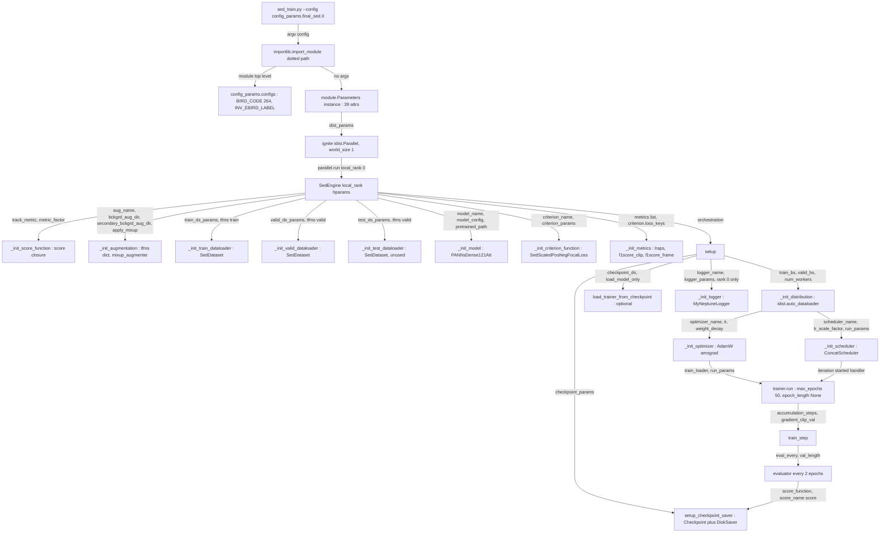

## Purpose

This module is the single source of truth for every knob in the SED training path. There is no CLI flag beyond `--config`: `sed_train.py` imports a Python module by dotted path, instantiates its `Parameters` class, and hands that one object to `SedEngine`, which then dispatches on ~39 attributes to build the augmentation pipeline, dataset, dataloader, model, criterion, optimizer, scheduler, metrics, logger and checkpoint saver. Because the mechanism is *arbitrary Python* rather than a serialised format, the same mechanism also encodes the **cross-validation strategy**: each fold is a separate config file whose only real difference is which `/folds*/fold_N_{train,test}.csv` it points at. The "13 model" ensemble in the README is nothing more than the union of these per-fold configs across two directories.

---

## Contracts

**Inputs** — one CLI argument, `--config <dotted.module.path>`, e.g. `config_params.example_config` (`sed_train.py:19-24`). No other input. There is no env-var or YAML/JSON/CLI override layer; `NEPTUNE_API_TOKEN` and `SLACK_URL` are read by the logger, not by the config.

**Outputs** — `hyperparams`: an instance of the config's `Parameters` class, carrying 39 attributes. Nothing is written back. Three attributes are *consumed twice* in different shapes: `logger_params` is `**`-splatted into `MyNeptuneLogger(**self.hparams.logger_params)` (`sed_engine.py:136`), `criterion_params`/`model_config` are `**`-splatted into the loss/model constructors (`sed_engine.py:96`, `:189`), and `run_params` is `**`-splatted into `trainer.run(...)` (`base_engine.py:218`).

**Called by** — `sed_train.py::main` (`sed_train.py:12-14`), which wraps the run in `ignite.distributed.Parallel(**hyperparams.dist_params)` and calls `parallel.run(run, hyperparams)`. With `dist_params = {}` this resolves to ignite 0.4.0's single-process branch: `func(local_rank, *args)` → `run(0, hyperparams)` → `SedEngine(0, hyperparams).train(config.run_params)` (`launcher.py:219-224`).

**Calls** — `engine.sed_engine.SedEngine` → `engine.base.base_engine.BaseEngine` → `augmentations.sed_default_augment` / `sed_background_augment` / `mixup`, `dataloaders.sed_dataset.SedDataset`, `models.sed_models.PANNsDense121Att`, `loss.sed_scaled_pos_neg_focal_loss[_augd]`, `metrics.sed_{lraps,f1score_clip,f1score_frame}`, `logger.neptune.neptune_logger.MyNeptuneLogger`, `ignite.handlers.Checkpoint` + `DiskSaver`.

---

## How it works

### 1. The config mechanism

```python
# sed_train.py:21-26
params = parser.parse_args()

module = importlib.import_module(params.config, package=None)
hyperparams = module.Parameters()

main(hyperparams)
```

1. `--config` is a **dotted module path relative to `src/`** (there is no `__init__.py` anywhere in the repo — `find . -name "__init__.py"` returns nothing — so imports work purely via `src/` being `sys.path[0]` because you run `python sed_train.py` from inside `src/`). This means `config_params.final_sed.final_sed_dense121_mix_fold0` works even though `final_sed/` is not a package.
2. `importlib.import_module` executes the module top level, which runs `from config_params.configs import get_dict_value, BIRD_CODE, INV_EBIRD_LABEL` — so importing any config transitively imports the 264-entry label dictionaries in `configs.py`.
3. `module.Parameters()` is called with **no arguments**. Every config defines `def __init__(self, hparams=None)`; the `hparams` parameter is dead in all 22 files — it is never passed and never read.

> [!warning] Not class attributes
> A `Parameters` class body contains **no** class-level attributes. Every value is an *instance* attribute assigned inside `__init__`. This matters because it means (a) the config is evaluated once per run at construction time, so `self.fold = 0` followed by `Path(f"/folds/fold_{self.fold}_train.csv")` inside the same `__init__` genuinely interpolates, and (b) f-string interpolation across attributes inside `__init__` is the entire "templating" mechanism — there is no inheritance, no `super()` chain, no `_base_config`.

The self-referential naming convention is the one bit of real cleverness:

```python
self.name = os.path.basename(__file__).replace(".py", "")   # every config, line 9
```

`self.name` is then reused for `checkpoint_params["save_dir"]`, `checkpoint_params["prefix_name"]`, and `logger_params["name"]`. **Renaming the file renames the model directory and the Neptune run.** That is why the `_2` suffixed files each write into their own `/saved_models/final_sed_dense121_mix_foldN_2/` directory rather than overwriting the base run.

### 2. Why arbitrary Python instead of YAML

There is no serialisation layer at all, and `logger_params["params"]` (a flat dict of scalars splatted into Neptune) is the *only* place where anything resembling "a config record" is produced. Nothing round-trips: you cannot dump a `Parameters` object and re-read it. The payoff is that every value is a live Python object:

- **`Path` objects** survive all the way into `pandas.read_csv(csv_dir)` (`sed_dataset.py:27`) and `soundfile.read(file_dir)` (`:76`).
- **`root_dir` is polymorphic.** `sed_dataset.py:66-69` branches on the *type*:

  ```python
  if type(self.root_dir) is dict:
      file_dir = self.root_dir[primary_label[0]]/f"{primary_label}"/f"{filename.replace('.mp3','.wav')}"
  else:
      file_dir = self.root_dir/f"{primary_label}"/f"{filename.replace('.mp3','.wav')}"
  ```

  `configs.get_dict_value(input_dir)` builds the dict case — a mapping from first letter of species code to one of the five Kaggle `birdsong-resampled-train-audio-0X` directories (`configs.py:21-28`). This is the shard lookup for the resampled-audio layout.

  > [!info] Correction on `train_bs`
  > The brief for this chapter anticipated `train_bs` being a dict of per-site batch sizes. **It is not, anywhere in this repo.** All 22 configs set `train_bs` to a plain `int`: `24` (nomix folds), `28` (5-fold + `example_config`), `32` (mix folds). `base_engine.py:65` passes it straight to `idist.auto_dataloader(batch_size=self.hparams.train_bs)`, which requires an int. The per-shard dict in this codebase is `root_dir`, not `train_bs`.

- **`run_params` is splatted** into `Engine.run`, whose signature is `run(data, max_epochs=None, epoch_length=None, ...)`. `run_params = {"max_epochs": 50, "epoch_length": None}` therefore *is* the trainer's argument list. Adding a key here that `Engine.run` does not accept raises `TypeError` immediately.
- **`fold` is deliberately polymorphic**: `int` 0-4 in fold configs, and the string `"all"` in `final_sed_dense121_nomix_1.py` / `_3.py`. It is only ever interpolated into a path and logged as a Neptune tag, so `"all"` is safe — but note `final_sed_dense121_mix_2.py` sets `fold = 0` while pointing at `/folds/all_data.csv`, so its Neptune tag says `fold=0` for a full-data run.

`get_dict_value` is imported in every config and **never called** in any of them. Dead import, kept for the `root_dir`-as-dict path that no committed config exercises.

### 3. Dispatch: one config attribute per `_init_*` factory

`BaseEngine.__init__` (`base_engine.py:35-50`) is a fixed-order constructor:

```
_init_score_function()      ← track_metric, metric_factor
_init_augmentation()        ← aug_name, bckgrd_aug_dir, secondary_bckgrd_aug_dir, apply_mixup
_init_train_dataloader()    ← train_ds_params, tfms["train"]
_init_valid_dataloader()    ← valid_ds_params, tfms["valid"]
_init_test_dataloader()     ← test_ds_params, tfms["valid"]
_init_model()               ← model_name, model_config, pretrained_path
_init_criterion_function()  ← criterion_name, criterion_params
_init_metrics()             ← metrics, criterion.loss_keys
setup()
  └─ _init_distribution()   ← train_bs, train_num_workers, valid_bs, valid_num_workers, dist_params
       └─ _init_optimizer() ← optimizer_name, lr, weight_decay
       └─ _init_scheduler() ← scheduler_name, lr, lr_scale_factor, run_params
  └─ load_trainer_from_checkpoint() ← checkpoint_dir, load_model_only
  └─ setup_checkpoint_saver()       ← checkpoint_params
  └─ _init_logger()                 ← logger_name, logger_params   [rank 0 only]
```

Every `_init_*` is an `if/elif` string dispatch on a config value, e.g. `_init_criterion_function` (`sed_engine.py:87-102`) supports five `criterion_name` values, and `_init_augmentation` (`:200-212`) supports exactly two `aug_name` values: `"default"` and `"secondary_default"`. A typo in a string is silent — the attribute is simply never set, and you get an `AttributeError` several lines later.

---

## Key decisions and tricks

### 4. Complete hyperparameter inventory

39 attributes. Values below are the union across all 22 config files; "all configs" means no exceptions.

#### 4.1 Front-end / feature extraction — `model_config`, splatted into `PANNsDense121Att.__init__`

| Key | Value | Meaning |
|---|---|---|
| `sample_rate` | `32000` | Resampled audio rate. Matches `SoundFile` requirement in README. |
| `window_size` | `1024` | `n_fft` **and** `win_length` of the `Spectrogram` (`sed_models.py:334-340`). 32 ms window. |
| `hop_size` | `320` | `hop_length`; 10 ms. **Sets the label frame rate.** |
| `mel_bins` | `64` | `n_mels`; also the channel count fed into `self.bn0 = nn.BatchNorm2d(mel_bins)`. |
| `fmin` | `50` | Mel filterbank low cut. |
| `fmax` | `14000` | Mel filterbank high cut (below Nyquist 16000). |
| `classes_num` | `264` | Output classes. Verified: `len(BIRD_CODE) == 264`, indices 0…263 contiguous. |
| `apply_aug` | `True` | Enables `SpecAugmentation(time_drop_width=64, time_stripes_num=2, freq_drop_width=8, freq_stripes_num=2)` and the spectrogram-level mixup, both gated on `self.training` (`sed_models.py:391-397`). |
| `top_db` | `None` — except `final_sed_dense121_nomix_3.py` = `80.0` | dB floor for `power_to_db` clamping (`sed_audio_utils.py:190-193`). `None` disables the clamp. Note `LogmelFilterBank`'s own default is `80.0`, so `nomix_3` is the config that matches librosa convention; every other config deliberately passes `None`. |

Concretely, with `PERIOD = 30`, `sr = 32000`, `hop = 320`:

- input waveform to model: `(B, S, 960000)` where `S = num_test_samples`
- after `logmel_extractor`: `(B*S, 3001, 64)` frames
- after densenet121 `.features` (÷32 in time): `(B*S, 1024, 93, M)` → mean over `M` → `(B*S, 1024, 93)`
- `framewise_output`: `(B, S, 3001, 264)` after `interpolate(·, 32)` then `pad_framewise_output` back to `frames_num`
- `clipwise_output`: `(B, S, 264)`

`interpolate_ratio = 32` is hard-coded at `sed_models.py:329` and is *not* configurable.

#### 4.2 Model and weights

| Attribute | Value(s) | Meaning |
|---|---|---|
| `model_name` | `"sed_dense121att"` (all configs) | Dispatch key. `sed_ccnn14att` / `dense161/169/201att` also exist in `_init_model` but are unused. |
| `pretrained_path` | `None` (all configs) | Only honoured for `sed_ccnn14att`, where `_init_model` strips `att_block` keys and loads `strict=False` (`sed_engine.py:180-186`). For `sed_dense121att` the ImageNet weights come from `models.densenet121(pretrained=True)` inside the model (`sed_models.py:367`) — `pretrained_path` is **inert** for every committed config. |
| `aug_name` | `"default"` (15 files) / `"secondary_default"` (5 files in `final_sed_5_fold` + `example_config`) | Which audiomentations pipeline. |
| `apply_mixup` | `True` / `False` | See §10. |

README's three stated model deltas are all confirmed in `sed_models.py`: DenseNet121 backbone (`:367`), `torch.tanh` replacing `clamp` in `AttBlock.forward` (`:159` `torch.softmax(torch.tanh(self.att(x)), dim=-1)`), and `AttBlock(1024, classes_num)` (`:364`).

The two augmentation pipelines differ materially:

| | `aug_name="default"` (`sed_default_augment.py:22-32`) | `aug_name="secondary_default"` (`sed_background_augment.py:22-41`) |
|---|---|---|
| list | `AddGaussianNoise(0.001–0.015, p=0.3)`, `AddGaussianSNR(p=0.3)`, `AddBackgroundNoise(dir, p=0.5)` | `AddGaussianNoise(p=0.2)`, `AddGaussianSNR(p=0.2)`, `Gain(±15 dB, p=0.3)`, `AddBackgroundNoise(dir, p=0.2)`, `AddShortNoises(secondary_dir, min_gap=0, max_gap=15 s, burst_p=0.5, p=0.6)`, then `AddGaussianNoise(p=0.2)`, `AddGaussianSNR(p=0.2)`, `Gain(±15 dB, p=0.3)` **again** |
| needs `secondary_bckgrd_aug_dir` | no | yes |
| validation transform | identity (`get_validation_augmentation`) | identity |

`secondary_default` doubles the noise/gain block and is the only pipeline that exercises the README's `AddShortNoises` and `Gain` bullets. It is used exclusively by the 5-fold family. In every `"default"` config the first `AddGaussianNoise` line is commented out upstream and the amplitudes default — irrelevant here, but it means `bckgrd_aug_dir` and `secondary_bckgrd_aug_dir` being the *same* `/pinknoise` path in `final_sed_5_fold` means `AddBackgroundNoise` and `AddShortNoises` draw from the same 1-minute pink-noise pool.

#### 4.3 Datasets — `train_ds_params`, `valid_ds_params`, `test_ds_params`

Splatted verbatim into `SedDataset(**params, transform=...)` (`sed_engine.py:216/220/224`). Its signature is `(root_dir, csv_dir, period, bird_code, inv_ebird_label, isTraining, num_test_samples, transform=None, background_audio_dir=None)`.

| Key | train | valid / test | Meaning |
|---|---|---|---|
| `root_dir` | `Path("/data/")` | `Path("/data/")` | Audio root. README: "store the training data in `/data`". `example_config` uses relative `Path("data/")`. |
| `csv_dir` | `Path(f"/folds/fold_{fold}_train.csv")` (or `/folds5/`, or `/folds/all_data.csv`) | `Path(f"/folds/fold_{fold}_test.csv")` | **Despite the name this is a single CSV file, not a directory.** Read directly by `pd.read_csv(csv_dir)`. |
| `period` | `30` | `30` | Window length in seconds. `example_config`: `30` via `self.PERIOD`. |
| `bird_code` | `BIRD_CODE` | same | The 264-entry `{code: int}` dict, shared object reference from `configs.py`. |
| `inv_ebird_label` | `INV_EBIRD_LABEL` | same | `{long_name: code}`, used to decode `secondary_labels` (`sed_dataset.py:63-64`). |
| `isTraining` | `True` | `False` | Switches random-crop vs tiled-crop in `__getitem__`. |
| `num_test_samples` | `1` | `2` | Number of `period`-length crops per file. Train: `S=1`. Eval: `S=2` → `(B, 2, 960000)`. |
| `background_audio_dir` | **absent** (→ `None`) | `Path("/background/data_ssw")` | Optional. When set, `SedDataset.__init__` globs `**/*.wav` and appends each as a bare `{"filename": Path}` dict, i.e. **label-free negatives mixed into the validation set** (`sed_dataset.py:33-42`). README: "data provided in the discuss here, with 5-30 second clips extracted where no bird call was found". Explicitly optional per README. |

`PERIOD = 30` is a top-level attribute used only to fill the three `period` keys and the Neptune `params` dict; it is not read anywhere else.

The eval-time crop rule is worth stating precisely because it drives the shape contract:

```python
# sed_dataset.py:116-125
if item["duration"] < effective_length * self.num_test_samples:
    new_y = np.zeros(effective_length * self.num_test_samples, dtype=y.dtype)
    new_y[0:item["duration"]] = y          # zero-PAD, not random placement
    ...
for i in range(self.num_test_samples):
    y_snippet = y[effective_length*i : effective_length*i + effective_length]
```

Eval is deterministic and left-aligned; short files are right-padded with zeros to `60 s`. Train (`:104-115`) instead takes `num_test_samples` random crops, zero-inserting into a random offset when the file is shorter than 30 s.

#### 4.4 Dataloader

| Attribute | Values | Meaning |
|---|---|---|
| `train_bs` | `24` nomix / `28` 5-fold / `32` mix | `batch_size` for `idist.auto_dataloader`, `drop_last=True` (`base_engine.py:65`). |
| `train_num_workers` | `8` (all configs) | |
| `valid_bs` | `32` (all configs) | `drop_last=False`; reused as `test_bs` (`base_engine.py:75`). |
| `valid_num_workers` | `4` (all configs) | |
| `dist_params` | `{}` (all configs) | Empty → `Parallel()` with no backend → `world_size == 1`, `local_rank == 0`, `manual_seed(42 + 0)`. Single-GPU only. |

Worker seeding is `int.from_bytes(os.urandom(4))` per worker (`sed_dataset.py:51-53`) — non-deterministic augmentation by design.

**The sampler is hard-wired, not configurable.** `SedDataset.__init__` sets `self.sampler = ImbalancedDatasetSampler` (the *class*, not an instance, line 25), and `base_engine.py:57-63` does:

```python
if self.train_ds.sampler is not None:
    sampler = self.train_ds.sampler(self.train_ds, self.train_ds.get_label)
    isShuffle = False
```

So class-balance-aware sampling is always on for train, and `shuffle` is always `False` there (sampling order is decided by the sampler). Validation and test loaders get `shuffle=False` and no sampler.

#### 4.5 Loss

| Attribute | Values | Meaning |
|---|---|---|
| `criterion_name` | `"sed_scaled_pos_neg_focal_loss"` (all but the two `_augd` files) / `"sed_scaled_pos_neg_focal_loss_augd"` (`nomix_fold2_augd`, `nomix_fold3_augd`) | |
| `criterion_params.gamma` | `0.0` | Focal exponent. **At `gamma = 0`, `(1 - pt)**0 == 1` and the focal modulation vanishes entirely** — this is plain scaled BCE with per-class masks. |
| `criterion_params.alpha_0` | `1.0` | Negative-class scale (`F_loss_0`). |
| `criterion_params.alpha_1` | `1.0` | Positive-class scale (`F_loss_1`). |
| `criterion_params.secondary_factor` | `1.0` | Down-weight for labels present *only* as secondary. Library default is `0.1` (`loss/sed_scaled_pos_neg_focal_loss.py:8`); **every config overrides it to `1.0`, i.e. secondary labels are weighted exactly as heavily as primary ones.** |
| `criterion_params.primary_drop_out_factor` | `0.3` — **only** in the two `_augd` files | Randomly zeroes the primary-label mask with p=0.3 each step (`sed_scaled_pos_neg_focal_loss_augd.py:37-38`). A stochastic primary-label dropout regulariser. |

Only `clipwise_output` is fed to the loss (`sed_engine.py:72`). The loss dict keys are `["bce_loss", "F_loss", "FScaled_loss", "F_loss_0", "F_loss_1"]` in both variants; each becomes a `RunningAverage` on train and eval (`sed_engine.py:151-156`), i.e. 10 extra logged scalars.

#### 4.6 Optimizer and scheduler

| Attribute | Values | Meaning |
|---|---|---|
| `optimizer_name` | `"adamw"` (all) | `torch.optim.AdamW(params, lr, betas=(0.9, 0.999), eps=1e-8, weight_decay=..., amsgrad=True)` (`sed_engine.py:85`). **`betas`, `eps`, `amsgrad` are hard-coded and not configurable.** |
| `lr` | `0.001` (all base configs) / `0.0005` (the four `mix_foldN_2.py`) | Peak LR. |
| `weight_decay` | `0.01` (default) — but see the diff table in §9 | Decoupled weight decay. |
| `scheduler_name` | `"warmup_with_cosine"` (all) | |
| `lr_scale_factor` | `0.01` | Multiplier for both the warmup start and the cosine end: `lr*0.01 = 1e-5`. |
| `run_params.max_epochs` | `50` | |
| `run_params.epoch_length` | `None` | Falls back to `len(self.train_loader)` (`sed_engine.py:110-113`). Set it to an int and the scheduler schedule is computed from that instead of the real loader length — a deliberate hook for length-mismatched debug runs. |

The schedule is a two-phase `ConcatScheduler` (`sed_engine.py:107-118`):

```
LinearCyclicalScheduler(lr, start=lr*0.01, end=lr, cycle_size=2*epoch_length)   # durations=[epoch_length]
CosineAnnealingScheduler(lr, start=lr,      end=lr*0.01, cycle_size=50*epoch_length)
```

The warmup phase is capped at one epoch by `durations=[epoch_length]`, so only the *rising half* of the cyclical schedule is ever used — a linear warmup over epoch 0, then cosine decay over the remaining 49. The cosine `cycle_size` is `50*epoch_length`, not `49*epoch_length`, so the anneal finishes slightly short of `lr*0.01` at epoch 50.

#### 4.7 Training loop

| Attribute | Values | Meaning |
|---|---|---|
| `accumulation_steps` | `1` (all) | `train_step` steps the optimizer when `engine.state.iteration % accumulation_steps == 0` (`base_engine.py:245-248`). |
| `gradient_clip_val` | `0` (all) | `clip_gradients` early-returns when `<= 0` (`base_engine.py:329-330`). **Clipping is fully disabled in every committed config.** |
| `max_epochs` | `50` (in `run_params`) | |
| `eval_every` | `2` (all fold configs) / `10` (`mix_2`, `nomix_1`, `nomix_3`) | `Events.EPOCH_COMPLETED(every=eval_every)` on the trainer (`base_engine.py:182`). 25 validation passes over 50 epochs in the fold configs. |
| `epoch_length` | `None` (in `run_params`) | |
| `val_length` | `None` (all) | `epoch_length` for `evaluator.run` → full validation loader (`base_engine.py:227`). |
| `add_pbar` | `True` (all) | `with_pbars` for common handlers + `ProgressBar` on evaluator and tester. |

#### 4.8 Metrics

| Attribute | Values | Meaning |
|---|---|---|
| `metrics` | `["lraps", "f1score_clip", "f1score_frame"]` (all configs, unchanged) | All three are **computed** every validation pass; this list is a whitelist of what to compute, not of what to optimise. |
| `track_metric` | `"f1score_clip"` (18 files) / `"f1score_frame"` (4 files: `final_sed_5_fold` folds 1-4) / `"lraps"` (`mix_2`, `nomix_1`) | Which of the three drives checkpoint selection. |
| `metric_factor` | `1` (all) | Scale applied to the tracked metric before ranking. |
| *(implicit)* `hparams.save_dir`, `hparams.combine_files` | **absent from every config** | Only read by the `"test"` branch of `_init_metrics` (`sed_engine.py:174`). Adding `"test"` to `metrics` without also defining these two attributes raises `AttributeError`. |

Metric definitions (all `threshold=0.5` unless noted, `sed_engine.py:160-170`):

- `SedLRAPS` — `label_ranking_average_precision_score` over `clipwise_output.max(axis=1)[0]` (max over the `S` snippet axis) vs `all_labels[:,0,:]`.
- `SedF1ScoreClip` — micro-F1 of `clipwise_output.max(axis=1)[0] >= 0.5`. Zero-target items are scored specially: prediction fires → F1 0, prediction silent → F1 1.
- `SedF1ScoreFrame` — micro-F1 of the **conjunction** `(framewise.max(axis=1)[0].max(axis=1)[0] >= 0.5) & (clipwise.max(axis=1)[0] >= 0.3)`. The `0.3` clip gate is hard-coded inside the metric (`sed_f1score_frame.py:33,38`) and is unrelated to `metric_factor`.

`train_metrics` / `validation_metrics` / `test_metrics` are separate ignite metric dicts, attached to their respective engines (`base_engine.py:130-132`, `:147`, `:206`, `:232`).

#### 4.9 Checkpointing

| Attribute | Values | Meaning |
|---|---|---|
| `checkpoint_params.save_dir` | `f"/saved_models/{self.name}"` (all) | `DiskSaver` dirname, `require_empty=False`. |
| `checkpoint_params.n_saved` | `5` (`final_sed`) / `10` (`final_sed_5_fold`, `example_config`) | Rolling best-N retention. |
| `checkpoint_params.prefix_name` | `= self.name` | |
| `checkpoint_dir` | `None` (base) / a `.pt` path (see §8) | Warm-start. `load_trainer_from_checkpoint` is a no-op when `None`. |
| `load_model_only` | `True` (fold configs) / `False` (all-data configs) | `True` → `to_load = {"model": self.model}` only. `False` → also restores `trainer`, `optimizer`, `scheduler` state. |

The saved filename format is `{prefix}_checkpoint_{epoch}_score={score:.4f}.pt` (ignite `Checkpoint` + `score_name="score"` + `global_step_from_engine(self.trainer)`), which is directly observable in the `checkpoint_dir` strings committed in the `_2` configs:

```
/saved_models/final_sed_dense121_mix_fold0/final_sed_dense121_mix_fold0_checkpoint_50_score=0.6328.pt
```

Epoch `50` = `global_step_from_engine(trainer)` on `EPOCH_COMPLETED`, `0.6328` = the `{:.4f}`-formatted `score_function` output = `metric_factor * metrics["f1score_clip"]`. Saved objects: `model`, `trainer`, `optimizer`, `scheduler` (`base_engine.py:197-205`). Saving is triggered on the **evaluator's** `Events.COMPLETED` (`base_engine.py:128`), so only validation-touching checkpoints exist.

#### 4.10 Logging

| Attribute | Value | Meaning |
|---|---|---|
| `logger_name` | `"neptune"` (all configs) | `"print"` is the alternative (`sed_engine.py:130-138`); any other string silently yields `self.logger = None`. |
| `logger_params.project_name` | `"bird-song"` — **except `example_config.py` = `"NEPTUNE_PROJECT_NAME"`** | README: change to your own project. |
| `logger_params.log_every` | `10` | `BaseLogger.log_every` → iteration handler cadence. |
| `logger_params.name` | `= self.name` | Neptune run name. |
| `logger_params.prefix_name` | `f"{self.name}_best"` | **Unused** — `MyNeptuneLogger.__init__` only reads `project_name`, `name`, `params`, `tags`, `log_every`. |
| `logger_params.tags` | `[self.fold, self.name, self.model_name, self.criterion_name]` | |
| `logger_params.params` | 14 scalars + `**model_config` + `**criterion_params` | The only "serialisable config record" in the system. Two configs' extras leak in: `primary_drop_out_factor` on the `_augd` files, `top_db` everywhere. |

`logger_name = "neptune"` requires `NEPTUNE_API_TOKEN` at construction time (`neptune_logger.py:16`) — an unset token makes `import` succeed but constructor raise. `_init_logger` runs **after** checkpoint setup and only on `rank == 0` (`base_engine.py:209-214`).

---

---

### 5. Cross-validation strategy

> [!warning] The split artifacts are not in this repository
> There is **no** code anywhere in `src/` that creates the fold CSVs — no `sklearn.model_selection`, no `StratifiedKFold`, no `groupby` on `ebird_code` outside the unrelated `audio_dataset_v2/3/4.py` class-balancing code. `find . -name "*.csv"` returns nothing. The folds, `all_data.csv`, and `/folds5/*` are **data artifacts**, produced offline, and are a hard reproduction gap. Every statement below about stratification is inference from downstream evidence.

### 6. The split unit is a CSV pair, one per fold

The unit of cross-validation is **a pair of CSV files on disk**, not an index range. Each config hard-codes two paths built from `self.fold`:

```python
"train_ds_params": {..., "csv_dir": Path(f"/folds/fold_{self.fold}_train.csv")},
"valid_ds_params": {..., "csv_dir": Path(f"/folds/fold_{self.fold}_test.csv")},
"test_ds_params":  {..., "csv_dir": Path(f"/folds/fold_{self.fold}_test.csv")},
```

Consequences:

- **The CSVs are relative to nothing.** `Path("/folds/fold_0_train.csv")` is an absolute path. README's setup instructions list `/data` and `/pinknoise` but conspicuously *not* `/folds` or `/folds5` — those are the missing artifacts.
- **`valid_ds_params` and `test_ds_params` are byte-identical** in every config (same `csv_dir`, same `background_audio_dir`, `num_test_samples=2`, `isTraining=False`). The `test_ds_params` block is therefore functionally dead for the 22 SED configs: nothing in `sed_train.py` calls `engine.evaluate(...)`, and `_init_test_dataloader` builds a loader that is never iterated. It exists so that a downstream inference script can re-use the config verbatim.
- **`/folds` (4-fold) and `/folds5` (5-fold) are two independent split families**, in two directories, generated by two separate offline runs. They are not nested.

### 7. Stratification is by primary species only — inferred

`ImbalancedDatasetSampler` is the only class-label-aware code in the SED data path, and its label accessor returns a single scalar:

```python
# sed_dataset.py:45-46
def get_label(self, dataset, idx):
    return dataset.data[idx]["ebird_code"]
```

`ebird_code` is the **primary** label column. `secondary_labels` (a separate column, `eval`-ed from a stringified list at `sed_dataset.py:28`) is never consulted by the sampler. So any label-based operation *inside this repo* keys on primary species only.

> [!info] Why this matters for stratification
> A recording with primary `amecro` and secondary `amegfi` counts as one `amecro` example. If the offline splitter had stratified on the union of primary + secondary, the per-class counts driving a stratified split would not match the counts the sampler computes, and class balance during training would drift. The fact that both the sampler and (presumably) the splitter key on primary only is consistent with — though not proof of — primary-only stratification.
>
> It is also a deliberate choice rather than an oversight: `secondary_factor = 1.0` in every config means secondary labels are trained with full weight even though they were never used to balance the split.

What cannot be determined: whether the split was stratified at all, whether it was grouped by `recording_id` (no `recording_id` column survives into the dataset — `sed_dataset.py:29` keeps only `filename`, `ebird_code`, `secondary_labels`), or whether any site/time stratification was applied. *No code in this repo answers this.*

The one hard structural fact recoverable from the code: the two dataset classes used for CV (`folds/`, `folds5/`) each contain every one of the 264 species, since `BIRD_CODE`/`INV_EBIRD_LABEL` are passed whole and `classes_num = 264` is fixed for every model. A fold that dropped a species entirely would produce a class with no positives in validation, which the F1 metrics handle gracefully (the `t.sum() == 0.0` branches score such items 1 if the model stays silent). So even that is not verifiable from here.

### 8. The 13-model ensemble: reconciling 15 config files with 13 models

README claims three model families and 13 total:

> - 4 fold models (without mixup)
> - 5 fold models (without mixup)
> - 4 fold models (with mixup)

`src/config_params/final_sed/` contains **15** files, `final_sed_5_fold/` contains **5**. 15 + 5 = 20, not 13. Reconciliation:

| Files | Count | In the 13? |
|---|---|---|
| `final_sed_dense121_nomix_fold0.py`, `_fold1.py`, `_fold2_augd.py`, `_fold3_augd.py` | 4 | ✅ the 4-fold no-mixup family |
| `final_sed_5_fold/final_5fold_sed_dense121_nomix_fold{0..4}.py` | 5 | ✅ the 5-fold no-mixup family |
| `final_sed_dense121_mix_fold{0,1,2,3}.py` | 4 | ✅ the 4-fold mixup family |
| `final_sed_dense121_mix_fold{0,1,2,3}_2.py` | 4 | ❌ **second-stage fine-tunes of the four mixup models**, not additional members |
| `final_sed_dense121_nomix_1.py`, `_nomix_3.py`, `_mix_2.py` | 3 | ❌ **full-data retrains** on `/folds/all_data.csv` |

4 + 5 + 4 = **13**. ✅

**The `_2` files are fine-tune stage 2, not seed reruns.** The evidence is unambiguous and does not require inference:

```diff
  self.lr = 0.001                        →  self.lr = 0.0005
  self.checkpoint_dir = None             →  self.checkpoint_dir = "/saved_models/final_sed_dense121_mix_fold{N}/...checkpoint_50_score=0.63XX.pt"
```

Both halves of the diff are mechanically explained: they halve the LR and warm-start from the **epoch-50** checkpoint of the corresponding base run — i.e. continue training the finished fold model at lower LR. `load_model_only = True` in all four, so optimizer/scheduler state is *not* restored: the LR schedule restarts from scratch around the new, halved peak. The embedded scores differ per fold (`0.6328 / 0.6134 / 0.6305 / 0.6370` for folds 0-3), which is exactly what you'd expect from four independent stage-1 runs.

> [!tip] There is no seed attribute
> No config has a `seed` field. `manual_seed(42 + rank)` is hard-coded in `_init_distribution` (`base_engine.py:54`), so **every run in this repo starts from the identical seed** — with `dist_params = {}`, always `manual_seed(42)`. Worker seeding is `os.urandom`-derived. So "different seed" is not even expressible in this mechanism; a second run of the same config would differ only through non-deterministic worker init and cuDNN benchmarking (`torch.backends.cudnn.benchmark = True`, `sed_train.py:6`).

Which of `mix_foldN` vs `mix_foldN_2` contributed the actual ensemble member is **not determinable** — presumably the `_2` checkpoint, since it is the more-trained one, but the repo does not say, and the ensemble/voting code that consumed these checkpoints is not in this repo at all (only the per-model `SedTest` metric writes anything).

**The three all-data configs** all use `csv_dir = /folds/all_data.csv` for train, valid *and* test — i.e. they train and "validate" on the same rows. Their validation metrics are therefore meaningless as generalisation estimates, and that shows up in the artifacts: `nomix_1`'s `checkpoint_dir` filename reads `score=0.9117`, an LRAPS value on data the model has memorised. These are submission models, not CV members. They are also the only configs with `eval_every = 10` and `load_model_only = False` (full optimizer-state resume — `nomix_1` explicitly resumes *its own* epoch-30 checkpoint, i.e. it is a third training stage).

### 9. What changes per fold, what does not

Diffing the fold configs directly (all diffs are exhaustive — anything not listed is byte-identical):

**`final_sed_dense121_mix_fold{0,1,2,3}.py` — the cleanest family. 3 keys vary:**

| Key | fold 0 | fold 1 | fold 2 | fold 3 |
|---|---|---|---|---|
| `self.fold` | `0` | `1` | `2` | `3` |
| `train_ds_params.csv_dir` | `/folds/fold_0_train.csv` | `…1_…` | `…2_…` | `…3_…` |
| `valid_ds_params.csv_dir` / `test_ds_params.csv_dir` | `/folds/fold_0_test.csv` | `…1_…` | `…2_…` | `…3_…` |
| `checkpoint_params.save_dir` | `/saved_models/final_sed_dense121_mix_fold0` | `…fold1` | `…fold2` | `…fold3` |

Everything else is identical across all four, including `weight_decay = 0.01`, `train_bs = 32`, `aug_name = "default"`, `apply_mixup = True`, `lr = 0.001`, `track_metric = "f1score_clip"`.

**`final_sed_5_fold/final_5fold_sed_dense121_nomix_fold{0..4}.py` — 4 keys vary:**

| Key | fold 0 | fold 1 | fold 2 | fold 3 | fold 4 |
|---|---|---|---|---|---|
| `self.fold` | `0` | `1` | `2` | `3` | `4` |
| `csv_dir` prefix | `/folds5/` | `/folds5/` | `/folds5/` | `/folds5/` | `/folds5/` |
| `checkpoint_params.save_dir` | `…nomix_fold0` | `…fold1` | `…fold2` | `…fold3` | `…fold4` |
| **`track_metric`** | **`"f1score_clip"`** | **`"f1score_frame"`** | `"f1score_frame"` | `"f1score_frame"` | `"f1score_frame"` |

> [!warning] Two real inconsistencies in the CV families
> 1. **`track_metric` is not constant within the 5-fold family.** Fold 0 selects checkpoints on `f1score_clip`; folds 1-4 select on `f1score_frame`. `f1score_frame` is the *stricter* metric — it requires both a frame-level hit and a clip-level `>= 0.3` — so folds 1-4 optimise a different objective from fold 0. This may be deliberate (fold 0's run may predate the metric, or `frame` was found better and fold 0 was never re-run), but it is undocumented.
> 2. **The 4-fold no-mixup family is not homogeneous.** `final_sed_dense121_nomix_fold0.py` uses `weight_decay = 0.0001`, `_fold1.py` uses `0.01`, and `_fold2_augd.py` / `_fold3_augd.py` use `0.001` **plus** a different loss (`sed_scaled_pos_neg_focal_loss_augd` with `primary_drop_out_factor = 0.3`). Four different configurations across "4 fold models without mixup". Given `AdamW` applies weight decay per step, a 100× spread in `weight_decay` between fold 0 and fold 1 is a large effective difference.
>
> The *sibling* `final_sed_dense121_mix_fold*` family is homogeneous by contrast — this makes the mixing of configs inside the nomix family look deliberate (per-fold tuning) rather than accidental, but that is *inferred — reason: no code comment or README line explains it.*

### 10. Mixup vs no-mixup — exact values

| | `aug_name` | `apply_mixup` | `Mixup(mixup_alpha=…)` | Effective batch |
|---|---|---|---|---|
| 4-fold nomix (`nomix_fold*`, 4 files) | `"default"` | `False` | `self.mixup_augmenter = None` | `train_bs = 24` |
| 5-fold nomix (`final_5fold_*`, 5 files) | `"secondary_default"` | `False` | `None` | `train_bs = 28` |
| 4-fold mix (`mix_fold*`, 4 files) | `"default"` | `True` | `Mixup(mixup_alpha=1.)` | `train_bs = 32` |
| All-data nomix (`nomix_1`, `nomix_3`) | `"default"` | `False` | `None` | `train_bs = 24` |
| All-data mix (`mix_2`) | `"default"` | `True` | `Mixup(mixup_alpha=1.)` | `train_bs = 32` |

`mixup_alpha` is hard-coded to `1.` in `_init_augmentation` (`sed_engine.py:210`) — **not** configurable. `Mixup.random_state` is a fixed `np.random.RandomState(1234)` (`mixup.py:29`), so the λ sequence is deterministic given the batch size.

Mixup halves the batch dimension in two places that must agree: `prepare_batch` mixes labels `((B*S)//2, 1, 264)` (`sed_engine.py:26-30`) and `forward` sets `b = (b*c)//2; c = 1` (`sed_models.py:407-409`). With `num_test_samples = 1` on train, `bs*c == bs == 32`, so 32 spectrograms are mixed pairwise into 16. Mixing is applied to the **log-mel spectrogram**, not the waveform (`sed_models.py:392-397`), and only when `self.training and self.apply_aug`.

Note the cross-family correlation: `apply_mixup = True` co-occurs exactly with `train_bs = 32` and `weight_decay = 0.01`; `apply_mixup = False` co-occurs with `train_bs ∈ {24, 28}`. Mixup runs get a larger nominal batch *and* the mixup that halves it to 16, so the mixup family sees 16 effective samples per step against the 5-fold family's 28. Not obviously a confound, but it means "mixup vs nomix" is not a clean single-variable comparison across families.

### 11. `final_5sec_sed_5_fold` — named in the directory listing, absent from the repo

`directory_structure.txt` (committed in `b019cce`) lists four `config_params` subdirectories:

```
./src/config_params/old
./src/config_params/final_sed_5_fold
./src/config_params/final
./src/config_params/final_sed
./src/config_params/final_5sec_sed_5_fold
```

> [!warning] Three of these five directories do not exist
> `ls src/config_params/` returns only `configs.py`, `example_config.py`, `final_sed/`, `final_sed_5_fold/`. `git ls-tree -r HEAD` confirms only the 22 tracked files. Checking every commit in the repo's 22-commit history (`ba6b639`…`4ad1aa4`), the count of `config_params` paths per commit goes `0 → 1 → 2 → 22` and never shows `old/`, `final/`, or `final_5sec_sed_5_fold/`. **They were never committed.** `directory_structure.txt` is therefore an aspirational/stale manifest, not a description of the shipped tree.

- **`config_params/old/`** — the pre-final research configs. Nothing in `src/` imports from it; no engine reads it. Content unknown and unrecoverable from this repo. Presumably the earlier CNN14-based (`sed_ccnn14att`) and classifier-based experiments, since `_init_model` still carries branches for `sed_ccnn14att` and `sed_dense161/169/201att` that no committed config selects.
- **`config_params/final/`** — the pre-SED final configs, matching `train.py` / `engine/main_engine.py` and the `audio_dataset*.py` family. Those engines are fully present in `src/` and have their own `_init_*` methods, so this directory held real, working (and now unrunnable) experiments.
- **`config_params/final_5sec_sed_5_fold/`** — a 5-second-granularity variant of the 5-fold family. Its contents cannot be read. What "5sec" would mean mechanically is fully determined by `SedDataset`, though:

  `period` is the only knob. `period = 5` with `num_test_samples` unchanged at `2` would give 10 s of coverage per file (a 60× increase in effective temporal resolution vs `period = 30`), which would silently mismatch train-time and eval-time context lengths. To hold the 60 s eval window constant at 5 s granularity, `num_test_samples` must go to `12`. *(inferred — reason: `sed_dataset.py:117-125` computes coverage as exactly `period * num_test_samples`, and `period = 30 / num_test_samples = 2` is the committed 60 s setting.)* Whether the author did that, or genuinely halved the context window, is not recoverable.

  Context for why this matters: the competition's sites 1 and 2 are labelled in 5 s increments and site 3 only at file level (README, quoted from the task description), and the winning ensemble thresholds at 0.3/0.3 (README). `period = 30` training with `num_test_samples = 2` produces clip-level and frame-level outputs over 60 s that the downstream voting code slices to the required resolution.

### 12. Abandoned vs live paths

| Path | Status |
|---|---|
| `sed_train.py` + `SedEngine` + `BaseEngine` + `final_sed/` + `final_sed_5_fold/` | **live** — the 1st-place solution |
| `example_config.py` | **live** — the documented starting point (`python sed_train.py --config "config_params.example_config"`), closest in shape to the 5-fold family (`secondary_default`, `secondary_bckgrd_aug_dir`, `train_bs = 28`) but with relative paths and a placeholder Neptune project |
| `train.py`, `train_v2.py`, `train_v3.py`, `train_v4.py` + `engine/main_engine*.py` + `dataloaders/audio_dataset*.py` + most of `loss/` + `augmentations/default_augment.py` | **dead** — earlier classification experiments. `main_engine_v3/v4` have per-site mixing loops (`for i, y_pred_i in enumerate(...)`, `betas[i]`) that have no counterpart in the SED path. Their config directory (`config_params/final/`) was never committed, so none of them can be run as-is. |
| `augmentations/noise_maker.py` | **dead** — pink noise is generated by the linked Kaggle kernel, not by this repo (README). |
| `loss/*` other than `sed_scaled_pos_neg_focal_loss{,_augd}` | **dead** — 13 other loss modules, no config selects them. |
| `configs.py::AUDIO_CONFIG` | **dead** — `sampling_rate=32000, n_mels=128, n_fft=2560, fmin=500, fmax=15000, hop_length=251` ("making it 128 in size"). Contradicts every SED config (`mel_bins=64`, `window_size=1024`, `fmin=50`, `fmax=14000`, `hop_size=320`). It belongs to the classifier-era experiments and is imported by nothing. |
| `models/{aux_densenet121,densnet161,classifier_dcase,classifier_m_series}.py` | **dead** — `sed_models.py` uses `torchvision.models.densenet121` directly. |
| `metrics/custom_*.py` | **dead** — superseded by `sed_*.py`. |
| `get_dict_value` | **dead import** — the `root_dir`-as-dict path exists in `SedDataset` but no committed config uses it. |
| `Parameters(hparams=…)` argument | **dead** — never passed, never read. |
| `logger_params.prefix_name` | **dead** — `MyNeptuneLogger` ignores it. |
| `pretrained_path` | **inert for `sed_dense121att`** — only the `sed_ccnn14att` branch reads it. |
| `lr_finder()` (`base_engine.py:353-375`) | **dead** — never called; `lr = 0.001` was set by hand. |
| Mixed precision (`USE_AMP`) | **forced off** — `base_engine.py:6-13` imports apex then unconditionally sets `USE_AMP = False` with the comment "NOT USING APEX BECAUSE CANNOT CREATE MEL SPEC, REQUIRES TUNING, PROBLEMS HAVE OCCURRED". README corroborates: "will output NaN values". |
| `Slack notifications` | **optional** — `os.environ["SLACK_URL"]` in a `try/except` in `logger/{neptune,print}/*_utils.py`. |

---

## Failure modes and gotchas

1. **Config paths are absolute and hard-coded.** Every `final_sed`/`final_sed_5_fold` config assumes `/data`, `/pinknoise`, `/background/data_ssw`, `/saved_models`, `/folds`, `/folds5`. README documents the first two. The last two — **`/folds` and `/folds5`, the CV artifacts themselves — are not mentioned anywhere in the README.** Reproducing the split is impossible from this repo.

2. **You must run from `src/`.** `python sed_train.py --config config_params.example_config` — with no `__init__.py` in `config_params/`, the dotted import only resolves because `src/` is `sys.path[0]`. From the repo root: `python src/sed_train.py --config config_params.example_config` fails on `from engine.sed_engine import SedEngine`.

3. **`checkpoint_dir` in the `_2` configs points into another config's output directory.** `mix_fold0_2` reads `/saved_models/final_sed_dense121_mix_fold0/…` while writing to `/saved_models/final_sed_dense121_mix_fold0_2/`. Running the `_2` configs before their base runs raises `FileNotFoundError` from `torch.load`. **Order matters: base first, then `_2`.**

4. **`DiskSaver(..., require_empty=False)`** (`base_engine.py:124`) means a stale `save_dir` is silently reused, and `n_saved = 5` will happily delete older checkpoints from a previous run of the same config.

5. **`load_model_only = True` + non-`None` `checkpoint_dir` silently discards optimizer and scheduler state.** The LR schedule restarts from `lr*0.01` → `lr` → cosine. This is exactly what the `_2` configs intend, but it means a 50-epoch `_2` run is 50 *additional* epochs, not 50 total.

6. **Missing CSV columns fail at construction, not at `__getitem__`.** `sed_dataset.py:28-29` requires `filename`, `ebird_code`, `secondary_labels`, and `secondary_labels` must be a stringified Python list (`apply(eval)`). A fold CSV with a missing column or a bare `"amegfi"` instead of `"['amegfi']"` raises immediately.

7. **`background_audio_dir` on the training set would crash the sampler.** Background entries are appended as `{"filename": Path}` with **no `ebird_code` key** (`sed_dataset.py:36-38`), and `get_label` does `dataset.data[idx]["ebird_code"]` unconditionally → `KeyError`. This is safe today only because `train_ds_params` never sets `background_audio_dir`. If you add it to train, you must also guard `get_label`.

8. **`gradient_clip_val = 0` means no clipping, not "clip at 0".** `clip_gradients` returns immediately. Given `gamma = 0` (no focal down-weighting) and `alpha_0 = alpha_1 = 1.0`, there is no loss-based gradient damping anywhere in the final recipe.

9. **String dispatch is silent on typos.** `_init_augmentation` with `aug_name = "defualt"` leaves `self.tfms` unset from `BaseEngine._init_augmentation` (`base_engine.py:315-316`), and the failure surfaces later as `TypeError: 'NoneType' object is not subscriptable` at `sed_engine.py:216`.

10. **Multi-GPU is broken and unconfigured.** `dist_params = {}` in all 22 configs → `world_size == 1`, so `idist.auto_dataloader` is a pass-through. If you *did* set a backend, `base_engine.py:150-154` calls `self.train_loader.sampler.set_epoch(...)`, and `ImbalancedDatasetSampler` defines no `set_epoch` → `AttributeError`. Also `parallel.run(run, hyperparams)` passes `hyperparams` positionally after `local_rank` (`launcher.py:223`), which is fine, but `_init_optimizer` builds a plain `AdamW` over `self.model.parameters()` before `idist.auto_model` wraps it, so DDP parameter flattening is not handled.

11. **`track_metric` must name a metric that is in `metrics`.** `_init_score_function` runs *first* (`base_engine.py:39`), before `_init_metrics`; if `track_metric` is absent from `metrics`, the failure appears only when the `Checkpoint` handler fires at the first validation epoch — many minutes in.

12. **`add_pbar = False` silently drops `ProgressBar` from the evaluator** but still passes `with_pbars=False` to `setup_common_training_handlers`; nothing else changes.

13. **`valid_ds_params == test_ds_params` exactly.** Any edit to validation is also an edit to "test". Since `test_ds_params` is unused in this repo, a future inference script built on the same config will silently inherit whatever you changed for validation.

14. **`n_saved` bounds are tight.** `eval_every = 2` over 50 epochs = 25 save opportunities against `n_saved = 5`. Only the 5 best-by-score checkpoints survive, and the score is a *validation* score on one fold. The `_2` configs reference the epoch-50 checkpoint of their base run, which must be the top-scoring one to still exist.

15. **Everything is trained for 50 epochs on a single T4-class GPU** (README's `n1-standard-8` + 1× T4, `train_bs` 24-32, `8` dataloader workers). Changing `max_epochs` changes the LR schedule, since `CosineAnnealingScheduler`'s `cycle_size` is derived from `run_params["max_epochs"]`.

---

## Mermaid

Config → engine dispatch. Edge labels name the config attributes that select the branch.



Where the fold comes from, and where it goes.

```mermaid
flowchart TD
  M0["fold 0"] --> C0["/folds/fold_0_train.csv plus fold_0_test.csv"]
  M1["fold 1"] --> C1["/folds/fold_1_train.csv plus fold_1_test.csv"]
  M2["fold 2"] --> C2["/folds/fold_2_train.csv plus fold_2_test.csv"]
  M3["fold 3"] --> C3["/folds/fold_3_train.csv plus fold_3_test.csv"]
  F0["5fold fold 0"] --> D0["/folds5/fold_0_train.csv plus fold_0_test.csv"]
  F1["5fold fold 1"] --> D1["/folds5/fold_1_train.csv plus fold_1_test.csv"]
  F2["5fold fold 2"] --> D2["/folds5/fold_2_train.csv plus fold_2_test.csv"]
  F3["5fold fold 3"] --> D3["/folds5/fold_3_train.csv plus fold_3_test.csv"]
  F4["5fold fold 4"] --> D4["/folds5/fold_4_train.csv plus fold_4_test.csv"]
  C0 --> TRDS["SedDataset train : isTraining True, num_test_samples 1"]
  C1 --> TRDS
  C2 --> TRDS
  C3 --> TRDS
  D0 --> TRDS
  D1 --> TRDS
  D2 --> TRDS
  D3 --> TRDS
  D4 --> TRDS
  C0 --> VADS["SedDataset valid : isTraining False, num_test_samples 2"]
  D0 --> VADS
  D1 --> VADS
  D2 --> VADS
  D3 --> VADS
  D4 --> VADS
  BGAUDIO["/background/data_ssw glob wavs, label-free"] --> VADS
  TRDS -->|get_label returns primary ebird_code| SAMPLER["ImbalancedDatasetSampler : weight 1 over class count"]
  SAMPLER -->|shuffle False, drop_last True| TL["train_loader"]
  VADS -->|shuffle False, drop_last False| VL["valid_loader"]
  TL --> ENS["train_step, mixup pairs 32 down to 16 if enabled"]
  VL --> VAL["evaluator, tracks f1score_clip or f1score_frame"]
  TRDS --> CKPT["DiskSaver /saved_models per name, n_saved 5 or 10"]
  VAL --> CKPT