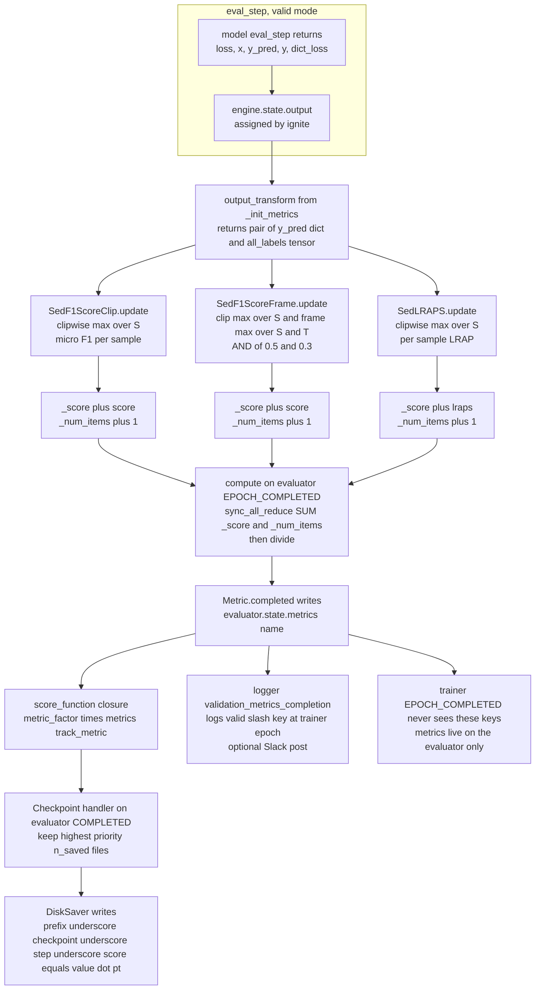
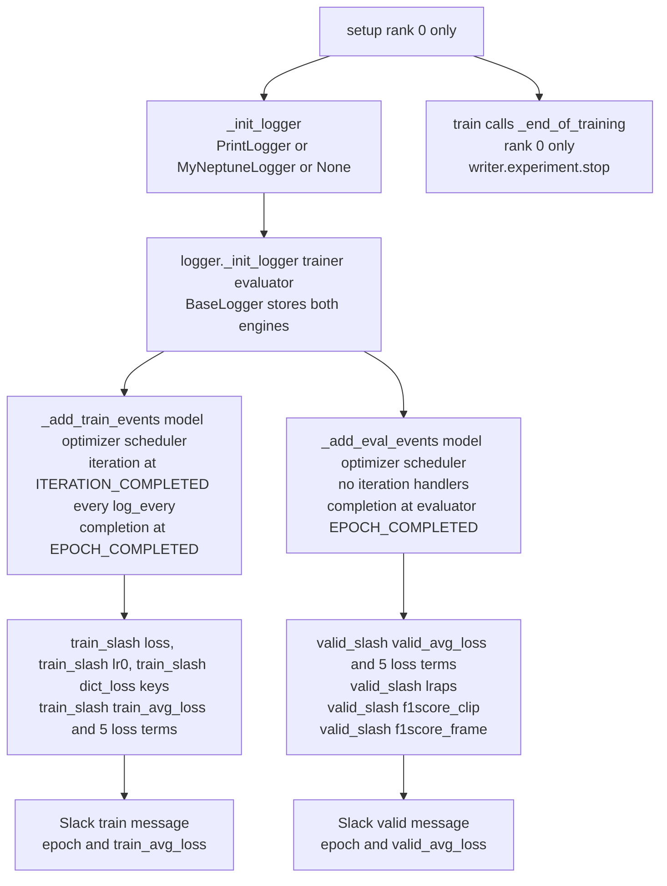

## Purpose

This module covers the two halves of "how do we know the run is working": the **score functions** that turn a validation pass into a number, and the **experiment trackers** that turn that number into a curve on somebody's screen at 3am. It exists as a separate unit because the whole measurement policy — which metrics exist, what they are computed on, which one drives checkpoint selection, and where the curves go — is defined entirely by `_init_metrics` (which builds the objects), `attach_metrics` (which decides which engine owns them), `_init_score_function` (which picks the winner), and the `logger/` package (which decides who gets to see it). No other part of the code touches `engine.state.metrics`. It also owns the honest accounting of the gap between what is scored *in the loop* and what Kaggle actually scored on the leaderboard, which is the single most important thing to re-derive before trusting any number in the Neptune log.

## Contracts

**Inputs** — six config fields on the `Parameters` object (`src/config_params/**.py`), read in `SedEngine._init_metrics` and `BaseEngine.setup`:

| field | type | value in the shipped configs | role |
| --- | --- | --- | --- |
| `metrics` | `list[str]` | `["lraps", "f1score_clip", "f1score_frame"]` — **identical in all 21 shipped configs** (15 in `final_sed/`, 5 in `final_sed_5_fold/`, plus `example_config.py:93`) | which optional metrics get constructed. Membership is tested with `in` on a list of bare strings. |
| `track_metric` | `str` | `"f1score_clip"` (15 configs), `"f1score_frame"` (4), `"lraps"` (2) | the name of the entry in `engine.state.metrics` the Checkpoint handler ranks on. |
| `metric_factor` | `int` | `1` everywhere | multiplies the tracked metric. `1` ⇒ maximise. |
| `checkpoint_params` | `dict` or `None` | `{"save_dir": "/saved_models/<name>", "n_saved": 5 or 10, "prefix_name": "<name>"}` | `None` ⇒ no Checkpoint handler at all ⇒ `track_metric` is never read. |
| `logger_name` | `str` | `"neptune"` in **all 21** configs; `"print"` is the documented fallback | selects the logger class; anything unrecognised ⇒ `self.logger = None`. |
| `logger_params` | `dict` | `{"project_name": "bird-song", "log_every": 10, "name": <config filename>, "prefix_name": ..., "tags": [...], "params": {...}}` | handed verbatim to the logger constructor. Only `project_name`, `name`, `params`, `tags`, `log_every` are read; `prefix_name` is read by nobody. |

Plus one hard-coded environment read per logger module, evaluated **once at import**:

| env var | read in | effect when unset |
| --- | --- | --- |
| `NEPTUNE_API_TOKEN` | `neptune_logger.py:15`, `os.getenv` | `logger_name="neptune"` ⇒ the run dies in `setup()`, no fallback |
| `SLACK_URL` | `neptune_utils.py:6` and `print_utils.py:6` | `slack_url = None`, the `if slack_url is not None` branches are simply skipped |

**Objects handed to each metric** — the `output_transform` lambda registered in `_init_metrics` receives `engine.state.output`, which is exactly the dict built by `SedEngine.output_transform` (`sed_engine.py:75-81`):

```python
{
  "loss":     Tensor (),                                   # loss.detach()
  "x":        (Tensor (B, S, 960000), None),               # waveforms + mixup_lambda
  "y_pred":   {"clipwise_output":   Tensor (B, S, 264),
               "framewise_output":  Tensor (B, S, 3001, 264)},
  "y":        {"all_labels":      Tensor (B, S, 264),     # float32 multi-hot
               "primary_labels":  Tensor (B, S, 264),
               "secondary_labels":Tensor (B, S, 264)},
  "dict_loss":{"bce_loss": Tensor(()), "F_loss": ..., "FScaled_loss": ..., "F_loss_0": ..., "F_loss_1": ...}
}
```

Concrete values with the shipped config (`PERIOD = 30`, `sample_rate = 32000`, `hop_size = 320`, `classes_num = 264`, `valid_bs = 32`, `num_test_samples = 2` on the valid loader):

- **B** = `valid_bs` = 32 (validation) or `train_bs` = 24 (training).
- **S** = `num_test_samples` = 2 (valid) / 1 (train) — the number of consecutive 30 s snippets each dataset item is chopped into.
- **T** = 3001 = `1 + (32000*30)//320` — logmel frames per 30 s snippet at `hop_size=320` (10 ms). Derived by `PANNsDense121Att.preprocess` (`sed_models.py:384`, `frames_num = x.shape[2]`), then round-tripped through `interpolate(x, 32)` + `pad_framewise_output`.
- **C** = 264 bird classes, `BIRD_CODE` in `src/config_params/configs.py:30-84` (indices 0…263, `len(self.bird_code)` in `SedDataset.convert_labels_to_coded`).
- Waveform per item: `(S, 960000)` → batched `(B, S, 960000)`; the model reshapes to `(B*S, 960000)` at `sed_models.py:281` and reshapes the outputs back to `(B, S, ·)` at `sed_models.py:434-437`.

**Outputs** — `metric.compute()` returns a plain Python float, which ignite writes as `engine.state.metrics[name]`. With `metrics = ["lraps","f1score_clip","f1score_frame"]` and `criterion_name = "sed_scaled_pos_neg_focal_loss"`, `engine.state.metrics` contains **9 keys** on the evaluator at `EPOCH_COMPLETED`:

```
valid_avg_loss, valid_bce_loss, valid_F_loss, valid_FScaled_loss,
valid_F_loss_0, valid_F_loss_1, lraps, f1score_clip, f1score_frame
```

and **6 keys** on the trainer:

```
train_avg_loss, train_bce_loss, train_F_loss, train_FScaled_loss,
train_F_loss_0, train_F_loss_1
```

The loggers translate these into the Neptune series names `train/train_avg_loss`, `valid/valid_f1score_clip`, … (note the doubled prefix — the `train/`/`valid/` logger prefix is stacked on top of the metric's own `train_`/`valid_` prefix), and into stdout lines.

**Called by** — `BaseEngine.__init__` calls `_init_score_function()` first (line 39) and `_init_metrics()` at line 48, then `setup()` at line 50. `setup()` calls `attach_metrics(self.trainer, self.train_metrics)` at line 147, `attach_metrics(self.evaluator, self.validation_metrics)` at line 206, `setup_checkpoint_saver(to_save)` at line 207, and — under `if self.rank == 0:` — `_init_logger()`, `logger._init_logger(...)`, `logger._add_train_events(**train_handler_params)`, `logger._add_eval_events(**eval_handler_params)` at lines 209-214. `BaseEngine.train` calls `logger._end_of_training()` at line 223. `sed_engine.SedEngine` supplies the two `_init_*` overrides (`sed_engine.py:130-138` for the logger, `140-174` for the metrics).

**Calls** — `ignite.metrics.Metric` / `RunningAverage`, `ignite.metrics.metric.sync_all_reduce` + `reinit__is_reduced`, `ignite.metrics.metric.EpochWise` (via `attach`'s default `usage`), `ignite.engine.Events`, `ignite.handlers.Checkpoint` / `DiskSaver` / `global_step_from_engine`, `ignite.contrib.handlers.neptune_logger.NeptuneLogger`, `sklearn.metrics.f1_score`, `sklearn.metrics.label_ranking_average_precision_score`, `requests.post`.

## How it works

### 1. The ignite `Metric` protocol, as actually implemented by these three classes

`requirements.txt:1` pins `pytorch-ignite==0.4.0.post1`. `ignite.metrics.Metric` is an ABC with three hooks — `reset`, `update`, `compute` — that it wires up for you. `Metric.__init__` (`metric.py:131-148`) stores `_output_transform`, sets `self._is_reduced = False`, and **calls `self.reset()` immediately**, so a metric is already primed before it is ever attached.

`attach(engine, name, usage=EpochWise())` (`metric.py:253-291`) is the whole mechanism:

```python
usage = self._check_usage(usage)                                    # default EpochWise()
if not engine.has_event_handler(self.started, usage.STARTED):
    engine.add_event_handler(usage.STARTED, self.iteration…)         # Events.EPOCH_STARTED
if not engine.has_event_handler(self.iteration_completed, usage.ITERATION_COMPLETED):
    engine.add_event_handler(usage.ITERATION_COMPLETED, self.iteration_completed)
engine.add_event_handler(usage.COMPLETED, self.completed, name)      # Events.EPOCH_COMPLETED
```

`EpochWise` (`metric.py:49-67`) resolves to `started=EPOCH_STARTED`, `iteration_completed=ITERATION_COMPLETED`, `completed=EPOCH_COMPLETED`. So per validation pass, per metric:

1. **`EPOCH_STARTED` → `self.started(engine)` → `self.reset()`** (`metric.py:188-195`). Each of the three `sed_*` metrics zeroes `self._score = 0.0` and `self._num_items = 0`.
2. **`ITERATION_COMPLETED` (per batch) → `self.iteration_completed(engine)`** (`metric.py:197-220`):
   ```python
   output = self._output_transform(engine.state.output)
   # Mapping branch skipped — these transforms return tuples
   self.update(output)
   ```
3. **`EPOCH_COMPLETED` → `self.completed(engine, name)`** (`metric.py:222-237`):
   ```python
   result = self.compute()
   engine.state.metrics[name] = result
   ```

None of the three `sed_*` classes overrides `attach`, `started`, `iteration_completed`, or `completed`. They only supply `reset`/`update`/`compute`, which is why they are each 30-45 lines long.

### 2. The `output_transform` signature, and why the lambda is load-bearing

Every optional metric is registered in `_init_metrics` (`sed_engine.py:160-174`) with the same one-argument lambda:

```python
if "lraps" in self.hparams.metrics:
    self.validation_metrics["lraps"] = SedLRAPS(
        output_transform=lambda x: (x["y_pred"], x["y"]["all_labels"]))
if "f1score_clip" in self.hparams.metrics:
    self.validation_metrics["f1score_clip"] = SedF1ScoreClip(
        threshold=0.5, output_transform=lambda x: (x["y_pred"], x["y"]["all_labels"]))
if "f1score_frame" in self.hparams.metrics:
    self.validation_metrics["f1score_frame"] = SedF1ScoreFrame(
        threshold=0.5, output_transform=lambda x: (x["y_pred"], x["y"]["all_labels"]))
```

- `x` is the whole `engine.state.output` dict described above.
- `x["y_pred"]` is the model's **output dict**, not a tensor. Every `sed_*` metric immediately does `pred["clipwise_output"]` / `pred["framewise_output"]`.
- `x["y"]["all_labels"]` is the **float32 multi-hot** target `(B, S, 264)`.
- The lambda returns a **2-tuple**, and `update()` starts with `pred, target = output` — a positional unpack. Nothing checks the arity.

> [!warning] The lambda is not cosmetic. `Metric._required_output_keys` defaults to `("y_pred", "y")` (`metric.py:129`), and `iteration_completed` has a Mapping branch (`metric.py:207-219`) that would extract exactly those two keys and hand `update()` the tuple `(x["y_pred"], x["y"])` if no transform were supplied. `x["y"]` is a *dict*, so `target[:,0,:]` would raise `TypeError: unhashable type: 'slice'` on the very first batch. The explicit transform is what converts "dict of targets" into "the one tensor I want".

`SedTest` is registered with a **different** lambda — `lambda x: (x["y_pred"], x["y"])` — because it wants the filename list that lives beside `all_labels` inside `x["y"]`.

### 3. The two distributed decorators

All three metrics carry both ignite decorators, and both are mandatory:

```python
@reinit__is_reduced
def reset(self): self._score = 0.0; self._num_items = 0; super().reset()

@reinit__is_reduced
def update(self, output): ...

@sync_all_reduce("_score", "_num_items")
def compute(self): return self._score / self._num_items
```

- **`reinit__is_reduced`** (`metric.py:478-491`) wraps the function and sets `self._is_reduced = False` *after* it returns. `update()` runs every batch, so the flag is False by the time `compute()` is reached each epoch.
- **`sync_all_reduce("_score", "_num_items")`** (`metric.py:454-475`) does:
  ```python
  if len(attrs) > 0 and not self._is_reduced:
      for attr in attrs:
          t = getattr(self, attr, None)
          if t is not None and idist.get_world_size() > 1:
              t = idist.all_reduce(t); self._is_reduced = True; setattr(self, attr, t)
  ```
  i.e. **SUM** both accumulators across ranks, once per epoch, then divide. The result is a true global mean over the whole (sharded) validation set, not a mean-of-per-rank-means — which is the correct formulation here.
- `idist.all_reduce` on a Python `Number` goes through `_all_collective_op` (`comp_models/base.py:109-141`), which wraps it in `torch.tensor(num, device=device, dtype=self._collective_op_dtype)` and unwraps with `.item()`. `_collective_op_dtype` is `None` for the native backend (only XLA overrides it, `xla.py:128`), so `_score` is reduced in **float32** and `_num_items` in int64.
- The **only** thing that makes this safe is that `reset` and `update` are both decorated: `Metric.__init__` (`metric.py:137-145`) raises a `RuntimeWarning` at construction if `world_size > 1` and either is missing `_decorated`, with the message *"Computed result is not collected across all computing devices"*. All three `sed_*` metrics pass that check.

### 4. `SedF1ScoreClip` vs `SedF1ScoreFrame` — what is actually thresholded

Both classes are line-for-line identical except for the decision rule. `SedF1ScoreClip.update` (`sed_f1score_clip.py:21-39`):

```python
pred   = pred["clipwise_output"]                        # (B, S, 264)  S = 2
pred   = pred.max(axis=1)[0].detach().cpu().numpy()     # (B, 264)   max over snippets
target = target[:,0,:].detach().cpu().numpy()           # (B, 264)   snippet row 0
for i, (p, t) in enumerate(zip(pred, target)):
    if t.sum() == 0.0:
        score = f1_score([1], [0], average='micro') if (p >= self.threshold).sum() > 0 \
                else f1_score([1], [1], average='micro')
    else:
        score = f1_score([t], [p >= self.threshold], average='micro')
    self._score += score; self._num_items += 1
```

`SedF1ScoreFrame.update` (`sed_f1score_frame.py:21-42`) computes **two** reductions and requires **both** to fire:

```python
pred_frame = pred["framewise_output"].max(axis=1)[0].max(axis=1)[0]   # (B, S, T, 264) -> (B, 264)
pred_clip  = pred["clipwise_output"].max(axis=1)[0]                    # (B, S, 264)   -> (B, 264)
...
decision = (pf >= self.threshold) & (pc >= 0.3)      # <-- 0.3 is a LITERAL, not self.threshold
```

| | `SedF1ScoreClip` | `SedF1ScoreFrame` |
| --- | --- | --- |
| axis(s) max-pooled | `clipwise_output` over S | `clipwise_output` over S **and** `framewise_output` over S then over T = 3001 |
| decision | `clip >= 0.5` | `(frame >= 0.5) AND (clip >= 0.3)` |
| constructor knob | `threshold=0.5` applies to the clip axis | `threshold=0.5` applies to the **frame** axis; the clip axis is pinned at the literal `0.3` in lines 35 and 40 |
| sigmoid | **not** applied — `## NB: SIGMOID IS NOT APPLIED HERE` | not applied, same reason |

The `AttBlock` is built with `activation='sigmoid'` (`sed_models.py:364`) and `nonlinear_transform` returns `torch.sigmoid(x)` (`sed_models.py:171-175`), so `clipwise_output` and `framewise_output` are **already probabilities in [0,1]** and re-applying a sigmoid would double-compress them — which is exactly what the abandoned `custom_*` metrics do (see §6).

> [!tip] `SedF1ScoreFrame`'s AND rule is the submission rule, minus the ensemble. README.md:45: *"if 4 out of the 13 models predicted a bird with a threshold of `0.3` for both `clipwise_output` and `framewise_output` within the audio snippet then it would be accepted"*. The in-loop metric runs the identical boolean shape with **one** model = one vote. That is why `f1score_frame` is the closest in-loop analogue of the leaderboard metric, and why 4 of the 5 5-fold configs select it as `track_metric`.

### 5. The 0.5-vs-0.3 threshold gap, stated precisely

- `sed_engine.py:166` and `sed_engine.py:170` both hard-code `threshold=0.5` at construction. There is no config field to move it.
- `sed_f1score_frame.py:35` and `:40` hard-code the literal `0.3` for the clip gate. This is the **winning inference clip threshold** from README.md:45 baked into the training-time metric.
- README.md:47: *"I didn't try a threshold of `0.3` for the frame threshold since I ran out of submissions"*. So the frame gate is stuck at 0.5 everywhere, in-loop and at inference alike, and the 13-model table (README.md:51-56) shows that combination cost 0.002 private LB (0.681 → 0.679).
- Net effect: the in-loop `f1score_frame` number is computed at the *runner-up* operating point, not the submitted one. An `f1score_frame` curve peaking at 0.9 does not mean the ensemble at 0.3/0.3 would score 0.9.

### 6. F1 granularity: per-sample, globally accumulated, micro — **not** macro

This is the part that most often gets mis-read, so it is worth being unambiguous:

**(a) It is micro over the 264 classes, per sample.** `f1_score([t], [p>=th], average='micro')` passes `y_true` and `y_pred` as one-element lists wrapping a 264-length array, i.e. shape `(1, 264)` — one sample, 264 binary labels. `average='micro'` sums TP/FP/FN across all 264 labels and computes one precision and one recall. **There is no macro-averaging anywhere in this repo**, no per-class F1, no `labels=` mask, no `zero_division=` argument. Verified numerically: a sample with 3 true positives, all detected, scores `micro = 1.0` but `macro = 0.0114`. Consequences: a class that is absent from the target *and* not predicted contributes nothing at all to the micro numerator or denominator (so the 261 irrelevant classes are effectively free), and a single extra false alarm costs a large fraction of the score.

**(b) It is accumulated globally across the epoch, not per-batch-averaged.** `update()` loops over the batch and does `self._score += score; self._num_items += 1` **per sample**; `compute()` is `self._score / self._num_items`. This is a per-sample mean over every sample in the validation set. It is arithmetically identical to a batch-average only when every batch is full — and `valid_loader` is built with `drop_last=False` (`base_engine.py:70`), so the final partial batch's samples still receive full weight. That is the correct behaviour, and it is what makes the number comparable across validation-set sizes.

**(c) Under DDP it stays exact.** `sync_all_reduce` sums both counters across ranks before the division, so `f1score_clip` in a 4-GPU run is the mean over the union of the shards, not the mean of four shard means (which would over-weight small shards).

**(d) Classes/samples with no positives get a hand-written branch.** When `t.sum() == 0.0` — a background clip, drawn from `background_audio_dir = Path("/background/data_ssw")` (README.md:122), the discussion-sourced clips with 5-30 s of bird-free audio — the metric collapses the whole 264-vector down to one synthetic bit:

```
f1_score([1], [0], average='micro')  ->  0.0     # at least one class crossed the threshold
f1_score([1], [1], average='micro')  ->  1.0     # nothing crossed the threshold: clean negative
```

Two reasons this branch exists, both verified against sklearn 1.9.1: (i) without it `f1_score([zeros(264)], [zeros(264)], average='micro')` emits `UndefinedMetricWarning` and returns 0.0, so every correctly-silent background clip would be scored as a total failure; (ii) it converts the background case into a clean **precision-only** score, which is the right shape for "did we hallucinate anything". Note the consequence: a background clip contributes exactly **0.0 or 1.0**, never anything in between, and one false alarm on a background clip costs a full sample's worth of the epoch mean. If the background set is a large fraction of validation (it is a `background_audio_dir` fed alongside the real folds), `f1score_clip` is substantially a *false-alarm rate*.

**(e) `target[:,0,:]` discards nothing.** `all_labels` is produced by `SedDataset.convert_labels_to_coded(len(list_of_y), item["all_labels"])` (`sed_dataset.py:87-92`), which allocates `np.zeros((num_images, len(bird_code)))` and writes `coded_labels[:, label_index] = 1` — **every row gets the same species set**, because the Kaggle ground truth is per-file (5-second bins for sites 1/2, file-level for site 3). So slicing row `0` of `S = 2` is a redundant-but-harmless shortcut, *not* a silent "only the first 30 s is scored". Same for `target[:,0,:]` in `SedLRAPS`.

### 7. The official metric and the size of the proxy gap

README.md:13 states: *"Scores were evaluated based on their row-wise micro averaged F1 score."* The official metric consumes a **CSV**, not a model. Its rows are `(row_id, location, seconds, ebird_code)` — for site 1 and site 2 that is a 5-second-granular grid (README.md:11), for site 3 it is file-level. The gap between that and anything computed in-loop has four independent components:

1. **The ensemble must be applied first.** The submitted score for a (time, species) cell is the **vote count across 13 models at threshold 0.3**, accepted at `count >= 4` (README.md:45). In-loop there is exactly **one** model and therefore exactly **one** vote, so `SedF1ScoreFrame` evaluates `count >= 1`. A single model is far more permissive than a 4-of-13 vote, so the `f1score_frame` values that appear in the checkpoint filenames — e.g. `final_sed_dense121_mix_fold0_checkpoint_50_score=0.6328.pt`, hard-coded as `checkpoint_dir` in `final_sed/final_sed_dense121_mix_fold0_2.py:97` — are **not** estimates of any submitted score.
2. **The unit of prediction differs.** The in-loop metric makes one decision per 60 s pair of 30 s snippets (`S = 2`). The submission makes a decision per 5-second bin (or per file at site 3). A call detected in the right 60 s but the wrong 5 s bin is a **hit** in-loop and a **miss** on the leaderboard.
3. **The submission is unranked; LRAPS is ranked.** `f1score_*` thresholds at a fixed operating point, `lraps` scores the whole ordering of the 264 scores. Neither is the official metric; they bracket it.
4. **Distribution shift dwarfs the differences you are trying to resolve.** README.md:49-56: the selected 13-model ensemble scored **0.616 public / 0.681 private**. A public-private gap of 0.065 is an order of magnitude larger than most epoch-to-epoch differences in `f1score_clip`, so an in-loop curve cannot rank two ensembles.

**Conclusion to re-derive before trusting anything:** `track_metric` is a *checkpoint-selection* signal, not a leaderboard estimator. `track_metric` decides which of the `n_saved` snapshots survives; the surviving snapshots are then ensembled **outside** this codebase (README.md:127-130, the Kaggle kernels) and scored by Kaggle. The `metric_factor = 1` convention means the loop is optimising the *easy* direction (more recall) and the hard part — vote count and threshold — was tuned by hand against the leaderboard with a 2-submission/day budget.

### 8. LRAP / mAP — `sed_lraps.py` and what it actually measures

The whole implementation (`sed_lraps.py:20-29`):

```python
pred = pred["clipwise_output"]                       # (B, S, 264)
pred = pred.max(axis=1)[0].detach().cpu().numpy()    # (B, 264)
target = target[:,0,:].detach().cpu().numpy()        # (B, 264)
for i in range(len(pred)):
    self._score += label_ranking_average_precision_score([target[i]], [pred[i]])
    self._num_items += 1
```

- It wraps **`sklearn.metrics.label_ranking_average_precision_score`**, called **per sample** with `y_true` shaped `(1, 264)` in multilabel-indicator format. No torchmetrics, no hand-rolled AP. `requirements.txt` does not even list scikit-learn — it arrives transitively (via audiomentations) and is unpinned.
- Internally (verified against the installed sklearn 1.9.1 source): `check_array` → CSR, `y_score = -y_score`, then per sample
  ```python
  relevant = y_true.indices[start:stop]
  if relevant.size == 0 or relevant.size == n_labels:
      aux = 1.0                                    # "the label ranking has no meaning"
  else:
      rank = rankdata(-y_score[i], "max")[relevant]
      L    = rankdata(-y_score[i][relevant], "max")
      aux  = (L / rank).mean()
  ```
  then averaged over samples. The engine divides by `_num_items` afterwards.
- **Multi-label is native.** `all_labels` is a genuine multi-hot over primary + secondary species (`sed_dataset.py:61-81`), which is why LRAP (designed for multilabel ranking) is the right family and why `average_precision_score` (single-label) is not used.
- **Ranking metrics need positives to rank, not negatives.** F1 needs both a positive set and a negative set; with ≤100 labelled samples per class spread over 264 classes (README.md:25) the per-class positive counts are tiny, so a thresholded F1 on a rare class is dominated by whatever 0.5 happens to be. LRAP consumes the whole `(B, 264)` score vector and never picks a cut, which makes it a much lower-variance early-stopping signal in this regime.
- **The trap: absence of negatives is scored as perfect.** `relevant.size == 0` ⇒ `aux = 1.0` **by definition**. Verified: `label_ranking_average_precision_score([np.zeros(264)], [np.random.rand(264)]) == 1.0`. So **every background clip contributes a free 1.0** to `SedLRAPS`. A rising `lraps` curve can therefore mean "the validation set gained more background clips" rather than "ranking improved". This is the exact complement of `f1score_clip`'s empty-target branch, which scores a background clip 0.0 the instant anything crosses the threshold. On this dataset the two metrics are opposites on background clips, and `f1score_clip` is the one that punishes false alarms — which is why 19 of the 21 shipped configs track one of the F1 variants and only `final_sed_dense121_mix_2.py:94` and `final_sed_dense121_nomix_1.py:94` track `"lraps"`.

**`custom_lraps.py` contrast (abandoned research path).** The whole `custom_*` trio (`custom_f1score.py`, `custom_lraps.py`, `custom_test.py`) predates the `sed_*` rewrite and belongs to `engine/main_engine_v2/v3/v4.py` (which pass `x["y_pred"][0]` — a *tensor* — to these metrics):

- `CustomLRAPS.update`: `pred = self.sigmoid(pred); pred = pred.mean(axis=1)` — applies sigmoid **and** averages over the second axis of a tensor whose layout depended on the older model's output contract. The `sed_*` version instead max-pools `clipwise_output` and does not sigmoid, because the `sed_*` models already emit probabilities from `AttBlock(activation='sigmoid')`.
- `CustomF1Score.update` is byte-identical to `SedF1ScoreClip.update` except for `torch.sigmoid(pred)`.
- `CustomTest.update` is not a metric at all: it **dumps one JSON per audio file** containing `predicted`, `targets`, `filename`, `lraps_score`, a `background` flag, and the F1 at each threshold in `[0.5, 0.6, 0.7, 0.8, 0.9]` (`custom_test.py:54-64`), then optionally concatenates every file into `final/merged_results.json` under `_combine_files`. That is a **threshold-sweep and raw-prediction-export harness** — exactly the tool you want for tuning the 0.3/0.5 thresholds, but it is never invoked by `sed_train.py`.
- Its `sed_*` successor, `metrics/sed_test.py`, drops the threshold sweep and keeps only the raw-prediction export — **and does not parse** (see Failure modes §1).
- Verdict: `custom_f1score.py` / `custom_lraps.py` are **dead** in the final solution. `custom_test.py` is dead. `sed_test.py` is dead *and* broken. Only `sed_lraps.py`, `sed_f1score_clip.py`, `sed_f1score_frame.py` execute.

### 9. Metrics live on the **evaluator**, and the Checkpoint saver reads them there

`BaseEngine.setup` attaches the two metric families to two different engines:

```python
self.attach_metrics(self.trainer,    self.train_metrics)       # line 147
...
self.attach_metrics(self.evaluator,  self.validation_metrics)   # line 206
self.setup_checkpoint_saver(to_save)                            # line 207
```

and `attach_metrics` is the two-line loop (`base_engine.py:130-132`):

```python
def attach_metrics(self, engine, metrics):
    for name, metric in metrics.items():
        metric.attach(engine, name)
```

So `lraps`, `f1score_clip`, `f1score_frame` exist **only** in `self.evaluator.state.metrics`. They populate only when the evaluator actually runs, which happens via:

```python
self.validation_handler_event = self.trainer.add_event_handler(
    Events.EPOCH_COMPLETED(every=self.hparams.eval_every), self.validate(self.valid_loader))   # line 182

def validate(self, dl):
    def validate_run(engine): self.evaluator.run(dl, epoch_length=self.hparams.val_length)
    return validate_run                                                                        # lines 225-228
```

`Events.EPOCH_COMPLETED(every=N)` uses `every_event_filter` (`events.py:94-100`: `return event % every == 0`), so validation fires on epochs **N, 2N, 3N, …**. With `eval_every = 2` and `max_epochs = 50` that is 25 validation passes; with `eval_every = 10` (used by `final_sed_dense121_nomix_1.py`, `final_sed_dense121_nomix_3.py`, `final_sed_dense121_mix_2.py`) it is 5.

The checkpoint saver is attached to the evaluator's **`COMPLETED`** (`base_engine.py:128`), which in ignite fires *after* `EPOCH_COMPLETED`:

```
trainer EPOCH_COMPLETED(every=eval_every)  ->  evaluator.run(...)
    evaluator EPOCH_STARTED     -> all 9 metrics reset
    evaluator ITERATION_COMPLETED x N_batches -> all 9 metrics update
    evaluator EPOCH_COMPLETED   -> all 9 metrics compute  ->  evaluator.state.metrics[...]
    evaluator COMPLETED         -> Checkpoint handler -> score_function -> keep-best-N
```

ignite 0.4.0 fires handlers in **insertion order** (`engine.py:390`: `for func, args, kwargs in self._event_handlers[event_name]`), so on the evaluator's `EPOCH_COMPLETED` the order is `complete_clear` (registered line 183) → every `Metric.completed` (line 206) → the logger's `validation_metrics_completion` (registered through line 214). `complete_clear` nulls `engine.state.output` and calls `gc.collect()` *before* the metrics compute — harmless only because `Metric.completed` calls `compute()`, which reads instance attributes accumulated during `update()`, never `engine.state.output`. That ordering is load-bearing and fragile: any metric that needed the raw output at compute time would read `None`.

### 10. `_init_score_function` → keep-best-N

```python
def _init_score_function(self):                                       # base_engine.py:318-325
    def get_score_function(metric_name, factor=1):
        def score_function(engine):
            return factor * engine.state.metrics[metric_name]
        return score_function
    self.score_function = get_score_function(self.hparams.track_metric, self.hparams.metric_factor)
```

It is a **closure frozen at construction** (`__init__` line 39, before anything else exists). `engine` is whichever engine the handler is attached to — the evaluator — so `track_metric` must name a key in `validation_metrics`, never in `train_metrics`. Then:

```python
handler = Checkpoint(to_save, DiskSaver(checkpoint_params["save_dir"], require_empty=False),
                     n_saved=checkpoint_params["n_saved"],
                     filename_prefix=checkpoint_params["prefix_name"],
                     score_function=self.score_function, score_name="score",
                     global_step_transform=global_step_from_engine(self.trainer))
self.evaluator.add_event_handler(Events.COMPLETED, handler)
```

`Checkpoint.__call__` (`checkpoint.py:278-344`) computes `priority = self._score_function(engine)` and then:

```python
if self._check_lt_n_saved() or self._saved[0].priority < priority:   # strictly-greater wins
    ...
    self._saved.append(Checkpoint.Item(priority, filename)); self._saved.sort(key=lambda item: item[0])
    if not self._check_lt_n_saved():
        item = self._saved.pop(0); self.save_handler.remove(item.filename)
```

So: fill to `n_saved`, then evict the lowest priority whenever a strictly better one arrives. `metric_factor = 1` everywhere ⇒ **maximise**. Filenames are `{prefix}_checkpoint_{trainer_global_step}_score={priority:.4f}.pt`, where the step comes from the **trainer** while the priority comes from the **evaluator** — the two engines' counters are deliberately mixed. Nothing validates that `track_metric` exists; a typo surfaces as a `KeyError` at the first checkpoint attempt.

### 11. The logger hierarchy

```
BaseLogger                     logger/base/base_logger.py
  ├── _init_logger(trainer, evaluator)      -> stores both engines
  ├── _add_train_handlers(iter, comp)       -> add_iteration_handlers(self.trainer, ...)
  ├── _add_evaluation_handlers(iter, comp)  -> add_iteration_handlers(self.evaluator, ...)
  ├── _add_train_events(model, optimizer, scheduler, metrics)   -> NotImplementedError
  ├── _add_eval_events (model, optimizer, scheduler, metrics)   -> NotImplementedError
  ├── _add_custom_train_iteration_handler(event, log_every)
  └── _add_custom_eval_iteration_handler (event, log_every)
        ├── MyNeptuneLogger                logger/neptune/neptune_logger.py   (LIVE)
        └── PrintLogger                    logger/print/print_logger.py       (fallback)
```

`BaseLogger` is a plain `object` (not an ABC, no `ABCMeta`) whose "abstract" methods simply `raise NotImplementedError`. `logger/base/utils.py` is the entire mechanism, 12 lines:

```python
def add_iteration_handlers(engine, method_events=[], log_every=5):
    for method_event in method_events:
        engine.add_event_handler(Events.ITERATION_COMPLETED(every=log_every), method_event)

def add_completion_handlers(engine, method_events=[]):
    for method_event in method_events:
        engine.add_event_handler(Events.EPOCH_COMPLETED, method_event)
```

Consequences worth internalising:

- `log_every` is **per logger, not per handler**: every iteration handler shares the same `every=log_every`. `logger_params["log_every"] = 10` in every shipped config ⇒ `train/loss`, `train/lr0` and the five `train/*_loss` series are each sampled every 10 iterations.
- `lr_iteration` logs at `engine.state.iteration - 1` (`neptune_utils.py:13`) because the scheduler is attached to `ITERATION_STARTED` (`base_engine.py:144`) and has already stepped by the time `ITERATION_COMPLETED` fires.
- Mutable default arguments (`iteration_events = []`, `metrics = {}`) are used throughout. Harmless today because nothing mutates them; a landmine the moment someone does `events.append(...)` on the default.

> [!warning] Two different methods are both called `_init_logger`, and they do opposite jobs. `BaseEngine._init_logger` (`base_engine.py:300-301`) **constructs** the logger object from config. `BaseLogger._init_logger` (`base_logger.py:13-15`) **injects** the trainer and evaluator into an already-constructed logger. `setup()` calls both, on different objects, three lines apart:
> ```python
> self._init_logger()                                        # sed_engine.py:130 — make it
> if self.logger:
>     self.logger._init_logger(self.trainer, self.evaluator)  # base_logger.py:13  — wire it
> ```
> Both are underscore-private by convention only.

### 12. The three-arg signature and the identical-dict smell

`base_engine.setup()` lines 185-214:

```python
train_handler_params = {"model": self.model, "optimizer": self.optimizer, "scheduler": self.scheduler}
eval_handler_params  = {"model": self.model, "optimizer": self.optimizer, "scheduler": self.scheduler}
...
self.logger._add_train_events(**train_handler_params)
self.logger._add_eval_events(**eval_handler_params)
```

**The two dicts are byte-identical.** The split exists only so `_add_train_events` and `_add_eval_events` can keep a symmetric four-parameter signature. Nothing depends on the distinction, and:

| argument | `_add_train_events` (Neptune) | `_add_eval_events` (Neptune) | `_add_train_events` (Print) | `_add_eval_events` (Print) |
| --- | --- | --- | --- | --- |
| `model` | referenced only in the **commented-out** `WeightsScalarHandler` / `GradsScalarHandler` block, `neptune_logger.py:23-28` | ignored | ignored | ignored |
| `optimizer` | live, via `lr_iteration` | ignored | **commented out**, `print_logger.py:22` | ignored |
| `scheduler` | ignored | ignored | ignored | ignored |
| `metrics` | ignored | ignored | ignored | ignored |

*(inferred — reason: the author generalised from an ignite "log everything" logger; `optimizer` was needed for LR, `model` for weight/grad histograms. Neither the histograms nor the eval-side model ever got used.)*

The `eval_handler_params` dict could be deleted outright and `_add_eval_events()` called with no arguments; `_add_eval_events` would then need a no-arg-compatible signature. It is also why `_add_eval_events(model=None, optimizer=None, scheduler=None, metrics={})` "looks" like it might log model weights during validation and does not. Related dead config: `logger_params["prefix_name"]` (`f"{self.name}_best"`) is present in every config and read by **neither** logger.

### 13. Rank-0 gating

```python
self.attach_metrics(self.evaluator, self.validation_metrics)   # line 206 — ALL ranks
self.setup_checkpoint_saver(to_save)                          # line 207 — ALL ranks
if self.rank == 0:                                            # line 209
    self._init_logger()
    if self.logger:
        self.logger._init_logger(self.trainer, self.evaluator)
        self.logger._add_train_events(**train_handler_params)
        self.logger._add_eval_events(**eval_handler_params)
```

and in `train()`:

```python
if self.rank == 0 and self.logger:                             # line 222
    self.logger._end_of_training()
```

`self.rank` is set in `_init_distribution()` (`base_engine.py:53`, `idist.get_rank()`), which `setup()` calls first (line 135). With `dist_params = {}` (`sed_train.py:13`, `idist.Parallel(**hyperparams.dist_params)`) ignite installs `_SerialModel`, whose `get_rank()` returns 0 unconditionally (`comp_models/base.py:175-176`) — so **in single-GPU mode the gate is always open** and rank-0-only is a no-op. Under `torchrun`/slurm it does real work.

Why the separation matters, precisely:

1. **The metrics are the collective; the logger is not.** Every `sed_*` `compute()` enters `idist.all_reduce` — a real NCCL/GLOO collective — guarded only by `get_world_size() > 1`. Every rank runs the same `validate_run`, so every rank reaches `compute()` at the same iteration. If the metric *objects* had been constructed or attached only on rank 0 (an easy mistake to make when the logging gate sits two lines above), the non-zero ranks would never enter the collective and the job would **hang at the first validation epoch** — not crash, not warn: hang. Keeping `attach_metrics` unconditional and the logger rank-gated is exactly what avoids that.
2. **Neptune, not the metric, is the shared resource.** Only rank 0 constructs a `NeptuneLogger`, so a 4-GPU fold produces one experiment, not four. Only rank 0 posts to Slack, so no 4× spam.
3. **Ignite has a built-in guard for the mistake.** `Metric.__init__` (`metric.py:137-145`) warns at construction when `world_size > 1` unless *both* `reset` and `update` carry `_decorated`. All three `sed_*` metrics are decorated, so the warning never fires — which is the desired outcome and also means a future metric that forgets a decorator gets a loud warning rather than a silent wrong number.
4. **The hidden cost: rank 0 does synchronous HTTP on the critical path.** Every logged iteration is a blocking call into `log_metric` from inside `ITERATION_COMPLETED`, so the other ranks wait at the next collective. At `log_every = 10` this is negligible; at `log_every = 1` it would dominate the epoch time. There is no `asynchronous=True` and no batching.
5. **Non-zero ranks get nothing at all** — no console output, no progress bar, no traceback beyond `trainer.logger`'s own rank-filtered stream. Debugging a hang means reproducing on one GPU.
6. **Corollary:** `trainer.state.metrics` never contains any F1/LRAP key. Reaching for `trainer.state.metrics["f1score_clip"]` from a custom handler is a guaranteed `KeyError`.

### 14. Neptune: what is uploaded, and when

`MyNeptuneLogger.__init__` (`neptune_logger.py:14-20`) is the entire upload surface:

```python
self.writer = NeptuneLogger(
    api_token=os.getenv('NEPTUNE_API_TOKEN'),
    project_name=kwargs["project_name"],   # "bird-song" in all final configs; "NEPTUNE_PROJECT_NAME" in example_config.py:107
    name=kwargs["name"],                   # os.path.basename(__file__).replace(".py","") -> e.g. "final_sed_dense121_mix_fold0"
    params=kwargs["params"],               # flat dict, ~14 scalars + **model_config + **criterion_params
    tags=kwargs["tags"])                   # [fold, name, model_name, criterion_name]
super().__init__(log_every=log_every)     # 10
```

- **`api_token`** comes only from the env (README.md:101). No config fallback, no `try`. If `NEPTUNE_API_TOKEN` is unset and `logger_name == "neptune"`, `setup()` raises before a trainer exists.
- **`project_name`** is `logger_params["project_name"]`, hard-coded to `"bird-song"` in all 20 configs under `final_sed*/`. README.md:123: *"change the `project_name` in the config files to your personal neptune project name"*. `example_config.py:107` ships the literal placeholder `"NEPTUNE_PROJECT_NAME"`.
- **`params`** flattens `bs, lr, name, aug_name, model_name, weight_decay, apply_mixup, optimizer_name, criterion_name, scheduler_name, fold, lr_scale_factor, period` plus `**model_config` (`classes_num: 264`, `mel_bins: 64`, `window_size: 1024`, `hop_size: 320`, `fmin: 50`, `fmax: 14000`, `sample_rate: 32000`, `apply_aug: True`, `top_db: None`) plus `**criterion_params` (`gamma`, `alpha_0`, `alpha_1`, `secondary_factor`). That is the run's full reproducibility record minus the folds CSVs and the audio.
- **`tags`** = `[0, "final_sed_dense121_mix_fold0", "sed_dense121att", "sed_scaled_pos_neg_focal_loss"]` — fold, config filename, backbone, loss. Enough to group the 13–21 runs of the final ensemble in the UI.

**Series written**, and at which event:

| handler | event | step | series |
| --- | --- | --- | --- |
| `training_iteration` | trainer `ITERATION_COMPLETED(every=10)` | `engine.state.iteration` | `train/loss`, and `train/{k}` for each `k in output["dict_loss"]` → `bce_loss, F_loss, FScaled_loss, F_loss_0, F_loss_1` |
| `lr_iteration` | trainer `ITERATION_COMPLETED(every=10)` | `engine.state.iteration - 1` | `train/lr{i}` for each param group (one group) |
| `train_metrics_completion` | trainer `EPOCH_COMPLETED` | `engine.state.epoch` | `train/train_avg_loss`, `train/train_bce_loss`, … (6) |
| `validation_metrics_completion` | **evaluator** `EPOCH_COMPLETED` | **`trainer.state.epoch`** | `valid/valid_avg_loss`, `valid/valid_bce_loss`, …, `valid/lraps`, `valid/f1score_clip`, `valid/f1score_frame` (9) |

Two details in that table are easy to get wrong. First, `validation_metrics_completion` is built as a **closure over `trainer`** — `validation_metrics_completion(self.trainer, self.writer)` at `neptune_logger.py:50` / `print_logger.py:40` — and stamps every x-axis with `trainer.state.epoch`, because the evaluator restarts its own `state.epoch` at 1 on every `run()`; using `engine.state.epoch` would collapse all 25 validation passes onto x = 1. Second, the `train/`/`valid/` prefix is stacked on top of the metric's own `train_`/`valid_` prefix, so the actual Neptune series names are `train/train_avg_loss` and `valid/valid_f1score_clip`.

**Stopping the run.** `_end_of_training()` → `self.writer.experiment.stop()` (`neptune_logger.py:60-61`), called from `BaseEngine.train` at line 223, i.e. **after** the `try/except` around `trainer.run`. Because the exception is swallowed (`base_engine.py:217-221` prints the traceback and continues), a run that **crashed** still closes its Neptune experiment — at whatever epoch it reached, with no error marker, so the curve just stops. Conversely a `SIGKILL`/OOM-kill never reaches line 223 and the run stays "running" in the Neptune UI forever. There is no `atexit` hook and no signal handler.

### 15. The Slack webhook: the exact trigger

The URL is resolved **once, at module import** (`neptune_utils.py:5-8`, identically `print_utils.py:5-8`):

```python
try:
    slack_url = os.environ["SLACK_URL"]
except:
    slack_url = None
```

The message body (`neptune_utils.py:25-35` and `37-47`):

```python
# train, on trainer EPOCH_COMPLETED
for key, value in metrics.items():
    writer.experiment.log_metric(f"train/{key}", engine.state.epoch, value)
if slack_url is not None:
    try:
        requests.post(slack_url, json={"text": f"[TRAIN] {engine.state.epoch}: {metrics['train_avg_loss']}"})
    except:
        pass

# valid, on evaluator EPOCH_COMPLETED
for key, value in metrics.items():
    writer.experiment.log_metric(f"valid/{key}", trainer.state.epoch, value)
if slack_url is not None:
    try:
        requests.post(slack_url, json={"text": f"[VALID] {trainer.state.epoch}: {metrics['valid_avg_loss']}"})
    except:
        pass
```

So a Slack message is sent **iff all three** hold:

1. `SLACK_URL` was present in the environment when `logger/neptune/neptune_utils.py` (or `print_utils.py`) was first imported;
2. the handler fires — `EPOCH_COMPLETED` of the **trainer** for `[TRAIN]`, `EPOCH_COMPLETED` of the **evaluator** for `[VALID]`. With `eval_every = 2`, that is one `[TRAIN]` per epoch and one `[VALID]` per *second* epoch. With `eval_every = 10`, one `[VALID]` per tenth epoch;
3. `requests.post` did not raise.

The payload is `{"text": "[TRAIN] <trainer_epoch>: <train_avg_loss>"}` or `{"text": "[VALID] <trainer_epoch>: <valid_avg_loss>"}` — **loss only**, exactly as README.md:107 claims (*"A Slack message notification will occur at the end of each epoch during training and validation with loss."*). `metrics['train_avg_loss']` and `metrics['valid_avg_loss']` are constructed unconditionally in `_init_metrics` (`sed_engine.py:143-149`) and can never be missing; and the f-string is evaluated *inside* the `try`, so even a hypothetical `KeyError` would be swallowed.

> [!warning] The `except: pass` is bare and swallows everything — a malformed URL, a missing `requests`, a DNS failure, a Slack-side 4xx. "No Slack messages" is indistinguishable from "Slack is broken", which is the worst possible failure mode for the one channel you are relying on to notice a dead run at 3am. The import-time read also means `export SLACK_URL=...` *after* the process starts has no effect.

> [!warning] **The PrintLogger's Slack behaviour differs from Neptune's, and README.md:107 describes only the Neptune path.** In `print_utils.validation_metrics_completion` the single loss message is **commented out** (`print_utils.py:43`) and replaced by a loop that posts **one message per metric key**:
> ```python
> if slack_url is not None:
>     # requests.post(slack_url, json={"text": f"[VALID] {trainer.state.epoch}: {metrics['valid_avg_loss']}"})
>     for key, value in metrics.items():
>         try:
>             requests.post(slack_url, json={"text": f"[VALID-{key}] {trainer.state.epoch} : {value}"})
>         except:
>             pass
> ```
> With the default `metrics`, that is **9 messages per validation epoch** (`valid_avg_loss`, `valid_bce_loss`, `valid_F_loss`, `valid_FScaled_loss`, `valid_F_loss_0`, `valid_F_loss_1`, `lraps`, `f1score_clip`, `f1score_frame`), each formatted `[VALID-<key>] <epoch> : <value>` — and it is the only place the F1/LRAP numbers ever reach Slack at all. The `[TRAIN]` path in `print_utils` *is* unchanged (single loss message), so the asymmetry is specific to validation.

### 16. `PrintLogger` — the zero-dependency fallback, and `logger_name`

The config switch is `SedEngine._init_logger` (`sed_engine.py:130-138`), in full:

```python
def _init_logger(self):
    if   self.hparams.logger_name == "print":   from logger.print.print_logger import PrintLogger;        self.logger = PrintLogger(**self.hparams.logger_params)
    elif self.hparams.logger_name == "neptune": from logger.neptune.neptune_logger import MyNeptuneLogger; self.logger = MyNeptuneLogger(**self.hparams.logger_params)
    else:                                        self.logger = None
```

- **An unrecognised `logger_name` silently disables all experiment tracking** — no error, no warning. Both consumers are guarded (`if self.logger:` at `base_engine.py:211`, `if self.rank==0 and self.logger` at line 222), so the run proceeds happily and produces no curve and no Slack. This is the one config typo that fails completely silently.
- `PrintLogger.__init__(self, log_every=5, **kwargs)` (`print_logger.py:14-16`) accepts and **ignores every** `logger_params` key, sets `self.writer = None`, and forwards `log_every` to `BaseLogger`. So `logger_params["log_every"] = 10` is honoured and nothing else survives.
- `_end_of_training` is a bare `return` (`print_logger.py:50-51`) — the symmetric no-op.
- Every closure in `print_utils` takes a `writer` argument it never uses. The whole file is `neptune_utils.py` with `log_metric(f'a', b, c)` → `print('a', b, c)` and `.item()` appended where a tensor would print as `tensor(0.42)`. The signature symmetry exists so `_add_train_events` / `_add_eval_events` bodies are copy-paste identical across the two loggers.
- `print_logger.py:7` does `from ignite.contrib.handlers.neptune_logger import *` even though the file uses nothing from it. This is **not** a hard dependency: in ignite 0.4.0.post1 that module only does `import neptune` *inside* `NeptuneLogger.__init__` (`neptune_logger.py:481, 487`), so the top-level import succeeds with `neptune-client` absent. It does shadow nothing (the same objects are already imported at lines 1-3) and it makes the file look like it depends on Neptune when it does not.
- README.md:105: *"Neptune is not required, set `logger_name` in the config path to a different name and create an different logger."* — i.e. adding a third logger means subclassing `BaseLogger`, implementing `_add_train_events` / `_add_eval_events` / `_end_of_training`, and adding one `elif` branch in `sed_engine._init_logger`. Nothing else needs touching.

**Practical consequence of the switch:** with `logger_name="print"` you keep the F1/LRAP numbers on stdout (so checkpoint selection is completely unaffected — that path never touches the logger), you lose the Neptune run, the param block, and the tags, and you get 9 Slack messages per validation instead of 1.

### 17. Metric wiring table

| `hparams.metrics` contains | class constructed | dict it lands in | key | constructor args | thresholds applied |
| --- | --- | --- | --- | --- | --- |
| `"lraps"` | `metrics.sed_lraps.SedLRAPS` | `self.validation_metrics` | `"lraps"` | — | none (ranking only) |
| `"f1score_clip"` | `metrics.sed_f1score_clip.SedF1ScoreClip` | `self.validation_metrics` | `"f1score_clip"` | `threshold=0.5` | `clipwise_output >= 0.5` |
| `"f1score_frame"` | `metrics.sed_f1score_frame.SedF1ScoreFrame` | `self.validation_metrics` | `"f1score_frame"` | `threshold=0.5` | `framewise_output >= 0.5` **AND** `clipwise_output >= 0.3` (literal) |
| `"test"` | `metrics.sed_test.SedTest` | `self.test_metrics` | `"test"` | `save_dir=hparams.save_dir`, `combine_files=hparams.combine_files` — **neither attribute exists on any shipped `Parameters`** | none |

Always constructed, regardless of `hparams.metrics`:

| source | key on trainer | key on evaluator |
| --- | --- | --- |
| `_init_metrics` line 144 / 148 | `train_avg_loss` | `valid_avg_loss` |
| `add_criterion_metrics(lk)` for `lk in criterion.loss_keys` — for `sed_scaled_pos_neg_focal_loss` that is `["bce_loss", "F_loss", "FScaled_loss", "F_loss_0", "F_loss_1"]` | `train_bce_loss`, `train_F_loss`, `train_FScaled_loss`, `train_F_loss_0`, `train_F_loss_1` | `valid_bce_loss`, `valid_F_loss`, `valid_FScaled_loss`, `valid_F_loss_0`, `valid_F_loss_1` |

All are `RunningAverage(output_transform=lambda x: x["loss"])` or `... x["dict_loss"][f"{lk}"]`.

`track_metric` across the shipped configs:

| value | configs | note |
| --- | --- | --- |
| `"f1score_clip"` | 15: `example_config`, 13 of the 15 `final_sed/*`, and `final_sed_5_fold/*_fold0` | the default; anti-false-alarm |
| `"f1score_frame"` | 4: `final_sed_5_fold/*_fold1..4` | closest to the submission's AND rule |
| `"lraps"` | 2: `final_sed/final_sed_dense121_mix_2.py:94` and `final_sed/final_sed_dense121_nomix_1.py:94` | the only two that trust a metric which hands background clips a free 1.0 — and both are `eval_every = 10` whole-data runs |

`metric_factor = 1` in **all 21** configs ⇒ maximise. `n_saved` = 5 in all 15 `final_sed/*`, 10 in all 5 `final_sed_5_fold/*` and in `example_config`. `eval_every` = 2 everywhere except `final_sed_dense121_mix_2.py`, `final_sed_dense121_nomix_1.py` and `final_sed_dense121_nomix_3.py`, which use 10.

## Key decisions and tricks

**The proxy is the product.** The single most consequential decision in this module is that *nothing here computes the Kaggle metric*. All three metrics are per-model, single-model, clip-level, threshold-fixed proxies. The real decision (4-of-13 votes at 0.3) lives outside the repo in the Kaggle kernels. Everything else follows: `track_metric` picks which proxy ranks checkpoints; `metric_factor = 1` optimises the direction the ensemble can recover from; and the one deliberate nod to the real operating point is the hard-coded `0.3` clip gate inside `SedF1ScoreFrame`, which is the *only* place a leaderboard-derived number appears in the training code.

**`SedF1ScoreFrame`'s 0.3 is a literal, `self.threshold` is not it.** Anyone who reads `threshold=0.5` at the construction site and concludes the clip gate is 0.5 will tune the wrong knob. Line 35 and line 40 both read `(pf >= self.threshold) & (pc >= 0.3)`.

**The empty-target branch is the anti-background hack, and it is duplicated in three files.** `sed_f1score_clip.py:31-35`, `sed_f1score_frame.py:34-38`, and `custom_f1score.py:31-35` all contain the same `if t.sum() == 0.0` → `f1_score([1],[0])` / `f1_score([1],[1])` fork. It exists because `f1_score` on an all-zero y_true with an all-zero y_pred emits `UndefinedMetricWarning` and returns 0.0 (verified), which would make every correctly-silent background clip a total failure. Deleting the branch does not crash — it silently halves the metric. That is the worst kind of bug and it is worth grepping for this exact three-line pattern before touching any of them.

**Metrics on the evaluator, loggers on rank 0 — the distinction is load-bearing.** `attach_metrics` is deliberately outside the rank guard. The three `compute()` methods contain a collective. Move metric construction inside `if self.rank == 0` and a distributed run deadlocks at the first validation epoch instead of failing.

**No macro-averaging, no `zero_division`, no `labels=`.** The metric is `f1_score(<one sample>, <one prediction>, average='micro')` over 264 classes. That is the cheapest possible per-sample F1 and it happens to align with the official "micro averaged" wording — but at the wrong granularity (60 s clip, not 5 s bin) and with the wrong ensemble. The 261 irrelevant classes being free to the micro average is what makes `f1score_clip` readable as a false-alarm rate.

**`sync_all_reduce` on `("_score", "_num_items")`, not on the ratio.** Reducing the two accumulators and dividing afterwards is the only formulation that is correct when validation shards have unequal sizes. Reducing the per-rank ratios would silently over-weight small shards.

**The metric family name is the research history.** `sed_*` = the live path (dictionary outputs, sigmoid already applied by `AttBlock`, max-pool not mean-pool). `custom_*` = the abandoned path for `main_engine_v2/v3/v4` (bare tensors, sigmoid applied in the metric, mean-pool). Same metric names, different numerics, and the `## NB: SIGMOID IS NOT APPLIED HERE` / `## NB SIGMOID IS APPLIED HERE` comment pair is the only thing marking which is which.

**`log_every` is per-logger, not per-handler, and it silently throttles everything including the loss.** One number in `logger_params` decides the sample rate for `train/loss`, `train/lr0` and all five per-term loss series at once.

**`validation_metrics_completion(trainer, writer)` takes the trainer explicitly.** Because the evaluator restarts `state.epoch` at 1 on every `run()`, the only way to get a monotone x-axis across 25 validation passes is to close over the trainer. Every handler attached to the evaluator that wants a meaningful step must do the same.

## Failure modes and gotchas

**1. `src/metrics/sed_test.py` does not parse.** Line 59-60 is missing a comma:

```python
solution = {
    "filename": filename          # <-- no comma
    "predicted_frames": p_f,
```

`ast.parse` fails with `SyntaxError: invalid syntax` at line 60. The module is only imported lazily inside `if "test" in self.hparams.metrics:` (`sed_engine.py:173`), and no shipped config puts `"test"` in `hparams.metrics`, so **the file has never been imported and the repo still trains**. Flipping that flag on produces an `ImportError`, not a test run.

**2. `"test" in hparams.metrics` also needs two attributes that do not exist.** `sed_engine.py:174` reads `self.hparams.save_dir` and `self.hparams.combine_files`. Grepping every `Parameters` class in `src/config_params/**` finds only `checkpoint_params["save_dir"]` — a **string**, and nested. There is no top-level `save_dir` and no `combine_files` anywhere, so the branch would raise `AttributeError` even after the syntax error is fixed. (`SedTest.__init__` also calls `save_dir.mkdir(parents=True, exist_ok=True)`, which requires a `pathlib.Path`, so the string would fail anyway.)

**3. `SedTest.compute`'s `@sync_all_reduce` names an attribute that does not exist.** It decorates `("_score", "_num_items")` but the instance sets `_score_frame` / `_score_clip` (`sed_test.py:23-24`, `35-36`). `sync_all_reduce` uses `getattr(self, attr, None)` and skips `None` (`metric.py:464-465`), so the decorator is a **silent no-op** in DDP and `compute()` returns a rank-local mean. `custom_test.py` has the same decorator with attributes that *do* exist, so only the `sed_` copy is wrong.

**4. `evaluate()` is never called.** `BaseEngine.evaluate(dl)` (`base_engine.py:230-235`) is the only thing that would build the tester engine and attach `self.test_metrics`, and `src/sed_train.py` never calls it. `sed_train.py` ends at `pe.train(config.run_params)`. The entire test/inference path — including the raw-prediction JSON dumps that the 0.3/0.5 threshold tuning depended on — is dead in this repo and lived in the Kaggle kernels (README.md:127-130).

**5. A wrong `track_metric` fails late and loudly.** `_init_score_function` does no validation of the name. If `track_metric` is not in `hparams.metrics` (or is misspelled), `score_function` raises `KeyError` inside `Checkpoint.__call__` at the **first** validation `COMPLETED`, i.e. on epoch `eval_every`, after `eval_every` full training epochs. Set it to a trainer-side key (`"train_avg_loss"`) and it fails the same way, because the handler is attached to the evaluator.

**6. `checkpoint_params = None` makes `track_metric` inert.** `setup_checkpoint_saver` returns early and no `Checkpoint` is ever constructed, so the F1/LRAP curves become purely observational. Nothing in the code warns that the model-selection policy has been switched off.

**7. Checkpoints only exist on validation epochs.** With `eval_every = 10` and `max_epochs = 50` a run produces **5** checkpoint candidates and `n_saved = 5` never evicts anything — the disk holds every validation point, and "best of 5" is "best of 5", not "best of 25". With `eval_every = 2` there are 25 candidates and `n_saved = 5` genuinely keeps the best five. Do not compare a `final_sed_dense121_nomix_1` checkpoint filename against a fold config's without checking `eval_every` first.

**8. `lraps` rewards background clips.** `relevant.size == 0 ⇒ 1.0` is sklearn's definition, verified. Any background clip in validation contributes a free 1.0 to `SedLRAPS`. A rising `lraps` is not evidence of better ranking until you have checked how many zero-positive samples the validation set contains that epoch. `f1score_clip` is the intended counterweight — hence `track_metric` in 19 of the 21 shipped configs.

**9. `f1score_frame`'s frame gate is frozen at 0.5.** The `threshold=` kwarg only moves the frame axis; the clip axis is the literal `0.3`. Two configs (README.md:51-52) differ *only* in that frame threshold and it moved the private LB by 0.002, which is below the resolution of any in-loop proxy.

**10. `train()` swallows every exception from `trainer.run`** (`base_engine.py:217-221`): `except Exception as e: import traceback; print(traceback.format_exc())`. A metrics bug raised inside the evaluator propagates up, gets printed once, and the run "finishes" — with `_end_of_training()` still called, so Neptune shows a clean stopped run that simply stops improving. Same for an OOM in `loss_backpass`. **The traceback on stdout is the only failure signal.**

**11. Removing the `t.sum() == 0.0` branch does not crash.** sklearn emits `UndefinedMetricWarning` and returns 0.0 for the all-zero/all-zero case, so background clips silently start scoring 0.0 and the epoch metric collapses. This is why `warnings.simplefilter("error")` is the right way to sanity-check any edit to these three files.

**12. `logger_name="neptune"` without `NEPTUNE_API_TOKEN` dies in `setup()`.** `NeptuneLogger(api_token=None, ...)` is constructed at `setup()` line 210 — before `self.logger` exists, before the trainer has run a step. There is **no** graceful degradation in that direction; the graceful path only exists in the other direction (`logger_name="print"` or an unrecognised string, which silently produces nothing).

**13. `SLACK_URL` is read at import time, once.** Exporting it after `python sed_train.py` starts has no effect. And the bare `except: pass` around `requests.post` means a broken webhook looks exactly like a disabled one.

**14. `trainer.state.metrics` has no F1/LRAP key.** Every one of `lraps`, `f1score_clip`, `f1score_frame` lives on `self.evaluator.state.metrics`. Any custom handler added to the trainer that reads them gets a `KeyError`.

**15. Handler ordering is FIFO in ignite 0.4.0 and that is what makes the logger work.** The metrics are attached (line 206) before the logger's handlers (line 214), so `Metric.completed` populates `state.metrics` before `validation_metrics_completion` reads it. `complete_clear` is registered even earlier (line 183) and nulls `engine.state.output` before the metrics compute — safe only because `compute()` never touches the engine. Reordering those three lines silently breaks both the logger and the metrics.

**16. `_score` is reduced in float32.** `_collective_op_dtype` is `None` for the native backend (only XLA sets `torch.float32`, `xla.py:128`), so `_all_collective_op` builds `torch.tensor(python_float, device=device, dtype=None)` → float32. Summing ~10^3 per-sample F1 values in float32 is fine here, but it is worth knowing before anyone accumulates a much longer horizon.

**17. Dead config, dead imports.** `logger_params["prefix_name"]` is read by nothing. `neptune_logger.py:23-28` (weights/grads histograms) and `print_logger.py:22` (`lr_iteration`) are commented out. `print_logger.py:7` star-imports the Neptune contrib handler for no reason. `base_logger.py:1-3` and `logger/*/*_utils.py:1-3` all import `Checkpoint`, `DiskSaver`, `global_step_from_engine` and `ProgressBar`; none of the four logger files uses any of them. `sed_f1score_clip.py:2`, `sed_f1score_frame.py:2`, `sed_lraps.py:2` all `from ignite.exceptions import NotComputableError` and never raise it — the metrics `return self._score / self._num_items` unconditionally, so a metric attached to an engine that never ran would raise `ZeroDivisionError`, not the ignite-idiomatic `NotComputableError`.

## Mermaid



