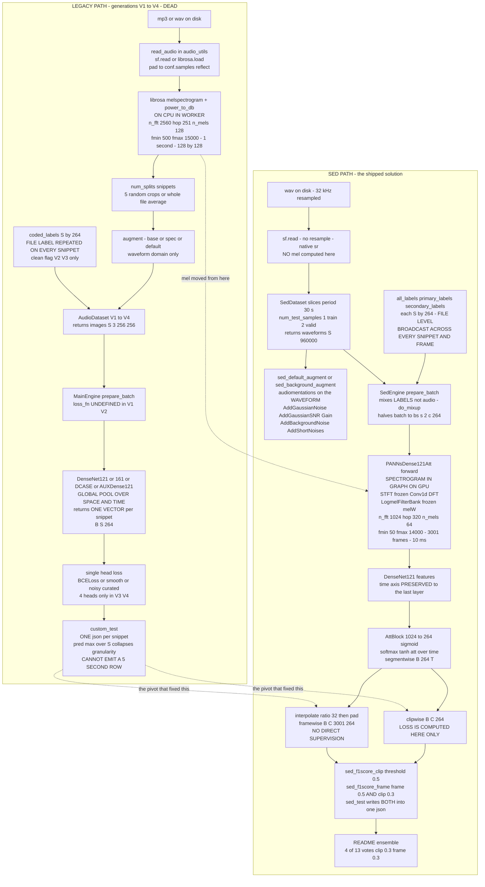
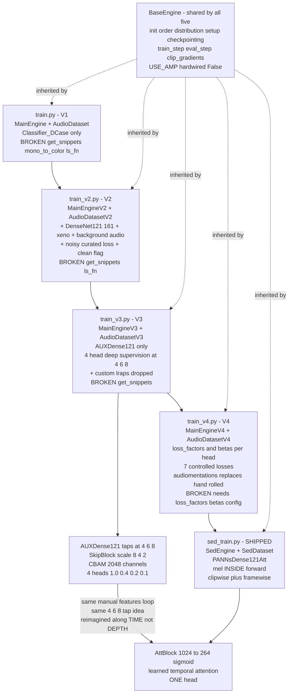
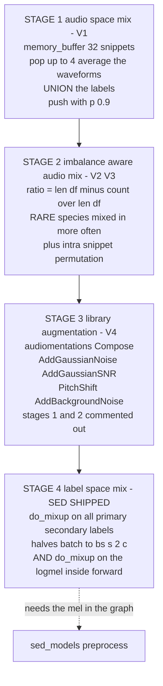

## Purpose

This chapter documents the **four abandoned generations of the classification path** — `train.py` / `train_v2.py` / `train_v3.py` / `train_v4.py`, each a triple of `train_vN.py` → `engine/main_engine_vN.py` → `dataloaders/audio_dataset_vN.py` — plus the six model files and three augmentation modules that only they ever referenced. None of this code is reachable from the final solution. It is documented here because the *shape of the abandonment* is the most informative single artifact in the repo: it is the record of the author discovering that **plain clip-level multi-label classification is structurally incapable of solving this competition**, and the design decisions in the shipped `sed_models.py` can only be read correctly against it.

The whole module exists as one unit because the four generations are a **single line of development**, not four alternatives. Each generation keeps the previous generation's dataset class, augments it, and hands it to a deeper model. V1 → V2 adds background noise and secondary labels; V2 → V3 changes the noise model and adds deep supervision; V3 → V4 replaces the hand-rolled augmentation with `audiomentations` and adds per-head loss control. The SED path is generation V5, and it is not a sibling of these — it is a **rewrite of the front-end and the output layer** while keeping `BaseEngine` and the `dataloaders/` / `loss/` / `metrics/` layout intact.

> [!warning] The single most important architectural pivot
> Every one of the four generations answers **"which birds are in this 1-second window?"** with one `(B, S, 264)` probability vector. The competition requires answering **"which birds are in this 5-second row, and separately, which birds are anywhere in this file?"** — two different granularities over the same audio, at the same time. One classification head over a fixed window cannot emit both, because the 5-second row and the file-level row are different resolutions of the same weak label. The SED path solves this by making the head **two-headed** (`clipwise_output` + `framewise_output`) and by moving the log-mel **inside `forward()`** so that time resolution actually exists in the graph. Everything else in this chapter is a footnote to that pivot.

> [!warning] `directory_structure.txt` is a stale artifact — do not trust it
> The repo root contains `directory_structure.txt`, which advertises four config directories:
>
> ```
> ./src/config_params/old
> ./src/config_params/final_sed_5_fold
> ./src/config_params/final
> ./src/config_params/final_sed
> ./src/config_params/final_5sec_sed_5_fold
> ```
>
> **Three of those five do not exist.** The actual `src/config_params/` inventory is:
>
> | entry | count | tracked in git? |
> |---|---|---|
> | `configs.py` | 1 file | yes |
> | `example_config.py` | 1 file | yes |
> | `final_sed/` | **15** `.py` | yes |
> | `final_sed_5_fold/` | **5** `.py` | yes |
> | `old/` | **absent** | never |
> | `final/` | **absent** | never |
> | `final_5sec_sed_5_fold/` | **absent** | never |
>
> Verified with `git log --all --diff-filter=A --name-only` and `git log --all --diff-filter=D --name-only`: the repo has **exactly one commit introducing Python source** (`17cd1e8 initial code commit`) and **zero deletions across all refs**. `old/`, `final/` and `final_5sec_sed_5_fold/` were never tracked, so they were deleted locally before the first push. `directory_structure.txt` is a leftover from the author's working tree, not a description of the published repo.
>
> The `final_5sec_sed_5_fold` name is a strong hint that a **5-second SED** variant was being developed alongside the 30-second one — which is exactly the axis the dual-head design exists to serve. *(inferred — reason: the directory name, plus `SedDataset`'s `period` parameter being fully config-driven, plus `interpolate_ratio` in `sed_models.py`.)*

---

## Contracts

### Inputs

The legacy entry points are **byte-identical boilerplate** except for the engine class and one `torch.backends` line:

| entry point | engine imported | differs from `train.py` by |
|---|---|---|
| `src/train.py:2` | `from engine.main_engine import MainEngine` | — (the reference) |
| `src/train_v2.py:2` | `from engine.main_engine_v2 import MainEngineV2` | class name only |
| `src/train_v3.py:2` | `from engine.main_engine_v3 import MainEngineV3` | class name only |
| `src/train_v4.py:2` | `from engine.main_engine_v4 import MainEngineV4` | class name + `torch.backends.cudnn.benchmark = True` at **line 6** |

All four are 25–26 lines and do exactly three things:

```python
def run(local_rank, config):
    pe = MainEngine(local_rank, config)   # or V2 / V3 / V4
    pe.train(config.run_params)

# __main__:
module = importlib.import_module(params.config, package=None)
hyperparams = module.Parameters()
main(hyperparams)
```

So the **only** runtime input is `--config <dotted.path.to.module>` resolving to a module with a `Parameters()` constructor. There is no argparse for hyperparameters at all.

`torch.backends.cudnn.benchmark = True` is present in `train_v4.py:6` and `sed_train.py:6`, and **absent** from `train.py`, `train_v2.py`, `train_v3.py`. *(inferred — reason: benchmark mode pays an autotuning cost per new input shape; it only became worth it once the input resolution stopped changing, which is the V4/SED regime.)*

### Outputs

| quantity | shape | dtype | produced by |
|---|---|---|---|
| `batch["images"]` (legacy) | `(B, S, 3, 256, 256)` — `S = num_splits` | `float32` | `AudioDataset*.__getitem__` + `base_augment`/`default_augment` |
| `batch["coded_labels"]` | `(B, S, 264)` | `float32` | `convert_labels_to_coded` / inline `np.zeros((S, 264))` |
| `batch["clean"]` (V2/V3 only) | `(B, S)` | `float32` | `1.0` if "full-window" snippet, `0.0` if "random crop" snippet |
| `batch["primary_codes"]` (V4 only) | `list[int]` of length `S`, or `None` | `int` / `None` | `collate_fn` |
| model output (V1/V2) | `(B, S, num_classes)` — logits, no sigmoid | `float32` | `DenseNet121`, `DenseNet161`, `Classifier_DCase` |
| model output (V3/V4) | `[x, aux3, aux2, aux1]`, **each** `(B, S, 264)` | `float32` | `AUXDense121` |

`num_classes` is `264` throughout — `BIRD_CODE` in `src/config_params/configs.py:30-84` has exactly **264** entries (verified by counting `'<code>':` matches), and `AUXDense121`'s signature default is `num_classes=264` (`aux_densenet121.py:103`).

### Called by

**Nothing.** No config file, no script, no README instruction references `train.py`, `train_v2.py`, `train_v3.py` or `train_v4.py`. `README.md:113` documents only:

```cmd
python sed_train.py --config "config_params.example_config"
```

And `README.md:117` names only `src/config_params/final_sed` and `src/config_params/final_sed_5_fold` as the config locations. The 21 surviving configs are **all** `SedEngine` configs — every one sets `model_name = "sed_dense121att"` and `criterion_name ∈ {"sed_scaled_pos_neg_focal_loss", "sed_scaled_pos_neg_focal_loss_augd"}` (verified by `grep -h` + `sort | uniq -c` over `final_sed/*.py final_sed_5_fold/*.py`).

### Calls

Full transitive closure of the legacy path, with the file that pulls each in:

```
train_v{1,2,3,4}.py
└── engine/base/base_engine.py            (BaseEngine — SHARED with SedEngine)
└── engine/main_engine{,_v2,_v3,_v4}.py   (the specialised engine)
    ├── dataloaders/audio_dataset{,_v2,_v3,_v4}.py
    │   ├── helpers/audio_utils.py        (read_audio, audio_to_melspectrogram)
    │   └── dataloaders/imbalanced_dataset_sampler.py   (SHARED with SedDataset)
    ├── models/{densenet121,densenet161,aux_densenet121,aux_densnet161,
    │          classifier_dcase,classifier_m_series}.py
    ├── augmentations/{base_augment,spec_augment,default_augment}.py
    ├── loss/{bce_loss,smooth_bce_loss,custom_losses,custom_losses_for_targets,
    │         noisy_loss,noisy_controlled_loss,f1_controlled_loss,
    │         bce_controlled_loss,bce_controlled_standard_loss,
    │         focal_controlled_standard_loss,focal_mse_loss}.py
    ├── metrics/{custom_f1score,custom_lraps,custom_test}.py
    └── logger/{print/print_logger,neptune/neptune_logger}.py   (SHARED)
```

The **`sed_*`-free** half of that list — the `dataloaders/audio_dataset*`, `models/dense*|aux_*|classifier_*`, `augmentations/base_|spec_|default_`, `loss/*` **without** `sed_` and without `focal_loss_standard`, `metrics/custom_*` — is the safe-to-ignore surface enumerated in the last section.

---

## How it works

### 1. The four generations at a glance

| Gen | entry point | engine | dataset | model(s) wired by `_init_model` | loss wiring | aug | task type |
|---|---|---|---|---|---|---|---|
| **V1** | `train.py` | `MainEngine` | `AudioDataset` | `Classifier_DCase` **only** | `self.ls_fn` **(undefined)** | `base_augment` (`aug_name == "baseline"`) | clip multi-label classification |
| **V2** | `train_v2.py` | `MainEngineV2` | `AudioDatasetV2` | `Classifier_DCase`, `DenseNet121`, `DenseNet161` | `self.ls_fn` **(undefined)** | `base_augment` or `spec_augment` | clip multi-label classification |
| **V3** | `train_v3.py` | `MainEngineV3` | `AudioDatasetV3` | `AUXDense121` **only** | `self.criterion`, hardcoded `[1.0, 0.4, 0.2, 0.1]` over 4 heads | `base_augment` or `spec_augment` | clip multi-label classification, **4 heads** |
| **V4** | `train_v4.py` | `MainEngineV4` | `AudioDatasetV4` | `AUXDense121` **only** | `self.criterion`, `hparams.loss_factors` + `hparams.betas` | `default_augment` (`aug_name == "default"`) | clip multi-label classification, 4 heads, per-head β |
| *(V5 / live)* | `sed_train.py` | `SedEngine` | `SedDataset` | `PANNs{CNN14,Dense121,Dense161,Dense169,Dense201}Att` | `self.criterion(y_pred["clipwise_output"], y)` | `sed_default_augment` / `sed_background_augment` | **sound event detection, 2 heads** |

**Task type is "clip multi-label classification" for all four.** Each of the `num_splits` snippets of a file is scored independently and all `num_splits` share the file's label row. There is no temporal output, no frame axis, no attention over time. `Classifier_DCase`, `DenseNet121`, `DenseNet161` and `AUXDense121` all collapse the snippet to a single vector via global pooling inside the classifier, and all four return `(B, S, 264)`.

### 2. The central architectural contrast — where the mel is computed

> [!warning] Correction to a common assumption about this repo
> **The legacy path does not cache anything to disk.** A repo-wide grep for `np.save`, `np.load`, `.npy`, `pickle`, `joblib`, `torch.save`, `to_disk` across `src/` returns **only two hits**, both of which are *checkpoint loading*, not feature caching:
>
> - `src/engine/base/base_engine.py:117` — `torch.load(self.hparams.checkpoint_dir, map_location="cpu")`
> - `src/engine/sed_engine.py:181` — `torch.load(self.hparams.pretrained_path, map_location="cpu")["model"]`
>
> There is **no feature cache anywhere in this repository.** The real discriminator is *which process computes the log-mel, with what code, and at what temporal resolution*.

**Legacy — mel computed on the CPU, in the dataloader worker, by librosa.**

`src/helpers/audio_utils.py` (the entire legacy front-end, 56 lines) exports five names and nothing else:

| symbol | role |
|---|---|
| `read_audio(pathname, conf)` | `soundfile.read` for `.wav`; else `librosa.load(sr=conf.sampling_rate, mono=True, res_type="kaiser_fast")`. Then `np.pad` to `conf.samples` with `conf.padmode`. Returns `(float32 y, duration=len(y))` — note `duration` is the **post-padding** length. |
| `audio_to_melspectrogram(audio, config)` | `librosa.feature.melspectrogram(audio, sr=config.sampling_rate, hop_length=config.hop_length, n_mels=config.n_mels, n_fft=config.n_fft, fmin=config.fmin, fmax=config.fmax)` then `librosa.power_to_db`. Returns `float32`, shape `(n_mels, T)`. |
| `show_melspectrogram` | matplotlib debugging helper, unused. |
| `count_parameters` | unused. |
| `normalise` | unused. |

The parameters come from `AUDIO_CONFIG` at `src/config_params/configs.py:4-13`:

```python
class AUDIO_CONFIG:
    sampling_rate = 32000
    duration = 1
    hop_length = 251   # making it 128 in size
    fmin = 500
    fmax = 15000
    n_mels = 128
    n_fft = n_mels * 20          # == 2560
    samples = sampling_rate * duration   # == 32000
    padmode = 'reflect'
```

The `hop_length = 251` comment *"making it 128 in size"* is exact: with `center=True` (librosa's default), `T = 1 + len(y) // hop_length = 1 + 32000 // 251 = 1 + 127 = 128`. So one legacy snippet is a **square 128 × 128 log-mel image** of one second of audio. `n_mels = 128` matches `T = 128` on purpose.

That whole computation happens **in `__getitem__`, on the CPU, per worker**, and the DataLoader ships `float32` arrays:

```python
# audio_dataset_v4.py:166 — representative of all four
spectrogram = audio_to_melspectrogram(y_snippet, self.conf)
list_of_images.append(spectrogram)
```

**SED — mel computed on the GPU, inside `forward()`, by frozen `nn.Module`s.**

`src/helpers/sed_audio_utils.py` (271 lines) exports a completely different set of names — `STFT`, `Spectrogram`, `LogmelFilterBank`, `DropStripes`, `SpecAugmentation` — all `nn.Module` subclasses. The chain is wired in `PANNsDense121Att.__init__` (`src/models/sed_models.py:333` and `:343`) and executed in `preprocess`:

```python
x = self.spectrogram_extractor(input_x)   # STFT via frozen nn.Conv1d carrying DFT matrices
x = self.logmel_extractor(x)              # torch.matmul(x, self.melW) + power_to_db
frames_num = x.shape[2]
x = x.transpose(1, 3); x = self.bn0(x); x = x.transpose(1, 3)
if self.training and self.apply_aug: x = self.spec_augmenter(x)
if self.training and self.apply_aug and mixup_lambda is not None: x = do_mixup(x, mixup_lambda)
```

`freeze_parameters=True` on both extractors means `requires_grad = False` — the DFT matrices and the mel filterbank are constants, not learned. Crucially they are **`nn.Module`s sitting inside the model**, so `SpecAugmentation` and `do_mixup` operate **on the log-mel tensor itself**, after it exists. That is impossible in the legacy layout because there the log-mel is a numpy array created in a worker process and handed over already-converted.

**Side-by-side of the front-ends:**

| | legacy `helpers/audio_utils.py` | SED `helpers/sed_audio_utils.py` |
|---|---|---|
| backend | `librosa` (CPU, numpy) | hand-written PyTorch |
| hop | `251` samples ≈ 7.8 ms | `320` samples = **10 ms exactly** |
| window | `n_fft = 2560` (80 ms) | `window_size = 1024` (32 ms) |
| mels | `n_mels = 128` | `mel_bins = 64` |
| band | `fmin=500`, `fmax=15000` | `fmin=50`, `fmax=14000` |
| chunk length | `duration = 1 s` | `period = 30 s` |
| `top_db` | librosa default (`80.0`) | `top_db = None` in every config — **disabled**, because the AGC-style clamp is incompatible with clipping |
| augmentation surface | waveform-domain only | log-mel domain (`SpecAugmentation`, `do_mixup`) |
| executed in | `Dataset.__getitem__` (worker process) | `Model.forward()` (GPU) |

**Two entirely separate front-ends.** `sed_audio_utils.py` is *not* a superset of `audio_utils.py`; they share nothing but the word "mel". `audio_dataset*.py` never import `sed_audio_utils` and `sed_models.py` never imports `audio_utils`. Both call `librosa` — but the SED one only for `librosa.filters.get_window` and `librosa.filters.mel` at `__init__` time (i.e. to *build* the constants), never for the per-sample transform.

### 3. The central architectural contrast — the label is applied at a different rank

**Legacy.** The label is a `(S, 264)` multi-hot row built in the dataset and **repeated for every snippet of the file**:

```python
# audio_dataset.py:115-119
coded_labels = np.zeros((len(list_of_images), len(self.bird_code)))
for index, temp_labels in enumerate(list_of_labels):
    for temp_label in temp_labels:
        coded_labels[index][label_index] = 1
```

`list_of_labels = [[label]] * len(y_snippets)` in V1. **There is no time axis on the label at all.** A 10-minute file becomes `num_splits` (5) independent 1-second problems, all carrying the same answer.

**SED.** `SedDataset.get_audio` splits the label into three `(S, 264)` tensors (`src/dataloaders/sed_dataset.py:77-84`):

```python
"all_labels": all_labels,          # primary + secondary
"primary_labels": [primary_label] if primary_label is not None else [],
"secondary_labels": [x for x in all_labels if x != primary_label],
```

and `convert_labels_to_coded` writes them **across the snippet axis**:

```python
coded_labels = np.zeros((num_images, len(self.bird_code)))
for index, temp_label in enumerate(labels):
    label_index = self.bird_code[temp_label]
    coded_labels[:, label_index] = 1     # <-- ':' not '[index]'
```

The `:` is the whole point — the file-level weak label is **broadcast identically over all `S` snippets** so it can be compared against *both* the clip-level output and, after the model upsamples, every frame of the frame-level output. Labels remain weak and file-level; they never gain temporal precision. What gains temporal precision is the **prediction**.

### 4. Why the dual head is necessary for this competition

`README.md:11` states the requirement verbatim:

> "Sites 1 and 2 were labeled in 5 second increments and need matching predictions, but due to the time consuming nature of the labeling process the site 3 files are only labeled at the file level. Accordingly, site 3 has relatively few rows in the test set and needs lower time resolution predictions."

So the submission format demands, **from one model**:

- **site 1 / site 2**: rows at 5-second granularity → needs a *frame-level* score with ≥ 5 s resolution.
- **site 3**: one row per file → needs a *clip-level* score for the whole file.

A single classification head over a fixed 1-second window can produce neither, for three compounding reasons:

1. **Resolution mismatch.** The legacy window is `duration = 1` s. To emit a 5-second row you would have to aggregate 5 window predictions — a decision made *after* the model, with no temporal context, and it cannot be trained.
2. **No shared representation.** Nothing in the legacy path carries information from window 1 to window 5. `Classifier_DCase` sees `(B*S, 3, H, W)` — each snippet is an independent image through an image-classification CNN. Attention, temporal pooling, and multi-scale feature fusion are all absent by construction.
3. **One row cannot be two rows.** `custom_test.py` (the legacy submission writer) emits exactly **one JSON entry per (file, snippet)**, and `pred.max(axis=1)[0]` at line 44 collapses the snippet axis by max-pooling before thresholding. The two required granularities are irrecoverably merged at the last step.

The SED path fixes all three by moving the log-mel into the graph, which creates a real time axis, and by splitting the head:

| output | shape | produced by | supervised by | used for |
|---|---|---|---|---|
| `clipwise_output` | `(b, c, 264)` | `att_block`'s attention-weighted sum over time, `torch.sum(norm_att * cla, dim=2)` | `SedEngine.loss_fn` → `self.criterion(y_pred["clipwise_output"], y)` | **site 3** file-level rows; gates the frame predictions |
| `framewise_output` | `(b, c, 3001, 264)` | `interpolate(segmentwise_output, 32)` then `pad_framewise_output(..., frames_num)` | **not directly** — see gotcha below | **site 1 / 2** 5-second rows |

The two heads are treated differently **everywhere downstream**, and this is the evidence the design is deliberate rather than vestigial:

- **Validation metrics are separate.** `SedEngine._init_metrics` wires `SedF1ScoreClip` (threshold 0.5 on `clipwise_output`) and `SedF1ScoreFrame` (threshold 0.5 on `framewise_output` **AND 0.3 on `clipwise_output`**), plus `SedLRAPS` on `clipwise_output`. `sed_f1score_frame.py:35,40` is the conjunction:
  ```python
  score = f1_score([t], [(pf >= self.threshold) & (pc >= 0.3)], average='micro')
  ```
  A frame prediction is accepted **only if the clip head also fires**. That is a learned, soft version of "the bird must actually be in this file".
- **Inference writes both.** `sed_test.py:45-65` stores `predicted_frames` *and* `predicted_clip` in the same per-file JSON, together with two separate LRAPS values (`lraps_score_clip`, `lraps_score_frames`).
- **The final ensemble thresholds them separately.** `README.md:49-62` tabulates `Clip Threshold` and `Frame Threshold` as independent columns. The winning ensemble was 4-of-13 votes at clip `0.3` / frame `0.3`; the 9-model ensemble was clip `0.3` / frame `0.5`. The fact that the author was willing to *tune two thresholds independently* is only possible because the model exposes two independent resolutions.

**The legacy path has no equivalent of `framewise_output`.** `custom_test.py` has one prediction vector, `custom_f1score.py` has one threshold, and `custom_lraps.py` is only wired by `MainEngineV2`. The submission format for sites 1/2 is simply not expressible.

### 5. `audio_dataset_vN` progression

All four share a large common core — `init_workers_fn` (re-seeds `np.random` from `os.urandom(4)` per worker), `get_label`, the `xeno_csv` concat, the `background_audio_dir` glob that appends `{"filename": bk, "ebird_code": None}` entries to `self.data`, and the same `coded_labels` construction. The deltas:

| | V1 `AudioDataset` | V2 `AudioDatasetV2` | V3 `AudioDatasetV3` | V4 `AudioDatasetV4` |
|---|---|---|---|---|
| signature | `(root_dir, csv_dir, conf, bird_code, mem_size=32, file_type, num_splits=5, apply_mix_aug, isTraining, transform)` | adds `inv_ebird_label`, `background_audio_dir`, `xeno_csv`, `xeno_dir`; renames `apply_mix_aug`→`apply_mixer` | same as V2 | **rewritten**: `(root_dir, csv_dir, conf, bird_code, inv_ebird_label, num_test_samples=10, bckgrd_aug_dir, background_audio_dir, file_type, isTraining, transform, apply_mixer)` |
| `num_splits` | ctor arg, default 5 | ctor arg, default 5 | ctor arg, default 5 | **replaced** by `num_test_samples`, default 10 |
| xeno support | no | yes (`xeno_source` flag routes to `self.xeno_dir`) | yes | **removed** |
| noise injection | none | in `get_audio`: with p=0.8, `y += noise_amp * randn`, `noise_amp = U(0,1)*U(0,1)/choice([10,100])` | **commented out** (lines 135–137) | delegated to `audiomentations` |
| snippet grid | `num_splits` **random** offsets when training, **evenly spaced** when validating (`range(0, duration-snip_duration, ceil(...))`) | same, plus a **5-second permutation** branch at p>0.5 | same, but the permutation granularity is generalised (below) | `num_test_samples` **random** 1-second crops when training; `ceil((duration-samples)/num_test_samples)` hop when evaluating, with a pad-loop up to `num_test_samples` |
| intra-snippet permutation | none | fixed 5 × 1 s blocks from `selection_index = range(0, 5*sr, sr)` (line 69), p>0.5 | `num_divisions = choice([2,4,5])`, `division_length = snip_duration // num_divisions`, `mixture_num ∈ [1, num_divisions]`, p>0.75 | removed |
| mixing | `memory_buffer` of ≤32 snippets, pop up to 4, **average** the waveforms, **union** the labels, push with p=0.9 | imbalance-proportional: `ratio = (len(df) - count) / len(df)` so **rare** species are mixed in preferentially, then `(m + y_sec)/2` | same as V2 | mixup block **commented out** (lines 134–142); `apply_mixer` now only gates `audiomentations` |
| secondary labels | not read | `df.secondary_labels.apply(eval)`; `labels = added_label_codes + [label]` | same | same, but `all_labels = [primary] + secondary` |
| extra target | — | `clean (S,)`: `0.0` if the snippet was a *random-offset* sample, `1.0` if it was the *whole-window-averaged* sample. This is the **noisy-or-curated flag** consumed by `NoisyCuratedLoss`. | same | replaced by `primary_codes` |
| `collate_fn` | none (torch default) | none | none | **custom** (line 78), does `torch.stack` and sets `primary_codes = None if None in primary_codes else primary_codes` |
| returns | `filenames, images, coded_labels` | `+ clean` | `+ clean` | `filenames, images, coded_labels, primary_codes` |

**The `clean` flag is V2/V3's answer to weak labels, and it is worth dwelling on.** The dataset chooses *per snippet* whether to take a random-offset 1-second crop (the bird may be anywhere — noisy) or to average the whole file into one 1-second vector (the bird is definitely there somewhere — curated). `NoisyCuratedLoss` (`src/loss/custom_losses.py:38-80`) then splits the batch by that flag, applies `LSoftLoss` to the noisy half and plain `CuratedLoss` (BCE) to the curated half, weights each by its share of the batch, and sums `0.5*noisy + 0.5*curated`. That is a real, working answer to noisy labels. **It was abandoned**, and the SED path answers the same problem differently — not by trusting vs distrusting a label, but by *separating primary from secondary labels* and letting the frame head learn where in time the primary label actually applies.

**Mel parameters never change across V1–V4.** All four call `audio_to_melspectrogram(y_snip, self.conf)` and all four would have to be handed an `AUDIO_CONFIG` instance. No shipped config does so — see "safe to ignore".

### 6. The models

Six files, of which **three are dispatched by no engine at all**.

#### 6.1 `models/densenet121.py` — `DenseNet121` (18 lines)

Thin wrapper over torchvision. `self.densenet = models.densenet121(pretrained=pretrained)`, then `self.densenet.classifier = torch.nn.Linear(1024, num_classes)` (1024 is densenet121's feature width). `forward` accepts 5-D and flattens:

```python
def forward(self, x):            # (bs, seq, c, h, w)
    bs, seq, c, h, w = x.shape
    x = x.reshape(bs*seq, c, h, w)
    x = self.densenet(x)          # (bs*seq, num_classes)
    x = x.reshape(bs, seq, self.num_classes)
```

The 5-D reshape-and-restore is the **whole** adaptation: it lets the DataLoader collate `(batch, snippet)` into one tensor and the model treat each snippet as an independent image. Default `num_classes=6`.

#### 6.2 `models/densenet161.py` — `DenseNet161` (18 lines)

Identical, with `Linear(2208, num_classes)` (densenet161's width). Default `num_classes=6`. This is the smallest meaningful step from V1 → V2: *the same wrapper, a deeper backbone*.

#### 6.3 `models/classifier_dcase.py` — `Classifier_DCase` (173 lines)

**This is a DCASE audio-tagging CNN, ported.** Evidence:

- The block vocabulary is exactly the DCASE 2020 Task-1 baseline (`qiuqiangkong/audioset_tagging_cnn`-lineage): `ConvBlock` = 2 × `Conv2d` + `BatchNorm2d` + `ReLU`, plus an **`SCse`** module = `SpatialAttention2d` (1×1 conv → sigmoid, a spatial gate) **+** `GAB` (global-avg-pool → 1×1 conv → ReLU → 1×1 conv → sigmoid, a channel gate), summed. SCSE attention is the signature of that baseline, not of torchvision.
- `init_layer(layer, nonlinearity='leaky_relu')` at line 5 uses `nn.init.kaiming_uniform_`, and `forward` re-initialises with `kaiming_normal_(mode='fan_out', nonlinearity='leaky_relu')` — the `fan_out` + leaky_relu pairing is the DCASE recipe.
- Default `num_classes=80`.
- The comment at lines 63–64 documents a **local experiment on top of the port**: *"changed kernel size / we don't know why, but this is better than (3, 3) kernels."* → `kernel_size=(2, 2)`. That is the author's own note, not upstream's.

Architecture, top to bottom:

| stage | shape (per snippet) |
|---|---|
| `conv1..conv5 = ConvBlock(3,32 / 32,64 / 64,128 / 128,256 / 256,512)`, each with SCSE, all `pool_type="both"` (max+avg summed) | |
| pooling `conv1 (1,1)`, `conv2 (4,1)`, `conv3 (1,3)`, `conv4 (4,1)`, `conv5 (1,3)` — **alternating time/frequency**, comment: *"Changed pooling policy."* | `(512, T/4, F/4)`-ish |
| `x1 = adaptive_avg_pool2d(max_pool2d(x,(5,8)) + avg_pool2d(x,(5,8)), 1)` | `512` |
| `x2 = adaptive_avg_pool2d(max_pool2d(x,(2,4)) + avg_pool2d(x,(2,4)), 1)` | `512` |
| `x = mean(x, dim=3); x, _ = max(x, dim=2)` | `512` |
| `cat([x, x1, x2])` — **three parallel pooling scales** | `1536` |
| `bn1(1536) → drop1(0.4) → fc1(1536,512) → PReLU → bn2(512) → drop2(0.2) → fc2(512,num_classes)` | `num_classes` |

The three-scale concat is a *spatial* multi-scale mechanism — exactly the idea that the SED model later reimplements along the **time** axis with `AttBlock`. The comment at line 154, *"Cutting the feature map to arbitrary size"*, marks where the fixed-size pooling replaced the original flatten.

#### 6.4 `models/classifier_m_series.py` — `Classifier_M3`, `Classifier_M2` (110 lines) — **dispatched by no engine**

These are the **M-series** (Qiuqiang Kong's `CNN_M*` family), identifiable by:

- `adaptive_concat_pool2d(x, sz)` = `cat([adaptive_avg_pool2d, adaptive_max_pool2d])` — the M-series' standard **avg+max dual pooling**.
- **Pyramid pooling** over intermediate depths: `Classifier_M3` concatenates `adaptive_concat_pool2d(x2), (x3), (x4), (x5)` → `3840`; `Classifier_M2` concatenates `x2..x4` → `1792`. (`M3` = 4 pyramid levels × 2 pooling modes; `M2` = 3 × 2.)
- `ConvBlock` with a **dense-style residual concat**: `conv2` takes `out_channels + in_channels` and is fed `torch.cat([x, x1], 1)`.
- `fc = BatchNorm1d → Linear → PReLU → BatchNorm1d → Linear`.
- Defaults `num_classes=6` on both.

*Where the `M3`/`M2` naming comes from is an inference* — the naming matches Kong's `CNN_M1..M20` model zoo, whose distinguishing trait is exactly the pyramid + avg/max concat pooling above, and `README.md:136` cites `qiuqiangkong/audioset_tagging_cnn` as reference `[2]`. **Not verifiable from this repo alone**: no file imports either class, and there is no header or comment naming the source.

> [!warning] Dead: dispatched by nothing
> `grep -rn "classifier_m_series\|Classifier_M3\|Classifier_M2" --include=*.py .` returns **only the two `class` statements inside the file itself**. Not one engine's `_init_model` names them. This is a scratch file — the author ported the M-series and moved on without ever wiring it into a training run.

#### 6.5 `models/aux_densenet121.py` — `AUXDense121` (161 lines) — **the architectural ancestor of the shipped model**

The most important file in this chapter. Signature:

```python
AUXDense121(base_size=64, last_fc=8, num_classes=264, dropout=0.2, ratio=16, kernel_size=7, last_filters=8)
```

Structure, with the `densenet121(pretrained=True).features` layers indexed `ii` as the code itself numbers them:

1. `features = list(densenet121(pretrained=True).features)` wrapped in `nn.ModuleList`.
2. **Manual `for ii, model in enumerate(self.features)` loop** with **deep-supervision taps at `ii == 4`, `6`, `8`**:
   ```python
   for ii, model in enumerate(self.features):
       x = model(x)
       if ii == 4:   skip1 = self.skip1(x); aux1 = self.aux1(skip1)
       elif ii == 6: skip2 = self.skip2(x); aux2 = self.aux2(skip2)
       elif ii == 8: skip3 = self.skip3(x); aux3 = self.aux3(skip3)
   ```
3. Each `SkipBlock(in, 512, scale_factor)` = `avg_pool2d(scale_factor)` → `Conv2d(3,3,pad=1)` → `BatchNorm2d` → `ReLU`, used at scale factors **8, 4, 2** respectively — an explicit **U-Net/pyramid** back-off to a common 512-channel resolution.
4. Each `AuxBlock` = `AdaptiveAvgPool2d(1)` → flatten → `Dropout(0.2)` → `Linear(512, 512)` → `PReLU` → `BatchNorm1d(512)` → `Dropout(0.1)` → `Linear(512, num_classes)`.
5. `x = self.transition(x)` — a local `_Transition(1024 → 512)` = `BatchNorm2d + ReLU + Conv2d(1×1) + AvgPool2d(1, stride=1)` (note: the `AvgPool2d(kernel_size=1, stride=1)` is a **no-op**, a vestige of a copied torchvision definition).
6. `x = torch.cat([x, skip1, skip2, skip3], dim=1)` → **2048 channels**.
7. `x = self.attention(x)` — `ConvolutionalBlockAttentionModule(2048, ratio=16, kernel_size=7)`, i.e. `ChannelAttention` (1×1 conv squeeze r=16, avg+max paths summed, sigmoid) **then** `SpatialAttention` (7×7 conv on `cat([mean, max], dim=1)`, sigmoid). Both are attributed verbatim in the source: `# Source: https://github.com/luuuyi/CBAM.PyTorch`.
8. `x = self.merge(x)` — `SkipBlock(2048, 512, scale_factor=1)`, no pooling since `scale_factor < 2`.
9. `AdaptiveAvgPool2d(1)` → flatten → `fc`: `Dropout(0.2) → Linear(512,512) → PReLU → BatchNorm1d(512) → Dropout(0.1) → Linear(512, 264)`.
10. **Returns `[x, aux3, aux2, aux1]`** — a *list*, main head first then deepest-to-shallowest — each reshaped to `(bs, s, 264)`.

> [!tip] What the auxiliary supervision actually is
> **It is deep supervision, not a second task.** Each of `aux1`, `aux2`, `aux3` is a full `Linear(512, 264)` classifier emitting the **same 264-way multi-hot target** as the main head — just from a coarser, earlier, more-downsampled feature map. There is no auxiliary *objective* (no "is there noise" head, no site/recorder head, no age/gender head). The supervision signal is: *make the intermediate layers linearly decodable into the label, and back-propagate into the early DenseNet layers so they don't have to carry all the burden.*
>
> `MainEngineV3.loss_fn` confirms the design by weighting the four heads:
> ```python
> loss_factors = [1.0, 0.4, 0.2, 0.1]      # main, aux3, aux2, aux1
> total_loss = 0.0
> for i, y_pred_i in enumerate(y_pred):
>     loss, dict_loss = self.criterion(y_pred_i, y)
>     total_loss += loss * loss_factors[i]
> ```
> A monotonically decaying factor per depth — the standard deep-supervision schedule.

**The lineage to `PANNsDense121Att` is direct and visible in the code.**

| | `AUXDense121` (V3/V4) | `PANNsDense121Att` (shipped) |
|---|---|---|
| backbone | `densenet121(pretrained=True).features` as `ModuleList`, **manual `for` loop** | `models.densenet121(pretrained=True).features` as one module |
| taps | at `ii ∈ {4, 6, 8}` | **none** |
| multi-scale mechanism | 3 × `SkipBlock` with hand-chosen `scale_factor ∈ {8,4,2}` | `interpolate(segmentwise_output, 32)` — a **single** learned `interpolate_ratio` |
| multi-scale fusion | `torch.cat` of 4 × 512 channels → 2048 | implicit in `AttBlock`'s attention over time |
| multi-head supervision | 4 heads, `[1.0, 0.4, 0.2, 0.1]` | **1 head** |
| attention | CBAM on `(B, 2048, H, W)` | `AttBlock(1024, 264, activation='sigmoid')` on `(B, 1024, T)` |
| output | list of 4 × `(B, S, 264)` | dict of `clipwise (B, C, 264)` + `framewise (B, C, 3001, 264)` |

The shared fingerprint is the **manual iteration over `densenet.features` with taps at 4/6/8** — a pattern found in neither PANNs upstream nor torchvision. The conceptual move the author made: *deep supervision at three fixed depths with hand-tuned averaging scales is a crude way to say "let the network decide where and when the evidence is".* `AttBlock` says exactly that, learned, along the time axis. The multi-head → dual-output evolution is not a change of backbone; it is the discovery that **the useful axis is time, not depth**.

One more continuity: **both** feed ImageNet-pretrained DenseNet, which requires 3 input channels, and **both** get them by duplicating rather than learning. Legacy `default_augment.py:22-24` stacks `[x, librosa.feature.delta(x), librosa.feature.delta(x, order=2)]` — the mel plus its 1st and 2nd derivatives. SED `sed_models.py:410` does `x = x.expand(x.shape[0], 3, x.shape[2], x.shape[3])` — plain replication of one mel channel. The legacy approach is strictly more informative; the shipped one is simpler and sufficient.

#### 6.6 `models/aux_densnet161.py` — `AUXDense161` (156 lines) — **dispatched by no engine AND broken**

Same design on `densenet161(pretrained=True).features`. Differences from `AUXDense121`:

- `last_fc=2` (not 8), so `fc` is `Linear(512, 128) → PReLU → BN1d(128) → Linear(128, 264)` — a much narrower head.
- A **fourth** tap `skip4 = SkipBlock(in_channels=2208, out_channels=512, scale_factor=1)` applied to the **final** features (`x = self.skip4(x)`, line 142) instead of `AUXDense121`'s `_Transition(1024 → 512)`.
- `aux_densnet161.py:98-103` sizes the taps from `base_size` arithmetic that assumes densenet161's growth rate: `base_size*6` (384), `base_size*6*2` (768), `base_size*33` (2112), plus 2208 from the final layer. All four are concatenated to `base_size*8*4 = 2048`, same as V3.
- Returns a **tuple** `x, aux3, aux2, aux1` (line 156) whereas `AUXDense121` returns a **list**. Harmless for `enumerate`, but the inconsistency is real.

> [!danger] `AUXDense161` raises `NameError` on construction
> The file imports only:
> ```python
> import torch
> import torch.nn as nn
> from torchvision.models import densenet161, densenet121
> from collections import namedtuple
> ```
> There is **no `import torch.nn.functional as F`**, yet `SkipBlock.forward` calls `F.avg_pool2d` at line 17 and `AUXDense161.forward` calls `F.adaptive_avg_pool2d` at line 149. `aux_densenet121.py:5` has the missing import; `aux_densnet161.py` does not. Also note the **filename itself is misspelled** (`aux_densnet161.py` — missing the `e`), so a search for `aux_densenet161` finds nothing. Combined with the fact that no engine dispatches it, this file was never executed.

### 7. `main_engine_vN` progression — shared vs specialised

**All five engines — `MainEngine`, `MainEngineV2`, `MainEngineV3`, `MainEngineV4`, `SedEngine` — inherit `BaseEngine` and override the same 14 methods.** The base class was kept and specialised; nothing about the training lifecycle was rewritten.

#### 7.1 What is SHARED (in `BaseEngine`, `src/engine/base/base_engine.py`, 375 lines)

Everything that is not about *what the task is*:

| method | line | role |
|---|---|---|
| `__init__` | 35 | fixed init order: `_init_score_function` → `_init_augmentation` → 3 dataloaders → `_init_model` → `_init_criterion_function` → `_init_metrics` → `setup()` |
| `_init_distribution` | 52 | `idist.get_rank()`, `manual_seed(42 + rank)`, `idist.device()`; builds `train_loader` / `valid_loader` / `test_loader` via `idist.auto_dataloader`; **uses `self.train_ds.sampler(self.train_ds, self.train_ds.get_label)` when `train_ds.sampler is not None`, else `shuffle=True`**; the AMP branch; `self.criterion.to(self.device)` |
| `setup` | 134 | creates `Engine(self.train_step)` and `Engine(self.eval_step)`, attaches metrics, `common.setup_common_training_handlers`, wires validation on `EPOCH_COMPLETED(every=hparams.eval_every)`, sets up the checkpoint saver |
| `setup_checkpoint_saver` | 120 | `Checkpoint` + `DiskSaver` attached to the **evaluator** |
| `load_trainer_from_checkpoint` | 103 | full-session or model-only restore |
| `train` / `validate` / `evaluate` | 216 / 225 / 230 | the run loop |
| `train_step` / `eval_step` / `test_step` | 237 / 258 / 268 | `model.train()`/`model.eval()`, `no_grad` on eval/test, `loss_backpass`, gradient accumulation every `accumulation_steps`, `clip_gradients()` |
| `loss_backpass` | 251 | `amp.scale_loss` or plain `backward` |
| `clip_gradients` | 327 | L2-norm clip; `eps` = `EPSILON_FP16` when AMP/bf16 else `EPSILON` |
| `_init_score_function` | 318 | closure over `track_metric` / `metric_factor` |
| `lr_finder` | 353 | `ignite.contrib.handlers.FastaiLRFinder`, detaches validation + scheduler handlers first |
| the 8 stubs | 282–323 | `_init_scheduler`, `prepare_batch`, `output_transform`, `loss_fn`, `_init_model`, `_init_optimizer`, `_init_criterion_function`, `_init_logger`, `_init_metrics`, `_init_*_dataloader`, `_init_augmentation` — all `raise NotImplementedError` or return `None` |

**AMP lives here and is hard-disabled.** `base_engine.py:6-13`:

```python
try:
    from apex import amp
    print("Found NVIDIA Apex, using mixed precision")
    print("NOT USING APEX BECAUSE CANNOT CREATE MEL SPEC, REQUIRES TUNING, PROBLEMS HAVE OCCURRED")
    USE_AMP = False
except:
    print("NVIDIA Apex not found, not using mixed precision")
    USE_AMP = False
```

`USE_AMP = False` on **both** branches. The second print is the author's own note and it is the direct, contemporaneous explanation of the pivot: **Apex O1/O2 mixed precision could not handle the in-graph mel** (`10*log10(clamp(x, min=1e-10))` underflows in fp16 → NaN). The comment names the symptom before the fix was found; the fix was to leave AMP off entirely. `README.md:94` restates it: *"The sed training models don't support mixed precision training in the current state and will output NaN values. This can be fixed by adjusting the `amin` value but this is an untested change."* Note the irony: this was only ever a problem **after** the mel moved into the graph. The legacy path, whose mel was computed in numpy on the CPU, could have used AMP without difficulty — but the flag is global to `BaseEngine`, so the legacy engines are also stuck at fp32.

**`lr_finder` is dead in every generation.** It exists on `BaseEngine` but is never called from any engine, any config, or `startup.sh`.

#### 7.2 What is SPECIALISED per generation

| method | V1 `MainEngine` | V2 `MainEngineV2` | V3 `MainEngineV3` | V4 `MainEngineV4` | SED `SedEngine` |
|---|---|---|---|---|---|
| `prepare_batch` | `(x, coded_labels)`; test → `(x, whole batch)` | `(x, (coded_labels, clean))` | same as V2 | `(x, (coded_labels, primary_codes))` — **`y[1]` stays a python list, NOT converted to device** | builds the **`(x, mixup_lambda)` tuple** the model unpacks, and mixes the three label tensors |
| `loss_fn` | `self.ls_fn(...)` **← never defined** | `self.ls_fn(...)` **← never defined** | multi-head: `criterion(y_pred_i, y)` × 4, factors `[1.0,0.4,0.2,0.1]` | `criterion(y_pred_i, y, betas[i], betas[i]+0.05)`, factors `hparams.loss_factors` | **single head**: `self.criterion(y_pred["clipwise_output"], y)` |
| `_init_optimizer` | `adamw`, `adam` | same | same | `adamw`, `adamw_no_weight_decay` (`weight_decay=0.0`) | `AdamW(lr, betas=(0.9,0.999), eps=1e-08, weight_decay=hparams.weight_decay, amsgrad=True)` |
| `_init_criterion_function` | `bce`, `smooth_bce` | + `lq`/`lsoft` (`NoisyCuratedLoss`), `lsoft_targetted` | same as V2 | **all-new family**: `noisy_controlled_loss`, `noisy_loss`, `f1_controlled_loss`, `bce_controlled_loss`, `bce_controlled_standard_loss`, `focal_controlled_standard_loss`, `focal_mse_loss` | `focal_loss_standard`, `sed_removed_focal_loss`, `sed_scaled_pos_neg_focal_loss`, `sed_scaled_pos_neg_focal_loss_augd`, `bce_controlled_standard_loss` |
| `_init_scheduler` | `none`, `warmup_with_cosine` (1%→lr→lr·0.001) | + `warmup_with_cosine_10` (10%→lr→lr·0.1) | same as V2 | + `warmup_with_cosine_100` (1%→lr→lr·0.01), `one_cycle_cosine_10`, `one_cycle_cosine_100` | `none`, `warmup_with_cosine`, `one_cycle_cosine` — all reading `hparams.lr_scale_factor` |
| `_init_logger` | print / neptune, **no `else` fallback** | + `else: self.logger = None` | same | same | same |
| `_init_metrics` | only `"f1score"`; **no `self.test_metrics` at all** | `f1score50/60/70`, `lraps`, `test`; adds `self.test_metrics = {}` | f1 scores only on `y_pred[0]` (`for i in range(1)`); **drops `lraps`** | adds per-loss-component `RunningAverage`s from `criterion.loss_keys` × `range(4)` | `lraps`, `f1score_clip`, `f1score_frame`, `test` |
| `_init_model` | `dcase` only | `dcase`, `densenet121`, `densenet161` | `aux_dense121` only | `aux_dense121` only | 5 × `PANNs*Att` |
| `_init_augmentation` | `baseline` only | `baseline`, `spec_aug` | `baseline`, `spec_aug` | `default` only | `default`, `secondary_default` |
| `_init_*_dataloader` | `AudioDataset` | `AudioDatasetV2` | `AudioDatasetV3` | `AudioDatasetV4` | `SedDataset` |

#### 7.3 The per-generation feature story, told as narrative

- **V1 — the minimum.** One model, one loss, one metric, one augmentation. Two fatal bugs (`get_snippets`, `self.ls_fn`) mean it never ran to completion.
- **V2 — the data era.** Three models, a real loss library (`NoisyCuratedLoss`, the noisy/curated split), real metrics (three F1 thresholds + LRAPS), a real submission writer (`CustomTest`), and the sampler is now consulted. **The `clean` target is born here.** The dataset grows xeno-canto support and a background-audio pool.
- **V3 — the architecture era.** The only substantive change is `loss_fn`: the single-head assumption breaks, replaced by the 4-head deep-supervision sum. `CustomF1Score` is re-pointed at `y_pred[i]`. The augmentation is generalised from fixed 5-second blocks to `num_divisions ∈ {2,4,5}`.
- **V4 — the tuning era.** Nothing new architecturally; instead everything becomes **configurable per head**: `loss_factors` and per-head `betas` move from a hardcoded list into the config, seven new criterion variants land, two new scheduler shapes land, `adamw_no_weight_decay` lands, and the hand-rolled waveform augmentation is **replaced wholesale by `audiomentations`**. `AudioDatasetV4` is the first dataset with a `collate_fn`. This is the generation where the author stopped inventing and started tuning — and it is immediately followed by the architectural rewrite.

**No engine ever enables AMP** (the flag is in `BaseEngine`) and **no engine ever calls `lr_finder`**.

### 8. The mixup evolution — four stages

This is the cleanest narrative thread in the abandoned code, because it maps exactly onto the shipped path's design:

**Stage 1 — audio-space mix (V1).** `AudioDataset.mix_aug` keeps a `self.memory_buffer` of up to `mem_size=32` snippets. For each snippet, if the buffer is >80% full it pops up to 4 items, **averages the waveforms** (`mixed_snippets[index] = np.array(mem_y_snippets).sum(0)/len(mem_y_snippets)`) and **unions the label lists**. Snippets are pushed with `np.random.random() > 0.1`.

**Stage 2 — audio-space mix, imbalance-aware (V2/V3).** V2/V3 replace the buffer with **inverse-frequency sampling**:

```python
ebird_counts = df.groupby("ebird_code").agg(len)
ebird_counts["ratio"] = (len(df) - ebird_counts["filename"]) / len(df)
```

so **rare** species get large `ratio` → large `prob` → are mixed in more often, and the union of labels makes the mixture multi-label by construction. V2/V3 also add the intra-snippet 1-second / variable-division permutations described above.

**Stage 3 — library augmentation (V4).** **V4 deletes all of Stage 1 and Stage 2** (the `add_augmentation` mixup block is commented out at lines 134–142) and delegates to `audiomentations`:

```python
Compose([
    AddGaussianNoise(min_amplitude=0.001, max_amplitude=0.015, p=0.3),
    AddGaussianSNR(p=0.3),
    PitchShift(min_semitones=-4, max_semitones=4, p=0.3),
    AddBackgroundNoise(bckgrd_aug_dir, p=0.5),      # only if bckgrd_aug_dir is not None
])
```

**Stage 4 — label-space mix (SED, shipped).** `SedEngine._init_augmentation` sets `self.mixup_augmenter = Mixup(mixup_alpha=1.)` when `hparams.apply_mixup`, and `prepare_batch` applies it to **labels, not audio**:

```python
mixup_lambda = self.mixup_augmenter.get_lambda(batch_size=bs*c, device=x.device)
all_labels      = do_mixup(all_labels.reshape(bs_al*s_al, c_al), mixup_lambda).reshape((bs_al*s_al)//2, 1, c_al)
primary_labels  = do_mixup(primary_labels.reshape(...), mixup_lambda).reshape(...)
secondary_labels= do_mixup(secondary_labels.reshape(...), mixup_lambda).reshape(...)
```

`do_mixup` (`src/augmentations/mixup.py:49`, MIT header, *"source: https://github.com/qiuqiangkong/audioset_tagging_cnn"*) pairs even and odd indices and **halves the batch dimension**. The model's `forward` then re-halves it:

```python
input_x, mixup_lambda = input_data
if mixup_lambda is not None:
    b = (b*c)//2
    c = 1
```

and `do_mixup` is applied a **second** time, to the **log-mel inside `preprocess`** (`sed_models.py:394-395`). So the shipped path mixes in *both* spaces, and can only do the mel-space mix because the mel is now inside the graph. `README.md:43` records that half the final ensemble (4 fold + 5 fold "with mixup") depends on this flag.

`README.md:29-35` lists the final augmentation set as `AddGaussianNoise`, `AddGaussianSNR`, `Gain`, `AddBackgroundNoise`, `AddShortNoises` — which matches `sed_background_augment.py` (the `secondary_default` branch, and `example_config.py:11` uses `aug_name = "secondary_default"`), not `sed_default_augment.py`. Both branches prepend **and** append the same `AddGaussianNoise(p=0.2) / AddGaussianSNR(p=0.2) / Gain(...)` triple, doubling those three.

---

## Key decisions and tricks

### 1. `weight_decay` was honoured by exactly one engine

| engine | `_init_optimizer` |
|---|---|
| `MainEngine` | `torch.optim.AdamW(self.model.parameters(), lr=self.hparams.lr)` |
| `MainEngineV2` | identical |
| `MainEngineV3` | identical |
| `MainEngineV4` | `torch.optim.AdamW(..., lr=self.hparams.lr)` **or** `torch.optim.AdamW(..., lr=self.hparams.lr, weight_decay=0.0)` |
| **`SedEngine`** | `torch.optim.AdamW(self.model.parameters(), lr=self.hparams.lr, betas=(0.9, 0.999), eps=1e-08, weight_decay=self.hparams.weight_decay, amsgrad=True)` |

`self.hparams.weight_decay` is read at **`sed_engine.py:85` and nowhere else in the repo.** Every legacy `AdamW` call drops it, silently falling back to the PyTorch default `weight_decay=1e-2` regardless of what the config said. The final configs carry real values — `0.01` in `example_config.py:32`, `0.0001` in `final_sed_dense121_nomix_fold0.py` — so a legacy run would have trained at **100× the intended decay** and reported nothing wrong. `grep -rn "weight_decay" src/config_params/` shows legacy `weight_decay` values were never honoured by anything.

**Lesson recorded.** V4 tried to address this by adding an explicit `adamw_no_weight_decay` branch rather than by threading the config value through — evidence the author noticed the omission but did not fix it properly until the rewrite.

### 2. `loss_fn` is broken in V1 and V2 — the criterion is built and then never called

```python
# main_engine.py:31-33 and main_engine_v2.py:34-36 — identical
def loss_fn(self, y_pred, y):
    loss, dict_loss = self.ls_fn(y_pred, y)
    return loss, dict_loss
```

`self.ls_fn` is **never assigned anywhere in the repository** — `grep -rn "ls_fn" --include=*.py .` returns exactly these two hits. Meanwhile `_init_criterion_function` *does* populate `self.criterion`, and `BaseEngine.__init__` even calls `self.criterion.to(self.device)` at line 92. So V1 and V2 construct a criterion, move it to the GPU, and then raise `AttributeError` on the first `train_step`. V3 fixes it by switching to `self.criterion` — the only structural change V3 makes.

### 3. The four-head loss is hardcoded in V3 and config-driven in V4

V3 (`main_engine_v3.py:35`):

```python
loss_factors = [1.0, 0.4, 0.2, 0.1]
```

V4 (`main_engine_v4.py:43-44`):

```python
loss_factors = self.hparams.loss_factors   # [1.0, 0.4, 0.2, 0.1]
betas = self.hparams.betas                 # [0.6, 0.7, 0.8, 0.9]
```

and each head gets its **own** noise coefficient, `betas[i]` for the main target and `betas[i] + 0.05` for the primary-label term (`main_engine_v4.py:48`). The four V4 criteria that accept this signature — `BCEControlledLoss`, `NoisyLoss`, `NoisyControlledLoss`, `F1ControlledLoss`, `FocalControlledStandardLoss`, `FocalMSELoss` — all implement the same `LSoftLoss` target-smoothing idea, differing in the base loss:

```python
y_true_updated = (beta*y_true + (1-beta)*y_pred) * y_true     # BCEControlledLoss
```

The `* y_true` multiplication is the distinguishing trick: **the smoothed target is clamped back to zero wherever the true label is 0**, so smoothing can only ever *reduce* confidence in a positive, never invent a negative. That is the cleanest weak-label trick in the repo.

`F1ControlledLoss` goes further and computes `tp/fp/fn` per class directly, using the smoothed target for `fn` only — an explicit differentiable surrogate for the metric that is actually scored.

> [!warning] `hparams.loss_factors` and `hparams.betas` do not exist in any shipped config
> `grep -rn "loss_factors\|betas\|primary_loss_factor" src/config_params/` returns **zero matches**. V4 is unrunnable without hand-writing a config, and the two list-valued parameters are exactly the kind of thing that would have been tuned — which is arguably why V4 was abandoned rather than finished.

### 4. The V4 criterion family is a controlled-loss family

All six V4 criteria share the `LSoftLoss` skeleton and differ only in the base loss and the mask. They are also the direct ancestor of the SED loss:

| V4 criterion | base | V4 loss keys | SED descendant |
|---|---|---|---|
| `BCEControlledLoss` | `F.binary_cross_entropy` | `primary_loss`, `bce_loss` | — |
| `NoisyLoss` / `NoisyControlledLoss` | BCE | `zeros_loss, ones_loss, primary_loss, overall_target_loss` | — |
| `F1ControlledLoss` | explicit `tp/fp/fn` | `precision, recall, f1` | — |
| `FocalControlledStandardLoss` | `BCEWithLogitsLoss` | `bce_loss, F_loss` | `FocalLossStandard`, `SedRemovedFocalLoss` |
| `FocalMSELoss` | `MSELoss` | `mse_loss, F_loss` | — |
| — | — | — | **`SedScaledPosNegFocalLoss`** |

`SedScaledPosNegFocalLoss` is the same idea again: BCE → `pt = exp(-bce)` → `(1-pt)**gamma` → split into `F_loss_0` (negative) and `F_loss_1` (positive) → weight by `alpha_0`/`alpha_1` → multiply by a **secondary-label mask** that down-weights positions where a *secondary* (weak) label is present. That mask is the direct descendant of V2/V3's `clean` flag: both ask "how much should I trust this label?", and both answer by *weighting the loss* rather than by changing the architecture.

### 5. `framewise_output` receives no direct supervision

This is easy to miss and it is a genuine design point rather than a bug.

`SedEngine.loss_fn`:

```python
def loss_fn(self, y_pred, y):
    loss, dict_loss = self.criterion(y_pred["clipwise_output"], y)
    return loss, dict_loss
```

**Only `clipwise_output` enters the loss.** `framewise_output` is produced by `interpolate(segmentwise_output, 32)` — a nearest-neighbour `repeat` of the *same* `cla` projection that feeds the clip head — then truncated by `pad_framewise_output` to `frames_num`. So:

- the frame head is trained **only implicitly**, through the shared `AttBlock.cla` weights that the clip loss also trains;
- the `framewise_output` is free — no extra parameters, no extra loss term, no extra compute;
- but it is also **not calibrated** relative to `clipwise_output`, which is exactly why the ensemble needed **two independently tuned thresholds** (`README.md:49-62`) and why `sed_f1score_frame.py` gates every frame prediction behind `pc >= 0.3`.

`pad_framewise_output` fills with a repeat of the **last** frame (`sed_models.py:71-72`):

```python
pad = framewise_output[:, -1:, :].repeat(1, frames_num - framewise_output.shape[1], 1)
```

— a deliberate "extrapolate the final decision backwards" rather than a zeros pad, which would have produced spurious negatives in the tail.

### 6. `AUDIO_CONFIG` is defined and never used

`src/config_params/configs.py:4-13` defines the entire mel parameterisation of the legacy path — `sampling_rate=32000`, `duration=1`, `hop_length=251`, `n_mels=128`, `n_fft=2560`, `fmin=500`, `fmax=15000`, `padmode='reflect'`. `grep -rn "AUDIO_CONFIG" --include=*.py .` returns **one hit: the class definition itself.** No config constructs it; no engine references it; it is passed as the `conf` argument by a hand-written config that no longer exists. The comment `# making it 128 in size` on `hop_length` is the only surviving record of the reasoning behind the legacy front-end's parameters.

### 7. The legacy `clean` flag and the SED label split are two answers to the same problem

Worth stating plainly because it shows the thinking did not regress — it changed axis.

| | legacy V2/V3 | shipped SED |
|---|---|---|
| the problem | the eBird label is **weak**: the bird may be anywhere in the file, or only in the foreground while other birds/noise are in the background | same |
| the axis of the answer | **trust axis** — `clean ∈ {0,1}` per snippet, split the batch, apply a different loss to each half | **semantic axis** — split the label into `primary_labels` (foreground, trustworthy) and `secondary_labels` (present-but-unlabelled), down-weight the latter by `secondary_factor` |
| mechanism | `NoisyCuratedLoss`, `0.5*noisy + 0.5*curated` | `y_secondary_mask` inside `SedScaledPosNegFocalLoss` |

### 8. The `aux` → `AttBlock` pivot, restated as the chapter's thesis

Deep supervision at three fixed depths with hand-chosen `scale_factor ∈ {8,4,2}` is a **static** guess about where multi-scale information should be combined. `AttBlock` is a **learned, per-sample, per-frame** weighting of the same information:

```python
norm_att = torch.softmax(torch.tanh(self.att(x)), dim=-1)   # (n, classes, T)
cla = self.nonlinear_transform(self.cla(x))                 # (n, classes, T)
x = torch.sum(norm_att * cla, dim=2)                         # clipwise: (n, classes)
```

`norm_att` is **also returned** by `AttBlock.forward` — and the shipped code throws it away (`_ , norm_att, segmentwise_output = ...`). That it is *returned* rather than discarded is the fossil of the multi-head idea: this is where the aux weights used to be. The gain-pooling before it (`max_pool1d(k=3) + avg_pool1d(k=3)`, lines 416-418) is the temporal analogue of `Classifier_DCase`'s `max_pool2d + avg_pool2d`. **The entire legacy model family was reaching for learned temporal aggregation; the shipped model finally built it.**

---

## Failure modes and gotchas

> [!danger] **V1 is dead on arrival — `AudioDataset` raises `NameError` on the first batch**
> `src/dataloaders/audio_dataset.py:12` does `from helpers.audio_utils import *`, then:
>
> - line 102: `y_snippets = get_snippets(y, snip_duration, indices)`
> - line 112: `image = mono_to_color(image)`
>
> **Neither `get_snippets` nor `mono_to_color` is defined in `helpers/audio_utils.py`**, which exports exactly five names: `read_audio`, `audio_to_melspectrogram`, `show_melspectrogram`, `count_parameters`, `normalise`. Confirmed with `grep -rn "def get_snippets\|def mono_to_color" --include=*.py .` → *no matches anywhere in the repository*.
>
> The failure is unconditional — **every** path through `__getitem__` reaches line 102 — so `AudioDataset` cannot produce a single item. Since `MainEngine._init_train_dataloader` instantiates it in `BaseEngine.__init__`, **V1 cannot even construct its engine.**
>
> `mono_to_color` is separately imported at `augmentations/spec_augment.py:8` and used at lines 49 and 63, so that module also fails at import time.
>
> `git log --all -S"get_snippets"` shows the name present only in the single `initial code commit`; `git log --all --diff-filter=D` is empty, so **the file that defined it was never in the repo** — it was deleted locally before the first push, exactly like the `old/` config directory.

> [!danger] **V2 and V3 are broken by the same missing `get_snippets`**
> `audio_dataset_v2.py` calls it at lines 145, 150, 160, 191; `audio_dataset_v3.py` at lines 142, 147, 157, 186. The `isTraining=True` branch reaches it at line 145/142 whenever `duration - snip_duration <= 0`, and the `else` (validation) branch always reaches it. So both datasets raise `NameError` unconditionally, exactly like V1.
>
> **V2/V3 additionally cannot survive their own augmentation module**, which is worth knowing before anyone tries to repair them:
>
> - `aug_name == "baseline"` → `base_augment.get_transforms()` → `torch.tensor(x/255).permute(0,3, 1, 2)`. This needs a 4-D `(S, H, W, 3)` input. V1 called `mono_to_color` in the dataset to produce it; **V2 and V3 dropped that call**, so they hand the transform a 3-D `(S, 128, 128)` array. Verified: `torch.rand(5,128,128).permute(0,3,1,2)` → `RuntimeError: input.dim() = 3 is not equal to len(dims) = 4`.
> - `aug_name == "spec_aug"` → `spec_augment.py`, which additionally imports `cv2` and `skimage.transform` (neither is in `requirements.txt`) and calls the missing `mono_to_color`.
>
> **V1/V2/V3 have no working augmentation path at all.**

> [!danger] **V2 and V3 additionally raise `AttributeError` on the first `train_step`**
> `self.ls_fn` — see Key decisions #2 below. Even with a repaired dataset and augmentation, V1 and V2 cannot complete one training iteration. V3 fixes this.

> [!danger] **V3 and V4 can only run with a specific criterion family, and V4 needs two config fields that no config defines**
> V3's `loss_fn` passes `y = (coded_labels, clean)` (a **tuple**) to every head. `BCELoss.forward(pred, actual)` and `SmoothBCELoss.forward(pred, actual)` both assume a tensor and will fail on the tuple. Only `NoisyCuratedLoss` / `NoisyCuratedLossTargetted` unpack it (`target, clean = target`, `custom_losses.py:49`). So `criterion_name ∈ {"bce", "smooth_bce"}` is **broken under V3** despite being the default choice in V1/V2.
>
> V4 needs `hparams.loss_factors` **and** `hparams.betas` (plus `primary_loss_factor` / `gamma` / `alpha` depending on the criterion). None of these appear in any shipped config.

> [!warning] **`MainEngine` (V1) has no `self.test_metrics` and no logger fallback**
> - `_init_metrics` never assigns `self.test_metrics` (grep: 0 hits in `main_engine.py`). `BaseEngine.evaluate` (line 232) does `self.attach_metrics(self.tester, self.test_metrics)` → `AttributeError`. V2/V3/V4/SED all assign `self.test_metrics = {}`.
> - `_init_logger` (lines 73-79) has **no `else: self.logger = None`**. V2/V3/V4 and `SedEngine` all have it. Any `logger_name` other than `"print"`/`"neptune"` → `AttributeError: 'MainEngine' object has no attribute 'logger'`.

> [!warning] **`aux_densnet161.py` is doubly dead**
> Dispatched by no engine (`grep` finds only the class definition), **and** missing `import torch.nn.functional as F` while calling `F.avg_pool2d` (line 17) and `F.adaptive_avg_pool2d` (line 149) → `NameError` at runtime. Filename misspelled as `aux_densnet161` (no `e`), so a grep for `aux_densenet161` finds nothing.

> [!warning] **`classifier_m_series.py` is dispatched by no engine**
> `Classifier_M3` and `Classifier_M2` are referenced only by their own `class` statements. Scratch file.

> [!warning] **`loss/sed_scaled_focal_loss.py` is dead on the live side too**
> It is the only file in `src/loss/` that **no engine imports** — not even `sed_engine.py`. It also defines a class named `SedRemovedFocalLoss` (line 7), which is a **duplicate name** of the one in `sed_removed_focal_loss.py:7`. Confusing to grep for; a stale copy.

> [!warning] **`AUDIO_CONFIG` is never instantiated**
> See Key decisions #6 below. Any attempt to resurrect a legacy path must construct `AUDIO_CONFIG()` and pass it as `conf` to the dataset ctor — which means also supplying `train_ds_params` with a `conf` key, which no shipped config has.

> [!info] **A minor shape bug in `AudioDatasetV4`'s evaluation branch**
> `audio_dataset_v4.py:171-186` computes `split_hop = math.ceil((duration - samples) / num_test_samples)` and iterates `range(0, total_duration, split_hop)`, then pads up with a `while len < num_test_samples` loop. If `total_duration` is large relative to `num_test_samples` the loop yields **more** than `num_test_samples` images (e.g. `total=100, split=10 → range(0,100,10) = 10`, but `total=105, split=11 → 0,11,…,99 = 10`; the count stays ≈ `num_test_samples`, so this is bounded in practice). The `collate_fn`'s `torch.stack` would then throw on ragged shapes. *(inferred — reason: the `while` loop only pads up, never truncates.)*

> [!info] **`read_audio` returns a post-padding duration**
> `audio_utils.py:14-19`: padding runs `if len(y) <= conf.samples`, then `duration = len(y)`. So `duration` is the length **after** padding to `conf.samples`, not the file's true length. For files shorter than one second `duration == conf.samples` exactly, which makes `duration - snip_duration == 0` and sends every snippet index to `[0]*num_splits`. The legacy datasets rely on this to avoid out-of-range slicing; it also means the true file duration is never known downstream.

### Reverse-engineered insight: the shipped focal loss is numerically inert at the shipped values

All 21 configs set:

```python
self.criterion_params = {
    "gamma": 0.0,
    "alpha_0": 1.0,
    "alpha_1": 1.0,
    "secondary_factor": 1.0
}   # the two *_augd files add "primary_drop_out_factor": 0.3
```

Substituting into `SedScaledPosNegFocalLoss.forward` (`src/loss/sed_scaled_pos_neg_focal_loss.py:29-48`):

| setting | effect on the computation |
|---|---|
| `gamma = 0.0` | `(1-pt)**0 == 1` for every element → the **focal term is exactly 1**, so `F_loss_0 = alpha_0*(1-mask)*bce` and `F_loss_1 = alpha_1*mask*bce`. No focal down-weighting at all. |
| `alpha_0 = alpha_1 = 1.0` | `F_loss_0 + F_loss_1 = (1-mask)*bce + mask*bce = bce`. The positive/negative split **reconstructs unweighted BCE**. |
| `secondary_factor = 1.0` | `y_zeros_mask = ones * 1.0`, so `y_secondary_mask = where(sec > 0, 1.0, 1.0) == 1.0` everywhere. The secondary-label down-weighting is a **no-op**. |
| **net** | `FScaled_loss = bce_loss.mean()` — **exactly plain mean BCE.** |

So the elaborate `alpha_0`/`alpha_1`/`gamma`/`secondary_factor` machinery is **present, calibrated, logged as five separate metrics, and numerically inert at the values the author shipped.** The five `loss_keys` (`bce_loss, F_loss, FScaled_loss, F_loss_0, F_loss_1`) are all reported to Neptune and all collapse to the same number.

The **only** place a shipped hyperparameter changes the objective is the `_augd` variant's `primary_drop_out_factor = 0.3`:

```python
y_primary_true = y_true - y_sec_true
y_primary_mask = torch.where(y_primary_true > 0, ones, zeros)
y_primary_mask = torch.where(torch.rand(y_primary_mask.shape) <= self.primary_drop_out_factor,
                             y_primary_mask, zeros)
FScaled_loss2 = (1 - y_primary_mask) * FScaled_loss
```

i.e. **randomly drop the primary (foreground) label from 30 % of training samples** — a direct, targeted response to weak labels, and structurally the same idea as V2/V3's `clean` flag but expressed as label dropout rather than as a loss split.

*(inferred — reason: the algebra above is a direct substitution into the shipped `forward`; it is deterministic, not a guess. What I cannot determine is **why** the values were left at the neutral setting — whether they were never tuned, were tuned and found not to help, or the `*_augd` variant was created specifically to escape the collapse.)*

---

## Mermaid

### Side-by-side: legacy classification vs sound event detection



### The four generations and the SED rewrite, as a lineage



### Mixup evolution: four stages, three of them abandoned



---

## Files referenced by nothing in the final pipeline

The **live** chain, in full — `sed_train.py` → `SedEngine` → `BaseEngine` → `SedDataset` + `sed_models` + `sed_*` loss/metric/augment. Every file below is reachable only from a legacy engine, or from nothing at all.

> [!tip] Safe to ignore, with the reason for each
> "Unreferenced" means: no import, no dispatch, no entry point. If you are pruning, reading, or looking for a baseline, skip all of it.

### Entry points — all four dead

| file | referenced by |
|---|---|
| `src/train.py` | nothing (`README.md:113` names only `sed_train.py`) |
| `src/train_v2.py` | nothing |
| `src/train_v3.py` | nothing |
| `src/train_v4.py` | nothing |

### Engines — all four dead

| file | referenced by |
|---|---|
| `src/engine/main_engine.py` | `train.py:2` only |
| `src/engine/main_engine_v2.py` | `train_v2.py:2` only |
| `src/engine/main_engine_v3.py` | `train_v3.py:2` only |
| `src/engine/main_engine_v4.py` | `train_v4.py:2` only |

### Dataloaders — all four dead

| file | referenced by | note |
|---|---|---|
| `src/dataloaders/audio_dataset.py` | `main_engine.py:107,111,115` | **hard-broken** (`get_snippets`, `mono_to_color`) |
| `src/dataloaders/audio_dataset_v2.py` | `main_engine_v2.py:157,161,165` | hard-broken (`get_snippets`) |
| `src/dataloaders/audio_dataset_v3.py` | `main_engine_v3.py:157,161,165` | hard-broken (`get_snippets`) |
| `src/dataloaders/audio_dataset_v4.py` | `main_engine_v4.py:210,214,218` | closest to runnable; needs a bespoke config |

> `src/dataloaders/imbalanced_dataset_sampler.py` is **NOT** in this list. It is live: `sed_dataset.py:8` imports it, and `BaseEngine._init_distribution:59` calls `self.train_ds.sampler(self.train_ds, self.train_ds.get_label)`.

### Models — all six dead

| file | class(es) | dispatched by | state |
|---|---|---|---|
| `src/models/densenet121.py` | `DenseNet121` | `main_engine_v2.py:141-143` | importable, runnable |
| `src/models/densenet161.py` | `DenseNet161` | `main_engine_v2.py:144-146` | importable, runnable |
| `src/models/classifier_dcase.py` | `Classifier_DCase` | `main_engine.py:97-99`, `main_engine_v2.py:137-140` | importable, runnable |
| `src/models/aux_densenet121.py` | `AUXDense121` | `main_engine_v3.py:144-146`, `main_engine_v4.py:200-202` | importable, runnable; the architectural ancestor |
| `src/models/aux_densnet161.py` | `AUXDense161` | **nothing** | **broken** — missing `import torch.nn.functional as F` |
| `src/models/classifier_m_series.py` | `Classifier_M3`, `Classifier_M2` | **nothing** | importable, unreachable |

### Augmentations — all three legacy ones dead

| file | referenced by | state |
|---|---|---|
| `src/augmentations/base_augment.py` | `main_engine.py:102-104`, `main_engine_v2.py:149-151`, `main_engine_v3.py:149-151` | needs 4-D input; **unreachable** because V1/V2/V3 datasets are broken |
| `src/augmentations/spec_augment.py` | `main_engine_v2.py:152-154`, `main_engine_v3.py:152-154` | **broken** — imports missing `mono_to_color`, plus `cv2` and `skimage` are absent from `requirements.txt` |
| `src/augmentations/default_augment.py` | `main_engine_v4.py:205-207` | the delta/accel-to-3-channel trick; only reachable via V4 |

> `src/augmentations/mixup.py`, `sed_default_augment.py`, `sed_background_augment.py` are **live** (imported by `sed_engine.py:10,209` / `:202` / `:205`).
> `src/augmentations/noise_maker.py` is imported by nothing — it is a **standalone script**, vendored from `felixpatzelt/colorednoise` (`README.md:134` reference `[1]`), used manually to generate the pink-noise corpus that `AddBackgroundNoise` later reads. **Not dead — just not imported.**

### Losses — ten legacy ones dead, two dead on the live side too

| file | referenced by | state |
|---|---|---|
| `src/loss/bce_loss.py` | `main_engine*.py` (V1/V2/V3) | legacy |
| `src/loss/smooth_bce_loss.py` | `main_engine*.py` (V1/V2/V3) | legacy |
| `src/loss/custom_losses.py` (`LqLoss`, `LSoftLoss`, `CuratedLoss`, `NoisyCuratedLoss`) | `main_engine_v2.py`, `main_engine_v3.py` | legacy |
| `src/loss/custom_losses_for_targets.py` (`NoisyCuratedLossTargetted`) | `main_engine_v2.py`, `main_engine_v3.py` | legacy |
| `src/loss/noisy_loss.py` | `main_engine_v4.py:72-74` | legacy |
| `src/loss/noisy_controlled_loss.py` | `main_engine_v4.py:69-71` | legacy |
| `src/loss/f1_controlled_loss.py` | `main_engine_v4.py:75-77` | legacy |
| `src/loss/bce_controlled_loss.py` | `main_engine_v4.py:78-80` | legacy |
| `src/loss/focal_controlled_standard_loss.py` | `main_engine_v4.py:84-86` | legacy |
| `src/loss/focal_mse_loss.py` | `main_engine_v4.py:87-89` | legacy |
| **`src/loss/sed_scaled_focal_loss.py`** | **nothing** | **dead on both sides**; duplicates the class name `SedRemovedFocalLoss` from `sed_removed_focal_loss.py` |

> **Live losses:** `sed_scaled_pos_neg_focal_loss.py` (17 configs), `sed_scaled_pos_neg_focal_loss_augd.py` (2 configs), plus `focal_loss_standard.py`, `sed_removed_focal_loss.py`, `bce_controlled_standard_loss.py` which `SedEngine._init_criterion_function` can construct but **no shipped config selects**.

### Metrics — all three legacy ones dead

| file | referenced by |
|---|---|
| `src/metrics/custom_f1score.py` (`CustomF1Score`) | `main_engine.py`, `main_engine_v2.py`, `main_engine_v3.py`, `main_engine_v4.py` |
| `src/metrics/custom_lraps.py` (`CustomLRAPS`) | `main_engine_v2.py:129-131` **only** — V3 dropped it |
| `src/metrics/custom_test.py` (`CustomTest`) | `main_engine_v2.py`, `main_engine_v3.py`, `main_engine_v4.py` |

> **Live metrics:** `sed_lraps.py`, `sed_f1score_clip.py`, `sed_f1score_frame.py`, `sed_test.py`.

### Helpers — the legacy front-end is dead

| file | referenced by | state |
|---|---|---|
| `src/helpers/audio_utils.py` | `audio_dataset*.py` (all four, `import *`), `spec_augment.py` | **legacy front-end, dead**; also exports `show_melspectrogram`, `count_parameters`, `normalise`, none of which anything calls |

> **Live:** `src/helpers/sed_audio_utils.py` (imported at `sed_models.py:177`).

### Config artifacts that do not exist

| advertised in `directory_structure.txt` | actual |
|---|---|
| `src/config_params/old/` | **absent** — never tracked in git |
| `src/config_params/final/` | **absent** — never tracked |
| `src/config_params/final_5sec_sed_5_fold/` | **absent** — never tracked |

**Consequence: there is no shipped config for any of the four legacy generations.** All 21 surviving configs target `SedEngine`. `AUDIO_CONFIG` (`configs.py:4`) is defined but never instantiated; `get_dict_value` (`configs.py:21`) is imported by all 21 configs but **never called** by any of them; `BIRD_CODE` (264 entries) and `INV_EBIRD_LABEL` are the only two symbols from `configs.py` the live path actually uses (`sed_dataset.py` and `sed_test.py:10`).

---

## Return value

- **Four generations, one line of development**, not four alternatives: V1 `MainEngine`/`AudioDataset`/`Classifier_DCase` → V2 adds `DenseNet121|161`, xeno, background audio, `NoisyCuratedLoss`, the `clean` flag → V3 adds `AUXDense121`'s 4-head deep supervision with hardcoded `[1.0,0.4,0.2,0.1]` → V4 makes everything per-head configurable and swaps hand-rolled augmentation for `audiomentations`. **No engine ever wired `Classifier_M3`, `Classifier_M2` or `AUXDense161`.**
- **The pivot is dual-output, not dual-input.** Legacy collapses everything to `(B, S, 264)` with global pooling; the shipped `PANNsDense121Att` preserves the time axis to the last layer and emits `clipwise (B,C,264)` + `framewise (B,C,3001,264)`. This is *required* by `README.md:11` — site 1/2 need 5-second rows, site 3 needs file-level rows. Validation (`SedF1ScoreFrame` gates frames behind `pc>=0.3`) and the winning ensemble (two independently tuned thresholds) both depend on the two heads being genuinely independent.
- **Nothing is cached anywhere in this repo.** The legacy/SED contrast is *CPU worker + librosa on numpy* vs *GPU + frozen `nn.Module`s inside `forward()`*, with different hop (251 vs 320), window (2560 vs 1024), mels (128 vs 64), band (500–15000 vs 50–14000), and chunk (1 s vs 30 s). `grep` for `np.save|np.load|.npy|pickle|joblib|torch.save` over `src/` returns only two `torch.load` checkpoint lines.
- **`AUXDense121` is the direct architectural ancestor of the shipped model** — same manual `for ii, model in enumerate(self.features)` loop with taps at `ii ∈ {4,6,8}`, then abandoned in favour of a single learned `AttBlock(1024, 264, 'sigmoid')` over time. The aux weights became the attention weights; `AttBlock` still *returns* `norm_att`, which the shipped code discards.
- **The shipped focal loss is numerically inert.** `gamma=0` kills the focal term, `alpha_0=alpha_1=1` reconstructs unweighted BCE, `secondary_factor=1.0` makes the secondary mask identically 1 — all 19 non-`_augd` configs collapse to plain mean BCE while still logging five separate metrics. Only `_augd`'s `primary_drop_out_factor=0.3` (30% primary-label dropout) is active.
- **`weight_decay` is honoured by exactly one engine** (`sed_engine.py:85`). All four legacy `AdamW` calls silently use the PyTorch default `1e-2`, so a legacy run would train at up to 100× the configured decay with no warning. V4's `adamw_no_weight_decay` shows the author noticing without fixing it.
- **Hard-broken as shipped:** V1 (`get_snippets` + `mono_to_color` + `ls_fn`, three independent failures — cannot even construct an engine), V2/V3 (`get_snippets`, plus no working augmentation path exists), V4 (needs `hparams.loss_factors` and `hparams.betas`, in zero configs). `aux_densnet161.py` is missing `import torch.nn.functional as F`; `spec_augment.py` is missing `mono_to_color` and imports `cv2`/`skimage`, neither in `requirements.txt`.
- **Could a legacy baseline be reproduced?** Only V4, and only after: constructing `AUDIO_CONFIG()` and threading it as `conf`, writing a config with `loss_factors`/`betas`, and repairing `read_audio`'s interaction with V4's `np.random.randint(0, duration - samples + 1)`. V4's dataset is the only legacy dataset with no undefined symbols. V1/V2/V3 would need `get_snippets` reimplemented before anything else.
- **Stale-artifact trap:** `directory_structure.txt` advertises `src/config_params/{old,final,final_5sec_sed_5_fold}/`; none exist and none were ever tracked (`git log --all --diff-filter=D` is empty; the repo has one source-introducing commit, `17cd1e8`). **There is no shipped config for any legacy generation.**
- **Mixup narrative:** audio-space buffer mix (V1) → imbalance-proportional audio mix + intra-snippet permutation (V2/V3) → `audiomentations` (V4) → **label-space** `do_mixup` on `all/primary/secondary` labels plus a second `do_mixup` on the in-graph logmel (SED). Only the last stage is possible because the mel moved into `forward()`.
- **Could not determine from the code:** the provenance of `classifier_m_series.py` (the `M3`/`M2` naming matches Kong's `CNN_M*` zoo, but nothing in the repo says so); whether the `_augd` variant was created specifically to escape the BCE collapse; what the `final_5sec_sed_5_fold/` experiment was testing (the name plus `SedDataset.period` being config-driven suggests a 5-second-chunk SED variant — *inferred*); and whether any legacy generation ever produced a trained checkpoint.