# Week 01 — PyTorch Foundations (Comprehensive Study Notes)

## Table of Contents
- [1. Study Topics: PyTorch and NumPy Foundations (Section 1)](#1-study-topics-pytorch-and-numpy-foundations-section-1)
- [2. Study Topics: Tensor Basics (Section 2)](#2-study-topics-tensor-basics-section-2)
- [3. Study Topics: Indexing, Slicing, and Shape Manipulation (Section 3)](#3-study-topics-indexing-slicing-and-shape-manipulation-section-3)
- [4. Study Topics: Tensor Arithmetic and Reductions (Section 4)](#4-study-topics-tensor-arithmetic-and-reductions-section-4)
- [5. Study Topics: Broadcasting (Section 5)](#5-study-topics-broadcasting-section-5)
- [6. Study Topics: Memory, Views, Contiguity, and Devices (Section 6)](#6-study-topics-memory-views-contiguity-and-devices-section-6)
- [7. Study Topics: Derivatives and Autograd Fundamentals (Section 7)](#7-study-topics-derivatives-and-autograd-fundamentals-section-7)
- [8. Study Topics: Backpropagation and Gradient Mechanics (Section 8)](#8-study-topics-backpropagation-and-gradient-mechanics-section-8)
- [9. Study Topics: Gradient Verification and Debugging (Section 9)](#9-study-topics-gradient-verification-and-debugging-section-9)
- [Autograd One-Page Cheat Sheet (Section 9)](#autograd-one-page-cheat-sheet-section-9)
- [10. Study Topics: Linear Regression Fundamentals (Section 10)](#10-study-topics-linear-regression-fundamentals-section-10)
- [11. Study Topics: Training Loop and Validation (Section 11)](#11-study-topics-training-loop-and-validation-section-11)
- [12. Study Topics: Optimization Behavior and Experiments (Section 12)](#12-study-topics-optimization-behavior-and-experiments-section-12)
- [13. Study Topics: Logistic Regression and Binary Classification (Section 13)](#13-study-topics-logistic-regression-and-binary-classification-section-13)
- [14. Study Topics: Classification Metrics and Evaluation (Section 14)](#14-study-topics-classification-metrics-and-evaluation-section-14)
- [15. Assessment and Review (Section 15)](#15-assessment-and-review-section-15)
- [Repository Review Checklist (Section 15C)](#repository-review-checklist-section-15c)
- [Week 1 Cheat Sheets (Section 15D)](#week-1-cheat-sheets-section-15d)

---

## 1. Study Topics: PyTorch and NumPy Foundations (Section 1)

### 1.1 What PyTorch is and how it differs from NumPy
- **NumPy** is a foundational numerical computing library for Python focused on efficient CPU-based `ndarray` operations, vectorization, broadcasting, and scientific/math routines.
- **PyTorch** is a tensor computation and deep learning framework that provides `torch.Tensor`, automatic differentiation (`autograd`), neural-network building blocks (`torch.nn`), optimizers (`torch.optim`), data utilities, and accelerator support (CUDA/MPS/CPU).
- **Key differences:** PyTorch adds gradient tracking, device placement (CPU/GPU/MPS), and DL training abstractions; NumPy focuses on general-purpose numerical computing on CPU without built-in autograd or neural-network training APIs.

### 1.2 Tensors versus NumPy arrays
- Both represent n-dimensional, typed, homogeneous data and support similar indexing/slicing/broadcasting patterns.
- `numpy.ndarray`: CPU-resident array object; no built-in gradient history or device abstraction like PyTorch tensors.
- `torch.Tensor`: can live on different devices, can require gradients (`requires_grad=True`), and integrates with autograd and model training.
- Interoperability is possible (`torch.from_numpy`, `.numpy()`), but memory sharing and device/grad constraints must be handled carefully.

### 1.3 CPU versus GPU computation
- **CPU:** general-purpose cores, strong for control flow, smaller/irregular workloads, and data orchestration.
- **GPU:** massively parallel throughput for large tensor/matrix operations common in deep learning.
- PyTorch operations run on the tensor's device; tensors/models must be on compatible devices.
- Data transfer between CPU and accelerators has overhead; use accelerators when workload size/parallelism benefits outweigh transfer costs.

### 1.4 Eager execution
- PyTorch executes operations immediately by default (**eager mode** / define-by-run), making debugging and experimentation straightforward.
- Dynamic control flow in Python works naturally because computation is defined as it runs.
- When gradients are required, autograd records operations during eager execution to build the graph needed for backpropagation.

### 1.5 Tensor-based computation
- Tensors generalize scalars/vectors/matrices to n dimensions and are the core data structure for ML/DL.
- Computations are expressed as vectorized/batched tensor operations (element-wise ops, reductions, matmul, etc.) for clarity and performance.
- Efficient tensor-based code minimizes Python loops and leverages optimized backend kernels.

### 1.6 PyTorch's role in deep learning
- Provides end-to-end primitives: tensors, autograd, layers/losses/optimizers, data loading utilities, and device acceleration.
- Supports rapid research (flexible eager execution) and scalable training/inference workflows.
- Bridges mathematical model definitions to trainable systems through differentiable computation graphs.

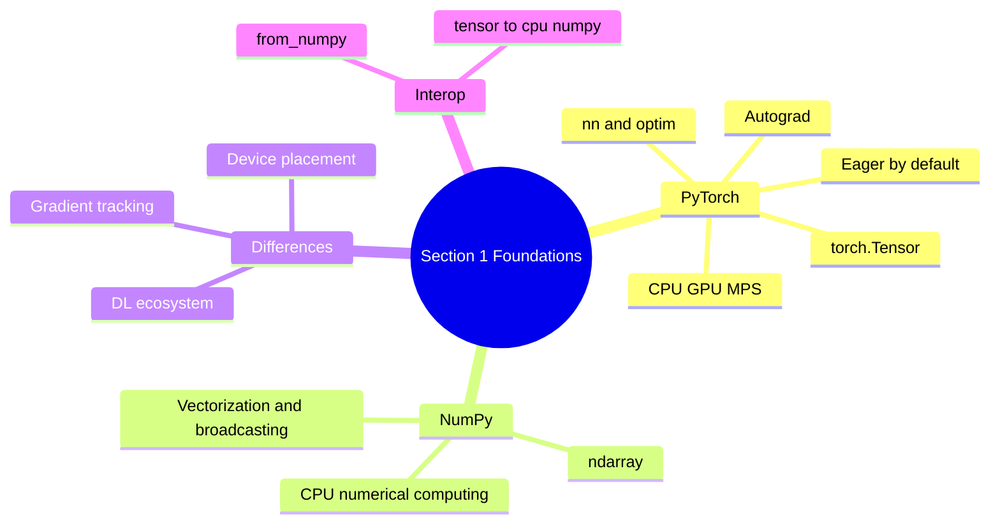

---

## 2. Study Topics: Tensor Basics (Section 2)

### 2.1 Scalar, vector, matrix, and higher-dimensional tensors
- **Scalar (rank 0):** single value, shape `()`.
- **Vector (rank 1):** 1D sequence, shape `(n,)`.
- **Matrix (rank 2):** rows and columns, shape `(m, n)`.
- **Higher-dimensional tensors:** rank >= 3, e.g. `(batch, channels, height, width)` for images or `(batch, seq_len, embed_dim)` for sequences.

### 2.2 Tensor rank
- **Rank** (number of dimensions/axes) is `tensor.ndim`.
- Rank determines how many indices are needed to access an element.

### 2.3 Tensor shape
- **Shape** describes the size of each dimension, e.g. `torch.Size([2, 3, 4])`.
- Total number of elements is the product of shape dimensions (`tensor.numel()`).

### 2.4 Tensor dimensions
- Each dimension (axis) has a length and a semantic meaning (e.g. batch, channel, time, feature).
- Correct interpretation of axes is essential for slicing, reductions, broadcasting, and model input/output compatibility.

### 2.5 Tensor data types
- Common dtypes: `torch.float32`, `torch.float64`, `torch.float16`, `torch.int32`, `torch.int64`, `torch.bool`.
- Dtype affects precision, memory, numerical behavior, and operator/type promotion.
- Explicit casting (`.to(dtype)`, `tensor.float()`, etc.) improves clarity and correctness.

### 2.6 Random tensor generation
- `torch.rand`: uniform in `[0, 1)`.
- `torch.randn`: standard normal distribution.
- `torch.randint`: integer range sampling.
- Reproducibility requires seed control (`torch.manual_seed`, and NumPy seeds when applicable).

### 2.7 Tensor initialization
- From data/literals: `torch.tensor(...)`.
- Constant fills: `torch.zeros`, `torch.ones`, `torch.full`, `*_like` variants.
- Ranges/sequences: `torch.arange`, `torch.linspace`.
- Random initialization for experiments/parameters as needed.

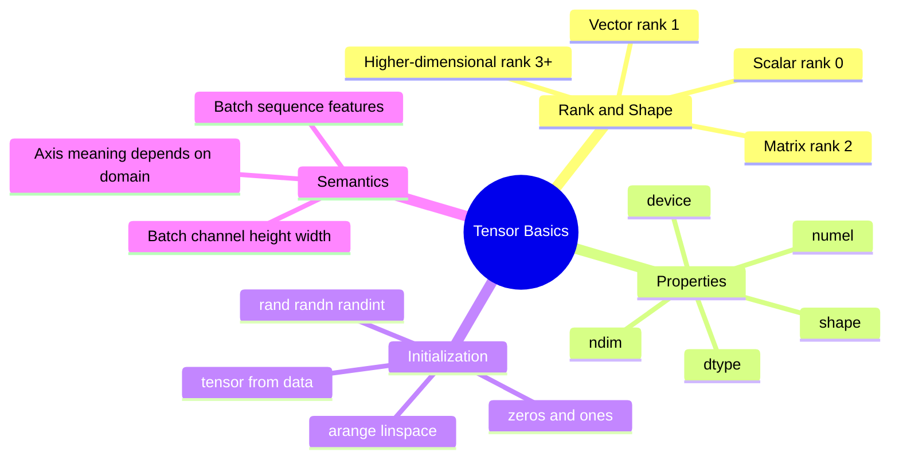

---

## 3. Study Topics: Indexing, Slicing, and Shape Manipulation (Section 3)

### 3.1 Indexing
- Access elements or substructures using integer indices (0-based), negative indices, and tensor/list indices.
- Indexing can reduce rank (e.g. selecting a row from a matrix yields a vector).

### 3.2 Slicing
- Use ranges `start:stop:step` to select contiguous or strided subsets along dimensions.
- Slices often return views sharing storage (implementation/layout dependent), so mutations may affect originals.

### 3.3 Selecting rows and columns
- Matrix row: `M[i]` or `M[i, :]`; column: `M[:, j]`.
- Submatrices via combined row/column slices or advanced indexing.

### 3.4 Reshaping
- `reshape` changes shape without changing total element count (`numel` must match).
- `-1` can infer one dimension; invalid target sizes raise runtime errors.
- `view` requires compatible memory layout; `reshape` may return a view or copy.

### 3.5 Viewing tensor dimensions
- Inspect `shape`, `size()`, `ndim`, and strides/layout behavior when relevant.
- Dimension manipulation (`unsqueeze`, `squeeze`, `permute`, `transpose`) changes interpretation/access patterns.

### 3.6 Transposing
- Swap axes: `T`, `transpose(dim0, dim1)` (2D common), or `permute(...)` for higher dims.
- Transposition can make tensors non-contiguous.

### 3.7 Squeezing and unsqueezing
- `unsqueeze(dim)` adds a singleton dimension (size 1).
- `squeeze()` removes all singleton dims; `squeeze(dim)` removes a specific singleton dim.
- Useful for broadcasting alignment and model input shape compatibility.

### 3.8 Concatenating tensors
- `torch.cat` joins tensors along an **existing** dimension; other dimensions must be compatible.

### 3.9 Stacking tensors
- `torch.stack` creates a **new** dimension and stacks tensors along it (shapes must match).

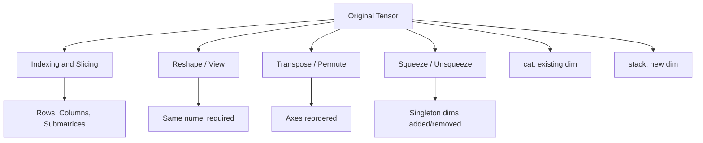

---

## 4. Study Topics: Tensor Arithmetic and Reductions (Section 4)

### 4.1 Element-wise addition and subtraction
- Operate per element on tensors with identical or broadcast-compatible shapes.
- Support scalars, vectors, matrices, and higher-dimensional tensors.

### 4.2 Element-wise multiplication and division
- Use `*` and `/` for element-wise operations (not matrix multiplication).
- Division behavior depends on dtype; be explicit for integer cases when needed.

### 4.3 Matrix multiplication
- Use `@`, `torch.matmul`, or `torch.mm` (for 2D) with compatible inner dimensions: `(m, k) @ (k, n) -> (m, n)`.

### 4.4 Dot products
- `torch.dot` for 1D vectors of equal length; equivalent to element-wise multiply then sum.

### 4.5 Matrix-vector multiplication
- `(m, n) @ (n,) -> (m,)` (or compatible batched forms via matmul semantics).
- Common in linear models: `y = Xw + b`.

### 4.6 Sum and mean
- Global reductions: `tensor.sum()`, `tensor.mean()`.
- Dimension-wise reductions: specify `dim` (and optionally `keepdim`).

### 4.7 Minimum and maximum
- `min`/`max` return values (and indices for dimension-wise forms) over all elements or along a dimension.

### 4.8 Argmax and argmin
- `argmax`/`argmin` return indices of extrema globally or along a dimension.

### 4.9 Reduction across dimensions
- Reductions collapse specified axes; understanding axis semantics is critical for correct results.
- `keepdim=True` preserves reduced axes with size 1 for broadcasting-friendly follow-up operations.

---

## 5. Study Topics: Broadcasting (Section 5)

### 5.1 Broadcasting rules
- Align shapes from the right.
- Dimensions are compatible if equal or one is 1 (missing leading dims treated as 1).
- Result size per dimension is the max of aligned sizes.
- Incompatible if aligned dims differ and neither is 1.

### 5.2 Dimension alignment
- Right-to-left comparison determines whether expansion is valid.
- Explicit reshaping/`unsqueeze` can make intent clear.

### 5.3 Singleton dimensions
- Size-1 dimensions can be expanded logically without copying data conceptually.
- Common for row/column-wise operations and batch computations.

### 5.4 Compatible and incompatible shapes
- Compatible: `(3,4)` and `(4,)`, `(3,1)`, `(1,4)`, `(2,3,4)` and `(3,1)`.
- Incompatible: `(3,4)` and `(3,)`, `(2,2)` and `(2,3)`.

### 5.5 Broadcasting in arithmetic operations
- Supports `+ - * /` and other element-wise ops when shapes are broadcast-compatible.

### 5.6 Broadcasting in batch computations
- Enables applying biases/scales/masks across batches efficiently (e.g. adding `(features,)` to `(batch, features)`).

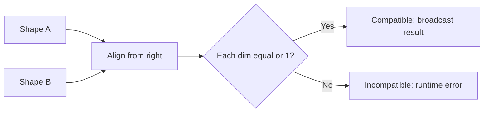

---

## 6. Study Topics: Memory, Views, Contiguity, and Devices (Section 6)

### 6.1 Tensor views versus copies
- **View:** shares underlying storage with the original tensor (when possible); modifying data through a view can affect the original.
- **Copy:** independent storage (`clone()`, `tensor.copy()` patterns, `.numpy().copy()` when needed).
- Use copies when isolation is required.

### 6.2 Contiguous and non-contiguous tensors
- Contiguity refers to memory layout matching row-major stride order for the given shape.
- Operations like `transpose`, `permute`, and some slicing patterns can produce non-contiguous tensors.
- Check with `is_contiguous()`.

### 6.3 Memory layout
- Strides define how indices map to memory.
- Layout affects which operations can use `view` directly and may impact performance.

### 6.4 In-place operations
- In-place ops modify tensor data directly (often suffixed with `_`, e.g. `add_`, `relu_`).
- They can save memory but may break autograd graph requirements, invalidate views/shared references, or cause subtle bugs.

### 6.5 CPU/GPU transfers
- Move tensors with `.to(device)`, `.cpu()`, `.cuda()` (when available).
- Transfers are synchronization/copy points and can be expensive; minimize unnecessary moves.

### 6.6 Device consistency
- Binary operations generally require tensors on the same device (and compatible dtypes/shapes).
- Cross-device operations raise runtime errors; handle with explicit moves and environment-aware checks.

### 6.7 Basic GPU memory awareness
- GPU memory (VRAM) is limited; large tensors/batches/activations can cause OOM errors.
- Monitor/query when relevant (`torch.cuda.memory_allocated`, `memory_reserved` if CUDA available).
- Prefer deleting unused references, using smaller batches, and avoiding needless copies/transfers.

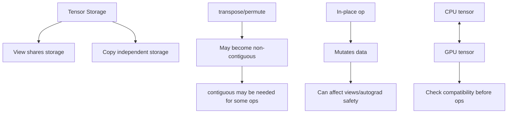

---

## 7. Study Topics: Derivatives and Autograd Fundamentals (Section 7)

### 7.1 What a derivative represents
- A derivative measures instantaneous rate of change of an output with respect to an input.
- In ML, gradients of loss with respect to parameters drive optimization.

### 7.2 Partial derivatives
- For multivariable functions, partial derivatives measure change w.r.t. one variable while holding others constant.
- Gradients collect partial derivatives across parameters.

### 7.3 Computational graphs
- A computational graph represents operations and dependencies from inputs to outputs.
- PyTorch autograd builds graphs dynamically (define-by-run) for tensors requiring gradients.

### 7.4 Forward computation
- Forward pass computes outputs/loss values from inputs and parameters.

### 7.5 Gradient tracking
- Operations on tensors with `requires_grad=True` are tracked so gradients can be computed during backward pass.

### 7.6 `requires_grad`
- Tensor attribute controlling whether autograd records operations involving that tensor.
- Can be set at creation or changed via methods like `requires_grad_()` (with care).

### 7.7 Leaf tensors
- **Leaf tensors** are graph inputs owned by the user (e.g. parameters created directly) that are not results of tracked operations.
- Typically `.grad` is populated for leaf tensors after backward (depending on settings).

### 7.8 Relationship between tensors and differentiable operations
- Differentiable operations compose into functions whose gradients autograd can compute via chain rule.
- Non-differentiable or detached paths break/stop gradient flow.

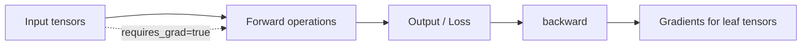

---

## 8. Study Topics: Backpropagation and Gradient Mechanics (Section 8)

### 8.1 Chain rule
- Backpropagation applies the chain rule to compute gradients of composed functions efficiently.

### 8.2 Backward propagation
- Starting from a scalar loss, `.backward()` propagates gradients through the recorded graph.

### 8.3 Gradient calculation
- Gradients are accumulated into `.grad` fields of relevant tensors (commonly leaves/parameters).

### 8.4 Gradient accumulation
- By default, repeated backward calls add gradients into existing `.grad` values.
- Must be cleared (`zero_()` or optimizer-equivalent) between independent optimization steps unless accumulation is intentional.

### 8.5 `.backward()`
- Triggers reverse-mode autodiff on a scalar tensor (or with explicit gradient argument for non-scalars).

### 8.6 `.grad`
- Stores computed gradient tensor for a tensor after backward (when retained/available).

### 8.7 `torch.no_grad()`
- Disables gradient tracking in a context; useful for inference, evaluation, and manual parameter updates.

### 8.8 `torch.detach()`
- Returns a tensor sharing data (when possible) but detached from the computation graph (no gradient history).

### 8.9 Gradient clearing
- Clear before each new optimization step to avoid unintended accumulation: `param.grad.zero_()` or set to `None` (with awareness of behavior).

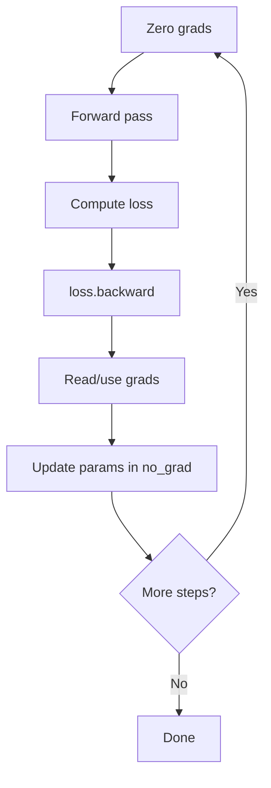

---

## 9. Study Topics: Gradient Verification and Debugging (Section 9)

### 9.1 Analytical gradients
- Closed-form derivatives derived mathematically from function definitions.

### 9.2 Numerical gradients
- Approximations computed from function evaluations (e.g. finite differences).

### 9.3 Finite difference approximation
- Common form: \( f'(x) \approx \frac{f(x+h)-f(x-h)}{2h} \) (central difference), with step size `h` affecting accuracy.

### 9.4 Gradient verification
- Compare analytical, numerical, and autograd gradients (using tolerances like `allclose`) to validate correctness.

### 9.5 Incorrect gradient tracking
- Bugs arise from missing `requires_grad`, unintended `no_grad`, detached tensors, or operations outside tracked graph.

### 9.6 Gradient accumulation bugs
- Forgetting to clear gradients causes stale/accumulated updates and incorrect optimization behavior.

### 9.7 Non-differentiable operations
- Some operations/paths are non-differentiable or discontinuous at points; gradients may be zero, undefined, or not meaningful as expected.
- Discrete argmax-like choices and hard thresholds require care (surrogates/relaxations in practice).

---

## Autograd One-Page Cheat Sheet (Section 9)

**Authoritative source for Section 9 Exercise 10 and Section 15D.2 (reuse/copy verbatim where embedded).**

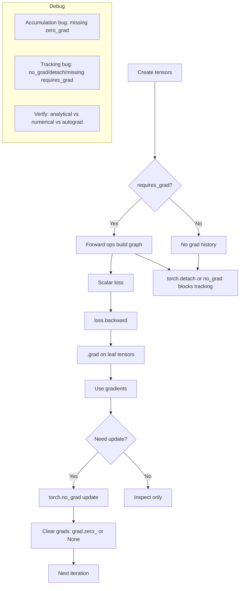

**Quick rules**
- Track: set `requires_grad=True` on tensors whose gradients you need.
- Backward: call on scalar loss (or provide gradient argument for non-scalar outputs).
- Accumulation: gradients add up by default; clear before independent steps.
- Stop tracking: `torch.no_grad()` for blocks, `detach()` for tensors, `.item()` for Python scalars.
- Leaf/non-leaf: parameter/leaf grads are usually what you optimize.
- Verify: compare autograd with finite differences/analytical derivatives within tolerance.

---

## 10. Study Topics: Linear Regression Fundamentals (Section 10)

### 10.1 Linear model
- For one feature: \( \hat{y} = wx + b \), where `w` is weight and `b` is bias.

### 10.2 Weights and bias
- Trainable parameters learned from data to minimize loss.

### 10.3 Predictions
- Model outputs computed from inputs and current parameters.

### 10.4 Mean Squared Error (MSE)
- \( \mathrm{MSE} = \frac{1}{N}\sum_i (\hat{y}_i - y_i)^2 \), penalizes squared residuals.

### 10.5 Loss functions
- Quantify prediction error; differentiable losses enable gradient-based optimization.

### 10.6 Gradient descent
- Iterative parameter update: \( \theta \leftarrow \theta - \eta \nabla_\theta L \).

### 10.7 Learning rates
- Step size `η`; too small => slow convergence, too large => instability/divergence.

### 10.8 Epochs
- One full pass over training data (or defined iteration cycle in batch contexts).

### 10.9 Model convergence
- Loss/parameters stabilize near an optimum; depends on data, model, LR, initialization, and noise.

---

## 11. Study Topics: Training Loop and Validation (Section 11)

### 11.1 Complete training iteration
- Forward -> loss -> backward -> update -> clear gradients.

### 11.2 Forward pass
- Compute predictions from inputs and parameters.

### 11.3 Loss computation
- Compare predictions to targets with chosen loss function.

### 11.4 Backward pass
- Compute gradients via autograd (`loss.backward()`).

### 11.5 Gradient update
- Apply gradient descent step (in `torch.no_grad()` for manual updates).

### 11.6 Gradient clearing
- Reset `.grad` before next backward to prevent unintended accumulation.

### 11.7 Training loop
- Repeat iterations/epochs, track metrics, and optionally checkpoint/log.

### 11.8 Validation evaluation
- Evaluate on held-out data without gradient-tracked parameter updates to estimate generalization.

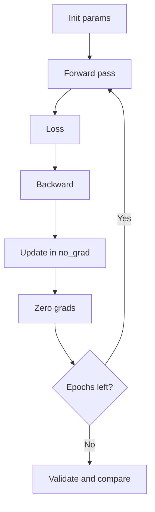

---

## 12. Study Topics: Optimization Behavior and Experiments (Section 12)

### 12.1 Learning-rate selection
- Critical hyperparameter balancing speed and stability.

### 12.2 Convergence
- Parameters/loss approach a stable solution.

### 12.3 Divergence
- Loss grows/oscillates uncontrollably (often due to excessive LR or numerical issues).

### 12.4 Slow convergence
- Very small LR or poor conditioning leads to many iterations with minimal progress.

### 12.5 Loss curves
- Visualize training/validation loss over epochs to diagnose learning dynamics.

### 12.6 Initialization sensitivity
- Starting parameter values can affect optimization trajectory and speed.

### 12.7 Gradient magnitude
- Very small/large gradients impact update effectiveness (vanishing/exploding-like behavior in broader contexts).

---

## 13. Study Topics: Logistic Regression and Binary Classification (Section 13)

### 13.1 Binary classification
- Predict one of two classes (0/1) from input features.

### 13.2 Linear decision function
- Compute logit \( z = xW^T + b \) as a linear score.

### 13.3 Logits
- Unbounded real-valued scores before sigmoid/probability mapping.

### 13.4 Sigmoid function
- \( \sigma(z)=\frac{1}{1+e^{-z}} \) maps logits to probabilities in (0,1).

### 13.5 Probability estimation
- Interpreted as estimated \( P(y=1 \mid x) \) (model-dependent calibration).

### 13.6 Binary cross-entropy (BCE)
- Measures loss between true labels and predicted probabilities.

### 13.7 Binary cross-entropy with logits
- Numerically stable formulation combining sigmoid and BCE; preferred over naive sigmoid+log in unstable ranges.

### 13.8 Classification threshold
- Convert probability to class label (default 0.5); threshold choice trades off precision/recall.

---

## 14. Study Topics: Classification Metrics and Evaluation (Section 14)

### 14.1 Classification threshold
- Decision cutoff on predicted probability affects predicted positives/negatives.

### 14.2 Accuracy
- Fraction of correct predictions; can be misleading on imbalanced data.

### 14.3 Precision
- \( \frac{TP}{TP+FP} \): correctness among predicted positives.

### 14.4 Recall
- \( \frac{TP}{TP+FN} \): coverage of actual positives.

### 14.5 F1 score
- Harmonic mean of precision and recall: \( 2 \cdot \frac{PR}{P+R} \).

### 14.6 Confusion matrix
- Table of TP, FP, TN, FN summarizing classification outcomes.

### 14.7 Decision boundary
- Surface/line where model score equals threshold; separates predicted classes in feature space.

### 14.8 Train versus validation performance
- Compare metrics/loss to detect underfitting/overfitting and generalization behavior.

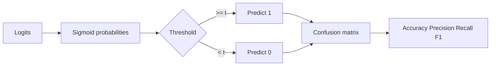

---

## 15. Assessment and Review (Section 15)

### 15.1 Independent implementation (Exercise A)
- Implement linear regression from scratch in a **fresh notebook**: generate data, initialize parameters, calculate predictions, calculate loss, backpropagate, update parameters, evaluate final model.
- Artifact: `notebooks/07_linear_regression_fresh_assessment.ipynb`.

### 15.2 Debugging challenge (Exercise B)
- Diagnose and demonstrate fixes for: forgetting to clear gradients, inappropriate learning rate, incompatible tensor shapes, tensors on different devices, accidentally disabled gradient tracking.
- Artifact: `notebooks/08_week1_assessment.ipynb` (safe, caught/diagnosed demos).

### 15.3 Repository review (Exercise C)
- Verify notebooks execute, experiments reproducible, no unexplained hardcoded assumptions, loss curves saved, results documented, README explains reproduction.
- Artifact locations: authoritative checklist below and applied evidence in `notebooks/08_week1_assessment.ipynb` (captured post-verification).

### 15.4 Cheat sheets (Exercise D)
- Three one-page cheat sheets: Tensor operations and broadcasting; Autograd and backpropagation; Gradient descent and optimization.
- Artifact locations: `## Week 1 Cheat Sheets (Section 15D)` in this notes file and referenced/embedded in `notebooks/08_week1_assessment.ipynb`.

---

## Repository Review Checklist (Section 15C)

Use this checklist as the authoritative review list (apply with evidence in assessment notebook after final verification):

- [ ] All notebooks execute successfully (valid nbformat v4 JSON, nbconvert execution passes per recorded evidence).
- [ ] All experiments are reproducible (seeds set where applicable, configs recorded, deterministic artifact paths).
- [ ] No unexplained hardcoded assumptions exist (constants/shapes/hyperparameters documented or justified in context).
- [ ] Loss curves are saved to deterministic paths in the week folder and/or clearly displayed with saved artifact references.
- [ ] Results are documented (key metrics, comparisons, observations/explanations present).
- [ ] README explains how to reproduce the experiments (actual commands/steps matching delivered content).

---

## Week 1 Cheat Sheets (Section 15D)

### 1. Tensor Operations and Broadcasting

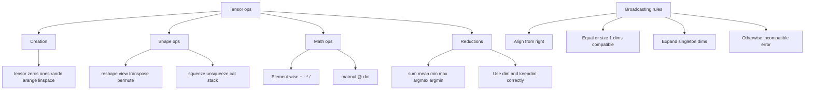

**Essentials:** track `shape/ndim/dtype/device`; reshape requires same `numel`; `cat` uses existing dim, `stack` adds new dim; reductions collapse axes (`dim` matters).

### 2. Autograd and Backpropagation

(Authoritative content: identical to [Autograd One-Page Cheat Sheet (Section 9)](#autograd-one-page-cheat-sheet-section-9))

**Quick rules:** `requires_grad` enables tracking; backward from scalar loss; grads accumulate by default; update in `no_grad`; clear grads each step; verify with finite differences/analytical checks.

### 3. Gradient Descent and Optimization

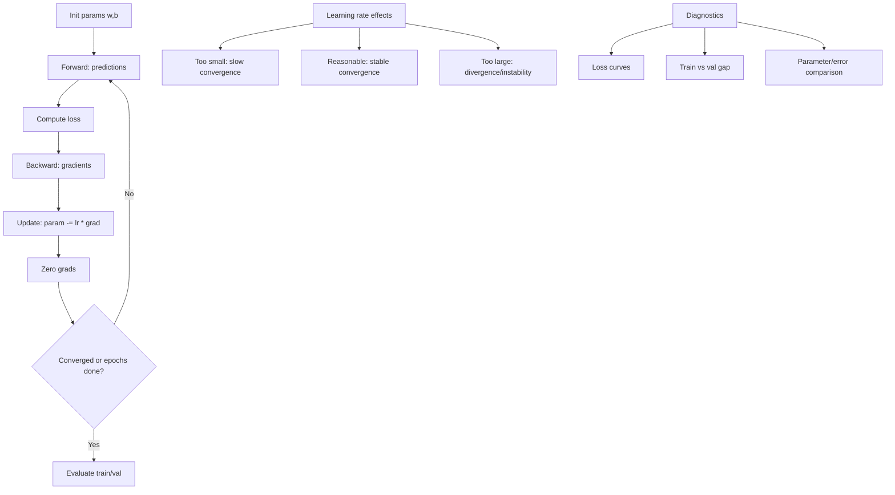

**Essentials:** choose LR carefully; monitor train/val loss; reset grads each step; use reproducible seeds/configs; compare learned vs known parameters when ground truth exists.

---
